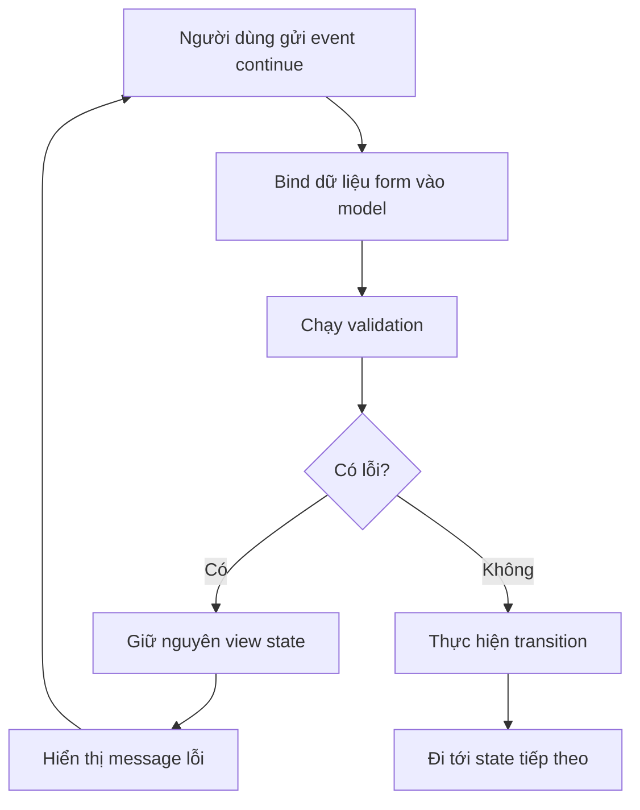

# Chặn chuyển bước khi model chưa hợp lệ

Trong chương **Kiểm tra dữ liệu**, validation của view state bảo đảm flow chỉ chuyển sang bước tiếp theo khi model đáp ứng các quy tắc cần thiết. Khi người dùng gửi event như `continue` hoặc `submit`, Spring Web Flow có thể bind dữ liệu form vào model, chạy validation rồi mới thực hiện transition. Nếu validation phát hiện lỗi, flow ở lại view state hiện tại và đưa thông báo lỗi về view để người dùng sửa.

Module `SPRING_WEB_FLOW` dùng state, event, transition và subflow để mô hình hóa hành trình web nhiều bước; đồng thời thực hành form binding, validation, quản lý scope và phiên, tích hợp Spring MVC, kiểm thử và phục hồi luồng. Chặn chuyển bước ở đúng ranh giới giúp dữ liệu chưa hoàn chỉnh không đi vào bước review hoặc xác nhận. Tuy nhiên, validation của view state chỉ là một lớp bảo vệ trải nghiệm và luồng giao diện; các quy tắc nghiệp vụ quan trọng vẫn phải được kiểm tra ở service/domain layer trước khi ghi dữ liệu.

## 1. Validation nằm giữa binding và transition

Một view state thường gắn với một model, chẳng hạn `booking` cho form đặt chỗ. Khi người dùng gửi event của một transition, quá trình xử lý khái quát diễn ra như sau:

1. Flow nhận event được gửi từ view.
2. Nếu binding được bật, dữ liệu request được bind vào model theo cấu hình binder.
3. Nếu validation được bật, Spring Web Flow kiểm tra model bằng cơ chế validator đã cấu hình hoặc validation method tương ứng.
4. Nếu có lỗi, flow không thực hiện transition; view state hiện tại được hiển thị lại cùng các thông báo lỗi.
5. Nếu không có lỗi, transition được thực hiện và flow đi tới state đích.



Đây là lý do validation phải được thực hiện trước transition. Nếu chỉ kiểm tra sau khi đã chuyển sang state review, flow có thể phải quay lui và xử lý lại dữ liệu đã được coi là hợp lệ ở bước trước.

## 2. Bật validation trên transition

Thuộc tính `validate` của transition từ view state điều khiển việc validation có được thực hiện trước khi chuyển state hay không. Với transition cần dữ liệu hợp lệ, có thể khai báo `validate="true"` tường minh:

```xml
<var name="booking" class="com.example.web.BookingForm" />

<view-state id="enterDetails"
            view="booking/details"
            model="booking">
    <transition on="continue"
                to="review"
                bind="true"
                validate="true" />
</view-state>

<view-state id="review" view="booking/review">
    <transition on="confirm" to="completed" />
    <transition on="back" to="enterDetails" />
</view-state>
```

Khi người dùng gửi event `continue`, flow bind form vào `booking`, chạy validation và chỉ tới `review` khi không có lỗi. Nếu validation thất bại, transition không được thực hiện và view `booking/details` được render lại để người dùng sửa dữ liệu.

Đối với transition từ view state, validation thường được bật theo mặc định. Việc ghi `validate="true"` làm ý định rõ ràng trong flow definition và giúp người đọc nhận ra đây là ranh giới cần kiểm tra dữ liệu. Hãy xác nhận default và cấu hình cụ thể với phiên bản Spring Web Flow mà ứng dụng sử dụng.

## 3. Viết validation method theo state

Một cách tích hợp validation của Spring Web Flow là đặt phương thức validation theo quy ước trên model object. Tên phương thức gồm `validate` và tên state với chữ cái đầu viết hoa. Ví dụ state có ID `enterDetails` thì phương thức là `validateEnterDetails`, nhận tham số `ValidationContext`.

```java
import org.springframework.binding.message.MessageBuilder;
import org.springframework.binding.message.MessageContext;
import org.springframework.binding.validation.ValidationContext;

public class BookingForm {

    private String guestName;
    private LocalDate checkIn;
    private int guestCount;

    public void validateEnterDetails(ValidationContext context) {
        MessageContext messages = context.getMessageContext();

        if (guestName == null || guestName.trim().isEmpty()) {
            messages.addMessage(new MessageBuilder()
                    .error()
                    .source("guestName")
                    .defaultText("Vui lòng nhập tên người đặt.")
                    .build());
        }

        if (checkIn == null || !checkIn.isAfter(LocalDate.now())) {
            messages.addMessage(new MessageBuilder()
                    .error()
                    .source("checkIn")
                    .defaultText("Ngày nhận phòng phải ở tương lai.")
                    .build());
        }

        if (guestCount < 1 || guestCount > 8) {
            messages.addMessage(new MessageBuilder()
                    .error()
                    .source("guestCount")
                    .defaultText("Số khách phải từ 1 đến 8.")
                    .build());
        }
    }

    // getters and setters
}
```

Validation method thêm lỗi vào `MessageContext`. `source` nên trùng với tên thuộc tính của form để view có thể gắn lỗi vào đúng trường. Khi message context có lỗi, Spring Web Flow coi validation không thành công và giữ flow ở view state hiện tại.

Tên method phải khớp chính xác với state ID theo quy ước. Nếu đổi `enterDetails` thành `editBookingDetails`, hãy cập nhật method tương ứng. Với dự án có nhiều state dùng chung một model, mỗi state có thể cần quy tắc kiểm tra riêng; không nên gom mọi điều kiện vào một phương thức tổng quát nếu mỗi bước có yêu cầu khác nhau.

Ví dụ trên minh họa validation ở mức form. Trong ứng dụng thực tế, cần xử lý múi giờ và ngày nghiệp vụ theo quy định của hệ thống, không mặc định đồng hồ máy chủ luôn là nguồn thời gian nghiệp vụ duy nhất.

## 4. Dùng Spring Validator hoặc Bean Validation

Validation method phù hợp với quy tắc gắn với một state cụ thể. Ứng dụng cũng có thể dùng các validator của Spring hoặc Bean Validation (Jakarta Validation/Jakarta Bean Validation tùy phiên bản thư viện).

Một Spring `Validator` thường kiểm tra object và thêm lỗi vào `Errors`:

```java
public class BookingFormValidator implements Validator {

    @Override
    public boolean supports(Class<?> type) {
        return BookingForm.class.isAssignableFrom(type);
    }

    @Override
    public void validate(Object target, Errors errors) {
        BookingForm form = (BookingForm) target;

        if (form.getGuestName() == null
                || form.getGuestName().trim().isEmpty()) {
            errors.rejectValue("guestName", "booking.guestName.required");
        }

        if (form.getGuestCount() < 1) {
            errors.rejectValue("guestCount", "booking.guestCount.minimum");
        }
    }
}
```

Validator cần được đăng ký trong cấu hình validation mà Spring Web Flow sử dụng, thường thông qua cấu hình flow builder services. Cách đăng ký cụ thể phụ thuộc cách ứng dụng cấu hình Java/XML và phiên bản Spring Web Flow. Nếu dùng Bean Validation, cần có provider tương ứng và validator được tích hợp vào cấu hình của ứng dụng; chỉ thêm annotation vào class không đảm bảo chúng tự chạy nếu provider chưa được cấu hình.

Ví dụ DTO dùng annotation:

```java
public class BookingForm {

    @NotBlank(message = "Vui lòng nhập tên người đặt.")
    private String guestName;

    @NotNull(message = "Vui lòng chọn ngày nhận phòng.")
    @Future(message = "Ngày nhận phòng phải ở tương lai.")
    private LocalDate checkIn;

    @Min(value = 1, message = "Cần ít nhất một khách.")
    @Max(value = 8, message = "Không thể đặt cho hơn tám khách.")
    private int guestCount;

    // getters and setters
}
```

Các annotation này diễn tả ràng buộc trên dữ liệu. Nếu có quy tắc phụ thuộc nhiều trường, chẳng hạn ngày trả phòng phải sau ngày nhận phòng, có thể dùng class-level constraint hoặc validator tùy chỉnh. Chọn một cơ chế nhất quán và bảo đảm cấu hình Spring Web Flow thực sự gọi validator đó.

## 5. Lỗi validation và message context

`MessageContext` là nơi lưu thông báo gắn với lần xử lý flow hiện tại. Validation method hoặc validator có thể thêm lỗi theo field hoặc lỗi chung. View sau đó đọc message context để hiển thị lỗi.

Ví dụ một lỗi gắn với trường:

```java
messages.addMessage(new MessageBuilder()
        .error()
        .source("checkIn")
        .defaultText("Ngày nhận phòng không hợp lệ.")
        .build());
```

Lỗi có `source` là `checkIn` có thể được hiển thị cạnh trường ngày nhận phòng. Một lỗi chung không gắn trường cụ thể có thể được thêm bằng message builder mà không đặt `source`, phù hợp với lỗi liên quan tới nhiều trường hoặc toàn bộ form.

Với view JSP/Spring MVC, ứng dụng có thể dùng các tag hiển thị lỗi và message theo cấu hình view. Với Thymeleaf hoặc view technology khác, cần ánh xạ message context và model vào view theo tích hợp tương ứng. Nội dung lỗi nên hướng dẫn người dùng sửa dữ liệu, tránh tiết lộ chi tiết nội bộ như câu SQL, stack trace hoặc tên class.

Nên dùng message code và message source để hỗ trợ đa ngôn ngữ. Ví dụ `booking.checkIn.future` có thể ánh xạ sang thông báo tiếng Việt hoặc ngôn ngữ khác. Không đưa dữ liệu người dùng nhạy cảm vào thông báo hoặc log lỗi.

## 6. Phân biệt binding error, validation error và lỗi nghiệp vụ

Các loại lỗi này xuất hiện ở những giai đoạn khác nhau và cần được xử lý đúng chỗ.

| Loại lỗi | Ví dụ | Cách xử lý |
|---|---|---|
| Binding/conversion error | Chuỗi `abc` không thể chuyển thành `LocalDate` | Hiển thị lỗi nhập liệu; không chuyển bước |
| Validation error | Ngày hợp lệ về kiểu nhưng nằm trong quá khứ | Thêm field/global message; giữ view state |
| Business rule error | Phòng vừa hết chỗ hoặc booking đã bị hủy | Kiểm tra trong service/domain; trả kết quả nghiệp vụ và chọn nhánh phù hợp |
| Authorization error | Người dùng không sở hữu booking đang sửa | Từ chối thao tác ở ranh giới bảo mật/service; không dựa vào view validation |
| Infrastructure error | Database hoặc dịch vụ ngoài không phản hồi | Xử lý timeout/exception và chính sách retry, phục hồi |

Binding error có thể xảy ra trước khi validator nhận được model đúng kiểu. Vì vậy, không nên giả định validation method sẽ luôn nhận dữ liệu đã chuyển đổi hoàn chỉnh. Kiểm tra null và trạng thái thiếu dữ liệu trong validation method, đồng thời cấu hình converter/formatter phù hợp.

Validation ở view state không thay thế việc kiểm tra lại ở service. Dữ liệu có thể thay đổi giữa lúc người dùng mở form và lúc họ gửi form. Ví dụ, phòng còn trống khi trang được hiển thị nhưng đã được đặt bởi người khác trước khi người dùng bấm xác nhận. Service phải kiểm tra tồn chỗ trong transaction tại thời điểm ghi.

## 7. Chọn transition nào cần validation?

Không phải mọi event trên cùng một view đều cần validation. Event `continue` hoặc `confirm` thường cần dữ liệu hợp lệ. Event `cancel` có thể không cần dữ liệu form; event `back` có thể cần giữ dữ liệu nhưng cho phép form chưa hoàn chỉnh.

```xml
<view-state id="enterDetails"
            view="booking/details"
            model="booking">

    <transition on="continue"
                to="review"
                bind="true"
                validate="true" />

    <transition on="back"
                to="chooseOptions"
                bind="true"
                validate="false" />

    <transition on="cancel"
                to="cancelled"
                bind="false"
                validate="false" />
</view-state>
```

Trong ví dụ:

- `continue` bind và validate để chỉ đi tới review khi form hợp lệ.
- `back` vẫn bind để giữ dữ liệu đã nhập nhưng bỏ qua validation, cho phép quay lại khi form chưa hoàn chỉnh.
- `cancel` bỏ binding và validation vì thao tác hủy không phụ thuộc dữ liệu form hiện tại.

`validate="false"` chỉ bỏ validation tự động ở transition đó. Nó không bỏ qua kiểm tra quyền hoặc quy tắc nghiệp vụ trong action/service tiếp theo. Nếu transition gọi một service có tác dụng phụ, service vẫn phải xác thực trạng thái và quyền của tài nguyên.

## 8. Kiểm tra nhiều bước trong cùng một hành trình

Với form nhiều bước, mỗi view state nên kiểm tra dữ liệu cần thiết để bước tiếp theo có thể thực hiện đúng. Không nhất thiết kiểm tra toàn bộ hồ sơ ngay ở bước đầu nếu một số trường chỉ xuất hiện ở bước sau.

Ví dụ hành trình:

1. `enterCustomer`: kiểm tra tên và thông tin liên hệ.
2. `choosePlan`: kiểm tra gói dịch vụ và điều kiện áp dụng.
3. `reviewApplication`: xác nhận toàn bộ dữ liệu và kiểm tra lại các quy tắc liên quan.
4. `submitApplication`: service kiểm tra quyền, tính hợp lệ tại thời điểm ghi và lưu hồ sơ trong transaction.

Validation theo state có thể dùng các phương thức `validateEnterCustomer`, `validateChoosePlan` hoặc validator riêng cho từng model. Hãy để mỗi bước kiểm tra đúng tập dữ liệu mà nó sở hữu. Trước thao tác cuối cùng, service/domain vẫn phải xác minh toàn bộ invariant nghiệp vụ vì dữ liệu có thể thay đổi hoặc có đường gọi khác không đi qua flow.

Đối với quy tắc liên trường, có thể kiểm tra ở bước review khi tất cả giá trị đã có. Ví dụ, ngày bắt đầu phải trước ngày kết thúc hoặc gói dịch vụ phải tương thích với khu vực khách hàng. Nếu phát hiện lỗi, gắn message vào trường hoặc thông báo chung và giữ người dùng ở bước phù hợp để sửa.

## 9. Khi nào validation thất bại và flow không chuyển bước?

Flow giữ nguyên view state khi validator ghi nhận lỗi validation. Người dùng được render lại cùng view và có thể gửi lại event sau khi sửa. Cần bảo đảm view vẫn có đủ dữ liệu để hiển thị form và lỗi, đồng thời không xóa dữ liệu hợp lệ đã nhập.

Một số điểm cần lưu ý:

- Event gửi lên phải khớp với transition được khai báo trong view state.
- Validation phải được bật trên transition cần kiểm tra.
- Model được chỉ định đúng trong `model` của view state.
- Binding và converter phải ánh xạ đúng tên field và kiểu dữ liệu.
- Validator phải được đăng ký hoặc validation method phải đúng quy ước tên state.
- Message source của lỗi phải khớp tên thuộc tính nếu muốn hiển thị lỗi cạnh field.
- Không thực hiện side effect không thể đảo ngược trước khi validation hoàn tất.

Nếu validation method không được gọi, hãy kiểm tra state ID và tên method, model được gắn với view state, cấu hình validator, event/transition thực tế và phiên bản thư viện. Không khắc phục bằng cách chuyển validation xuống sau transition, vì như vậy sẽ mất ranh giới chặn chuyển bước.

## 10. Kiểm thử việc chặn transition

Một test tốt cần xác minh cả kết quả hiển thị và việc transition có thực sự bị chặn. Chỉ kiểm tra message đã được thêm vào context chưa là chưa đủ nếu flow vẫn có thể đi tới state đích do cấu hình sai.

| Kịch bản | Điều cần xác minh |
|---|---|
| Gửi dữ liệu hợp lệ | Validator chạy, không có lỗi và flow tới state đích |
| Gửi dữ liệu thiếu hoặc sai | Flow ở lại view state; lỗi được đưa vào message context |
| Lỗi gắn với một field | View hiển thị lỗi đúng trường |
| Lỗi liên trường | Thông báo chung hoặc lỗi ở trường phù hợp được hiển thị |
| Binding/conversion thất bại | Không chuyển bước; lỗi nhập liệu được hiển thị |
| Transition `validate=false` | Validator tự động không chặn event đó; các kiểm tra nghiệp vụ riêng vẫn hoạt động |
| Event Cancel hoặc Back | Hành vi bind/validate đúng như thiết kế |
| Dữ liệu thay đổi trước khi ghi | Service kiểm tra lại và xử lý xung đột trong nghiệp vụ |
| Validator ném exception | Exception được xử lý theo chính sách; không giả thành validation thành công |

Spring Web Flow cung cấp test support để khởi chạy flow, gửi event và kiểm tra state hiện tại. API cụ thể phụ thuộc phiên bản. Có thể dùng unit test cho validation method/validator và integration test cho flow definition để xác nhận transition bị chặn khi có lỗi.

Ví dụ các khẳng định cần có trong test (mã giả):

```java
// Dữ liệu không hợp lệ: vẫn ở enterDetails.
assertThat(flow.currentState()).isEqualTo("enterDetails");
assertThat(flow.messageContext().hasErrorMessages()).isTrue();

// Dữ liệu hợp lệ: transition được thực hiện.
assertThat(validFlow.currentState()).isEqualTo("review");
assertThat(validFlow.messageContext().hasErrorMessages()).isFalse();
```

Đây là mã giả mô tả điều cần xác minh; cách tạo execution, gửi event và truy cập message context phải dùng test API của phiên bản dự án. Nên kiểm thử cả validation method và flow XML để phát hiện trường hợp validator hoạt động độc lập nhưng không được gọi trong cấu hình flow thực tế.

## 11. Lỗi thiết kế thường gặp

### Chỉ validate ở trình duyệt

HTML required hoặc JavaScript có thể cải thiện trải nghiệm, nhưng client có thể bỏ qua hoặc gửi request trực tiếp. Validation phía máy chủ vẫn bắt buộc.

### Tắt validation cho transition cần dữ liệu hợp lệ

Nếu `continue` hoặc `confirm` đặt `validate="false"`, flow có thể đi tiếp với model không đáp ứng điều kiện của bước. Chỉ tắt validation cho event thực sự không cần dữ liệu form và đã có kiểm tra thích hợp ở nơi khác.

### Dùng validation để kiểm tra quyền

Validation phản hồi dữ liệu không hợp lệ; authorization quyết định người dùng có quyền thực hiện thao tác hay không. Kiểm tra quyền phải được thực hiện ở security/service boundary, kể cả khi form đã qua validation.

### Đặt side effect trước validation

Không tạo đơn, trừ tiền hoặc gửi thông báo không thể thu hồi trong lúc model vẫn có thể bị validation từ chối. Thực hiện side effect sau khi kiểm tra thành công và trong ranh giới transaction/idempotency phù hợp.

### Không xử lý lỗi binding

Validator có thể không nhận được giá trị đã chuyển đổi như mong đợi. Cần cấu hình converter và thông báo binding error, đồng thời xử lý null/giá trị thiếu an toàn.

### Gộp mọi quy tắc vào một validator lớn

Validator quá lớn khó hiểu và có thể kiểm tra cả những trường chưa được nhập ở bước hiện tại. Chia validation theo state và đặt invariant cuối cùng ở domain/service layer.

## 12. Checklist trước khi cho phép chuyển bước

Trước khi hoàn thiện một view state, hãy xác nhận:

1. Model được gắn đúng với view state và chỉ chứa dữ liệu cần thiết cho form.
2. Transition nào cần bind và validation đã được khai báo rõ.
3. Validation method có tên khớp state ID hoặc validator đã được đăng ký đúng cấu hình.
4. Binding error, validation error và lỗi nghiệp vụ được phân biệt.
5. Message có source đúng field và nội dung đủ hướng dẫn người dùng sửa.
6. Event Back/Cancel có chính sách bind/validate phù hợp với hành vi mong đợi.
7. Service/domain kiểm tra lại quyền và invariant tại thời điểm ghi.
8. Không có side effect quan trọng chạy trước khi validation hoàn tất.
9. Test xác minh cả trường hợp bị chặn và trường hợp chuyển bước thành công.

## Kết luận

Validation trên transition của view state là ranh giới giúp Spring Web Flow chặn chuyển bước khi model chưa hợp lệ. Dữ liệu form được bind, validator được gọi và nếu có lỗi thì flow ở lại view hiện tại để hiển thị message; chỉ khi validation thành công transition mới được thực hiện.

Hãy chọn validation method theo state, Spring Validator hoặc Bean Validation theo cấu hình ứng dụng; gắn lỗi vào message context và kiểm thử state sau mỗi event. Validation của form giúp hành trình nhiều bước có trải nghiệm rõ ràng, còn service/domain layer vẫn phải kiểm tra quyền và quy tắc nghiệp vụ trước khi lưu để bảo đảm dữ liệu đúng trong mọi đường gọi.
