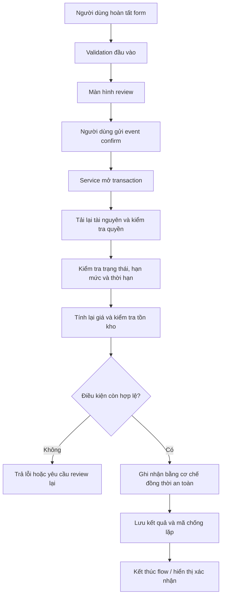

# Kiểm tra lại quy tắc nghiệp vụ tại thời điểm xác nhận cuối

Trong chương **Kiểm tra dữ liệu**, bài này giải thích vì sao ứng dụng phải kiểm tra lại các quy tắc nghiệp vụ ngay khi người dùng xác nhận bước cuối của một hành trình Spring Web Flow. Ở các bước trước, flow có thể đã kiểm tra định dạng, trường bắt buộc, lựa chọn và điều kiện ban đầu. Nhưng trong lúc người dùng đọc lại thông tin hoặc chờ xác nhận, dữ liệu trong hệ thống vẫn có thể thay đổi.

Với module **SPRING_WEB_FLOW**, các state, event, transition và subflow mô hình hóa hành trình nhiều bước; form binding và validation giúp thu thập dữ liệu. Bước xác nhận cuối cần bảo đảm dữ liệu vẫn hợp lệ, người dùng vẫn có quyền, tài nguyên vẫn còn và thao tác chỉ được ghi nhận một lần. Đây là ranh giới giữa dữ liệu người dùng đã nhập và một thay đổi nghiệp vụ được hệ thống chấp nhận.

## 1. Vì sao kiểm tra ở bước trước chưa đủ?

Giả sử người dùng đặt một chỗ cho chuyến đi. Ở bước chọn chỗ, hệ thống hiển thị còn 3 chỗ và giá là 1.200.000 đồng. Người dùng chuyển sang màn hình xem lại rồi để tab mở trong vài phút. Trong thời gian đó, người khác có thể đặt chỗ cuối cùng, giá có thể thay đổi, chương trình ưu đãi có thể hết hạn hoặc quyền của người dùng có thể bị thu hồi.

Kết quả validation trước đó chỉ phản ánh dữ liệu tại thời điểm kiểm tra. Nó không bảo đảm rằng điều kiện vẫn đúng ở thời điểm xác nhận. Nếu ứng dụng chỉ tin giá trị đã lưu trong form hoặc `flowScope`, có thể tạo đặt chỗ vượt tồn kho, tính sai giá hoặc chấp nhận một hành động không còn hợp lệ.

Đây là vấn đề **time-of-check to time-of-use (TOCTOU)**: điều kiện được kiểm tra ở một thời điểm, nhưng tài nguyên được sử dụng ở thời điểm khác. Khoảng thời gian giữa hai thời điểm càng dài, khả năng dữ liệu thay đổi càng lớn.

## 2. Phân biệt validation của biểu mẫu và kiểm tra nghiệp vụ cuối

Validation biểu mẫu thường kiểm tra dữ liệu người dùng nhập có đúng định dạng và đầy đủ hay không. Kiểm tra nghiệp vụ cuối xác minh dữ liệu đó có còn được phép thực hiện trong trạng thái hệ thống hiện tại hay không.

| Loại kiểm tra | Câu hỏi cần trả lời | Ví dụ |
|---|---|---|
| Kiểu và định dạng | Giá trị có thể chuyển đổi và đúng định dạng không? | Ngày hợp lệ, số lượng là số nguyên. |
| Validation biểu mẫu | Các trường bắt buộc và giới hạn có được đáp ứng không? | Tên người nhận không rỗng, ghi chú không vượt độ dài. |
| Quy tắc nghiệp vụ | Dữ liệu có thỏa điều kiện của nghiệp vụ không? | Số lượng không vượt hạn mức, ngày khởi hành còn mở bán. |
| Kiểm tra quyền | Người dùng hiện tại có thể xác nhận tài nguyên này không? | Người dùng được phép đặt hoặc sửa hồ sơ này. |
| Kiểm tra đồng thời | Điều kiện có còn đúng khi ghi nhận không? | Tồn kho vẫn đủ khi transaction cập nhật. |
| Idempotency | Request lặp có tạo tác động thứ hai không? | Double-click không tạo hai đơn. |

Các lớp kiểm tra bổ sung cho nhau. `@NotNull`, `@Size` hoặc validator của flow không thể chứng minh tồn kho còn đủ. Kiểm tra quyền khi mở flow không thay thế việc kiểm tra quyền khi xác nhận. Một kết quả truy vấn “còn chỗ” cũng không bảo đảm hai request đồng thời đều có thể giữ cùng chỗ.

## 3. Dùng màn hình review làm điểm xác nhận ý định

Trong một flow nhiều bước, màn hình review cho người dùng xem lại dữ liệu và gửi event cuối, chẳng hạn `confirm`. Event này thể hiện ý định thực hiện nghiệp vụ. Khi nhận event, flow gọi service xác nhận; service tải lại dữ liệu có thẩm quyền và thực hiện các kiểm tra trong transaction.



Không thực hiện thao tác ghi dữ liệu chỉ vì người dùng mở hoặc render màn hình review. Việc tải lại bản tóm tắt có thể diễn ra nhiều lần; thao tác tạo đơn, giữ chỗ, trừ tiền hoặc phát hành vé phải gắn với event xác nhận rõ ràng.

## 4. Đặt lần kiểm tra cuối ở service nghiệp vụ

Flow nên điều phối state và event. Quy tắc cuối cùng cần nằm trong service/domain layer để mọi đường gọi đều được bảo vệ, kể cả khi request được gửi trực tiếp hoặc service được gọi từ một flow khác.

Ví dụ flow XML dưới đây gọi service khi người dùng gửi event `confirm`:

```xml
<flow xmlns="http://www.springframework.org/schema/webflow">
    <input name="bookingId" type="java.util.UUID" required="true"/>

    <on-start>
        <evaluate expression="confirmationKeyFactory.create()"
                  result="flowScope.confirmationKey"/>
    </on-start>

<view-state id="review" view="booking/review">
    <transition on="back" to="editBooking"/>
    <transition on="confirm" to="confirmBooking"/>
</view-state>

<action-state id="confirmBooking">
    <evaluate expression="bookingConfirmationService.confirm(flowScope.bookingId, currentActor.userId, flowScope.acceptedQuoteVersion, flowScope.confirmationKey)"
              result="flowScope.confirmation"/>
    <transition on="success" to="confirmationDecision"/>
</action-state>

<decision-state id="confirmationDecision">
    <if test="flowScope.confirmation.reconfirmationRequired"
        then="reviewChanged" else="completed"/>
</decision-state>

<view-state id="reviewChanged" view="booking/review-changed">
    <on-entry>
        <evaluate expression="confirmationKeyFactory.create()"
                  result="flowScope.confirmationKey"/>
    </on-entry>
    <transition on="confirm" to="confirmBooking"/>
</view-state>

<end-state id="completed" view="booking/confirmation"/>
<end-state id="bookingExpired" view="booking/expired"/>
<end-state id="bookingUnavailable" view="booking/unavailable"/>
<end-state id="accessDenied" view="booking/access-denied"/>

<global-transitions>
    <transition on-exception="com.example.booking.BookingExpiredException"
                to="bookingExpired"/>
    <transition on-exception="com.example.booking.BookingUnavailableException"
                to="bookingUnavailable"/>
    <transition on-exception="org.springframework.security.access.AccessDeniedException"
                to="accessDenied"/>
</global-transitions>
</flow>
```

Đoạn XML minh họa flow nhận `bookingId`, tạo `confirmationKey` phía server và gọi service từ event `confirm`. `currentActor.userId` phải đến từ principal đã xác thực, không phải input của trình duyệt. `acceptedQuoteVersion` là phiên bản báo giá mà người dùng đang chấp nhận; service phải tra cứu và xác minh phiên bản đó ở server, không tin một giá trị tiền do trình duyệt gửi lên. Không dựa vào tổng tiền, chủ sở hữu hoặc trạng thái được gửi từ trình duyệt. Nếu người dùng phải chấp nhận báo giá mới, hiển thị báo giá và phiên bản mới, chờ event confirm rõ ràng rồi tạo confirmation key mới cho lần xác nhận điều kiện mới.

Với nghiệp vụ cần phản hồi “giá thay đổi, vui lòng xem lại”, có thể để service trả về một kết quả có phân loại, sau đó flow chuyển sang màn hình review mới. Với lỗi không thể tiếp tục như hết hạn hoặc hết chỗ, ánh xạ ngoại lệ nghiệp vụ sang state giải thích phù hợp. Không nuốt ngoại lệ rồi chuyển sang end-state thành công.

## 5. Những quy tắc cần kiểm tra lại

Các kiểm tra cụ thể tùy nghiệp vụ, nhưng thường bao gồm:

| Nhóm | Kiểm tra tại thời điểm xác nhận |
|---|---|
| Danh tính và quyền | Actor hiện tại vẫn đăng nhập và có quyền thực hiện hành động trên đúng tài nguyên. |
| Trạng thái bản ghi | Đơn vẫn ở trạng thái cho phép xác nhận; chưa bị hủy, đóng hoặc xác nhận bởi một yêu cầu khác. |
| Thời hạn | Phiên đặt chỗ, báo giá, mã ưu đãi hoặc thời gian giữ chỗ chưa hết hạn. |
| Tài nguyên | Số lượng, chỗ trống, hạn mức hoặc quota vẫn đủ. |
| Giá và ưu đãi | Giá được tính lại từ dữ liệu server; ưu đãi vẫn áp dụng và không vượt điều kiện. |
| Quan hệ dữ liệu | Tài khoản, địa chỉ, phương thức giao hàng hoặc đối tượng liên quan vẫn hợp lệ. |
| Quy tắc chuyển trạng thái | Actor được phép thực hiện chuyển đổi hiện tại theo state machine của domain. |
| Chống xử lý lặp | Cùng một yêu cầu xác nhận không tạo thêm đơn, giao dịch hoặc thông báo. |

Chỉ kiểm tra những điều kiện có ý nghĩa với nghiệp vụ. Ví dụ, nếu giá được khóa theo một báo giá có thời hạn, service cần xác minh báo giá đó còn hiệu lực thay vì luôn tự ý đổi giá. Nếu giá thay đổi, phải yêu cầu người dùng chấp nhận mức giá mới trước khi thu tiền.

## 6. Tải lại dữ liệu có thẩm quyền thay vì tin flow model

`flowScope` hữu ích để giữ dữ liệu qua nhiều state, nhưng nó có thể đã cũ. Nên lưu định danh và dữ liệu nhập cần thiết trong flow, rồi tải lại entity hoặc dữ liệu chuẩn từ repository/service khi xác nhận.

Ví dụ, form có thể giữ `bookingId`, ngày và lựa chọn người dùng. Khi xác nhận, service tải booking từ cơ sở dữ liệu, xác minh actor, lấy giá hiện tại và kiểm tra tình trạng chỗ. Các trường như `ownerId`, `status`, `unitPrice` hoặc `availableQuantity` không nên được coi là có thẩm quyền chỉ vì chúng xuất hiện trong form.

```java
import java.util.UUID;

public record BookingConfirmationCommand(
        UUID bookingId,
        long acceptedQuoteVersion,
        UUID confirmationKey,
        String selectedOptionId) {
}
```

Command chỉ chứa dữ liệu cần thiết để diễn đạt ý định xác nhận. Actor nên được lấy từ principal đã xác thực ở phía server hoặc truyền vào service từ một nguồn tin cậy. Không đưa `actorId` lấy từ hidden field vào command rồi dùng nó để quyết định quyền.

## 7. Thực hiện kiểm tra và ghi nhận trong transaction

Để tránh khoảng cách giữa kiểm tra và ghi nhận, đặt các bước đọc trạng thái, kiểm tra điều kiện và cập nhật dữ liệu trong một transaction phù hợp. Cách khóa phụ thuộc vào mô hình dữ liệu và mức độ tranh chấp.

Ví dụ service dưới đây là khung triển khai cho một nghiệp vụ xác nhận đặt chỗ:

```java
import java.time.Clock;
import org.springframework.stereotype.Service;
import org.springframework.transaction.annotation.Transactional;

@Service
public class BookingConfirmationService {

    private final BookingRepository bookingRepository;
    private final BookingAccessPolicy accessPolicy;
    private final AvailabilityService availabilityService;
    private final PricingService pricingService;
    private final ConfirmationRepository confirmationRepository;
    private final Clock clock;

    public BookingConfirmationService(
            BookingRepository bookingRepository,
            BookingAccessPolicy accessPolicy,
            AvailabilityService availabilityService,
            PricingService pricingService,
            ConfirmationRepository confirmationRepository,
            Clock clock) {
        this.bookingRepository = bookingRepository;
        this.accessPolicy = accessPolicy;
        this.availabilityService = availabilityService;
        this.pricingService = pricingService;
        this.confirmationRepository = confirmationRepository;
        this.clock = clock;
    }

    @Transactional
    public ConfirmationResult confirm(
            BookingConfirmationCommand command, String actorId) {

        var booking = bookingRepository.findByIdForUpdate(command.bookingId())
                .orElseThrow(BookingNotFoundException::new);

        accessPolicy.assertCanConfirm(actorId, booking);

        var previous = confirmationRepository.findByConfirmationKey(
                command.confirmationKey());
        if (previous.isPresent()) {
            if (!previous.get().belongsTo(booking.id())) {
                throw new InvalidConfirmationKeyException();
            }
            return ConfirmationResult.alreadyConfirmed(previous.get());
        }

        booking.assertConfirmable(clock.instant());

        var currentQuote = pricingService.quote(booking, command.selectedOptionId());
        if (currentQuote.version() != command.acceptedQuoteVersion()) {
            return ConfirmationResult.reconfirmationRequired(currentQuote);
        }

        availabilityService.reserveWithinTransaction(booking, command);
        var confirmation = booking.confirm(currentQuote, command.confirmationKey());
        confirmationRepository.save(confirmation);

        return ConfirmationResult.confirmed(confirmation);
    }
}
```

Các repository và domain method trong ví dụ là thành phần minh họa cần triển khai theo mô hình dữ liệu của ứng dụng. `findByIdForUpdate` biểu thị truy vấn khóa bản ghi trong transaction; có thể dùng pessimistic lock khi cần tuần tự hóa thao tác trên cùng bản ghi. Nếu dùng optimistic locking, thêm trường phiên bản như `@Version` và xử lý xung đột khi cập nhật.

`reserveWithinTransaction` phải bảo đảm không cấp vượt số lượng. Với tồn kho, có thể dùng cập nhật có điều kiện ở cơ sở dữ liệu, ví dụ chỉ giảm số lượng khi `available_quantity >= requested_quantity`, rồi xác nhận đúng một hàng đã được cập nhật. Chỉ đọc số lượng trước rồi ghi sau mà không có khóa hoặc điều kiện nguyên tử vẫn có thể bị race condition.

Không giữ khóa cơ sở dữ liệu trong suốt thời gian người dùng điền form và đọc màn hình review. Transaction chỉ nên bao quanh lần xác nhận cuối; khóa dài theo thời gian người dùng suy nghĩ sẽ làm nghẽn hệ thống.

## 8. Xử lý khi giá hoặc điều kiện đã thay đổi

Không phải mọi thay đổi đều cần từ chối chung chung. Hãy phân loại kết quả để flow có thể hướng dẫn người dùng:

- **Giá thay đổi:** trả báo giá mới và chuyển về màn hình review. Người dùng phải chấp nhận giá mới trước khi hệ thống thu tiền hoặc xác nhận.
- **Hết chỗ hoặc hết hạn mức:** thông báo tài nguyên không còn khả dụng và cho phép chọn phương án khác nếu nghiệp vụ hỗ trợ.
- **Hết thời hạn:** yêu cầu bắt đầu lại hoặc tạo báo giá/giữ chỗ mới.
- **Trạng thái đã được xử lý:** trả kết quả hiện có nếu đó là cùng yêu cầu xác nhận; nếu trạng thái không tương thích, giải thích rằng hành động không thể thực hiện.
- **Quyền đã thay đổi:** từ chối thao tác, không hiển thị dữ liệu hoặc chi tiết mà actor không còn quyền truy cập.

Khi trả về màn hình review mới, cần hiển thị rõ phần thay đổi và yêu cầu một event xác nhận mới. Không tự động tiếp tục giao dịch với giá hoặc điều kiện mới mà người dùng chưa chấp nhận.

## 9. Chống xác nhận trùng bằng idempotency

Người dùng có thể bấm nút nhiều lần, trình duyệt gửi lại POST, mạng timeout khiến client retry hoặc flow tiếp tục một request cũ. Service cần nhận một `confirmationKey` duy nhất do server tạo cho ý định xác nhận và dùng nó để nhận diện request lặp.

Bảng lưu xác nhận nên có ràng buộc unique trên `confirmation_key`. Nếu cùng key đã được xử lý, service trả lại kết quả đã lưu. Khi hai request đồng thời cùng dùng key, ràng buộc unique ở cơ sở dữ liệu là hàng rào cuối cùng; chỉ kiểm tra bằng câu query trước khi insert không đủ để tránh race condition. Cần xử lý xung đột unique và đọc lại kết quả đã tạo trong transaction phù hợp.

Không dùng flow execution key làm idempotency key nghiệp vụ. Một flow execution là định danh điều hướng của SWF, còn confirmation key đại diện cho một ý định xác nhận trong domain. Hai flow khác nhau vẫn có thể đại diện cho cùng một yêu cầu nghiệp vụ.

Với thanh toán, email hoặc tích hợp bên ngoài, không giả định transaction cơ sở dữ liệu có thể rollback tác động của hệ thống khác. Ghi nhận ý định gửi sự kiện trong cùng transaction bằng outbox, sau đó worker xử lý và retry bằng idempotency key tương ứng. Với quy trình gồm nhiều dịch vụ, dùng trạng thái pending/confirmed/failed và cơ chế bù trừ phù hợp thay vì giữ transaction phân tán kéo dài.

## 10. Đưa kết quả kiểm tra trở lại flow

Service nên trả một kết quả có ý nghĩa nghiệp vụ hoặc ném ngoại lệ domain cụ thể. Flow dùng kết quả đó để chọn state phù hợp:

| Kết quả service | Hành vi của flow |
|---|---|
| Xác nhận thành công | Chuyển đến end-state hoặc màn hình xác nhận. |
| Cần người dùng xác nhận lại | Hiển thị báo giá/trạng thái mới và chờ event confirm mới. |
| Hết chỗ hoặc hết quota | Chuyển đến màn hình không khả dụng hoặc quay lại bước chọn. |
| Hết hạn | Hướng dẫn khởi tạo lại flow hoặc lấy báo giá mới. |
| Không có quyền | Dừng flow an toàn và trả phản hồi phù hợp. |
| Xung đột đồng thời | Đọc lại kết quả hoặc thông báo tài nguyên vừa thay đổi. |

Có thể ánh xạ ngoại lệ nghiệp vụ cụ thể sang state lỗi bằng cơ chế exception transition của flow, hoặc xử lý ở tầng điều phối tương ứng. Chỉ ánh xạ các ngoại lệ đã hiểu rõ; không bắt tất cả `Exception` rồi đưa người dùng về review như thể chưa có gì xảy ra. Nếu không biết transaction đã commit hay chưa, cần tra cứu bằng confirmation key trước khi thử lại command.

## 11. Kiểm thử xác nhận cuối

Kiểm thử phải mô phỏng dữ liệu thay đổi sau bước validation ban đầu, đồng thời xác minh số lần ghi nhận:

| Tình huống | Kết quả mong đợi |
|---|---|
| Dữ liệu vẫn hợp lệ khi confirm | Tạo đúng một xác nhận. |
| Tồn kho giảm sau khi người dùng mở review | Không cấp vượt tồn kho; yêu cầu chọn lại hoặc báo hết chỗ. |
| Giá thay đổi trước confirm | Không tự thu tiền; trả báo giá mới để người dùng chấp nhận. |
| Booking hết hạn | Từ chối xác nhận và hướng dẫn tạo yêu cầu mới. |
| Quyền bị thu hồi sau khi mở flow | Service từ chối ở lần confirm. |
| Hai người cùng xác nhận tài nguyên cuối | Chỉ một request thành công theo cơ chế khóa/cập nhật nguyên tử. |
| Double-click hoặc retry cùng key | Chỉ có một xác nhận; request sau nhận kết quả đã lưu. |
| Retry bằng key mới cho cùng booking đã xác nhận | Domain state ngăn tạo xác nhận thứ hai. |
| Lỗi khi gửi email/thanh toán bên ngoài | Trạng thái outbox/pending cho phép retry có kiểm soát. |

Các lớp kiểm thử nên gồm:

1. Unit test cho domain rule: trạng thái nào được xác nhận, điều kiện hết hạn, giá và hạn mức.
2. Service integration test với cơ sở dữ liệu thật hoặc môi trường test tương đương để kiểm tra transaction, unique constraint và locking.
3. Test đồng thời cho hai request tranh cùng một tài nguyên hoặc confirmation key.
4. Flow execution test để xác nhận event `confirm` gọi service và chuyển đúng state theo kết quả.
5. MockMvc/integration test cho request lặp, session hết hạn và việc quay lại màn hình review.
6. Test outbox hoặc adapter bên ngoài để bảo đảm retry không gửi tác động trùng.

Không chỉ mock service rồi kiểm tra transition thành công. Cần có ít nhất các test tích hợp chứng minh ràng buộc dữ liệu thực sự bảo vệ trước cạnh tranh và retry.

## 12. Các lỗi thường gặp

| Lỗi | Hậu quả | Cách xử lý |
|---|---|---|
| Chỉ validate khi người dùng nhập form | Điều kiện có thể đã thay đổi trước lúc confirm. | Kiểm tra lại trong service tại thời điểm ghi. |
| Tin giá và số lượng trong `flowScope` | Dữ liệu có thể cũ hoặc bị sửa từ request. | Tải lại/tính lại từ nguồn server. |
| Kiểm tra tồn kho rồi insert mà không khóa | Hai request có thể cùng thấy một chỗ còn trống. | Dùng khóa hoặc cập nhật có điều kiện nguyên tử. |
| Giữ transaction trong toàn bộ hành trình | Khóa lâu, tốn connection và dễ nghẽn. | Chỉ mở transaction trong lần xác nhận cuối. |
| Chỉ disable nút confirm ở giao diện | Request lặp hoặc request trực tiếp vẫn có thể đến server. | Idempotency ở service và unique constraint. |
| Tự động chấp nhận giá mới | Người dùng chưa đồng ý điều kiện mới. | Hiển thị lại và yêu cầu xác nhận mới. |
| Gửi email/thanh toán trước khi commit | Giao dịch ngoài có thể thành công dù DB rollback. | Outbox hoặc quy trình trạng thái/bù trừ. |
| Bắt mọi ngoại lệ và hiển thị thành công | Che giấu lỗi và trạng thái giao dịch không rõ ràng. | Phân loại lỗi; tra cứu kết quả bằng confirmation key khi retry. |

## 13. Checklist trước khi phát hành hành trình

- [ ] Các bước trước chỉ kiểm tra dữ liệu đầu vào và hướng dẫn người dùng; không được xem là phê duyệt cuối.
- [ ] Event `confirm` gọi service/domain operation chuyên trách.
- [ ] Service tải lại tài nguyên và actor từ nguồn có thẩm quyền.
- [ ] Quyền, trạng thái, thời hạn, hạn mức và các quan hệ liên quan được kiểm tra lại.
- [ ] Giá và điều kiện được tính lại; thay đổi quan trọng cần người dùng chấp nhận.
- [ ] Kiểm tra và ghi nhận được bảo vệ bởi transaction cùng locking/constraint phù hợp.
- [ ] Có idempotency key và ràng buộc unique để chống request lặp.
- [ ] Không giữ khóa hoặc transaction trong lúc người dùng đọc và nhập liệu.
- [ ] Tác động bên ngoài dùng outbox hoặc cơ chế retry/bù trừ an toàn.
- [ ] Flow ánh xạ kết quả và lỗi nghiệp vụ sang state rõ ràng.
- [ ] Có test tích hợp cho dữ liệu thay đổi, request đồng thời và retry.

## 14. Kết luận

Kiểm tra ở các bước nhập liệu giúp phát hiện lỗi sớm, nhưng chỉ lần xác nhận cuối mới có thể quyết định nghiệp vụ có được ghi nhận hay không. Tại thời điểm đó, service cần tải lại dữ liệu có thẩm quyền, xác minh actor và quyền, kiểm tra trạng thái, thời hạn, giá và tài nguyên trong transaction, đồng thời chống request lặp. Khi điều kiện thay đổi, flow phải đưa người dùng về bước review hoặc thông báo lỗi phù hợp để họ đưa ra quyết định mới. Cách thiết kế này giúp hành trình Spring Web Flow giữ được tính đúng đắn ngay cả khi nhiều người dùng thao tác đồng thời hoặc request được gửi lại.
