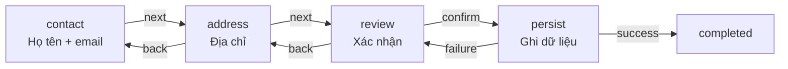
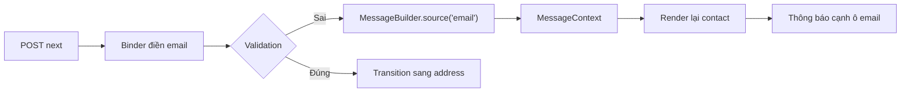

# Thông báo theo trường và thông báo toàn màn hình trong Spring Web Flow

Trong một hành trình web nhiều bước, thông báo phải giúp người dùng hiểu **vấn đề xảy ra ở đâu** và **họ cần làm gì tiếp theo**. Khi đang nhập email, lỗi “Địa chỉ email không hợp lệ” nên xuất hiện ngay cạnh ô email. Khi hệ thống lưu đơn đăng ký thất bại do dịch vụ tạm ngừng, một thông báo ở đầu màn hình lại phù hợp hơn. Hai loại phản hồi này có vị trí hiển thị, cách gắn dữ liệu và vòng đời khác nhau.

Bài học thuộc chương **Thông báo và ngôn ngữ** của `SPRING_WEB_FLOW`. Spring Web Flow mô hình hóa luồng bằng **state, event, transition và subflow**, đồng thời phối hợp **form binding, validation, scope/phiên và Spring MVC**. Ta sẽ thiết kế thông báo để người dùng sửa được dữ liệu mà không mất tiến trình, hiểu rõ lỗi của một trường hay của cả bước, và nhìn thấy văn bản theo ngôn ngữ giao diện.

## 1. Phân biệt hai loại thông báo

| Tiêu chí | Thông báo theo trường (field message) | Thông báo toàn màn hình (global/page message) |
|---|---|---|
| Gắn với | Một trường cụ thể như `email` hoặc `address.city` | Một thao tác, một view-state hoặc toàn bộ bước |
| Thường xuất hiện | Gần label/input tương ứng | Đầu form, cuối form hoặc khu vực trạng thái chung |
| Ví dụ | “Vui lòng nhập email hợp lệ” | “Chưa thể gửi đăng ký. Hãy thử lại sau” |
| Định danh trong SWF | Có `source` chỉ đến đường dẫn trường | Không chỉ định `source` của trường |
| Cách người dùng xử lý | Sửa trường được chỉ rõ | Đọc hướng dẫn, thử lại, quay về hoặc liên hệ hỗ trợ |
| Tình huống điển hình | Binding, chuyển kiểu, validation theo bước | Lỗi nghiệp vụ liên quan nhiều trường, kết quả lưu, cảnh báo chung |

Ngoài **vị trí**, thông báo còn có **mức độ nghiêm trọng**:

- `ERROR`: dữ liệu không hợp lệ hoặc hành động không thể tiếp tục.
- `WARNING`: có điều kiện cần lưu ý nhưng chưa chắc ngăn chuyển bước.
- `INFO`: xác nhận một thao tác hoặc hướng dẫn thông thường.

Mức độ và vị trí là **hai chiều độc lập**. Chẳng hạn cảnh báo “Mã bưu chính chưa được kiểm chứng” có thể gắn với một trường; còn lỗi “Dịch vụ đặt lịch đang bận” là lỗi toàn màn hình. Không nên suy ra “lỗi = theo trường” hoặc “thông tin = toàn màn hình”.

## 2. Luồng ví dụ: đăng ký gồm ba bước

Giả sử có ba màn hình:



Tại bước `contact`, email sai định dạng là thông báo theo trường. Tại `review`, thao tác lưu có thể thất bại vì dịch vụ ngoài tạm thời không khả dụng; thông báo này thuộc toàn màn hình vì không có ô nhập liệu riêng nào gây ra lỗi.

Một JavaBean đơn giản làm model chung của các bước:

```java
package com.example.registration;

import java.io.Serializable;

public class RegistrationDraft implements Serializable {
    private static final long serialVersionUID = 1L;

    private String fullName;
    private String email;
    private String city;

    public String getFullName() { return fullName; }
    public void setFullName(String fullName) { this.fullName = fullName; }

    public String getEmail() { return email; }
    public void setEmail(String email) { this.email = email; }

    public String getCity() { return city; }
    public void setCity(String city) { this.city = city; }
}
```

Model có thể khai báo bằng `<var>` ở cấp flow và được giữ trong `flowScope` trong suốt một lần thực thi. Việc render lại một view-state do lỗi validation **không có nghĩa phải tạo model mới**.

## 3. MessageContext: nơi quản lý thông báo của flow

Trong Spring Web Flow 2.x, `org.springframework.binding.message.MessageContext` là giao diện dùng để thu thập các thông báo nảy sinh khi flow xử lý binding, validation hoặc action. Mỗi thông báo có thể mô tả:

1. **Severity**: mức độ (`info`, `warning`, `error`, ...).
2. **Source**: nguồn liên quan; với lỗi của trường, đây thường là tên property như `email`.
3. **Message code**: khóa dùng tìm văn bản đã dịch, chẳng hạn `registration.email.invalid`.
4. **Default text**: câu dự phòng khi không tìm được bản dịch phù hợp.
5. **Arguments** (nếu có): tham số để chèn vào mẫu thông báo, ví dụ độ dài tối đa.

Dùng `MessageBuilder` để xây dựng thông báo:

```java
import org.springframework.binding.message.MessageBuilder;
import org.springframework.binding.message.MessageContext;

public class RegistrationMessages {

    public void addInvalidEmail(MessageContext messages) {
        messages.addMessage(
            new MessageBuilder()
                .error()
                .source("email")
                .code("registration.email.invalid")
                .defaultText("Địa chỉ email không hợp lệ")
                .build()
        );
    }

    public void addUnavailableService(MessageContext messages) {
        messages.addMessage(
            new MessageBuilder()
                .error()
                .code("registration.submit.unavailable")
                .defaultText("Hệ thống đang bận. Hãy thử lại sau.")
                .build()
        );
    }
}
```

Điểm khác biệt có chủ ý nằm ở **`.source("email")`**. Đối tượng đầu tiên là lỗi của trường `email`; đối tượng thứ hai là lỗi chung, **không gắn với trường nào**.

Thông báo chung không có nghĩa luôn là lỗi. Ví dụ sau có thể dùng để báo thành công hoặc hướng dẫn người dùng:

```java
messages.addMessage(
    new MessageBuilder()
        .info()
        .code("registration.draft.saved")
        .defaultText("Đã lưu thông tin hiện tại.")
        .build()
);
```

`MessageContext` quản lý thông báo của hoạt động flow; đây **không phải** một cơ sở dữ liệu lưu thông báo vĩnh viễn. Hiệu lực qua việc chuyển state và render còn phụ thuộc cách framework tạo/duy trì message context và cách view đọc thông báo. Nếu ứng dụng cần thông báo sống lâu hơn một lần chuyển hoặc cần hiển thị sau flow kết thúc, hãy thiết kế vị trí lưu/đẩy thông báo phù hợp thay vì mặc định mọi message tự xuất hiện mãi mãi.

### MessageContext khác BindingResult ở đâu?

Hai khái niệm dễ bị nhập làm một:

- Spring Web Flow cung cấp `MessageContext` và `MessageBuilder` để biểu diễn thông báo trong quá trình xử lý flow.
- Spring MVC form tag thường làm việc với cơ chế form binding và lỗi của Spring BindingResult; việc ánh xạ thông báo SWF sang thông tin mà view rendering đọc được **phụ thuộc vào cấu hình view integration**.

Một lỗi xuất hiện trong `MessageContext` **không bảo đảm** rằng mọi mẫu HTML, mọi form tag hay mọi thư viện giao diện sẽ tự hiển thị nó. Cần kiểm tra view renderer và cách tích hợp Spring MVC của dự án.

## 4. Gắn thông báo vào đúng trường

Với model `RegistrationDraft` có property `email`, ta dùng `source("email")`. Khi form có cấu trúc lồng nhau như `draft.contact.email`, property path được gắn với model có thể là `contact.email`; hãy nhất quán giữa binder, validator, error source và form path.

### Ví dụ validation tại view-state `contact`

SWF hỗ trợ những cơ chế validation có thể làm việc với `ValidationContext`, bao gồm quy ước validation theo tên state khi model/validator được cấu hình phù hợp. Ví dụ phương thức sau có thể đặt **bên trong `RegistrationDraft`** để minh họa cách đẩy lỗi của một trường vào message context:

```java
import org.springframework.binding.message.MessageBuilder;
import org.springframework.webflow.validation.ValidationContext;

// Phương thức nằm trong class RegistrationDraft.
public void validateContact(ValidationContext context) {
    String emailValue = getEmail();

    if (emailValue == null || emailValue.trim().isEmpty()) {
        context.getMessageContext().addMessage(
            new MessageBuilder()
                .error()
                .source("email")
                .code("registration.email.required")
                .defaultText("Vui lòng nhập địa chỉ email.")
                .build()
        );
    } else if (!emailValue.contains("@")) {
        context.getMessageContext().addMessage(
            new MessageBuilder()
                .error()
                .source("email")
                .code("registration.email.invalid")
                .defaultText("Địa chỉ email chưa đúng định dạng.")
                .build()
        );
    }
}
```

Kiểm tra `contains("@")` chỉ là **điều kiện minh họa**, không phải thuật toán xác thực email dùng trong sản phẩm. Thực tế nên dùng Bean Validation `@Email` hoặc một validator email đáng tin cậy và có bộ test rõ ràng. Kiểu `validateContact(ValidationContext)` cần được framework nhận diện theo quy ước/cấu hình validation hiện hành; không nên cho rằng cứ định nghĩa phương thức bất kỳ là SWF tự gọi.

Điều cần nắm là đường đi của lỗi:



Để hiển thị lỗi tại đúng vị trí, view cần biết tên trường. Với JSP/Spring MVC form tags, một form thường trông như sau (đường dẫn action và việc truyền lỗi phụ thuộc cấu hình SWF/Spring MVC của ứng dụng):

```jsp
<%@ taglib prefix="form" uri="http://www.springframework.org/tags/form" %>

<form:form method="post"
           action="${flowExecutionUrl}"
           modelAttribute="draft">

    <label for="email">Email</label>
    <form:input id="email" path="email"
                aria-describedby="email-error"/>
    <form:errors path="email"
                 id="email-error"
                 cssClass="field-error"/>

    <button type="submit" name="_eventId_next">Tiếp tục</button>
</form:form>
```

Trong ví dụ, `path="email"` phải trùng với đường dẫn field của model; `source("email")` cũng phải dùng cùng quy ước. Khi integration chuyển các lỗi validation đến cơ chế mà `<form:errors>` sử dụng, lỗi sẽ được render cạnh input. Với renderer khác (ví dụ Thymeleaf), cách viết HTML và cú pháp lấy lỗi thay đổi, nhưng quy tắc định danh field không đổi.

**Lưu ý quan trọng:** `source` không nên là câu thông báo đã dịch. `source` là vị trí của trường, còn `code` mới là khóa tra văn bản ngôn ngữ. Tránh dùng `source("Địa chỉ email không hợp lệ")`, vì view không thể tìm đúng field bằng câu văn đó.

## 5. Thông báo toàn màn hình: khi lỗi không thuộc một field

Xét các tình huống:

- Dịch vụ lưu đăng ký đang tạm thời gián đoạn.
- Người dùng không có quyền hoàn tất thao tác.
- Một quy tắc liên quan **nhiều trường** không thỏa mãn, như ngày bắt đầu phải trước ngày kết thúc.
- Bản nháp đã bị thay đổi ở một tab khác.
- Bước xác nhận hoàn thành và hệ thống cần thông báo kết quả.

Ở các trường hợp này, việc gán lỗi ngẫu nhiên vào `email` hoặc `city` gây hiểu nhầm. Hãy thêm thông báo **không có `source` trường**:

```java
context.getMessageContext().addMessage(
    new MessageBuilder()
        .error()
        .code("registration.submit.failed")
        .defaultText("Không thể hoàn tất đăng ký. Vui lòng thử lại.")
        .build()
);
```

Có thể tạo thông báo toàn màn hình theo sự kiện xử lý nghiệp vụ, chẳng hạn lưu thất bại ở một `action-state`. Trình tự đề xuất:

1. Flow nhận event `confirm` ở `review`.
2. `action-state` gọi service lưu dữ liệu; service kiểm tra lại quyền và quy tắc nghiệp vụ.
3. Nếu xảy ra lỗi có thể xử lý, một action/controller adapter tạo **mã lỗi an toàn cho người dùng**, rồi thêm thông báo chung vào message context hoặc chuyển mã lỗi sang model của view.
4. Flow quay lại `review` (hoặc vào state báo lỗi phù hợp).
5. Giao diện hiển thị banner chung và cung cấp hành động “Thử lại” hoặc “Quay lại chỉnh sửa”.

Không nên để stack trace, SQL, token, thông tin định danh nhạy cảm hay dữ liệu riêng tư xuất hiện trong thông báo người dùng. Log kỹ thuật dùng cơ chế riêng để hỗ trợ chẩn đoán; message giao diện chỉ cần mô tả vấn đề và cách tiếp tục.

### Vị trí hiển thị chung

Ví dụ HTML đơn giản:

```html
<div class="page-message page-message--error"
     role="alert" aria-live="assertive">
  Không thể hoàn tất đăng ký. Vui lòng thử lại.
</div>
```

Nếu view template có một danh sách `globalMessages` đã được adapter chuẩn bị từ các message **không gắn field**, có thể render chúng bằng JSP/JSTL:

```jsp
<%@ taglib prefix="c" uri="http://java.sun.com/jsp/jstl/core" %>

<c:forEach items="${globalMessages}" var="message">
    <div class="page-message" role="alert">
        <c:out value="${message.text}"/>
    </div>
</c:forEach>
```

Ở đây `globalMessages` là **biến view model do ứng dụng cung cấp**, không phải tên biến mặc định được SWF bảo đảm tạo trong mọi dự án. Adapter cần lấy thông báo từ `MessageContext`, phân loại theo `source` và đặt nội dung đã giải quyết i18n vào model. Trường `message.text` trong ví dụ là thuộc tính của DTO hiển thị, không phải cam kết về API của mọi đối tượng message SWF.

Nếu dùng `<form:errors path="*">`, hãy nhớ lựa chọn này có thể hiển thị **cả lỗi theo trường và lỗi toàn form** theo cơ chế binding đang dùng. Nếu đã render lỗi ngay bên từng input mà tiếp tục in toàn bộ lỗi ở đầu trang, người dùng có thể thấy cùng một thông báo hai lần. Muốn chỉ hiển thị thông báo toàn màn hình, cần lọc riêng **object/global errors** hoặc các message không có `source` tương ứng.

### Thông báo chung có thể dẫn đến hành động khác

Một banner “Phiên làm việc đã hết hạn” nên đi kèm đường dẫn bắt đầu lại flow. Một banner “Đã lưu bản nháp” có thể chỉ cần hiện ngắn. Một banner “Không thể lưu” nên giữ những dữ liệu đang có và cho thử lại khi an toàn. Hãy thiết kế **hành động tiếp theo** cùng lúc với message code.

## 6. Cách kết hợp message với state và transition

Lỗi nhập liệu và lỗi xử lý nghiệp vụ xảy ra ở những thời điểm khác nhau:

| Thời điểm | Loại lỗi hay gặp | Cách xử lý phù hợp |
|---|---|---|
| Binding trước transition `next` | Không chuyển được `age="abc"` sang số | Lỗi tại trường `age`, ở lại view |
| Validation của `contact` | Email thiếu hoặc sai định dạng | Lỗi tại `email`, ở lại `contact` |
| Validation liên quan nhiều trường | Thời gian bắt đầu sau thời gian kết thúc | Thông báo chung kèm chỉ dẫn, hoặc gắn có chủ đích vào một trường để sửa |
| Action lưu dữ liệu | Service tạm ngừng hoặc quy tắc nghiệp vụ thay đổi | Thông báo toàn màn hình, đi đến nhánh lỗi có thể khôi phục |
| Kết thúc flow thành công | Tạo đăng ký thành công | Trang kết quả hoặc thông báo thành công sau khi điều hướng |

Một flow XML tối giản để hình dung ranh giới:

```xml
<?xml version="1.0" encoding="UTF-8"?>
<flow xmlns="http://www.springframework.org/schema/webflow"
      xmlns:xsi="http://www.w3.org/2001/XMLSchema-instance"
      xsi:schemaLocation="http://www.springframework.org/schema/webflow
                          http://www.springframework.org/schema/webflow/spring-webflow.xsd">

    <var name="draft" class="com.example.registration.RegistrationDraft"/>

    <view-state id="contact" view="registration/contact" model="draft">
        <binder>
            <binding property="fullName" required="true"/>
            <binding property="email" required="true"/>
        </binder>

        <transition on="next" to="review"/>
        <transition on="cancel" to="cancelled"
                    bind="false" validate="false"/>
    </view-state>

    <view-state id="review" view="registration/review" model="draft">
        <transition on="back" to="contact"
                    bind="false" validate="false"/>
        <transition on="confirm" to="persist"
                    bind="false" validate="false"/>
    </view-state>

    <action-state id="persist">
        <!-- Action trả về event success hoặc failure sau khi xử lý. -->
        <evaluate expression="registrationAction.submit(draft)"/>
        <transition on="success" to="completed"/>
        <transition on="failure" to="review"/>
    </action-state>

    <end-state id="completed" view="registration/completed"/>
    <end-state id="cancelled" view="registration/cancelled"/>
</flow>
```

Ví dụ trên mô tả **hợp đồng của action**: `registrationAction.submit(draft)` phải trả về kết quả mà SWF ánh xạ thành event `success` hoặc `failure`. Cách làm cụ thể có thể dùng một action implement API của SWF hoặc phương thức tương thích với cơ chế expression/action. **Không giả định** mọi exception được framework tự biến thành event `failure`: lỗi ngoại lệ phải có nhánh xử lý hoặc exception handler rõ ràng.

Nếu action trả về `failure`, nó cần cung cấp thông báo theo chiến lược hiển thị đã chọn. Khi quay lại `review`, không được xóa `draft` hoặc điều hướng tới một flow execution mới chỉ để hiện thông báo. Đó là cách bảo toàn các trường người dùng đã nhập.

### Tránh hiển thị lỗi sai bước

Nếu người dùng chuyển từ `address` về `contact`, lỗi của trường `address.city` không nên hiện như lỗi của trường `email`. Giao diện có thể phân loại theo property path và state. Khi xử lý lại event, application cũng cần quản lý việc loại bỏ hoặc thay thế các message không còn đúng sau khi dữ liệu được sửa, tránh thông báo cũ kéo dài sai ngữ cảnh.

## 7. Message code và quốc tế hóa (i18n)

Nếu viết cố định câu tiếng Việt trong Java/XML, việc đổi ngôn ngữ sẽ khó và dễ bỏ sót. Thay vào đó, mỗi message có một **code ổn định**, sau đó tài nguyên ngôn ngữ cung cấp văn bản tương ứng.

Ví dụ:

```properties
# messages_vi.properties
registration.email.required=Vui lòng nhập địa chỉ email.
registration.email.invalid=Địa chỉ email chưa đúng định dạng.
registration.submit.unavailable=Hệ thống đang bận. Hãy thử lại sau.
registration.completed=Đăng ký của bạn đã được ghi nhận.
```

```properties
# messages_en.properties
registration.email.required=Please enter your email address.
registration.email.invalid=Please enter a valid email address.
registration.submit.unavailable=The service is temporarily unavailable. Please try again.
registration.completed=Your registration has been submitted.
```

Java chỉ tham chiếu mã:

```java
messages.addMessage(
    new MessageBuilder()
        .error()
        .source("email")
        .code("registration.email.invalid")
        .defaultText("Địa chỉ email chưa đúng định dạng.")
        .build()
);
```

`source("email")` **không đổi** khi chuyển từ tiếng Việt sang tiếng Anh. `code("registration.email.invalid")` cũng giữ nguyên; chỉ bản dịch và cách định dạng nội dung thay đổi theo `Locale`.

### Tích hợp MessageSource

Trong hệ sinh thái Spring, `MessageSource` phân giải message code theo `Locale`. Ví dụ Spring Java configuration:

```java
import org.springframework.context.MessageSource;
import org.springframework.context.annotation.Bean;
import org.springframework.context.annotation.Configuration;
import org.springframework.context.support.ReloadableResourceBundleMessageSource;

@Configuration
public class MessageConfiguration {

    @Bean
    public MessageSource messageSource() {
        ReloadableResourceBundleMessageSource source =
                new ReloadableResourceBundleMessageSource();
        source.setBasename("classpath:messages");
        source.setDefaultEncoding("UTF-8");
        return source;
    }
}
```

`classpath:messages` tương ứng các file `messages.properties`, `messages_vi.properties` và `messages_en.properties`. Cần kiểm tra **cách cấu hình Spring MVC/SWF sử dụng message source**, locale resolver và view renderer trong đúng phiên bản dự án. Việc chỉ có một bean `MessageSource` không bảo đảm mọi adapter/custom renderer tự động gọi nó hoặc chọn đúng locale.

Với Spring MVC, `LocaleResolver` hoặc cơ chế xác định locale đang dùng quyết định ngôn ngữ hiện tại; người dùng có thể chọn ngôn ngữ theo chính sách ứng dụng. Với SWF, đảm bảo locale vẫn nhất quán qua các request của cùng execution và thông báo được giải quyết theo locale phù hợp tại thời điểm hiển thị.

### Có tham số trong bản dịch

Nếu validation yêu cầu tên tối đa 80 ký tự, không cần ghép chuỗi thủ công:

```properties
# messages_vi.properties
registration.fullName.tooLong=Họ tên không được vượt quá {0} ký tự.
```

Thành phần tạo message có thể truyền argument cho hệ phân giải message, tùy API `MessageBuilder` và cấu hình resolver của phiên bản SWF đang dùng. Điều quan trọng là **code cố định, tham số được định dạng và escape đúng, bản dịch kiểm soát cấu trúc câu**.

Tránh đưa nội dung người dùng nhập vào code của thông báo. Cũng tránh chèn thẳng HTML không tin cậy vào bản dịch. Khi render, ưu tiên escaping nội dung để ngăn XSS; chỉ dùng HTML cho thông báo khi có cơ chế kiểm soát và làm sạch rõ ràng.

## 8. UX và accessibility cho hai nhóm message

Thông báo đúng vị trí nhưng khó nhìn, khó đọc bằng công cụ hỗ trợ hoặc bị mất khi rerender vẫn là trải nghiệm kém.

**Với lỗi theo trường:**

- Hiển thị sát trường bị lỗi, kèm label và hướng dẫn sửa cụ thể.
- Giữ nguyên giá trị hợp lệ đã nhập; không reset toàn bộ biểu mẫu.
- Khi có lỗi, liên kết input với vùng lỗi bằng `aria-describedby` và đặt trạng thái `aria-invalid="true"` cho field sai (theo khả năng của template/framework).
- Không chỉ dùng màu đỏ để báo lỗi; cần có câu chữ rõ ràng.
- Nếu có nhiều lỗi, có thể thêm bảng tổng hợp đầu form với liên kết đến trường, nhưng tránh lặp thông báo gây nhiễu.

**Với thông báo toàn màn hình:**

- Đặt ở một vùng có thể tìm thấy ngay, có ngữ cảnh và hành động tiếp theo.
- Có thể dùng `role="alert"` với lỗi cấp thiết, `role="status"` cho thông tin ít khẩn cấp; tránh biến mọi thông báo thành alert gây ngắt đọc liên tục.
- Nếu lỗi chặn tiếp tục, giữ màn hình và dữ liệu để người dùng thử lại hoặc quay về.
- Nếu flow kết thúc, trang kết quả phải có khả năng hiển thị thông báo ngay cả khi scope của execution đã kết thúc.
- Không đính kèm thông tin nội bộ nhạy cảm vào câu lỗi.

### Đặt thông báo trong ngữ cảnh bước hiện tại

Một câu như “Đã có lỗi xảy ra” quá chung chung. Tại bước địa chỉ, “Không thể kiểm tra mã bưu chính, bạn có thể sửa và thử lại” hữu ích hơn. Tại bước xác nhận, “Chưa thể gửi đăng ký; thông tin bạn đã nhập vẫn được giữ trong phiên hiện tại” giúp người dùng hiểu tình trạng thực tế, **nếu** flow/application thực sự giữ dữ liệu theo thiết kế đó.

Không hứa “Dữ liệu luôn được lưu” khi chưa có cơ chế lưu nháp bền vững.

## 9. Kiểm thử field message và global message

Kiểm thử flow phải kiểm tra cả **state** lẫn **message**. Một test chỉ xác nhận `contact` không chuyển sang `address` vẫn chưa chứng minh người dùng được chỉ rõ trường nào sai.

| Kịch bản | Kỳ vọng về flow | Kỳ vọng về message |
|---|---|---|
| Email trống, nhấn `next` | Ở lại `contact` | Có lỗi nguồn `email`, code `registration.email.required` |
| Email sai định dạng | Ở lại `contact` | Có lỗi nguồn `email`, không thành banner nghiệp vụ không rõ nguyên nhân |
| Email hợp lệ | Chuyển sang bước sau | Không còn lỗi email cũ |
| Lưu thất bại do dịch vụ | Quay về `review` hoặc state lỗi | Thông báo lỗi chung, không gán sai vào `email` |
| Người dùng nhấn `back` | Quay về bước trước | Không bị lỗi validation của bước chưa hoàn tất chặn |
| Đổi locale `vi` → `en` | State và dữ liệu không đổi | Cùng message code, câu được dịch theo ngôn ngữ |
| Có hai lỗi input | Ở lại màn hình | Mỗi lỗi gắn đúng property path; summary chung không lặp gây hiểu nhầm |

Một test ở mức API của validator có thể kiểm tra `MessageContext`:

```java
// Pseudocode mô tả assertion; dùng mock/stub của dự án cho ValidationContext.
draft.setEmail("invalid");
draft.validateContact(validationContext);

MessageContext messages = validationContext.getMessageContext();

// Kiểm tra có lỗi của trường "email" với message code mong muốn.
// Không chỉ kiểm tra messages.hasErrorMessages() mà bỏ qua source.
```

Với integration test, hãy mở flow qua đúng URL của Spring MVC, gửi request có event `_eventId_next`, kiểm tra render của `form:errors` hoặc view adapter tương ứng, rồi đổi locale và kiểm tra văn bản. Nên có test cho refresh, lỗi conversion, quay lại bước trước và timeout để phát hiện thông báo bị mất hoặc rò rỉ giữa các execution.

## 10. Lỗi triển khai thường gặp và cách khắc phục

### 10.1. Dùng một thông báo chung cho mọi lỗi input

Lỗi “Biểu mẫu không hợp lệ” có thể cho người dùng biết đã thất bại, nhưng không biết sửa ở đâu. Hãy thêm message có `source` tương ứng với trường sai, đồng thời chỉ dùng message tổng hợp khi nó thực sự giúp định hướng.

### 10.2. Gắn sai đường dẫn trường

Nếu model lưu `contact.email` nhưng validator gửi `source("email")`, view có thể không tìm thấy lỗi khi render `path="contact.email"`. Dùng một quy ước đường dẫn xuyên suốt model, binder, validator và view; kiểm thử cả model có nested properties.

### 10.3. Tưởng `MessageBuilder` tự render HTML

`MessageBuilder` tạo một mô tả message. View chịu trách nhiệm đọc thông báo, tra bản dịch và hiển thị đúng vị trí. Kiểm thử integration là cách xác minh được hành vi thực tế của từng thư viện form/view.

### 10.4. Tạo thông báo trong `<on-render>` không có kiểm soát

`<on-render>` có thể chạy lại khi người dùng refresh hoặc validation render lại view. Nếu mỗi lần đều thêm cùng một lỗi không phụ thuộc tình trạng hiện tại, danh sách có thể bị trùng hoặc hiện thông báo cũ. Nên tạo lỗi khi validation/action diễn ra, rồi quản lý vòng đời message thích hợp.

### 10.5. Để lỗi nghiệp vụ đi qua như exception không xử lý

Một exception trong action-state **không mặc nhiên** biến thành event `failure` và banner người dùng hiểu được. Hãy định nghĩa hợp đồng kết quả nghiệp vụ hoặc exception handler phù hợp, đồng thời log chi tiết ở hệ thống quan sát riêng.

### 10.6. Không kiểm thử locale và fallback

Một bản dịch bị thiếu có thể khiến người dùng thấy message code hoặc câu mặc định không đúng ngôn ngữ, tùy resolver. Cần thống nhất fallback, kiểm tra key ở tất cả ngôn ngữ hỗ trợ và test các lỗi phổ biến bằng locale thực tế.

### 10.7. Chỉ kiểm tra cấp view, quên xác minh ở service

Thông báo validation giúp người dùng sửa thông tin. Nó không thay thế validation phía server khi lưu, kiểm tra phân quyền, trạng thái dữ liệu mới nhất và khả năng xử lý yêu cầu lặp. Khi service phát hiện lỗi cuối cùng, phải trả về mã nghiệp vụ an toàn và diễn đạt nó bằng thông báo phù hợp.

## 11. Bài tập thực hành

Hãy mở rộng flow **đăng ký lịch tư vấn** ba bước: `contact`, `schedule`, `review`.

**Yêu cầu:**

1. Tạo `BookingDraft` với `email`, `phone`, `startTime` và `serviceType`.
2. Ở `contact`, email thiếu hoặc sai phải hiện **cạnh ô email**, có message code riêng và không mất dữ liệu đã nhập.
3. Ở `schedule`, nếu `startTime` nằm trong quá khứ, gắn lỗi vào `startTime`. Nếu dịch vụ đã ngừng nhận lịch, hiện **thông báo toàn màn hình**.
4. Khi `review` gửi yêu cầu lưu nhưng dịch vụ bận, cho người dùng thử lại; không đưa thông tin kỹ thuật nội bộ vào banner.
5. Chuẩn bị file tiếng Việt và tiếng Anh cho ít nhất bốn message code và kiểm tra đổi locale.
6. Kiểm thử event `next`, `back`, `confirm`; xác minh field error có `source` đúng, global message không có `source` trường.
7. Tạo HTML mà công cụ hỗ trợ tiếp cận có thể đọc lỗi; thông báo chung không lặp vô hạn khi render lại.

**Câu hỏi ôn tập:**

- Khi email sai, dùng `.source("email")` hay bỏ trống source? **Dùng source của trường** để view chỉ ra chính xác vị trí cần sửa.
- Khi dịch vụ không thể lưu, có nên gán lỗi vào `email`? **Không**, vì vấn đề không thuộc trường email; dùng thông báo chung và nhánh xử lý thích hợp.
- `MessageContext` có bảo đảm JSP tự hiển thị tất cả thông báo không? **Không**, cần view integration đọc và render chúng đúng cách.
- Khi chuyển giao diện từ tiếng Việt sang tiếng Anh, điều gì nên giữ nguyên? **Message code và field source**; chỉ văn bản đã giải quyết theo locale thay đổi.
- Lỗi validation ở bước 2 có nên ngăn người dùng bấm `back`? Thông thường **không**; có thể cấu hình transition `back` với `bind="false" validate="false"`.

## 12. Checklist trước khi đưa flow vào sử dụng

- [ ] Mỗi lỗi theo trường có `source` đúng property path.
- [ ] Thông báo chung không bị gắn tùy tiện vào một input không liên quan.
- [ ] Các message code ổn định, có bản dịch và fallback rõ ràng.
- [ ] View hiển thị đúng mức độ, đúng vị trí, không làm trùng thông báo.
- [ ] Lỗi của bước hiện tại không làm mất draft hoặc ngăn điều hướng `back` không cần thiết.
- [ ] Có nhánh cho thất bại của action/service và kiểm tra lại dữ liệu khi lưu.
- [ ] Giao diện có label, diễn giải cụ thể, hỗ trợ accessibility và tránh lộ thông tin nhạy cảm.
- [ ] Test đã xác nhận thông báo theo trường, thông báo chung, ngôn ngữ và sự thay đổi trạng thái.

**Điểm cần nhớ:** Trong Spring Web Flow, **field message giúp sửa đúng dữ liệu**, còn **global message giúp hiểu tình trạng của cả thao tác hoặc màn hình**. `MessageContext` và `MessageBuilder` cung cấp thông tin về mức độ, nguồn và message code; flow quyết định xử lý tiếp; view tích hợp với Spring MVC hiển thị thông báo, còn `MessageSource` giải quyết văn bản theo ngôn ngữ. Thiết kế đủ cả các phần này để thông báo thực sự giúp người dùng hoàn tất một hành trình nhiều bước.

