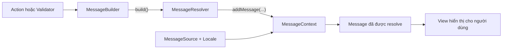
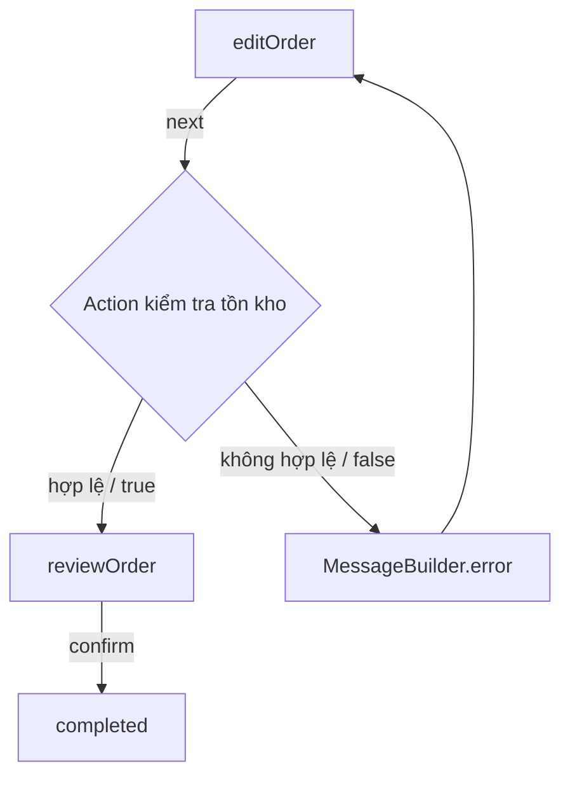

# Tạo thông báo bằng MessageBuilder

Khi người dùng đi qua một hành trình nhiều bước, hệ thống cần giải thích chuyện gì vừa xảy ra: một trường nhập sai, mã ưu đãi hết hạn, dữ liệu đã lưu thành công hay giao dịch chưa thể hoàn tất. Với **Spring Web Flow (SWF)**, các thông báo này thường gắn với một **flow execution** đang được điều hướng qua `view-state`, `event` và `transition`. Nếu mỗi action tự tạo chuỗi văn bản và trả về controller, nội dung sẽ khó tái sử dụng, khó dịch và khó hiển thị nhất quán trên nhiều màn hình.

**`MessageBuilder`** thuộc `org.springframework.binding.message` là công cụ tạo thông báo theo cách *fluent*: chọn mức độ, nguồn phát sinh, mã thông điệp, tham số và văn bản dự phòng; sau đó đưa thông báo vào `MessageContext` của Web Flow. Nó hoạt động cùng `MessageSource` của Spring để hỗ trợ nhiều ngôn ngữ.

Bài học này tập trung vào **cách tạo thông báo bằng `MessageBuilder`**, từ ví dụ nhỏ đến việc sử dụng trong validation và action của một flow thực tế. Các khái niệm liên quan đến ngôn ngữ, scope và render view được trình bày ở mức cần thiết để hiểu kết quả.

## 1. Mục tiêu

Sau bài học, bạn có thể:

1. Phân biệt `MessageBuilder`, `MessageResolver`, `MessageContext` và `MessageSource`.
2. Tạo thông báo `info`, `warning`, `error` và `fatal` khi phù hợp.
3. Chỉ định `source` để liên kết lỗi với trường form hoặc tạo thông báo toàn cục.
4. Dùng `code`, `codes`, `arg`, `args` và `defaultText` để hỗ trợ i18n.
5. Lấy `MessageContext` từ `RequestContext`, `ValidationContext` hoặc biến EL `messageContext`.
6. Thêm thông báo trong validation/action mà vẫn kiểm soát được hành vi điều hướng.
7. Đọc thông báo theo source, kiểm thử việc chọn mã dịch và tránh các lỗi thường gặp.

## 2. Luồng tạo và hiển thị thông báo

Một thông báo đi qua bốn thành phần:

| Thành phần | Trách nhiệm | API tiêu biểu |
| --- | --- | --- |
| `MessageBuilder` | Ghi nhận mức độ, source, code, arguments và fallback | `new MessageBuilder().error()...build()` |
| `MessageResolver` | Mô tả cách tìm văn bản tương ứng với `Locale` và `MessageSource` | Kết quả của `build()` |
| `MessageContext` | Nhận và lưu các thông báo trong lúc flow chạy; cung cấp API truy xuất | `addMessage(...)`, `getAllMessages()` |
| `MessageSource` | Đọc văn bản từ các message bundle theo mã và ngôn ngữ | `messages.properties`, `messages_vi.properties` |



Điểm quan trọng: **`build()` không tự hiển thị thông báo**. Nó tạo ra `MessageResolver`; ứng dụng phải gọi `messageContext.addMessage(...)`. Sau đó, cơ chế render view phù hợp sẽ đọc và trình bày thông báo.

Hãy phân biệt thông báo với event:

- `event="next"` hoặc `event="cancel"` quyết định flow xử lý sự kiện nào.
- `MessageBuilder` tạo nội dung để người dùng hiểu điều gì đã xảy ra.
- Việc thêm `Severity.ERROR` vào `MessageContext` **không có nghĩa** tự động chuyển flow đến state lỗi trong mọi tình huống. Validation và action phải trả kết quả phù hợp để Web Flow giữ lại màn hình hoặc chuyển state.

## 3. Tạo thông báo đầu tiên

Ví dụ một form đặt phòng cần báo rằng ngày nhận phòng phải ở tương lai:

```java
import org.springframework.binding.message.MessageBuilder;
import org.springframework.binding.message.MessageContext;

public void validateCheckinDate(MessageContext messages) {
    messages.addMessage(
        new MessageBuilder()
            .error()
            .source("checkinDate")
            .defaultText("Ngày nhận phòng phải ở trong tương lai.")
            .build()
    );
}
```

Đọc đoạn code từ trái sang phải:

1. `new MessageBuilder()` tạo bộ dựng mới.
2. `error()` chọn mức độ lỗi.
3. `source("checkinDate")` liên kết thông báo với trường nhập `checkinDate`.
4. `defaultText(...)` là văn bản có thể dùng khi không cấu hình mã dịch hoặc không tìm được mã.
5. `build()` tạo một `MessageResolver`.
6. `addMessage(...)` đưa resolver vào ngữ cảnh thông báo đang được quản lý bởi flow.

Sau khi được resolve, thông báo có thể mang các thuộc tính như:

```text
source   = "checkinDate"
severity = ERROR
text     = "Ngày nhận phòng phải ở trong tương lai."
```

Ví dụ sử dụng `defaultText` trực tiếp rất tiện cho mẫu thử hoặc thông báo ít tái sử dụng. Với ứng dụng đa ngôn ngữ, nên ưu tiên `code` và giữ `defaultText` làm phương án dự phòng.

## 4. Các mức độ thông báo

`MessageBuilder` hỗ trợ lựa chọn mức độ bằng các phương thức:

| Phương thức | Mức độ | Khi nào dùng? |
| --- | --- | --- |
| `info()` | `Severity.INFO` | Thông báo đã lưu bản nháp, thao tác thành công |
| `warning()` | `Severity.WARNING` | Dữ liệu vẫn có thể dùng nhưng cần người dùng chú ý |
| `error()` | `Severity.ERROR` | Sai dữ liệu, vi phạm ràng buộc nghiệp vụ, không thể hoàn tất bước |
| `fatal()` | `Severity.FATAL` | Sự cố nghiêm trọng, khó tiếp tục trong trạng thái hiện tại |

Ví dụ tạo ba thông báo khác nhau:

```java
MessageContext messages = /* lấy từ flow RequestContext */;

messages.addMessage(new MessageBuilder()
    .info()
    .code("profile.draft.saved")
    .defaultText("Đã lưu bản nháp.")
    .build());

messages.addMessage(new MessageBuilder()
    .warning()
    .source("email")
    .code("profile.email.unverified")
    .defaultText("Email chưa được xác minh.")
    .build());

messages.addMessage(new MessageBuilder()
    .error()
    .source("email")
    .code("profile.email.invalid")
    .defaultText("Email không hợp lệ.")
    .build());
```

Trong một số tài liệu tham khảo Web Flow cũ có ví dụ gọi `warn()`; API `MessageBuilder` của nhánh **3.x** công bố `warning()`. Khi đưa code vào dự án thật, đối chiếu Javadoc đúng phiên bản dependency thay vì sao chép nguyên ví dụ từ bản khác.

**Không dùng `fatal()` cho lỗi nhập liệu thông thường.** Mức độ `FATAL` có trong API nhưng không biến exception thành trang phục hồi hay thay thế việc rollback. Hãy xử lý sự cố ở action/service và điều hướng lỗi một cách tường minh.

## 5. `source`: thông báo của một trường hay toàn bộ màn hình?

Phương thức `source(Object source)` chỉ đối tượng/nguồn mà thông báo liên quan đến. Trong form, thông dụng nhất là tên thuộc tính:

```java
// Lỗi gắn với field: có thể hiển thị ngay cạnh ô nhập.
messages.addMessage(new MessageBuilder()
    .error()
    .source("phoneNumber")
    .code("registration.phone.required")
    .defaultText("Vui lòng nhập số điện thoại.")
    .build());

// Thông báo chung: không gắn với field cụ thể.
messages.addMessage(new MessageBuilder()
    .error()
    .code("registration.service.unavailable")
    .defaultText("Dịch vụ hiện không sẵn sàng. Vui lòng thử lại.")
    .build());
```

Sự khác nhau có tác dụng rõ rệt ở tầng trình bày:

| Phân loại | `source` | Nơi thường hiển thị |
| --- | --- | --- |
| Lỗi trường | `"phoneNumber"` | Gần input số điện thoại và phần tổng hợp lỗi |
| Lỗi toàn form | Không đặt source | Khu vực cảnh báo chung của form |
| Thông tin chung | Không đặt source | Banner hoặc vùng trạng thái |

Để Web Flow liên kết đúng lỗi với form, `source` nên khớp đường dẫn thuộc tính mà binding/view đang dùng, ví dụ `"address.postalCode"` nếu đó thực sự là một property path hợp lệ của model. `source` **không tự tạo field**, không tự kích hoạt validation và cũng không đảm bảo view biết chỗ hiển thị; tầng view phải đọc đúng thông báo.

## 6. `code` và `defaultText`: chuẩn bị cho i18n

Thay vì nhúng mọi câu tiếng Việt vào Java, đặt các mã thông báo ổn định:

```java
messages.addMessage(new MessageBuilder()
    .error()
    .source("quantity")
    .code("checkout.quantity.overLimit")
    .arg(10)
    .defaultText("Số lượng không được vượt quá 10.")
    .build());
```

Khi có `MessageSource` phù hợp, mã `checkout.quantity.overLimit` được tìm trong file thông điệp cho locale hiện tại. Ví dụ đặt bundle cạnh định nghĩa flow:

```text
WEB-INF/flows/checkout/
├── checkout-flow.xml
├── messages.properties
├── messages_vi.properties
└── messages_en.properties
```

Ví dụ nội dung các file:

```properties
# messages.properties — văn bản mặc định
checkout.quantity.overLimit=Quantity must not exceed {0}.
checkout.saved=Your draft has been saved.
checkout.quantity.label=Quantity
```

```properties
# messages_vi.properties — tiếng Việt
checkout.quantity.overLimit=Số lượng không được vượt quá {0}.
checkout.saved=Đã lưu bản nháp.
checkout.quantity.label=Số lượng
```

```properties
# messages_en.properties — tiếng Anh
checkout.quantity.overLimit=Quantity must not exceed {0}.
checkout.saved=Your draft has been saved.
checkout.quantity.label=Quantity
```

Khi locale là `vi` và tham số là `10`, nội dung dự kiến là:

> Số lượng không được vượt quá 10.

Khi locale là `en`, nội dung dự kiến là:

> Quantity must not exceed 10.

Spring Web Flow cho phép đặt `messages.properties` theo thư mục định nghĩa flow; khi sử dụng nguồn thông báo toàn ứng dụng, cần cấu hình `MessageSource` tương ứng và đảm bảo view/flow đang dùng nguồn mong đợi. Cách xác định locale có thể phụ thuộc tích hợp Spring MVC/JSF và cấu hình i18n của ứng dụng.

**Lưu ý:** `defaultText` là *fallback*. Nó không yêu cầu `MessageSource` đã cấu hình; nếu không tìm được code, giá trị fallback có thể được sử dụng. Với ứng dụng đa ngôn ngữ, fallback cố định một thứ tiếng chỉ là giải pháp an toàn cuối cùng, không thay thế message bundle đầy đủ.

## 7. Truyền tham số: `arg`, `args` và `resolvableArg`

Thay thế vị trí như `{0}`, `{1}` trong bundle giúp cùng một message code dùng cho các giá trị khác nhau.

### 7.1. `arg` và `args`

```java
messages.addMessage(new MessageBuilder()
    .warning()
    .code("checkout.stock.low")
    .arg("Bút chì")
    .arg(2)
    .defaultText("Sản phẩm {0} chỉ còn {1} chiếc.")
    .build());
```

```properties
# messages_vi.properties
checkout.stock.low=Sản phẩm {0} chỉ còn {1} chiếc.
```

Kết quả với các đối số trên:

> Sản phẩm Bút chì chỉ còn 2 chiếc.

Có thể viết gọn `args("Bút chì", 2)`. Nếu gọi `arg(...)` nhiều lần, các đối số được bổ sung theo đúng thứ tự; mã `{0}` dùng đối số đầu tiên.

### 7.2. `resolvableArg` dịch cả tên field

Trong một câu như “Trường Số lượng phải lớn hơn 0”, nhãn **Số lượng** cũng cần được dịch. `resolvableArg` dùng một đối số có thể được tìm qua `MessageSource`:

```java
messages.addMessage(new MessageBuilder()
    .error()
    .source("quantity")
    .code("checkout.field.mustBePositive")
    .resolvableArg("checkout.quantity.label")
    .defaultText("Trường {0} phải lớn hơn 0.")
    .build());
```

```properties
# messages_vi.properties
checkout.field.mustBePositive=Trường {0} phải lớn hơn 0.
checkout.quantity.label=Số lượng
```

Với cấu hình trên, kết quả là:

> Trường Số lượng phải lớn hơn 0.

Nếu viết `arg("checkout.quantity.label")` thay vì `resolvableArg(...)`, có thể sẽ hiện **chuỗi mã** `checkout.quantity.label` thay vì nhãn được dịch. Dùng `resolvableArgs(...)` khi có nhiều đối số cùng cần resolve.

### 7.3. `codes` với nhiều phương án tra cứu

`codes(String...)` cho phép thử nhiều mã theo thứ tự ưu tiên:

```java
messages.addMessage(new MessageBuilder()
    .error()
    .source("email")
    .codes("registration.email.duplicate", "email.duplicate")
    .defaultText("Email đã được sử dụng.")
    .build());
```

Nếu dự án có mã đặc thù cho đăng ký, dùng mã đó; nếu không, có thể fallback sang mã dùng chung. Điều này hữu ích khi cùng một lỗi xuất hiện trong nhiều flow nhưng cần lời giải thích khác nhau theo ngữ cảnh.

| Phương thức | Dùng khi | Ví dụ |
| --- | --- | --- |
| `code("...")` | Một mã i18n | `checkout.saved` |
| `codes("a", "b")` | Nhiều mã ưu tiên | `registration.email.duplicate` → `email.duplicate` |
| `arg(value)` | Một biến cần chèn | Số ngày, số lượng |
| `args(a, b)` | Nhiều biến thường | Tên sản phẩm, số lượng |
| `resolvableArg("key")` | Đối số cũng cần dịch | Nhãn của trường form |
| `defaultText("...")` | Văn bản dự phòng | Khi mã không tồn tại |

## 8. Lấy `MessageContext` ở đúng nơi

`MessageContext` là ngữ cảnh thông báo, không phải một bộ lưu thông báo toàn cục. Mỗi action/validator cần nhận đúng context của lượt thực thi flow.

### 8.1. Trong action nhận `RequestContext`

```java
import org.springframework.binding.message.MessageBuilder;
import org.springframework.webflow.execution.RequestContext;

public class DraftAction {

    public void showNotice(RequestContext context) {
        context.getMessageContext().addMessage(
            new MessageBuilder()
                .info()
                .code("draft.reminder")
                .defaultText("Bạn có thể tiếp tục bản nháp sau.")
                .build()
        );
    }
}
```

Trong `RequestContext`, `getMessageContext()` là API truy cập trực tiếp. Không nên tạo `new DefaultMessageContext()` trong action đang chạy rồi mong view của flow tự biết ngữ cảnh mới đó.

### 8.2. Trong validator nhận `ValidationContext`

```java
import org.springframework.binding.message.MessageBuilder;
import org.springframework.binding.message.MessageContext;
import org.springframework.webflow.validation.ValidationContext;

public class ContactFormValidator {

    // Tên validateEnterContact ứng với view-state id="enterContact".
    public void validateEnterContact(ContactForm form,
                                     ValidationContext context) {
        MessageContext messages = context.getMessageContext();

        if (form.getEmail() == null ||
            form.getEmail().isBlank()) {
            messages.addMessage(new MessageBuilder()
                .error()
                .source("email")
                .code("contact.email.required")
                .defaultText("Vui lòng nhập email.")
                .build());
        }
    }
}
```

Đây là mẫu validator theo quy ước đặt tên của Web Flow. Ứng dụng phải khai báo validator tương ứng với model và view-state thực tế. Khi view-state có `model`, Web Flow thực hiện binding và validation khi xử lý sự kiện phù hợp; nếu validation thất bại, view được hiển thị lại để người dùng sửa dữ liệu.

### 8.3. Trong expression của flow XML

Web Flow cung cấp biến EL `messageContext`:

```xml
<view-state id="editProfile" model="profileForm">
    <transition on="save" to="reviewProfile">
        <evaluate expression="profileAction.checkBeforeReview(
                  profileForm, messageContext)" />
    </transition>
</view-state>
```

Với bean/action này:

```java
public boolean checkBeforeReview(ProfileForm form,
                                 MessageContext messages) {
    if (!form.isContactConfirmed()) {
        messages.addMessage(new MessageBuilder()
            .error()
            .source("contact")
            .code("profile.contact.unconfirmed")
            .defaultText("Vui lòng xác nhận thông tin liên hệ.")
            .build());
        return false;
    }
    return true;
}
```

Ở **transition action** như ví dụ, trả về `false` ngăn transition hoàn tất, nên người dùng ở lại `editProfile` để thấy lỗi. Điều này khác với chỉ thêm một thông báo `error` rồi mặc định flow sẽ dừng.

## 9. Ví dụ hoàn chỉnh: kiểm tra kho trước khi rời form

Giả sử một hành trình checkout có ba state:



**Bước 1: định nghĩa flow.**

```xml
<flow xmlns="http://www.springframework.org/schema/webflow"
      xmlns:xsi="http://www.w3.org/2001/XMLSchema-instance"
      xsi:schemaLocation="
          http://www.springframework.org/schema/webflow
          http://www.springframework.org/schema/webflow/spring-webflow.xsd">

    <var name="orderDraft"
         class="com.example.checkout.OrderDraft" />

    <view-state id="editOrder" model="orderDraft">
        <transition on="next" to="reviewOrder">
            <evaluate expression="stockAction.checkAvailability(
                      orderDraft, messageContext)" />
        </transition>
        <transition on="cancel" to="cancelled"
                    bind="false" validate="false" />
    </view-state>

    <view-state id="reviewOrder">
        <transition on="back" to="editOrder" />
        <transition on="confirm" to="completed" />
    </view-state>

    <end-state id="completed" />
    <end-state id="cancelled" />
</flow>
```

Ở ứng dụng thực, `confirm` phải gọi service lưu đơn hàng và xử lý transaction; ví dụ XML này chỉ thể hiện cách xử lý thông báo trước bước review.

**Bước 2: triển khai action có xử lý lỗi nghiệp vụ.**

```java
package com.example.checkout;

import org.springframework.binding.message.MessageBuilder;
import org.springframework.binding.message.MessageContext;

public final class StockAction {

    private final StockService stockService;

    public StockAction(StockService stockService) {
        this.stockService = stockService;
    }

    public boolean checkAvailability(OrderDraft draft,
                                     MessageContext messages) {
        StockCheck result = stockService.check(draft);

        if (!result.available()) {
            messages.addMessage(new MessageBuilder()
                .error()
                .source("quantity")
                .code("checkout.stock.insufficient")
                .arg(result.remaining())
                .defaultText("Số lượng trong kho không đủ. Còn {0} sản phẩm.")
                .build());
            return false;
        }

        return true;
    }
}
```

Ở đây, `StockService` và `StockCheck` là các kiểu nghiệp vụ do ứng dụng định nghĩa; chẳng hạn `StockCheck` cung cấp `available()` và `remaining()`. `StockAction` cần được đăng ký thành Spring bean với tên `stockAction` để biểu thức XML tìm được.

**Bước 3: khai báo bundle theo ngôn ngữ.**

```properties
# messages_vi.properties
checkout.stock.insufficient=Số lượng trong kho không đủ. Còn {0} sản phẩm.
```

```properties
# messages_en.properties
checkout.stock.insufficient=Insufficient stock. Only {0} items remain.
```

Khi người dùng yêu cầu số lượng lớn hơn tồn kho, action thêm thông báo có `source="quantity"` và trả `false`. Khi đã đủ hàng, action trả `true` để transition sang `reviewOrder` tiếp tục. Việc thêm thông báo **không tự sửa `orderDraft`**, cũng không thay cho kiểm tra lại tồn kho lúc xác nhận đơn hàng.

### 9.1. Một thông báo cho trường và một thông báo chung

Đôi khi cần hai mức diễn giải: gắn lỗi với trường cụ thể và đưa hướng dẫn tổng quát phía trên:

```java
messages.addMessage(new MessageBuilder()
    .error()
    .source("quantity")
    .code("checkout.quantity.invalid")
    .defaultText("Số lượng không hợp lệ.")
    .build());

messages.addMessage(new MessageBuilder()
    .warning()
    .code("checkout.reviewBeforeRetry")
    .defaultText("Vui lòng kiểm tra lại đơn hàng trước khi tiếp tục.")
    .build());
```

Tầng view quyết định có hiển thị cả hai hay chỉ phần cần thiết. Tránh lặp cùng câu ở nhiều vùng khiến người dùng khó nhận biết lỗi chính.

## 10. Đọc và hiển thị thông báo

`MessageContext` hỗ trợ các thao tác sau:

```java
MessageContext messages = context.getMessageContext();

// Tất cả thông báo đã được resolve để trình bày.
Message[] all = messages.getAllMessages();

// Chỉ thông báo gắn với một trường.
Message[] emailMessages = messages.getMessagesBySource("email");

// Có thông báo ở mức lỗi hay không?
boolean hasErrors = messages.hasErrorMessages();
```

Các kiểu tương ứng:

```java
import org.springframework.binding.message.Message;
import org.springframework.binding.message.MessageContext;
```

Một `Message` đã được resolve có `getSource()`, `getText()` và `getSeverity()`. Tầng view có thể phân nhóm theo nguồn và mức độ để hiển thị:

| Nguồn | Mức độ | Cách trình bày gợi ý |
| --- | --- | --- |
| `email` | `ERROR` | Thông báo cạnh trường Email |
| `quantity` | `WARNING` | Cảnh báo cạnh Số lượng |
| Không gắn source | `INFO` | Thông báo toàn màn hình |
| Không gắn source | `ERROR` | Banner lỗi chung |

Web Flow tích hợp thông báo vào cơ chế render view và có khả năng giữ thông báo qua redirect trong flow. Tuy nhiên **cách trình bày cụ thể** phụ thuộc framework view:

- Với **JSF** tích hợp Web Flow, các thông báo có thể được đưa vào `FacesContext` và xuất qua `<h:messages />` hoặc `<h:message />`.
- Với **Spring MVC/JSP hoặc Thymeleaf**, cần đối chiếu view model, binding adapter và tag/component đang sử dụng. Không nên giả định mọi view template đều tự có một biến tên `messages` chứa `MessageContext`.
- Với **Ajax và fragment rendering**, bảo đảm vùng fragment được render lại thực sự chứa khu vực hiển thị thông báo sau action.

Khi render nội dung từ message arguments, phải **escape HTML** theo quy tắc của template. Không xem thông báo phát sinh từ input của người dùng là HTML đáng tin cậy.

### 10.1. Không tùy tiện xóa toàn bộ message context

API `clearMessages()` xóa tất cả thông báo đã được ghi. Đó là thao tác mạnh, có thể xóa cả lỗi validation mà một action khác đã tạo. Chỉ gọi khi có quy tắc rõ ràng về thời điểm làm mới khu vực thông báo; không đặt lệnh này vào một tiện ích logging hoặc một action dùng chung.

Một số flow có thể quay lại cùng view-state nhiều lần. Nếu action thêm cùng một lời nhắc mỗi lần vào state, người dùng có thể thấy thông báo lặp. Khi thiết kế, hãy xác định event nào cần tạo thông báo và khi nào view được re-render.

## 11. Thông báo tạo bằng tay và lỗi binding tự động

Khi một `view-state` có `model`, Web Flow bind dữ liệu từ request vào model trước khi chuyển state. Nếu kiểu nhập không chuyển đổi được, Web Flow có thể tự tạo thông báo từ lỗi binding, không cần bạn tự xây dựng `MessageBuilder` cho từng lỗi chuyển kiểu.

Ví dụ model `Booking` có thuộc tính `checkinDate`, người dùng nhập một giá trị không phải ngày. Web Flow có thể tìm khóa chi tiết trong message bundle:

```properties
booking.checkinDate.typeMismatch=Ngày nhận phòng phải đúng định dạng yyyy-MM-dd.
```

Nếu không có khóa chi tiết, framework có thể thử mã chung:

```properties
typeMismatch=Trường {0} có kiểu dữ liệu không hợp lệ.
```

Đây là **lỗi do binding tạo tự động**, khác với thông báo nghiệp vụ như “Ngày nhận phòng phải sau ngày trả phòng”:

```java
messages.addMessage(new MessageBuilder()
    .error()
    .source("checkinDate")
    .code("booking.checkinDate.mustBeFuture")
    .defaultText("Ngày nhận phòng phải ở trong tương lai.")
    .build());
```

Đối với form nhiều bước, nên chia trách nhiệm:

1. **Binding:** chuyển chuỗi request thành kiểu của model; tạo lỗi kiểu/định dạng.
2. **Validation:** kiểm tra ràng buộc của trường hoặc phối hợp nhiều trường.
3. **Action/service:** kiểm tra quy tắc nghiệp vụ và các điều kiện bên ngoài như tồn kho, quyền truy cập, trạng thái giao dịch.
4. **MessageBuilder:** mô tả lỗi/cảnh báo/thông tin ở bất kỳ tầng nào có quyền ghi vào `MessageContext`.

## 12. Một số sai lầm dễ mắc

### 12.1. Gọi `build()` rồi bỏ quên `addMessage(...)`

```java
// Chỉ tạo resolver; flow chưa nhận thông báo.
new MessageBuilder().error()
    .defaultText("Không thể tiếp tục.")
    .build();

// Đúng: thêm resolver vào context.
messages.addMessage(new MessageBuilder().error()
    .defaultText("Không thể tiếp tục.")
    .build());
```

### 12.2. Dùng `source` không khớp model

Nếu form có property `emailAddress` nhưng dùng `source("email")`, hệ thống có thể không hiển thị lỗi ở chỗ mong muốn. Cần đối chiếu với tên field/property path trong view.

### 12.3. Dùng `error()` và mong transition tự dừng

`MessageBuilder.error()` chỉ chọn mức độ thông báo. Trong transition action tự viết, cần trả kết quả phù hợp như `false` để dừng chuyển state, hoặc sử dụng cơ chế validation chuẩn của Web Flow.

### 12.4. Thêm message ở cuối flow rồi giả định luôn có ở trang khác

Thông báo thuộc vòng đời flow execution. Khi flow đã kết thúc và chuyển sang controller hoặc flow top-level khác, không mặc định `MessageContext` cũ tồn tại ở trang mới. Nếu muốn hiện thông báo sau khi rời flow, cần xác định cơ chế chuyển dữ liệu phù hợp, ví dụ flash attributes ở tầng MVC hoặc output của flow.

### 12.5. Dịch chuỗi hiển thị nhưng không dịch tham số

`.code("field.invalid").arg("Tên trường nội bộ")` có thể làm câu nửa tiếng Việt nửa tiếng Anh. Dùng `resolvableArg` cho nhãn cần i18n và đặt các key dịch tương ứng trong bundle.

### 12.6. Nhét dữ liệu nhạy cảm vào message

Không đưa mật khẩu, mã OTP, token, số thẻ hoặc exception stack trace vào `arg(...)`/`defaultText(...)`. Thông báo dùng để giao tiếp với người dùng; log kỹ thuật cần được xử lý riêng, có kiểm soát truy cập và mức độ chi tiết phù hợp.

### 12.7. Tái sử dụng cùng một `MessageBuilder` cho nhiều thông báo

Builder lưu các chỉ thị đã thêm, đặc biệt `codes` và `args`. Dùng `new MessageBuilder()` cho **mỗi thông báo** giúp tránh mang theo tham số/mức độ từ lần dựng trước. Không lưu builder mutable trong singleton service.

### 12.8. Dùng mặc định sai phiên bản framework

Spring Web Flow có nhiều nhánh phát hành. Trong API 3.x, phương thức chọn cảnh báo là `warning()`; một vài ví dụ tài liệu cũ sử dụng `warn()`. Luôn kiểm tra Javadoc tương ứng bản dependency khi IDE báo không có phương thức.

## 13. Kiểm thử thông báo

Cần kiểm tra **nội dung**, **source**, **severity**, **mã được resolve** và **hành vi flow** liên quan.

### 13.1. Test `MessageBuilder` với `DefaultMessageContext`

Ví dụ JUnit 5:

```java
import static org.junit.jupiter.api.Assertions.*;

import org.junit.jupiter.api.Test;
import org.springframework.binding.message.DefaultMessageContext;
import org.springframework.binding.message.Message;
import org.springframework.binding.message.MessageBuilder;
import org.springframework.binding.message.Severity;

class MessageBuilderTest {

    @Test
    void ghiLoiChoTruongEmail() {
        DefaultMessageContext messages = new DefaultMessageContext();

        messages.addMessage(new MessageBuilder()
            .error()
            .source("email")
            .defaultText("Email không hợp lệ.")
            .build());

        assertTrue(messages.hasErrorMessages());
        assertEquals(1, messages.getMessagesBySource("email").length);

        Message actual = messages.getAllMessages()[0];
        assertEquals("email", actual.getSource());
        assertEquals(Severity.ERROR, actual.getSeverity());
        assertEquals("Email không hợp lệ.", actual.getText());
    }
}
```

`new DefaultMessageContext()` phù hợp cho bài test chỉ kiểm tra `defaultText`; constructor không nhận `MessageSource` **không thể kiểm thử đầy đủ việc dịch mã i18n**.

### 13.2. Test dịch theo locale

Có thể kiểm thử riêng `MessageResolver` với `StaticMessageSource`:

```java
import static org.junit.jupiter.api.Assertions.assertEquals;

import java.util.Locale;
import org.junit.jupiter.api.Test;
import org.springframework.binding.message.Message;
import org.springframework.binding.message.MessageBuilder;
import org.springframework.binding.message.MessageResolver;
import org.springframework.context.support.StaticMessageSource;

class LocalizedMessageTest {

    @Test
    void resolveDungNgonNgu() {
        StaticMessageSource source = new StaticMessageSource();
        source.addMessage("checkout.stock.low",
                Locale.forLanguageTag("vi"),
                "Chỉ còn {0} sản phẩm.");
        source.addMessage("checkout.stock.low",
                Locale.ENGLISH,
                "Only {0} items left.");

        MessageResolver resolver = new MessageBuilder()
            .warning()
            .code("checkout.stock.low")
            .arg(3)
            .defaultText("Stock is low.")
            .build();

        Message vi = resolver.resolveMessage(
                source, Locale.forLanguageTag("vi"));
        Message en = resolver.resolveMessage(source, Locale.ENGLISH);

        assertEquals("Chỉ còn 3 sản phẩm.", vi.getText());
        assertEquals("Only 3 items left.", en.getText());
    }
}
```

Test này tách biệt khỏi HTTP/session, do đó dễ xác minh `code` và `arg`. Với ứng dụng thật, cần test tích hợp để chắc chắn flow lấy đúng locale từ yêu cầu của người dùng và load đúng bundle.

### 13.3. Bảng kiểm thử cho một flow nhiều bước

| Trường hợp | Tác động | Điều cần xác nhận |
| --- | --- | --- |
| Email bỏ trống | Submit form | Lỗi `ERROR` gắn `source="email"` |
| Dữ liệu hợp lệ | Submit form | Không còn lỗi ngăn điều hướng |
| Kho không đủ hàng | Event `next` | Action trả `false`, vẫn ở form, message có số còn lại |
| Cảnh báo nhẹ | Người dùng thao tác hợp lệ nhưng có khuyến nghị | `WARNING` hiện được, không tự chặn flow |
| Locale tiếng Việt | Dùng mã `checkout.stock.low` | Câu được dịch sang tiếng Việt |
| Locale tiếng Anh | Cùng mã và args | Câu được dịch sang tiếng Anh |
| Thiếu code dịch | Không có key trong bundle | `defaultText` được sử dụng |
| Hai field có lỗi khác nhau | Submit cùng lúc | Có thể truy xuất riêng `getMessagesBySource(...)` |
| View render lại qua Ajax | Event cập nhật fragment | Khu vực thông báo được cập nhật khi fragment render |
| Kết thúc flow top-level | Redirect sang ứng dụng khác | Không phụ thuộc vào message context của flow đã kết thúc |

## 14. Bài tập tự thực hành

Xây dựng flow `register-account` có `view-state` `enterAccount` với form gồm `email`, `password`, `confirmPassword`:

1. Khi email trống, thêm `ERROR` với `source="email"` và `code="account.email.required"`.
2. Khi mật khẩu ngắn, thêm `ERROR` với `source="password"`; cho độ dài tối thiểu đi qua `arg(...)`.
3. Khi mật khẩu và xác nhận không khớp, thêm lỗi vào `confirmPassword`.
4. Nếu email hợp lệ nhưng thuộc một tên miền bị hạn chế theo chính sách, thêm `WARNING` và chọn rõ hành vi có cho tiếp tục hay không.
5. Khi người dùng hoàn tất bước lưu nháp, thêm `INFO` với `code="account.draft.saved"`.
6. Viết `messages_vi.properties` và `messages_en.properties`.
7. Kiểm thử một thông báo lỗi trong Java, một ca dịch theo locale và một ca transition bị chặn do lỗi nghiệp vụ.

Gợi ý một lời gọi builder:

```java
messages.addMessage(new MessageBuilder()
    .error()
    .source("password")
    .code("account.password.tooShort")
    .arg(12)
    .defaultText("Mật khẩu phải có ít nhất {0} ký tự.")
    .build());
```

Khi review lời giải, tự hỏi: thông báo có đúng `source` không, đã được thêm vào `MessageContext` chưa, mã đã có trong bundle chưa, action/validation có giữ người dùng ở view-state khi có lỗi không và các đối số có chứa thông tin nhạy cảm không?

## 15. Ghi nhớ

- **`MessageBuilder` tạo `MessageResolver`; `MessageContext.addMessage(...)` mới ghi nhận thông báo cho flow.**
- Chọn `info()`, `warning()`, `error()` hoặc `fatal()` tương ứng với ý nghĩa; mức độ không thay thế logic điều hướng.
- Dùng `source("fieldName")` cho lỗi field; bỏ `source` khi muốn tạo thông báo chung.
- Dùng `code(...)`/`codes(...)` để tra bundle và `defaultText(...)` để fallback; dùng `arg(...)`/`args(...)` cho biến, `resolvableArg(...)` cho nhãn cần dịch.
- Lấy `MessageContext` qua `RequestContext`, `ValidationContext` hoặc biến EL `messageContext` trong XML Web Flow.
- Với validation nhiều bước, phối hợp thông báo với cơ chế binding/validation và action result, đồng thời bảo đảm view có cách hiển thị tương ứng.
- Kiểm thử cả text, severity, source, locale lẫn hành vi giữ hoặc chuyển state.

### Tài liệu tham khảo

- [Spring Web Flow Reference Guide 3.0.2 — Working with Messages, mục 13.12](https://docs.spring.io/spring-webflow/docs/3.0.x/reference/#_working_with_messages)
- [Spring Web Flow 3.0.1 — MessageBuilder API](https://docs.spring.io/spring-webflow/docs/3.0.1/api/org/springframework/binding/message/MessageBuilder.html)
- [Spring Web Flow 3.0.1 — MessageContext API](https://docs.spring.io/spring-webflow/docs/3.0.1/api/org/springframework/binding/message/MessageContext.html)
- [Spring Web Flow 3.0.1 — DefaultMessageContext API](https://docs.spring.io/spring-webflow/docs/3.0.1/api/org/springframework/binding/message/DefaultMessageContext.html)
