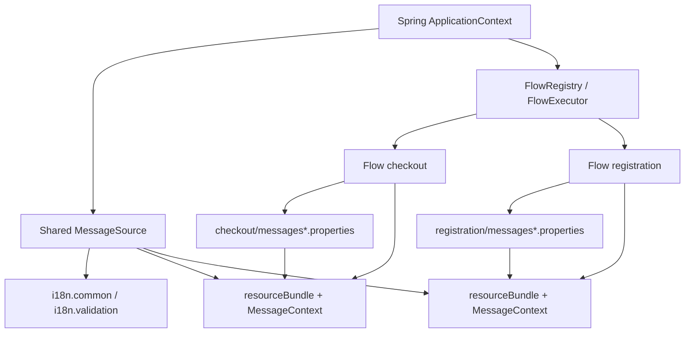

# Kết hợp tài nguyên của flow với MessageSource chung

## 1. Bài toán thông báo trong ứng dụng nhiều flow

Một ứng dụng Spring Web Flow (SWF) thường có nhiều hành trình như đăng ký, đặt hàng, quản lý hồ sơ và thanh toán. Mỗi flow có câu chữ riêng: tiêu đề, hướng dẫn, thông báo xác nhận và lỗi nghiệp vụ. Toàn ứng dụng lại có những câu chữ dùng chung như “Lưu”, “Quay lại”, “Trường bắt buộc” hoặc “Phiên làm việc đã hết hạn”.

Nếu sao chép mọi thông báo vào từng flow, thay đổi một câu dùng chung sẽ phải sửa nhiều nơi. Nếu đưa tất cả vào một bundle toàn cục, các câu chữ chỉ có ý nghĩa trong một flow khó được tổ chức và dễ va chạm mã.

Spring Web Flow hỗ trợ hai phạm vi tài nguyên:

- **Bundle riêng của flow:** các file `messages.properties` đặt cạnh định nghĩa flow.
- **Spring MessageSource chung:** nguồn thông báo của ApplicationContext, dùng lại trong nhiều flow và trong service, controller hoặc validator.

Bài này trình bày cách kết hợp hai phạm vi, truy cập `resourceBundle`, ghi thông báo bằng `MessageContext`, xử lý locale và kiểm thử fallback.

## 2. Phân biệt MessageSource, resourceBundle và MessageContext

| Thành phần | Trách nhiệm | Ví dụ |
|---|---|---|
| `MessageSource` | Phân giải mã thông báo theo locale và tham số | `common.button.save` |
| Flow-specific bundle | Cung cấp mã chỉ dùng trong một flow | `checkout.payment.failed` |
| `resourceBundle` | Biến EL truy cập MessageSource của flow đang hoạt động | `resourceBundle['checkout.title']` |
| `MessageContext` | Lưu thông báo phát sinh trong lượt thực thi để view hiển thị | Lỗi `checkout.address.required` |

`MessageSource` là abstraction của Spring. Các implementation thường gặp gồm `ResourceBundleMessageSource` và `ReloadableResourceBundleMessageSource`.

`MessageContext` là API của Spring Web Flow để thêm, truy xuất và phân giải thông báo trong quá trình thực thi. Message có thể là văn bản trực tiếp hoặc được tra cứu theo code trong `MessageSource`. Ba mức severity là `info`, `warning` và `error`.

`resourceBundle` trỏ tới nguồn thông báo của flow đang hoạt động. Trong SpEL, `MessageSourcePropertyAccessor` đọc message từ nguồn này; với Unified EL, `FlowResourceELResolver` cung cấp chức năng tương ứng.

## 3. Mô hình kết hợp hai nguồn

Một cách tổ chức phổ biến là khai báo nguồn dùng chung trong Spring ApplicationContext chứa Web Flow, sau đó đặt bundle riêng bên cạnh từng flow.



Trong cấu hình chuẩn, ngữ cảnh của flow có thể truy cập ApplicationContext cha. Cơ chế phân giải theo hierarchy của Spring cho phép nguồn cục bộ xử lý các mã riêng của flow; mã không có ở nguồn cục bộ có thể được chuyển tiếp tới MessageSource chung ở context cha.

Có hai quy tắc tổ chức quan trọng:

1. Đặt câu chữ đặc thù trong bundle của flow.
2. Đặt câu chữ dùng chung trong bundle ứng dụng, với namespace rõ như `common.*`, `validation.*` hoặc `security.*`.

Nếu cùng một key xuất hiện ở cả hai nguồn, nguồn cục bộ có thể che khuất bản dịch chung. Hãy tránh trùng key, trừ khi có chủ đích ghi đè và đã kiểm thử theo locale.

## 4. Cấu trúc thư mục tài nguyên

Ví dụ ứng dụng có hai flow `checkout` và `registration`:

```text
src/main/resources/
  i18n/
    common.properties
    common_vi.properties
    common_en.properties
    validation.properties
    validation_vi.properties
    validation_en.properties

WEB-INF/flows/
  checkout/
    checkout.xml
    review.jsp
    messages.properties
    messages_vi.properties
    messages_en.properties
  registration/
    registration.xml
    account.jsp
    messages.properties
    messages_vi.properties
    messages_en.properties
```

Các file trong `i18n/` được khai báo qua MessageSource chung. Các file `messages*.properties` đặt trong thư mục flow là tài nguyên riêng của flow đó.

Mỗi flow nên có một file mặc định `messages.properties` và các file cho locale cần hỗ trợ, ví dụ `messages_vi.properties` hoặc `messages_en.properties. Tên file tuân theo quy ước resource bundle của Java; có thể dùng `messages_vi_VN.properties` cho locale `vi-VN`.

Không đặt mọi câu chữ của ứng dụng trong bundle của một flow rồi kỳ vọng các flow khác tự tìm thấy chúng. Mã dùng chung nên ở MessageSource của ApplicationContext.

## 5. Khai báo MessageSource chung bằng XML

Spring ApplicationContext tìm bean có tên chính xác là `messageSource` để xử lý yêu cầu phân giải thông báo. Nếu context hiện tại không có nguồn, Spring có thể tìm trong context cha.

Ví dụ dùng `ResourceBundleMessageSource`:

```xml
<bean id="messageSource"
      class="org.springframework.context.support.ResourceBundleMessageSource">
    <property name="basenames">
        <list>
            <value>i18n.common</value>
            <value>i18n.validation</value>
        </list>
    </property>
    <property name="defaultEncoding" value="UTF-8" />
    <property name="fallbackToSystemLocale" value="false" />
</bean>
```

Các basename trên tương ứng với:

```text
src/main/resources/i18n/common.properties
src/main/resources/i18n/common_vi.properties
src/main/resources/i18n/common_en.properties

src/main/resources/i18n/validation.properties
src/main/resources/i18n/validation_vi.properties
src/main/resources/i18n/validation_en.properties
```

Basename được viết theo dạng tên package/resource bundle, dùng dấu chấm thay cho dấu gạch chéo. Nên đặt bean trong root web application context hoặc một context cha mà cấu hình Web Flow có thể truy cập.

Nếu muốn đọc lại file properties khi ứng dụng đang chạy hoặc dùng tài nguyên ngoài classpath, có thể dùng `ReloadableResourceBundleMessageSource`:

```xml
<bean id="messageSource"
      class="org.springframework.context.support.ReloadableResourceBundleMessageSource">
    <property name="basenames">
        <list>
            <value>classpath:i18n/common</value>
            <value>classpath:i18n/validation</value>
        </list>
    </property>
    <property name="defaultEncoding" value="UTF-8" />
    <property name="fallbackToSystemLocale" value="false" />
    <property name="cacheSeconds" value="300" />
</bean>
```

`cacheSeconds` quy định khoảng thời gian cache trước khi kiểm tra lại resource. Chọn chính sách cache phù hợp với cách phát hành tài nguyên; không cần bật reload liên tục nếu bundle chỉ thay đổi khi triển khai phiên bản mới.

## 6. Khai báo MessageSource chung bằng Java

Nếu ứng dụng dùng Java configuration, bean vẫn cần tên `messageSource`:

```java
import org.springframework.context.MessageSource;
import org.springframework.context.annotation.Bean;
import org.springframework.context.annotation.Configuration;
import org.springframework.context.support.ResourceBundleMessageSource;

@Configuration
public class I18nConfig {

    @Bean(name = "messageSource")
    public MessageSource messageSource() {
        ResourceBundleMessageSource source =
                new ResourceBundleMessageSource();

        source.setBasenames(
                "i18n.common",
                "i18n.validation"
        );
        source.setDefaultEncoding("UTF-8");
        source.setFallbackToSystemLocale(false);

        return source;
    }
}
```

Service có thể inject nguồn chung để lấy mã dùng toàn ứng dụng:

```java
import java.util.Locale;
import org.springframework.context.MessageSource;
import org.springframework.stereotype.Service;

@Service
public class NotificationTextService {

    private final MessageSource messageSource;

    public NotificationTextService(MessageSource messageSource) {
        this.messageSource = messageSource;
    }

    public String savedText(Locale locale) {
        return messageSource.getMessage(
                "common.record.saved",
                null,
                "Đã lưu thay đổi",
                locale
        );
    }
}
```

Overload `getMessage(code, args, defaultMessage, locale)` nhận mã, tham số, câu mặc định và locale. Nếu không tìm thấy mã trong nguồn hiện tại hoặc nguồn cha, Spring dùng câu mặc định. Overload không có câu mặc định có thể ném `NoSuchMessageException`.

Nguồn được inject vào service là MessageSource chung của ứng dụng. Khi cần đọc thông báo của flow hiện tại, hãy dùng `resourceBundle` hoặc `MessageContext` trong flow context.

## 7. Tạo bundle riêng cho một flow

Giả sử định nghĩa flow checkout nằm ở:

```text
/WEB-INF/flows/checkout/checkout.xml
```

Đặt bundle cạnh file flow:

```text
/WEB-INF/flows/checkout/messages.properties
/WEB-INF/flows/checkout/messages_vi.properties
/WEB-INF/flows/checkout/messages_en.properties
```

Ví dụ file mặc định `messages.properties`:

```properties
checkout.title=Review your order
checkout.address.required=Please enter a delivery address.
checkout.payment.failed=The payment could not be completed.
checkout.confirmation=Your order has been submitted.
```

Ví dụ file `messages_vi.properties`:

```properties
checkout.title=Kiểm tra đơn hàng
checkout.address.required=Vui lòng nhập địa chỉ giao hàng.
checkout.payment.failed=Không thể hoàn tất thanh toán.
checkout.confirmation=Đơn hàng của bạn đã được gửi.
```

Các key `checkout.*` chỉ có ý nghĩa trong flow checkout. Flow registration có thể định nghĩa `registration.title` hoặc `registration.email.invalid` trong bundle riêng mà không làm phình bundle checkout.

Khi locale là `vi`, Web Flow có thể dùng file tiếng Việt. Nếu locale không có file riêng hoặc một key chưa được dịch, resource bundle có thể fallback về `messages.properties`. Nếu key không được tìm thấy trong nguồn cục bộ, MessageSource ở context cha có thể cung cấp nó theo hierarchy đã cấu hình.

## 8. Quy ước key để tránh ghi đè ngoài ý muốn

Nên chia key theo trách nhiệm:

| Namespace | Nơi đặt | Ví dụ |
|---|---|---|
| `common.*` | Bundle chung | `common.button.save` |
| `validation.*` | Bundle chung | `validation.required` |
| `security.*` | Bundle chung | `security.session.expired` |
| `checkout.*` | Bundle checkout | `checkout.address.required` |
| `registration.*` | Bundle registration | `registration.email.invalid` |

Ví dụ bundle chung:

```properties
common.button.save=Lưu
common.button.cancel=Hủy
common.button.back=Quay lại
common.record.saved=Đã lưu thay đổi thành công.
validation.required=Vui lòng nhập {0}.
security.session.expired=Phiên làm việc đã hết hạn. Vui lòng đăng nhập lại.
```

Và bundle checkout:

```properties
checkout.title=Kiểm tra đơn hàng
checkout.address.required=Vui lòng nhập địa chỉ giao hàng.
checkout.payment.failed=Không thể hoàn tất thanh toán.
```

Không định nghĩa lại `common.button.save` trong bundle checkout chỉ vì màn hình checkout cũng có nút Lưu. Đưa key này vào bundle chung. Ngược lại, không đưa `checkout.payment.failed` vào bundle chung nếu thông báo chỉ có nghĩa trong flow checkout.

Trong cấu trúc context phân cấp chuẩn, nguồn cục bộ của flow được tra cứu trước nguồn chung. Vì vậy, key chung bị lặp ở bundle cục bộ có thể che khuất bản dịch chung. Dùng namespace riêng và viết test cho các trường hợp override có chủ ý.

## 9. Truy cập resourceBundle trong biểu thức của flow

Web Flow cung cấp biến EL `resourceBundle` để truy cập MessageSource của flow đang hoạt động. Với SpEL, `MessageSourcePropertyAccessor` hỗ trợ đọc message bằng tên thuộc tính hoặc cú pháp map.

Ví dụ trong flow:

```xml
<on-start>
    <set name="flowScope.pageTitle"
         value="resourceBundle['checkout.title']" />
</on-start>
```

Hoặc:

```xml
<evaluate expression="resourceBundle['checkout.confirmation']"
          result="requestScope.confirmationText" />
```

Cú pháp dấu chấm phù hợp với key đơn giản:

```xml
<evaluate expression="resourceBundle.checkoutTitle"
          result="requestScope.title" />
```

Với key chứa dấu chấm như `checkout.title`, cú pháp ngoặc vuông thể hiện rõ đó là một key nguyên vẹn. Với Unified EL, Web Flow cung cấp `FlowResourceELResolver` để phân giải message từ MessageSource của flow.

Trong subflow, `resourceBundle` trỏ tới nguồn của flow đang hoạt động. Vì vậy, bundle payment có thể chứa key riêng cho payment; các key dùng chung vẫn được đặt ở MessageSource ứng dụng.

## 10. Dùng resourceBundle trong view

Tài liệu Web Flow minh họa việc truy cập tài nguyên từ view bằng biến `resourceBundle`. Ví dụ với JSF:

```xml
<h:outputText value="#{resourceBundle.reservationConfirmation}" />
```

Với key chứa dấu chấm, có thể dùng cú pháp truy cập theo key:

```xml
<h:outputText value="#{resourceBundle['checkout.title']}" />
```

Trong view Spring MVC, tag `<spring:message>` thường phân giải mã qua MessageSource của Spring web context, phù hợp với các mã chung. Với thông báo riêng của flow, dùng biến `resourceBundle` mà Web Flow cung cấp trong view context hoặc cơ chế message tích hợp với view technology đang dùng.

Ví dụ JSP dùng tag cho thông báo chung:

```jsp
<spring:message code="common.button.save" />
```

Các thông báo ghi vào `MessageContext` nên được render qua cơ chế message của view đang dùng để giữ severity và field source. Luôn escape nội dung khi hiển thị; không coi properties là HTML đáng tin cậy.

## 11. Ghi thông báo quốc tế hóa bằng MessageContext

`MessageContext` là nơi ghi các thông báo phát sinh trong một lượt thực thi flow. Một thông báo có thể mang:

- `severity`: mức `info`, `warning` hoặc `error`.
- `source`: field hoặc thành phần giao diện liên quan, ví dụ `email` hay `checkinDate`.
- `code`: mã được phân giải qua MessageSource.
- `args`: các tham số được chèn vào thông điệp.

Ví dụ Java Action xử lý lỗi đặt chỗ:

```java
import org.springframework.binding.message.MessageBuilder;
import org.springframework.stereotype.Component;
import org.springframework.webflow.execution.Action;
import org.springframework.webflow.execution.Event;
import org.springframework.webflow.execution.RequestContext;
import com.example.checkout.domain.Booking;
import com.example.checkout.service.BookingService;
import com.example.checkout.service.RoomUnavailableException;

@Component("reservationAction")
public class ReservationAction implements Action {

    private final BookingService bookingService;

    public ReservationAction(BookingService bookingService) {
        this.bookingService = bookingService;
    }

    @Override
    public Event execute(RequestContext context) {
        Booking booking = (Booking) context.getFlowScope().get("booking");
        try {
            bookingService.reserve(booking);
            return new Event(this, "success");
        } catch (RoomUnavailableException ex) {
            context.getMessageContext().addMessage(
                new MessageBuilder()
                    .error()
                    .source("room")
                    .code("checkout.room.unavailable")
                    .arg(booking.getRoomName())
                    .build()
            );
            return new Event(this, "invalid");
        }
    }
}
```

Trong bundle checkout:

```properties
checkout.room.unavailable=Phòng {0} hiện không còn trống.
```

Action thêm message với severity `error`, liên kết lỗi với field `room` và truyền tên phòng làm tham số `{0}` qua `arg(...)`. Dùng `arg` cho giá trị thông thường; `resolvableArg` dành cho tham số bản thân nó là một `MessageSourceResolvable` cần được phân giải tiếp. Action trả Event `invalid` để flow chọn nhánh phù hợp.

Ví dụ flow gọi action:

Giả sử component scan đã đăng ký bean reservationAction trong Spring context:

```xml
<view-state id="review" model="booking">
    <transition on="confirm" to="reserveRoom" />
</view-state>

<action-state id="reserveRoom">
    <evaluate expression="reservationAction" />
    <transition on="success" to="completed" />
    <transition on="invalid" to="review" />
</action-state>

<end-state id="completed" />
```

Mã `checkout.room.unavailable` được phân giải theo locale hiện tại bằng nguồn message của flow. Nếu mã không có ở bundle cục bộ nhưng có trong nguồn chung, nguồn chung có thể đáp ứng theo hierarchy đã cấu hình.

Thông báo trong `MessageContext` được Web Flow giữ qua redirect của flow execution. Điều này giúp mô hình POST/REDIRECT/GET không làm mất thông báo vừa ghi.

## 12. Thông báo tự sinh từ binding và validation

Web Flow cũng tạo thông báo khi binding từ view vào model thất bại, ví dụ người dùng nhập chữ vào field ngày tháng. Thông báo được tra cứu theo mã lỗi và tên thuộc tính.

Giả sử flow đang bind vào model `Booking`, field `checkinDate` gặp lỗi chuyển kiểu. Web Flow thử mã cụ thể:

```text
booking.checkinDate.typeMismatch
```

Ví dụ bundle:

```properties
booking.checkinDate.typeMismatch=Ngày nhận phòng phải theo định dạng yyyy-MM-dd.
```

Nếu không tìm thấy mã cụ thể, Web Flow thử mã tổng quát:

```properties
typeMismatch=Trường {0} có kiểu dữ liệu không hợp lệ.
```

Tên field được truyền như một message argument. Điều này cho phép ứng dụng khai báo một câu chung cho nhiều trường hợp chuyển kiểu, đồng thời ghi đè bằng thông báo riêng cho một model property khi cần.

Mã được sinh còn phụ thuộc `MessageCodesResolver` và cấu hình binding/validation. Nếu ứng dụng đã tùy chỉnh resolver, hãy kiểm tra danh sách mã thực tế thay vì giả định luôn có cùng một chuỗi.

Với Bean Validation, thông báo constraint có thể lấy từ bundle mà validator sử dụng. Nếu đang cấu hình `LocalValidatorFactoryBean` với MessageSource chung, hãy bảo đảm message interpolator và nguồn `ValidationMessages.properties`/Spring MessageSource được kết nối đúng mục đích. Không mặc định bundle của flow và bundle Bean Validation là cùng một nguồn nếu chưa cấu hình hoặc kiểm thử.

## 13. Locale được chọn như thế nào?

`MessageSource` cần một `Locale` để chọn bundle phù hợp. Trong ứng dụng Spring MVC, locale thường được xác định qua cơ chế như `AcceptHeaderLocaleResolver`, `SessionLocaleResolver` hoặc `CookieLocaleResolver`, tùy cấu hình.

Ví dụ người dùng chọn tiếng Việt:

```text
Locale: vi_VN

Flow bundle:
  messages_vi.properties

Shared bundles:
  common_vi.properties
  validation_vi.properties
```

Với locale `vi-VN`, Java resource bundle có thể xét file cụ thể `messages_vi_VN.properties`, sau đó `messages_vi.properties`, rồi bundle mặc định `messages.properties`. Cơ chế tương tự áp dụng cho basename chung.

Nên thống nhất cách chọn locale cho MVC và Web Flow. Nếu giao diện đổi sang tiếng Việt nhưng `MessageContext` vẫn dùng locale tiếng Anh, thông báo validation sẽ không đồng nhất với view.

Một số lưu ý:

- Đừng dựa vào locale mặc định của máy chủ để chọn ngôn ngữ người dùng.
- Nếu muốn tránh fallback theo system locale, đặt `fallbackToSystemLocale=false` trên MessageSource chung.
- Luôn có bundle mặc định `messages.properties`.
- Với file properties chứa tiếng Việt, thống nhất encoding giữa build, runtime và loader. Với runtime Java cũ hoặc loader cũ dùng ISO-8859-1, có thể cần Unicode escape; hãy kiểm tra bằng test đọc chuỗi tiếng Việt thực tế.

## 14. Khi nào nên inject MessageSource và khi nào dùng resourceBundle?

| Nhu cầu | Cách dùng phù hợp |
|---|---|
| Service hoặc controller cần câu chữ chung | Inject bean `MessageSource` |
| Flow cần đọc message của chính nó trong EL | Dùng `resourceBundle` |
| Java Action muốn thêm thông báo cho view | Dùng `MessageContext` và `MessageBuilder` |
| Validator cần thêm lỗi gắn với field | Dùng `MessageContext` trong `ValidationContext` hoặc cơ chế `Errors` tương ứng |
| View cần hiển thị thông báo chung | Dùng cơ chế message tag của view technology |
| View cần hiển thị message theo flow đang hoạt động | Dùng `resourceBundle` hoặc cơ chế message tích hợp của Web Flow |

Ví dụ lấy mã chung trong service:

```java
String commonText = messageSource.getMessage(
        "common.button.save",
        null,
        locale
);
```

Đoạn này đọc nguồn chung được inject. Nó không có nghĩa là đang đọc bundle riêng của flow. Nếu code cần message flow-specific, hãy để việc phân giải diễn ra trong flow context hoặc dùng `resourceBundle`/`MessageContext` của execution.

## 15. Lỗi thường gặp và cách khắc phục

| Hiện tượng | Nguyên nhân thường gặp | Cách xử lý |
|---|---|---|
| Flow không tìm thấy mã chung | Bean không tên `messageSource` hoặc nằm ở context không phải parent/ancestor của flow | Đặt bean trong context chứa Web Flow hoặc context cha có thể truy cập |
| `resourceBundle` không có key | Sai tên key, sai locale hoặc bundle không nằm cạnh flow definition | Kiểm tra thư mục flow và file locale |
| View hiện mã thay vì câu chữ | Message code chưa được tìm thấy hoặc default message được cấu hình là code | Kiểm tra key, basename và locale |
| Một flow dùng câu chữ của flow khác | Dùng key trùng hoặc bundle đặt nhầm thư mục | Tạo namespace theo flow và kiểm tra vị trí file |
| Bản dịch tiếng Việt không xuất hiện | Sai tên file locale, encoding hoặc locale hiện tại vẫn là English | Kiểm tra LocaleResolver, `messages_vi.properties` và encoding |
| Message chung bị flow-local che khuất | Bundle flow định nghĩa trùng key chung | Xóa key trùng hoặc chủ ý kiểm thử override |
| Lỗi binding chỉ hiện thông báo tổng quát | Thiếu mã cụ thể `model.property.errorCode` | Bổ sung key cụ thể hoặc chấp nhận fallback tổng quát |
| Thông báo validation dùng ngôn ngữ khác view | Validator dùng locale/MessageSource khác | Đồng bộ locale và cấu hình validator |
| Message bị mất sau redirect | Message được lưu ngoài MessageContext hoặc custom redirect xử lý sai | Ghi bằng MessageContext và kiểm tra luồng PRG |
| Message chứa HTML không an toàn | Nội dung message hoặc tham số được đưa thẳng vào markup | Escape output; không coi properties là HTML đáng tin |

Không dùng mã message làm dữ liệu điều khiển nghiệp vụ. Message chỉ là nội dung hiển thị; logic flow nên dựa trên event, validation result hoặc outcome rõ ràng.

## 16. Kiểm thử kết hợp bundle cục bộ và MessageSource chung

Hãy tạo flow `checkout` với bundle cục bộ và cấu hình MessageSource chung. Bộ kiểm thử nên bao phủ các trường hợp sau:

| Ca kiểm thử | Dữ liệu | Kết quả mong đợi |
|---|---|---|
| Mã riêng của flow | `checkout.title` | Lấy từ `checkout/messages*.properties` |
| Mã chung | `common.button.save` | Lấy từ MessageSource ứng dụng |
| Locale tiếng Việt | `vi_VN` | Chọn bản dịch tiếng Việt nếu có |
| Locale không có file riêng | Một locale chưa được cung cấp | Fallback theo resource bundle mặc định |
| Key không có trong flow | Mã chỉ có ở nguồn chung | Nguồn chung đáp ứng nếu nằm trong parent hierarchy |
| Key trùng giữa flow và common | Cùng một code ở hai nguồn | Xác nhận thứ tự ưu tiên thực tế; tránh trùng nếu không có chủ đích |
| MessageContext có tham số | `checkout.room.unavailable` + tên phòng | `{0}` được thay đúng |
| Lỗi binding | `booking.checkinDate.typeMismatch` | Ưu tiên mã cụ thể, rồi fallback `typeMismatch` |
| Subflow | Bundle riêng của payment | Khi payment active, đọc message theo flow đang hoạt động |
| Encoding | Câu có dấu tiếng Việt | Không lỗi dấu hoặc ký tự thay thế |

Một test tối thiểu cho nguồn chung:

```java
import static org.junit.Assert.assertEquals;

import java.util.Locale;
import org.junit.Test;
import org.junit.runner.RunWith;
import org.springframework.beans.factory.annotation.Autowired;
import org.springframework.context.MessageSource;
import org.springframework.test.context.ContextConfiguration;
import org.springframework.test.context.junit4.SpringJUnit4ClassRunner;

@RunWith(SpringJUnit4ClassRunner.class)
@ContextConfiguration(classes = I18nConfig.class)
public class SharedMessagesTest {

    @Autowired
    private MessageSource messageSource;

    @Test
    public void resolvesVietnameseCommonMessage() {
        String text = messageSource.getMessage(
                "common.button.save",
                null,
                Locale.forLanguageTag("vi-VN")
        );

        assertEquals("Lưu", text);
    }
}
```

Trong test thực tế, inject bean từ ApplicationContext của test thay vì tự tạo một nguồn rời rạc. Với bundle riêng, chạy flow bằng Web Flow test support hoặc FlowExecutor test configuration để kiểm tra `resourceBundle` trong context của flow. Test riêng `ResourceBundleMessageSource` chung không chứng minh được flow builder đã nhận đúng bundle nằm cạnh flow definition.

## 17. Checklist triển khai

- [ ] Bean chung được đăng ký bằng tên `messageSource`.
- [ ] Bean nằm trong ApplicationContext mà flow có thể truy cập.
- [ ] Các basename chung được phân vùng theo namespace.
- [ ] Mỗi flow có `messages.properties` mặc định và file locale cần hỗ trợ.
- [ ] Bundle flow chỉ chứa key đặc thù của flow.
- [ ] Không lặp key chung trong bundle cục bộ nếu không chủ ý override.
- [ ] Các message code trong MessageContext có bản dịch ở locale cần thiết.
- [ ] `resourceBundle` được kiểm thử trong cả flow gốc và subflow.
- [ ] Mã lỗi binding cụ thể và mã lỗi tổng quát đã được khai báo.
- [ ] LocaleResolver, encoding và fallback locale được cấu hình thống nhất.
- [ ] View escape nội dung message khi render.
- [ ] Có test cho mã cục bộ, mã chung, fallback và key trùng.

## 18. Ghi nhớ

Spring Web Flow hỗ trợ bundle riêng bằng cách đặt `messages.properties` và các file locale cạnh flow definition. Biến `resourceBundle` truy cập MessageSource của flow đang hoạt động. Spring ApplicationContext cung cấp MessageSource chung thông qua bean tên `messageSource`, để service, controller, validator và các flow dùng lại thông báo toàn ứng dụng.

`MessageContext` kết nối hai phần này với quá trình thực thi: action hoặc validator ghi message theo code, severity, source và arguments; view hiển thị nội dung đã được phân giải theo locale. Hãy giữ namespace riêng cho thông báo chung và thông báo flow, kiểm tra hierarchy khi có key trùng và kiểm thử locale/fallback trong execution thật.

### Tài liệu tham khảo

- [Spring Web Flow 2.5.1 — Working with messages](https://docs.spring.io/spring-webflow/docs/2.5.1.RELEASE/reference/html/views.html) — `MessageContext`, `MessageBuilder`, flow-specific bundles, `resourceBundle` và message sinh từ data binding.
- [Spring Web Flow 2.5.1 — FlowResourceELResolver API](https://docs.spring.io/spring-webflow/docs/2.5.x/api/org/springframework/webflow/expression/el/FlowResourceELResolver.html) — EL resolver đọc MessageSource của flow đang hoạt động.
- [Spring Web Flow 2.5.1 — MessageSourcePropertyAccessor API](https://docs.spring.io/spring-webflow/docs/2.5.1.RELEASE/api/org/springframework/webflow/expression/spel/MessageSourcePropertyAccessor.html) — truy cập message source qua SpEL và biến `resourceBundle`.
- [Spring Web Flow 2.5.1 — DefaultMessageContext API](https://docs.spring.io/spring-webflow/docs/2.5.x/api/org/springframework/binding/message/DefaultMessageContext.html) — thêm và phân giải thông báo qua `MessageSource`.
- [Spring Framework — Additional Capabilities of the ApplicationContext](https://docs.spring.io/spring/reference/core/beans/context-introduction.html) — quy ước bean `messageSource`, resource bundles và MessageSource hierarchy.
