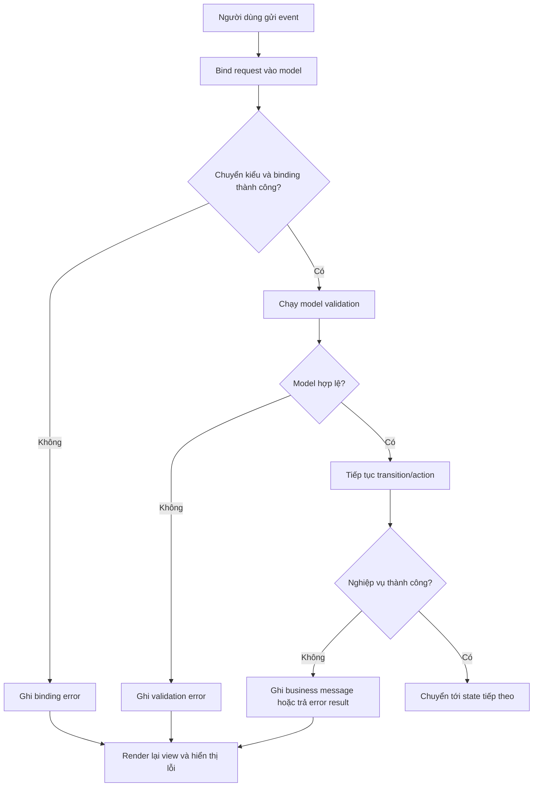

# Hiển thị lỗi binding và validation trong view

Một form đặt phòng yêu cầu ngày nhận phòng, ngày trả phòng và số khách. Người dùng có thể nhập chữ vào trường ngày, bỏ trống số khách hoặc chọn ngày trả phòng sớm hơn ngày nhận phòng. Spring Web Flow cần nhận ra từng lỗi, giữ người dùng ở đúng màn hình và đưa thông báo tới đúng vị trí để họ sửa dữ liệu.

Trong Spring Web Flow, lỗi phát sinh khi chuyển dữ liệu từ request vào model được ghi nhận như **binding errors**; lỗi do quy tắc dữ liệu được ghi nhận như **validation errors**. Cả hai có thể được hiển thị trong view thông qua mô hình lỗi mà Web Flow cung cấp cho Spring MVC view, qua `MessageContext` hoặc qua cơ chế riêng của JSF. Muốn hiển thị đúng, cần hiểu lỗi thuộc về field nào, mã thông báo được phân giải ra sao và công nghệ view đang dùng cách truy cập lỗi nào.

## 1. Mục tiêu học tập

Sau bài học, bạn có thể:

1. Phân biệt binding/conversion error, validation error và lỗi nghiệp vụ.
2. Giải thích cách `view-state model` kích hoạt binding và validation khi người dùng gửi event.
3. Hiển thị lỗi theo field và lỗi tổng thể trong JSP bằng Spring form tags.
4. Hiển thị lỗi trong Thymeleaf bằng `th:errors` và `#fields`.
5. Hiển thị thông báo bằng `h:message` và `h:messages` trong JSF.
6. Ghi lỗi từ validator vào `MessageContext` và gắn lỗi với đúng property.
7. Tùy biến thông báo binding bằng flow-specific `messages.properties`.
8. Giữ người dùng ở view hiện tại khi dữ liệu không hợp lệ và cho phép họ sửa.
9. Kiểm thử cả trạng thái flow, message code và HTML hiển thị.

## 2. Phân biệt ba loại lỗi

Không phải mọi thông báo trên form đều xuất phát từ cùng một giai đoạn.

| Loại lỗi | Thời điểm phát sinh | Ví dụ | Nơi xử lý |
| --- | --- | --- | --- |
| Binding/conversion error | Khi chuyển request parameter thành property của model | Nhập `abc` vào trường ngày | Web Flow binding và ConversionService |
| Validation error | Sau khi binding thành công, khi kiểm tra ràng buộc | Ngày trả phòng trước ngày nhận phòng | Bean Validation hoặc validator |
| Lỗi nghiệp vụ | Khi action/service thực hiện một thao tác nghiệp vụ | Phòng vừa được người khác đặt | Action/service ghi message hoặc trả kết quả lỗi |

Ba loại lỗi có thể cùng xuất hiện trên một view nhưng có nguyên nhân khác nhau:



### 2.1. Binding error: dữ liệu không thể đưa vào model

HTTP request gửi dữ liệu dưới dạng chuỗi. Nếu property `checkinDate` có kiểu `LocalDate` nhưng người dùng nhập `abc`, bộ chuyển đổi không thể tạo một ngày hợp lệ. Web Flow ghi nhận lỗi chuyển kiểu cho property đó.

Khi view-state có thuộc tính `model`, Web Flow thực hiện view-to-model binding khi xử lý event. Nếu binding thất bại, flow không tạo event để transition tiếp tục; view được render lại để người dùng sửa dữ liệu.

### 2.2. Validation error: model đã nhận dữ liệu nhưng vi phạm quy tắc

Ví dụ, hai giá trị ngày đều chuyển kiểu thành công:

- Ngày nhận phòng: 2026-12-20.
- Ngày trả phòng: 2026-12-18.

Binding thành công, nhưng quy tắc nghiệp vụ yêu cầu ngày trả phòng phải sau ngày nhận phòng. Validator ghi lỗi vào model/message context. Flow giữ người dùng ở màn hình hiện tại thay vì đi tiếp tới bước xem lại.

### 2.3. Business error: thao tác không thể hoàn tất

Người dùng nhập form hợp lệ nhưng phòng vừa hết khi service xác nhận đặt chỗ. Đây là lỗi nghiệp vụ xảy ra sau validation. Action có thể thêm thông báo vào `MessageContext` và ngăn transition, để view hiển thị lỗi mà không làm người dùng mất dữ liệu đã nhập.

## 3. Khai báo model cho view-state

Khi một view cần nhận dữ liệu form, khai báo model bằng thuộc tính `model`:

```xml
<flow xmlns="http://www.springframework.org/schema/webflow"
      xmlns:xsi="http://www.w3.org/2001/XMLSchema-instance"
      xsi:schemaLocation="http://www.springframework.org/schema/webflow
                          https://www.springframework.org/schema/webflow/spring-webflow.xsd">

    <var name="booking"
         class="com.example.booking.BookingForm" />

    <view-state id="enterBookingDetails"
                view="booking/enterBookingDetails"
                model="booking">
        <binder>
            <binding property="checkinDate" required="true" />
            <binding property="checkoutDate" required="true" />
            <binding property="guestCount" required="true" />
        </binder>

        <transition on="proceed" to="reviewBooking" />
        <transition on="cancel" to="bookingCancelled"
                    bind="false" validate="false" />
    </view-state>

    <view-state id="reviewBooking">
        <transition on="revise" to="enterBookingDetails" />
        <transition on="confirm" to="confirmBooking" />
    </view-state>

    <end-state id="bookingCancelled" />
</flow>
```

Trong ví dụ:

- `booking` là model mà view chỉnh sửa.
- `model="booking"` bật quy trình binding và validation của Web Flow.
- `<binder>` giới hạn những property được nhận từ form.
- Event `proceed` chỉ đi tiếp nếu binding và validation hoàn tất.
- Event `cancel` bỏ qua binding và validation để người dùng có thể hủy ngay cả khi form đang sai.

Khai báo `binder` tường minh giúp giới hạn field được phép binding. Nếu không cấu hình binder, mặc định các public property của model có thể đủ điều kiện nhận dữ liệu từ view; điều này cần được cân nhắc về bảo mật mass assignment.

## 4. Spring BindingModel đưa lỗi tới Spring view

Khi Spring Web Flow render một view MVC có model, nó cung cấp một đối tượng binding cho model. Trong API Web Flow, `BindingModel` triển khai Spring `BindingResult`/`Errors`. Nó giữ:

- Model object đang được bind.
- Kết quả mapping từ request sang model.
- Các field error và object/global error.
- Message được ghi trong `MessageContext` cho model đó.

Nhờ adapter này, các công cụ view của Spring MVC có thể sử dụng cách hiển thị lỗi quen thuộc. Với JSP, đó là Spring form tags. Với Thymeleaf Spring integration, đó là `th:errors` và `#fields`.

Điều quan trọng là tên model phải nhất quán. Nếu flow dùng `model="booking"`, form view cần bind tới object `booking`; đừng khai báo form object thành `reservation` rồi mong Spring tự nối lỗi của `booking` sang đó.

## 5. Hiển thị lỗi trong JSP bằng Spring form tags

Spring Web Flow cung cấp BindingModel tương thích Spring BindingResult để Spring form tags đọc dữ liệu và lỗi.

### 5.1. Hiển thị lỗi tổng thể và lỗi theo field

Ví dụ `enterBookingDetails.jsp`:

```jsp
<%@ taglib prefix="form" uri="http://www.springframework.org/tags/form" %>

<form:form modelAttribute="booking"
           method="post"
           action="${flowExecutionUrl}">

    <div class="form-errors" role="alert">
        <form:errors path="*" element="div" cssClass="error-summary" />
    </div>

    <div class="field">
        <form:label path="checkinDate">Ngày nhận phòng</form:label>
        <form:input path="checkinDate"
                    cssErrorClass="input-invalid" />
        <form:errors path="checkinDate"
                     element="span"
                     cssClass="field-error" />
    </div>

    <div class="field">
        <form:label path="checkoutDate">Ngày trả phòng</form:label>
        <form:input path="checkoutDate"
                    cssErrorClass="input-invalid" />
        <form:errors path="checkoutDate"
                     element="span"
                     cssClass="field-error" />
    </div>

    <div class="field">
        <form:label path="guestCount">Số khách</form:label>
        <form:input path="guestCount"
                    cssErrorClass="input-invalid" />
        <form:errors path="guestCount"
                     element="span"
                     cssClass="field-error" />
    </div>

    <button type="submit" name="_eventId_proceed">
        Tiếp tục
    </button>
    <button type="submit" name="_eventId_cancel">
        Hủy
    </button>
</form:form>
```

Ý nghĩa:

- `modelAttribute="booking"` liên kết form với model trong flow.
- `path="*"` hiển thị các lỗi của object, hữu ích cho phần tóm tắt lỗi đầu form.
- `path="checkinDate"` chỉ hiển thị lỗi của một property.
- `cssErrorClass` thêm class khi field có lỗi.
- `element` xác định phần tử HTML bao quanh thông báo.

Nếu không có lỗi tương ứng, thẻ `form:errors` không tạo thông báo. Có thể đặt một vùng summary có điều kiện hiển thị bằng CSS/logic view để tránh tạo một hộp trống.

### 5.2. Tập trung lỗi ở đầu form

Một form dài nên có vùng tóm tắt để người dùng biết cần sửa gì:

```jsp
<div class="error-summary" role="alert" aria-live="polite">
    <strong>Vui lòng kiểm tra thông tin:</strong>
    <form:errors path="*" element="ul" />
</div>
```

Nếu muốn hiển thị từng lỗi gần field, giữ các thẻ `form:errors` theo field như phần trên. Hai cách có thể được kết hợp: summary ở đầu form và thông báo ngắn cạnh trường sai.

### 5.3. Không tự dựng tên BindingResult

Với Spring MVC thông thường, Spring form tags dựa vào model attribute và binding result tương ứng. Trong flow, để Web Flow cung cấp BindingModel cho đúng tên `model`; không tạo một object lỗi giả trong request scope rồi gắn nhầm vào form.

## 6. Hiển thị lỗi trong Thymeleaf

Với Thymeleaf Spring integration, `th:object` xác định model object và các tiện ích `#fields` đọc lỗi gắn với object đó.

### 6.1. Hiển thị lỗi theo field

Ví dụ `enterBookingDetails.html`:

```html
<form th:object="${booking}"
      th:action="${flowExecutionUrl}"
      method="post">

    <div th:if="${#fields.hasAnyErrors()}"
         class="error-summary"
         role="alert">
        <strong>Vui lòng kiểm tra thông tin:</strong>
        <ul>
            <li th:each="error : ${#fields.detailedErrors()}"
                th:text="${error.message}">
                Nội dung lỗi
            </li>
        </ul>
    </div>

    <div class="field">
        <label for="checkinDate">Ngày nhận phòng</label>
        <input id="checkinDate"
               type="date"
               th:field="*{checkinDate}"
               th:classappend="${#fields.hasErrors('checkinDate')} ? ' input-invalid' : ''" />
        <p th:if="${#fields.hasErrors('checkinDate')}"
           th:errors="*{checkinDate}"
           class="field-error">
            Lỗi ngày nhận phòng
        </p>
    </div>

    <div class="field">
        <label for="checkoutDate">Ngày trả phòng</label>
        <input id="checkoutDate"
               type="date"
               th:field="*{checkoutDate}"
               th:classappend="${#fields.hasErrors('checkoutDate')} ? ' input-invalid' : ''" />
        <p th:if="${#fields.hasErrors('checkoutDate')}"
           th:errors="*{checkoutDate}"
           class="field-error">
            Lỗi ngày trả phòng
        </p>
    </div>

    <button type="submit" name="_eventId_proceed">
        Tiếp tục
    </button>
    <button type="submit" name="_eventId_cancel">
        Hủy
    </button>
</form>
```

Các biểu thức chính:

- `th:object="${booking}"` chọn form-backing object.
- `th:field="*{checkinDate}"` liên kết input với property.
- `#fields.hasErrors('checkinDate')` kiểm tra field có lỗi không.
- `th:errors="*{checkinDate}"` hiển thị message của field.
- `#fields.detailedErrors()` cho phép lặp qua danh sách lỗi để xây dựng summary.

### 6.2. Phân biệt field error và global error

`#fields.detailedErrors()` trả về các thông tin lỗi chi tiết, trong đó có cờ `global` để phân biệt lỗi gắn với field và lỗi toàn object. Ví dụ:

```html
<ul th:if="${#fields.hasAnyErrors()}">
    <li th:each="error : ${#fields.detailedErrors()}"
        th:class="${error.global} ? 'global-error' : 'field-error'">
        <span th:text="${error.global} ? '*' : error.fieldName">
            Trường
        </span>
        <span th:text="${error.message}">Thông báo</span>
    </li>
</ul>
```

Nếu cần hiển thị lỗi ngoài form, Thymeleaf hỗ trợ biểu thức variable thay cho selection:

```html
<div th:errors="${booking}">Lỗi của toàn object</div>
<div th:errors="${booking.checkinDate}">Lỗi của ngày nhận phòng</div>
<div th:errors="${booking.*}">Tất cả lỗi của booking</div>
```

Hãy giữ cùng tên object giữa `model="booking"` và `th:object="${booking}"` để tránh đọc nhầm binding errors.

## 7. Hiển thị lỗi trong JSF/Facelets

Với JSF, Spring Web Flow tích hợp `MessageContext` với hệ thống message của JSF. Có thể dùng component chuẩn:

```xml
<h:form id="bookingForm">
    <h:messages id="allMessages"
                globalOnly="false"
                layout="list"
                styleClass="error-summary" />

    <h:outputLabel for="checkinDate"
                   value="Ngày nhận phòng" />
    <h:inputText id="checkinDate"
                 value="#{booking.checkinDate}">
        <f:convertDateTime pattern="yyyy-MM-dd" />
    </h:inputText>
    <h:message for="checkinDate"
               styleClass="field-error" />

    <h:outputLabel for="checkoutDate"
                   value="Ngày trả phòng" />
    <h:inputText id="checkoutDate"
                 value="#{booking.checkoutDate}">
        <f:convertDateTime pattern="yyyy-MM-dd" />
    </h:inputText>
    <h:message for="checkoutDate"
               styleClass="field-error" />

    <h:commandButton value="Tiếp tục" action="proceed" />
</h:form>
```

- `h:message` hiển thị message gắn với một component.
- `h:messages` hiển thị danh sách message; `globalOnly="false"` cho phép hiển thị cả message không phải global.
- Message được thêm vào `MessageContext` của Web Flow có thể xuất hiện cùng message JSF trong vùng `h:messages` khi tích hợp đúng.

Không áp dụng Spring form taglib hoặc Thymeleaf `#fields` cho Facelets. Mỗi view technology có cơ chế render lỗi riêng, nhưng dữ liệu lỗi vẫn có thể được quản lý tập trung bởi Web Flow.

## 8. Ghi lỗi vào MessageContext từ validator

`MessageContext` là nơi Web Flow lưu thông báo trong suốt quá trình thực thi flow. Nó hỗ trợ ba mức độ:

| Severity | Dùng khi |
| --- | --- |
| `error` | Dữ liệu không hợp lệ hoặc thao tác không thể tiếp tục |
| `warning` | Có cảnh báo nhưng người dùng có thể tiếp tục |
| `info` | Thông tin kết quả hoặc hướng dẫn |

Message có thể gắn với một property bằng `source` hoặc là message chung nếu không chỉ rõ source.

### 8.1. Validator theo view-state

Với model tên `booking` và view-state `enterBookingDetails`, Web Flow có thể tự tìm bean `bookingValidator` và gọi phương thức `validateEnterBookingDetails`:

```java
package com.example.booking;

import org.springframework.binding.message.MessageBuilder;
import org.springframework.binding.message.MessageContext;
import org.springframework.stereotype.Component;
import org.springframework.binding.validation.ValidationContext;

import java.time.LocalDate;

@Component
public class BookingValidator {

    public void validateEnterBookingDetails(
            BookingForm booking,
            ValidationContext context) {

        MessageContext messages = context.getMessageContext();
        LocalDate today = LocalDate.now();

        if (booking.getCheckinDate() == null
                || !booking.getCheckinDate().isAfter(today)) {
            messages.addMessage(new MessageBuilder()
                    .error()
                    .source("checkinDate")
                    .code("booking.checkinDate.notFuture")
                    .defaultText("Ngày nhận phòng phải sau hôm nay.")
                    .build());
        }

        if (booking.getCheckinDate() != null
                && booking.getCheckoutDate() != null
                && !booking.getCheckoutDate()
                        .isAfter(booking.getCheckinDate())) {
            messages.addMessage(new MessageBuilder()
                    .error()
                    .source("checkoutDate")
                    .code("booking.checkoutDate.afterCheckin")
                    .defaultText("Ngày trả phòng phải sau ngày nhận phòng.")
                    .build());
        }
    }
}
```

Web Flow gọi validator sau khi binding model, trừ khi validation bị tắt trên transition. Tên bean tuân theo quy ước `${model}Validator`; tên phương thức tuân theo `validate${state}`.

### 8.2. Validator đặt trong model

Nếu quy tắc gắn chặt với model, có thể định nghĩa phương thức validation ngay trong model:

```java
public void validateEnterBookingDetails(ValidationContext context) {
    MessageContext messages = context.getMessageContext();

    if (checkoutDate != null
            && checkinDate != null
            && !checkoutDate.isAfter(checkinDate)) {
        messages.addMessage(new MessageBuilder()
                .error()
                .source("checkoutDate")
                .defaultText("Ngày trả phòng phải sau ngày nhận phòng.")
                .build());
    }
}
```

Web Flow tự gọi phương thức có tên `validate${state}` khi model được validate ở state tương ứng. Nếu model có cả phương thức mặc định `validate` và phương thức riêng cho state, phương thức theo state chạy trước rồi tới phương thức mặc định.

### 8.3. Ghi lỗi tổng thể

Khi lỗi không thuộc riêng một field, bỏ `source`:

```java
messages.addMessage(new MessageBuilder()
        .error()
        .code("booking.policy.notAllowed")
        .defaultText("Yêu cầu đặt phòng không đáp ứng chính sách hiện tại.")
        .build());
```

Thông báo này là lỗi ở cấp object/flow. Dùng nó trong summary đầu form hoặc vùng thông báo chung thay vì gắn vào một input không liên quan.

### 8.4. Dùng Spring Validator hiện có

Một validator theo quy ước của Web Flow có thể nhận thêm Spring MVC `Errors`. Điều này hữu ích khi muốn tái sử dụng validator đang dùng trong Spring MVC. `MessageContextErrors` là adapter cho phép Spring `Errors` ghi lỗi vào MessageContext của Web Flow.

Không tạo song song hai nguồn lỗi độc lập nếu không cần thiết. Hãy để validator nhận `Errors` do Web Flow cung cấp, hoặc chuyển lỗi từ validator vào MessageContext qua cơ chế tích hợp.

## 9. Dùng Bean Validation cho lỗi field

Với các ràng buộc đơn giản, có thể đặt annotation trên model:

```java
import jakarta.validation.constraints.Min;
import jakarta.validation.constraints.NotNull;
import org.springframework.format.annotation.DateTimeFormat;
import java.time.LocalDate;

public class BookingForm {

    @NotNull
    @DateTimeFormat(iso = DateTimeFormat.ISO.DATE)
    private LocalDate checkinDate;

    @NotNull
    @DateTimeFormat(iso = DateTimeFormat.ISO.DATE)
    private LocalDate checkoutDate;

    @NotNull
    @Min(1)
    private Integer guestCount;

    // getters/setters
}
```

Spring Web Flow hỗ trợ Bean Validation (JSR-303/Jakarta Bean Validation) khi validation provider được cấu hình trong ứng dụng. Annotation kiểm tra từng thuộc tính; quy tắc liên thuộc tính như ngày trả phòng phải sau ngày nhận phòng thường cần class-level constraint hoặc programmatic validator.

Nếu dùng validation groups, có thể chỉ định `validation-hints` trên view-state để chọn nhóm phù hợp với từng bước. Ví dụ bước nhập cơ bản chỉ kiểm tra trường bắt buộc; bước xác nhận chạy thêm nhóm kiểm tra chính sách.

## 10. Tùy biến message code cho binding errors

Khi binding thất bại do chuyển kiểu, Web Flow tự tạo message code. Với model class `BookingForm` (tên class ngắn trong ví dụ là `bookingForm`) và property `checkinDate`, key cụ thể có dạng:

```properties
bookingForm.checkinDate.typeMismatch=Ngày nhận phòng phải theo định dạng yyyy-MM-dd.
typeMismatch=Trường {0} không đúng định dạng.
```

Web Flow tìm key đặc thù trước:

```text
<model>.<property>.<errorCode>
bookingForm.checkinDate.typeMismatch
```

Nếu không tìm thấy, nó thử key chung theo error code:

```text
<errorCode>
typeMismatch
```

Trong message tổng quát, tên field được truyền như đối số `{0}`. Nhờ vậy, ứng dụng có thể có thông báo chung cho mọi lỗi chuyển kiểu và thông báo riêng cho những field quan trọng.

### 10.1. Đặt message bundle cạnh flow

Có thể đặt các file bundle trong thư mục chứa flow definition:

```text
booking/
├── booking.xml
├── messages.properties
├── messages_vi.properties
├── messages_en.properties
└── enterBookingDetails.html
```

Ví dụ `messages_vi.properties`:

```properties
bookingForm.checkinDate.typeMismatch=Ngày nhận phòng phải theo định dạng yyyy-MM-dd.
booking.checkinDate.notFuture=Ngày nhận phòng phải sau hôm nay.
booking.checkoutDate.afterCheckin=Ngày trả phòng phải sau ngày nhận phòng.
booking.policy.notAllowed=Yêu cầu đặt phòng không đáp ứng chính sách hiện tại.
typeMismatch=Trường {0} không đúng định dạng.
```

Ví dụ `messages_en.properties`:

```properties
bookingForm.checkinDate.typeMismatch=Enter the check-in date as yyyy-MM-dd.
booking.checkinDate.notFuture=Check-in date must be in the future.
booking.checkoutDate.afterCheckin=Check-out date must be after check-in.
booking.policy.notAllowed=This booking request does not meet the current policy.
typeMismatch=The {0} field has an invalid format.
```

Flow-specific message bundle giúp thông báo gắn với một hành trình không làm phình message catalog toàn ứng dụng. Với message dùng chung giữa nhiều flow, có thể đặt ở application-level `MessageSource`.

### 10.2. Code và defaultText

Khi dùng:

```java
new MessageBuilder()
    .error()
    .source("checkinDate")
    .code("booking.checkinDate.notFuture")
    .defaultText("Ngày nhận phòng phải sau hôm nay.")
    .build();
```

- `code` là khóa được dùng để phân giải message theo locale.
- `defaultText` là nội dung dự phòng nếu không tìm thấy message code.
- `source` gắn thông báo với property để view có thể hiển thị cạnh field.

Không hard-code toàn bộ nội dung thông báo trong Java nếu ứng dụng cần hỗ trợ nhiều ngôn ngữ. Giữ code ổn định và đặt nội dung theo locale trong message bundle.

## 11. Giữ view hiện tại khi có lỗi

Nếu binding thất bại, Web Flow không phát flow event để transition tiếp tục. Nếu validator ghi error message, flow cũng không nên rời view-state theo transition yêu cầu dữ liệu hợp lệ. View được render lại cùng lỗi để người dùng sửa.

Ví dụ:

```xml
<view-state id="enterBookingDetails" model="booking">
    <transition on="proceed" to="reviewBooking" />
    <transition on="cancel" to="bookingCancelled"
                bind="false" validate="false" />
</view-state>
```

Hành vi:

- `proceed`: binding và validation chạy. Nếu có lỗi, flow ở lại `enterBookingDetails` và view hiển thị lỗi.
- `cancel`: bỏ qua binding và validation để người dùng rời form dù dữ liệu hiện tại không hợp lệ.

Chú ý: `validate="false"` chỉ tắt validation; binding vẫn chạy. `bind="false"` tắt binding cho transition đó. Với nút Hủy không cần đọc dữ liệu form, thường dùng cả hai.

### 11.1. Giữ lại giá trị người dùng đã nhập

Khi chuyển kiểu thất bại, model không thể nhận giá trị sai kiểu. Tuy nhiên, binding result/mapping result được Web Flow giữ để view binding có thể hiển thị lỗi và giá trị bị từ chối theo cơ chế của view technology. Vì vậy, không nên tự xóa model hoặc tạo object mới ngay sau khi nhận lỗi, nếu không người dùng có thể mất dữ liệu cần sửa.

### 11.2. Không xóa message quá sớm

Không gọi `messageContext.clearMessages()` trước khi view có cơ hội render lỗi. Nếu một action cần xóa thông báo cũ, hãy xác định rõ thời điểm bắt đầu thao tác mới và chỉ xóa những message không còn phù hợp.

## 12. Hiển thị lỗi nghiệp vụ từ transition action

Một số lỗi chỉ xuất hiện sau khi gọi service, ví dụ phòng đã được đặt bởi người khác. Có thể dùng transition action trả về `false` để ngăn transition và ghi message:

```xml
<view-state id="reviewBooking">
    <transition on="confirm" to="bookingConfirmed">
        <evaluate expression="bookingAction.confirm(booking, messageContext)" />
    </transition>
</view-state>
```

Action:

```java
public boolean confirm(BookingForm booking, MessageContext messages) {
    try {
        bookingService.confirm(booking);
        return true;
    } catch (RoomNotAvailableException ex) {
        messages.addMessage(new MessageBuilder()
                .error()
                .code("booking.room.noLongerAvailable")
                .defaultText("Phòng vừa được đặt. Vui lòng chọn phòng khác.")
                .build());
        return false;
    }
}
```

Với POJO action, giá trị boolean `false` ngăn transition; view được render lại và thông báo có thể hiển thị. Chuỗi `success`, `yes` hoặc `true` biểu thị cho phép transition; kết quả khác biểu thị không tiếp tục. Hãy dùng hợp đồng trả về rõ ràng và kiểm thử nó.

Đây là lỗi nghiệp vụ, không phải binding error. Đừng gắn nó vào `checkinDate` nếu vấn đề thực sự là phòng đã hết. Có thể dùng message tổng thể ở đầu form.

## 13. Ajax: cập nhật cả vùng lỗi

Nếu form dùng Ajax để kiểm tra một trường hoặc cập nhật một vùng, fragment chứa thông báo phải được render cùng dữ liệu mới. Ví dụ:

```xml
<view-state id="enterBookingDetails" model="booking">
    <transition on="checkAvailability">
        <evaluate expression="bookingAction.checkAvailability(booking, messageContext)" />
        <render fragments="availabilityResult,bookingErrors" />
    </transition>
</view-state>
```

View cần có các fragment/DOM ID tương ứng:

```html
<div id="availabilityResult">
    <!-- Kết quả kiểm tra phòng -->
</div>

<div id="bookingErrors" role="alert">
    <!-- Lỗi validation hoặc business message -->
</div>
```

`<render>` yêu cầu Web Flow render lại các vùng được nêu; view technology và Ajax handler phải hỗ trợ partial rendering. Nếu chỉ render vùng kết quả mà không render vùng lỗi, người dùng có thể không nhìn thấy message mới dù MessageContext đã nhận message.

Với lỗi binding/validation tự động, Web Flow render lại view hiện tại theo lifecycle xử lý form. Nếu dùng custom Ajax event, cần kiểm tra response thực tế và bảo đảm fragment lỗi nằm trong danh sách cần cập nhật.

## 14. Thiết kế thông báo dễ hiểu và dễ truy cập

Thông báo lỗi tốt cần chỉ rõ:

- Trường nào cần sửa.
- Giá trị hoặc quy tắc nào không được đáp ứng.
- Cách sửa phù hợp.

Ví dụ:

| Không nên | Nên dùng |
| --- | --- |
| `Invalid value` | `Ngày nhận phòng phải theo định dạng yyyy-MM-dd.` |
| `Validation failed` | `Số khách phải từ 1 đến 8.` |
| `Error 409` | `Phòng vừa được đặt. Hãy chọn phòng khác.` |
| `Unexpected exception in BookingService` | `Chưa thể xác nhận đặt phòng. Vui lòng thử lại.` |

Ngoài thông báo bằng chữ:

- Đặt lỗi cạnh field và cung cấp summary ở đầu form khi có nhiều lỗi.
- Dùng `aria-describedby` để liên kết input với phần tử thông báo.
- Đặt `aria-invalid="true"` khi field có lỗi.
- Không chỉ dùng màu đỏ để biểu thị lỗi.
- Đảm bảo thông báo có thể đọc bằng trình đọc màn hình và có thứ tự focus hợp lý.
- Không hiển thị stack trace, tên bảng database, token hoặc dữ liệu nội bộ.
- Để framework escape nội dung message; không ghép HTML không tin cậy vào thông báo.

## 15. Kiểm thử lỗi binding và validation

Kiểm thử cần chứng minh ba điều: lỗi được tạo đúng, flow không đi tiếp sai và view hiển thị message có ích.

### 15.1. Ma trận kiểm thử

| Dữ liệu gửi | Giai đoạn | Kết quả mong đợi |
| --- | --- | --- |
| `checkinDate=abc` | Binding/conversion | Có `typeMismatch`; giữ ở form; hiển thị lỗi ngày |
| `checkinDate` để trống | Required/Bean Validation | Hiển thị lỗi bắt buộc |
| Check-out trước check-in | Programmatic validation | Hiển thị lỗi ở `checkoutDate` |
| Số khách bằng 0 | Bean Validation | Hiển thị lỗi `Min` |
| Phòng vừa hết | Business action | Transition bị ngăn; message chung được hiển thị |
| Nhấn Hủy khi form sai | Transition hủy | Bỏ qua binding/validation và kết thúc hủy |
| Locale tiếng Việt | Message resolution | Chọn message tiếng Việt |
| Locale tiếng Anh | Message resolution | Chọn message tiếng Anh |
| Không có key đặc thù | Message fallback | Dùng key lỗi tổng quát nếu có |

### 15.2. Kiểm thử flow

Với `AbstractXmlFlowExecutionTests`:

1. Khởi động flow và xác nhận state `enterBookingDetails`.
2. Gửi event `proceed` với request parameter không chuyển kiểu được.
3. Xác nhận flow vẫn ở `enterBookingDetails`.
4. Kiểm tra MessageContext có error cho đúng source/property.
5. Gửi dữ liệu hợp lệ nhưng vi phạm quy tắc ngày.
6. Xác nhận validator thêm message và transition chưa chạy.
7. Gửi dữ liệu hợp lệ hoàn toàn và xác nhận flow sang `reviewBooking`.

Khi kiểm tra message, có thể truy cập `MessageContext` của request context trong fixture test và dùng `hasErrorMessages()`, `getAllMessages()` hoặc `getMessagesBySource("checkinDate")`. Cách lấy request context phụ thuộc test harness đang dùng.

### 15.3. Kiểm thử view

Flow execution test không chứng minh HTML đã hiển thị đúng. Bổ sung MVC/browser integration test:

- JSP: response có nội dung của `form:errors` ở field và summary.
- Thymeleaf: response có `th:errors` và class lỗi.
- JSF: response có `h:message`/`h:messages`.
- Kiểm tra nội dung message theo locale.
- Kiểm tra field lỗi có class/ARIA attribute phù hợp.
- Kiểm tra request sai không gọi action lưu dữ liệu.

## 16. Lỗi thường gặp khi hiển thị message

| Triệu chứng | Nguyên nhân có thể | Cách xử lý |
| --- | --- | --- |
| Flow ở lại view nhưng không thấy lỗi | View không render BindingResult/MessageContext errors | Dùng đúng Spring form tags, Thymeleaf fields hoặc JSF message component |
| Lỗi xuất hiện ở đầu form nhưng không cạnh field | Message không có `source` hoặc source không trùng property | Gắn `source("checkinDate")` và kiểm tra tên field |
| JSP không hiển thị form error | `modelAttribute` khác tên `model` của view-state | Đồng bộ tên `booking` |
| Thymeleaf không tìm thấy lỗi | Thiếu `th:object` hoặc expression sai | Đặt `th:object="${booking}"` và dùng `*{field}` |
| JSF chỉ hiện message JSF, không hiện message Web Flow | Không dùng `h:messages` hoặc integration chưa đúng | Kiểm tra Faces/Web Flow integration |
| Binding error hiện thông báo chung | Thiếu key cụ thể trong message bundle | Thêm `bookingForm.checkinDate.typeMismatch` |
| Message code không phân giải | Key trong bundle sai hoặc bundle chưa được nạp | Kiểm tra tên file, locale và code |
| Lỗi biến mất ngay sau postback | Action xóa message hoặc thay model quá sớm | Không clear message trước khi render |
| Nhấn Hủy nhưng vẫn bị validation | Transition chỉ tắt validate, binding vẫn chạy hoặc chưa tắt cả hai | Dùng `bind="false" validate="false"` khi phù hợp |
| Lỗi Ajax không cập nhật | Fragment lỗi không được yêu cầu render | Thêm fragment thông báo vào `<render>` |
| Thông báo lộ chi tiết hệ thống | Đưa exception message trực tiếp ra view | Ánh xạ sang message nghiệp vụ an toàn |

## 17. Bài tập thực hành

Xây dựng form `customer-registration` với model `registration` và view-state `enterRegistration`. Form gồm:

- `email`: bắt buộc và đúng định dạng.
- `displayName`: bắt buộc.
- `birthDate`: phải là ngày trong quá khứ.
- `password` và `confirmPassword`: phải khớp nhau.

Yêu cầu:

1. Khai báo `model="registration"` và binder chỉ cho phép năm property trên.
2. Dùng Bean Validation cho các ràng buộc đơn giản.
3. Viết `registrationValidator.validateEnterRegistration(...)` cho quy tắc ngày sinh và so khớp mật khẩu.
4. Gắn lỗi với đúng field bằng `MessageBuilder.source(...)`; lỗi so khớp mật khẩu nên gắn vào `confirmPassword`.
5. Tạo `messages.properties` và `messages_vi.properties` cho message code.
6. Hiển thị lỗi field và error summary bằng JSP hoặc Thymeleaf.
7. Khi submit hợp lệ, gọi service tạo tài khoản; nếu email vừa được đăng ký, hiển thị business message và giữ lại form.
8. Thêm nút Hủy bỏ qua binding/validation.
9. Viết test cho conversion error, validation error, business error, locale và hủy.

**Câu hỏi tự kiểm tra:**

- Nếu người dùng nhập `abc` vào field `birthDate`, lỗi phát sinh ở binding hay validation?
- Vì sao lỗi `checkinDate` cần `source("checkinDate")` để xuất hiện cạnh đúng input?
- `BindingModel` giúp Spring form tags đọc dữ liệu gì?
- Khi nào nên dùng `h:messages` thay vì `h:message`?
- Vì sao transition Hủy có thể cần cả `bind="false"` và `validate="false"`?
- Nếu Ajax cập nhật kết quả nhưng không cập nhật vùng lỗi, người dùng sẽ thấy điều gì?

## 18. Checklist trước khi hoàn thành form

- [ ] View-state khai báo đúng model bằng `model`.
- [ ] Binder chỉ cho phép các property cần nhận từ request.
- [ ] Binding error và validation error được phân biệt trong thiết kế.
- [ ] Validator gắn lỗi với đúng property hoặc tạo global error có chủ đích.
- [ ] JSP/Thymeleaf/JSF dùng đúng cơ chế hiển thị message.
- [ ] Error summary và field message không bị trùng lặp khó hiểu.
- [ ] Message bundle có key cụ thể và fallback phù hợp.
- [ ] Nội dung message được bản địa hóa theo locale.
- [ ] Transition lỗi giữ người dùng ở view để sửa dữ liệu.
- [ ] Transition hủy có chính sách binding/validation phù hợp.
- [ ] Ajax fragment chứa vùng thông báo lỗi nếu cần cập nhật một phần.
- [ ] Test cả flow state, message source/code và HTML render.
- [ ] Không hiển thị chi tiết nội bộ hoặc dữ liệu nhạy cảm.

## 19. Ghi nhớ

- Binding error xảy ra khi request không thể chuyển thành property của model; validation error xảy ra khi model đã nhận dữ liệu nhưng vi phạm quy tắc.
- Khi view-state khai báo `model`, Web Flow tự bind và validate trong quá trình xử lý event. Binding lỗi khiến view được render lại thay vì transition tiếp tục.
- `BindingModel` triển khai Spring `BindingResult`/`Errors`, cho phép Spring form tags và các Spring view đọc lỗi.
- JSP dùng `form:errors`; Thymeleaf dùng `th:errors` và `#fields`; JSF dùng `h:message`/`h:messages`.
- `MessageContext` lưu error, warning và info message. Dùng `source` để gắn lỗi với field; bỏ source cho lỗi tổng thể.
- Validator có thể nằm trong model hoặc Spring bean theo quy ước `${model}Validator` và `validate${state}`.
- Binding conversion error có thể được phân giải bằng key `<model>.<property>.<errorCode>`, rồi fallback về error code chung.
- Flow-specific `messages.properties` giúp thông báo theo ngữ cảnh của flow và hỗ trợ nhiều locale.
- Transition Hủy có thể bỏ qua binding và validation để người dùng thoát khỏi form đang sai.
- Kiểm thử cần xác minh message được tạo, flow ở đúng state và view thực sự render nội dung lỗi.

### Tài liệu tham khảo

- [Spring Web Flow 3.0.2 Reference Guide — Binding to a Model](https://docs.spring.io/spring-webflow/docs/3.0.2/reference/#_binding_to_a_model)
- [Spring Web Flow 3.0.2 Reference Guide — Validating a Model](https://docs.spring.io/spring-webflow/docs/3.0.2/reference/#_validating_a_model)
- [Spring Web Flow 3.0.2 Reference Guide — Working with Messages](https://docs.spring.io/spring-webflow/docs/3.0.2/reference/#_working_with_messages)
- [Spring Web Flow 3.0.1 Javadoc — BindingModel](https://docs.spring.io/spring-webflow/docs/3.0.1/api/org/springframework/webflow/mvc/view/BindingModel.html)
- [Spring Web Flow 3.0.1 Javadoc — MessageContext](https://docs.spring.io/spring-webflow/docs/3.0.1/api/org/springframework/binding/message/MessageContext.html)
- [Spring Web Flow 3.0.1 Javadoc — MessageContextErrors](https://docs.spring.io/spring-webflow/docs/3.0.1/api/org/springframework/binding/message/MessageContextErrors.html)
- [Spring Web Flow 3.0.1 Javadoc — ValidationContext](https://docs.spring.io/spring-webflow/docs/3.0.1/api/org/springframework/binding/validation/ValidationContext.html)
- [Spring Framework 6.2 Javadoc — ErrorsTag](https://docs.spring.io/spring-framework/docs/6.2.15/javadoc-api/org/springframework/web/servlet/tags/form/ErrorsTag.html)
- [Thymeleaf 3.1 + Spring — Displaying errors](https://www.thymeleaf.org/doc/tutorials/3.1/thymeleafspring.html#displaying-errors)
