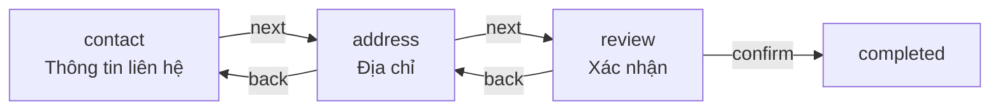
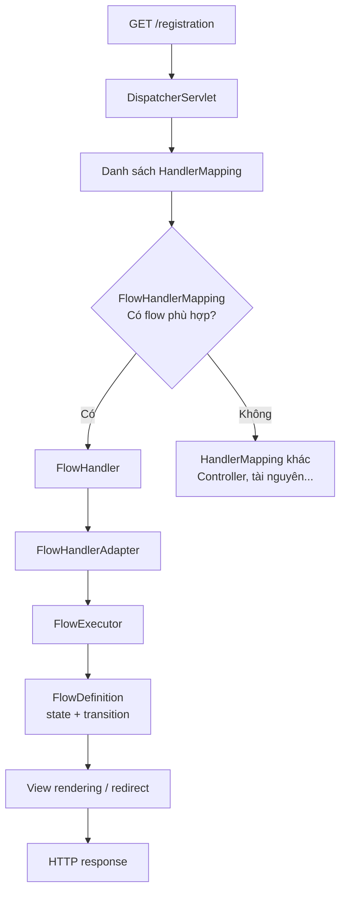
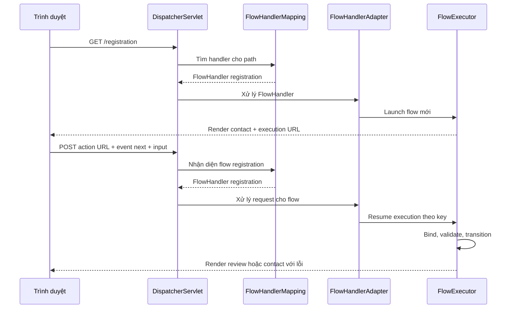

# FlowHandlerMapping và nhận diện URL của flow trong Spring MVC

Khi tích hợp **Spring Web Flow (SWF)** với Spring MVC, người dùng thường chỉ nhìn thấy một đường dẫn như `/registration`. Phía sau URL đó, Spring MVC cần xác định request thuộc **một flow đã đăng ký**, chuyển cho bộ máy thực thi flow và đưa người dùng tới `view-state` phù hợp. Thành phần nối điểm vào HTTP với flow là **`FlowHandlerMapping`**, thường hoạt động cùng **`FlowHandlerAdapter`** và **`FlowExecutor`**.

Bài học thuộc chương **Tích hợp Spring MVC** của module **SPRING_WEB_FLOW**, tập trung vào việc mô hình hóa hành trình nhiều bước bằng **state, event, transition và subflow** thay vì viết nhiều nhánh điều hướng trong controller. Chúng ta sẽ đi từ một request HTTP đến flow definition, phân biệt ba định danh thường bị nhầm là **flow ID, flow execution key và event ID**, rồi kiểm tra cách mapping tương tác với controller, form binding, session và xử lý lỗi.

## 1. Vì sao Spring MVC cần FlowHandlerMapping?

Trong Spring MVC truyền thống, `DispatcherServlet` nhận request và hỏi các `HandlerMapping` để tìm handler phù hợp. Một URL như `/users/new` có thể được xử lý bởi một phương thức `@GetMapping` trong controller.

Trong Spring Web Flow, một hành trình đăng ký nhiều bước có thể đi qua:



Thay vì tạo controller `/contact`, `/address`, `/review` để tự quyết định trang tiếp theo và cất dữ liệu vào session, ta cho Spring Web Flow điều phối các state. Nhưng HTTP request vẫn phải đi qua Spring MVC. `FlowHandlerMapping` giúp **`DispatcherServlet` nhận ra URL đại diện cho flow**, tìm flow đã đăng ký và cung cấp handler tương ứng.

Sơ đồ tích hợp:



Mỗi thành phần có một trách nhiệm riêng:

| Thành phần | Trách nhiệm |
|---|---|
| `DispatcherServlet` | Điểm vào chung của Spring MVC; tìm handler và gọi adapter |
| `FlowHandlerMapping` | Nhận diện request URL tương ứng một flow đã đăng ký |
| `FlowDefinitionRegistry` | Lưu các định nghĩa flow và ID để lookup |
| `FlowHandler` | Handler đại diện cho một flow ở ranh giới MVC |
| `FlowHandlerAdapter` | Cho Spring MVC thực thi `FlowHandler` thông qua SWF |
| `FlowExecutor` | Khởi động, tiếp tục, chuyển trạng thái và kết thúc flow execution |
| View resolver / renderer | Hiển thị `view-state` thành nội dung phản hồi HTTP |

**Điểm cốt lõi:** `FlowHandlerMapping` giải quyết **request này thuộc flow nào**; `FlowExecutor` giải quyết **execution hiện tại đang ở state nào và event tiếp theo sẽ làm gì**.

## 2. Phân biệt flow ID, execution key, state ID và event ID

Một URL có thể chứa nhiều thành phần, nhưng mỗi phần có ý nghĩa khác nhau.

| Khái niệm | Ví dụ | Do ai quản lý? | Dùng để làm gì? |
|---|---|---|---|
| Flow ID | `registration` | Cấu hình flow registry | Chọn định nghĩa hành trình |
| Request path | `/registration` | MVC, URL handler và servlet mapping | Tìm URL nào kích hoạt flow |
| Execution key | `execution=<opaque-key>` | SWF execution repository | Tiếp tục một lần chạy flow cụ thể |
| State ID | `contact`, `review` | Flow definition | Xác định màn hình/trạng thái hiện tại |
| Event ID | `next`, `back`, `confirm` | Request/action và transition | Báo hành động để flow chuyển state |

Giả sử người dùng truy cập:

```http
GET /my-app/registration HTTP/1.1
Host: localhost:8080
```

`my-app` có thể là context path của ứng dụng; `registration` là đường dẫn được handler mapping phân giải thành flow ID theo cấu hình. Khi SWF tạo một execution mới, trang trả về sẽ chứa **URL tiếp tục execution**. Ví dụ mang tính minh họa:

```text
/my-app/registration?execution=e1s1
```

Giá trị `e1s1` chỉ là **ví dụ về dạng khóa**; không được tự tạo hoặc hardcode. SWF và repository quyết định giá trị thực tế. Sau một transition, execution key có thể thay đổi tùy cấu hình snapshot/history.

Nếu biểu mẫu gửi nút `_eventId_next`, request thể hiện event `next`. Tên `next` không phải flow ID, cũng không phải state ID. XML định nghĩa transition để diễn giải event đó.

### Tại sao cần tách các khái niệm?

- **Flow ID** dùng để tìm *bản thiết kế* hành trình.
- **Execution key** dùng để tìm *một lần thực thi cụ thể* đang có dữ liệu.
- **State ID** là điểm trong hành trình do SWF quản lý.
- **Event ID** là hành động yêu cầu SWF xử lý.

Một người dùng có thể mở **hai execution của cùng flow `registration`**. Cả hai có cùng flow ID nhưng khác execution key và có thể chứa các bản nháp khác nhau. Vì vậy không nên nhận diện dữ liệu phiên chỉ bằng tên flow.

## 3. Cấu hình FlowHandlerMapping qua XML

Với một ứng dụng Spring MVC sử dụng cấu hình XML và Spring Web Flow 2.x tương thích, mô hình cấu hình thường gồm ba nhóm: đăng ký flow, khởi tạo executor và nối executor vào Spring MVC.

Ví dụ file cấu hình Spring:

```xml
<?xml version="1.0" encoding="UTF-8"?>
<beans xmlns="http://www.springframework.org/schema/beans"
       xmlns:xsi="http://www.w3.org/2001/XMLSchema-instance"
       xmlns:webflow="http://www.springframework.org/schema/webflow-config"
       xsi:schemaLocation="
           http://www.springframework.org/schema/beans
           http://www.springframework.org/schema/beans/spring-beans.xsd
           http://www.springframework.org/schema/webflow-config
           http://www.springframework.org/schema/webflow-config/spring-webflow-config.xsd">

    <!-- 1. Định nghĩa flow nào có thể được nhận diện bằng ID. -->
    <webflow:flow-registry id="flowRegistry">
        <webflow:flow-location
            id="registration"
            path="/WEB-INF/flows/registration/registration.xml"/>
    </webflow:flow-registry>

    <!-- 2. Bộ máy thực thi các flow đã đăng ký. -->
    <webflow:flow-executor id="flowExecutor"
                           flow-registry="flowRegistry"/>

    <!-- 3. Spring MVC nhận diện URL flow. -->
    <bean class="org.springframework.webflow.mvc.servlet.FlowHandlerMapping">
        <property name="flowRegistry" ref="flowRegistry"/>
        <property name="order" value="0"/>
    </bean>

    <!-- 4. Spring MVC chuyển FlowHandler vào executor. -->
    <bean class="org.springframework.webflow.mvc.servlet.FlowHandlerAdapter">
        <property name="flowExecutor" ref="flowExecutor"/>
    </bean>
</beans>
```

**Giải thích từng phần:**

1. `<webflow:flow-location>` ánh xạ ID `registration` sang tệp XML của flow. Đây là **định nghĩa**, không phải request URI.
2. `<webflow:flow-executor>` tạo đối tượng điều phối các lần chạy flow; nó cần registry để biết flow definition nào được thực thi.
3. `FlowHandlerMapping` được cung cấp **cùng registry** để xác định request có trỏ đến một flow đã đăng ký hay không.
4. `FlowHandlerAdapter` cung cấp cách Spring MVC xử lý handler của SWF thông qua executor.

Cấu hình trên giả định các bean được nạp trong đúng **web application context** mà `DispatcherServlet` dùng để tìm các `HandlerMapping` và `HandlerAdapter`. Nếu cấu hình chỉ tồn tại ở context không được MVC truy cập hoặc bị bỏ khỏi component scan/import, URL vẫn có thể trả 404 dù file flow XML có mặt trên classpath.

**Không có một URL bắt buộc cho mọi project.** Với `DefaultFlowUrlHandler`, đường dẫn lookup từ request thường được diễn giải thành flow ID, nhưng kết quả còn phụ thuộc context path, servlet mapping và cách đăng ký flow. Ví dụ `/registration` ở đây dựa trên giả định application/servlet mapping phù hợp. Phải kiểm tra URL thật của dự án bằng request HTTP và log mapping khi tích hợp.

### Thực hành với nhiều flow

Nếu có hai hành trình đăng ký và thanh toán, bạn có thể đăng ký tường minh:

```xml
<webflow:flow-registry id="flowRegistry">
    <webflow:flow-location
        id="registration"
        path="/WEB-INF/flows/registration/registration.xml"/>
    <webflow:flow-location
        id="checkout"
        path="/WEB-INF/flows/checkout/checkout.xml"/>
</webflow:flow-registry>
```

Registry có hai định nghĩa, nhưng **không có nghĩa** `/registration/contact` hay `/checkout/pay` tự thành endpoint riêng. `contact` và `pay` chỉ là state ID bên trong flow. Khi người dùng chuyển từ state này sang state khác, SWF thường tiếp tục qua URL execution của chính flow.

Trong dự án lớn có thể dùng pattern đăng ký nhiều flow, nhưng phải kiểm tra **ID sinh ra từ cấu trúc thư mục**. Không nên đổi tên hoặc di chuyển tệp flow rồi mặc định URL cũ vẫn tương thích.

## 4. Một flow XML tối giản để quan sát URL

Ví dụ `/WEB-INF/flows/registration/registration.xml`:

```xml
<?xml version="1.0" encoding="UTF-8"?>
<flow xmlns="http://www.springframework.org/schema/webflow"
      xmlns:xsi="http://www.w3.org/2001/XMLSchema-instance"
      xsi:schemaLocation="
          http://www.springframework.org/schema/webflow
          http://www.springframework.org/schema/webflow/spring-webflow.xsd">

    <var name="draft"
         class="com.example.registration.RegistrationDraft"/>

    <view-state id="contact"
                view="registration/contact"
                model="draft">
        <binder>
            <binding property="fullName" required="true"/>
            <binding property="email" required="true"/>
        </binder>
        <transition on="next" to="review"/>
        <transition on="cancel" to="cancelled"
                    bind="false" validate="false"/>
    </view-state>

    <view-state id="review"
                view="registration/review"
                model="draft">
        <transition on="back" to="contact"
                    bind="false" validate="false"/>
        <transition on="confirm" to="completed"
                    bind="false" validate="false"/>
    </view-state>

    <end-state id="completed" view="registration/completed"/>
    <end-state id="cancelled" view="registration/cancelled"/>
</flow>
```

Điểm cần quan sát: ngay cả khi flow chuyển từ `contact` sang `review`, **`FlowHandlerMapping` vẫn nhận diện định nghĩa `registration` qua URL của flow**. Việc state đang hoạt động là `contact` hay `review` thuộc quyền của `FlowExecutor` và execution repository.

`draft` được tạo và tồn tại trong flow scope của execution; view-state chỉ định model để thực hiện form binding. `FlowHandlerMapping` **không** tự điền `draft.email`, chạy validator hoặc chọn transition. Nó chỉ đảm nhận phần nhận diện handler ở ranh giới MVC.

Với bài thực hành đầy đủ, cần cung cấp lớp `RegistrationDraft`, view template và các bean cần thiết. Ví dụ flow trên minh họa định tuyến, chưa mô hình hóa bước lưu dữ liệu hoặc kiểm tra nghiệp vụ cuối cùng.

## 5. Luồng request: GET bắt đầu, POST tiếp tục

Hãy theo dõi hai request liên tiếp trong một hành trình:



### Request đầu tiên

Người dùng GET `/registration`. Nếu request được ánh xạ và chưa có execution key để tiếp tục một execution cũ, SWF sẽ khởi động hành trình tương ứng theo quy tắc xử lý của hệ thống. Biến flow được tạo, state đầu tiên được chọn và view được hiển thị.

**Lưu ý:** Một request GET chứa execution key có thể mang ý nghĩa **tiếp tục hoặc render lại** execution thay vì bắt đầu mới. Không nên dùng mỗi HTTP method để suy ra chắc chắn hành vi launch hay resume; sự hiện diện và tính hợp lệ của key cũng quan trọng.

### Request tiếp theo

HTML form nhận URL tiếp tục flow từ SWF và gửi event cùng dữ liệu:

```jsp
<%@ taglib prefix="form" uri="http://www.springframework.org/tags/form" %>

<form:form id="contactForm"
           method="post"
           action="${flowExecutionUrl}"
           modelAttribute="draft">

    <label for="email">Email</label>
    <form:input id="email" path="email"/>
    <form:errors path="email" cssClass="field-error"/>

    <button type="submit" name="_eventId_next">
        Tiếp tục
    </button>
    <button type="submit" name="_eventId_cancel">
        Hủy
    </button>
</form:form>
```

Trong JSP này, `flowExecutionUrl` trỏ đến đúng execution hiện tại, thường bao gồm cơ chế nhận diện execution do SWF tạo ra. `_eventId_next` phát event `next`; `_eventId_cancel` phát event `cancel`. Tên tham số event có thể được chuyển theo cơ chế SWF, ví dụ `_eventId` đi kèm giá trị event tương ứng, nhưng phải thống nhất với cấu hình/view hiện tại.

Nếu tích hợp Spring Security, cần giữ cơ chế CSRF token đúng với form renderer và filter chain. Ví dụ JSP trên chỉ minh họa sự liên hệ giữa **action URL** và **event**; ứng dụng thực phải kiểm tra CSRF cũng như quyền cho từng thao tác nghiệp vụ.

### Không hardcode execution key

Một cách viết sai thường gặp:

```html
<!-- Ví dụ không nên dùng: khóa được viết cố định -->
<form action="/registration?execution=e1s1" method="post">
```

Khóa `e1s1` có thể không tồn tại, thuộc execution khác hoặc trở nên cũ khi repository tạo snapshot mới. Hãy để framework sinh URL và lấy giá trị đó khi render form hoặc khi kiểm thử HTTP.

## 6. URL được nhận diện như thế nào?

Để hình dung quá trình lookup, xem ví dụ một ứng dụng có context path `/my-app` và `DispatcherServlet` ánh xạ theo quy ước phù hợp.

| Request nhìn từ trình duyệt | Vai trò thường gặp | Điều cần xác minh |
|---|---|---|
| `GET /my-app/registration` | Vào flow `registration` | Context path và lookup path đúng |
| `POST /my-app/registration?execution=...` | Tiếp tục execution hiện có | Key hợp lệ, cùng session và event đúng |
| `GET /my-app/checkout` | Vào flow `checkout` nếu registry có ID này | ID tồn tại và URL handler nhận diện đúng |
| `GET /my-app/registration/review` | Không tự động có ý nghĩa là state `review` | Có mapping riêng hay không? |
| `GET /my-app/api/registration` | Có thể thuộc REST controller khác | Thứ tự mapping và quyền sở hữu endpoint |
| `GET /my-app/assets/app.css` | Tài nguyên tĩnh | Flow mapping nên để mapping tài nguyên xử lý |

Địa chỉ chính xác phụ thuộc `contextPath`, `servletPath`, servlet mapping, reverse proxy và `FlowUrlHandler` hiện hành. Ví dụ nếu servlet được map dưới `/ui/*` thay vì `/`, URL nhìn từ trình duyệt và phần path mà URL handler diễn giải có thể khác; không được suy ra trực tiếp từ tên file XML.

### FlowUrlHandler đứng ở đâu?

`FlowHandlerMapping` dùng cơ chế xử lý URL của SWF, thường là `DefaultFlowUrlHandler`, để phân giải flow ID từ request. `FlowUrlHandler` cũng liên quan đến cách tạo URL bắt đầu flow và URL tiếp tục execution.

Khi cần quy tắc URL riêng (ví dụ `/journeys/registration` được chuyển thành ID `registration`), ứng dụng có thể cung cấp một **`FlowUrlHandler` tùy biến** phù hợp với phiên bản SWF, sau đó cấu hình thống nhất giữa phía nhận diện handler và phía tạo URL của flow.

Điều cần chú ý là **tính đối xứng**:

- Request bắt đầu phải được ánh xạ đến đúng flow ID.
- URL do flow sinh ra khi tiếp tục phải được ánh xạ trở lại cùng flow và execution.
- Redirect, query parameter và execution key phải được bảo toàn khi đi qua proxy hoặc custom URL rewrite.

Nếu chỉ đổi đường dẫn ở `FlowHandlerMapping` mà phần tạo URL tiếp tục vẫn sinh ra định dạng cũ, người dùng có thể mở được bước đầu nhưng thất bại ngay khi nhấn `next`.

## 7. Quan hệ với @RequestMapping, @GetMapping và thứ tự handler

Spring MVC có thể đăng ký nhiều `HandlerMapping`. Chúng được xét theo **thứ tự ưu tiên**; thông thường giá trị `order` **nhỏ hơn có độ ưu tiên cao hơn**. Trong cấu hình ở phần 3, `FlowHandlerMapping` có `order=0` để minh họa một lựa chọn cụ thể.

Tuy nhiên, một dự án cũng có thể có:

```java
@Controller
class RegistrationController {

    @GetMapping("/registration")
    String registration() {
        return "registration/start";
    }
}
```

Nếu đồng thời đăng ký flow ID `registration`, ta đã tạo **hai ứng viên** cho cùng URL. Kết quả phụ thuộc mapping nào được xét và trả handler trước. Việc này có thể gây hành vi khác mong đợi khi thêm thư viện, nâng phiên bản Spring MVC hoặc thay đổi cấu hình bean.

**Thiết kế nên làm rõ quyền sở hữu từng endpoint:**

- Nếu `/registration` là điểm vào Spring Web Flow, để flow đảm nhận hành trình nhiều bước.
- Nếu cần một REST API, cấp đường dẫn riêng như `/api/registrations` và để `@RestController` xử lý.
- Nếu cần trang giới thiệu trước khi mở flow, có thể dùng một URL riêng và liên kết đến điểm bắt đầu flow.

Không nên dựa vào “mapping nào tình cờ thắng” để làm contract của ứng dụng. Trong test integration, phải xác minh handler thực tế và nội dung trả về, không chỉ xác minh URL không trả 404.

### Khi FlowHandlerMapping không tìm được flow

Một `FlowHandlerMapping` thông thường chỉ nhận diện được URL mà nó phân giải thành flow đã đăng ký. Nếu không có flow phù hợp, Spring MVC có thể tiếp tục xét mapping khác. Nếu không mapping nào nhận request, ứng dụng trả lỗi tương ứng, thường là **404 Not Found**.

Điều này khác với việc **tìm được flow nhưng execution key sai**: trường hợp thứ hai thuộc logic phục hồi execution và có thể dẫn tới exception, trang hết hạn hoặc redirect được cấu hình. Hai nguyên nhân cần phân biệt khi chẩn đoán.

## 8. Vì sao state và subflow không phải URL độc lập?

Giả sử flow có ba view-state:

```xml
<view-state id="contact" view="registration/contact" ... />
<view-state id="address" view="registration/address" ... />
<view-state id="review" view="registration/review" ... />
```

Không có quy tắc rằng framework sẽ tự tạo:

```text
/registration/contact
/registration/address
/registration/review
```

cho từng state. Mặc định, **một flow execution quyết định state hiện tại**; trình duyệt tiếp tục thông qua URL/key của execution. Việc người dùng sửa URL thành `/registration/review` không phải cách hợp lệ để nhảy tới bước xác nhận.

Với **subflow**, flow cha có thể gọi một flow khác bằng `subflow-state`. Subflow có input/output và vòng đời của riêng nó. Việc subflow được gọi trong một execution không có nghĩa mọi state bên trong nó phải được công bố bằng một endpoint công khai.

Một flow definition có thể được đăng ký để dùng làm subflow, nhưng **khả năng gọi trực tiếp qua URL** và chính sách bảo mật cần được cấu hình/kiểm tra phù hợp. Không nên dựa vào việc ẩn URL để bảo vệ các thao tác: service phải xác thực người dùng và quyền nghiệp vụ trước khi thay đổi dữ liệu.

## 9. Xử lý lỗi khi ánh xạ hoặc tiếp tục execution

Có thể chia lỗi thành ba lớp, tương ứng với ba nơi trong đường xử lý:

| Nơi xảy ra | Triệu chứng | Hướng kiểm tra |
|---|---|---|
| Spring MVC / HandlerMapping | `GET /registration` trả 404 | Registry ID, URL lookup, servlet mapping, context path, thứ tự mapping |
| HandlerAdapter / FlowExecutor / repository | Mở được flow nhưng POST tiếp theo thất bại | Đã đăng ký adapter/executor? Key hợp lệ? Session còn? |
| Binding / validation / action / view | Đã vào flow nhưng kẹt state, lỗi render hoặc lỗi nghiệp vụ | Field name, event ID, validator, view resolver, Spring bean và exception handler |

### Triệu chứng 404 ngay khi mở flow

Kiểm tra lần lượt:

1. `DispatcherServlet` có nhận URL này không?
2. `FlowHandlerMapping` có được đăng ký trong context MVC không?
3. URL handler có phân giải đúng ID `registration` không?
4. `flowRegistry` có thực sự chứa flow ID đó không?
5. Có mapping nào khác đã xử lý request trước và trả 404 không?

Việc tệp `registration.xml` tồn tại **chưa đủ** để chứng minh flow đã được đăng ký bằng đúng ID.

### Mở được bước đầu nhưng POST quay về trang lỗi

Kiểm tra `action` của form có dùng `flowExecutionUrl` hiện tại hay không, execution key có được truyền đầy đủ không, và session có được giữ qua hai request không. Nếu request đi qua reverse proxy, kiểm tra các quy tắc rewrite/forward để tránh mất query string hoặc đổi path.

### POST không chuyển bước dù không có lỗi HTTP

Có thể nút submit phát sai event (`_eventId_go` trong khi XML chỉ có transition `next`), hoặc validation đang giữ execution ở state hiện tại. Đừng kết luận ngay rằng `FlowHandlerMapping` hỏng: mapping đã thành công nếu request tới được flow. Cần kiểm tra tiếp event và thông báo của view.

### 403 ở request POST

Nếu Security/CSRF được bật, POST thiếu token hoặc không đủ quyền có thể bị chặn **trước khi** handler của SWF chạy. Đây là lỗi/biện pháp bảo vệ ở tầng filter, khác với việc lookup flow ID thất bại.

### 500 khi chuyển tới state mới

Flow có thể chuyển state đúng nhưng view resolver không tìm thấy `registration/review`, hoặc action gọi bean chưa có. Để xử lý, cần đọc exception và log của đúng request. Không thay đổi mapping URL để che lỗi render hoặc lỗi bean.

## 10. Kiểm thử nhận diện flow ở tầng MVC

Bài học này cần hai loại kiểm tra bổ sung cho nhau:

1. **Flow execution test**: bắt đầu flow trực tiếp, phát event và assert state, `flowScope` và transition. Nó chứng minh flow definition xử lý hành trình đúng.
2. **HTTP integration test**: gửi GET/POST qua Spring MVC, kiểm tra URL, handler mapping, form action, execution key, session, security và HTML/redirect. Nó chứng minh request ngoài thực sự tới đúng flow.

Một flow engine test như `startFlow()` rồi `signalEvent("next")` có thể PASS trong khi `GET /registration` trả 404 do thiếu `FlowHandlerMapping`. Vì vậy, **test flow definition không thay thế test endpoint**.

### Khung kiểm thử MockMvc

Với cấu hình servlet phù hợp, có thể tổ chức test dựa trên `MockMvc`:

```java
// Ví dụ cấu trúc test với Spring MVC test framework.
// Cấu hình Spring, import, security và các helper phụ thuộc dự án.

@SpringBootTest
@AutoConfigureMockMvc
class RegistrationRoutingIT {

    @Autowired
    MockMvc mvc;

    @Test
    void flowEntryIsHandled() throws Exception {
        MvcResult result = mvc.perform(get("/registration"))
                .andReturn();

        // Xác minh status, redirect hoặc view thực tế
        // theo contract của ứng dụng. Đồng thời kiểm tra
        // request đã vào flow registration.
        int status = result.getResponse().getStatus();
        assertThat(status).isBetween(200, 399);
    }

    @Test
    void unrelatedUrlIsNotRecognizedAsRegistrationFlow()
            throws Exception {
        mvc.perform(get("/unknown-flow-path"))
                .andExpect(status().isNotFound());
    }
}
```

Đây là **ví dụ phác thảo**, chưa phải một lớp test tự chạy độc lập. `assertThat` và test annotations cần import/dependencies phù hợp; endpoint `/unknown-flow-path` chỉ nên được mong đợi 404 nếu project thật **không** đăng ký bất kỳ mapping, fallback hay resource handler nào nhận path đó. Với redirect, một kết quả 3xx chỉ xác nhận xử lý HTTP bước đầu, chưa chứng minh flow đã render thành công ở đích.

Một test chất lượng hơn cần có **assertion đặc trưng cho flow**: view name, thuộc tính model, tên form/event, URL chứa execution key hoặc nội dung HTML. Tùy renderer, dùng `forwardedUrl`, `view().name`, thông tin `ModelAndView` hoặc kiểm tra response body phù hợp.

**Lưu ý với JSP:** `MockMvc` có thể chỉ ghi nhận forward đến JSP mà **không thực thi JSP để tạo HTML**. Nếu muốn khẳng định HTML JSP đã được render, hãy dùng môi trường servlet tích hợp/embedded server thích hợp. Với template engine render trực tiếp (chẳng hạn Thymeleaf) và cấu hình đầy đủ, MockMvc có thể kiểm tra nội dung HTML thực tế.

### Kiểm thử chuỗi GET → POST

Test chính cần:

1. GET URL bắt đầu flow, lưu session được server tạo.
2. Lấy action/execution URL từ phản hồi, không tự tạo key.
3. POST đúng URL đó với event `_eventId_next`, dữ liệu form, session và CSRF token khi cần.
4. Theo redirect nếu có; kiểm tra kết quả đã sang state kế tiếp.
5. Gửi `_eventId_back` rồi assert quay lại state trước mà dữ liệu vẫn giữ.
6. Bắt đầu flow execution thứ hai trong cùng session, assert dữ liệu hai flow không lẫn nhau.

Nếu JSP được render ngoài MockMvc, dùng HTTP client với embedded servlet container để lấy form action thật. Nếu ứng dụng có chính sách sử dụng execution key mới sau mỗi chuyển trạng thái, test phải trích **URL mới từ phản hồi tiếp theo**.

### Ma trận kiểm thử URL quan trọng

| ID | Request | Điều cần chứng minh |
|---|---|---|
| M01 | `GET /registration` | Handler nhận đúng flow ID và mở state đầu |
| M02 | `GET /checkout` | Flow khác không bị ánh xạ nhầm sang `registration` |
| M03 | `GET /unknown-flow-path` | Mapping không “nuốt” URL không đăng ký |
| M04 | `POST /registration?execution=...` | Tiếp tục đúng execution, nhận event và binding |
| M05 | POST thiếu/sai execution key | Xử lý lỗi execution theo chính sách ứng dụng |
| M06 | POST không có CSRF token | Bị từ chối nếu security yêu cầu |
| M07 | Hai execution cùng session | Hai bản nháp độc lập |
| M08 | URL dưới context/servlet path khác | Đường dẫn được phân giải đúng trong môi trường triển khai |
| M09 | Request tới URL controller khác | Không bị flow mapping chặn nhầm |
| M10 | Redirect/forward qua proxy | URL tiếp tục flow còn đầy đủ path và query |

## 11. Triển khai với Spring Boot và các khác biệt cấu hình

Spring Boot giúp cấu hình Spring MVC, nhưng không nên mặc định rằng thêm dependency Spring Web Flow là **mọi flow được tự động đăng ký và nhận diện**. Tùy bản Spring Web Flow, Spring Framework và cấu hình ứng dụng, bạn có thể phải khai báo các bean registry, executor, mapping và adapter rõ ràng.

Một cấu hình Java tương đương ở mức khái niệm:

```java
// Ví dụ đoạn bean registration; registry và executor
// phải được tạo/config trước theo API của phiên bản SWF.

@Bean
public FlowHandlerMapping flowHandlerMapping(
        FlowDefinitionRegistry flowRegistry) {

    FlowHandlerMapping mapping = new FlowHandlerMapping();
    mapping.setFlowRegistry(flowRegistry);
    mapping.setOrder(0);
    return mapping;
}

@Bean
public FlowHandlerAdapter flowHandlerAdapter(
        FlowExecutor flowExecutor) {

    FlowHandlerAdapter adapter = new FlowHandlerAdapter();
    adapter.setFlowExecutor(flowExecutor);
    return adapter;
}
```

Trong code hoàn chỉnh cần thêm import tương ứng:

```java
import org.springframework.context.annotation.Bean;
import org.springframework.webflow.definition.registry.FlowDefinitionRegistry;
import org.springframework.webflow.executor.FlowExecutor;
import org.springframework.webflow.mvc.servlet.FlowHandlerAdapter;
import org.springframework.webflow.mvc.servlet.FlowHandlerMapping;
```

Cách tạo `FlowDefinitionRegistry`, `FlowExecutor` và builder services bằng Java config còn phụ thuộc phiên bản thư viện; tham khảo API thực tế được sử dụng trong dự án khi áp dụng. Điều cần giữ nguyên là **mapping dùng registry chứa flow definitions; adapter dùng executor thực thi các definitions ấy**.

Ngoài ra, phải xét tương thích giữa các bản Spring Framework, Jakarta/Javax Servlet, Spring Boot và Spring Web Flow. Một dependency không tương thích có thể gây lỗi class loading hoặc servlet API ngay khi khởi động. Đây là vấn đề tương thích thư viện; không thể giải quyết bằng cách sửa riêng URL.

## 12. Thiết kế URL dễ vận hành

Khi đặt tên flow và URL, hãy trả lời rõ ba câu hỏi:

- **Điểm vào công khai của hành trình là đâu?** Ví dụ `/registration`.
- **Cách flow ID được suy ra từ đường dẫn là gì?** Mặc định theo quy tắc URL handler đang dùng hay có mapping tùy biến?
- **URL tiếp tục execution được sinh ra như thế nào?** Nó có giữ session, execution key và query parameter cần thiết qua reverse proxy không?

Một số nguyên tắc:

1. Dành một namespace rõ ràng cho flow khi ứng dụng có nhiều API/controller; ví dụ `/flows/registration` **chỉ dùng nếu cấu hình URL handler và registry thực sự hỗ trợ đường dẫn đó**.
2. Tránh trùng URL với `@RequestMapping`, static resources và các endpoint quản trị.
3. Không đưa state ID vào URL như cách “đi tắt” bypass validation. SWF mới là nơi quyết định state hợp lệ.
4. Không coi execution key là xác thực người dùng. Endpoint vẫn cần kiểm tra session, CSRF và authorization.
5. Không để đường dẫn render view (như `registration/contact`) bị nhầm với URL public của flow.
6. Dùng URL do framework tạo cho form và redirect; tránh nối query string bằng tay.
7. Kiểm tra cả môi trường local và môi trường có context path, servlet mapping hoặc reverse proxy khác nhau.

### Bảo mật và điều hướng

Flow mapping chỉ là **định tuyến HTTP**. Không thể dùng nó để thay cho bảo mật. Một request có thể bị sửa event/field hoặc gửi thẳng tới endpoint. Ứng dụng cần:

- Spring Security/filter chain cho xác thực, CSRF và chính sách URL.
- Kiểm soát quyền ở action/service theo người dùng hiện tại.
- Binder whitelist theo từng state để tránh sửa trường không được phép.
- Validation và kiểm tra bất biến nghiệp vụ trước khi lưu.
- Xử lý an toàn request dùng execution key hết hạn, cũ hoặc không đúng.
- Giới hạn các hành động có tác dụng phụ bằng transaction/idempotency phù hợp.

Ngay cả khi flow được nhận diện đúng, lỗi dữ liệu và lỗi phân quyền vẫn có thể xảy ra ở lớp sâu hơn. Test nên kiểm tra riêng từng ranh giới.

## 13. Bài tập thực hành: thêm flow đặt lịch bên cạnh controller hiện có

Giả sử một ứng dụng có:

```text
GET  /api/appointments       -> REST controller
POST /api/appointments       -> REST controller
GET  /home                   -> MVC controller
GET  /appointment-wizard     -> Spring Web Flow
```

Hãy thiết kế một flow `appointment-wizard` với ba state:

1. `selectService`: chọn dịch vụ.
2. `selectTime`: chọn thời gian.
3. `review`: xác nhận thông tin.

**Yêu cầu triển khai:**

1. Tạo flow XML có các transition `next`, `back`, `cancel`, `confirm`.
2. Đăng ký flow ID và đường dẫn tới XML trong `FlowDefinitionRegistry`.
3. Cấu hình `FlowExecutor`, `FlowHandlerMapping` và `FlowHandlerAdapter`.
4. Chọn URL public của flow và bảo đảm không xung đột hai REST endpoint.
5. Trong view đầu, render form `action` theo execution URL do SWF cung cấp.
6. Gửi `_eventId_next`, kiểm tra dữ liệu đã bind và state chuyển đúng.
7. Nhấn `back`, xác nhận thông tin bước trước còn giữ trong cùng execution.
8. Gửi request với một execution key cũ/hết hạn và kiểm tra cách ứng dụng xử lý.
9. Viết HTTP test để chứng minh `/home` và `/api/appointments` vẫn được MVC xử lý đúng.
10. Tạo flow thứ hai trong cùng session để kiểm tra dữ liệu của hai execution độc lập.

**Thử nghiệm gây lỗi có chủ đích:** Đăng ký flow ID `appointment-wizard` nhưng trong form lại POST tới `/appointment-wizard/review`. Hãy dự đoán và xác minh hành vi khi URL handler không nhận diện đường dẫn đó là một flow phù hợp. Sau đó sửa form để dùng URL tiếp tục execution do SWF sinh ra.

### Câu hỏi ôn tập

**1. `FlowHandlerMapping` có tự quyết định chuyển từ `contact` sang `review` không?** Không. Nó nhận diện handler của flow từ URL; chuyển trạng thái thuộc `FlowExecutor` và định nghĩa transition.

**2. Nếu URL `/registration` được mapping đúng nhưng POST vẫn không chuyển bước, nên kiểm tra gì?** Action URL/execution key, event parameter, validation và session trước khi kết luận mapping sai.

**3. `FlowHandlerAdapter` cần gì để xử lý flow?** Nó cần một `FlowExecutor` được cấu hình hợp lệ để launch/resume execution.

**4. Vì sao không suy ra mỗi state sẽ có URL public riêng?** State là trạng thái nội bộ trong một execution; đường dẫn public do handler mapping/URL handler quyết định.

**5. `@GetMapping("/registration")` tồn tại cùng flow ID `registration` thì sao?** Có khả năng xung đột trách nhiệm xử lý cùng URL. Cần kiểm tra thứ tự handler mapping và thiết kế để chỉ một cơ chế sở hữu endpoint đó.

**6. Hai người dùng truy cập cùng flow ID có dùng cùng draft không?** Không theo thiết kế flow scope tiêu chuẩn: mỗi execution có state/dữ liệu riêng. Phải giữ session và execution key đúng để không lẫn phiên.

## 14. Checklist khi tích hợp URL flow với Spring MVC

- [ ] Flow đã được đăng ký trong registry bằng đúng ID.
- [ ] `FlowHandlerMapping` nhìn thấy registry chứa định nghĩa ấy.
- [ ] `FlowHandlerAdapter` có executor hợp lệ.
- [ ] Các bean mapping/adapter nằm trong cấu hình MVC mà `DispatcherServlet` sử dụng.
- [ ] URL public được xác minh với context path và servlet mapping thực tế.
- [ ] Không có controller/static handler cạnh tranh ngoài chủ đích.
- [ ] Form dùng flow execution URL do framework tạo và event name đúng.
- [ ] Session và execution key được bảo toàn qua request/redirect.
- [ ] Các bước cần binding/validation hoạt động; back/cancel không bị chặn ngoài dự kiến.
- [ ] Có phương án xử lý session/key hết hạn và exception.
- [ ] Spring Security, CSRF và authorization được kiểm tra ở đúng tầng.
- [ ] HTTP integration test chứng minh routing thực tế, bổ sung cho flow execution test.

**Ghi nhớ:** `FlowHandlerMapping` là cầu nối từ **URL của Spring MVC** đến **định nghĩa Spring Web Flow**. Nó nhận diện *flow nào* cần được xử lý; `FlowHandlerAdapter` và `FlowExecutor` thực hiện *lần chạy nào, state nào, event nào*. Khi phân biệt rõ flow ID, execution key và event ID, bạn sẽ cấu hình URL, thiết kế form nhiều bước, chẩn đoán lỗi 404/403/500 và viết kiểm thử tích hợp chính xác hơn.

