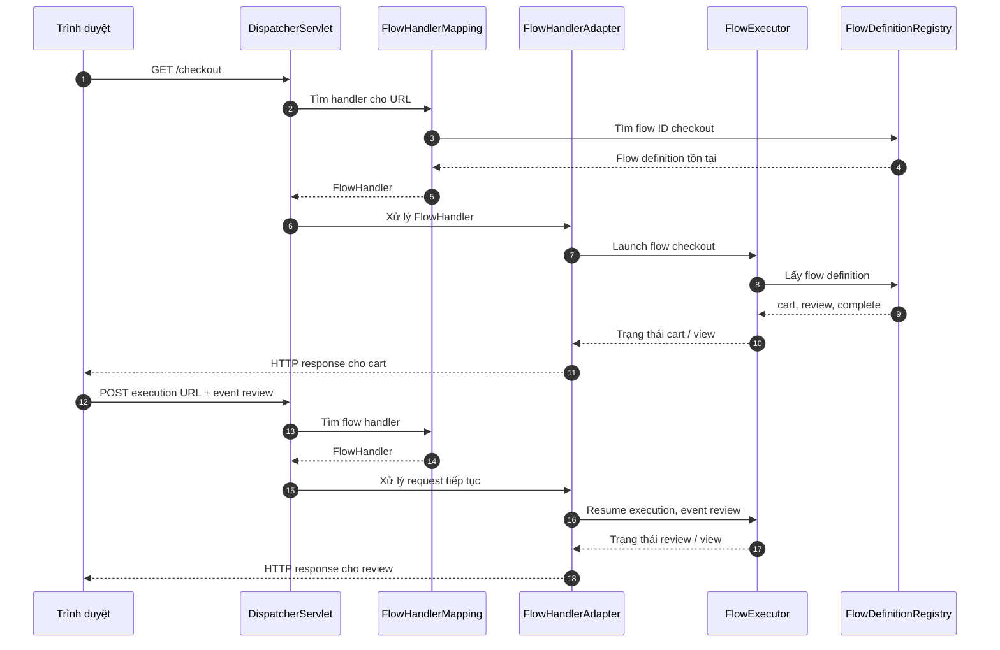
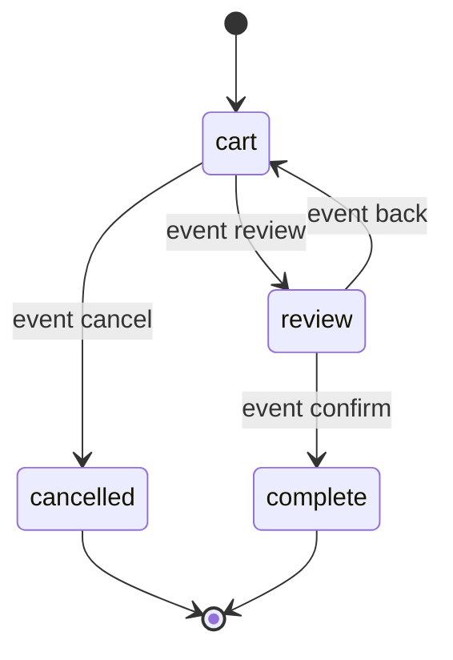

# FlowHandlerAdapter và việc điều khiển execution

## 1. Vai trò của FlowHandlerAdapter trong Spring MVC

**Spring Web Flow** mô hình hóa hành trình web nhiều bước bằng các `state`, `event` và `transition`. Người dùng có thể bắt đầu đăng ký tài khoản, đi tới bước xác nhận, quay lại sửa dữ liệu hoặc kết thúc. Một hành trình như vậy được gọi là **flow**, còn lần chạy cụ thể của người dùng là **flow execution**. Khi tích hợp với Spring MVC, mỗi HTTP request liên quan đến flow phải được chuyển từ `DispatcherServlet` đến bộ máy thực thi của Web Flow.

`org.springframework.webflow.mvc.servlet.FlowHandlerAdapter` là cầu nối đảm nhiệm việc đó. Nó là một **Spring MVC HandlerAdapter**, biết cách xử lý handler dành cho flow, chuẩn bị ngữ cảnh HTTP cho Web Flow và phối hợp với `FlowExecutor` để **khởi chạy (launch)** hoặc **tiếp tục (resume)** một execution.

Không nên nhầm với hai thành phần cạnh nó:

| Thành phần | Trách nhiệm | Câu hỏi được giải quyết |
| --- | --- | --- |
| `FlowHandlerMapping` | Đối chiếu URL với flow đã đăng ký, cung cấp handler cho MVC | “URL này thuộc flow nào?” |
| **`FlowHandlerAdapter`** | Điều phối request/response HTTP tới Web Flow thông qua `FlowExecutor` | “MVC sẽ xử lý flow handler này bằng cách nào?” |
| `FlowExecutor` | Khởi chạy, tiếp tục, kết thúc execution; xử lý state, event và transition | “Hành trình này sẽ chuyển sang trạng thái nào?” |
| `FlowDefinitionRegistry` | Lưu các định nghĩa flow theo ID | “Định nghĩa của flow `checkout` nằm ở đâu?” |

`FlowHandlerAdapter` **không tự định nghĩa các state**, không phải bộ điều hướng nghiệp vụ và cũng không thay thế `FlowExecutor`. Các transition vẫn nằm trong XML flow; adapter chuyển request HTTP vào đúng engine để thực thi chúng.

## 2. Đường đi của một HTTP request

Giả sử ứng dụng bán hàng có flow ID `checkout`. Người dùng mở đường dẫn `/checkout`, đi từ màn hình giỏ hàng tới xác nhận rồi đặt hàng.



Có hai tình huống quan trọng:

1. **Bắt đầu flow:** request chưa mang khóa execution hợp lệ để tiếp tục. Adapter xác định flow ID qua handler, gọi cơ chế launch của `FlowExecutor` và trả màn hình đầu tiên.
2. **Tiếp tục flow:** request tới **execution URL** mang thông tin nhận diện lần chạy đang tồn tại. Adapter chuyển yêu cầu tới cơ chế resume; Web Flow khôi phục trạng thái đã lưu, tiếp nhận event, thực hiện transition và trả trạng thái mới hoặc outcome kết thúc.

Từng phiên bản Web Flow có thể xử lý render và redirect khác nhau theo cấu hình. Do đó không nên mặc định rằng tất cả transition đều trả HTTP 200 chứa HTML hoặc đều trả HTTP 302. Hãy quan sát URL, headers và response trong ứng dụng thực tế.

### Flow ID khác execution key

| Khái niệm | Ví dụ | Ý nghĩa |
| --- | --- | --- |
| **Flow ID** | `checkout` | Tên *loại* hành trình được đăng ký trong registry. |
| **Flow execution key** | Một khóa do runtime cấp, thường xuất hiện ở tham số `execution` trong URL | Định danh *lần chạy cụ thể* và trạng thái được lưu của hành trình. |
| **Event ID** | `review`, `back`, `confirm` | Tên sự kiện được dùng để chọn transition tại state hiện tại. |
| **State ID** | `cart`, `review`, `complete` | Trạng thái bên trong định nghĩa flow. |
| **Outcome** | `complete` | Kết quả khi execution kết thúc tại end-state. |

Nhiều người dùng có thể cùng mở flow `checkout`, nhưng mỗi lần chạy được quản lý riêng bằng execution key và session/repository phù hợp. Khi trình duyệt gửi một khóa execution cũ, lỗi có thể do phiên đã hết hạn hoặc snapshot không còn tồn tại; chỉ gửi lại flow ID không đảm bảo khôi phục được giỏ hàng đang dang dở.

## 3. Khai báo FlowHandlerAdapter bằng Java configuration

Để request Web Flow được Spring MVC nhận và xử lý, cần đăng ký **registry, executor, handler mapping và handler adapter**. Ví dụ dưới đây dùng cấu hình Java dựa trên `AbstractFlowConfiguration`, tích hợp view JSP qua `MvcViewFactoryCreator`.

> Ví dụ giả định ứng dụng có bộ Spring Framework, Spring Web Flow và Servlet API tương thích. Khi dùng dòng Spring Web Flow 2.x / `javax.servlet` hoặc 3.x / `jakarta.servlet`, cần chọn thư viện phù hợp; phần khai báo bean chính có thể tương tự nhưng không được trộn các dependency không tương thích.

**`WebFlowConfig.java`:**

```java
package com.example.config;

import java.util.Collections;

import org.springframework.beans.factory.annotation.Qualifier;
import org.springframework.context.annotation.Bean;
import org.springframework.context.annotation.Configuration;
import org.springframework.web.servlet.ViewResolver;
import org.springframework.web.servlet.view.InternalResourceViewResolver;
import org.springframework.webflow.config.AbstractFlowConfiguration;
import org.springframework.webflow.definition.registry.FlowDefinitionRegistry;
import org.springframework.webflow.engine.builder.support.FlowBuilderServices;
import org.springframework.webflow.executor.FlowExecutor;
import org.springframework.webflow.mvc.builder.MvcViewFactoryCreator;
import org.springframework.webflow.mvc.servlet.FlowHandlerAdapter;
import org.springframework.webflow.mvc.servlet.FlowHandlerMapping;

@Configuration
public class WebFlowConfig extends AbstractFlowConfiguration {

    @Bean
    public ViewResolver jspViewResolver() {
        InternalResourceViewResolver resolver =
                new InternalResourceViewResolver();
        resolver.setPrefix("/WEB-INF/views/");
        resolver.setSuffix(".jsp");
        return resolver;
    }

    @Bean
    public MvcViewFactoryCreator mvcViewFactoryCreator(
            @Qualifier("jspViewResolver") ViewResolver resolver) {
        MvcViewFactoryCreator creator = new MvcViewFactoryCreator();
        creator.setViewResolvers(Collections.singletonList(resolver));
        return creator;
    }

    @Bean
    public FlowBuilderServices flowBuilderServices(
            MvcViewFactoryCreator mvcViewFactoryCreator) {
        return getFlowBuilderServicesBuilder()
                .setViewFactoryCreator(mvcViewFactoryCreator)
                .build();
    }

    @Bean
    public FlowDefinitionRegistry flowRegistry(
            FlowBuilderServices flowBuilderServices) {
        return getFlowDefinitionRegistryBuilder(flowBuilderServices)
                .addFlowLocation(
                        "/WEB-INF/flows/checkout/checkout-flow.xml",
                        "checkout")
                .build();
    }

    @Bean
    public FlowExecutor flowExecutor(
            FlowDefinitionRegistry flowRegistry) {
        return getFlowExecutorBuilder(flowRegistry).build();
    }

    @Bean
    public FlowHandlerMapping flowHandlerMapping(
            FlowDefinitionRegistry flowRegistry) {
        FlowHandlerMapping mapping = new FlowHandlerMapping();
        mapping.setFlowRegistry(flowRegistry);
        mapping.setOrder(0);
        return mapping;
    }

    @Bean
    public FlowHandlerAdapter flowHandlerAdapter(
            FlowExecutor flowExecutor) {
        FlowHandlerAdapter adapter = new FlowHandlerAdapter();
        adapter.setFlowExecutor(flowExecutor);
        return adapter;
    }
}
```

**Dòng quyết định của bài học** là:

```java
FlowHandlerAdapter adapter = new FlowHandlerAdapter();
adapter.setFlowExecutor(flowExecutor);
```

`FlowHandlerAdapter` cần tham chiếu `FlowExecutor` đã được xây dựng từ registry chứa các flow thật. Nếu mapping tìm đúng flow nhưng adapter chưa được khai báo, `DispatcherServlet` không có HandlerAdapter tương ứng để thực thi handler. Nếu adapter tồn tại mà executor hoặc registry sai, request vẫn không thể hoàn thành hành trình.

Trong ví dụ, `order=0` cho `FlowHandlerMapping` chỉ nhằm minh họa một thứ tự ưu tiên. Với ứng dụng có nhiều `HandlerMapping`, cần thiết kế URL tránh tranh chấp với `@RequestMapping`, sau đó kiểm tra thứ tự thực tế; không coi giá trị `0` là lựa chọn bắt buộc cho mọi hệ thống.

### Đặt các bean vào đúng Spring MVC context

Nếu dùng `DispatcherServlet` cấu hình bằng Java, có thể nạp `WebFlowConfig` vào servlet application context:

```java
package com.example.config;

import org.springframework.web.servlet.support.AbstractAnnotationConfigDispatcherServletInitializer;

public class WebAppInitializer
        extends AbstractAnnotationConfigDispatcherServletInitializer {

    @Override
    protected Class<?>[] getRootConfigClasses() {
        return null;
    }

    @Override
    protected Class<?>[] getServletConfigClasses() {
        return new Class<?>[] { MvcConfig.class, WebFlowConfig.class };
    }

    @Override
    protected String[] getServletMappings() {
        return new String[] { "/" };
    }
}
```

```java
package com.example.config;

import org.springframework.context.annotation.Configuration;
import org.springframework.web.servlet.config.annotation.EnableWebMvc;

@Configuration
@EnableWebMvc
public class MvcConfig {
}
```

Đây là cấu hình cho ứng dụng Spring MVC Servlet truyền thống. Nếu dự án đang dùng Spring Boot hoặc đã có `DispatcherServlet`, hãy đưa các bean Web Flow vào context mà servlet hiện tại có thể truy cập; không tạo thêm initializer hoặc bật `@EnableWebMvc` tùy tiện vì có thể ảnh hưởng cơ chế tự cấu hình MVC của Boot.

## 4. Flow XML và form cho một execution cụ thể

Ví dụ có ba màn hình: xem giỏ hàng, xác nhận và kết thúc. Cấu trúc file:

```text
src/main/webapp/WEB-INF/
├── flows/
│   └── checkout/
│       └── checkout-flow.xml
└── views/
    └── checkout/
        ├── cart.jsp
        ├── review.jsp
        └── complete.jsp
```

**`checkout-flow.xml`:**

```xml
<?xml version="1.0" encoding="UTF-8"?>
<flow xmlns="http://www.springframework.org/schema/webflow"
      xmlns:xsi="http://www.w3.org/2001/XMLSchema-instance"
      xsi:schemaLocation="
        http://www.springframework.org/schema/webflow
        http://www.springframework.org/schema/webflow/spring-webflow-2.0.xsd">

    <view-state id="cart" view="checkout/cart">
        <transition on="review" to="review"/>
        <transition on="cancel" to="cancelled"/>
    </view-state>

    <view-state id="review" view="checkout/review">
        <transition on="back" to="cart"/>
        <transition on="confirm" to="complete"/>
    </view-state>

    <end-state id="cancelled"/>
    <end-state id="complete" view="checkout/complete"/>
</flow>
```

**`cart.jsp`:**

```jsp
<h1>Giỏ hàng</h1>
<form method="post" action="${flowExecutionUrl}">
    <button type="submit" name="_eventId_review">Xem lại đơn</button>
    <button type="submit" name="_eventId_cancel">Hủy</button>
</form>
```

**`review.jsp`:**

```jsp
<h1>Xác nhận đơn hàng</h1>
<form method="post" action="${flowExecutionUrl}">
    <button type="submit" name="_eventId_back">Quay lại</button>
    <button type="submit" name="_eventId_confirm">Hoàn tất</button>
</form>
```

**`complete.jsp`:**

```jsp
<h1>Hành trình đặt hàng đã hoàn thành</h1>
```

Web Flow cung cấp `flowExecutionUrl` cho view. Form cần gửi request đến URL này để adapter biết đang tiếp tục **execution hiện tại**. Đặt nút submit có tên `_eventId_review` tạo event `review`; engine tìm transition `on="review"` tại state `cart`. Tên event có thể được tạo theo cách khác bằng cấu hình Web Flow, nhưng phải khớp hợp đồng event của flow.

Ví dụ không kết nối dịch vụ thanh toán hay tạo đơn hàng thật. Trong hệ thống thực, event `confirm` cần gọi service nghiệp vụ có kiểm soát giao dịch, phân quyền và chống xử lý lặp; việc đến `end-state` không tự chứng minh đã ghi dữ liệu thành công.

### Theo dõi đường đi từ đầu đến cuối



| Lượt request | URL / dữ liệu gửi đi | Vai trò của adapter | Kết quả mong đợi |
| --- | --- | --- | --- |
| 1 | `GET /checkout` | Khởi chạy flow bằng flow ID `checkout` | Vào state `cart` |
| 2 | `POST flowExecutionUrl` với `_eventId_review` | Tiếp tục execution bằng event `review` | Chuyển sang `review` |
| 3a | `POST flowExecutionUrl` với `_eventId_back` | Tiếp tục bằng event `back` | Quay về `cart` |
| 3b | `POST flowExecutionUrl` với `_eventId_confirm` | Tiếp tục và đạt end-state `complete` | Execution kết thúc; có thể hiển thị view hoàn tất |
| Khác | `POST` với execution key không còn tồn tại | Cố gắng khôi phục execution đã mất | Phát sinh đường xử lý lỗi/khởi tạo lại theo ứng dụng |

Lượt 3a và 3b là **hai nhánh thay thế** khi đang ở state `review`. Sau khi execution đã kết thúc, không tiếp tục gửi event mới vào key cũ.

## 5. FlowHandlerAdapter điều khiển execution đến mức nào?

Adapter làm việc với **request/response** và engine; luật điều hướng vẫn do định nghĩa flow quyết định. Cần phân biệt ba lớp trách nhiệm:

### 5.1. Adapter: nối HTTP với engine

Với mỗi request flow, adapter phối hợp để:

- Lấy flow ID tương ứng với handler mà Spring MVC đã chọn.
- Nhận diện yêu cầu khởi chạy mới hay tiếp tục execution đã tồn tại.
- Chuyển thông tin HTTP như request parameters, event, session và các đặc tính request cần thiết vào ngữ cảnh Web Flow.
- Gọi `FlowExecutor` để launch hoặc resume và phối hợp tạo response/redirect phù hợp.

Phần nhận diện Ajax có thể được thay đổi qua chiến lược `AjaxHandler` trên adapter; riêng việc lựa chọn fragment hoặc transition nằm ở tầng flow/view.

### 5.2. Executor: vận hành máy trạng thái

`FlowExecutor` duy trì vòng đời của một lần thực thi: tạo execution mới, phục hồi execution từ repository, tìm event, áp dụng transition, chạy action, đặt biến vào scope và đi đến end-state. Đây mới là thành phần chịu trách nhiệm **thực thi nội dung định nghĩa flow**.

Khi một transition đi từ `cart` sang `review`, adapter không chứa đoạn `if (event.equals("review"))`. Nó truyền event vào engine; engine tìm transition trong `checkout-flow.xml`. Điều này giúp mọi đường đi nhiều bước được mô tả tập trung và có thể kiểm thử độc lập bằng các công cụ flow testing.

### 5.3. View: trình bày trạng thái và thông báo

`MvcViewFactoryCreator` cùng `ViewResolver` xác định cách dựng view của Spring MVC. Trạng thái `review` chọn tên logic `checkout/review`; resolver trong ví dụ biến tên đó thành `/WEB-INF/views/checkout/review.jsp`.

Nếu view không tìm thấy hoặc form không giữ execution URL, lỗi xảy ra ở tầng render/binding hoặc hợp đồng client. Đổi `FlowHandlerAdapter` không khắc phục được một tên JSP sai.

## 6. Execution key, session, scope và vòng đời request

Web Flow phải lưu tiến trình giữa những HTTP request độc lập. Tùy cấu hình, một lần chạy được lưu qua cơ chế **flow execution repository** gắn với phiên hoặc storage phù hợp. Khi người dùng chuyển state, Web Flow có thể tạo snapshot và sinh execution key mới để nhận diện trạng thái hiện tại.

### Vì sao không tự lưu key rồi dùng mãi?

`flowExecutionUrl` được tạo cho execution và trạng thái tương ứng tại thời điểm render. Nếu frontend tự lưu một URL từ bước trước rồi sử dụng lại sau nhiều transition, có thể gặp:

- Key tương ứng snapshot đã bị loại khỏi repository.
- Flow đã tới end-state và không còn active.
- Session đã hết hạn hoặc cookie không đi kèm request.
- Hai tab gửi đồng thời trên cùng execution, dẫn đến xung đột hoặc kết quả khó dự đoán.

Do đó nên **lấy action URL từ view hiện tại** và hạn chế double submit. Khi xử lý lỗi phục hồi, đưa người dùng đến màn hình phù hợp để bắt đầu lại hoặc phục hồi dữ liệu đã lưu có chủ đích; đừng tự tạo một execution key.

### Dữ liệu đi qua những scope nào?

| Phạm vi | Dùng cho | Lưu ý |
| --- | --- | --- |
| `requestScope` | Dữ liệu của request đang xử lý | Không mặc định tồn tại ở request kế tiếp |
| `viewScope` | Dữ liệu phụ thuộc màn hình hiện tại | Có thể bị thay thế khi chuyển view-state |
| `flowScope` | Model/biến dùng suốt một execution | Tách biệt với execution khác cùng flow ID |
| `conversationScope` | Dữ liệu gắn với conversation; hữu ích khi có subflow | Cân nhắc vòng đời, kích thước và tính nhất quán |
| `sessionScope` | Dữ liệu ở phiên HTTP rộng hơn flow | Có thể được nhiều flow hoặc tab cùng truy cập |

Không nên đưa dữ liệu biểu mẫu mutable của người dùng vào field của singleton controller, adapter, executor hay Spring service. Những bean hạ tầng dùng chung nhiều request; các giá trị tạm thời thuộc một hành trình cần nằm trong scope phù hợp.

## 7. Form binding và validation: adapter liên quan gì?

Adapter chuyển request sang Web Flow. Khi một `view-state` khai báo `model`, cơ chế binding của Web Flow mới gắn request parameters vào đối tượng. Sau đó validator phù hợp có thể chặn transition nếu model không hợp lệ.

Ví dụ thay `view-state` `cart` trong flow bằng một màn hình có model:

```xml
<!-- Đây là trích đoạn bên trong <flow>. -->
<var name="checkoutForm" class="com.example.checkout.CheckoutForm"/>

<view-state id="cart" view="checkout/cart" model="checkoutForm">
    <transition on="review" to="review"/>
    <transition on="cancel" to="cancelled" bind="false"/>
</view-state>
```

Ở request `POST`, adapter vẫn gọi executor; executor điều phối việc binding và validation của state. Nếu model có lỗi và Web Flow được cấu hình validator phù hợp, flow có thể giữ `cart` và hiển thị thông báo. `FlowHandlerAdapter` không phải nơi tự viết các quy tắc `@NotBlank`, `@Email` hoặc kiểm tra điều kiện nghiệp vụ.

**Điểm cần phân biệt:**

| Tình huống | Kiểm tra ở đâu? |
| --- | --- |
| Form không gửi event đúng tên | Tên nút `_eventId_*`, URL POST, transition `on` |
| Form gửi dữ liệu nhưng model không thay đổi | `model` của view-state, field name, binding/convert |
| Model sai nhưng vẫn chuyển bước | Cấu hình validation, validation hints, `validate`/`bind` trên transition |
| Dữ liệu hợp lệ nhưng gọi service thất bại | Action-state/`evaluate` và service nghiệp vụ |
| Session mất khiến không tìm được execution | URL execution, session/repository và cơ chế khôi phục |

Điều này giúp tách lỗi ở ranh giới HTTP, máy trạng thái và nghiệp vụ thay vì xem mọi lỗi là do adapter.

## 8. Ajax và phản hồi fragment

Một hành trình có thể xử lý cả submit thường và request Ajax. `FlowHandlerAdapter` hỗ trợ cấu hình `AjaxHandler` để nhận diện yêu cầu Ajax và điều phối kiểu redirect tương ứng. Ví dụ phần cấu hình dưới chỉ áp dụng với phiên bản Web Flow có `DefaultAjaxHandler` trong package được import:

```java
import org.springframework.webflow.context.servlet.DefaultAjaxHandler;

@Bean
public FlowHandlerAdapter flowHandlerAdapter(FlowExecutor flowExecutor) {
    FlowHandlerAdapter adapter = new FlowHandlerAdapter();
    adapter.setFlowExecutor(flowExecutor);
    adapter.setAjaxHandler(new DefaultAjaxHandler());
    return adapter;
}
```

Request JavaScript cần gửi tín hiệu mà handler đã cấu hình hiểu được. Việc sử dụng `fetch()` hoặc header `X-Requested-With` không tự đảm bảo tất cả phiên bản `AjaxHandler` coi request là Ajax.

**Nhận diện Ajax không đồng nghĩa render fragment:** flow có thể khai báo `<render fragments="..."/>` cho transition ở nguyên view-state, nhưng công nghệ view cần hỗ trợ partial rendering. Nếu client tự viết bằng `fetch`, nó còn phải xử lý response, cập nhật DOM và các thông báo redirect mà Web Flow trả về.

## 9. Error handling và an toàn khi tiếp tục execution

Để ứng dụng phục hồi mượt mà khi có lỗi, cần nhận diện lỗi theo tầng:

| Dấu hiệu | Vị trí khả nghi | Cách kiểm tra |
| --- | --- | --- |
| `GET /checkout` trả 404 | Servlet mapping, `FlowHandlerMapping` hoặc ID flow | Kiểm tra URL, context path, registry chứa `checkout` |
| MVC tìm handler nhưng không xử lý được | `FlowHandlerAdapter` thiếu hoặc chưa được đăng ký trong MVC context | Kiểm tra bean, `setFlowExecutor`, cấu hình `DispatcherServlet` |
| Có adapter nhưng flow không khởi chạy | Executor/registry hoặc XML definition sai | Kiểm tra `flowExecutor`, `flowRegistry` và tài nguyên XML |
| Bấm nút nhưng state không chuyển | Event không khớp transition hoặc bị validation chặn | Kiểm tra `_eventId_*`, `on`, MessageContext và binding |
| View xuất hiện sai hoặc 404 sau transition | View name/resolver hoặc JSP path sai | Kiểm tra `MvcViewFactoryCreator`, `ViewResolver` và file JSP |
| POST trả lỗi execution không tồn tại | Key cũ, session timeout, repository hết snapshot | Kiểm tra cookie/session, URL, lifecycle và chính sách lưu |
| Ajax nhận cả trang HTML | View không hỗ trợ fragment hoặc client/adapter chưa thống nhất tín hiệu Ajax | Kiểm tra `AjaxHandler`, fragment và response |
| Bấm xác nhận hai lần tạo hai thao tác | Double submit, thiếu idempotency ở service | Khóa nút khi gửi, triển khai bảo vệ giao dịch/idempotency |
| Nút gọi action không đủ quyền vẫn chạy | Chỉ kiểm tra quyền ở giao diện | Áp dụng xác thực và phân quyền phía server trong flow/service |

**Bảo mật:** execution key là định danh trạng thái chứ không thay thế kiểm tra quyền. Một request muốn tiếp tục flow vẫn cần xác thực, authorization, CSRF protection và validation theo nghiệp vụ. Không sử dụng event hoặc dữ liệu do client gửi như bằng chứng người dùng đã vượt qua bước kiểm tra bảo mật.

Với lỗi execution không còn hợp lệ, ứng dụng nên trả thông báo rõ ràng và một đường bắt đầu lại an toàn. Nếu muốn khôi phục dữ liệu cũ, hãy lấy từ nguồn lưu bền vững được kiểm soát quyền; không giả định dữ liệu trong `flowScope` còn tồn tại sau khi execution hết hạn.

## 10. Kiểm thử FlowHandlerAdapter ở đúng tầng

Kiểm thử engine và kiểm thử tích hợp MVC phục vụ các mục tiêu khác nhau:

1. **Flow test:** dùng `AbstractXmlFlowExecutionTests` hoặc công cụ test tương ứng để kiểm tra state, event, transition, input, validation và end-state mà không cần HTTP.
2. **MVC integration test:** khởi tạo `WebApplicationContext` thật có mapping/adapter/executor/registry rồi gửi request qua `MockMvc`; kiểm tra URL flow được định tuyến đúng, event tiếp tục execution và các response liên quan.
3. **Browser/E2E test:** xác minh form action sử dụng execution URL mới nhất, cookie/CSRF, nút Back/Refresh, session timeout, nhiều tab và Ajax rendering.

`MockMvc` cấu hình `standaloneSetup` chỉ với một MVC controller thông thường sẽ không tự động mang theo `FlowHandlerMapping` và `FlowHandlerAdapter`. Để kiểm tra thực tế dây nối, dùng cấu hình có đủ bean Web Flow hoặc tự đăng ký chúng một cách có chủ đích.

### Bảng kịch bản thực hành

| Kịch bản | Thao tác | Kết quả cần xác minh |
| --- | --- | --- |
| Mở flow | `GET /checkout` | Flow ID `checkout` được nhận; render `cart` |
| Đi tiếp | Submit `_eventId_review` qua action URL từ `cart` | Execution được resume và vào `review` |
| Quay lại | Submit `_eventId_back` từ `review` | Trở về `cart` trong cùng hành trình |
| Hoàn tất | Submit `_eventId_confirm` từ `review` | Execution kết thúc, nhận outcome `complete` |
| Hủy | Submit `_eventId_cancel` từ `cart` | Execution kết thúc theo nhánh `cancelled` |
| Thiếu sự kiện | POST đúng execution URL nhưng không có event phù hợp | Phản hồi theo cấu hình, không coi là xác nhận đơn hàng |
| Key cũ | Gửi event sau khi execution đã kết thúc/hết hạn | Hệ thống báo lỗi hoặc chuyển sang luồng phục hồi an toàn |
| Hai tab | Hai view chia sẻ hoặc dùng hai execution khác nhau | Không ghi chồng trạng thái ngoài dự kiến |
| Sai dữ liệu | Model không đạt validation | Giữ state cần sửa, hiển thị lỗi và không ghi đơn hàng |
| Ajax | Gửi event Ajax với marker và fragment đã cấu hình | Adapter/client xử lý đúng kiểu response và điều hướng |

Khi chạy kiểm thử HTTP, nên lấy **URL action từ response hiện tại** và giữ cookie phiên giữa các lượt. Không hardcode một execution key từ lần chạy trước; key đó có thể thay đổi hoặc đã mất hiệu lực.

## 11. Bài tập vận dụng

Xây dựng flow đăng ký dịch vụ `subscription` gồm `choosePlan → review → finished`, có event `back` từ `review` quay lại `choosePlan`:

1. Tạo `FlowDefinitionRegistry` đăng ký `subscription-flow.xml` với ID `subscription`.
2. Tạo `FlowExecutor` từ registry và hai bean `FlowHandlerMapping`, `FlowHandlerAdapter` có quan hệ dependency rõ ràng.
3. Đặt file JSP cho hai view-state, form luôn POST về `flowExecutionUrl` với nút `_eventId_next`, `_eventId_back` và `_eventId_confirm` tương ứng.
4. Thêm model lựa chọn gói đăng ký vào `flowScope` hoặc khai báo model cho view-state, kiểm tra dữ liệu hợp lệ trước khi xác nhận.
5. Viết flow test cho state/transition và một integration test xác nhận HTTP request bắt đầu/tiếp tục flow qua MVC.
6. Thử tiếp tục bằng URL cũ sau khi flow kết thúc và thiết kế phản hồi khôi phục phù hợp.

**Tiêu chí đạt:** URL `/subscription` được nhận diện đúng bởi Spring MVC; adapter giao request cho executor; các event di chuyển state theo XML; dữ liệu hợp lệ được giữ trong execution; lỗi phiên không gây thao tác nghiệp vụ lặp.

## 12. Ghi nhớ

- **`FlowHandlerMapping` chọn flow handler; `FlowHandlerAdapter` xử lý handler; `FlowExecutor` điều khiển execution.** Ba trách nhiệm này liên kết nhưng không đồng nhất.
- Khi mở flow, adapter phối hợp khởi chạy execution. Các request sau phải cung cấp **execution URL/key còn hợp lệ** và event phù hợp để tiếp tục đúng hành trình.
- `view-state`, `transition`, `end-state`, scope, binding và validation do **flow definition và engine** kiểm soát; adapter chỉ nối chúng với HTTP.
- Khi tích hợp JSP, phải cấu hình view factory/resolver đúng. Khi dùng Ajax, thêm chiến lược nhận diện và partial rendering/client phù hợp.
- Với lỗi điều hướng, kiểm tra lần lượt **MVC mapping → adapter/executor → registry/flow definition → event/model → view → session/repository**.

### Tài liệu tham khảo

- [Spring Web Flow – Reference Guide](https://docs.spring.io/spring-webflow/docs/3.0.2/reference/): các phần system setup, Spring MVC integration, flow execution và navigation.
- [Spring Web Flow – FlowHandlerAdapter API](https://docs.spring.io/spring-webflow/docs/3.0.2/api/org/springframework/webflow/mvc/servlet/FlowHandlerAdapter.html): hợp đồng HandlerAdapter và cấu hình FlowExecutor/AjaxHandler.
- [Spring Web Flow – FlowHandlerMapping API](https://docs.spring.io/spring-webflow/docs/3.0.2/api/org/springframework/webflow/mvc/servlet/FlowHandlerMapping.html): ánh xạ URL đến flow handler.
- [Spring MVC – DispatcherServlet](https://docs.spring.io/spring-framework/reference/web/webmvc/mvc-servlet.html): HandlerMapping/HandlerAdapter và lifecycle xử lý request.
