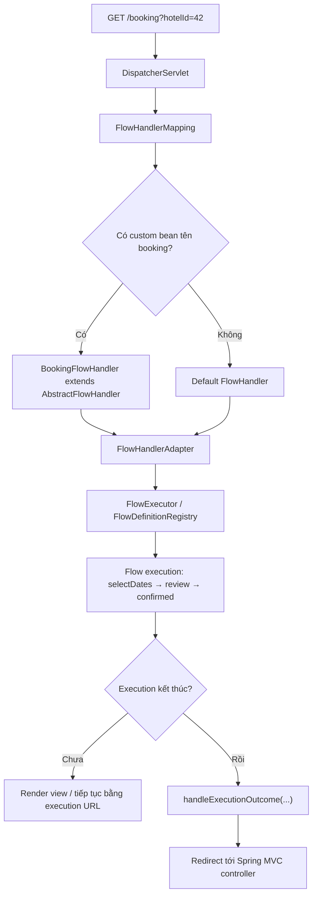

# AbstractFlowHandler để tùy chỉnh theo từng flow

## 1. Tại sao cần một FlowHandler riêng?

Trong **Spring Web Flow**, một hành trình nhiều bước như đặt phòng, đăng ký hoặc thanh toán được mô hình hóa bằng **state**, **event**, **transition** và có thể chứa **subflow**. `FlowExecutor` thực thi các state và transition; `FlowHandlerMapping` và `FlowHandlerAdapter` nối cơ chế đó với `DispatcherServlet` của Spring MVC.

Với phần lớn flow, handler mặc định là đủ: URL tương ứng flow ID sẽ khởi chạy flow, dữ liệu request được cung cấp cho execution mới và khi flow kết thúc thì hạ tầng áp dụng chính sách điều hướng mặc định. Tuy nhiên, từng hành trình đôi khi cần **quy tắc tích hợp MVC riêng**:

- Flow `booking` chỉ nhận input `hotelId` đã được chuẩn hóa, không mang toàn bộ HTTP parameters vào flow.
- Khi hoàn tất đặt phòng, điều hướng về một `@Controller` hiển thị booking đã tạo, thay vì khởi động lại flow.
- Khi người dùng gửi execution key đã hết hạn, điều hướng tới trang phục hồi dành riêng cho hành trình này.
- Flow có đường dẫn truy cập khác ID được dùng để tra cứu trong `FlowDefinitionRegistry`.

`org.springframework.webflow.mvc.servlet.AbstractFlowHandler` là lớp cơ sở để tùy chỉnh các trường hợp đó. Nó triển khai interface `FlowHandler`, cung cấp implementation mặc định đơn giản và cho phép **ghi đè chỉ những hook cần thiết**. Đây là lớp tích hợp HTTP cho *một flow*, không phải nơi đặt validation nghiệp vụ, lưu transaction hay mã điều hướng từ state này sang state khác.

**Mục tiêu bài học – Tích hợp Spring MVC:** nắm rõ hợp đồng `FlowHandler`, tạo subclass của `AbstractFlowHandler`, đăng ký nó theo flow ID, điều khiển input/outcome/exception tại ranh giới MVC–Web Flow và kiểm thử mà không phá vỡ lifecycle của execution.

## 2. Vị trí của AbstractFlowHandler trong luồng HTTP



Ba điểm mấu chốt:

1. **`FlowHandlerMapping` chọn một `FlowHandler`** dựa trên request path/flow ID. Nếu tìm thấy bean handler tùy chỉnh có tên khớp flow ID, nó ưu tiên handler đó theo cơ chế mapping.
2. **`FlowHandlerAdapter` gọi `FlowExecutor`** để launch hoặc resume execution. Khi launch, adapter có thể lấy input từ handler; khi end-state đạt outcome, adapter dùng handler để xử lý đích điều hướng.
3. **`AbstractFlowHandler` không quyết định transition.** Nó xử lý vòng tích hợp: flow ID, input lúc khởi chạy, outcome sau kết thúc và exception chưa được flow xử lý.

| Thành phần | Phạm vi trách nhiệm | Thay đổi khi viết custom FlowHandler? |
| --- | --- | --- |
| `FlowDefinitionRegistry` | Đăng ký và tra cứu XML flow | Không bắt buộc; flow vẫn phải được đăng ký đúng ID |
| `FlowHandlerMapping` | Chọn handler cho HTTP URL | Không cần subclass trong trường hợp bean name khớp flow ID |
| `AbstractFlowHandler` | Tùy chỉnh input/outcome/exception của *một flow* | **Có, là trọng tâm bài** |
| `FlowHandlerAdapter` | Nối handler với executor và response | Vẫn cần cấu hình, thường không subclass |
| `FlowExecutor` | Xử lý execution/state/event/transition | Không thay bằng FlowHandler |
| `@Controller` Spring MVC | Render trang kết quả, truy vấn dữ liệu cuối cùng | Có thể nhận redirect từ FlowHandler |

## 3. Hợp đồng của FlowHandler và các method có thể override

API trong dòng Spring Web Flow 3.x, với Servlet `jakarta.servlet.http.*`:

```java
public interface FlowHandler {
    String getFlowId();

    MutableAttributeMap<Object> createExecutionInputMap(
            HttpServletRequest request);

    String handleExecutionOutcome(
            FlowExecutionOutcome outcome,
            HttpServletRequest request,
            HttpServletResponse response);

    String handleException(
            FlowException exception,
            HttpServletRequest request,
            HttpServletResponse response);
}
```

`AbstractFlowHandler` đã hiện thực bốn method, mặc định trả `null`. Giá trị `null` cho biết phần xử lý **được giao lại cho caller/adapter theo chính sách mặc định**, chứ không có nghĩa dữ liệu trả về rỗng một cách vô hại trong mọi ngữ cảnh.

| Hook | Khi nào được dùng | Trả về | Nên override khi |
| --- | --- | --- | --- |
| `getFlowId()` | Khi xác định flow definition mà handler quản lý | Flow ID hoặc `null` để caller tự suy | Flow ID cần được xác định tường minh |
| `createExecutionInputMap(request)` | Khi bắt đầu **execution mới** | `MutableAttributeMap<Object>` hoặc `null` | Cần lọc, chuẩn hóa, xác định kiểu dữ liệu input |
| `handleExecutionOutcome(outcome, request, response)` | Khi flow đến **end-state** | Chuỗi đích redirect hoặc `null` | Cần đi tới controller/trang kết quả dựa trên outcome |
| `handleException(exception, request, response)` | Khi exception của flow không được xử lý nội bộ | Chuỗi đích redirect hoặc `null` | Cần xử lý chọn lọc lỗi execution hết hạn hoặc lỗi flow đặc thù |

**Cẩn thận với tài liệu cũ:** có phiên bản Reference Guide viết mô tả `getFlowId(HttpServletRequest)`, nhưng chữ ký thực tế trong Javadoc của `FlowHandler`/`AbstractFlowHandler` dòng 3.x là **`getFlowId()` không tham số**. Hãy đối chiếu API của dependency đang cài đặt trước khi thêm `@Override`. Với dòng 2.x, Servlet import thường là `javax.servlet.http.*`; dòng 3.x dùng `jakarta.servlet.http.*`.

### 3.1. getFlowId() không phải state ID

`getFlowId()` trả về ID của *flow definition* trong registry, ví dụ `booking`, không phải `selectDates` hay `review`. Flow ID được dùng để **launch flow**; khi đã có execution key, `FlowExecutor` phục hồi tiến trình và nhận event tại state đang chạy.

```java
@Override
public String getFlowId() {
    return "booking";
}
```

Không nên quyết định state bắt đầu bằng cách thay đổi flow ID theo request; state bắt đầu thuộc định nghĩa flow (mặc định là state đầu tiên hoặc được chỉ rõ bởi `start-state`). Nếu nhiều URL cần dùng cùng một flow với input khác nhau, xem xét mapping hoặc controller khởi tạo flow; không sao chép toàn bộ definition chỉ vì URL khác.

### 3.2. createExecutionInputMap(...) chỉ dành cho lúc launch

Một lần chạy mới có thể nhận input map `hotelId`. Khi người dùng tiếp tục một execution đang dở, dữ liệu form được xử lý qua binding và event của `view-state`; **không gọi input map như thể nó là nơi đọc mọi postback**.

Nếu flow XML có `<input name="hotelId" required="true"/>`, handler có thể cấp giá trị cho input này từ HTTP request. Chỉ đưa những dữ liệu cần thiết vào map, kiểm tra kiểu dữ liệu và vẫn xác nhận **quyền truy cập phía server**.

### 3.3. handleExecutionOutcome(...) chọn điểm đến sau end-state

`outcome.getId()` là ID của kết quả kết thúc, ví dụ `confirmed` hoặc `cancelled`. `outcome.getOutput()` chứa dữ liệu được khai báo `<output>` tại end-state. Handler trả về một **resource location**, rồi adapter xử lý redirect theo hợp đồng Spring Web Flow.

Không trả `"booking/details"` với kỳ vọng nó luôn là view name để render trực tiếp. Ở đây, chuỗi là **đích redirect**, khác với giá trị tên view được `@Controller` trả về hoặc view-state XML khai báo.

### 3.4. handleException(...) chỉ dành cho exception không được flow xử lý

Nếu flow đã khai báo exception handler hoặc action tự xử lý lỗi nghiệp vụ, logic đó vẫn chạy theo định nghĩa flow. Hook `handleException` được sử dụng khi exception đến tầng điều phối bên ngoài. Trả về một địa chỉ phục hồi **chỉ cho lỗi mà handler thực sự biết xử lý**; trả `null` cho loại lỗi còn lại để hạ tầng Spring MVC có thể xử lý hoặc ghi nhận.

**Không** nuốt mọi `FlowException`, chuyển hết về một trang thành công hay tự động khởi chạy lại thanh toán: điều đó có thể che giấu lỗi hệ thống và lặp thao tác không idempotent.

## 4. Ví dụ thực hành: BookingFlowHandler cho flow đặt phòng

Giả sử ứng dụng có flow definition `booking`, URL `/booking?hotelId=42`, hai view-state `selectDates` và `review`, hai end-state `confirmed`, `cancelled`. Khi hoàn thành, booking service trả về `bookingId` được lưu trong output của outcome.

### 4.1. Lớp custom handler hoàn chỉnh

**`BookingFlowHandler.java`**, ví dụ dùng Spring Web Flow 3.x và Spring Framework 6.x:

```java
package com.example.booking.web;

import jakarta.servlet.http.HttpServletRequest;
import jakarta.servlet.http.HttpServletResponse;
import org.springframework.http.HttpStatus;
import org.springframework.web.server.ResponseStatusException;
import org.springframework.webflow.core.FlowException;
import org.springframework.webflow.core.collection.LocalAttributeMap;
import org.springframework.webflow.core.collection.MutableAttributeMap;
import org.springframework.webflow.execution.FlowExecutionOutcome;
import org.springframework.webflow.execution.repository.NoSuchFlowExecutionException;
import org.springframework.webflow.mvc.servlet.AbstractFlowHandler;

public class BookingFlowHandler extends AbstractFlowHandler {

    // Flow ID trong FlowDefinitionRegistry, không phải state ID.
    @Override
    public String getFlowId() {
        return "booking";
    }

    // Được dùng khi launch execution mới.
    @Override
    public MutableAttributeMap<Object> createExecutionInputMap(
            HttpServletRequest request) {

        String rawHotelId = request.getParameter("hotelId");
        if (rawHotelId == null
                || !rawHotelId.matches("[1-9][0-9]{0,11}")) {
            throw new ResponseStatusException(
                    HttpStatus.BAD_REQUEST, "hotelId không hợp lệ");
        }

        MutableAttributeMap<Object> input = new LocalAttributeMap<>();
        input.put("hotelId", Long.valueOf(rawHotelId));
        return input;
    }

    // Được dùng sau khi flow đã đi đến end-state.
    @Override
    public String handleExecutionOutcome(
            FlowExecutionOutcome outcome,
            HttpServletRequest request,
            HttpServletResponse response) {

        if ("confirmed".equals(outcome.getId())) {
            String bookingId = outcome.getOutput().getString("bookingId");
            if (bookingId == null
                    || !bookingId.matches("[A-Za-z0-9-]{1,36}")) {
                throw new IllegalStateException(
                        "Flow confirmed thiếu bookingId hợp lệ");
            }

            // Redirect theo context path của ứng dụng.
            return "contextRelative:/bookings/" + bookingId;
        }

        if ("cancelled".equals(outcome.getId())) {
            return "contextRelative:/hotels";
        }

        // Outcome chưa được tùy chỉnh: dùng chính sách của adapter.
        return null;
    }

    @Override
    public String handleException(
            FlowException exception,
            HttpServletRequest request,
            HttpServletResponse response) {

        if (exception instanceof NoSuchFlowExecutionException) {
            return "contextRelative:/booking/expired";
        }

        // Không che giấu các lỗi nghiệp vụ/hạ tầng không biết xử lý.
        return null;
    }
}
```

Các điểm đáng chú ý:

- `getFlowId()` trả `booking` dù thông tin request có thêm `hotelId`. Không trộn flow ID với tham số đầu vào.
- `createExecutionInputMap(...)` chỉ cho phép `hotelId` là số nguyên dương có giới hạn chữ số; tránh đẩy nguyên bản toàn bộ request parameters vào flow. Dự án thực tế cần xử lý chặt chẽ cả phân quyền truy cập hotel.
- `handleExecutionOutcome(...)` chỉ dựa trên **outcome được engine công bố**, không dựa vào event `confirm` do client tự gửi. Chỉ điều hướng tới kết quả sau khi flow đã kết thúc.
- `bookingId` được giới hạn ký tự trước khi ghép vào path redirect, tránh biến output không tin cậy thành open redirect hoặc URL bất thường. Một ID phức tạp hơn cần mã hóa như một path segment và bảo đảm URL thuộc allowlist.
- `handleException(...)` chỉ tùy chỉnh lỗi `NoSuchFlowExecutionException`; các lỗi khác để hạ tầng xử lý. Trang `/booking/expired` **không tự phục hồi** context đã mất mà chỉ hướng người dùng khởi chạy lại an toàn.

Đoạn handler này không nhận dependency service để ghi booking; thao tác ghi vẫn thuộc **service được action của flow gọi**, với transaction, validation, quyền truy cập và idempotency riêng.

## 5. Đăng ký handler để chỉ áp dụng cho flow booking

Spring Web Flow hỗ trợ quy ước **bean name = flow ID**. Khi `FlowHandlerMapping` đang tìm handler cho flow `booking`, nó có thể lấy bean `FlowHandler` có tên `booking` từ Spring application context thay vì tạo default handler. Đây là bước quan trọng: **chỉ khai báo một class extends `AbstractFlowHandler` chưa khiến MVC tự sử dụng nó**.

### 5.1. Java configuration

Ví dụ dưới đây đăng ký flow, executor, mapping, adapter và bean handler. Nếu ứng dụng đã có các bean nền tảng, chỉ bổ sung phần bean custom và đảm bảo nó nằm trong đúng context.

```java
package com.example.booking.config;

import com.example.booking.web.BookingFlowHandler;
import org.springframework.context.annotation.Bean;
import org.springframework.context.annotation.Configuration;
import org.springframework.webflow.config.AbstractFlowConfiguration;
import org.springframework.webflow.definition.registry.FlowDefinitionRegistry;
import org.springframework.webflow.executor.FlowExecutor;
import org.springframework.webflow.mvc.servlet.FlowHandlerAdapter;
import org.springframework.webflow.mvc.servlet.FlowHandlerMapping;

@Configuration
public class BookingWebFlowConfig extends AbstractFlowConfiguration {

    @Bean
    public FlowDefinitionRegistry flowRegistry() {
        return getFlowDefinitionRegistryBuilder()
                .addFlowLocation(
                        "/WEB-INF/flows/booking/booking-flow.xml",
                        "booking")
                .build();
    }

    @Bean
    public FlowExecutor flowExecutor(FlowDefinitionRegistry flowRegistry) {
        return getFlowExecutorBuilder(flowRegistry).build();
    }

    @Bean
    public FlowHandlerMapping flowHandlerMapping(
            FlowDefinitionRegistry flowRegistry) {
        FlowHandlerMapping mapping = new FlowHandlerMapping();
        mapping.setFlowRegistry(flowRegistry);
        mapping.setOrder(0);
        return mapping;
    }

    @Bean
    public FlowHandlerAdapter flowHandlerAdapter(FlowExecutor flowExecutor) {
        FlowHandlerAdapter adapter = new FlowHandlerAdapter();
        adapter.setFlowExecutor(flowExecutor);
        return adapter;
    }

    // Quan trọng: bean name trùng flow ID.
    @Bean(name = "booking")
    public BookingFlowHandler bookingFlowHandler() {
        return new BookingFlowHandler();
    }
}
```

Đối với ứng dụng thực sử dụng JSP/Thymeleaf, hãy nối `MvcViewFactoryCreator` và `FlowBuilderServices` với resolver tương ứng. Ví dụ cấu hình trên tập trung vào **cách cài custom FlowHandler**, không thay thế cấu hình view, persistence, security hoặc `DispatcherServlet` đã có.

Chỉ cần bean tên `booking` khi muốn ghi đè chính sách cho flow đó; các flow khác trong registry, ví dụ `signup`, vẫn có thể dùng handler mặc định của `FlowHandlerMapping`.

### 5.2. XML bean configuration tương đương

```xml
<!-- Trong Spring application context của DispatcherServlet. -->
<bean name="booking"
      class="com.example.booking.web.BookingFlowHandler"/>

<bean class="org.springframework.webflow.mvc.servlet.FlowHandlerMapping">
    <property name="flowRegistry" ref="flowRegistry"/>
    <property name="order" value="0"/>
</bean>

<bean class="org.springframework.webflow.mvc.servlet.FlowHandlerAdapter">
    <property name="flowExecutor" ref="flowExecutor"/>
</bean>
```

Đoạn XML là trích đoạn: `flowRegistry` và `flowExecutor` phải có sẵn trong context, cùng cấu hình namespace Spring beans/schema hợp lệ. Khi dùng `@Bean(name = "booking")`, không khai báo XML bean trùng tên trong cùng context.

### 5.3. Khi nào custom handler không được gọi?

Một số tình huống thường gặp:

- Bean `bookingFlowHandler` được đăng ký bằng tên phương thức mặc định, **không phải `booking`**. `FlowHandlerMapping` có thể tiếp tục tạo default handler.
- Bean nằm ở Spring root context hoặc một servlet context khác; handler mapping xử lý request không tìm thấy nó theo phạm vi bean đang dùng.
- Registry đăng ký ID `hotels/booking` nhưng bean lại đặt tên `booking`; hai ID không khớp.
- Một `@RequestMapping` của controller hoặc handler mapping ưu tiên cao hơn đã nhận URL trước Web Flow.
- Spring MVC chưa đăng ký `FlowHandlerAdapter` hoặc bean adapter dùng sai executor.
- Flow ID trùng với bean khác không phải `FlowHandler`, dẫn đến xung đột resolution.

Hãy kiểm tra **flow ID → bean name → handler mapping → adapter → executor** theo thứ tự trước khi sửa logic trong handler.

## 6. Kết nối flow XML với input và outcome của custom handler

File `/WEB-INF/flows/booking/booking-flow.xml` phải tuyên bố đầu vào mà handler cung cấp. Ví dụ mẫu sau có hai màn hình, một action lưu booking và hai end-state:

```xml
<?xml version="1.0" encoding="UTF-8"?>
<flow xmlns="http://www.springframework.org/schema/webflow"
      xmlns:xsi="http://www.w3.org/2001/XMLSchema-instance"
      xsi:schemaLocation="
        http://www.springframework.org/schema/webflow
        http://www.springframework.org/schema/webflow/spring-webflow-2.0.xsd">

    <input name="hotelId" required="true"/>

    <on-start>
        <evaluate expression="bookingService.start(hotelId)"
                  result="flowScope.bookingDraft"/>
    </on-start>

    <view-state id="selectDates"
                view="booking/select-dates"
                model="bookingDraft">
        <transition on="next" to="review"/>
        <transition on="cancel" to="cancelled" bind="false"/>
    </view-state>

    <view-state id="review"
                view="booking/review"
                model="bookingDraft">
        <transition on="back" to="selectDates" validate="false"/>
        <transition on="confirm" to="saveBooking"/>
    </view-state>

    <action-state id="saveBooking">
        <evaluate expression="bookingService.confirm(bookingDraft)"
                  result="flowScope.bookingId"/>
        <transition on="success" to="confirmed"/>
    </action-state>

    <end-state id="confirmed">
        <output name="bookingId" value="flowScope.bookingId"/>
    </end-state>

    <end-state id="cancelled"/>
</flow>
```

Giả định `bookingService` là Spring bean có hai phương thức:

- `start(Long hotelId)`: kiểm tra quyền truy cập, tìm khách sạn hợp lệ và tạo model tạm của hành trình.
- `confirm(BookingDraft draft)`: kiểm tra lại thông tin, tồn phòng và giá cuối cùng, sau đó tạo booking trong transaction; trả ID đã lưu. Thao tác này phải có biện pháp chống xử lý lặp (idempotency).

`bookingDraft` là ví dụ model do dự án định nghĩa, không phải class sẵn của Web Flow. Form ở `selectDates`/`review` sử dụng thuộc tính của model để binding/validation. Nếu dữ liệu không hợp lệ, transition `next`/`confirm` có thể bị chặn theo cấu hình validator và view-state sẽ render thông báo lỗi.

**Ranh giới quan trọng:** chỉ khi action `bookingService.confirm(...)` hoàn tất và flow tới `confirmed`, outcome mới cung cấp `bookingId` để `BookingFlowHandler.handleExecutionOutcome(...)` chuyển hướng sang controller chi tiết booking. Tên `confirm` là event do người dùng gửi, còn `confirmed` là outcome được Web Flow phát sau end-state; không nên coi hai giá trị là một.

### 6.1. MVC controller nhận redirect

Ví dụ một controller chỉ có nhiệm vụ hiển thị thông tin đã lưu:

```java
package com.example.booking.web;

import org.springframework.stereotype.Controller;
import org.springframework.ui.Model;
import org.springframework.web.bind.annotation.GetMapping;
import org.springframework.web.bind.annotation.PathVariable;

@Controller
public class BookingResultController {

    private final BookingQueryService bookingQueryService;

    public BookingResultController(BookingQueryService bookingQueryService) {
        this.bookingQueryService = bookingQueryService;
    }

    @GetMapping("/bookings/{id}")
    public String show(@PathVariable("id") String id, Model model) {
        model.addAttribute(
                "booking", bookingQueryService.findAccessibleBooking(id));
        return "booking/details";
    }

    @GetMapping("/booking/expired")
    public String expired() {
        return "booking/expired";
    }

    @GetMapping("/hotels")
    public String hotels() {
        return "hotels/index";
    }
}
```

`BookingQueryService` trong ví dụ là service do ứng dụng tự viết, có trách nhiệm chỉ trả booking mà người dùng hiện tại **được phép xem**; lưu ý không truy cập booking chỉ dựa trên việc client biết ID. Các view JSP/Thymeleaf tương ứng cũng cần được cung cấp trong dự án.

### 6.2. Form tiếp tục một execution

Ví dụ JSP ở bước xác nhận:

```jsp
<h1>Xác nhận đặt phòng</h1>
<form method="post" action="${flowExecutionUrl}">
    <!-- Input form và CSRF hidden input tùy cấu hình bảo mật -->
    <button type="submit" name="_eventId_back">Quay lại</button>
    <button type="submit" name="_eventId_confirm">Xác nhận</button>
</form>
```

`flowExecutionUrl` xác định **execution đang diễn ra**. Khi submit event `confirm`, Web Flow resume state `review` rồi xử lý action. `createExecutionInputMap(...)` của handler **không phải nơi lấy lại `hotelId` trong mỗi POST**; input này đã được đưa vào context khi launch flow.

## 7. Chuỗi redirect sau khi flow kết thúc

Handler trả về đích redirect theo hợp đồng Spring Web Flow. Các prefix phổ biến:

| Chuỗi trả về | Cách hiểu | Lưu ý |
| --- | --- | --- |
| `"/bookings/123"` | Đường dẫn **servlet-relative** mặc định | Phụ thuộc servlet mapping của ứng dụng |
| `"servletRelative:/bookings/123"` | Đường dẫn tương đối với Servlet hiện tại | Dùng khi muốn nêu rõ ý nghĩa |
| `"contextRelative:/bookings/123"` | Đường dẫn tương đối với web application context path | Hữu ích khi app triển khai dưới `/my-app` |
| `"serverRelative:/bookings/123"` | Đường dẫn tương đối với server root | Cần kiểm tra context path nếu có |
| `"https://example.org/return"` | URL tuyệt đối | Chỉ dùng với allowlist domain và yêu cầu thực sự |
| `null` | Chưa xử lý riêng | Adapter sử dụng chính sách mặc định |

**Ví dụ:** nếu ứng dụng được triển khai tại context path `/my-app`, `contextRelative:/bookings/123` giúp điều hướng về `/my-app/bookings/123` thay vì mặc định ghép theo Servlet path. Giá trị trả về không cần thêm `redirect:` theo kiểu return view name của MVC `@Controller`.

Đừng ghép query string hoặc path từ dữ liệu client thiếu kiểm soát:

```java
// Không làm như thế: location nhận trực tiếp từ client.
return request.getParameter("next");

// Nên chọn URL hợp lệ từ quyết định của server.
return "contextRelative:/hotels";
```

Nếu đích điều hướng phụ thuộc booking ID, hãy sử dụng output sinh ra từ backend, giới hạn kiểu/ký tự hoặc URL-encode thành từng path segment. Mặt khác, **redirect thành công không thay thế kiểm tra giao dịch**: booking phải được lưu thành công trước khi end-state `confirmed` công bố outcome.

## 8. Xử lý FlowException và phục hồi execution an toàn

Một request có thể đến với execution key cũ do:

- Người dùng bấm Back trên trang cũ sau nhiều transition.
- HTTP session hết hạn hoặc repository đã dọn các execution/snapshot.
- Người dùng gửi lại form sau khi flow đã kết thúc.
- Hai tab dùng cùng trạng thái nhưng gửi event gần như đồng thời.

`NoSuchFlowExecutionException` xuất hiện khi hạ tầng không tìm được execution theo key được yêu cầu. Hành vi mặc định của Web Flow có thể khởi động lại flow; với hành trình có dữ liệu quan trọng, việc khởi động lại **mà không giải thích** thường gây nhầm lẫn. Custom handler có thể điều hướng sang trang riêng:

```java
@Override
public String handleException(
        FlowException exception,
        HttpServletRequest request,
        HttpServletResponse response) {
    if (exception instanceof NoSuchFlowExecutionException) {
        return "contextRelative:/booking/expired";
    }
    return null;
}
```

Trang phục hồi nên giải thích phiên làm việc đã hết hiệu lực, cung cấp nút bắt đầu booking mới, và chỉ đề nghị tải lại bản nháp nếu hệ thống **thực sự có lưu bản nháp bền vững**. Không giả định session/`flowScope` cũ vẫn tồn tại. Mọi thao tác khôi phục dữ liệu đều cần authorization.

Nếu gặp `FlowException` khác như lỗi action/transaction, **không** coi nó là lỗi session hết hạn. Hãy để exception lan tới cơ chế exception resolver/logging thích hợp của Spring MVC hoặc xử lý trong flow với chính sách đã thiết kế. Khi cần báo lỗi cho người dùng, không lộ stack trace, execution key, token, SQL hoặc thông tin nhạy cảm.

### Custom handler có thể thay thế quy tắc security không?

Không. Input map dùng dữ liệu từ HTTP request chỉ là **dữ liệu đề xuất**; nó không chứng minh quyền của người dùng. Để đảm bảo an toàn:

1. Xác thực và phân quyền ở Spring Security/service/flow theo yêu cầu.
2. Kiểm tra `hotelId` và quyền truy cập trong service, không chỉ regex trong handler.
3. Bảo vệ CSRF cho POST và không tự động cho rằng request mang execution key là hợp lệ.
4. Chống double submit và thiết kế transaction idempotent khi xác nhận booking.
5. Kiểm soát redirect bằng URL cố định/allowlist; không nhận `next` tùy ý từ client.
6. Đặt dữ liệu theo `flowScope`/`viewScope` thích hợp; không lưu form mutable của từng người dùng vào field của bean handler singleton.

## 9. Phân biệt custom FlowHandler với các điểm mở rộng khác

| Nhu cầu | Nên tùy chỉnh ở đâu? | Vì sao? |
| --- | --- | --- |
| Chọn input khi **launch** flow | `AbstractFlowHandler.createExecutionInputMap` | Điều khiển đầu vào ở ranh giới HTTP |
| Chuyển hướng tới MVC controller sau **end-state** | `AbstractFlowHandler.handleExecutionOutcome` | Tách URL bên ngoài khỏi XML flow |
| Phục hồi lỗi execution hết hạn cho **một flow** | `AbstractFlowHandler.handleException` | Cho thông điệp phục hồi riêng theo hành trình |
| Xác định flow ID từ quy tắc URL khác mặc định | `FlowHandlerMapping` / `FlowUrlHandler` hoặc `FlowHandler.getFlowId()` theo nhu cầu | Quản lý cách chọn flow, không chỉnh state transition |
| Điều kiện chuyển sang state khác | `transition`, `decision-state` hoặc action trong XML | Thuộc logic điều hướng |
| Chuyển input form thành Java object | `view-state model`, binding/conversion service | Không đặt form binding của mọi state vào custom handler |
| Kiểm tra `@NotBlank`, `@Email` hoặc policy | Validator và service | Không phải nhiệm vụ MVC integration handler |
| Tùy chỉnh repository, snapshot và conversation | `FlowExecutor` / repository config | Phạm vi tất cả execution, không chỉ URL của một flow |
| Xử lý Ajax request và redirect Ajax | `FlowHandlerAdapter.setAjaxHandler(...)`, view rendering | Chọn protocol và fragment, khác với outcome handler |
| Mã nghiệp vụ tạo booking, transaction | Spring service/action-state | Cần tính nhất quán và kiểm thử độc lập |

Với một yêu cầu đặc biệt của **chỉ một flow**, custom `AbstractFlowHandler` thường dễ hiểu hơn việc subclass `FlowHandlerAdapter` toàn cục. Nhưng nếu mục tiêu chỉ là đổi một transition trong nội bộ flow, hãy thay XML và test behavior thay vì tạo custom handler không cần thiết.

## 10. Kiểm thử các hook của custom handler

Nên có cả **unit test** trực tiếp các hook và **integration test** qua Spring MVC để xác nhận bean thực sự được chọn theo tên.

### 10.1. Unit test input map và outcome bằng JUnit 5

Đoạn mã minh họa sử dụng `spring-test` để có `MockHttpServletRequest`:

```java
import static org.junit.jupiter.api.Assertions.*;

import org.junit.jupiter.api.Test;
import org.springframework.mock.web.MockHttpServletRequest;
import org.springframework.mock.web.MockHttpServletResponse;
import org.springframework.webflow.core.collection.LocalAttributeMap;
import org.springframework.webflow.core.collection.MutableAttributeMap;
import org.springframework.webflow.execution.FlowExecutionOutcome;

class BookingFlowHandlerTest {

    private final BookingFlowHandler handler = new BookingFlowHandler();

    @Test
    void extractsOnlyTypedHotelId() {
        MockHttpServletRequest request = new MockHttpServletRequest();
        request.setParameter("hotelId", "42");
        request.setParameter("isAdmin", "true"); // Không đưa vào flow.

        MutableAttributeMap<Object> input =
                handler.createExecutionInputMap(request);

        assertEquals(42L, input.get("hotelId"));
        assertNull(input.get("isAdmin"));
    }

    @Test
    void confirmedRedirectsToBookingDetails() {
        LocalAttributeMap<Object> output = new LocalAttributeMap<>();
        output.put("bookingId", "BK-1024");
        FlowExecutionOutcome outcome =
                new FlowExecutionOutcome("confirmed", output);

        String location = handler.handleExecutionOutcome(
                outcome,
                new MockHttpServletRequest(),
                new MockHttpServletResponse());

        assertEquals("contextRelative:/bookings/BK-1024", location);
    }

    @Test
    void cancelledRedirectsToHotels() {
        FlowExecutionOutcome outcome = new FlowExecutionOutcome(
                "cancelled", new LocalAttributeMap<>());

        assertEquals(
                "contextRelative:/hotels",
                handler.handleExecutionOutcome(
                        outcome,
                        new MockHttpServletRequest(),
                        new MockHttpServletResponse()));
    }
}
```

Các test trên chỉ chứng minh **method của handler trả kết quả dự kiến**. Chúng chưa chứng minh `FlowHandlerMapping` đã dùng bean `booking` hoặc URL `/booking` có thực sự chạy flow.

### 10.2. Integration test cần kiểm tra thêm

Một `MockMvc` test nên nạp `WebApplicationContext` thực tế có registry, adapter, mapping, handler tùy chỉnh và view resolver phù hợp. Các kịch bản quan trọng:

| Kịch bản | Request | Kỳ vọng |
| --- | --- | --- |
| Handler được chọn | `GET /booking?hotelId=42` | Input map có `Long 42`; execution bắt đầu tại `selectDates` |
| Input không hợp lệ | `GET /booking?hotelId=abc` | HTTP 400 hoặc policy lỗi đầu vào được cấu hình, không tạo booking |
| Input dư thừa | Kèm `isAdmin=true` | Không đưa field này vào input map |
| Tiếp tục flow | POST tới `flowExecutionUrl` với `_eventId_next` | Engine chuyển sang `review`, handler không tạo execution mới |
| Xác nhận | POST event `confirm` và backend tạo booking | Flow kết thúc, redirect tới `/bookings/{bookingId}` |
| Hủy | POST event `cancel` | Redirect về `/hotels` |
| Execution không còn | POST bằng key cũ/session hết hạn | Redirect tới `/booking/expired` nếu hook nhận lỗi tương ứng |
| Lỗi service | Service ném exception không phải lỗi execution hết hạn | Không bị biến thành “thành công” hay “session expired” |
| An toàn nhiều tab | Hai execution cùng chỉnh dữ liệu | Không ghi chồng ngoài dự kiến; backend kiểm tra idempotency và concurrency |

Khi thử qua HTTP, giữ cookie session, CSRF token và execution URL lấy từ view mới nhất. Sau khi flow hoàn tất, không cố dùng lại execution key để tạo booking thứ hai.

### 10.3. Kiểm thử flow riêng

Dùng `AbstractXmlFlowExecutionTests` hoặc test support tương ứng để xác minh **event/transition/action** bên trong XML. Test này không cần quan tâm custom `FlowHandler` trả redirect URL nào. Ngược lại, unit test handler không cần mở database để xác minh việc phân loại outcome.

Sự phân chia này giúp tránh các bài test quá lớn nhưng không chỉ ra lỗi nằm ở engine, handler mapping, redirect hay transaction.

## 11. Các lỗi phổ biến khi tùy chỉnh từng flow

| Triệu chứng | Nguyên nhân có thể | Cách chẩn đoán |
| --- | --- | --- |
| Đã tạo subclass nhưng hook không được gọi | Bean name không bằng flow ID hoặc không nằm trong context được dùng | Kiểm tra `@Bean(name="booking")` và `FlowHandlerMapping` |
| `getFlowId(...)` không override được | Dùng chữ ký trong đoạn mô tả cũ thay vì Javadoc | Dùng `public String getFlowId()` không tham số |
| Input `hotelId` bị thiếu | Sai tên parameter, flow XML đòi input khác, request đang resume chứ không launch | Kiểm tra `<input>`, `createExecutionInputMap` và execution URL |
| Input là chuỗi nhưng service yêu cầu Long | Chưa convert tại ranh giới hoặc converter chưa đúng | Tạo input `Long` sau validation, kiểm tra type |
| Flow kết thúc nhưng vẫn mở lại màn hình đầu | `handleExecutionOutcome` trả `null` hoặc handler mặc định được chọn | Đối chiếu bean mapping và outcome ID |
| Redirect sai context path | Trả servlet-relative trong ứng dụng có mapping khác | Dùng `contextRelative:` hoặc prefix phù hợp |
| Redirect tới URL không an toàn | Ghép dữ liệu client trực tiếp thành URL | Dùng ID backend, allowlist và encode thành phần URL |
| Trang kết quả báo 404 | Controller đích chưa có route hoặc view resolver không khớp | Kiểm tra `@GetMapping` và resource view |
| Sau session timeout tự vào flow mới | Default recovery của adapter | Tùy chỉnh exception hook và trang phục hồi |
| Lỗi SQL bị hiểu thành lỗi hết phiên | `handleException` bắt mọi `FlowException` | Chỉ xử lý exception đặc trưng, trả `null` cho loại còn lại |
| Xác nhận bị thực thi hai lần | Double submit/retry không idempotent | Kiểm tra transaction, khóa nghiệp vụ, unique key |
| Submit không đến handler | Controller route hoặc handler mapping khác ưu tiên | Kiểm tra URL và thứ tự `HandlerMapping` |

Đường gỡ lỗi hiệu quả: **xác định flow ID → xác định tên bean handler → mapping → adapter/executor → input map → state/event → outcome/exception → redirect destination**. Nếu lỗi xảy ra ở giai đoạn binding/validation trong state, đừng sửa `handleExecutionOutcome`.

## 12. Bài tập vận dụng

Ứng dụng có flow `subscription` với ba lựa chọn `basic`, `pro` và `enterprise`. Hãy thiết kế `SubscriptionFlowHandler extends AbstractFlowHandler`:

1. Trong `createExecutionInputMap(...)`, chỉ chấp nhận input `plan` thuộc một trong ba giá trị định sẵn; nếu sai, trả lỗi HTTP phù hợp.
2. Khi flow tới `end-state id="activated"` và có output `subscriptionId`, redirect tới `contextRelative:/subscriptions/{id}`.
3. Khi tới `end-state id="cancelled"`, redirect tới `contextRelative:/plans`.
4. Khi gặp `NoSuchFlowExecutionException`, redirect tới `contextRelative:/subscription/expired`; với lỗi khác, không giả định là lỗi hết phiên.
5. Khai báo bean handler có **name="subscription"** và đăng ký flow definition ID `subscription`.
6. Viết unit test cho input hợp lệ/không hợp lệ, outcome thành công/hủy, và integration test để xác nhận MVC thực sự dùng custom handler.

**Tiêu chí hoàn thành:** giải thích được vì sao handler chỉ điều khiển **ranh giới HTTP của một flow**, trong khi lựa chọn state, validation, giao dịch và thay đổi dữ liệu vẫn do định nghĩa flow cùng các service chịu trách nhiệm.

## 13. Ghi nhớ

- `AbstractFlowHandler` là lớp cơ sở của `FlowHandler`, dùng khi cần tùy chỉnh **input, outcome, exception hoặc flow ID** cho một flow cụ thể.
- Trong Servlet API 3.x của Spring Web Flow, hook đúng là **`getFlowId()` không tham số**.
- `createExecutionInputMap(...)` chạy khi **launch execution mới**, không dùng để binding mọi request trong quá trình resume.
- `handleExecutionOutcome(...)` xử lý **outcome từ end-state**, có thể redirect về một Spring MVC controller mà không phải nhúng URL controller vào XML flow.
- `handleException(...)` chỉ nên bắt lỗi biết cách phục hồi, nhất là execution key không tồn tại; các lỗi khác phải được giữ để hạ tầng xử lý.
- **Tên bean của custom FlowHandler phải trùng flow ID** để `FlowHandlerMapping` chọn nó theo quy ước.
- Trong ứng dụng nhiều bước, phân biệt rõ **flow ID, state ID, event ID, execution key, outcome ID** và view name.
- Custom handler không thay thế kiểm tra quyền, CSRF, Bean Validation, transaction, idempotency, quản lý scope hoặc kiểm thử tích hợp.

### Tài liệu tham khảo

- [Spring Web Flow 3.0.1 – AbstractFlowHandler Javadoc](https://docs.spring.io/spring-webflow/docs/3.0.1/api/org/springframework/webflow/mvc/servlet/AbstractFlowHandler.html): chữ ký các hook và ngữ nghĩa giá trị trả về.
- [Spring Web Flow 3.0.1 – FlowHandler Javadoc](https://docs.spring.io/spring-webflow/docs/3.0.1/api/org/springframework/webflow/mvc/servlet/FlowHandler.html): giao diện tích hợp cho một flow.
- [Spring Web Flow 3.0.1 – FlowHandlerMapping Javadoc](https://docs.spring.io/spring-webflow/docs/3.0.1/api/org/springframework/webflow/mvc/servlet/FlowHandlerMapping.html): cách ưu tiên bean handler tùy chỉnh và flow ID.
- [Spring Web Flow 3.0.1 – Reference Guide, Spring MVC Integration](https://docs.spring.io/spring-webflow/docs/3.0.1/reference/#spring-mvc-integration): đăng ký custom FlowHandler, xử lý outcome và redirect prefixes.
- [Spring Framework – Spring MVC DispatcherServlet](https://docs.spring.io/spring-framework/reference/web/webmvc/mvc-servlet.html): hợp đồng HandlerMapping/HandlerAdapter và exception resolution.
