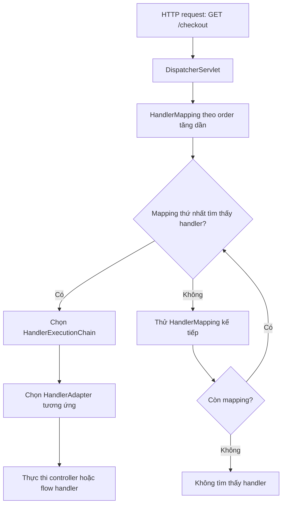

# Thứ tự mapping khi cùng tồn tại MVC controller

## 1. Vấn đề: một URL có thể được nhiều handler cùng quan tâm

Trong ứng dụng dùng **Spring MVC và Spring Web Flow (SWF)**, một URL có thể đồng thời phù hợp với:

- Một controller có `@RequestMapping` hoặc `@GetMapping`.
- Một flow definition được đăng ký trong flow registry.
- Một view controller, resource handler hoặc handler mapping tùy biến.

Ví dụ ứng dụng có flow ID `checkout`, được mở bằng đường dẫn `/checkout`. Đồng thời nhóm MVC tạo controller:

```java
@Controller
public class CheckoutController {

    @GetMapping("/checkout")
    public String checkoutLanding() {
        return "checkout/landing";
    }
}
```

Khi trình duyệt gọi `GET /checkout`, **ai sẽ nhận request trước?** Controller có render trang landing, hay Spring Web Flow khởi chạy flow `checkout`?

Câu trả lời phụ thuộc vào **thứ tự các HandlerMapping** mà `DispatcherServlet` sử dụng. Đây là cấu hình quan trọng khi một ứng dụng cùng có controller MVC và flow handler.

Trong bài này, ta sẽ:

1. Hiểu cách `DispatcherServlet` chọn handler.
2. Phân biệt thứ tự giữa các `HandlerMapping` với độ cụ thể của `@RequestMapping`.
3. Cấu hình `FlowHandlerMapping` để controller hoặc flow được ưu tiên.
4. Thiết kế URL để tránh xung đột.
5. Viết kiểm thử chứng minh request thực sự đi vào handler mong muốn.

## 2. DispatcherServlet chọn handler như thế nào?

Spring MVC sử dụng `DispatcherServlet` làm front controller. Khi nhận request, servlet hỏi danh sách các **HandlerMapping** theo thứ tự. Mỗi mapping cố gắng tìm một handler phù hợp với request. HandlerMapping đầu tiên trả về handler hợp lệ sẽ được sử dụng.



**Số order nhỏ hơn được xét trước.** Ví dụ mapping có order `-1` được hỏi trước mapping order `0`; mapping order `1` được hỏi sau. Khi một mapping đã tìm được handler, `DispatcherServlet` không tiếp tục hỏi các mapping phía sau để so sánh xem handler nào “cụ thể hơn”.

Điều này dẫn đến một quy tắc rất quan trọng:

> **Độ ưu tiên giữa HandlerMapping được xét trước độ cụ thể của các URL pattern nằm bên trong từng HandlerMapping.**

Một controller có pattern `/checkout/{id}` không tự động thắng một FlowHandlerMapping chỉ vì pattern có vẻ cụ thể hơn. Nếu FlowHandlerMapping đứng trước và nhận ra URL là một flow ID hợp lệ, request đã được giao cho flow.

### 2.1. Hai tầng so khớp khác nhau

| Tầng | Thành phần so khớp | Cách quyết định |
| --- | --- | --- |
| Tầng 1 | Danh sách `HandlerMapping` | Xét theo `order` tăng dần; mapping đầu tiên tìm thấy handler thắng |
| Tầng 2 | Các mapping bên trong một `HandlerMapping` | Mapping đó áp dụng quy tắc riêng để chọn handler phù hợp nhất |

Ví dụ trong cùng `RequestMappingHandlerMapping`, Spring MVC có thể chọn method `@GetMapping("/checkout/{id}")` phù hợp hơn method có pattern rộng. Nhưng phép so khớp này chỉ diễn ra **sau khi RequestMappingHandlerMapping được hỏi**.

### 2.2. HandlerMapping khác HandlerAdapter

Hai thành phần có nhiệm vụ riêng:

- **HandlerMapping:** quyết định request thuộc handler nào.
- **HandlerAdapter:** biết cách thực thi handler đã được chọn.

Trong cấu hình thường gặp:

| Loại handler | HandlerMapping | HandlerAdapter |
| --- | --- | --- |
| Controller annotation | `RequestMappingHandlerMapping` | `RequestMappingHandlerAdapter` |
| Spring Web Flow | `FlowHandlerMapping` | `FlowHandlerAdapter` |

Chỉ khai báo FlowHandlerMapping mà thiếu FlowHandlerAdapter tương ứng có thể khiến request đã được mapping nhưng không có adapter hỗ trợ thực thi. Ngược lại, có adapter mà mapping không chọn FlowHandler thì flow cũng không được gọi.

## 3. Các HandlerMapping thường gặp trong ứng dụng

Trong ứng dụng Spring MVC, `DispatcherServlet` có thể tìm thấy nhiều HandlerMapping. Những thành phần thường gặp:

| HandlerMapping | Vai trò |
| --- | --- |
| `RequestMappingHandlerMapping` | Tìm controller method có `@RequestMapping`, `@GetMapping`, `@PostMapping`... |
| `FlowHandlerMapping` | Tìm flow handler dựa trên flow ID/URL handler và flow registry |
| `BeanNameUrlHandlerMapping` | Ánh xạ URL tới bean handler theo quy ước tên |
| `SimpleUrlHandlerMapping` | Ánh xạ URL tường minh tới handler, thường dùng cho resource hoặc handler cấu hình |
| `ViewControllerHandlerMapping` | Ánh xạ URL đơn giản tới view mà không cần controller method |
| `ResourceHandlerMapping` | Phục vụ tài nguyên tĩnh qua cấu hình resource handler |

Không phải mọi ứng dụng đều có tất cả các mapping này. Cấu hình Java, XML, Spring Boot, thư viện bổ sung và custom MVC configuration có thể thêm/bớt hoặc thay đổi thứ tự.

### 3.1. Thứ tự mặc định cần lưu ý

Trong cấu hình Spring MVC annotation thông dụng, `RequestMappingHandlerMapping` thường có order `0`. `FlowHandlerMapping` kế thừa cơ chế order từ hệ thống mapping của Spring và nên được **đặt order tường minh** khi cùng tồn tại với controller có thể trùng URL.

Không nên dựa vào thứ tự khởi tạo bean hoặc thứ tự file XML. Cũng không nên để hai mapping quan trọng cùng order rồi kỳ vọng thứ tự đăng ký bean luôn ổn định. Hãy chọn các giá trị khác nhau và kiểm thử hành vi.

### 3.2. FlowHandlerMapping nhận diện URL thế nào?

`FlowHandlerMapping` dùng flow registry và cơ chế phân giải URL của Web Flow để tìm flow definition tương ứng. Với mapping mặc định thường gặp, flow ID `checkout` được truy cập qua đường dẫn `/checkout`; URL tiếp tục có thể chứa tham số execution do Web Flow cấp.

Đường dẫn chính xác còn phụ thuộc:

- `flow-registry` và ID được đăng ký.
- `FlowUrlHandler`/custom `FlowHandler` nếu ứng dụng có tùy chỉnh.
- Context path, servlet mapping và cấu hình triển khai.
- Cách ứng dụng đặt prefix hoặc ánh xạ flow URL.

Nếu không tìm được flow definition cho một URL, FlowHandlerMapping có thể không trả handler và `DispatcherServlet` tiếp tục xét mapping sau. Nhưng không nên dựa vào điều đó để thiết kế các route chồng lấn khó hiểu.

## 4. Xung đột giữa controller và flow xảy ra ra sao?

Giả sử flow registry đăng ký:

```xml
<webflow:flow-registry id="flowRegistry">
    <webflow:flow-location
        id="checkout"
        path="/WEB-INF/flows/checkout/checkout-flow.xml" />
</webflow:flow-registry>
```

Và controller có:

```java
@Controller
public class CheckoutController {

    @GetMapping("/checkout")
    public String landing() {
        return "checkout/landing";
    }

    @GetMapping("/checkout/help")
    public String help() {
        return "checkout/help";
    }
}
```

Hai thành phần cùng có thể quan tâm tới `/checkout`. Nếu RequestMappingHandlerMapping được xét trước và controller khớp URL này, nó trả về handler controller. FlowHandlerMapping không còn cơ hội nhận request đó.

### 4.1. Ví dụ hai thứ tự khác nhau

| FlowHandlerMapping order | RequestMappingHandlerMapping order | Kết quả khi cả hai cùng khớp `/checkout` |
| ---: | ---: | --- |
| `1` | `0` | Controller được xét trước và có thể nhận request |
| `-1` | `0` | Flow được xét trước và có thể nhận request |

Giả sử `RequestMappingHandlerMapping` giữ order mặc định `0`:

- **Flow order = 1:** controller có cơ hội nhận request trước. Nếu controller không khớp, mapping tiếp theo có thể là flow.
- **Flow order = -1:** flow được xét trước. Nếu URL xác định được flow `checkout`, flow nhận request; controller không được hỏi cho request đó.

Đây là ví dụ về thứ tự mapping, không phải giá trị bắt buộc cho mọi ứng dụng. Nếu dự án đã tùy chỉnh order của RequestMappingHandlerMapping hoặc thêm mapping khác, hãy xem thứ tự thực tế của toàn bộ danh sách.

### 4.2. URL pattern cụ thể hơn không vượt qua mapping order

Xét:

```java
@Controller
public class CheckoutController {

    @GetMapping("/checkout/{section}")
    public String section(@PathVariable String section) {
        return "checkout/" + section;
    }
}
```

Nếu FlowHandlerMapping đứng trước và URL `/checkout/help` được phân giải thành flow ID hợp lệ theo registry, flow có thể nhận request trước. Controller không thắng chỉ vì pattern có `{section}`.

Nếu FlowHandlerMapping đứng sau RequestMappingHandlerMapping, controller có thể nhận URL `/checkout/help` trước nếu pattern khớp. Các route cần được thiết kế sao cho người đọc hiểu ngay URL nào thuộc controller, URL nào thuộc flow.

## 5. Cấu hình controller được ưu tiên trước flow

Một lựa chọn phổ biến là để **controller xử lý các route MVC trước**, còn FlowHandlerMapping nhận các URL flow chưa được controller xử lý.

### 5.1. Cấu hình XML

Ví dụ:

```xml
<webflow:flow-registry id="flowRegistry">
    <webflow:flow-location
        id="checkout"
        path="/WEB-INF/flows/checkout/checkout-flow.xml" />
    <webflow:flow-location
        id="booking"
        path="/WEB-INF/flows/booking/booking-flow.xml" />
</webflow:flow-registry>

<webflow:flow-executor id="flowExecutor"
                       flow-registry="flowRegistry" />

<bean class="org.springframework.webflow.mvc.servlet.FlowHandlerMapping">
    <property name="flowRegistry" ref="flowRegistry" />
    <!-- RequestMappingHandlerMapping thường có order 0. -->
    <property name="order" value="1" />
</bean>

<bean class="org.springframework.webflow.mvc.servlet.FlowHandlerAdapter">
    <property name="flowExecutor" ref="flowExecutor" />
</bean>
```

Với cách đặt này, các controller annotation thông dụng (order `0`) được hỏi trước FlowHandlerMapping (order `1`). Nếu controller không tìm thấy handler cho URL, `DispatcherServlet` có thể tiếp tục hỏi FlowHandlerMapping.

**Không thêm một FlowHandlerMapping thứ hai chỉ để đổi order** nếu ứng dụng đã có mapping được đăng ký bởi cấu hình khác. Hãy xác định bean hiện hữu và cấu hình nó đúng một lần để tránh hai mapping cạnh tranh hoặc hai flow adapter không nhất quán.

### 5.2. Kết quả routing mong muốn

Với controller:

```java
@Controller
public class CheckoutController {

    @GetMapping("/checkout/help")
    public String help() {
        return "checkout/help";
    }

    @GetMapping("/checkout/terms")
    public String terms() {
        return "checkout/terms";
    }
}
```

Và flow ID `checkout`:

| URL | Handler mong muốn |
| --- | --- |
| `GET /checkout` | Flow `checkout` nếu không có controller route khớp |
| `GET /checkout/help` | Controller method `help()` |
| `GET /checkout/terms` | Controller method `terms()` |
| `GET /booking` | Flow `booking` nếu registry có ID và không có mapping trước nhận |
| `GET /unknown` | Không có handler phù hợp, hoặc handler khác nếu ứng dụng khai báo |

Ở đây controller được ưu tiên trước; FlowHandlerMapping xử lý các flow URL còn lại. Hãy xác minh hành vi của mapping khi URL không phải flow ID trong phiên bản/cấu hình đang sử dụng.

## 6. Cấu hình flow được ưu tiên trước controller

Có ứng dụng muốn route `/checkout` luôn thuộc Web Flow, trong khi controller xử lý các route phụ như `/checkout/help`. Khi đó có thể đặt FlowHandlerMapping với order nhỏ hơn RequestMappingHandlerMapping:

```xml
<bean class="org.springframework.webflow.mvc.servlet.FlowHandlerMapping">
    <property name="flowRegistry" ref="flowRegistry" />
    <!-- Giá trị nhỏ hơn order 0 để được hỏi trước. -->
    <property name="order" value="-1" />
</bean>
```

Với flow mapping đứng trước, request `/checkout` được flow nhận nếu flow ID hợp lệ. Nếu `/checkout/help` không tương ứng với flow definition nào và FlowHandlerMapping trả về không có handler, `DispatcherServlet` có thể tiếp tục tới RequestMappingHandlerMapping để controller xử lý.

### 6.1. Khi nào nên ưu tiên flow?

- Route gốc là một quy trình nhiều bước, ví dụ `/checkout` hoặc `/registration`.
- Không muốn một controller landing page vô tình chặn start URL của flow.
- Ứng dụng có quy ước URL rõ ràng: flow ID là namespace của các hành trình.

### 6.2. Khi nào nên ưu tiên controller?

- Controller đóng vai trò landing page, kiểm tra quyền hoặc điều kiện trước khi người dùng vào flow.
- Một số route cùng prefix cần xử lý bởi controller trước, ví dụ `/checkout/help` hoặc `/checkout/estimate`.
- Ứng dụng muốn controller làm cổng điều phối để redirect tới flow start URL sau khi chuẩn bị dữ liệu.

Nếu controller cần kiểm tra điều kiện rồi chuyển người dùng vào flow, hãy dùng redirect tới URL khởi chạy flow theo thiết kế. Đừng gọi flow executor thủ công từ controller chỉ để né việc cấu hình mapping nếu chưa có lý do kiến trúc rõ ràng.

## 7. Cách thiết kế URL để ít xung đột

Thứ tự mapping là cơ chế giải quyết request khi có nhiều handler phù hợp, nhưng **thiết kế route không chồng lấn** vẫn là lựa chọn dễ bảo trì nhất.

Một quy ước dễ đọc:

| Nhóm chức năng | Prefix đề xuất | Ví dụ |
| --- | --- | --- |
| Flow nhiều bước | URL theo flow ID hoặc prefix dành riêng | `/flows/checkout`, `/flows/booking` |
| Trang MVC thông thường | Prefix riêng | `/checkout/help`, `/account/profile` |
| API | Prefix API | `/api/orders`, `/api/bookings` |
| Tài nguyên tĩnh | Prefix resource | `/assets/**`, `/images/**` |

Nếu hệ thống đang dùng mặc định flow ID trực tiếp ở path như `/checkout`, không bắt buộc phải đổi toàn bộ URL sang `/flows/**`. Điều quan trọng là **thống nhất quy ước**, tránh để controller và flow cùng nhận một URL mà không có chủ đích.

### 7.1. Một ví dụ namespace rõ ràng

```text
Flow:
  /checkout
  /booking
  /registration

MVC controller:
  /pages/checkout-help
  /pages/booking-help
  /account/profile

API:
  /api/orders
  /api/bookings
```

Các namespace tách biệt giúp developer dự đoán handler ngay từ URL. Nếu có yêu cầu controller và flow cùng dùng một path, hãy ghi rõ mapping nào được ưu tiên và thêm test regression.

### 7.2. Context path và servlet path

Khi ứng dụng deploy dưới context path `/shop`, URL ngoài trình duyệt có thể là `/shop/checkout`, trong khi mapping bên trong Spring MVC thường được xét theo path thuộc servlet mapping sau khi container xử lý context path. Nếu DispatcherServlet được map dưới prefix như `/web/*`, servlet path cũng ảnh hưởng URL nhìn thấy và cấu hình handler.

Khi debug, phân biệt:

- **Context path:** prefix ứng dụng do container/deployment cấu hình.
- **Servlet path/path within application:** phần đường dẫn được DispatcherServlet xử lý.
- **Lookup path:** đường dẫn HandlerMapping sử dụng để so khớp.

Không thêm context path vào `@GetMapping` hoặc flow ID một cách tùy tiện. Hãy kiểm tra request URL, servlet mapping và lookup path thực tế trong môi trường triển khai.

## 8. Những nhầm lẫn thường gặp

### 8.1. Dùng `@Order` trên controller để đổi thứ tự HandlerMapping

`@Order` trên một controller bean không phải cách đáng tin để đổi order của **RequestMappingHandlerMapping**. Mapping này là thành phần tổng hợp các method mapping. Muốn điều chỉnh thứ tự giữa controller mapping và flow mapping, hãy cấu hình `order` của HandlerMapping tương ứng hoặc tùy chỉnh MVC infrastructure theo cơ chế của phiên bản Spring.

### 8.2. Nghĩ rằng pattern cụ thể nhất luôn thắng toàn ứng dụng

Quy tắc chọn pattern cụ thể nhất được áp dụng **bên trong mapping đang xét**, không so sánh tất cả handler của mọi HandlerMapping cùng lúc. Một mapping có order cao hơn không được hỏi nếu mapping trước đã trả handler.

### 8.3. Chỉ khai báo FlowHandlerMapping mà quên FlowHandlerAdapter

Mapping và adapter là hai thành phần khác nhau. Kiểm tra cả hai đã được đăng ký đúng và adapter đang nhận đúng loại FlowHandler. Nếu có custom FlowHandler, xác minh adapter tương ứng vẫn hỗ trợ handler đó.

### 8.4. Khai báo flow ID trùng với URL controller nhưng không kiểm thử

Flow ID `checkout` và controller `@GetMapping("/checkout")` có thể tạo xung đột thực tế. Việc ứng dụng “chạy được” không chứng minh handler đúng: controller có thể âm thầm chặn flow hoặc flow có thể chiếm route controller.

### 8.5. Nhầm start URL và continuation URL

Khi FlowHandlerMapping nhận route của flow, một request có thể là **launch** nếu chưa có execution key, hoặc **resume** nếu có key hợp lệ theo URL handler. Controller không nên chặn continuation URL của flow vì một mapping quá rộng như `/**` hoặc `/checkout/**` nếu không có chủ đích.

### 8.6. Nghĩ rằng thay thứ tự HandlerMapping sửa được mọi 404

Nếu FlowHandlerMapping không tìm thấy flow ID và các mapping khác cũng không tìm được handler, request vẫn có thể 404. Cần kiểm tra registry, ID, path, servlet mapping và context path thay vì chỉ đổi order.

## 9. Kiểm thử thứ tự mapping

Thứ tự mapping là một hành vi kiến trúc quan trọng, nên kiểm thử bằng request thực qua `DispatcherServlet`. Chỉ unit test controller method không xác nhận được mapping nào được chọn.

### 9.1. Kiểm thử controller và flow có route riêng

Thiết kế:

- Flow ID `checkout` được đăng ký.
- Controller có `@GetMapping("/checkout/help")`.
- FlowHandlerMapping có order rõ ràng.

Các assertion:

| Request | Kết quả cần xác minh |
| --- | --- |
| `GET /checkout` | Được flow handler nhận, khởi chạy flow |
| `GET /checkout/help` | Được controller method `help()` nhận |
| `POST /checkout?execution=...` | Tiếp tục execution theo flow handler, không bị controller catch-all chặn |

### 9.2. Kiểm thử route trùng có chủ đích

Nếu cả controller và flow cùng ánh xạ `/checkout`, viết test cho **hai cấu hình order**:

1. FlowHandlerMapping order `1`, controller mapping order `0` → xác nhận controller được gọi.
2. FlowHandlerMapping order `-1`, controller mapping order `0` → xác nhận flow được khởi chạy nếu registry có flow ID.

Test cần chạy với cùng route và cùng HTTP method để chứng minh chính xác thứ tự, không dùng hai URL khác nhau rồi kết luận về precedence.

### 9.3. Ví dụ kiểm thử MVC

Mẫu dưới đây minh họa cách assert controller handler:

```java
mockMvc.perform(get("/checkout/help"))
    .andExpect(status().isOk())
    .andExpect(handler().handlerType(CheckoutController.class))
    .andExpect(handler().methodName("help"));
```

Để xác minh request `/checkout` thuộc Web Flow, nên kiểm tra kết quả flow theo cấu hình thực tế, ví dụ view/redirect do flow trả về, continuation URL được render hoặc handler type là FlowHandler implementation tương ứng. **Không hardcode execution key** và không phụ thuộc vào class nội bộ nếu không cần.

Một test integration có thể kiểm tra:

```java
MvcResult result = mockMvc.perform(get("/checkout"))
    .andExpect(status().isOk())
    .andReturn();

// Tùy cấu hình flow, phản hồi có thể là view hoặc redirect.
// Assert view/Location/continuation URL theo hợp đồng ứng dụng.
assertNotNull(result.getRequest());
```

Đoạn mã cuối chỉ là khung minh họa; assertion có ý nghĩa phải xác nhận flow thực sự được launch hoặc controller thực sự được gọi. `assertNotNull(request)` một mình không chứng minh mapping đúng.

### 9.4. Kiểm tra danh sách HandlerMapping lúc chạy

Trong môi trường debug/test, có thể inspect các bean `HandlerMapping` mà DispatcherServlet sử dụng và order tương ứng. Mục tiêu là xác nhận:

- Có đúng một FlowHandlerMapping chịu trách nhiệm cho registry đó.
- RequestMappingHandlerMapping có order nào.
- Các mapping khác (view controller, resource, custom mapping) có chen vào trước hay không.
- Không có hai mapping cùng order quan trọng mà ứng dụng đang dựa vào thứ tự khởi tạo.

Tên bean và cách lấy danh sách phụ thuộc application context/DispatcherServlet context. Khi có nhiều DispatcherServlet, phải kiểm tra **context của servlet đang nhận request**, không chỉ root application context.

## 10. Ma trận chẩn đoán lỗi

| Triệu chứng | Nguyên nhân có thể | Cách kiểm tra |
| --- | --- | --- |
| URL flow hiển thị trang controller | RequestMappingHandlerMapping đứng trước và controller pattern khớp | Kiểm tra order và handler thực tế |
| URL controller lại khởi chạy flow | FlowHandlerMapping đứng trước và tìm được flow ID trùng path | Kiểm tra flow registry và route |
| Flow start được nhưng continuation bị controller nhận | Controller mapping rộng bắt cả URL có `execution` | Thu hẹp controller pattern hoặc điều chỉnh thứ tự |
| Một URL trả kết quả khác sau khi thêm controller | HandlerMapping mới thay đổi thứ tự/độ phủ | Kiểm tra toàn bộ danh sách mapping |
| Không có handler adapter phù hợp | Thiếu FlowHandlerAdapter hoặc adapter custom không hỗ trợ handler | Kiểm tra adapter sau khi mapping đã chọn handler |
| Flow ID đúng nhưng không được tìm thấy | Registry/location/URL handler không khớp | Kiểm tra flow ID, location và lookup path |
| 404 chỉ xảy ra dưới context path khác | Nhầm context path/servlet path | Kiểm tra request URL và mapping thực tế |
| Test pass riêng lẻ nhưng fail khi chạy ứng dụng | MVC auto-configuration hoặc bean mapping bổ sung | Chạy integration test qua DispatcherServlet và inspect order |
| Controller catch-all chặn mọi flow | Pattern quá rộng và được ưu tiên trước | Tách namespace hoặc giảm phạm vi pattern |

### 10.1. Quy trình xử lý một route bị nhận nhầm

1. Ghi nhận method, request URI, context path và servlet path.
2. Xác nhận URL có tương ứng flow ID trong registry không.
3. Liệt kê HandlerMapping theo order trong DispatcherServlet context.
4. Xác định mapping đầu tiên trả handler cho request.
5. Kiểm tra HandlerAdapter phù hợp với handler đó.
6. Sửa route hoặc order, rồi thêm integration test ngăn hồi quy.

Không nên sửa bằng cách thêm một controller redirect khác mà không hiểu mapping nào đang nhận request trước; cách đó có thể tạo thêm vòng redirect hoặc che lỗi cấu hình.

## 11. Khuyến nghị thiết kế cho ứng dụng có MVC và Web Flow

### 11.1. Đặt ranh giới URL rõ ràng

Ưu tiên namespace tách biệt cho:

- Flow nhiều bước.
- Controller landing/help/account.
- API.
- Tài nguyên tĩnh.

Nếu cần dùng chung prefix, hãy để một nhóm route có quyền sở hữu rõ ràng và cấu hình order nhất quán.

### 11.2. Chọn order tường minh

Không dựa vào thứ tự bean được quét hoặc thứ tự khai báo file. Dùng giá trị khác nhau và ghi chú lý do:

```xml
<bean class="org.springframework.webflow.mvc.servlet.FlowHandlerMapping">
    <property name="flowRegistry" ref="flowRegistry" />
    <!-- Controller annotation được xét trước; flow là fallback. -->
    <property name="order" value="1" />
</bean>
```

Nếu flow cần ưu tiên, dùng order nhỏ hơn mapping controller theo cấu hình thực tế. Khi thay đổi order, rà soát các route bị overlap và test cả GET start lẫn POST continuation.

### 11.3. Tránh controller catch-all

Một controller có `@RequestMapping("/**")` hoặc pattern rất rộng có thể nhận những URL lẽ ra dành cho flow, static resource hoặc API. Chỉ dùng catch-all khi thực sự cần, và kiểm tra rõ thứ tự cùng các ngoại lệ.

### 11.4. Không để flow mapping che endpoint bảo trì

Các endpoint health, metrics, actuator, API hoặc trang lỗi có thể thuộc servlet/application khác hoặc cùng DispatcherServlet. Đảm bảo mapping của flow không vô tình nhận các route này. Đặc biệt, không đăng ký flow ID trùng với các route hạ tầng.

### 11.5. Kiểm thử sau khi thay đổi MVC configuration

Khi thêm controller, view controller, resource handler hoặc custom HandlerMapping:

- Kiểm tra start URL của tất cả flow chính.
- Kiểm tra continuation URL có execution key.
- Kiểm tra các route controller gần prefix của flow.
- Kiểm tra HTTP method GET/POST tương ứng.
- Kiểm tra redirect, context path và bảo mật.

## 12. Bài tập thực hành

### Bài 1 — Dự đoán handler được chọn

Ứng dụng có:

- `RequestMappingHandlerMapping` order `0`.
- `FlowHandlerMapping` order `1`.
- Flow ID `checkout`.
- Controller `@GetMapping("/checkout")`.

**Câu hỏi:** `GET /checkout` được xử lý bởi ai?

**Đáp án:** controller được xét trước và khớp URL, vì vậy controller nhận request. FlowHandlerMapping không được hỏi sau khi mapping trước đã trả handler.

### Bài 2 — Đổi thứ tự

Giữ nguyên ứng dụng nhưng đặt FlowHandlerMapping order `-1`.

**Đáp án:** FlowHandlerMapping được xét trước. Nếu registry có flow ID `checkout` và URL handler nhận diện path đó, flow nhận request; controller không được xét cho request này.

### Bài 3 — Pattern cụ thể

Flow mapping có order `-1`; controller có `@GetMapping("/checkout/{section}")`. URL `/checkout/help` được xử lý bởi ai?

**Gợi ý:** kiểm tra FlowHandlerMapping trước. Nếu nó tìm thấy flow definition tương ứng URL theo URL handler, flow thắng; nếu không có flow tương ứng và mapping trả null, DispatcherServlet tiếp tục đến controller. Không thể chỉ dựa vào độ cụ thể của controller pattern để kết luận.

### Bài 4 — Thiết kế route

Thiết kế route cho:

- Flow đặt hàng.
- Trang hướng dẫn đặt hàng.
- API truy vấn đơn hàng.
- Tài nguyên ảnh sản phẩm.

**Một phương án:** `/checkout`, `/pages/checkout-help`, `/api/orders/**`, `/assets/products/**`. Đăng ký flow ID `checkout`; controller và resource mapping không bắt path flow.

### Bài 5 — Viết test hồi quy

Viết integration test xác minh `GET /checkout` khởi chạy flow và `GET /checkout/help` gọi controller `help()`. Sau đó thay order để cố tình làm controller chiếm `/checkout` và xác nhận test đầu tiên thất bại.

**Mục đích:** chứng minh test đang kiểm tra routing thực tế qua DispatcherServlet, không chỉ gọi trực tiếp method controller hoặc flow executor.

## 13. Ghi nhớ

- `DispatcherServlet` xét các **HandlerMapping theo order tăng dần** và dùng mapping đầu tiên trả handler phù hợp.
- **HandlerMapping order** là tầng ưu tiên giữa controller, flow, resource và những mapping khác; độ cụ thể của URL pattern chỉ được xét bên trong mapping tương ứng.
- `RequestMappingHandlerMapping` thường có order `0` trong cấu hình MVC annotation; hãy đặt `FlowHandlerMapping.order` tường minh khi hai loại handler có thể trùng URL.
- Flow order `1` thường cho controller order `0` cơ hội nhận request trước; flow order `-1` cho flow được xét trước. Xác nhận lại nếu dự án tùy chỉnh MVC.
- `FlowHandlerMapping` và `FlowHandlerAdapter` là hai thành phần khác nhiệm vụ: mapping chọn flow handler, adapter thực thi handler đó.
- Ưu tiên **URL namespace không chồng lấn**; nếu chủ ý dùng chung path, ghi rõ bên nào thắng và có integration test.
- Kiểm thử start URL, continuation URL, controller route, context path và HTTP method sau mỗi thay đổi MVC configuration.
