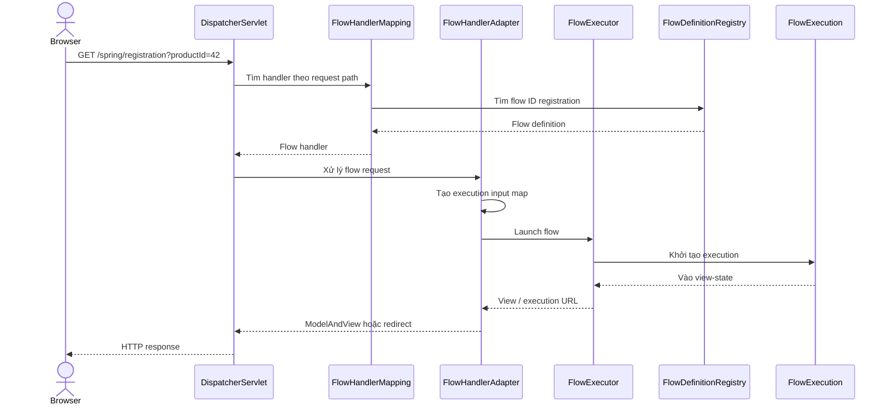

# Tạo ánh xạ dữ liệu đầu vào từ yêu cầu HTTP

## 1. Một request HTTP mang những loại dữ liệu nào?

Một ứng dụng **Spring Web Flow** (`SPRING_WEB_FLOW`) thường bắt đầu một hành trình từ URL như `/registration`, sau đó tiếp tục qua nhiều request khi người dùng nhập form, xem lại và xác nhận. Ở mỗi request, client có thể gửi nhiều loại dữ liệu: mã sản phẩm trong query string, ID trong path, dữ liệu form, header xác định kênh truy cập, cookie, file upload hoặc JSON body.

Muốn flow khởi chạy đúng và bind form an toàn, cần hiểu **dữ liệu đến từ đâu, thành phần nào đọc nó và dữ liệu sống trong bao lâu**.

Ba cơ chế thường được dùng trong cùng một ứng dụng:

- **Spring MVC argument binding:** Controller nhận dữ liệu qua `@RequestParam`, `@PathVariable`, `@RequestHeader`, `@ModelAttribute`, `@RequestBody` và các annotation liên quan.
- **Spring Web Flow input mapping:** Khi một flow mới được launch, `FlowHandlerAdapter` tạo input map; các phần tử `<input>` khai báo hợp đồng đầu vào của flow.
- **Web Flow request parameters và view binding:** Trong một request đang xử lý flow, expression `requestParameters` đọc tham số HTTP hiện tại; `view-state` có thể bind field form vào model của execution.

Các cơ chế này có liên hệ nhưng không đồng nhất. Ví dụ, `@RequestParam("productId")` là cách một controller method nhận tham số; `<input name="productId"/>` là cách flow khai báo một input; `requestParameters.productId` là cách expression trong flow đọc request parameter hiện tại.

> **Nguyên tắc:** Xác định dữ liệu là đầu vào để **khởi chạy flow**, dữ liệu gửi trong **một lần submit của view-state**, hay dữ liệu dành cho **một controller riêng**. Sau đó mới chọn cơ chế mapping và scope.

Bài thuộc chương **Tích hợp Spring MVC** của module `SPRING_WEB_FLOW`. Module học cách mô hình hóa hành trình nhiều bước qua state, event, transition và subflow, đồng thời thực hành form binding, validation, scope/phiên, tích hợp Spring MVC, kiểm thử và phục hồi lỗi. Vì vậy, bài này tập trung vào ranh giới HTTP → handler → flow input → model.

### Mục tiêu học tập

Sau bài này, bạn có thể:

1. Phân loại query parameter, path variable, form field, header, cookie, multipart và JSON body.
2. Chọn annotation Spring MVC thích hợp cho từng loại dữ liệu.
3. Giải thích cách `FlowHandlerMapping` và `FlowHandlerAdapter` chuyển request tới flow.
4. Khai báo flow input bằng `<input>` và ánh xạ kiểu dữ liệu.
5. Đọc request parameter bằng `requestParameters` trong expression.
6. Tùy chỉnh `FlowHandler` để chỉ nhận những input được cho phép.
7. Bind form vào model của `view-state` với converter, validator và danh sách field an toàn.
8. Kiểm thử request mapping, validation, security và các trường hợp dữ liệu thiếu/sai kiểu.

## 2. Phân loại dữ liệu trong HTTP request

Một request có thể chứa dữ liệu ở nhiều vị trí:

| Nguồn dữ liệu | Ví dụ | Cơ chế thường dùng trong Spring MVC | Ý nghĩa với Web Flow |
| --- | --- | --- | --- |
| Path segment | `/products/42` | `@PathVariable` trong controller | Có thể nằm trong đường dẫn dùng để xác định flow ID; không tự thành flow input |
| Query string | `?productId=42&campaign=email` | `@RequestParam` | Mặc định được đưa vào input map khi launch flow |
| Form URL-encoded | `email=a%40b.test` | `@RequestParam` hoặc `@ModelAttribute` | Có thể được bind vào model của view-state |
| Request header | `X-Channel: mobile` | `@RequestHeader` | Cần custom handler hoặc controller để đưa vào flow input |
| Cookie | `locale=vi` | `@CookieValue` | Không tự trở thành flow input theo mặc định |
| JSON body | `{"email":"a@b.test"}` | `@RequestBody` + HttpMessageConverter | Không được default FlowHandlerAdapter tự parse thành flow input |
| Multipart file | `multipart/form-data` | `MultipartFile`, `@RequestPart` | Cần MultipartResolver và flow/view binding phù hợp |

Trong Servlet API, query string và form data được tổng hợp trong request parameter map. Vì thế Spring MVC `@RequestParam` trong Servlet MVC có thể đọc cả query parameters và form fields; multipart fields cũng được hỗ trợ khi resolver đã cấu hình. JSON body là một nguồn khác, thường được đọc qua `HttpMessageConverter` và `@RequestBody`.

**Không phải mọi thứ client gửi đều là dữ liệu đáng tin cậy.** Path ID, giá tiền, user ID, role, header tùy biến và hidden fields đều phải được kiểm tra trước khi sử dụng trong nghiệp vụ.

## 3. Spring MVC: ánh xạ request vào controller method

Spring MVC dùng `DispatcherServlet` để nhận request và chọn handler. Khi request được ánh xạ tới controller, các argument resolver đọc dữ liệu theo annotation trên method parameters.

### 3.1. @RequestParam: query parameter và form field

`@RequestParam` đọc Servlet request parameters, bao gồm query string và form data:

```java
@Controller
@RequestMapping("/products")
public class ProductController {

    private final ProductService productService;

    public ProductController(ProductService productService) {
        this.productService = productService;
    }

    @GetMapping
    public String show(
            @RequestParam("productId") long productId,
            @RequestParam(name = "campaign", required = false) String campaign,
            Model model) {

        model.addAttribute("product",
                productService.findRequired(productId));
        model.addAttribute("campaign", campaign);
        return "products/detail";
    }
}
```

Request:

```http
GET /products?productId=42&campaign=email HTTP/1.1
Host: shop.example.test
```

Spring chuyển `productId` sang `long`. Mặc định một `@RequestParam` là bắt buộc; đặt `required=false` hoặc dùng `Optional<T>` khi tham số có thể vắng mặt.

Khi cùng tên xuất hiện nhiều lần, có thể nhận danh sách/array:

```java
@GetMapping("/compare")
public String compare(
        @RequestParam("id") List<Long> productIds,
        Model model) {
    model.addAttribute("products", productService.findAll(productIds));
    return "products/compare";
}
```

Ví dụ URL `/products/compare?id=10&id=20`. Cần giới hạn số lượng phần tử và kiểm tra quyền trên từng ID trước khi truy vấn.

### 3.2. @PathVariable: dữ liệu nằm trong đường dẫn

`@PathVariable` đọc biến trong URI template:

```java
@GetMapping("/{productId}")
public String detail(@PathVariable("productId") long productId,
                     Model model) {
    model.addAttribute("product",
            productService.findRequired(productId));
    return "products/detail";
}
```

Với URL `/products/42`, `productId` là `42`.

**Trong controller**, Spring MVC biết `productId` là một path variable nhờ `@GetMapping("/{productId}")`. **Trong flow URL**, `FlowHandlerMapping` thường dùng path để tìm flow definition ID. Không có method parameter `@PathVariable` tự động được inject vào flow input. Nếu cần ID trong path như dữ liệu nghiệp vụ, hãy dùng custom handler hoặc controller/entry point phù hợp để trích xuất và chuyển nó vào input map.

### 3.3. @RequestHeader và @CookieValue

Header có thể chứa ngôn ngữ, loại client hoặc correlation ID:

```java
@GetMapping("/channel")
public String channel(
        @RequestHeader(name = "X-Channel", required = false) String channel,
        @CookieValue(name = "locale", required = false) String locale,
        Model model) {

    model.addAttribute("channel", channel);
    model.addAttribute("locale", locale);
    return "channel/index";
}
```

Header và cookie là dữ liệu do client gửi. Không dùng `X-User-Id` hoặc cookie tự tạo làm bằng chứng người dùng đã đăng nhập. Danh tính phải lấy từ security context/principal đã được xác thực.

### 3.4. @ModelAttribute: bind request parameters vào object

`@ModelAttribute` phù hợp với form có nhiều trường:

```java
public class ContactForm {
    @NotBlank
    private String fullName;

    @NotBlank
    @Email
    private String email;

    // getter/setter
}
```

```java
@Controller
@RequestMapping("/contact")
public class ContactController {

    @GetMapping
    public String form(Model model) {
        model.addAttribute("contactForm", new ContactForm());
        return "contact/form";
    }

    @PostMapping
    public String submit(
            @Valid @ModelAttribute("contactForm") ContactForm form,
            BindingResult bindingResult) {

        if (bindingResult.hasErrors()) {
            return "contact/form";
        }

        // Chỉ gọi service sau khi dữ liệu form qua validation.
        return "redirect:/contact/received";
    }
}
```

`BindingResult` phải đứng ngay sau argument được validate. `@ModelAttribute` tạo hoặc lấy object trong MVC model rồi bind request parameters vào các property có thể bind. Nó không phải cùng một cơ chế với `model="contactForm"` trong Web Flow; phần đó sẽ được giải thích ở mục 9.

### 3.5. @RequestBody: đọc JSON/XML body

Với REST API, body thường được deserialize thành DTO qua `HttpMessageConverter`:

```java
@RestController
@RequestMapping("/api/registrations")
public class RegistrationApiController {

    private final RegistrationService registrationService;

    public RegistrationApiController(RegistrationService registrationService) {
        this.registrationService = registrationService;
    }

    @PostMapping
    public RegistrationReceipt create(
            @Valid @RequestBody RegistrationCommand command) {
        return registrationService.register(command);
    }
}
```

Ví dụ request:

```http
POST /api/registrations HTTP/1.1
Content-Type: application/json

{
  "fullName": "An Nguyen",
  "email": "an@example.test"
}
```

`@RequestBody` đọc request body; `@RequestParam` không tự deserialize JSON body. Với Spring MVC 6.2, validation của `@RequestBody` có thể phát sinh `MethodArgumentNotValidException` hoặc `HandlerMethodValidationException` tùy chữ ký method và cách khai báo constraint. Controller/API cần xử lý lỗi phù hợp.

### 3.6. @RequestPart và multipart

Khi form gửi file cùng dữ liệu khác, dùng `multipart/form-data` và `MultipartResolver`:

```java
@PostMapping(path = "/documents", consumes = MediaType.MULTIPART_FORM_DATA_VALUE)
public String upload(
        @RequestPart("metadata") @Valid DocumentMetadata metadata,
        @RequestPart("file") MultipartFile file) {

    documentService.store(metadata, file);
    return "redirect:/documents";
}
```

`@RequestPart` thường dùng để đọc một phần multipart và có thể áp dụng message converter cho phần đó. Nếu chỉ cần file upload trong controller MVC, `@RequestParam("file") MultipartFile` cũng là cách thường gặp.

## 4. Luồng request khi URL được xử lý bởi Web Flow

Trong ứng dụng kết hợp Spring MVC và Web Flow, flow là một loại handler được `DispatcherServlet` điều phối.



Các thành phần:

| Thành phần | Trách nhiệm |
| --- | --- |
| `DispatcherServlet` | Điểm vào của Spring MVC |
| `FlowHandlerMapping` | Ánh xạ request path tới flow definition theo ID |
| `FlowHandlerAdapter` | Xử lý flow handler, quyết định launch/resume và gọi executor |
| `FlowHandler` | Tùy chỉnh flow ID, input map, outcome và exception |
| `FlowExecutor` | Điều phối flow execution |
| `FlowDefinitionRegistry` | Tra cứu flow definition |
| `FlowExecutionRepository` | Lưu/khôi phục execution theo key và cấu hình persistence |

Ví dụ servlet mapping `/spring/*` và flow ID `registration` thường tạo URL bên ngoài `/spring/registration`. Khi flow URL được nhận diện, `FlowHandlerMapping` tìm definition ID tương ứng trong registry. Nếu không có flow phù hợp, MVC có thể tiếp tục hỏi handler mapping khác theo thứ tự.

**Đường URL của flow không tương đương với một method controller.** State ID như `enterDetails` hoặc `review` được quản lý bên trong execution, còn path thường định danh flow.

## 5. FlowHandlerAdapter mặc định ánh xạ request parameters thế nào?

Khi request khởi chạy **một flow execution mới**, `FlowHandlerAdapter` cần tạo input map để truyền vào flow.

Theo Spring Web Flow 3.0.2, mặc định:

- ID của flow được suy ra từ phần path phù hợp của request URI, thông qua flow URL handler.
- **Tất cả request parameters hiện tại** được đưa vào flow execution input map khi launch.
- Flow definition khai báo input nào cần nhận bằng phần tử `<input>`.
- Khi execution đã tồn tại, adapter sử dụng execution key để resume thay vì coi mọi request như một lần launch mới.

Ví dụ:

```http
GET /spring/registration?productId=42&campaign=email HTTP/1.1
Host: shop.example.test
```

Nếu servlet mapping là `/spring/*`, flow ID có thể được suy ra là `registration`. Mặc định input map của lần launch chứa các request parameters `productId` và `campaign`. Flow definition sẽ quyết định input nào là một phần của contract.

### 5.1. Request parameter map không phải toàn bộ HTTP request

Default input map nói trên là **request parameters** của Servlet request. Nó không có nghĩa Web Flow tự động:

- Deserialize JSON body thành object.
- Đưa mọi header vào flow inputs.
- Đưa mọi cookie vào flow inputs.
- Chuyển mọi URI segment thành named input.
- Xác minh rằng các giá trị do client gửi là hợp lệ hoặc được phép.

Khi cần những nguồn dữ liệu khác, dùng custom `FlowHandler` hoặc một controller/entry point được thiết kế rõ ràng.

### 5.2. Input map chỉ phục vụ lần launch mới

Cần phân biệt:

- **Flow input:** dữ liệu được truyền khi khởi chạy một execution mới, theo contract của flow.
- **`requestParameters`:** tham số của HTTP request đang được xử lý. Nó có thể được đọc trong request launch hoặc một request resume tiếp theo.
- **`flowScope`:** dữ liệu tồn tại trong flow session, thích hợp cho dữ liệu cần dùng qua nhiều bước.
- **Event ID:** tín hiệu điều hướng như `next`, `cancel`, `confirm`; không phải một input nghiệp vụ.

Nếu cần giữ `campaign` qua nhiều view-state, khai báo flow input để nó được lưu trong flow scope, thay vì mỗi bước lại đọc query string và giả định tham số vẫn có mặt.

## 6. Khai báo flow input bằng `<input>`

`<input>` khai báo một thuộc tính đầu vào trong contract của flow:

```xml
<flow xmlns="http://www.springframework.org/schema/webflow"
      xmlns:xsi="http://www.w3.org/2001/XMLSchema-instance"
      xsi:schemaLocation="
          http://www.springframework.org/schema/webflow
          https://www.springframework.org/schema/webflow/spring-webflow.xsd">

    <input name="productId" type="long" required="true" />
    <input name="campaign" />

    <!-- Các state được khai báo phía dưới. -->
</flow>
```

Ý nghĩa:

| Thuộc tính | Tác dụng |
| --- | --- |
| `name` | Tên input trong flow |
| `type` | Kiểu đích; Web Flow chuyển đổi giá trị nếu cần |
| `required` | Bắt buộc input không null/rỗng |
| `value` | Expression chỉ định vị trí nhận input value |

Giá trị input được lưu trong flow scope theo tên của nó. Vì vậy, trong flow trên, expression có thể đọc `productId` và `campaign` sau khi launch.

### 6.1. Chuyển kiểu input

Nếu request gửi `productId=42`, giá trị ban đầu từ HTTP thường là chuỗi. Với `type="long"`, Web Flow chuyển đổi sang kiểu số tương ứng.

```xml
<input name="productId" type="long" required="true" />
<input name="pageSize" type="int" />
<input name="activeOnly" type="boolean" />
```

Tên kiểu có thể dùng alias kiểu cơ bản được conversion service hỗ trợ. Nếu cần một kiểu domain riêng, đăng ký converter phù hợp và kiểm tra nó được dùng bởi flow builder services.

Nếu người dùng gửi `productId=abc`, conversion sẽ thất bại. Không nên để lỗi chuyển kiểu trở thành một ID rỗng rồi tiếp tục gọi service; hãy xử lý lỗi input/exception và phản hồi rõ ràng.

### 6.2. Ánh xạ input vào expression đích bằng value

Thuộc tính `value` chỉ định expression đích để gán input:

```xml
<input name="productId"
       type="long"
       value="flowScope.requestContext.productId"
       required="true" />
```

Ví dụ này giả định `flowScope.requestContext` đã tồn tại và có property `productId` có thể ghi. Khi không cần ánh xạ sang object khác, dùng tên input đơn giản là rõ nhất:

```xml
<input name="productId" type="long" required="true" />
```

Khi dùng `value`, cần bảo đảm object đích đã được khởi tạo trước và property có thể ghi. Đừng nhầm `value` với tên của query parameter; đó là expression đích trong flow context.

### 6.3. Input bắt buộc và optional

```xml
<input name="productId" type="long" required="true" />
<input name="campaign" />
<input name="referralCode" required="false" />
```

`productId` là dữ liệu bắt buộc để khởi chạy. `campaign` và `referralCode` có thể vắng mặt. Với input optional, flow phải có logic xử lý trường hợp null/rỗng thay vì giả định client luôn gửi giá trị.

**Bắt buộc về mặt contract không đồng nghĩa hợp lệ về mặt nghiệp vụ.** Một `productId` chuyển thành số thành công vẫn có thể không tồn tại, đã ngừng bán hoặc không thuộc quyền truy cập của người dùng. Service phải kiểm tra tiếp.

## 7. Đọc request parameter bằng requestParameters

Web Flow cung cấp biến EL đặc biệt `requestParameters` để truy cập tham số HTTP của request hiện tại.

Ví dụ:

```xml
<view-state id="searchProducts" view="catalog/search">
    <transition on="sort">
        <set name="flowScope.searchCriteria.sortBy"
             value="requestParameters.sortBy" />
    </transition>
</view-state>
```

Khi người dùng gửi `sortBy=price` cùng event `sort`, transition có thể đọc giá trị hiện tại và cập nhật tiêu chí tìm kiếm.

### 7.1. requestParameters khác flow input

| Tiêu chí | Flow input | `requestParameters` |
| --- | --- | --- |
| Thời điểm | Khi launch execution mới | Mỗi request đang xử lý flow |
| Nguồn | Input map truyền cho lần launch | Request parameters hiện tại |
| Vòng đời | Được lưu trong flow scope theo tên input hoặc expression mapping | Gắn với request hiện tại |
| Dùng cho | ID, context ban đầu, tham số khởi động | Filter, sort, page hoặc giá trị submit hiện tại |
| Sau khi chuyển bước | Có thể đọc lại từ flow scope | Không nên giả định request sau vẫn gửi lại |

Ví dụ, `productId` dùng để xác định sản phẩm của toàn wizard nên là flow input. `sortBy` dùng cho một lần lọc kết quả có thể đọc từ `requestParameters` khi event tương ứng được gửi.

### 7.2. Lưu request parameter vào scope khi cần giữ lại

Nếu muốn giữ một giá trị qua request sau, hãy sao chép nó vào scope phù hợp:

```xml
<transition on="applyFilter">
    <set name="flowScope.searchCriteria.keyword"
         value="requestParameters.keyword" />
</transition>
```

`flowScope` phù hợp nếu tiêu chí tìm kiếm cần sống qua nhiều state. Nếu chỉ dùng cho view hiện tại, có thể dùng `viewScope`. Không dùng `requestScope` nếu giá trị cần tồn tại sau request HTTP hiện tại.

### 7.3. Truy cập nhiều giá trị cùng tên

Servlet request có thể chứa nhiều parameter value cùng tên, ví dụ checkbox hoặc `id=10&id=20`. Nếu cần danh sách, hãy chọn cơ chế lấy **parameter values** thích hợp trong integration code hoặc bind vào kiểu collection có converter hỗ trợ. Đừng giả định truy cập một property đơn `requestParameters.id` luôn giữ toàn bộ mảng giá trị.

## 8. Event parameter không phải dữ liệu nghiệp vụ

Web Flow nhận event từ các parameter đặc biệt:

- `_eventId=next`: gửi event `next`.
- `_eventId_next`: nút submit có tên bắt đầu bằng `_eventId_`; phần sau là event ID.
- `_eventId_cancel`: gửi event `cancel`.

Ví dụ form:

```html
<form method="post" action="${flowExecutionUrl}">
    <label for="email">Email</label>
    <input id="email" name="email" type="email" />

    <button type="submit" name="_eventId_next">Tiếp tục</button>
    <button type="submit" name="_eventId_cancel">Hủy</button>
</form>
```

`flowExecutionUrl` là URL hiện hành của execution view-state. Trong JSP/Thymeleaf hoặc template engine khác, dùng cách render URL an toàn theo view technology của ứng dụng.

**Event ID là tín hiệu điều hướng, không phải dữ liệu để tin cậy.** Người dùng có thể sửa request và gửi `_eventId_confirm` trực tiếp. Flow chỉ nên xử lý event nếu nó có transition hợp lệ tại state hiện tại; service vẫn phải kiểm tra quyền và điều kiện nghiệp vụ.

## 9. Form binding trong view-state khác với flow input mapping

Flow input nhận dữ liệu khi **launch**. Form binding cập nhật model khi người dùng **submit view-state**.

Ví dụ:

```xml
<var name="registration"
     class="com.example.registration.RegistrationDraft" />

<view-state id="enterDetails"
            view="registration/details"
            model="registration">
    <binder>
        <binding property="fullName" required="true" />
        <binding property="email" required="true" />
    </binder>
    <transition on="next" to="review" />
    <transition on="cancel"
                to="cancelled"
                bind="false" />
</view-state>
```

Khi người dùng submit `next`:

1. Web Flow xác định execution và current view-state.
2. Các request parameters của form được bind vào model `registration` theo binder.
3. Conversion service chuyển chuỗi sang kiểu Java cần thiết.
4. Validation được thực hiện theo cấu hình.
5. Nếu hợp lệ, transition có thể chuyển sang `review`.
6. Nếu không hợp lệ, flow thường ở lại view-state để hiển thị lỗi.

### 9.1. Whitelist field bằng binder

Tài liệu Web Flow cảnh báo rằng nếu không khai báo `<binder>`, tất cả public properties của model có thể đủ điều kiện binding tùy cấu hình. Điều đó có thể tạo rủi ro mass assignment nếu model chứa các field nhạy cảm như `role`, `approved`, `accountBalance` hoặc `ownerId`.

Hãy chỉ cho phép những field thực sự được người dùng chỉnh sửa:

```xml
<view-state id="enterDetails"
            view="registration/details"
            model="registration">
    <binder>
        <binding property="fullName" required="true" />
        <binding property="email" required="true" />
        <binding property="phone" />
    </binder>
    <transition on="next" to="review" />
</view-state>
```

Không đưa các thuộc tính do server quản lý vào binder. ID người dùng hiện tại nên lấy từ principal/security context, không lấy từ hidden input.

### 9.2. Conversion và validator

Web Flow có thể dùng conversion service cho các field. Với Bean Validation, có thể cấu hình validator trong `flow-builder-services`. Ngoài ra, Web Flow hỗ trợ validator theo convention dựa trên tên model và state.

Ví dụ model:

```java
public class RegistrationDraft implements Serializable {
    @NotBlank
    private String fullName;

    @NotBlank
    @Email
    private String email;

    // getter/setter
}
```

Flow cần được cấu hình validator tương thích. Validation form không thay thế domain validation trong service khi lưu đăng ký.

### 9.3. validate=false và bind=false

| Thuộc tính trên transition | Binding | Validation | Khi dùng |
| --- | --- | --- | --- |
| Mặc định | Có | Có | Đi tiếp khi form hợp lệ |
| `validate="false"` | Vẫn có | Không | Nút Quay lại cho phép bỏ qua validation |
| `bind="false"` | Không | Không | Nút Hủy không cần đọc form |

Ví dụ:

```xml
<transition on="back" to="previousStep" validate="false" />
<transition on="cancel" to="cancelled" bind="false" />
```

Chọn theo ý định: nếu muốn giữ thay đổi người dùng vừa nhập khi quay lại thì `validate="false"` có thể phù hợp; nếu muốn bỏ qua toàn bộ form đang lỗi khi hủy thì `bind="false"`.

## 10. Custom FlowHandler để ánh xạ header hoặc whitelist input

Mặc định, khi launch flow, `FlowHandlerAdapter` đưa tất cả request parameters vào input map. Nếu chỉ muốn nhận một tập dữ liệu cụ thể hoặc cần lấy thêm header, hãy cung cấp custom `FlowHandler`.

Ví dụ:

```java
package com.example.webflow;

import jakarta.servlet.http.HttpServletRequest;

import org.springframework.stereotype.Component;
import org.springframework.webflow.core.collection.LocalAttributeMap;
import org.springframework.webflow.core.collection.MutableAttributeMap;
import org.springframework.webflow.mvc.servlet.AbstractFlowHandler;

@Component("registration")
public class RegistrationFlowHandler extends AbstractFlowHandler {

    @Override
    public MutableAttributeMap<Object> createExecutionInputMap(
            HttpServletRequest request) {

        MutableAttributeMap<Object> input = new LocalAttributeMap<>();

        String productId = request.getParameter("productId");
        if (productId != null) {
            input.put("productId", productId);
        }

        String campaign = request.getParameter("campaign");
        if (campaign != null) {
            input.put("campaign", campaign);
        }

        String channel = request.getHeader("X-Channel");
        if (channel != null) {
            input.put("channel", channel);
        }

        return input;
    }
}
```

Bean name `registration` khớp flow ID `registration`. Handler tạo một input map có whitelist gồm `productId`, `campaign` và `channel`. Flow definition có thể khai báo:

```xml
<input name="productId" type="long" required="true" />
<input name="campaign" />
<input name="channel" />
```

Nếu `createExecutionInputMap` trả về map cụ thể, map đó được dùng làm flow input. Nếu trả về `null`, adapter sử dụng cơ chế mặc định để lấy request parameters.

### 10.1. Tại sao cần whitelist?

Ví dụ request có thêm:

```http
GET /spring/registration?productId=42&campaign=email&isAdmin=true&approved=true
X-Channel: web
```

Custom handler chỉ chuyển `productId`, `campaign` và `channel` vào flow input. Các parameter khác không nằm trong input map. Đây là một lớp kiểm soát đầu vào hữu ích, nhưng **không thay thế authorization/validation**: người dùng vẫn có thể gửi ID sản phẩm không tồn tại hoặc không được phép sử dụng.

### 10.2. Lấy path segment, header và cookie

Nếu dữ liệu nằm trong header/cookie/path, handler có thể đọc từ `HttpServletRequest` và đưa vào map theo contract:

```java
String channel = request.getHeader("X-Channel");

String locale = request.getLocale().toLanguageTag();

String sessionHint = request.getParameter("sessionHint");
```

Nếu cần đọc cookie, dùng `request.getCookies()` và chọn đúng cookie theo tên. Không truyền nguyên toàn bộ cookie/session data vào flow. Không dùng header do client tự đặt như `X-User-Id` để xác định principal.

### 10.3. Khi nào custom handler nên chọn flow ID?

`FlowHandler` cũng là extension point để tùy chỉnh flow ID, outcome và exception handling. Mặc định, flow ID thường được suy từ path của request. Chỉ tùy chỉnh khi URL không thể ánh xạ trực tiếp tới registry ID hoặc ứng dụng cần một quy tắc route đặc biệt.

Không tạo custom handler chỉ để thay một query parameter thành flow ID nếu URL mapping mặc định đã rõ. Handler riêng nên giải quyết nhu cầu thực tế như whitelist input, bổ sung header hợp lệ hoặc xử lý outcome/exception.

## 11. JSON request body và Web Flow

Đây là ranh giới dễ nhầm nhất:

- Spring MVC controller có thể nhận JSON bằng `@RequestBody` và chuyển thành DTO qua `HttpMessageConverter`.
- `FlowHandlerAdapter` mặc định tạo flow input map từ **request parameters**. Nó không tự động deserialize JSON body thành các flow input attributes.
- `requestParameters` cũng là request parameter map, không phải JSON object trong body.

Nếu một client gửi:

```http
POST /spring/registration HTTP/1.1
Content-Type: application/json

{
  "productId": 42,
  "fullName": "An Nguyen"
}
```

Không nên giả định flow có thể đọc `requestParameters.productId` từ JSON body. Hãy chọn một trong các cách sau:

1. Nếu đây là REST API, dùng `@RestController` + `@RequestBody` để deserialize, validate và gọi application service.
2. Nếu cần launch flow từ JSON, xây dựng integration riêng để đọc body bằng message converter/ObjectMapper đã cấu hình rồi tạo flow input map có whitelist.
3. Nếu dữ liệu có thể gửi dưới dạng form/query, dùng request parameters và flow input mapping chuẩn.

Không đọc raw body thủ công nhiều lần. Request body là stream; nếu filter/handler đã tiêu thụ nó, thành phần khác có thể không đọc lại được. Cần thiết kế rõ nơi deserialize, validate và chuyển DTO thành input contract.

### 11.1. Mẫu controller làm entry point

Một controller có thể nhận JSON và khởi chạy use case riêng:

```java
@RestController
@RequestMapping("/api/registration-requests")
public class RegistrationRequestController {

    private final RegistrationService registrationService;

    public RegistrationRequestController(RegistrationService registrationService) {
        this.registrationService = registrationService;
    }

    @PostMapping
    public RegistrationReceipt submit(
            @Valid @RequestBody RegistrationCommand command,
            Principal principal) {

        return registrationService.register(
                command,
                principal.getName());
    }
}
```

Ví dụ này trả kết quả nghiệp vụ trực tiếp qua REST; nó **không tự khởi chạy Web Flow**. Nếu yêu cầu là tạo flow execution từ DTO, cần dùng integration/API phù hợp để launch với input map, thay vì giả định `@RequestBody` được FlowHandlerAdapter xử lý.

## 12. Multipart file upload

Spring Web Flow hỗ trợ upload file kết hợp với Spring MVC `MultipartResolver`. Form phải có `enctype="multipart/form-data"`:

```html
<form method="post"
      enctype="multipart/form-data"
      action="${flowExecutionUrl}">
    <input type="file" name="document" />
    <button type="submit" name="_eventId_upload">Tải lên</button>
</form>
```

Khi MultipartResolver được cấu hình đúng, field có thể bind vào model object có property kiểu `MultipartFile`. Transition action xử lý file:

```xml
<view-state id="uploadDocument"
            view="registration/upload"
            model="uploadHandler">
    <transition on="upload" to="review">
        <evaluate expression="uploadHandler.processFile()" />
    </transition>
    <transition on="cancel" to="cancelled" bind="false" />
</view-state>
```

Một model minh họa:

```java
public class UploadHandler implements Serializable {

    private static final long serialVersionUID = 1L;

    private transient MultipartFile document;

    public MultipartFile getDocument() {
        return document;
    }

    public void setDocument(MultipartFile document) {
        this.document = document;
    }

    public void processFile() {
        // Kiểm tra và lưu file qua service.
    }
}
```

Không giữ một `MultipartFile` hoặc stream upload lâu trong flow scope/snapshot. Xử lý file trong request phù hợp, kiểm tra kích thước, MIME/type, tên file và nội dung, sau đó lưu file vào storage và giữ lại ID/metadata bền vững trong flow.

## 13. Bảo mật khi ánh xạ dữ liệu đầu vào

Dữ liệu HTTP là dữ liệu không đáng tin cậy, kể cả khi URL do ứng dụng tạo ra.

### 13.1. Không bind toàn bộ object domain từ client

Nếu model có các thuộc tính `ownerId`, `role`, `approved` hoặc `totalAmount`, không cho phép form tự ghi các thuộc tính đó. Dùng form DTO và binder allowlist:

```xml
<view-state id="enterDetails" model="registration">
    <binder>
        <binding property="fullName" />
        <binding property="email" />
        <binding property="phone" />
    </binder>
</view-state>
```

Các thuộc tính còn lại do server/service quản lý.

### 13.2. Không lấy danh tính từ request parameter

Không viết:

```xml
<evaluate expression="registrationService.register(registration, requestParameters.userId)" />
```

Thay vào đó, dùng principal đã xác thực:

```xml
<evaluate expression="registrationService.register(registration, currentUser.name)"
          result="flowScope.receipt" />
```

`currentUser` đại diện principal hiện tại theo context bảo mật. Service vẫn phải kiểm tra quyền truy cập tài nguyên.

### 13.3. Không tin header hoặc cookie tùy biến

Header `X-Channel` có thể dùng để phân tích kênh giao diện, nhưng không dùng header tùy ý để cấp quyền. Cookie locale có thể chọn ngôn ngữ hiển thị, nhưng không được dùng thay session/authentication token an toàn.

### 13.4. CSRF và method

Form thay đổi trạng thái nên dùng POST và được bảo vệ CSRF theo cấu hình Spring Security. Không dùng GET để thực hiện thao tác ghi hoặc xác nhận nghiệp vụ. Flow event ID không phải CSRF token.

### 13.5. Validate ở cả web và domain

- Binding/conversion kiểm tra dữ liệu có chuyển được sang kiểu đích không.
- Validator kiểm tra ràng buộc form/model.
- Service/domain kiểm tra invariant và quyền tại thời điểm thực hiện.
- Database constraint bảo vệ bất biến dữ liệu khi có request đồng thời.

Không có lớp nào thay thế hoàn toàn lớp còn lại.

## 14. Ví dụ hoàn chỉnh: launch flow bằng query input rồi bind form

Yêu cầu: trang sản phẩm có nút **Đăng ký tư vấn**. Khi bấm, browser mở flow `registration` với `productId` và `campaign`. Người dùng nhập họ tên/email, xem lại, rồi gửi đăng ký.

### 14.1. Request khởi chạy

```http
GET /spring/registration?productId=42&campaign=email HTTP/1.1
Host: shop.example.test
```

`FlowHandlerMapping` tìm flow ID `registration`. `FlowHandlerAdapter` tạo input map từ request parameters. Flow contract nhận hai input đã khai báo.

### 14.2. Flow definition

```xml
<?xml version="1.0" encoding="UTF-8"?>
<flow xmlns="http://www.springframework.org/schema/webflow"
      xmlns:xsi="http://www.w3.org/2001/XMLSchema-instance"
      xsi:schemaLocation="
          http://www.springframework.org/schema/webflow
          https://www.springframework.org/schema/webflow/spring-webflow.xsd">

    <input name="productId" type="long" required="true" />
    <input name="campaign" />

    <on-start>
        <evaluate
            expression="registrationService.createDraft(productId, currentUser.name)"
            result="flowScope.registration" />
    </on-start>

    <view-state id="enterDetails"
                view="registration/details"
                model="registration">
        <binder>
            <binding property="fullName" required="true" />
            <binding property="email" required="true" />
        </binder>
        <transition on="next" to="review" />
        <transition on="cancel" to="cancelled" bind="false" />
    </view-state>

    <view-state id="review" view="registration/review">
        <transition on="back" to="enterDetails" validate="false" />
        <transition on="confirm" to="submitRegistration" />
    </view-state>

    <action-state id="submitRegistration">
        <evaluate
            expression="registrationService.submit(registration, campaign)"
            result="flowScope.receipt" />
        <transition on="success" to="completed" />
    </action-state>

    <end-state id="completed">
        <output name="registrationId" value="receipt.registrationId" />
    </end-state>

    <end-state id="cancelled" />
</flow>
```

Các bean `registrationService` và class `RegistrationDraft` là thành phần của ứng dụng. `createDraft` lấy ID sản phẩm từ flow input và danh tính principal; service cần kiểm tra sản phẩm có tồn tại và người dùng có quyền đăng ký. `submit` phải kiểm tra lại dữ liệu và bảo vệ chống submit trùng bằng idempotency/transaction thích hợp.

### 14.3. Form view

```html
<form method="post" action="${flowExecutionUrl}">
    <label for="fullName">Họ tên</label>
    <input id="fullName" name="fullName" type="text" required />

    <label for="email">Email</label>
    <input id="email" name="email" type="email" required />

    <button type="submit" name="_eventId_next">Tiếp tục</button>
    <button type="submit" name="_eventId_cancel">Hủy</button>
</form>
```

Khi người dùng submit, request có form fields và event ID. Web Flow bind các field vào `registration` theo binder của view-state. `productId` và `campaign` đã được lưu từ lần launch, nên không cần browser gửi lại chúng ở mọi bước.

### 14.4. Hành trình dữ liệu

```mermaid
flowchart TD
    A["GET /registration?productId=42&campaign=email"] --> B["FlowHandlerAdapter"]
    B --> C["Execution input map"]
    C --> D["Flow <input> contract"]
    D --> E["productId, campaign trong flow scope"]
    E --> F["on-start: createDraft(productId, currentUser)"]
    F --> G["view-state enterDetails"]
    G --> H["POST form + _eventId_next"]
    H --> I["Bind/convert/validate registration"]
    I --> J["review"]
    J --> K["confirm"]
    K --> L["submit(registration, campaign)"]
    L --> M["end-state completed + registrationId"]
```



Đường dữ liệu trên có ba loại input khác nhau:

- `productId` và `campaign` là flow inputs lúc launch.
- `fullName` và `email` là form values bind vào model trong view-state.
- `_eventId_next` và `_eventId_confirm` là event điều hướng.

## 15. Kiểm thử ánh xạ request

Không chỉ kiểm tra flow XML parse được. Cần xác minh dữ liệu đi từ request tới đúng contract và model.

### 15.1. Test flow input

| Request/đầu vào | Kỳ vọng |
| --- | --- |
| `productId=42` | Input được chuyển thành kiểu long và có trong flow |
| Thiếu `productId` | Required input không thỏa, launch bị từ chối theo error handling đã cấu hình |
| `productId=abc` | Conversion thất bại; không gọi service tạo draft |
| `campaign=email` | Flow có thể đọc campaign sau launch |
| Thêm `isAdmin=true` | Không được bind vào thuộc tính nhạy cảm; custom handler có thể loại bỏ khỏi input map |

### 15.2. Test requestParameters

- Launch flow với `campaign=email` và xác nhận flow input có giá trị.
- Gửi request resume chỉ có event `next`; không giả định query parameter `campaign` được gửi lại.
- Gửi event `sort` cùng `sortBy=price`; expression `requestParameters.sortBy` đọc giá trị của request đó.
- Không gửi `sortBy`; xử lý giá trị thiếu theo contract, không gây lỗi null ngoài ý muốn.

### 15.3. Test form binding/validation

- Submit `fullName` và `email` hợp lệ, flow chuyển tới `review`.
- Submit thiếu email, flow ở lại `enterDetails` và hiển thị lỗi.
- Gửi property không nằm trong binder như `isAdmin`; xác nhận không thay đổi model.
- Submit event `cancel` khi form lỗi; transition `bind="false"` vẫn cho phép hủy.
- Gửi dữ liệu sai kiểu ngày/số; xác nhận conversion error được trình bày phù hợp.

### 15.4. Test MVC controller mapping

Với controller riêng, dùng MockMvc hoặc integration test để kiểm tra:

- `@RequestParam` nhận query/form field và convert đúng kiểu.
- `@PathVariable` đọc đúng segment.
- `@RequestHeader`/`@CookieValue` xử lý giá trị vắng mặt.
- `@ModelAttribute` bind và `BindingResult` chứa lỗi.
- `@RequestBody` deserialize JSON và validation trả lỗi thích hợp.
- `@RequestPart` nhận multipart khi resolver đã cấu hình.

### 15.5. Test custom FlowHandler

- Handler bean name khớp flow ID.
- Chỉ các input được whitelist mới được thêm vào map.
- Header/cookie vắng mặt được xử lý an toàn.
- Input sai kiểu không gọi service.
- Nếu handler trả map, không vô tình dựa vào các request parameters đã bị loại.
- Nếu handler trả null, kiểm tra lại hành vi default input map của adapter.

## 16. Lỗi thường gặp và cách xử lý

| Triệu chứng | Nguyên nhân có thể | Cách kiểm tra |
| --- | --- | --- |
| Flow không nhận `productId` | Chưa khai báo `<input>` hoặc URL không gửi query/form parameter | Request URL, input contract, flow ID |
| Flow ID sai | Nhầm path variable với flow ID hoặc servlet mapping | `FlowHandlerMapping`, `pathInfo`, registry ID |
| `productId` là chuỗi nhưng service cần long | Thiếu `type` hoặc converter | `<input type="long">`, conversion service |
| Input bắt buộc bị thiếu | Client không gửi hoặc custom handler loại bỏ | Input map và `required` |
| `requestParameters.campaign` null ở bước sau | Request hiện tại không gửi lại parameter | Lưu campaign vào flow input/flowScope |
| JSON field không có trong flow | Default handler không parse JSON body | Dùng `@RequestBody` controller hoặc custom integration |
| Header không được đưa vào flow | Default input map chỉ lấy request parameters | Custom `FlowHandler` |
| Field nhạy cảm bị ghi đè | Binder cho phép quá nhiều property | Khai báo `<binder>` allowlist |
| Validation không chặn transition | Validator chưa cấu hình hoặc transition tắt validation | Flow builder services, `validate` |
| Nút bấm không kích hoạt transition | Event parameter sai tên hoặc state không có transition | `_eventId`, current state, flow XML |
| Upload file null | Chưa cấu hình MultipartResolver hoặc sai enctype | `multipart/form-data`, resolver, property name |
| Session/key hết hạn khi submit | Execution repository không còn snapshot/session | Execution key, session, error handling |
| User ID do client gửi bị tin cậy | Dùng request parameter thay principal | `currentUser`/Spring Security, service authorization |
| Giá trị query bị dùng lại như dữ liệu đáng tin | Không validate/authorize lại | Domain service và database |

## 17. Quy trình debug theo thứ tự

Khi flow không nhận được dữ liệu mong đợi, kiểm tra từng tầng:

1. **HTTP request:** URL, method, query string, content type, form field, header và cookie có đúng không?
2. **Servlet mapping:** `DispatcherServlet` có nhận request không?
3. **Handler mapping:** request đi vào controller hay `FlowHandlerMapping`?
4. **Flow ID:** registry có definition đúng với path không?
5. **Input map:** default adapter hay custom handler tạo map? Có những key nào?
6. **Flow input contract:** `<input>` có tên, kiểu, required và value mapping phù hợp không?
7. **Expression:** `requestParameters` có đang đọc đúng request hiện tại không?
8. **Form binding:** model, binder và property names có khớp view không?
9. **Conversion/validation:** kiểu dữ liệu và validator có hoạt động không?
10. **Service:** nghiệp vụ có kiểm tra quyền, invariant và trạng thái mới nhất không?

Log nên ghi flow ID, state, event, tên input và kết quả conversion ở mức an toàn. Không log raw password, CSRF token, session ID hoặc toàn bộ request body chứa dữ liệu nhạy cảm.

## 18. Checklist thiết kế

Trước khi thêm một input vào flow:

1. Xác định dữ liệu đến từ path, query, form, header, cookie, JSON hay multipart.
2. Quyết định request thuộc controller MVC hay FlowHandler.
3. Nếu là flow launch input, khai báo `<input>` và kiểu/required rõ ràng.
4. Nếu cần whitelist hoặc header, dùng custom `FlowHandler` để tạo input map có kiểm soát.
5. Dùng `requestParameters` cho dữ liệu của request hiện tại; lưu vào scope nếu cần qua nhiều request.
6. Phân biệt event ID với business input.
7. Bind form qua `view-state` và whitelist property trong `<binder>`.
8. Cấu hình conversion/validation, xử lý lỗi kiểu và field thiếu.
9. Không tin user ID, role, price hoặc quyền do client gửi.
10. Test request mapping, flow input, binder, validation, JSON/multipart và stale execution.

### Câu hỏi tự luyện

1. `@RequestParam` trong Spring MVC đọc được những nguồn request nào?
2. `@PathVariable` trong controller có tự động trở thành flow input không?
3. `@RequestBody` khác `requestParameters` ở điểm nào?
4. FlowHandlerAdapter mặc định tạo input map từ dữ liệu nào khi launch execution mới?
5. `<input name="productId" type="long"/>` lưu giá trị ở đâu?
6. Flow input khác `requestParameters` như thế nào khi người dùng submit bước thứ hai?
7. Khi nào cần custom `FlowHandler.createExecutionInputMap(...)`?
8. Vì sao không nên dùng header `X-User-Id` để xác định người đăng nhập?
9. Tại sao nên khai báo `<binder>` với các field cho phép thay vì bind toàn bộ public properties?
10. `validate="false"` và `bind="false"` khác nhau thế nào?
11. Khi upload file, tại sao không nên giữ `MultipartFile` lâu trong flow scope?
12. Nếu flow cần JSON body, nên chọn controller `@RequestBody` hay custom FlowHandler trong tình huống nào?
13. Vì sao một input chuyển thành long thành công vẫn cần service kiểm tra nghiệp vụ?
14. Những gì cần kiểm thử khi custom handler chỉ trả một tập input whitelist?

## Tài liệu tham khảo

- [Spring Web Flow 3.0.2 Reference Guide — Input/Output Mapping](https://docs.spring.io/spring-webflow/docs/3.0.2/reference/#_input_output_mapping)
- [Spring Web Flow 3.0.2 Reference Guide — Special EL Variables: requestParameters](https://docs.spring.io/spring-webflow/docs/3.0.2/reference/#_the_requestparameters_variable)
- [Spring Web Flow 3.0.2 Reference Guide — Spring MVC Integration](https://docs.spring.io/spring-webflow/docs/3.0.2/reference/#_spring_mvc_integration)
- [Spring Web Flow 3.0.2 Reference Guide — Binding to a Model](https://docs.spring.io/spring-webflow/docs/3.0.2/reference/#_binding_to_a_model)
- [Spring Web Flow 3.0.2 Reference Guide — Specifying Bindings Explicitly](https://docs.spring.io/spring-webflow/docs/3.0.2/reference/#_specifying_bindings_explicitly)
- [Spring Web Flow 3.0.2 Reference Guide — Handling File Uploads](https://docs.spring.io/spring-webflow/docs/3.0.2/reference/#_handling_file_uploads)
- [Spring Web Flow 3.0.1 Javadoc — FlowHandler](https://docs.spring.io/spring-webflow/docs/3.0.1/api/org/springframework/webflow/mvc/servlet/FlowHandler.html)
- [Spring Framework 6.2 Reference — MVC Controller Method Arguments](https://docs.spring.io/spring-framework/reference/6.2/web/webmvc/mvc-controller/ann-methods/arguments.html)
- [Spring Framework 6.2 Reference — MVC Validation](https://docs.spring.io/spring-framework/reference/6.2/web/webmvc/mvc-controller/ann-validation.html)

Các ví dụ sử dụng Spring Web Flow 3.0.2 và Spring MVC trên Servlet stack. Khi áp dụng vào dự án thật, hãy kiểm tra phiên bản Spring Framework, servlet mapping, handler order, converter, validator, MultipartResolver và security configuration đang được triển khai.
