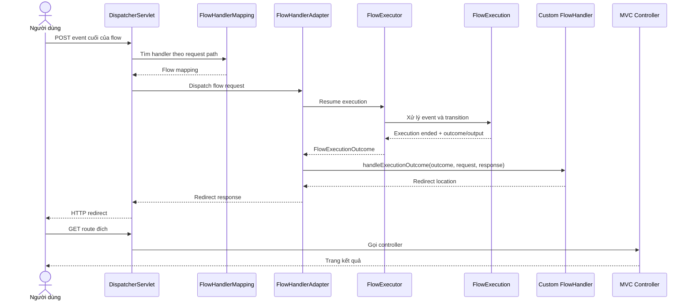

# Xử lý output và kết quả kết thúc bằng FlowHandler

Một flow đặt phòng khách sạn có thể dẫn người dùng qua các bước chọn phòng, nhập thông tin khách và xác nhận. Khi đặt phòng thành công, flow cần trả mã đặt phòng cho ứng dụng để chuyển người dùng tới trang chi tiết. Nếu người dùng hủy, ứng dụng cần quay về trang tìm kiếm. Hai kết quả này đều kết thúc flow, nhưng chúng dẫn tới hai đích khác nhau trong Spring MVC.

Trong Spring Web Flow, **`end-state` xác định kết quả kết thúc và các giá trị output mà flow trả về**. Khi execution kết thúc, Spring MVC integration có thể chuyển kết quả đó thành một redirect thông qua **`FlowHandler`**. `FlowHandler` là điểm nối giữa một flow cụ thể với phần còn lại của ứng dụng web: nó đọc outcome ID, lấy output đã khai báo, chọn URL tiếp theo và xử lý các exception chưa được flow xử lý.

Bài học thuộc chương **Tích hợp Spring MVC** của module `SPRING_WEB_FLOW`. Sau bài học, bạn có thể:

- Phân biệt end-state ID, flow output và `FlowExecutionOutcome`.
- Khai báo output trên `end-state` bằng phần tử `<output>`.
- Đọc outcome ID và output map trong `FlowHandler`.
- Viết custom handler kế thừa `AbstractFlowHandler`.
- Đăng ký handler đúng flow ID để `FlowHandlerAdapter` sử dụng.
- Chọn redirect URI và hiểu các prefix `servletRelative:`, `contextRelative:`, `serverRelative:`.
- Tùy chỉnh input map và xử lý exception ở tầng MVC.
- Phân biệt xử lý output qua `FlowHandler` với lưu output vào MVC Flash Scope.
- Bảo vệ output, URL redirect và dữ liệu mà controller nhận sau khi flow kết thúc.

## 1. Ba khái niệm cần tách biệt

Khi một flow kết thúc, có ba thông tin liên quan nhưng không đồng nghĩa:

| Khái niệm | Nguồn | Ý nghĩa |
| --- | --- | --- |
| **End-state ID** | `id` của `<end-state>` | Cho biết flow kết thúc ở nhánh nào, ví dụ `bookingConfirmed` hoặc `bookingCancelled` |
| **Flow output** | Các phần tử `<output>` của end-state | Các giá trị được flow chủ động trả ra, ví dụ `bookingId` hoặc `confirmationNumber` |
| **FlowExecutionOutcome** | Web Flow tạo khi execution kết thúc | Đối tượng mang outcome ID và output map tới tầng tích hợp |

`FlowExecutionOutcome` cung cấp hai thông tin chính:

- `getId()`: ID của outcome mà flow đã đạt tới.
- `getOutput()`: `AttributeMap<Object>` chứa các output do end-state trả về.

Ví dụ, nếu flow đi tới `<end-state id="bookingConfirmed">`, outcome ID là `bookingConfirmed`. Nếu end-state khai báo output `bookingId`, handler có thể lấy giá trị đó từ `outcome.getOutput().get("bookingId")`.

**Output là hợp đồng dữ liệu giữa flow và caller.** Nó không phải toàn bộ `flowScope`, không phải toàn bộ request parameter và cũng không tự động trở thành model attribute trong controller. Chỉ những giá trị được khai báo rõ ràng ở end-state mới được đưa vào output map.

## 2. Khai báo output trên end-state

Giả sử flow có biến `booking` lưu đối tượng đặt phòng. Flow có hai kết quả: xác nhận thành công hoặc hủy.

```xml
<flow xmlns="http://www.springframework.org/schema/webflow"
      xmlns:xsi="http://www.w3.org/2001/XMLSchema-instance"
      xsi:schemaLocation="http://www.springframework.org/schema/webflow
                          https://www.springframework.org/schema/webflow/spring-webflow.xsd">

    <var name="booking" class="com.example.booking.Booking" />

    <view-state id="reviewBooking" view="booking/review">
        <transition on="confirm" to="bookingConfirmed" />
        <transition on="cancel" to="bookingCancelled" />
    </view-state>

    <end-state id="bookingConfirmed">
        <output name="bookingId" value="booking.id" />
        <output name="confirmationNumber"
                value="booking.confirmationNumber" />
    </end-state>

    <end-state id="bookingCancelled" />
</flow>
```

Trong ví dụ:

- `bookingConfirmed` là outcome ID khi đặt phòng thành công.
- `bookingId` lấy từ biểu thức `booking.id`.
- `confirmationNumber` lấy từ `booking.confirmationNumber`.
- `bookingCancelled` kết thúc flow mà không trả output nào.

### Output lấy từ flow scope

Nếu không chỉ định thuộc tính `value`, Web Flow lấy giá trị trong flow scope theo đúng tên output:

```xml
<end-state id="completed">
    <output name="bookingId" />
</end-state>
```

Khai báo trên lấy biến `bookingId` trong flow scope để trả ra. Khi muốn ánh xạ một biểu thức khác hoặc đổi tên dữ liệu, dùng thuộc tính `value`:

```xml
<end-state id="completed">
    <output name="bookingId" value="booking.id" />
</end-state>
```

Nên đặt tên output theo hợp đồng mà caller cần, thay vì để controller phải biết cấu trúc nội bộ của flow model.

### Output riêng cho từng outcome

Mỗi end-state có thể trả một tập output khác nhau:

```xml
<end-state id="bookingConfirmed">
    <output name="bookingId" value="booking.id" />
</end-state>

<end-state id="bookingCancelled">
    <output name="reason" value="cancelReason" />
</end-state>
```

Nếu flow kết thúc bằng `bookingCancelled`, handler không nên giả định output `bookingId` tồn tại. Hãy đọc output theo outcome ID và kiểm tra null/type trước khi sử dụng.

## 3. FlowExecutionOutcome chuyển kết quả tới tầng MVC

`FlowExecutionOutcome` được tạo khi flow execution kết thúc. Nó không phải một view model hay một response HTTP. Nó là đối tượng tích hợp để `FlowHandlerAdapter` và `FlowHandler` biết:

1. Flow đã kết thúc bằng outcome nào.
2. Flow trả ra những output nào.

Có thể hình dung luồng dữ liệu:

```text
Flow definition
  |
  | Người dùng xác nhận
  v
<end-state id="bookingConfirmed">
  <output name="bookingId" value="booking.id" />
  <output name="confirmationNumber"
          value="booking.confirmationNumber" />
  |
  v
FlowExecutionOutcome
  id     = "bookingConfirmed"
  output = {
      bookingId: ...,
      confirmationNumber: ...
  }
  |
  v
FlowHandler.handleExecutionOutcome(...)
  |
  v
Redirect tới Spring MVC Controller
```

Handler có thể chọn một URL khác nhau cho từng outcome. Nhờ vậy, flow definition chỉ mô tả kết quả nghiệp vụ; URL điều hướng thuộc tầng tích hợp MVC. Cách tách này giúp thay đổi route controller mà không cần sửa logic state/transition của flow.

## 4. FlowHandler là extension point của Spring MVC

Trong Spring MVC, `DispatcherServlet` nhận request và chọn handler. Hai thành phần kết nối Web Flow với quá trình dispatch là:

- `FlowHandlerMapping`: ánh xạ request path tới flow ID trong `FlowRegistry`.
- `FlowHandlerAdapter`: gọi `FlowExecutor` để launch/resume execution và xử lý kết quả.

Khi cần tùy chỉnh cách một flow được gọi hoặc kết thúc, triển khai `FlowHandler`. Interface có các trách nhiệm:

| Method | Trách nhiệm |
| --- | --- |
| `getFlowId()` | Trả flow ID mà handler phục vụ; có thể trả `null` nếu ID được xác định bởi thành phần gọi |
| `createExecutionInputMap(request)` | Tạo input map cho execution mới từ HTTP request |
| `handleExecutionOutcome(outcome, request, response)` | Xử lý outcome khi flow kết thúc và trả redirect location |
| `handleException(exception, request, response)` | Xử lý exception của Web Flow chưa được flow xử lý |

Thông thường, hãy kế thừa `AbstractFlowHandler` và chỉ override method cần thiết:

```java
public class BookingFlowHandler extends AbstractFlowHandler {

    @Override
    public String handleExecutionOutcome(
            FlowExecutionOutcome outcome,
            HttpServletRequest request,
            HttpServletResponse response) {

        // Chọn redirect theo outcome.
        return null;
    }
}
```

Các method còn lại có implementation mặc định. Khi handler không xử lý một outcome và trả `null`, `FlowHandlerAdapter` tiếp tục dùng cơ chế mặc định của nó.

> Các ví dụ Java trong bài dùng namespace Servlet `jakarta.servlet` phù hợp với các dòng Web Flow dựa trên Jakarta. Với ứng dụng Web Flow 2.x cũ dùng Java EE, import tương ứng có thể là `javax.servlet`.

## 5. Cấu hình FlowHandlerMapping và FlowHandlerAdapter

Một cấu hình XML tối thiểu cho Spring MVC:

```xml
<webflow:flow-registry id="flowRegistry">
    <webflow:flow-location
            id="hotels/booking"
            path="/WEB-INF/flows/hotels/booking.xml" />
</webflow:flow-registry>

<webflow:flow-executor id="flowExecutor"
                       flow-registry="flowRegistry" />

<bean class="org.springframework.webflow.mvc.servlet.FlowHandlerMapping">
    <property name="flowRegistry" ref="flowRegistry" />
    <property name="order" value="0" />
</bean>

<bean class="org.springframework.webflow.mvc.servlet.FlowHandlerAdapter">
    <property name="flowExecutor" ref="flowExecutor" />
</bean>

<bean name="hotels/booking"
      class="com.example.booking.BookingFlowHandler" />
```

Điểm quan trọng là **tên bean custom `FlowHandler` phải khớp với flow ID mà handler áp dụng**. Trong ví dụ, flow ID là `hotels/booking`, nên bean handler cũng có tên `hotels/booking`.

`FlowHandlerMapping` ánh xạ request path `/hotels/booking` tới flow cùng ID trong registry. Khi request được dispatch tới `FlowHandlerAdapter`, adapter dùng handler tương ứng nếu có; nếu không có custom handler, các mặc định được sử dụng.

### Khi nào cần override getFlowId?

`FlowHandler.getFlowId()` cho phép handler chỉ định rõ flow ID. Nếu handler trả `null`, ID có thể do caller/URL mapping xác định. Trong cấu hình thông thường, `FlowHandlerMapping` suy ra flow ID từ request path và tìm flow trong registry.

Không nhầm `FlowHandler.getFlowId()` với `FlowUrlHandler.getFlowId(request)`: API URL handler chịu trách nhiệm giải mã flow ID từ request URL. Nếu cần thay quy tắc URL-to-flow mapping trên toàn ứng dụng, hãy xem xét `FlowUrlHandler`; nếu chỉ cần tùy chỉnh một flow, custom `FlowHandler` thường là đủ.

## 6. Đọc outcome và trả redirect theo từng kết quả

Ví dụ sau chuyển người dùng tới trang chi tiết nếu đặt phòng thành công, hoặc về trang tìm kiếm nếu hủy:

```java
package com.example.booking.web;

import jakarta.servlet.http.HttpServletRequest;
import jakarta.servlet.http.HttpServletResponse;

import org.springframework.webflow.execution.FlowExecutionOutcome;
import org.springframework.webflow.mvc.servlet.AbstractFlowHandler;
import org.springframework.web.util.UriComponentsBuilder;

public class BookingFlowHandler extends AbstractFlowHandler {

    @Override
    public String handleExecutionOutcome(
            FlowExecutionOutcome outcome,
            HttpServletRequest request,
            HttpServletResponse response) {

        if ("bookingConfirmed".equals(outcome.getId())) {
            Object bookingId = outcome.getOutput().get("bookingId");
            if (bookingId == null) {
                return "contextRelative:/booking/problem";
            }

            return "contextRelative:" + UriComponentsBuilder
                    .fromPath("/booking/confirmation")
                    .queryParam("bookingId", bookingId)
                    .build()
                    .encode()
                    .toUriString();
        }

        if ("bookingCancelled".equals(outcome.getId())) {
            return "contextRelative:/hotels/search";
        }

        // Không xử lý outcome này; để FlowHandlerAdapter dùng mặc định.
        return null;
    }
}
```

Đọc logic:

1. So sánh `outcome.getId()` với ID của end-state.
2. Chỉ khi outcome là `bookingConfirmed`, lấy `bookingId` từ output map.
3. Nếu output bắt buộc bị thiếu, chuyển tới trang lỗi an toàn.
4. Dùng `UriComponentsBuilder` để tạo URL và encode query parameter.
5. Nếu outcome là `bookingCancelled`, redirect về trang tìm kiếm.
6. Outcome khác trả `null` để adapter xử lý theo mặc định.

### Output map không phải lúc nào cũng có đủ key

Đừng đọc output mà không kiểm tra:

```java
String bookingId = outcome.getOutput().get("bookingId").toString();
```

Nếu người dùng hủy và end-state không khai báo `bookingId`, đoạn code trên có thể gây `NullPointerException`. Hãy xử lý theo outcome trước, rồi mới đọc các output mà outcome đó cam kết cung cấp.

## 7. Tùy chỉnh input map khi launch flow

`FlowHandler` không chỉ xử lý kết quả kết thúc. Nó còn có thể kiểm soát input khi flow được khởi chạy:

```java
import jakarta.servlet.http.HttpServletRequest;

import org.springframework.webflow.core.collection.LocalAttributeMap;
import org.springframework.webflow.core.collection.MutableAttributeMap;
import org.springframework.webflow.mvc.servlet.AbstractFlowHandler;

public class BookingFlowHandler extends AbstractFlowHandler {

    @Override
    public MutableAttributeMap<Object> createExecutionInputMap(
            HttpServletRequest request) {

        MutableAttributeMap<Object> input = new LocalAttributeMap<>();
        String hotelId = request.getParameter("hotelId");

        if (hotelId != null && hotelId.matches("[0-9]+")) {
            input.put("hotelId", Long.valueOf(hotelId));
        }

        return input;
    }
}
```

Theo mặc định, request parameters được cung cấp như flow input khi bắt đầu execution. Override `createExecutionInputMap` khi cần kiểm soát chính xác input được truyền vào flow, ví dụ chỉ chấp nhận `hotelId` và bỏ qua các tham số không thuộc hợp đồng.

Tuy nhiên, kiểm tra cú pháp ID chưa chứng minh người dùng có quyền truy cập khách sạn đó. Flow/service vẫn phải xác minh dữ liệu tồn tại, trạng thái và quyền truy cập. Không chuyển các tham số nhạy cảm từ browser thành dữ liệu tin cậy chỉ vì chúng đã nằm trong input map.

## 8. FlowHandler xử lý exception chưa được flow xử lý

Method `handleException` cho phép tùy chỉnh phản hồi khi exception thoát khỏi flow engine:

```java
import org.springframework.webflow.core.FlowException;
import org.springframework.webflow.execution.repository.NoSuchFlowExecutionException;

@Override
public String handleException(
        FlowException exception,
        HttpServletRequest request,
        HttpServletResponse response) {

    if (exception instanceof NoSuchFlowExecutionException) {
        return "contextRelative:/booking/restart";
    }

    return "contextRelative:/error/flow";
}
```

Đây là ví dụ chính sách điều hướng đơn giản; ứng dụng thực tế cần quyết định loại exception nào có thể phục hồi và loại nào phải chuyển tới cơ chế xử lý lỗi chung.

Các mặc định quan trọng:

- Khi browser truy cập execution đã kết thúc hoặc hết hạn và phát sinh `NoSuchFlowExecutionException`, `FlowHandlerAdapter` mặc định có thể khởi chạy lại flow.
- Exception Web Flow khác chưa được xử lý sẽ được ném tiếp tới hạ tầng `HandlerExceptionResolver` của Spring MVC.
- Custom `handleException` có thể trả redirect location để xử lý một exception cụ thể.
- Nếu handler trả `null`, exception được chuyển tiếp cho caller/default handling.

Không dùng `handleException` để che mọi lỗi bằng cách redirect về trang chủ. Cách đó làm mất thông tin chẩn đoán và có thể biến lỗi nghiệp vụ hoặc lỗi lập trình thành hành vi khó hiểu. Hãy log correlation ID và loại exception, đồng thời không ghi dữ liệu nhạy cảm vào log.

## 9. Quy tắc redirect location

Chuỗi trả về từ `handleExecutionOutcome` hoặc `handleException` là **resource location để redirect**, không phải tên view JSP/Thymeleaf.

Spring Web Flow hỗ trợ các dạng:

| Dạng trả về | Cách diễn giải |
| --- | --- |
| `/booking/confirmation` | Mặc định tương đối với servlet mapping hiện tại |
| `servletRelative:/booking/confirmation` | Tương đối với servlet hiện tại |
| `contextRelative:/booking/confirmation` | Tương đối với web application context path |
| `serverRelative:/booking/confirmation` | Tương đối với server root |
| `https://example.com/booking` | URL tuyệt đối |

Nếu ứng dụng triển khai DispatcherServlet tại `/spring/*`, một đường dẫn tương đối servlet có thể khác với đường dẫn tương đối context. Khi muốn redirect tới route của ứng dụng không phụ thuộc servlet mapping, `contextRelative:` thường rõ ràng hơn.

### Không tạo open redirect

Không trả trực tiếp URL do người dùng gửi lên:

```java
// Không an toàn: URL do client kiểm soát có thể trỏ ra ngoài ứng dụng.
return request.getParameter("returnUrl");
```

Thay vào đó:

- Chọn redirect từ danh sách route được phép.
- Chỉ dùng dữ liệu output đã kiểm tra để tạo path/query parameter.
- Encode dữ liệu khi đưa vào URL.
- Không cho phép request parameter tùy ý quyết định host/protocol.
- Nếu bắt buộc redirect ra ngoài, xác minh host theo allowlist.

## 10. FlowHandler và redirect trực tiếp từ end-state

Không phải mọi flow đều cần custom `FlowHandler`. Có hai cách phổ biến để điều hướng sau khi kết thúc:

| Cách | Nơi khai báo đích | Khi phù hợp |
| --- | --- | --- |
| Custom `FlowHandler` | Java handler của flow | Kết quả có nhiều nhánh, cần đọc output, chọn controller/route hoặc áp dụng chính sách riêng |
| `end-state` với redirect view | Flow XML | Đích cố định, đơn giản và phù hợp để flow definition tự điều hướng |

Ví dụ redirect được khai báo trong flow:

```xml
<end-state id="finish"
           view="externalRedirect:summary">
    <output name="confirmationNumber"
            value="booking.confirmationNumber" />
</end-state>
```

Cách này giữ đích redirect ngay trong flow definition. Nếu đích thay đổi theo outcome hoặc cần logic chọn route phức tạp, `FlowHandler` giúp tách phần điều hướng khỏi flow.

Đừng cấu hình cả hai cách với kỳ vọng chúng sẽ tự nối tiếp nhau. Hãy chọn một nơi chịu trách nhiệm điều hướng cuối cùng và kiểm thử response thực tế.

## 11. Đưa flow output vào Spring MVC Flash Scope

Một trường hợp khác là flow kết thúc bằng redirect và controller đích cần hiển thị thông báo một lần, ví dụ mã xác nhận. Spring Web Flow có tùy chọn lưu output vào MVC Flash Scope khi end-state thực hiện redirect.

Tính năng này bị tắt mặc định để tương thích ngược. Có thể bật trên `FlowHandlerAdapter`:

```xml
<bean class="org.springframework.webflow.mvc.servlet.FlowHandlerAdapter">
    <property name="flowExecutor" ref="flowExecutor" />
    <property name="saveOutputToFlashScopeOnRedirect" value="true" />
</bean>
```

Flow khai báo output:

```xml
<end-state id="finish" view="externalRedirect:summary">
    <output name="confirmationNumber"
            value="booking.confirmationNumber" />
</end-state>
```

Khi redirect diễn ra, output được lưu trong MVC Flash Scope để request tiếp theo có thể đọc. Đây là cơ chế phù hợp với dữ liệu ngắn hạn cần hiển thị sau redirect, như thông báo hoàn tất hoặc mã xác nhận.

Phân biệt:

- **Custom `FlowHandler`:** nhận `FlowExecutionOutcome` trực tiếp và tự quyết định redirect.
- **MVC Flash Scope:** giữ output qua một lần redirect để controller/view đích đọc.
- **Flow scope:** tồn tại trong suốt execution và kết thúc cùng flow; nó không tự trở thành flash attribute của MVC.

Không dùng Flash Scope làm nơi lưu dữ liệu dài hạn hoặc dữ liệu cần truy cập lại sau nhiều request. Với thông tin giao dịch, controller nên tải dữ liệu từ service/database bằng ID đã được kiểm tra quyền.

## 12. Luồng xử lý tổng thể trong Spring MVC



`FlowHandler` không thay thế `FlowExecutor`. Handler quyết định cách tích hợp một flow với servlet request/response; `FlowExecutor` vẫn chịu trách nhiệm thực thi flow.

## 13. Kiểm thử output và FlowHandler

Nên kiểm thử ít nhất ba lớp:

1. **Flow execution test:** xác nhận flow đi tới đúng end-state và output map có key/value mong đợi.
2. **FlowHandler unit test:** tạo outcome tương ứng, kiểm tra handler trả đúng redirect location.
3. **Spring MVC integration test:** hoàn thành flow qua HTTP và xác nhận response redirect, flash attributes và controller đích.

Ma trận kiểm thử:

| Kịch bản | Kết quả mong đợi |
| --- | --- |
| Outcome `bookingConfirmed` có `bookingId` | Redirect tới trang xác nhận với ID đúng |
| Outcome `bookingCancelled` | Redirect về trang tìm kiếm |
| Outcome không được handler hỗ trợ | Handler trả `null`, adapter dùng mặc định |
| Outcome thành công thiếu `bookingId` | Đi tới trang lỗi an toàn hoặc xử lý fallback rõ ràng |
| Output có ký tự đặc biệt | URL được encode đúng |
| Output chứa dữ liệu nhạy cảm | Không đưa dữ liệu đó vào URL |
| Flow kết thúc bằng end-state redirect | Response có redirect tới đích |
| Bật `saveOutputToFlashScopeOnRedirect` | Output xuất hiện trong MVC Flash Scope của request kế tiếp |
| Execution key hết hạn | Recovery theo chính sách `NoSuchFlowExecutionException` |
| Flow ném exception khác | Exception được chuyển tới handler/resolver phù hợp |
| Redirect URI không hợp lệ | Bị từ chối hoặc chuyển về route an toàn |
| Người dùng không có quyền với booking ID | Controller/service từ chối truy cập dù handler đã redirect |

### Ví dụ test handler

Có thể kiểm tra nhánh outcome độc lập với browser bằng cách tạo `FlowExecutionOutcome` chứa ID và output map:

```java
FlowExecutionOutcome outcome =
        new FlowExecutionOutcome("bookingConfirmed", outputMap);

String location = handler.handleExecutionOutcome(
        outcome, request, response);

assertTrue(location.startsWith("/booking/confirmation"));
```

`outputMap`, request và response được tạo bằng test fixture/mock phù hợp với test framework của dự án. Test này xác nhận logic chọn route; nó không chứng minh `FlowHandlerMapping` đã tìm đúng bean hoặc `FlowHandlerAdapter` đã dispatch request thật. Những phần đó cần MVC integration test.

## 14. Lỗi thường gặp khi xử lý output

| Hiện tượng | Nguyên nhân | Cách xử lý |
| --- | --- | --- |
| `outcome.getOutput()` không có key | End-state chưa khai báo `<output>` hoặc nhánh kết thúc khác | Khai báo output theo từng end-state và kiểm tra outcome ID |
| Handler luôn chạy nhánh mặc định | So sánh sai end-state ID | Dùng đúng `id` của end-state |
| Custom handler không được gọi | Bean name không khớp flow ID | Đăng ký handler với tên đúng flow ID |
| Controller không nhận được output | Nghĩ output tự động thành model attribute | Dùng FlowHandler hoặc bật MVC Flash Scope cho redirect phù hợp |
| Redirect sai context path | Dùng path tương đối servlet khi muốn context-relative | Dùng prefix rõ ràng |
| URL bị hỏng với ký tự đặc biệt | Nối chuỗi query parameter trực tiếp | Dùng URI builder/encoder |
| Mọi outcome đều redirect về trang chủ | Handler không phân biệt outcome | Xử lý từng outcome và có fallback rõ ràng |
| Exception bị che mất | `handleException` redirect mọi lỗi | Chỉ xử lý exception có chính sách; để lỗi khác đi tới resolver |
| Controller đọc ID nhưng không kiểm tra quyền | Tin rằng output ID là bằng chứng quyền truy cập | Authorize lại ở service/controller |
| URL redirect do client quyết định | Dùng `returnUrl` trực tiếp | Allowlist route/host và encode tham số |

## 15. Bài tập thực hành: hoàn tất quy trình đặt phòng

Xây dựng flow `hotels/booking` với hai kết quả `bookingConfirmed` và `bookingCancelled`.

1. Khai báo biến flow `booking` và các state nhập thông tin, xem lại, xác nhận.
2. Ở end-state `bookingConfirmed`, trả `bookingId` và `confirmationNumber`.
3. Ở end-state `bookingCancelled`, trả `reason` nếu nghiệp vụ cần thông tin hủy.
4. Tạo `BookingFlowHandler` kế thừa `AbstractFlowHandler`.
5. Trong `handleExecutionOutcome`, xử lý riêng outcome thành công và hủy.
6. Dùng URI builder để tạo redirect tới `/booking/confirmation?bookingId=...`.
7. Đăng ký handler bean với tên `hotels/booking`.
8. Kiểm tra route controller đích tải booking từ service và xác minh người dùng có quyền xem.
9. Thử outcome thiếu output, outcome không hỗ trợ, execution hết hạn và exception nghiệp vụ.
10. Thử phương án end-state redirect kết hợp `saveOutputToFlashScopeOnRedirect` để hiển thị confirmation number một lần.
11. Viết unit test cho handler và MVC integration test cho redirect thực tế.

**Câu hỏi tự đánh giá:**

- `FlowExecutionOutcome.getId()` khác `getOutput()` ở điểm nào?
- Vì sao flow chỉ nên trả các output mà caller thật sự cần?
- Khi nào nên dùng custom `FlowHandler` thay vì `externalRedirect` trên end-state?
- Tại sao bean handler phải khớp flow ID?
- `createExecutionInputMap` có thể giúp giảm dữ liệu request được truyền vào flow như thế nào?
- Nếu handler trả `null`, điều gì xảy ra?
- `contextRelative:` khác đường dẫn mặc định tương đối servlet ra sao?
- Khi nào `saveOutputToFlashScopeOnRedirect` hữu ích?
- Vì sao controller vẫn phải kiểm tra quyền sau khi nhận booking ID từ output?
- Làm thế nào tránh open redirect khi handler trả URL?

## 16. Tài liệu tham khảo

- [Spring Web Flow 3.0.2 Reference Guide — Spring MVC Integration](https://docs.spring.io/spring-webflow/docs/3.0.x/reference/#spring-mvc-integration): FlowHandler, xử lý outcome, redirect prefix và MVC Flash Scope.
- [Spring Web Flow 3.0.2 Reference Guide — The output Element](https://docs.spring.io/spring-webflow/docs/3.0.x/reference/#the-output-element): khai báo output trên end-state và chỉ định biểu thức nguồn.
- [FlowHandler API — Spring Web Flow 3.0.1](https://docs.spring.io/spring-webflow/docs/3.0.1/api/org/springframework/webflow/mvc/servlet/FlowHandler.html): hợp đồng handler, input map, outcome và exception.
- [AbstractFlowHandler API — Spring Web Flow 3.0.1](https://docs.spring.io/spring-webflow/docs/3.0.1/api/org/springframework/webflow/mvc/servlet/AbstractFlowHandler.html): lớp cơ sở để override các hook cần thiết.
- [FlowExecutionOutcome API — Spring Web Flow](https://docs.spring.io/spring-webflow/docs/current/api/org/springframework/webflow/execution/FlowExecutionOutcome.html): `getId()` và `getOutput()`.

## Ghi nhớ

Một flow kết thúc tại end-state và trả về **outcome ID cùng output map**. Phần tử `<output>` xác định chính xác dữ liệu được trả ra; `FlowExecutionOutcome` chuyển outcome và output tới tầng Spring MVC. Custom `FlowHandler` có thể đọc kết quả, chọn redirect, tùy chỉnh input map và xử lý exception chưa được flow xử lý. Đăng ký handler bằng bean name khớp flow ID, dùng redirect prefix phù hợp và không đưa dữ liệu nhạy cảm hoặc URL do client kiểm soát vào redirect. Nếu chỉ cần chuyển output qua một redirect để controller hiển thị thông báo, cân nhắc MVC Flash Scope với `saveOutputToFlashScopeOnRedirect`. Controller/service đích vẫn phải kiểm tra quyền truy cập và tải dữ liệu nghiệp vụ từ nguồn tin cậy.
