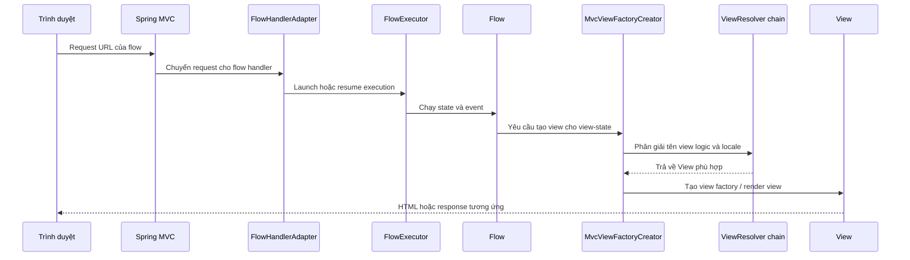

# MvcViewFactoryCreator và chuỗi ViewResolver

Trong Spring Web Flow, `view-state` mô tả thời điểm hành trình cần hiển thị một màn hình. Nhưng state chỉ cần biết tên logic của view; nó không nên phụ thuộc vào đường dẫn vật lý của JSP, template Thymeleaf hay một view được tạo sẵn. Khi tích hợp với Spring MVC, `MvcViewFactoryCreator` kết nối view của flow với cơ chế `ViewResolver` để chuyển tên logic thành đối tượng `View` có thể render response.

Hiểu đúng mối quan hệ này giúp tổ chức view theo công nghệ giao diện, thay đổi prefix/suffix mà không phải sửa flow definition và phối hợp nhiều resolver theo thứ tự rõ ràng. Đây là một phần của tích hợp Spring MVC trong Spring Web Flow: flow điều phối state, còn Spring MVC đảm nhiệm việc phân giải và render view.

## 1. Phân biệt các thành phần trong quá trình render

Các thành phần tham gia có trách nhiệm riêng:

| Thành phần | Trách nhiệm | Ví dụ |
|---|---|---|
| `view-state` | Khai báo màn hình cần hiển thị trong flow và các event có thể phát ra | State `enterCustomer` hiển thị form khách hàng |
| `MvcViewFactoryCreator` | Tạo view factory cho Spring MVC từ cấu hình các `ViewResolver` | Kết nối flow với JSP hoặc template resolver |
| `ViewResolver` | Nhận tên view logic và locale, trả về một `View` phù hợp hoặc không nhận xử lý | Phân giải `booking/customer` thành JSP view |
| `View` | Render nội dung thực tế vào response bằng model được cung cấp | Render `/WEB-INF/views/booking/customer.jsp` |
| `FlowHandlerAdapter` và `FlowExecutor` | Tiếp nhận request flow, khởi chạy hoặc tiếp tục execution | Xử lý event `continue` của flow đặt phòng |

`FlowHandlerMapping` và `FlowHandlerAdapter` xử lý việc định tuyến request đến flow. `MvcViewFactoryCreator` xử lý việc tạo view factory để flow hiển thị màn hình. `ViewResolver` phân giải tên view thành đối tượng view. Ba công việc này liên kết với nhau nhưng không thay thế nhau.

## 2. Vị trí của MvcViewFactoryCreator trong kiến trúc

Khi người dùng mở một URL thuộc flow, Spring MVC tìm handler phù hợp. Flow handler adapter chuyển request cho `FlowExecutor`. Flow chạy đến một `view-state`; tại thời điểm cần render, view factory creator tạo view dựa trên tên view và các resolver đã cấu hình. View được phân giải sau đó render nội dung ra response.



Ví dụ, flow có thể yêu cầu view tên `booking/customer`. Nó không cần biết view này được triển khai bằng JSP ở `/WEB-INF/views/booking/customer.jsp` hay bằng một template engine khác. Việc ánh xạ tên logic sang tài nguyên cụ thể thuộc cấu hình resolver.

## 3. Cấu hình MvcViewFactoryCreator

Với cấu hình XML, khai báo `MvcViewFactoryCreator`, cung cấp danh sách view resolver và gắn creator vào `flow-builder-services`:

```xml
<bean id="mvcViewFactoryCreator"
      class="org.springframework.webflow.mvc.servlet.MvcViewFactoryCreator">
    <property name="viewResolvers">
        <list>
            <ref bean="beanNameViewResolver" />
            <ref bean="jspViewResolver" />
        </list>
    </property>
</bean>

<webflow:flow-builder-services
        id="flowBuilderServices"
        view-factory-creator="mvcViewFactoryCreator" />
```

Điểm quan trọng là `flow-builder-services` phải sử dụng creator này. Nếu creator chỉ được khai báo như một bean nhưng không được đưa vào dịch vụ xây dựng flow, các flow có thể vẫn dùng cơ chế tạo view mặc định thay vì chuỗi resolver mong muốn.

Thuộc tính `viewResolvers` nhận các resolver mà creator sẽ sử dụng. Có thể cấu hình resolver cho nhiều loại view, nhưng cần xác định rõ thứ tự để tên view không bị một resolver tổng quát nhận trước khi resolver chuyên biệt có cơ hội xử lý.

## 4. Cấu hình một chuỗi ViewResolver

Một `ViewResolver` nhận tên view logic cùng locale và trả về một đối tượng `View`. Nếu resolver không xử lý tên đó, nó có thể trả `null` để resolver tiếp theo thử. Vì vậy, một chuỗi resolver có thể phối hợp nhiều cơ chế hiển thị.

Ví dụ cấu hình `BeanNameViewResolver` và `InternalResourceViewResolver`:

```xml
<bean id="beanNameViewResolver"
      class="org.springframework.web.servlet.view.BeanNameViewResolver">
    <property name="order" value="0" />
</bean>

<bean id="jspViewResolver"
      class="org.springframework.web.servlet.view.InternalResourceViewResolver">
    <property name="prefix" value="/WEB-INF/views/" />
    <property name="suffix" value=".jsp" />
    <property name="order" value="1" />
</bean>
```

`BeanNameViewResolver` tìm một Spring bean có tên trùng với view name. Nếu ứng dụng có bean view tên `booking/customer`, resolver này có thể trả về view đó. Nếu không tìm thấy bean phù hợp, resolver tiếp theo có thể xử lý.

`InternalResourceViewResolver` ghép prefix, tên view và suffix để tạo đường dẫn JSP. Với tên `booking/customer`, cấu hình trên tạo đường dẫn:

```text
/WEB-INF/views/booking/customer.jsp
```

`InternalResourceViewResolver` thường có thể tạo một `InternalResourceView` cho tên được yêu cầu mà không xác minh trước rằng tài nguyên JSP thực sự tồn tại. Vì vậy, cần đặt resolver này sau các resolver có khả năng từ chối tên view không thuộc phạm vi của chúng. Nếu đặt quá sớm, nó có thể nhận mọi tên và ngăn resolver khác được thử.

Thứ tự trong danh sách `viewResolvers` truyền cho `MvcViewFactoryCreator` cần phản ánh thứ tự ưu tiên mong muốn. Thuộc tính `order` cũng nên được cấu hình nhất quán khi các resolver được quản lý hoặc sắp xếp trong cùng ngữ cảnh Spring MVC. Không nên dựa vào thứ tự ngẫu nhiên của bean.

## 5. Kết nối tên view trong flow với resolver

Trong flow definition, `view-state` có thể khai báo tên view logic rõ ràng:

```xml
<view-state id="enterCustomer" view="booking/customer">
    <transition on="continue" to="reviewBooking" />
    <transition on="cancel" to="cancelled" />
</view-state>
```

Ở đây, `booking/customer` là tên logic được chuyển đến view factory. Resolver JSP ghép tên này thành `/WEB-INF/views/booking/customer.jsp`. Flow không ghi prefix `/WEB-INF/views/` hoặc suffix `.jsp`, do đó có thể chuyển sang template engine khác bằng cách thay cấu hình resolver mà không đổi tên view trong flow.

Nếu không khai báo thuộc tính `view`, Spring Web Flow có thể dùng quy ước tên state làm tên view. Cách này tiện khi tên state và tên template tương ứng, nhưng nên khai báo `view` tường minh khi muốn tách tên điều hướng khỏi cấu trúc giao diện hoặc khi có nhiều flow dùng chung một view.

Tên view nên là tên logic, không phải đường dẫn filesystem. Tránh ghi trực tiếp phần mở rộng `.jsp` hoặc đường dẫn vật lý vào flow definition, trừ khi có một quy ước resolver riêng yêu cầu điều đó. Giữ tên logic ổn định giúp flow ít phụ thuộc công nghệ giao diện.

## 6. Phối hợp nhiều công nghệ view

Một ứng dụng có thể dùng nhiều resolver: view bean dựng sẵn cho một số màn hình, template engine cho giao diện mới và JSP cho phần còn lại. `MvcViewFactoryCreator` có thể nhận danh sách các resolver cần dùng để phân giải view của flow.

Ví dụ thứ tự xử lý có thể là:

| Ưu tiên | Resolver | Phạm vi phù hợp |
|---:|---|---|
| 1 | `BeanNameViewResolver` | View đã được khai báo thành Spring bean |
| 2 | Resolver của template engine | Tên view thuộc các template mới |
| 3 | `InternalResourceViewResolver` | Các JSP truyền thống làm fallback |

Tên lớp cụ thể của resolver template phụ thuộc phiên bản Spring và template engine được ứng dụng sử dụng. Dù dùng Thymeleaf, FreeMarker hay một công nghệ khác, nguyên tắc vẫn là resolver chuyên biệt nên có cơ hội xử lý trước resolver tổng quát có thể nhận mọi tên.

Không phải mọi `ViewResolver` có mặt trong Spring MVC context đều mặc nhiên nằm trong danh sách mà `MvcViewFactoryCreator` sử dụng. Hãy cấu hình danh sách `viewResolvers` rõ ràng cho creator và xác minh cấu hình thực tế trong application context. Nếu ứng dụng dùng cùng resolver cho controller MVC và flow, có thể chia sẻ các bean resolver để tránh hai bộ cấu hình khác nhau.

## 7. Quan hệ với FlowHandlerMapping và FlowHandlerAdapter

Trong tích hợp servlet, luồng xử lý request và luồng phân giải view là hai nhánh cấu hình khác nhau:

- `FlowHandlerMapping` ánh xạ URL đến flow handler hoặc flow id.
- `FlowHandlerAdapter` nhận request đã được ánh xạ và làm việc với `FlowExecutor` để launch/resume flow.
- `MvcViewFactoryCreator` tạo view factory dùng Spring MVC cho các view-state.
- `ViewResolver` biến tên view logic thành đối tượng view để render.

Ví dụ cấu hình handler adapter tối giản thường có dạng:

```xml
<bean class="org.springframework.webflow.mvc.servlet.FlowHandlerMapping">
    <property name="flowRegistry" ref="flowRegistry" />
    <property name="order" value="0" />
</bean>

<bean class="org.springframework.webflow.mvc.servlet.FlowHandlerAdapter">
    <property name="flowExecutor" ref="flowExecutor" />
</bean>
```

Đây là phần định tuyến và thực thi flow. Nó không thay thế cấu hình `MvcViewFactoryCreator` và không quyết định JSP hay template nào được render. Khi URL không vào được flow, hãy kiểm tra handler mapping và adapter; khi flow chạy đến đúng state nhưng không render được view, hãy kiểm tra view factory creator và chuỗi resolver.

Trong ứng dụng có nhiều controller annotation, thứ tự của handler mapping cũng cần tránh xung đột URL. Ví dụ, một controller MVC không nên chiếm trước URL dành cho flow nếu yêu cầu là để `FlowHandlerMapping` xử lý URL đó.

## 8. Ví dụ cấu hình tích hợp hoàn chỉnh

Đoạn cấu hình sau ghép registry, executor, handler adapter và view factory creator để minh họa các điểm nối chính. Các bean `flowRegistry`, resolver và view cần được khai báo phù hợp với ứng dụng.

```xml
<webflow:flow-registry id="flowRegistry" base-path="/WEB-INF/flows">
    <webflow:flow-location path="/booking/booking-flow.xml" />
</webflow:flow-registry>

<webflow:flow-executor id="flowExecutor" flow-registry="flowRegistry" />

<bean id="beanNameViewResolver"
      class="org.springframework.web.servlet.view.BeanNameViewResolver">
    <property name="order" value="0" />
</bean>

<bean id="jspViewResolver"
      class="org.springframework.web.servlet.view.InternalResourceViewResolver">
    <property name="prefix" value="/WEB-INF/views/" />
    <property name="suffix" value=".jsp" />
    <property name="order" value="1" />
</bean>

<bean id="mvcViewFactoryCreator"
      class="org.springframework.webflow.mvc.servlet.MvcViewFactoryCreator">
    <property name="viewResolvers">
        <list>
            <ref bean="beanNameViewResolver" />
            <ref bean="jspViewResolver" />
        </list>
    </property>
</bean>

<webflow:flow-builder-services
        id="flowBuilderServices"
        view-factory-creator="mvcViewFactoryCreator" />

<bean class="org.springframework.webflow.mvc.servlet.FlowHandlerMapping">
    <property name="flowRegistry" ref="flowRegistry" />
    <property name="order" value="0" />
</bean>

<bean class="org.springframework.webflow.mvc.servlet.FlowHandlerAdapter">
    <property name="flowExecutor" ref="flowExecutor" />
</bean>
```

Trong ví dụ, `flowRegistry` tìm flow definition, `flowExecutor` quản lý execution, handler mapping/adapter nối HTTP với flow, còn `mvcViewFactoryCreator` dùng resolver list để render view-state. Nếu dự án dùng namespace hoặc Java configuration để đăng ký handler mapping và adapter, hãy tránh đăng ký trùng các bean tương đương.

## 9. Chọn view name và tổ chức tài nguyên

Nên thống nhất quy ước đặt tên view trong flow và cấu trúc thư mục giao diện. Ví dụ:

```text
Flow definition:
  booking/customer
  booking/review
  booking/confirmation

JSP resources:
  /WEB-INF/views/booking/customer.jsp
  /WEB-INF/views/booking/review.jsp
  /WEB-INF/views/booking/confirmation.jsp
```

Các tên view logic phản ánh mục đích màn hình, còn đường dẫn vật lý do resolver quyết định. Cấu trúc này giúp nhóm giao diện tổ chức template theo feature và giúp người đọc flow hiểu được màn hình mà không phải lần theo đường dẫn tài nguyên.

Đặt JSP dưới `/WEB-INF` thường giúp ngăn truy cập trực tiếp từ trình duyệt; view được render thông qua cơ chế forward của Spring MVC. Khi dùng template engine khác, vị trí và quy tắc đóng gói tài nguyên phụ thuộc engine đó.

Nếu nhiều flow chia sẻ một màn hình, có thể dùng cùng view name hoặc cùng bean view, nhưng cần bảo đảm model mà từng flow cung cấp tương thích với yêu cầu của view. Resolver chỉ tìm và trả view; nó không tự chuyển đổi một model flow bất kỳ thành model nghiệp vụ phù hợp.

## 10. Locale và nội dung hiển thị

Phương thức `ViewResolver` nhận locale cùng view name. Điều này cho phép resolver hoặc view sử dụng locale để chọn tài nguyên phù hợp khi công nghệ view hỗ trợ. Cấu hình locale của Spring MVC cần nhất quán giữa các request của flow, đặc biệt khi người dùng chuyển ngôn ngữ giữa hành trình.

Không nên mã hóa ngôn ngữ trong tên view, chẳng hạn `booking/customer_vi` và `booking/customer_en`, nếu mục đích chỉ là thay đổi nội dung. Hãy để message source, locale resolver và template xử lý bản địa hóa. Chỉ dùng các view name khác nhau khi cấu trúc giao diện thực sự khác nhau.

## 11. Lỗi thường gặp và cách chẩn đoán

**Flow chạy đúng state nhưng báo không tìm thấy view:** kiểm tra `view` trong `view-state`, tên state nếu đang dùng quy ước mặc định, bean `MvcViewFactoryCreator` và thuộc tính `viewResolvers`. Xác nhận creator đã được gắn vào `flow-builder-services`.

**Resolver không tìm thấy JSP:** kiểm tra prefix, suffix, tên view logic, chữ hoa/thường và vị trí đóng gói tài nguyên. Với ví dụ JSP ở trên, `booking/customer` phải ánh xạ đến `/WEB-INF/views/booking/customer.jsp`.

**Resolver sai nhận view:** kiểm tra thứ tự resolver. Một resolver tổng quát như `InternalResourceViewResolver` thường phải ở cuối vì nó có thể tạo view cho hầu hết tên được yêu cầu.

**Controller MVC nhận URL đáng lẽ thuộc flow:** kiểm tra `FlowHandlerMapping`, URL mapping và thứ tự handler mapping. Đây là vấn đề định tuyến request, không phải lỗi `ViewResolver`.

**View render nhưng thiếu dữ liệu:** kiểm tra model được đưa vào view-state, dữ liệu flow scope và hợp đồng mà template mong đợi. `ViewResolver` chỉ giải quyết view name; nó không tự nạp dữ liệu nghiệp vụ.

**Thay đổi resolver nhưng flow không phản ánh:** xác minh `MvcViewFactoryCreator` thực sự sử dụng danh sách resolver mới và flow builder đang dùng đúng `flow-builder-services`. Nếu cấu hình có nhiều application context, kiểm tra bean nằm trong context mà flow builder sử dụng.

## 12. Kiểm thử chuỗi ViewResolver

Nên kiểm tra việc phân giải view bằng kiểm thử tích hợp với cấu hình Spring MVC/Web Flow của ứng dụng. Một số trường hợp quan trọng:

1. Khởi chạy flow và đi đến từng `view-state`; xác minh view name được chọn đúng.
2. Kiểm tra tên view được `BeanNameViewResolver` xử lý trả về bean view mong muốn.
3. Kiểm tra tên không được resolver chuyên biệt nhận sẽ chuyển đến resolver tiếp theo.
4. Xác minh JSP name được ghép đúng prefix/suffix và tài nguyên có thể render.
5. Kiểm tra một view name không tồn tại để xác minh lỗi được phát hiện rõ ràng, không bị resolver tổng quát che giấu.
6. Kiểm tra locale khi view hoặc resolver hỗ trợ nội dung theo ngôn ngữ.
7. Xác minh URL flow vẫn được `FlowHandlerMapping` xử lý khi ứng dụng có controller MVC khác.

Khi dùng nhiều resolver, nên có kiểm thử cho cả thứ tự ưu tiên. Một cấu hình có thể khởi động thành công nhưng vẫn trả nhầm loại view khi resolver tổng quát đứng trước resolver chuyên biệt.

## 13. Nguyên tắc thiết kế

1. Dùng tên view logic trong `view-state`; để resolver quyết định đường dẫn và công nghệ render.
2. Cấu hình `MvcViewFactoryCreator` với danh sách `ViewResolver` rõ ràng.
3. Gắn creator vào `flow-builder-services` để các flow dùng đúng cơ chế tạo view.
4. Sắp xếp resolver chuyên biệt trước resolver tổng quát; đặt `InternalResourceViewResolver` ở cuối chuỗi JSP khi phù hợp.
5. Phân biệt định tuyến URL đến flow với phân giải view name thành `View`.
6. Giữ quy ước tên view và cấu trúc tài nguyên nhất quán giữa flow definition và view layer.
7. Kiểm thử cả view được chọn, thứ tự resolver, tài nguyên thiếu và tương tác với handler mapping.

`MvcViewFactoryCreator` là cầu nối giữa view-state của Spring Web Flow và hệ thống view của Spring MVC. Khi flow chỉ sử dụng tên view logic, creator được cấu hình với chuỗi resolver có thứ tự rõ ràng và handler mapping được phân biệt với view resolution, ứng dụng có thể thay đổi công nghệ giao diện mà vẫn giữ nguyên hành trình nghiệp vụ.
