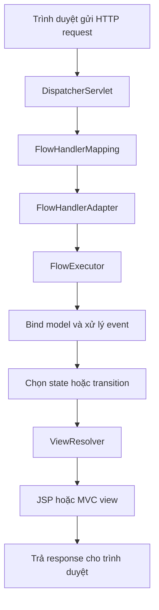

# Tiếp cận model cùng cơ chế binding trong view MVC

Trong chương **Tích hợp Spring MVC**, Spring Web Flow có thể dùng các view do Spring MVC render và tận dụng hệ thống form tag, binding, chuyển đổi kiểu cùng hiển thị lỗi của Spring. Khi một `view-state` khai báo model, đối tượng đó được đưa vào ngữ cảnh render để view MVC có thể hiển thị và bind các trường nhập liệu. Khi người dùng gửi event của flow, Spring Web Flow xử lý request, bind dữ liệu vào model theo cấu hình rồi quyết định transition.

Module `SPRING_WEB_FLOW` tập trung mô hình hóa hành trình web nhiều bước bằng state, event, transition và subflow; thực hành form binding, validation, quản lý scope và phiên; tích hợp Spring MVC; kiểm thử và phục hồi luồng khi có lỗi. Hiểu cách model đi từ flow definition tới view MVC giúp tổ chức form nhiều bước rõ ràng, tận dụng công cụ binding quen thuộc và kiểm soát chính xác dữ liệu nào được phép cập nhật ở mỗi bước.

## 1. Spring MVC tham gia vào request của flow như thế nào?

Trong ứng dụng web tích hợp, `DispatcherServlet` của Spring MVC tiếp nhận HTTP request. `FlowHandlerMapping` nhận diện request thuộc một flow và `FlowHandlerAdapter` chuyển việc xử lý cho `FlowExecutor`. Flow engine khôi phục hoặc khởi tạo execution, xử lý event, thực hiện action/transition và yêu cầu render view state hiện tại. View được phân giải qua hệ thống view resolver của ứng dụng.

Luồng khái quát:



Nhờ tích hợp này, controller không cần tự điều phối từng bước của một hành trình dài. Flow definition quản lý state và event; Spring MVC tiếp tục cung cấp hạ tầng HTTP, view resolution và các thành phần web dùng chung.

Trong cấu hình Java/XML, ứng dụng cần đăng ký flow registry, flow executor, `FlowHandlerMapping` và `FlowHandlerAdapter` theo cách phù hợp với phiên bản Spring Web Flow. Ví dụ XML khái quát:

```xml
<webflow:flow-registry id="flowRegistry" base-path="/WEB-INF/flows">
    <webflow:flow-location-pattern value="/**/*-flow.xml" />
</webflow:flow-registry>

<webflow:flow-executor id="flowExecutor" flow-registry="flowRegistry" />

<bean class="org.springframework.webflow.mvc.servlet.FlowHandlerMapping">
    <property name="flowRegistry" ref="flowRegistry" />
</bean>

<bean class="org.springframework.webflow.mvc.servlet.FlowHandlerAdapter">
    <property name="flowExecutor" ref="flowExecutor" />
</bean>
```

Đoạn cấu hình minh họa các thành phần cốt lõi. Namespace, thứ tự mapping, view resolver, security và các thuộc tính bổ sung cần được cấu hình theo phiên bản framework và cấu trúc ứng dụng thực tế.

## 2. Model của view-state được đưa vào view MVC

Một `view-state` có thể khai báo thuộc tính `model` để chỉ ra đối tượng dùng làm model cho view. Đối tượng đó thường được tạo như flow variable hoặc được chuẩn bị bởi action trước khi đi vào view state.

```xml
<flow xmlns="http://www.springframework.org/schema/webflow">
    <var name="bookingForm" class="com.example.web.BookingForm" />

    <view-state id="enterDetails"
                view="booking/details"
                model="bookingForm">
        <transition on="continue" to="review" />
    </view-state>

    <view-state id="review" view="booking/review">
        <transition on="back" to="enterDetails" />
        <transition on="confirm" to="completed" />
    </view-state>

    <end-state id="completed" view="booking/confirmation" />
</flow>
```

Ở đây, `bookingForm` là đối tượng dữ liệu dùng cho view `booking/details`. Khi state được render, Spring Web Flow đưa model vào ngữ cảnh view để JSP hoặc công nghệ view MVC khác có thể truy cập theo tên model. Khi event `continue` được gửi, dữ liệu form có thể được bind trở lại `bookingForm` trước khi flow chuyển tới `review`.

Model của view-state là model dành cho binding của view hiện tại. Nó không đồng nghĩa với `ModelMap` mà một controller Spring MVC tự tạo trong một request thông thường. Flow engine quản lý vòng đời execution và scope; MVC view nhận dữ liệu cần thiết để render. Không nên dùng controller model như một kho trạng thái thay thế `flowScope`.

Một form object/DTO riêng thường phù hợp hơn việc bind trực tiếp entity của domain. Nó giới hạn dữ liệu mà trình duyệt được phép gửi và giữ cho cấu trúc form không phụ thuộc toàn bộ mô hình lưu trữ.

## 3. Dùng Spring form tags trong JSP

Với JSP, Spring cung cấp tag library `spring-form` để liên kết input với thuộc tính của model. Trong view do flow render, `modelAttribute` của `<form:form>` phải khớp tên model được khai báo ở `view-state`.

Ví dụ view `booking/details.jsp`:

```jsp
<%@ taglib prefix="form" uri="http://www.springframework.org/tags/form" %>

<h1>Thông tin đặt chỗ</h1>

<form:form modelAttribute="bookingForm"
           action="${flowExecutionUrl}"
           method="post">

    <div>
        <label for="guestName">Tên người đặt</label>
        <form:input path="guestName" id="guestName" />
        <form:errors path="guestName" cssClass="field-error" />
    </div>

    <div>
        <label for="checkIn">Ngày nhận phòng</label>
        <form:input path="checkIn" id="checkIn" />
        <form:errors path="checkIn" cssClass="field-error" />
    </div>

    <div>
        <label for="guestCount">Số khách</label>
        <form:input path="guestCount" id="guestCount" />
        <form:errors path="guestCount" cssClass="field-error" />
    </div>

    <button type="submit" name="_eventId_continue">Tiếp tục</button>
    <button type="submit" name="_eventId_cancel">Hủy</button>
</form:form>
```

Các điểm cần chú ý:

- `modelAttribute="bookingForm"` liên kết form với model của view-state.
- `path` là tên thuộc tính của form object, không phải tên tùy ý của phần tử HTML.
- `action="${flowExecutionUrl}"` gửi form về URL của flow execution hiện tại.
- Tên nút `_eventId_continue` tạo event `continue`; `_eventId_cancel` tạo event `cancel`.
- `form:errors` hiển thị lỗi binding/validation tương ứng với thuộc tính, theo cách Spring MVC view integration cung cấp binding status.

Nếu dùng HTML thuần, có thể gửi event bằng tên input theo quy ước `_eventId_<eventId>`. Hãy giữ tên event khớp `on` trong transition. Không hard-code execution URL hoặc execution key vào view; dùng các thuộc tính do flow cung cấp để request tiếp tục đúng execution.

## 4. Binding model theo thuộc tính và whitelist

Spring Web Flow có thể cấu hình binder trong view-state để chỉ rõ những thuộc tính nào được bind. Đây là cách quan trọng để giới hạn bề mặt dữ liệu mà client có thể cập nhật.

```xml
<view-state id="enterDetails"
            view="booking/details"
            model="bookingForm">
    <binder>
        <binding property="guestName" required="true" />
        <binding property="checkIn" required="true" />
        <binding property="guestCount" required="true" />
    </binder>

    <transition on="continue" to="review" />
    <transition on="cancel" to="cancelled"
                bind="false" validate="false" />
</view-state>
```

Binder khai báo những property mà view được phép bind. Với dữ liệu quan trọng như `ownerId`, `approved`, `totalPrice`, `paymentStatus` hoặc quyền người dùng, không đưa chúng vào danh sách binding chỉ vì chúng tồn tại trên object. Những giá trị đó phải do máy chủ xác định và bảo vệ ở service/domain layer.

`required="true"` trong khai báo binding giúp đánh dấu property cần có theo cấu hình binder. Nó không thay thế toàn bộ validation nghiệp vụ, chẳng hạn kiểm tra ngày hợp lệ, số lượng nằm trong giới hạn hay booking còn khả dụng.

Nếu ứng dụng không khai báo binder rõ ràng, phạm vi binding mặc định phụ thuộc cơ chế và cấu hình phiên bản. Để tránh vô tình cho phép bind quá rộng, hãy định nghĩa các property được phép cho form có dữ liệu nhạy cảm và kiểm tra bằng test tích hợp.

## 5. Chuyển đổi kiểu và định dạng dữ liệu

Form HTML gửi dữ liệu dưới dạng chuỗi. Model Java có thể dùng `LocalDate`, `BigDecimal`, enum hoặc kiểu số. Binding cần converter/formatter để chuyển chuỗi thành kiểu phù hợp và định dạng giá trị khi render view.

Ví dụ, trường ngày có thể được biểu diễn trong form theo định dạng `yyyy-MM-dd` và chuyển thành `LocalDate`. Với tiền tệ, cần xác định locale, dấu thập phân và quy tắc làm tròn. Không nên tự parse chuỗi ngày hoặc tiền bằng logic tùy tiện trong controller nếu Spring ConversionService/Formatter có thể đảm nhiệm nhất quán.

Trong ứng dụng Spring Web Flow, conversion service có thể được cấu hình thông qua flow builder services; tích hợp Spring MVC cũng có thể dùng cấu hình formatter/converter của MVC. Cần bảo đảm hai phần sử dụng quy tắc tương thích để giá trị hiển thị và giá trị bind không khác nhau ngoài ý muốn.

Khi conversion thất bại, model không nhận được giá trị đúng kiểu và lỗi binding được đưa vào ngữ cảnh lỗi để view hiển thị. Ví dụ, chuỗi `abc` không thể chuyển thành số khách. Người dùng cần thấy thông báo rõ ràng và flow phải ở lại view state để họ sửa.

## 6. Hiển thị lỗi binding và validation trong MVC view

Spring form tags hỗ trợ hiển thị lỗi theo property. `form:errors` có thể đặt ngay dưới input để người dùng biết trường nào cần sửa. Lỗi chung của form có thể được trình bày trong vùng thông báo tổng quát bằng cơ chế message của ứng dụng.

Ví dụ:

```jsp
<form:form modelAttribute="bookingForm"
           action="${flowExecutionUrl}"
           method="post">
    <form:errors path="*" cssClass="form-error-summary" />

    <form:label path="guestName">Tên người đặt</form:label>
    <form:input path="guestName" />
    <form:errors path="guestName" cssClass="field-error" />

    <button type="submit" name="_eventId_continue">Tiếp tục</button>
</form:form>
```

Khi validation của view-state thất bại, transition không được thực hiện; view hiện tại được render lại cùng model và lỗi. Điều này giúp giữ trải nghiệm form nhiều bước liền mạch. Nội dung lỗi nên hướng dẫn người dùng sửa dữ liệu, không hiển thị stack trace, tên class hoặc chi tiết hệ thống nội bộ.

Nếu dùng Thymeleaf hoặc một view technology khác, cách hiển thị lỗi sẽ theo tích hợp của view đó. Nguyên tắc vẫn giữ nguyên: model và lỗi được cung cấp trong ngữ cảnh render, view gắn lỗi với đúng field, còn flow quyết định có được phép chuyển bước hay không.

## 7. Binding và validation theo từng event

Một view có thể có nhiều nút với ý nghĩa khác nhau. Event `continue` cần bind và validate; `back` có thể bind để giữ dữ liệu nhưng bỏ qua validation; `cancel` có thể bỏ cả binding lẫn validation.

```xml
<view-state id="enterDetails"
            view="booking/details"
            model="bookingForm">
    <transition on="continue" to="review"
                bind="true" validate="true" />

    <transition on="back" to="chooseOptions"
                bind="true" validate="false" />

    <transition on="cancel" to="cancelled"
                bind="false" validate="false" />
</view-state>
```

| Event | Binding | Validation | Kết quả mong muốn |
|---|---:|---:|---|
| `continue` | Có | Có | Chỉ chuyển tới review khi dữ liệu hợp lệ |
| `back` | Có | Không | Giữ dữ liệu người dùng vừa nhập và quay lại bước trước |
| `cancel` | Không | Không | Bỏ qua thay đổi đang gửi và đi theo nhánh hủy |

`bind="false"` không xóa model hiện có hoặc hoàn tác dữ liệu đã lưu; nó chỉ bỏ binding của view cho transition đó. `validate="false"` không bỏ qua authorization hoặc kiểm tra nghiệp vụ trong service. Các thao tác như hủy booking vẫn phải kiểm tra quyền và trạng thái tài nguyên.

## 8. View MVC và flow scope có vòng đời khác nhau

Model được cung cấp cho view là dữ liệu cần thiết để render và binding tại state hiện tại. `flowScope` có vòng đời theo một flow execution, cho phép giữ bản nháp qua nhiều request. `requestScope` chỉ tồn tại trong request đang xử lý. HTTP session có thể chứa nhiều execution và nhiều tab của cùng người dùng.

| Thành phần | Vai trò | Dùng cho |
|---|---|---|
| Model của view-state | Đối tượng mà view hiện tại bind và hiển thị | Form object như `bookingForm` |
| `requestScope` | Dữ liệu tạm trong request hiện tại | Cờ hiển thị hoặc thông báo chỉ dùng cho lần render này |
| `flowScope` | Dữ liệu gắn với một lần thực thi flow | Bản nháp nhiều bước và dữ liệu dùng qua các state |
| `conversationScope` | Dữ liệu chia sẻ trong conversation có flow cha/subflow | Thông tin cần dùng chung giữa các flow liên quan |
| HTTP session | Trạng thái gắn với phiên người dùng | Locale hoặc tùy chọn phiên theo thiết kế ứng dụng |

Tránh lưu một thuộc tính như `currentBooking` dùng chung trong HTTP session nếu nhiều tab có thể chạy các flow đặt chỗ độc lập. Mỗi execution nên có model/bản nháp riêng trong scope phù hợp. Khi flow kết thúc, dữ liệu cần tồn tại lâu dài phải được lưu vào repository/domain model, không phụ thuộc view model hoặc flow scope.

## 9. Tích hợp view MVC với Spring Security

Form gửi event flow là một HTTP POST và cần tuân thủ cơ chế bảo vệ request của ứng dụng. Nếu Spring Security bật CSRF protection, view cần gửi token theo cách mà tích hợp Spring Security và view technology đang dùng yêu cầu. Không tắt CSRF chỉ để form flow hoạt động.

Một số nguyên tắc:

- Giữ action form trỏ tới `${flowExecutionUrl}` để tiếp tục đúng execution.
- Đảm bảo CSRF token được render trong form theo cấu hình Spring Security.
- Không coi flow execution key là bằng chứng xác thực hoặc quyền truy cập.
- Kiểm tra quyền truy cập bản ghi ở service/domain layer cho từng thao tác.
- Giới hạn property được bind bằng binder/form DTO; không bind trường quản trị hoặc trường do máy chủ quyết định.
- Không đưa dữ liệu nhạy cảm vào hidden input chỉ vì view cần giữ trạng thái.

Flow điều phối hành trình, còn Spring Security xác thực và phân quyền request. Hai cơ chế bổ sung nhau nhưng không thay thế nhau.

## 10. Kiểm thử model và binding trong MVC view

Kiểm thử cần xác nhận model được cung cấp đúng tên, field được bind đúng, event được gửi tới flow và lỗi được hiển thị khi dữ liệu không hợp lệ. Có thể kết hợp test flow execution với kiểm thử MVC view/rendering.

| Kịch bản | Điều cần xác minh |
|---|---|
| Render view-state lần đầu | Model attribute `bookingForm` có mặt và view resolver tìm đúng view |
| Submit `continue` hợp lệ | Form fields được bind và flow chuyển tới `review` |
| Submit dữ liệu sai kiểu | Binding error được tạo, view hiện tại được render lại |
| Validation thất bại | Transition bị chặn và field/global error hiển thị đúng |
| Submit `cancel` | Binding không cập nhật model từ payload của form theo cấu hình transition |
| Gửi event không khớp transition | Flow xử lý event không hợp lệ theo chính sách, không chuyển nhầm state |
| Binder nhận field ngoài whitelist | Field không được cập nhật hoặc bị từ chối theo cấu hình binder |
| Hai execution cùng session | Model và flow scope không bị trộn giữa các tab |
| CSRF token thiếu hoặc sai | Security layer từ chối request theo chính sách |

Spring Web Flow có test support để khởi chạy flow, gửi event và kiểm tra state/model. Spring MVC cũng có công cụ kiểm thử controller và view integration. API cụ thể phụ thuộc phiên bản. Nên có integration test cho form thực tế hoặc view template để xác nhận `modelAttribute`, `path`, event parameter và hiển thị lỗi hoạt động cùng nhau.

Ví dụ các khẳng định cần có trong test (mã giả):

```java
// Form hợp lệ: event continue đưa flow tới review.
assertThat(flow.currentState()).isEqualTo("review");
assertThat(flow.flowScope().get("bookingForm").getGuestName())
        .isEqualTo("Lan");

// Form sai kiểu hoặc validation lỗi: flow vẫn ở enterDetails.
assertThat(invalidFlow.currentState()).isEqualTo("enterDetails");
assertThat(invalidFlow.messageContext().hasErrorMessages()).isTrue();
```

Đây là mã giả mô tả điều cần kiểm tra; cách gửi request, lấy model và message context phải dùng test API của phiên bản đang chạy. Kiểm thử service riêng để xác minh authorization và quy tắc nghiệp vụ không phụ thuộc vào việc request đến từ MVC view hay một caller khác.

## 11. Lỗi tích hợp thường gặp

### Tên model không khớp

`view-state model="bookingForm"` nhưng JSP dùng `modelAttribute="booking"`. Spring form tags không tìm thấy model mong đợi hoặc binding status không được tạo đúng. Giữ tên model nhất quán giữa flow definition và view.

### Form gửi sai event

Nút submit có tên `_eventId_next` nhưng flow khai báo `on="continue"`. Flow không tìm thấy transition phù hợp. Tên event trong HTML phải khớp chính xác transition.

### Hard-code flow execution URL

Execution URL có thể chứa thông tin định danh/continuation thay đổi theo từng request. Dùng `${flowExecutionUrl}` được flow cung cấp thay vì ghép URL thủ công.

### Bind trực tiếp domain entity

Form có thể gửi thêm thuộc tính không hiển thị trong UI. Dùng form DTO và binder whitelist, sau đó chuyển dữ liệu được phép sang domain object qua service.

### Coi MVC model là flow state

Model phục vụ render request không phải nơi lưu trạng thái qua nhiều bước. Dữ liệu cần tiếp tục giữa các request phải nằm trong flow scope hoặc kho lưu trữ phù hợp.

### Thiếu converter hoặc formatter

Ngày, tiền hoặc enum có thể hiển thị đúng nhưng bind thất bại do định dạng không khớp. Cấu hình conversion service/formatter thống nhất giữa flow và MVC, rồi kiểm thử cả chiều render và submit.

### Validation chỉ chạy ở controller

Flow có thể không đi qua controller method dự kiến cho từng bước. Đặt validation ở transition/view-state hoặc service/domain layer phù hợp với trách nhiệm; không dựa vào một controller handler không tham gia vào request của flow.

## 12. Checklist khi xây dựng view MVC cho flow

Trước khi hoàn thiện một view-state, hãy kiểm tra:

1. Flow được đăng ký và request được định tuyến qua `FlowHandlerMapping`/`FlowHandlerAdapter` đúng cấu hình.
2. `view-state` có model hợp lệ và đối tượng model được khởi tạo trong đúng scope.
3. `modelAttribute` của Spring form tags khớp tên model trong flow definition.
4. `path` của từng input khớp property hợp lệ của form object.
5. Form action dùng `${flowExecutionUrl}` và nút submit gửi đúng `_eventId_<eventId>`.
6. Binder chỉ cho phép các field cần thiết; trường nhạy cảm do máy chủ quản lý.
7. Converter, formatter và validation được cấu hình nhất quán.
8. Binding/validation error được hiển thị rõ ràng trong view.
9. Back, Continue và Cancel có chính sách binding/validation phù hợp.
10. CSRF và authorization được kiểm tra ở đúng lớp.
11. Test bao phủ render, submit, binding lỗi, validation lỗi và nhiều execution.

## Kết luận

Trong tích hợp Spring MVC, model của `view-state` được cung cấp cho view để Spring form tags hoặc công nghệ view khác có thể render và bind dữ liệu. Form gửi về `${flowExecutionUrl}` cùng event `_eventId_<eventId>`; Spring Web Flow tiếp nhận request, bind theo binder và transition, chạy validation rồi mới chuyển state. FlowHandlerMapping và FlowHandlerAdapter kết nối request MVC với FlowExecutor, còn view resolver chịu trách nhiệm render view.

Giữ tên model nhất quán, dùng form DTO và binder whitelist, cấu hình converter/formatter cùng message hiển thị lỗi, và kiểm soát binding theo từng event. Flow scope quản lý bản nháp qua nhiều bước; service/domain layer vẫn chịu trách nhiệm phân quyền, kiểm tra invariant và lưu dữ liệu bền vững. Cách phân chia này giúp tận dụng hệ sinh thái Spring MVC mà vẫn giữ được hành trình nhiều bước rõ ràng và có thể kiểm thử.
