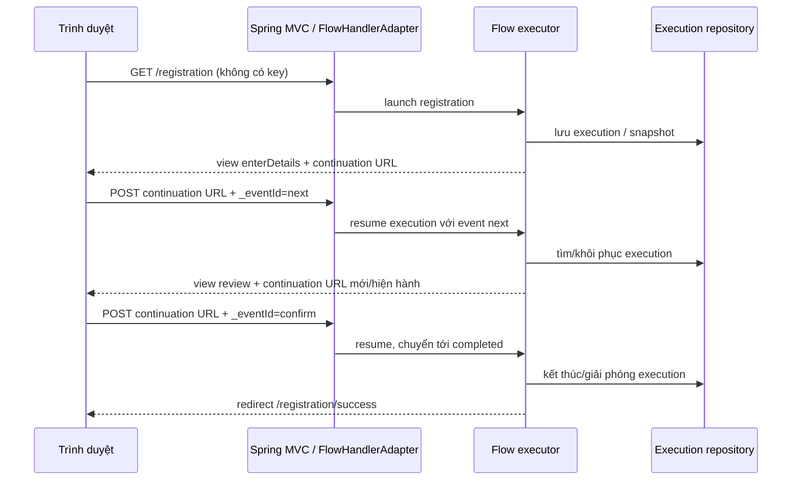

# URL khởi chạy flow và URL tiếp tục một execution trong Spring Web Flow

## 1. Hai loại URL phục vụ hai giai đoạn khác nhau

Trong Spring Web Flow (SWF), một hành trình web như đăng ký tài khoản, đặt hàng hoặc đặt lịch không chỉ là chuỗi trang được nối với nhau bằng những đường dẫn tĩnh. Framework điều phối **state**, **event**, **transition**, dữ liệu biểu mẫu và các bước xử lý trong một **flow execution**. Do đó, URL dùng để **bắt đầu** hành trình và URL dùng để **tiếp tục** một hành trình đang chạy có mục đích khác nhau.

Ví dụ ứng dụng triển khai dưới context path `/shop`:

```text
GET  /shop/checkout
     → Khởi chạy một flow checkout mới.

GET  /shop/checkout?execution=e1s1
     → Truy cập lại một execution/snapshot mà Web Flow nhận diện.

POST /shop/checkout?execution=e1s1
     body: _eventId=next&email=buyer%40example.com
     → Gửi sự kiện next tới execution đang chạy.
```

`e1s1` chỉ là **khóa minh họa** theo một định dạng thường thấy; không được tự tạo hoặc giả định khóa luôn có hình thức này. URL thực tế do cơ chế xử lý URL và repository của phiên bản/cấu hình Web Flow tạo ra. Không phải cứ có tham số `execution` là yêu cầu sẽ thành công: execution phải còn tồn tại, hợp lệ và truy cập được trong ngữ cảnh phiên tương ứng.

| Tiêu chí | URL khởi chạy flow | URL tiếp tục execution |
| --- | --- | --- |
| Mục tiêu | Tạo một hành trình mới từ trạng thái bắt đầu | Truy cập một hành trình đã tồn tại, thường kèm event |
| Ví dụ | `/shop/checkout` | `/shop/checkout?execution=e1s1` |
| Định danh | Flow id/đường dẫn do ứng dụng ánh xạ | Đường dẫn flow cộng **execution key** do framework cấp |
| Dữ liệu | Có thể nhận tham số khởi tạo như `productId` | Dùng trạng thái và scope của execution hiện hành |
| Bookmark/chia sẻ | Thường phù hợp nếu đầu vào hợp lệ và được thiết kế làm deep link | Không phù hợp làm liên kết lâu dài hoặc chia sẻ cho người khác |
| Cách tạo | Liên kết tới route khởi chạy đã cấu hình | Lấy URL do Web Flow cung cấp khi render view |

**Quy tắc thực hành:** dùng URL khởi chạy để người dùng mở một quy trình mới; dùng URL tiếp tục mà Web Flow cung cấp để gửi hành động cho chính quy trình đó. URL tiếp tục không phải mã định danh nghiệp vụ bền vững như `orderId`.

## 2. Ba khái niệm cần tách bạch

### 2.1. Flow definition

**Flow definition** là mô hình khai báo các trạng thái và transition, chẳng hạn một file `checkout-flow.xml` có trạng thái `enterDetails`, `review` và `completed`. Nó tương đương một bản thiết kế có thể được sử dụng để khởi tạo nhiều hành trình.

Một flow id như `checkout` thường được đăng ký trong **flow registry**. Ở cấu hình Spring MVC tiêu biểu, người dùng truy cập route `/checkout` để nhờ flow executor tạo một execution mới của definition đó.

### 2.2. Flow execution

**Flow execution** là một lần chạy cụ thể của bản thiết kế. Nó có trạng thái hiện tại và dữ liệu trong các scope như `flowScope`, `viewScope`. Hai cửa sổ có thể cùng đi qua flow `checkout` nhưng đang ở các state khác nhau và giữ dữ liệu khác nhau.

Flow execution có vòng đời riêng: bắt đầu, tạm dừng ở view-state để chờ event, tiếp tục, chuyển state, có thể gọi subflow, và cuối cùng kết thúc ở end-state.

### 2.3. Execution key và snapshot

Để một request kế tiếp tiếp tục đúng execution, Web Flow cần nhận diện được execution đó. Cơ chế repository cấp một **execution key**; một số chiến lược lưu trữ có snapshot của execution tại những thời điểm khác nhau. Khi tiếp tục, framework dùng khóa để tìm/khôi phục execution và áp dụng event.

Điều quan trọng là:

- **Execution key không phải session ID** và không đồng nghĩa với flow id. Nó là định danh dùng bởi cơ chế lưu trữ/khôi phục execution.
- Với repository lưu dữ liệu trong HTTP session, khóa thường còn phụ thuộc vào **phiên trình duyệt** chứa execution; chỉ sao chép URL sang trình duyệt khác không chuyển được dữ liệu phiên.
- Một key/snapshot có thể hết hiệu lực do flow kết thúc, hết hạn session, giới hạn snapshot, thay đổi repository hoặc các thao tác khác. Không thiết kế liên kết lâu dài dựa vào key.
- Web Flow quản lý chi tiết khóa và cách resume; ứng dụng không nên parse `e1s1` để rút ra nghiệp vụ hay tự tăng số phía sau.

## 3. URL khởi chạy flow được ánh xạ như thế nào?

Trong ứng dụng Spring MVC dùng tích hợp Web Flow truyền thống, các thành phần thường gặp là:

1. **Flow registry** đăng ký flow definition và id của nó.
2. **Flow executor** phụ trách khởi chạy, tạm dừng, tiếp tục và kết thúc execution.
3. **FlowHandlerMapping** nhận biết những request thuộc route của flow.
4. **FlowHandlerAdapter** đưa request đã ánh xạ vào quá trình xử lý của flow executor.

Đoạn cấu hình XML sau minh họa quan hệ giữa các thành phần. Cần khai báo namespace `beans`/`webflow` và cấu hình MVC tương ứng theo phiên bản dự án:

```xml
<webflow:flow-registry id="flowRegistry">
    <webflow:flow-location
        id="checkout"
        path="/WEB-INF/flows/checkout/checkout-flow.xml" />
</webflow:flow-registry>

<webflow:flow-executor
    id="flowExecutor"
    flow-registry="flowRegistry" />

<bean class="org.springframework.webflow.mvc.servlet.FlowHandlerMapping">
    <property name="flowRegistry" ref="flowRegistry" />
    <property name="order" value="0" />
</bean>

<bean class="org.springframework.webflow.mvc.servlet.FlowHandlerAdapter">
    <property name="flowExecutor" ref="flowExecutor" />
</bean>
```

Với mapping mặc định phù hợp, URL `GET /shop/checkout` có thể chọn definition `checkout`. Context path `/shop` là phần triển khai ứng dụng; `checkout` là route/flow id được nhận diện ở tầng MVC. Cấu hình matcher, URL handler hoặc mapping tùy biến có thể tạo ra URL khác; không suy luận route chỉ từ tên file XML.

**Đường dẫn bắt đầu một flow** thường không chứa tham số `execution`. Framework đọc route, chọn definition, tạo execution mới và chuyển tới state khởi đầu. Phân biệt việc *khởi tạo execution* với việc *truy cập view đầu tiên*: framework có thể redirect trước khi trả view, tùy chính sách điều hướng và cấu hình.

### 3.1. Tham số khởi tạo đi cùng start URL

Một start URL có thể mang dữ liệu đầu vào, ví dụ:

```text
GET /shop/checkout?productId=42
```

Khi flow bắt đầu, dữ liệu request có thể được đọc qua `requestParameters` ở vị trí thích hợp:

```xml
<on-start>
    <set name="flowScope.productId"
         value="requestParameters.productId" />
</on-start>
```

Đây là ví dụ tối giản; `productId` đến từ HTTP nên cần kiểm tra tồn tại, định dạng và quyền truy cập. Đọc giá trị từ request không đảm bảo nó đã là kiểu số hay đã được phép sử dụng. Trong flow thực tế, có thể dùng binding/conversion service, input declaration và service validation theo nhu cầu.

Một lần truy cập `/checkout?productId=42` và một lần truy cập `/checkout?productId=99` **có thể tạo hai execution khác nhau**, mặc dù cùng chọn một flow definition. Đây là lý do không nên dùng URL khởi chạy như thể nó đại diện duy nhất cho một lần xử lý đã diễn ra.

## 4. URL tiếp tục execution được tạo và sử dụng thế nào?

Khi execution dừng ở một `view-state` chờ người dùng gửi sự kiện, view cần một URL để đưa event về **đúng execution**. Ở chế độ Spring MVC/JSP thông dụng, Web Flow đưa `flowExecutionUrl` vào model/view context để form có thể sử dụng:

```jsp
<form method="post" action="${flowExecutionUrl}">
    <label for="email">Email</label>
    <input id="email" name="email" type="email" required>

    <button type="submit" name="_eventId_next" value="next">
        Tiếp tục
    </button>
</form>
```

Trong trang JSP, `${flowExecutionUrl}` được JSP EL thay bằng URL do framework cung cấp, chẳng hạn `/shop/checkout?execution=e1s1`. Nút có tên `_eventId_next` diễn đạt event `next`; Web Flow dùng event này để tìm transition `on="next"` trong state hiện tại.

Một cách gửi event khác là đặt trường ẩn:

```html
<input type="hidden" name="_eventId" value="next">
<button type="submit">Tiếp tục</button>
```

Hai cách trên là **hai lựa chọn khác nhau** để gửi sự kiện; hãy dùng một cách nhất quán cho một hành động. Trường hợp nhiều nút `back`, `next`, `confirm` trên cùng form thường tiện dùng `_eventId_back`, `_eventId_next`, `_eventId_confirm` trên từng nút.

Khi sử dụng Spring Security, form POST cần gửi CSRF token đúng cấu hình. Khi form có thể nhập dữ liệu cần binding, view cũng nên hiển thị lỗi validation và escape nội dung do người dùng cung cấp. Những việc này độc lập với cú pháp execution URL.

### 4.1. Ai tạo tham số execution?

Thông thường chính Web Flow tạo URL tiếp tục. Ứng dụng **không** nên tự viết:

```html
<!-- Tránh hardcode khóa/snapshot như ví dụ này. -->
<form action="/shop/checkout?execution=e1s1" method="post">
```

Vì khóa có thể thay đổi theo execution và snapshot, nên URL cố định dễ đưa request tới phiên cũ hoặc khiến việc khôi phục thất bại. Ngoài `flowExecutionUrl`, những tích hợp view khác có thể cung cấp helper hoặc cơ chế URL riêng. Với JSF, sự kiện thường được phát qua component/action của JSF, không mặc định sử dụng nguyên ví dụ form JSP.

### 4.2. Phân biệt sự kiện với URL

URL tiếp tục **xác định execution** cần tiếp tục; event **xác định hành động** cần thực hiện bên trong execution đó.

```text
URL:    /shop/checkout?execution=e1s1
Event:  next
Input:  email=buyer@example.com
```

Ba phần cùng được Web Flow sử dụng: tìm đúng execution, xử lý binding/validation, rồi tìm transition của state hiện hành. Nếu event không có transition hợp lệ trong state hiện tại, framework không tự đoán rằng cần đi tới state tên `next`.

Mặc dù có thể nhìn thấy ví dụ gắn `_eventId` vào query string, **ưu tiên form POST cho event thay đổi dữ liệu hoặc kích hoạt nghiệp vụ**. Tránh dùng GET để xác nhận đơn hàng, thanh toán hay xóa dữ liệu vì GET có thể được mở lại, lưu cache, theo dõi hoặc tự tải bởi trình duyệt/công cụ.

## 5. Một flow XML đầy đủ để theo dõi hành trình

Ví dụ dưới đây giả định ứng dụng có bean `registrationService` và lớp `RegistrationForm`, cùng các view `registration/details` và `registration/review`. Flow cho phép nhập thông tin, xem lại, quay lại sửa và xác nhận:

```xml
<?xml version="1.0" encoding="UTF-8"?>
<flow xmlns="http://www.springframework.org/schema/webflow"
      xmlns:xsi="http://www.w3.org/2001/XMLSchema-instance"
      xsi:schemaLocation="
        http://www.springframework.org/schema/webflow
        http://www.springframework.org/schema/webflow/spring-webflow.xsd">

    <var name="registrationForm"
         class="com.example.registration.RegistrationForm" />

    <view-state id="enterDetails"
                view="registration/details"
                model="registrationForm">
        <binder>
            <binding property="fullName" required="true" />
            <binding property="email" required="true" />
        </binder>
        <transition on="next" to="review" />
    </view-state>

    <view-state id="review"
                view="registration/review"
                model="registrationForm">
        <transition on="back" to="enterDetails" />
        <transition on="confirm" to="completed">
            <evaluate
                expression="registrationService.register(registrationForm)"
                result="flowScope.registrationId" />
        </transition>
    </view-state>

    <end-state id="completed"
               view="externalRedirect:contextRelative:/registration/success" />
</flow>
```

Đây là ví dụ về cấu trúc điều hướng. Dự án chạy thật còn cần khai báo bean nghiệp vụ, view resolver, handler mapping/adapter, xử lý validation, CSRF và trang `/registration/success`. Khi triển khai, service cũng cần xử lý khả năng gửi lặp thao tác `confirm`.

Theo dõi URL và event ở từng chặng:

| Bước | Request hoặc sự kiện | State/hành vi kỳ vọng |
| --- | --- | --- |
| 1 | `GET /shop/registration` | Tạo execution mới, vào `enterDetails` |
| 2 | View render với `flowExecutionUrl` do framework cấp | Có form POST về execution hiện tại |
| 3 | `POST` URL tiếp tục, event `next` và các field hợp lệ | Bind/validate, chuyển sang `review` |
| 4 | Event `back` trên URL tiếp tục được cấp cho view `review` | Quay lại `enterDetails`, dữ liệu form còn trong flow |
| 5 | Event `next` rồi `confirm` | Gọi `registrationService.register(...)`, nhận `registrationId` |
| 6 | Vào `completed` | Kết thúc execution và redirect tới `/registration/success` |

Trong bảng, route `/registration` giả định đã được ánh xạ vào flow id `registration` giống cơ chế ở phần trước. **Không thể lấy lại một execution đã kết thúc bằng cách gửi tiếp event tới URL cũ** rồi mong nó quay về state đang tồn tại.

### 5.1. Sơ đồ request và vòng đời



Sơ đồ này mô tả quan hệ logic; số lần redirect hoặc số snapshot được ghi thực tế phụ thuộc cấu hình execution repository, redirect policy và cách xử lý view của dự án.

## 6. Tham số trên URL có vai trò khác nhau

Với hai URL:

```text
/shop/registration?campaign=summer
/shop/registration?execution=e1s1
```

`campaign=summer` là dữ liệu ứng dụng có thể dùng để **khởi tạo** hành trình. `execution=e1s1` là thông tin mà **cơ chế Web Flow** dùng để tìm execution cần tiếp tục.

| Thành phần | Ai quyết định? | Dùng vào việc gì? | Có nên ứng dụng tự đặt? |
| --- | --- | --- | --- |
| Path `/registration` | MVC mapping/flow id và context path | Chọn flow được xử lý | Có, khi thiết kế route |
| `campaign`, `productId` | Ứng dụng/người gọi | Đầu vào khởi tạo hoặc nghiệp vụ | Có, nhưng phải validate |
| `execution` (theo URL handler mặc định điển hình) | Web Flow | Nhận diện execution/snapshot | Không tự sinh khóa |
| `_eventId` hoặc tên nút `_eventId_next` | View/ứng dụng theo quy ước Web Flow | Xác định event tại state hiện tại | Có, theo transition được khai báo |
| Form field `email`, `fullName` | View và binding model | Cập nhật dữ liệu biểu mẫu | Có, với whitelist/binder phù hợp |

Không nên xem mọi query parameter đều như nhau. Đặc biệt, **execution key không phải một input field có thể tùy ý chỉnh sửa** và cũng không phải chứng chỉ xác thực để thay thế quyền truy cập nghiệp vụ.

### 6.1. Thay URL bằng link nội bộ

Một đường dẫn menu mở quy trình mới có thể là:

```html
<a href="/shop/registration">Đăng ký mới</a>
```

Đường dẫn này nhằm **launch** flow. Ngược lại, liên kết `Tiếp tục` nằm bên trong một bước đang chạy phải mang continuation URL đúng execution. Dùng lại `/registration` ở nút Next sẽ dễ khởi tạo flow mới, mất tiến độ trước đó.

Ở các trang cần tính tương thích với context path không cố định, nên dùng công cụ tạo URL theo context (ví dụ tag URL của JSP/Spring MVC) thay vì hardcode `/shop`. Với continuation URL, ưu tiên chính URL được Web Flow xuất ra; đường dẫn có thể khác khi ứng dụng đặt sau reverse proxy hoặc sử dụng URL handler tùy biến.

## 7. Refresh, Back, nhiều tab và PRG

### 7.1. Refresh và Post/Redirect/Get

Spring Web Flow có thể redirect khi execution tạm dừng ở view-state, tùy thiết lập điều hướng. Chiến lược **Post/Redirect/Get (PRG)** giúp trình duyệt kết thúc request xử lý event rồi GET một view, giảm nguy cơ trình duyệt hỏi gửi lại POST khi bấm Refresh.

Tuy vậy, **PRG không tự làm cho thao tác nghiệp vụ có tính idempotent**. Nếu người dùng gửi `confirm` hai lần bằng hai request khác nhau hoặc khôi phục một snapshot trước đó, service vẫn cần bảo vệ việc tạo đơn/ghi nhận thanh toán trùng lặp, chẳng hạn bằng khóa idempotency hoặc ràng buộc nghiệp vụ thích hợp.

Không tự suy luận rằng mọi request sẽ redirect hoặc rằng reload một continuation URL luôn an toàn; chính sách redirect và khả năng khôi phục snapshot có thể khác nhau.

### 7.2. Nút Back và snapshot cũ

Trình duyệt có thể giữ trang hoặc URL continuation cũ trong history. Khi Back rồi gửi form từ trang cũ, event có thể tham chiếu một snapshot còn hiệu lực, hoặc một snapshot đã bị loại bỏ. Kết quả vì vậy phụ thuộc chính sách lưu snapshot, giới hạn bộ nhớ và cách ứng dụng xử lý state.

Nên khai báo **transition `back`** cho luồng nghiệp vụ khi cần quay lại sửa thông tin, thay vì coi nút Back của trình duyệt là cơ chế điều hướng chính. Khi nhận lỗi do key không còn hợp lệ, có thể hướng người dùng về start URL để khởi tạo hành trình mới.

### 7.3. Nhiều tab và nhiều execution

Hai tab đều mở `/shop/registration` từ đầu có thể có **hai execution key khác nhau**, dù chung một HTTP session. Từng tab cần dùng continuation URL của chính nó.

Ngược lại, nếu người dùng **nhân đôi cùng một tab đã có key**, cả hai có thể tham chiếu tới cùng execution hoặc các snapshot liên quan. Không nên bảo đảm rằng việc gửi event song song từ hai tab sẽ độc lập hay luôn hợp lệ. Cần kiểm thử với chính repository đang dùng, đặc biệt nếu flow có thao tác ghi dữ liệu.

## 8. Session, giới hạn lưu trữ và khả năng khôi phục

Trong cấu hình Web Flow phổ biến, repository gắn flow execution với phiên của người dùng. Dữ liệu trong `flowScope` hoặc các scope khác không phải được mã hóa hết vào URL; URL chỉ chứa khóa cần thiết để framework tra cứu/khôi phục trạng thái theo chiến lược repository.

Những tình huống làm continuation URL không còn sử dụng được gồm:

- Session hết hạn, người dùng đăng xuất hoặc mất cookie phiên.
- Execution đã kết thúc hoặc bị repository loại bỏ.
- Snapshot cũ bị loại theo chính sách giới hạn số lượng.
- Trình duyệt dùng session khác với session đã tạo execution.
- Ứng dụng triển khai nhiều node nhưng không có chiến lược lưu phiên/đồng bộ execution phù hợp.
- Ứng dụng nâng cấp hoặc triển khai lại với thay đổi không tương thích làm không thể khôi phục execution trước đó.

Khi cần duy trì dữ liệu quan trọng qua việc hết session hoặc ứng dụng khởi động lại, hãy lưu nghiệp vụ vào hệ thống bền vững theo các mốc thích hợp, sau đó tạo flow mới để người dùng tiếp tục nghiệp vụ từ mã đối tượng bền vững. **Execution URL không phải cơ chế khôi phục dài hạn**.

### 8.1. Bảo mật với execution URL

Execution key xuất hiện trên URL có thể đi vào log, history hoặc dữ liệu chẩn đoán. Vì thế:

1. Dùng HTTPS, bảo vệ session cookie và áp dụng kiểm soát truy cập với mỗi bước nghiệp vụ.
2. Tránh chia sẻ continuation URL trên email, liên kết công khai hoặc hệ thống theo dõi; hướng người dùng tới một deep link nghiệp vụ có xác thực phù hợp nếu cần quay lại sau.
3. Không xem việc sở hữu URL/key là đủ để truy cập đơn hàng của người khác. Service phải kiểm tra quyền trên resource.
4. Dùng CSRF protection với các POST chuyển trạng thái và xử lý input theo binder/validator.
5. Xem lại chính sách ghi log URL, referrer và thông tin nhạy cảm; không đặt mật khẩu, token đăng nhập hoặc dữ liệu cá nhân trực tiếp trên query string.

## 9. Lỗi thường gặp và cách chẩn đoán

| Hiện tượng | Khả năng nguyên nhân | Cách xử lý |
| --- | --- | --- |
| Vào `/checkout` nhận 404 | Route/flow id chưa được đăng ký, handler mapping không khớp, sai context path | Kiểm tra registry, mapping MVC, đường dẫn deploy và log routing |
| Bấm Next lại quay về bước đầu | Form submit tới **start URL** thay vì `flowExecutionUrl` | Dùng continuation URL do framework tạo |
| Bấm Next nhưng state không đổi | Thiếu `_eventId`, sai tên nút hoặc state không có transition tương ứng | Kiểm tra payload, event id, `on="next"` và validation |
| Event không chạy vì lỗi validation | Dữ liệu binding không hợp lệ, field chưa được cho phép hoặc bị lỗi converter | Hiển thị lỗi field/global và kiểm tra binder/validator |
| Báo không tìm thấy/không khôi phục được execution | Key cũ, flow kết thúc, session mất hoặc snapshot không còn | Kiểm tra cookie/session/repository; cung cấp đường quay lại start URL |
| Refresh hoặc Back gây trạng thái khó đoán | Trình duyệt giữ URL/snapshot cũ; cấu hình redirect khác mong đợi | Kiểm thử PRG, chính sách snapshot và điều hướng `back` |
| Hai tab tác động lẫn nhau | Cùng key bị sao chép hoặc có cạnh tranh khi resume | Mở flow mới ở mỗi tab; thiết kế xử lý concurrency và idempotency |
| Gọi URL trực tiếp từ hệ thống khác bị lỗi | Không có session/execution tương ứng | Dùng start URL hoặc API nghiệp vụ phù hợp |
| Chạy đúng local nhưng lỗi sau load balancer | Cookie/session affinity hoặc repository phân tán chưa nhất quán | Kiểm tra cấu hình phiên, sticky session hoặc session replication |

Để debug, nên quan sát có kiểm soát **flow id → execution key hiện hành → state hiện hành → event id → transition hoặc validation error**. Tránh ghi dữ liệu form nhạy cảm ra log. Nếu request không tới flow handler, bắt đầu từ tầng MVC routing; nếu đã resume nhưng không chuyển state, tập trung vào event, binding và transition.

## 10. Kiểm thử URL khởi chạy và URL tiếp tục

Khi kiểm thử flow đăng ký nhiều bước, nên tách hai nhóm kiểm thử:

### 10.1. Kiểm thử khởi chạy

**Đầu vào:** `GET /registration`, không có tham số `execution`.

**Kỳ vọng:** Web Flow nhận diện đúng flow id; một execution mới được khởi tạo; state ban đầu là `enterDetails`; view được render hoặc redirect tới URL truy cập state theo chính sách đã cấu hình.

Thử tiếp `GET /registration?campaign=summer` và kiểm tra `campaign` được xử lý theo quy tắc dữ liệu đầu vào nếu flow sử dụng nó. Một request thiếu/sai input phải được xử lý có kiểm soát thay vì tạo dữ liệu nghiệp vụ không hợp lệ.

### 10.2. Kiểm thử tiếp tục

**Chuỗi hành vi:**

1. Khởi chạy flow và lấy **continuation URL/key thực tế** do framework cấp.
2. Gửi event `next` với dữ liệu biểu mẫu hợp lệ đến URL đó; xác nhận chuyển sang `review` và form còn dữ liệu.
3. Lấy continuation URL thích hợp ở view `review`; gửi event `back`; xác nhận quay lại `enterDetails`.
4. Gửi `next` rồi `confirm`, dùng mock service để xác nhận thao tác đăng ký được gọi như thiết kế và flow kết thúc đúng route.
5. Gửi event không được khai báo, form thiếu trường bắt buộc và request có key không còn hợp lệ; xác nhận cơ chế báo lỗi/khôi phục hành trình.

Với kiểm thử tầng flow, có thể dùng hỗ trợ kiểm thử execution của Spring Web Flow và mock service. Với kiểm thử HTTP, dùng tích hợp Spring MVC phù hợp để xác minh **request URL, cookie/session, event parameter và redirect**. Không hardcode `e1s1` trong assertion; hãy lấy key từ execution/response test tạo ra.

### 10.3. Kịch bản phục hồi sau khi hết hạn

Giả sử khách hàng nhập gần xong form rồi để trình duyệt quá lâu khiến session hết hạn. Khi họ bấm `confirm`, continuation URL cũ có thể thất bại. Một trải nghiệm có kiểm soát nên:

- Thông báo phiên thao tác đã hết hạn bằng ngôn ngữ rõ ràng.
- Cung cấp liên kết tới **start URL** để khởi chạy flow mới.
- Khi nghiệp vụ hỗ trợ lưu bản nháp, phục hồi dữ liệu bằng mã bản nháp đã xác thực; không lấy lại dữ liệu chỉ từ execution key cũ.

Đây là điểm gắn kết giữa URL navigation, vòng đời phiên, validation và phục hồi flow khi gặp lỗi.

## 11. Bài tập thực hành

**Bài 1 — Phân loại URL.** Xét ba địa chỉ trong ứng dụng có context path `/portal`:

```text
A. /portal/booking
B. /portal/booking?execution=e2s3
C. /portal/booking?date=2026-12-15
```

Hãy phân loại start/continuation và giải thích ý nghĩa của `date`.

**Đáp án:** A thường là start URL; B là URL tiếp tục execution theo dạng mặc định thường thấy; C vẫn có thể là start URL mang tham số khởi tạo `date`. Cần kiểm tra mapping thực tế vì tên route và URL handler có thể tùy biến. Giá trị `date` không tự tạo execution key.

**Bài 2 — Sửa form bị mất tiến độ.** Một trang review có:

```html
<form action="/portal/booking" method="post">
    <button type="submit" name="_eventId_confirm">Xác nhận</button>
</form>
```

Vì sao form này có thể khởi tạo lại flow? Hãy sửa phần `action` cho ví dụ JSP dùng Spring Web Flow.

**Đáp án:** `/portal/booking` là start URL không có execution key. Form cần dùng `action="${flowExecutionUrl}"` trong JSP khi được Web Flow cung cấp biến này, để event đi tới execution đang hoạt động. Đồng thời cần CSRF token nếu ứng dụng bật CSRF protection.

**Bài 3 — Nhiều tab.** Hai tab đều hiển thị bước review, cùng sử dụng khóa `execution=e1s1` do người dùng nhân đôi tab. Điều gì có thể xảy ra khi cả hai gửi `confirm` gần đồng thời?

**Định hướng:** các request có thể cạnh tranh trên cùng execution hoặc snapshot. Kết quả phụ thuộc repository và chính sách khóa/snapshot; nghiệp vụ có nguy cơ bị thao tác lặp. Thiết kế service an toàn trước duplicate request, và mở flow mới nếu muốn hai hành trình độc lập.

**Bài 4 — Khôi phục.** Continuation URL sau 30 phút không còn sử dụng được vì session hết hạn. Nên cho người dùng làm gì, và có nên cho họ tự thay chuỗi `execution=...` không?

**Đáp án:** cung cấp lối quay lại start URL; nếu có dữ liệu đã lưu bền vững thì khôi phục qua cơ chế bản nháp/nghiệp vụ đã xác thực. Không tự sửa key vì khóa được framework cấp, phụ thuộc execution repository và session.

## 12. Ghi nhớ

- **Start URL** chọn flow definition và khởi tạo một execution mới; một deep link có thể mang tham số nghiệp vụ được xác thực.
- **Continuation URL** dùng execution key do Web Flow cấp để truy cập execution hiện hành; view nên dùng `flowExecutionUrl` hoặc cơ chế tương đương thay vì tự dựng key.
- **Event** như `next`, `back`, `confirm` là thông tin riêng với URL; Web Flow dùng event để tìm transition trong state hiện tại.
- **Execution key không phải định danh nghiệp vụ bền vững**. Session, repository, snapshot, Back/Refresh và nhiều tab quyết định URL còn resume được hay không.
- Kiểm thử điều hướng phải bao gồm launch, resume, binding, validation, PRG, session expiry và khả năng phục hồi; thao tác ghi nghiệp vụ vẫn cần kiểm soát quyền, CSRF và idempotency.
