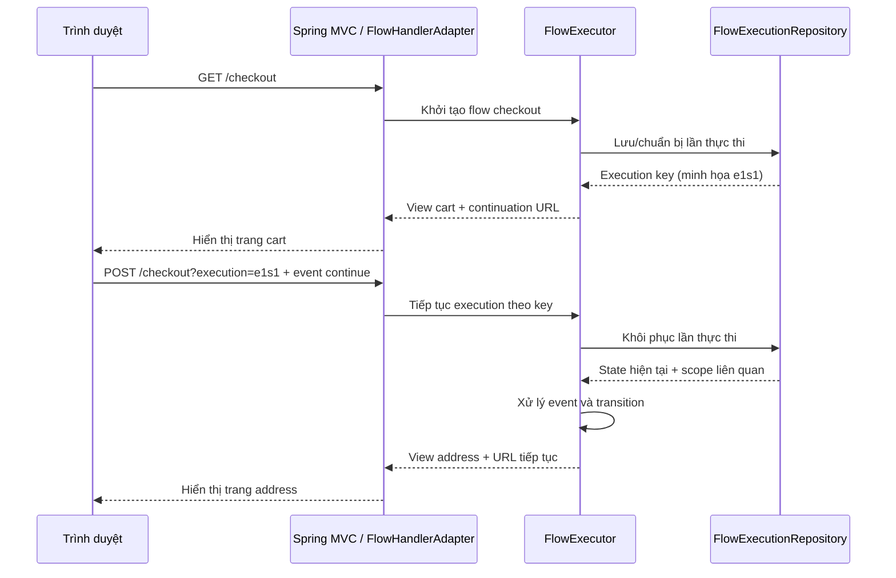
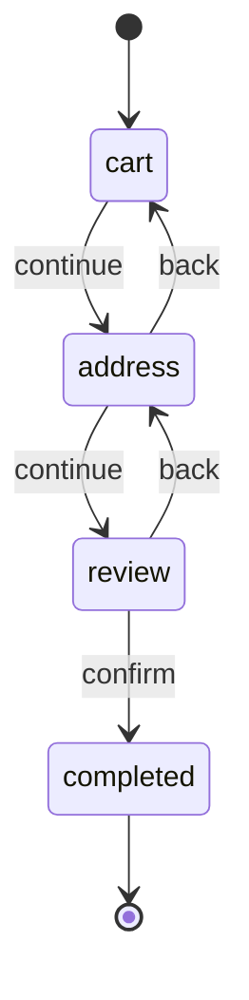
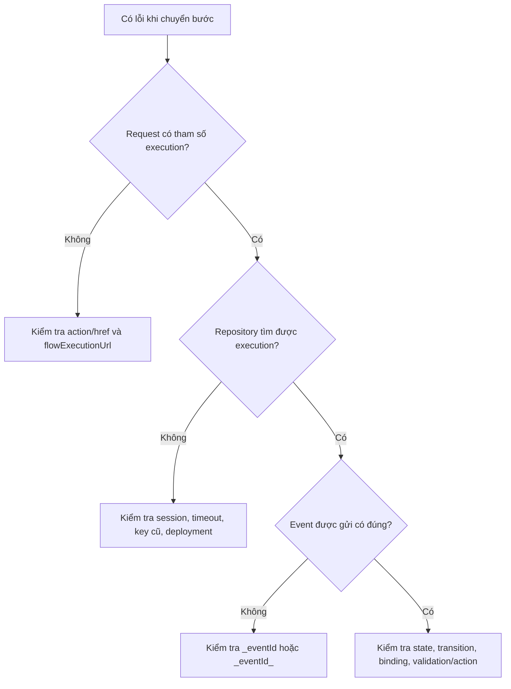

# Execution key và tham số execution trong Spring Web Flow

Khi người dùng đi qua một biểu mẫu nhiều bước, chẳng hạn **giỏ hàng → địa chỉ giao hàng → xác nhận → hoàn tất**, ứng dụng phải biết mỗi yêu cầu HTTP đang thuộc về lần chạy nào của quy trình. Trong **Spring Web Flow** (`SPRING_WEB_FLOW`), một phần quan trọng của cơ chế đó là **execution key** được đưa qua **tham số URL `execution`**.

Bài học thuộc chương **URL và điều hướng** này giải thích execution key được sinh và sử dụng khi nào, cách phân biệt URL bắt đầu flow với URL tiếp tục flow, cách truyền event mà không làm mất context, và cách chẩn đoán lỗi liên quan đến session, history hoặc nhiều tab trình duyệt. Các khái niệm liên quan trực tiếp đến state, event, transition, form binding, scope và tích hợp Spring MVC trong những hành trình web nhiều bước.

## 1. Bốn khái niệm cần phân biệt ngay từ đầu

| Khái niệm | Vai trò | Ví dụ minh họa |
| --- | --- | --- |
| **Flow ID** | Tên định nghĩa quy trình được đăng ký trong `FlowDefinitionRegistry` | `checkout` |
| **Flow execution** | Một **lần chạy cụ thể** của định nghĩa flow; có state và dữ liệu riêng | Lần thanh toán mà khách A đang thực hiện |
| **Execution key** | Khóa do hạ tầng Web Flow sinh để định vị/khôi phục một lần chạy qua `FlowExecutionRepository` | `e1s1` — chỉ là ví dụ, phụ thuộc implementation |
| **Tham số `execution`** | Vị trí mặc định trong request để trình duyệt gửi lại execution key | `?execution=e1s1` |

**Flow ID trả lời “đang dùng quy trình nào?”; execution key trả lời “đang tiếp tục lần chạy nào của quy trình ấy?”** Cùng một flow `checkout` có thể có nhiều flow execution độc lập: mỗi tab hoặc mỗi lần bắt đầu mua hàng có thể tạo một lần chạy riêng theo cơ chế quản lý phiên của ứng dụng.

Ví dụ, giả sử tầng Spring MVC đã ánh xạ URL `/checkout` đến flow có ID `checkout`:

```text
GET /checkout
    -> yêu cầu bắt đầu một lần thực thi checkout mới

GET /checkout?execution=e1s1
    -> yêu cầu tiếp tục một lần thực thi đã có,
       với key minh họa e1s1

POST /checkout?execution=e1s1
     _eventId=continue
    -> yêu cầu gửi sự kiện continue tới lần thực thi đó
```

Các URL trên là minh họa. Đường dẫn thực tế còn phụ thuộc `FlowHandlerMapping`, servlet mapping, context path và cách ứng dụng cấu hình `FlowUrlHandler`. Không nên giả định mọi dự án đều dùng `/checkout` hay cùng định dạng key.

## 2. Execution key tồn tại để giải quyết vấn đề gì?

HTTP không duy trì trạng thái nghiệp vụ giữa các request. Nếu khách hàng đang ở bước `address` và bấm **Tiếp tục**, server cần khôi phục đúng state, dữ liệu form và thông tin của lần thanh toán hiện tại, rồi mới áp dụng transition cho event tương ứng.

Trong Spring Web Flow, **FlowExecutor** điều phối vòng đời flow. Thành phần **FlowExecutionRepository** đảm nhiệm cơ chế lưu/khôi phục flow execution hoặc snapshot tùy kiểu repository được cấu hình. Khi một flow tạm dừng để hiển thị view, Web Flow có thể cung cấp khóa cho lần tiếp tục sau.



**Execution key không phải dữ liệu nghiệp vụ.** Nó không thay thế `orderId`, `userId`, `flowScope` hay `viewScope`. Nó là dữ liệu điều phối để hệ thống xác định phiên bản/lần thực thi cần được tiếp tục. Dữ liệu nghiệp vụ được quản lý trong flow, session hoặc tầng lưu trữ nghiệp vụ tương ứng.

Một số repository sử dụng snapshot để hỗ trợ quay lại các trạng thái trước. Vì vậy, execution key có thể khác sau một lần tạm dừng hoặc thay đổi state. Hãy coi toàn bộ giá trị key là **opaque identifier**: chỉ nhận, truyền lại nguyên vẹn và để framework xử lý. Đừng tự tách `e1s1` thành “execution 1, snapshot 1” rồi viết logic ứng dụng phụ thuộc vào cách đặt tên này.

## 3. Tham số `execution` trong URL

Với tích hợp Spring Web Flow 2.x theo cách cấu hình mặc định, tên query parameter phổ biến để mang execution key là **`execution`**.

```http
GET /shop/checkout?execution=e1s1 HTTP/1.1
Host: example.test
```

Trong đó:

- `/shop/checkout` là đường dẫn để tầng web định tuyến yêu cầu đến flow.
- `execution` là **tên tham số** mà bộ xử lý URL đọc.
- `e1s1` là **giá trị key minh họa** do Web Flow tạo.
- Nếu còn các tham số khác, chẳng hạn `locale=vi`, chúng không tự động trở thành một phần của execution key.

Tại tầng tích hợp Spring MVC, `FlowHandlerAdapter` phối hợp với `FlowUrlHandler` để đọc key từ request và tạo URL cho các lần tiếp tục. Với `DefaultFlowUrlHandler` thông thường, key được lấy từ tham số `execution`. Nếu hệ thống đã tự viết `FlowUrlHandler`, cách tạo và phân giải URL có thể khác.

Phân biệt hai kiểu URL:

**URL bắt đầu flow:**

```text
/checkout
```

URL này phù hợp để điều hướng từ menu, nút “Thanh toán” hoặc một link khởi tạo quy trình mới. Khi được map đúng flow ID, request không có execution key có thể khởi tạo flow mới.

**URL tiếp tục flow:**

```text
/checkout?execution=e1s1
```

URL này gắn với một lần thực thi đã tồn tại. Nó phù hợp cho thao tác gửi event hoặc điều hướng trong quá trình người dùng đang đi qua các bước. Key có thể hết hiệu lực khi flow kết thúc, session mất, hoặc repository không còn lưu được execution/snapshot đó.

> Không dùng URL tiếp tục flow như một đường dẫn cố định để chia sẻ, bookmark lâu dài hoặc đưa vào email. Nếu người dùng cần quay lại đơn hàng sau nhiều ngày, hãy thiết kế URL theo ID nghiệp vụ và tự xác thực quyền truy cập, sau đó khởi tạo một flow mới từ dữ liệu đã lưu.

## 4. Lấy URL tiếp tục từ Web Flow thay vì tự ghép key

Trong view do Spring Web Flow render, Web Flow thường cung cấp **`flowExecutionUrl`** và **`flowExecutionKey`** để hỗ trợ tạo request tiếp tục flow. Với cách render JSP/JSTL thường gặp, có thể dùng URL do framework cung cấp:

```jsp
<form action="${flowExecutionUrl}" method="post">
    <button type="submit" name="_eventId_continue" value="1">
        Tiếp tục
    </button>
    <button type="submit" name="_eventId_cancel" value="1">
        Hủy
    </button>
</form>
```

Ở ví dụ này, `flowExecutionUrl` là URL tiếp tục hiện tại, bao gồm execution key theo cơ chế Web Flow; form gửi event `continue` hoặc `cancel` tùy nút. Cách render, biến model và cú pháp escaping phụ thuộc view technology mà ứng dụng sử dụng; đây là ví dụ JSP, không phải cú pháp chung cho mọi template engine.

Một cách biểu diễn event khác là trường `_eventId`:

```jsp
<form action="${flowExecutionUrl}" method="post">
    <input type="hidden" name="_eventId" value="continue" />
    <button type="submit">Tiếp tục</button>
</form>
```

Hai quy ước nhận diện event thường gặp là:

| Tham số request | Ý nghĩa |
| --- | --- |
| `_eventId=continue` | Gửi event có ID `continue` |
| `_eventId_continue=1` | Tên tham số chứa phần hậu tố `continue` để nhận diện event, thường được dùng với nút submit |
| `execution=e1s1` | Xác định lần thực thi cần tiếp tục; **không phải event** |

Event chỉ có ý nghĩa khi flow đang ở state có transition/action phù hợp. Nếu state hiện tại không xử lý event `continue`, việc gửi đúng execution key vẫn có thể không dẫn đến state mong muốn.

Tránh hai lỗi:

1. **Hardcode key** như `e1s1` vào action hoặc đường dẫn. Key minh họa có thể chỉ hợp lệ trong một request/phiên.
2. **Truyền key hai lần** bằng cách vừa dùng `flowExecutionUrl` đã chứa `execution` vừa tự nối thêm một `execution=...` khác. Tham số trùng có thể được tầng HTTP hoặc custom handler xử lý ngoài dự kiến.

Nếu dự án cần tự tạo link, hãy sử dụng cơ chế tạo URL của Web Flow và trình dựng URL/escaping thích hợp cho template engine. Không tự nối chuỗi chưa encode, đặc biệt khi có các tham số đầu vào khác.

## 5. Ví dụ flow thanh toán qua ba màn hình

Giả sử flow `checkout` được đăng ký và có định nghĩa XML như sau:

```xml
<?xml version="1.0" encoding="UTF-8"?>
<flow xmlns="http://www.springframework.org/schema/webflow"
      xmlns:xsi="http://www.w3.org/2001/XMLSchema-instance"
      xsi:schemaLocation="
          http://www.springframework.org/schema/webflow
          http://www.springframework.org/schema/webflow/spring-webflow-2.0.xsd">

    <view-state id="cart" view="checkout/cart">
        <transition on="continue" to="address" />
    </view-state>

    <view-state id="address" view="checkout/address">
        <transition on="back" to="cart" />
        <transition on="continue" to="review" />
    </view-state>

    <view-state id="review" view="checkout/review">
        <transition on="back" to="address" />
        <transition on="confirm" to="completed" />
    </view-state>

    <end-state id="completed" />
</flow>
```

Quá trình điển hình có thể diễn ra như sau:

| Bước | Request minh họa | Kết quả |
| --- | --- | --- |
| 1. Vào thanh toán | `GET /checkout` | Tạo một flow execution và hiển thị `cart` |
| 2. Bấm tiếp tục | `POST /checkout?execution=e1s1`, event `continue` | Khôi phục execution, chuyển từ `cart` sang `address` |
| 3. Điền địa chỉ rồi tiếp tục | `POST /checkout?execution=e1s2`, event `continue` | Khôi phục phiên bản hợp lệ của execution, chuyển sang `review` |
| 4. Xác nhận | `POST /checkout?execution=e1s3`, event `confirm` | Chuyển đến `completed`, kết thúc flow |

Các giá trị `e1s1`, `e1s2`, `e1s3` chỉ nhằm minh họa **key có thể thay đổi**. Không có cam kết rằng mỗi transition làm key tăng theo mẫu này; giá trị thực phụ thuộc repository, snapshot, cấu hình và phiên bản thư viện. Khi triển khai, mỗi bước phải lấy **URL hiện tại từ view vừa render**, không đoán key tiếp theo.

Sơ đồ state tương ứng:



Khi form có binding/validation, Web Flow cần xử lý dữ liệu của **đúng execution** trước khi quyết định transition. Giữ execution key trong URL/form giúp server tìm được context cần thiết; nó **không tự thay thế** cấu hình binding, converter, validator hoặc action của từng state.

## 6. Nếu request thiếu, sai hoặc dùng key đã cũ

Ba tình huống có triệu chứng tương tự nhưng cách xử lý khác nhau:

### 6.1. Thiếu tham số `execution`

Ví dụ form gửi đến `/checkout` thay vì `${flowExecutionUrl}`:

```text
POST /checkout
_eventId=continue
```

Nếu URL này là endpoint bắt đầu flow, server có thể coi request là yêu cầu khởi tạo một execution mới. Hậu quả thường thấy là trang trở về bước đầu, form nhập trước đó không còn thuộc request hiện tại, hoặc event không được xử lý như kỳ vọng. Kết quả chính xác tùy adapter và mapping.

**Cách kiểm tra:** Mở Network trong DevTools, đối chiếu `Request URL` của form gửi đi với `action` đã render. Xác định response trước đó đã chứa `flowExecutionUrl` hay chưa và giá trị `execution` có được giữ nguyên khi submit không.

### 6.2. Key không còn tồn tại

Ví dụ log minh họa:

```text
... NoSuchFlowExecutionException ...
... execution key 'e1s1' ...
```

Nguyên nhân khả dĩ:

- Session HTTP hết hạn hoặc bị hủy.
- Flow đã kết thúc, bị hủy hoặc repository đã loại bỏ execution.
- Người dùng mở lại URL tiếp tục từ bookmark cũ.
- Ứng dụng chuyển instance nhưng repository/session không được chia sẻ hoặc khôi phục đúng.
- Request dùng key không được tạo từ execution hiện tại.

**Cách xử lý:** Xác minh session và repository, quan sát thời điểm mất key, rồi thiết kế đường quay về **URL bắt đầu flow** hoặc khôi phục từ dữ liệu nghiệp vụ đã lưu. Đừng xem một key cũ là cơ sở đáng tin cậy để tiếp tục một giao dịch đã kết thúc.

### 6.3. Key thuộc snapshot cũ

Trình duyệt có thể giữ URL từ bước trước trong History. Người dùng bấm **Back**, rồi gửi form từ trang cũ. Nếu repository lưu được snapshot tương ứng, Web Flow có thể khôi phục điểm cũ; nếu không, request có thể thất bại hoặc bị coi là không còn hợp lệ. Hành vi tùy cơ chế repository và cấu hình snapshot.

**Cách kiểm tra:** Ghi lại key khi render từng view, key khi submit và state/event tương ứng. Thử một tab, hai tab và Back/Forward trong môi trường kiểm thử. Đừng suy luận rằng mọi key cũ đều “sai” hoặc mọi key cũ đều khôi phục được.

## 7. Quan hệ giữa execution key và dữ liệu scope

Các scope trong Spring Web Flow có vòng đời khác nhau. Một số scope thường gặp:

| Scope | Mục đích | Execution key liên quan thế nào? |
| --- | --- | --- |
| `requestScope` | Dữ liệu cho request hiện tại | Key cho phép định vị execution; request scope không phải bộ lưu lâu dài |
| `flashScope` | Dữ liệu ngắn hạn qua một lần chuyển/hiển thị theo cơ chế Web Flow | Được quản lý theo vòng đời flow; không nằm dưới dạng text trong key |
| `viewScope` | Dữ liệu gắn với view-state đang hoạt động | Context được khôi phục theo flow; chuyển view có thể làm view scope thay đổi |
| `flowScope` | Dữ liệu dùng xuyên nhiều state trong cùng flow | Cùng flow execution sẽ có flow scope liên quan, với vòng đời theo flow |
| `conversationScope` | Dữ liệu dùng xuyên conversation, bao gồm các subflow liên quan | Không đồng nghĩa với query parameter `execution` |
| HTTP session | Phạm vi phiên web của container | Một số repository dùng session để lưu execution; session ID và execution key là hai loại định danh khác nhau |

Ví dụ khi người dùng cập nhật `flowScope.shippingAddress` ở state `address`, request tiếp tục cần quay về đúng execution để tìm context gắn với dữ liệu đó. Tuy nhiên, giá trị của `shippingAddress` không “được encode” vào chuỗi `e1s2`. Nếu hệ thống lưu state ở session/repository, dữ liệu được giữ tại đó theo thiết kế và cấu hình.

Trong subflow, hạ tầng còn quản lý execution/conversation của luồng cha và luồng con. Không nên tự tạo URL mới chỉ bằng cách ghép tên subflow với execution key của luồng cha; dùng cơ chế `subflow-state` và điều hướng chính thức của Web Flow.

## 8. Back, refresh, nhiều tab và PRG

Vì URL chứa execution key, lịch sử trình duyệt cũng có thể lưu một URL tiếp tục đã cũ. Đây là lý do cần xét hành vi điều hướng thực tế khi thiết kế hành trình nhiều bước.

**Refresh:** Nếu người dùng refresh trang view, trình duyệt có thể yêu cầu lại URL có execution key. Khả năng hiển thị lại phụ thuộc snapshot/repository và chiến lược redirect. Tránh gây tác dụng phụ nghiệp vụ chỉ bằng một GET refresh.

**Back:** Back về màn hình cũ không bảo đảm một snapshot cũ vẫn có thể resume. Nên hỗ trợ event `back` rõ ràng ở những state cần quay lại, để flow kiểm soát chuyển trạng thái.

**Nhiều tab:** Hai tab có thể chứa hai execution riêng nếu được bắt đầu độc lập; nhân bản một tab đang chạy có thể khiến cả hai sử dụng cùng một key hoặc snapshot ban đầu. Khi một tab tiến lên, tab còn lại có thể gửi state cũ. Cần kiểm thử chính sách repository và tính nhất quán nghiệp vụ của ứng dụng.

**Post/Redirect/Get:** Web Flow hỗ trợ cơ chế redirect khi tạm dừng ở view trong những cấu hình thường gặp. Response có thể là redirect rồi GET view với execution key mới/hiện tại, giúp tránh gửi lại form POST khi refresh. Cần kiểm tra cấu hình và chuỗi Network thực tế; không mặc định mọi chuyển state đều có đúng một kiểu redirect.

Trong mọi trường hợp, thao tác nghiệp vụ như **tạo đơn hàng hoặc thanh toán** cần có cơ chế chống thực thi lặp ở service/database. Execution key và PRG giúp điều phối UI nhưng không phải bảo đảm idempotency.

## 9. Bảo mật khi truyền execution key

Tham số `execution` có thể xuất hiện trên URL, browser history, access log, analytics hoặc referrer tùy cấu hình. Vì vậy:

1. **Không coi execution key là token đăng nhập hoặc bằng chứng được phép truy cập tài nguyên.** Hệ thống vẫn phải xác thực, phân quyền và kiểm tra ownership của đơn hàng hoặc dữ liệu nghiệp vụ.
2. **Không nhận key do client tự dựng** rồi suy ra user ID, order ID hay quyền truy cập từ định dạng chuỗi. Để `FlowExecutionRepository` và adapter kiểm tra khóa.
3. **Không ghi toàn bộ URL hoặc dữ liệu form nhạy cảm** vào log công khai. Nếu cần chẩn đoán, nên dùng correlation ID/trace ID, flow ID, state, event và thông tin lỗi đủ dùng.
4. **Bảo vệ request thay đổi trạng thái** bằng CSRF protection khi ứng dụng dùng Spring Security hoặc cơ chế tương đương; execution key không thay thế CSRF token.
5. **Không thiết kế thao tác thay đổi dữ liệu trên GET** chỉ vì một link có `execution` và event; dùng HTTP method, validation và kiểm soát nghiệp vụ phù hợp.

Khi một session bị thay đổi hoặc hết hạn, UX nên có trang thông báo phiên thao tác đã hết hiệu lực và tùy chọn khởi động lại flow, đồng thời tránh làm người dùng hiểu lầm rằng đơn hàng đã được lưu nếu backend chưa xác nhận.

## 10. Cách kiểm tra lỗi execution key từ trình duyệt đến server

Một quy trình điều tra hữu ích là so sánh các request ở ba thời điểm: **mở flow**, **hiển thị view**, và **gửi event**.



Trên trình duyệt, mở **DevTools → Network** rồi quan sát:

| Cần quan sát | Câu hỏi |
| --- | --- |
| Request URL | Đã chứa `execution` chưa? Có nhiều giá trị `execution` trùng nhau không? |
| Request method | Form gửi bằng POST hay liên kết GET? Có redirect hay không? |
| Form data/query | Có `_eventId` hoặc `_eventId_<event>` đúng với nút vừa bấm không? |
| Response status/location | Server trả view, redirect, lỗi 4xx/5xx hay chuyển về URL bắt đầu? |
| Cookies/session | Request có dùng cùng session hợp lệ không? |
| Flow state | State đang chạy có transition xử lý event tương ứng không? |

Ở server, có thể bật log Web Flow tạm thời:

```properties
logging.level.org.springframework.webflow=DEBUG
logging.level.org.springframework.webflow.execution.repository=DEBUG
logging.level.org.springframework.webflow.mvc.servlet=DEBUG
```

Các logger con có thể khác giữa phiên bản; việc bật logger không bảo đảm mọi key/state đều được in ra. Khi kiểm tra log, hãy đọc **toàn bộ chuỗi `Caused by`**, xác định exception xuất hiện ở bước khôi phục execution hay ở action/validation/view sau đó.

Nếu request có key hợp lệ nhưng người dùng vẫn ở state cũ, nguyên nhân có thể là **validation không đạt** hoặc event không có transition phù hợp. Đó là vấn đề xử lý flow, không nhất thiết là lỗi execution key.

## 11. Checklist triển khai ổn định

Khi xây dựng một màn hình nhiều bước dùng Spring MVC và Spring Web Flow, có thể tự kiểm tra:

- [ ] URL bắt đầu flow được map đúng `flowId`; người dùng có thể vào từ điều hướng chính.
- [ ] Form trong view đang chạy sử dụng URL tiếp tục do Web Flow cung cấp.
- [ ] Event được gửi đúng qua `_eventId` hoặc nút submit theo quy ước.
- [ ] Không hardcode hoặc tự dự đoán execution key trong link hay JavaScript.
- [ ] Không nhầm `execution` với order ID, session ID hay dữ liệu `flowScope`.
- [ ] Có xử lý UX khi key hết hạn, session mất hoặc dùng URL cũ.
- [ ] Đã thử Refresh, Back, nhiều tab và gửi lại form.
- [ ] Các thao tác thanh toán/ghi dữ liệu có kiểm tra quyền và chống xử lý lặp.
- [ ] Log chẩn đoán đủ state/event/correlation ID nhưng không lộ dữ liệu nhạy cảm.

## 12. Bài thực hành: tìm lỗi mất execution khi gửi form

Giả sử màn hình `address` render một form:

```jsp
<!-- Form lỗi: action không dùng URL tiếp tục hiện tại -->
<form method="post" action="/checkout">
    <input type="hidden" name="_eventId" value="continue" />
    <button type="submit">Đến bước xác nhận</button>
</form>
```

Người học bấm nút và bị quay về `cart` dù vừa nhập xong địa chỉ.

**Câu hỏi:**

1. Request đã truyền **flow ID**, **execution key** và **event** qua những phần nào?
2. Tại sao server có thể mở một execution mới thay vì chuyển từ `address` sang `review`?
3. Sửa form ra sao nếu dùng JSP và biến `flowExecutionUrl` đã được Web Flow cung cấp?
4. Sau sửa, quan sát Network/log như thế nào để chứng minh request tiếp tục đúng execution?

**Gợi ý lời giải:**

- URL `/checkout` cho phép MVC nhận diện flow `checkout` theo mapping giả định; `_eventId=continue` mang event; form **thiếu `execution`** để xác định lần chạy hiện tại.
- Nếu adapter xử lý URL không có execution key như yêu cầu khởi tạo flow, state có thể quay về `cart`. Mô tả cụ thể phụ thuộc cấu hình ứng dụng.
- Dùng action `${flowExecutionUrl}` để request mang key hiện tại:

```jsp
<form method="post" action="${flowExecutionUrl}">
    <input type="hidden" name="_eventId" value="continue" />
    <button type="submit">Đến bước xác nhận</button>
</form>
```

- Sau sửa, kiểm tra `Request URL` có key được tạo từ view hiện tại; server khôi phục đúng execution; transition `address --continue--> review` xảy ra. Nếu validation giữ người dùng ở `address`, hãy kiểm tra lỗi validation trước khi cho rằng execution key hỏng.

**Điểm cần nhớ:** Flow ID xác định **định nghĩa quy trình**, execution key xác định **lần thực thi đang tiếp tục**, còn event chỉ ra **hành động muốn áp dụng ở state hiện tại**. Trong Spring Web Flow, kết hợp đúng cả ba giúp URL và form điều hướng ổn định qua nhiều bước mà không phải tự quản lý state ở từng controller.
