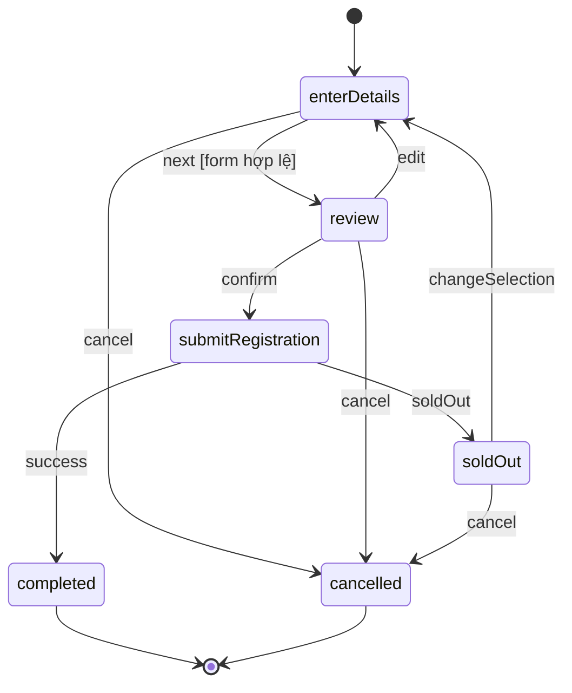
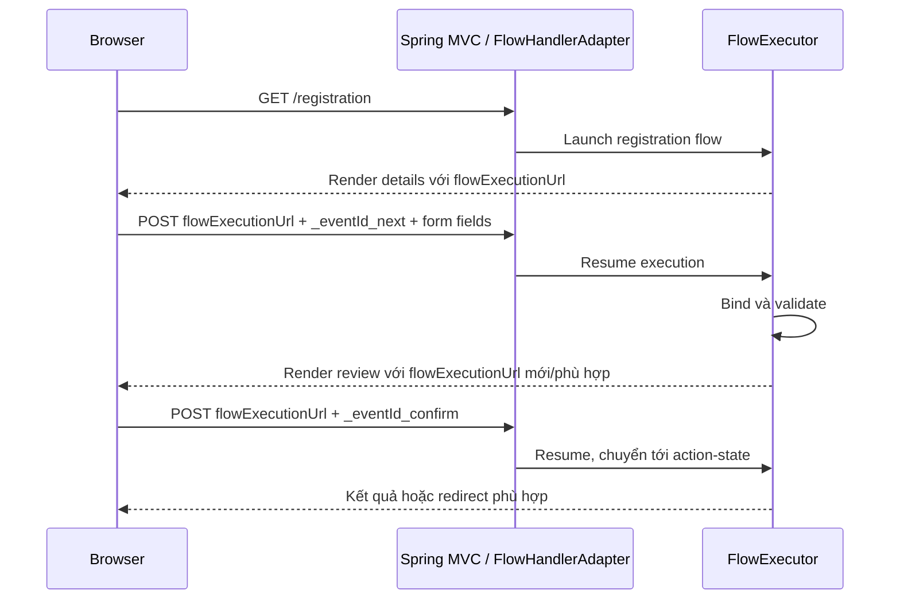
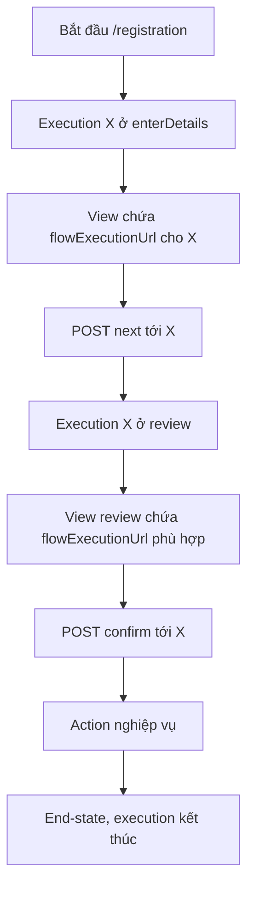

# Dùng flowExecutionUrl trong form và liên kết

Trong **Spring Web Flow**, một hành trình web nhiều bước không chỉ có URL để *bắt đầu* flow; sau khi flow chạy, trình duyệt cần gửi các event vào **đúng lần thực thi hiện tại**. Biến `flowExecutionUrl` được Web Flow cung cấp cho view giúp tạo các form và liên kết tiếp tục flow mà không phải tự lắp ghép khóa thực thi.

Bài này thuộc chương **URL và điều hướng** của module **SPRING_WEB_FLOW**. Ta sẽ thực hành với flow đăng ký workshop gồm bước nhập thông tin, xem lại và xác nhận. Qua đó, người học hiểu sự khác nhau giữa URL khởi động và URL tiếp tục flow, cách phát event bằng form hoặc liên kết, quy tắc GET/POST, binding/validation, vai trò của flow scope, cũng như cách xử lý Back, refresh và flow execution hết hạn.

Sau bài học, bạn có thể:

1. Giải thích vì sao URL của flow execution khác với URL cố định của một trang hoặc một flow definition.
2. Dùng `flowExecutionUrl` làm `action` của form POST và đưa event vào request bằng `_eventId` hoặc `_eventId_<tên-event>`.
3. Tạo liên kết điều hướng có event khi thực sự phù hợp, bảo đảm HTML escaping và URL encoding.
4. Tránh dùng liên kết GET để tạo đơn, thanh toán hoặc gây thay đổi nghiệp vụ.
5. Kiểm tra luồng thành công, lỗi validation, quay lại, refresh, execution key hết hạn và gửi yêu cầu lặp.

## 1. Vì sao flow cần URL của một lần thực thi?

Giả sử người dùng mở `/registration` để đăng ký workshop. Spring MVC cùng Spring Web Flow nhận request, tìm flow definition có ID `registration` rồi bắt đầu một **flow execution**. Khi người dùng hoàn thành form đầu tiên và chuyển sang màn xem lại, server cần phân biệt lần chạy đó với những lần chạy khác của cùng người dùng hoặc người dùng khác.

Ba khái niệm thường bị nhầm:

| Khái niệm | Vai trò | Ví dụ minh họa |
| --- | --- | --- |
| URL bắt đầu flow (*flow URL*) | Khởi động một lần thực thi mới | `/registration` |
| URL của execution hiện tại | Gửi request tiếp tục cùng một hành trình | `/registration?execution=e1s2` |
| Event | Yêu cầu flow chuyển trạng thái từ state hiện tại | `next`, `edit`, `confirm` |

Giá trị `e1s2` chỉ là **ví dụ** về execution key ở cấu hình phổ biến. Format thực tế và cách đặt key trong URL phụ thuộc vào cấu hình/phiên bản Web Flow. Không phân tích, tự đoán hoặc ghép một key như thế trong ứng dụng.

Một định nghĩa flow có thể có nhiều execution chạy đồng thời. Mỗi execution giữ thông tin về state hiện tại và context liên quan. Nếu form gửi về URL khởi động mà thiếu thông tin execution, server có thể xử lý như một hành trình mới hoặc không tiếp tục đúng hành trình cũ, tùy cách định tuyến.

**`flowExecutionUrl` là URL được sinh cho lần chạy hiện tại.** View dùng giá trị đó khi tạo action của form hoặc một liên kết tiếp tục flow. Nó giúp request quay lại đúng execution thay vì bắt đầu lại và mất dữ liệu đã nhập.

## 2. Hành trình ví dụ và điểm đặt sự kiện

Người dùng đăng ký workshop qua hai màn tương tác rồi kết thúc:



| State | Trách nhiệm | Event hợp lệ |
| --- | --- | --- |
| `enterDetails` | Bind và kiểm tra form đăng ký | `next`, `cancel` |
| `review` | Hiển thị bản nháp, chưa lưu | `edit`, `confirm`, `cancel` |
| `submitRegistration` | Gọi service lưu dữ liệu | Event kết quả `success`, `soldOut` |
| `soldOut` | Báo workshop hết chỗ | `changeSelection`, `cancel` |
| `completed` / `cancelled` | Kết thúc execution | Không có event tiếp tục |

Sơ đồ cho thấy **URL xác định execution**, trong khi **event và state hiện tại** xác định transition. Cùng một URL execution có thể tiếp nhận event `edit` hoặc `confirm` khi người dùng đang ở `review`. Nhưng gửi `confirm` từ `enterDetails` không có nghĩa Web Flow phải bỏ qua màn review.

Các event mang tác dụng ghi dữ liệu chỉ được phát từ thao tác có chủ ý; server vẫn phải kiểm tra quyền và điều kiện nghiệp vụ trước khi commit.

## 3. Định nghĩa XML cho ví dụ

Ví dụ file `registration-flow.xml` đã được đăng ký với flow ID `registration`:

```xml
<?xml version="1.0" encoding="UTF-8"?>
<flow xmlns="http://www.springframework.org/schema/webflow"
      xmlns:xsi="http://www.w3.org/2001/XMLSchema-instance"
      xsi:schemaLocation="
          http://www.springframework.org/schema/webflow
          http://www.springframework.org/schema/webflow/spring-webflow.xsd"
      start-state="enterDetails">

    <var name="registration"
         class="com.example.registration.RegistrationDraft"/>

    <view-state id="enterDetails"
                view="registration/details"
                model="registration">
        <binder>
            <binding property="fullName"/>
            <binding property="email"/>
            <binding property="workshopId"/>
        </binder>

        <transition on="next" to="review"
                    bind="true" validate="true"/>
        <transition on="cancel" to="cancelled"
                    bind="false" validate="false"/>
    </view-state>

    <view-state id="review" view="registration/review">
        <transition on="edit" to="enterDetails"/>
        <transition on="confirm" to="submitRegistration"/>
        <transition on="cancel" to="cancelled"/>
    </view-state>

    <action-state id="submitRegistration">
        <evaluate expression="registrationAction.submit(registration)"/>
        <transition on="success" to="completed"/>
        <transition on="soldOut" to="soldOut"/>
    </action-state>

    <view-state id="soldOut" view="registration/sold-out">
        <transition on="changeSelection" to="enterDetails"/>
        <transition on="cancel" to="cancelled"/>
    </view-state>

    <end-state id="completed" view="registration/completed"/>
    <end-state id="cancelled" view="registration/cancelled"/>
</flow>
```

Các class `RegistrationDraft` và bean `registrationAction` là thành phần ứng dụng cần tự tạo; đoạn XML giả định đã cấu hình view resolver và validator phù hợp.

- `enterDetails` chấp nhận `next` và `cancel`.
- `next` thực hiện binding và validation; nếu có lỗi, view hiện tại vẫn hiển thị để người dùng sửa.
- `review` không nhận lại toàn bộ dữ liệu từ browser. Event `edit` quay về form và giữ cùng bản nháp.
- `confirm` dẫn tới action-state gọi service. Action chỉ phát `success` khi nghiệp vụ thực sự thành công.
- `soldOut` là kết quả nghiệp vụ thất bại có đường quay lại lựa chọn khác.
- `end-state` kết thúc execution; các request sau đó không nên tiếp tục thực thi các event cũ.

Khai báo `<var>` tạo model dùng trong flow scope, vì vậy người dùng quay lại từ `review` không mất các trường đã nhập. Biến này khác với việc lưu một object dưới tên cố định trong session chung.

## 4. `flowExecutionUrl` được dùng trong view như thế nào?

Trong các view được Spring Web Flow render, tên `flowExecutionUrl` thường được cung cấp để template tham chiếu bằng cú pháp của công nghệ giao diện. Với JSP/JSTL, biểu thức EL thường là:

```jsp
${flowExecutionUrl}
```

Trong thuộc tính HTML:

```jsp
<form method="post" action="${flowExecutionUrl}">
    ...
</form>
```

Với **Spring Form Tags**:

```jsp
<form:form modelAttribute="registration"
           method="post"
           action="${flowExecutionUrl}">
    ...
</form:form>
```

Flow engine, cùng cơ chế view rendering, xác định URL phù hợp với execution hiện tại. View cần dùng URL **vừa được render cho trạng thái đó**, thay vì lấy khóa từ lần chạy trước.

Một cách hình dung request:



Không nên tự ghép `"?execution=" + key` vì dự án có thể dùng URL encoding, context path, reverse proxy, thông số khác hoặc chiến lược lưu execution khác. Template chỉ cần biết **URL mà flow cung cấp**, rồi thêm event theo cách có kiểm soát.

## 5. Gửi event bằng nút submit của form

Spring Web Flow có quy ước phổ biến để lấy event từ HTTP request: tham số `_eventId` có giá trị tên event, hoặc tên tham số dạng `_eventId_<tên-event>`. Trong JSP, một nút bấm có thể đặt tên như sau:

```jsp
<button type="submit" name="_eventId_next">
    Xem lại
</button>

<button type="submit" name="_eventId_cancel">
    Hủy
</button>
```

Khi nhấn nút **Xem lại**, browser gửi các field của form và tham số tên `_eventId_next`. Web Flow xác định event `next` rồi tìm transition hợp lệ tại `enterDetails`.

Có thể dùng dạng tham số chung:

```html
<button type="submit" name="_eventId" value="next">
    Xem lại
</button>
```

Khi nhận request, giá trị `next` là event cần xử lý. Hai quy ước đều giúp chuyển ý định của người dùng thành event; hãy chọn một cách nhất quán trong ứng dụng và kiểm thử theo phiên bản Web Flow sử dụng.

**Không tự cho phép browser gửi event `success` để báo nghiệp vụ đã hoàn thành.** Event kết quả của action-state phải do server quyết định sau khi thực thi service.

## 6. Form nhập liệu hoàn chỉnh với Spring Form Tags

Ví dụ `/WEB-INF/views/registration/details.jsp`:

```jsp
<%@ taglib prefix="form" uri="http://www.springframework.org/tags/form" %>

<h1>Đăng ký workshop</h1>

<form:form modelAttribute="registration"
           action="${flowExecutionUrl}"
           method="post">

    <div>
        <label for="fullName">Họ tên</label>
        <form:input id="fullName" path="fullName"/>
        <form:errors path="fullName" cssClass="field-error"/>
    </div>

    <div>
        <label for="email">Email</label>
        <form:input id="email" path="email" type="email"/>
        <form:errors path="email" cssClass="field-error"/>
    </div>

    <div>
        <label for="workshopId">Workshop</label>
        <form:select id="workshopId" path="workshopId">
            <form:option value="" label="-- Chọn workshop --"/>
            <form:option value="SPRING-INTRO"
                         label="Spring Web Flow cơ bản"/>
            <form:option value="SPRING-ADVANCED"
                         label="Spring Web Flow nâng cao"/>
        </form:select>
        <form:errors path="workshopId" cssClass="field-error"/>
    </div>

    <button type="submit" name="_eventId_next">Xem lại</button>
    <button type="submit" name="_eventId_cancel">Hủy</button>
</form:form>
```

Giải thích:

1. `modelAttribute="registration"` trỏ tới model đã khai báo trong flow, để form tag bind property theo `path`.
2. `action="${flowExecutionUrl}"` đưa POST về đúng execution.
3. Nút `_eventId_next` chọn event `next`, kích hoạt binding/validation theo transition.
4. `<form:errors>` hiển thị các lỗi gắn với field, khi hệ thống binding/validation tích hợp đúng.
5. Nút `_eventId_cancel` chọn event `cancel`; transition có `bind="false" validate="false"` để có thể hủy cả khi form đang lỗi.

Mẫu không tự cấu hình validation. JavaBean có thể dùng Bean Validation hoặc validator chuyên biệt của Web Flow; cần đăng ký validator phù hợp, tránh hiểu rằng `validate="true"` tự phát hiện tất cả quy tắc nghiệp vụ mà không có cấu hình.

Với **Spring Security**, các form POST phải gửi CSRF token theo cách ứng dụng đã cấu hình. Tùy integration, Spring Form Tags và `RequestDataValueProcessor` có thể thêm hidden field tự động. Nếu dùng form HTML thuần, phải bảo đảm token được gửi rõ ràng; đừng coi việc có execution key là thay thế CSRF.

## 7. Liên kết tiếp tục flow có khác form thế nào?

Một liên kết `<a href="...">` thường tạo HTTP GET. Trong một số màn hình, bạn có thể dùng nó để phát một event **điều hướng an toàn**, chẳng hạn quay lại bước nhập thông tin từ màn xem lại.

Ví dụ trong `review.jsp`, dùng JSTL để tạo URL có tham số event:

```jsp
<%@ taglib prefix="c" uri="http://java.sun.com/jsp/jstl/core" %>

<c:url var="editUrl" value="${flowExecutionUrl}">
    <c:param name="_eventId" value="edit"/>
</c:url>

<a href="${editUrl}">Quay lại sửa thông tin</a>
```

Thành phần quan trọng:

- `value="${flowExecutionUrl}"` là URL của execution, không phải URL khởi động flow.
- `<c:param>` thêm tên/giá trị event và xử lý mã hóa tham số URL.
- Event `edit` phải được khai báo trong `<view-state id="review">`.
- Đây chỉ phù hợp khi event không gây ra **thay đổi nghiệp vụ** và ứng dụng chấp nhận điều hướng qua GET.

Trong một số cấu hình, `flowExecutionUrl` đã có query parameter `execution`. Khi viết HTML bằng tay, ký tự `&` để phân tách thêm query parameter phải được escape thành `&amp;` trong thuộc tính HTML. Ví dụ minh họa **chỉ khi URL hiện có đã chứa query string**:

```html
<a href="/registration?execution=e1s2&amp;_eventId=edit">
    Quay lại sửa
</a>
```

Ví dụ trên cho thấy cách escape HTML, **không phải cách nên hardcode** execution key. Nếu URL có thể không chứa query string, phải chọn `?` hay `&` theo cấu trúc URI; dùng tag hỗ trợ URL như `c:url` hoặc URI builder phù hợp để tránh ghép chuỗi sai.

**Cảnh báo về GET:** bot, trình duyệt, browser prefetch hoặc người dùng bấm lại có thể truy cập liên kết mà không có chủ đích xác nhận. Vì vậy, tuyệt đối không gắn event tạo đơn, thanh toán, xóa dữ liệu, duyệt yêu cầu hay thực hiện side effect vào URL GET. Nếu muốn thống nhất tránh thay đổi state do link được prefetch, cũng có thể dùng **form POST với nút Quay lại**.

## 8. Dùng nút POST cho event thay đổi hoặc cần xác nhận

Tại màn `review`, cách rõ ràng và ít phụ thuộc vào hành vi prefetch là dùng form POST cho cả `edit`, `confirm` và `cancel`:

```jsp
<%@ taglib prefix="c" uri="http://java.sun.com/jsp/jstl/core" %>

<h1>Xem lại thông tin</h1>
<dl>
    <dt>Họ tên</dt>
    <dd><c:out value="${registration.fullName}"/></dd>

    <dt>Email</dt>
    <dd><c:out value="${registration.email}"/></dd>

    <dt>Workshop</dt>
    <dd><c:out value="${registration.workshopId}"/></dd>
</dl>

<form method="post" action="${flowExecutionUrl}">
    <c:if test="${not empty _csrf}">
        <input type="hidden"
               name="${_csrf.parameterName}"
               value="${_csrf.token}"/>
    </c:if>

    <button type="submit" name="_eventId_edit">
        Quay lại sửa
    </button>
    <button type="submit" name="_eventId_confirm">
        Xác nhận đăng ký
    </button>
    <button type="submit" name="_eventId_cancel">
        Hủy
    </button>
</form>
```

Trang review hiển thị **dữ liệu server đang giữ trong flow scope**, không chèn cả bản nháp thành hidden fields rồi tin dữ liệu được browser trả lại. Việc dùng `<c:out>` để escape HTML động cũng giúp giảm rủi ro XSS.

Tại `review`, event `confirm` mới đưa người dùng sang `submitRegistration`. Service cần bảo vệ thao tác ghi bằng transaction, kiểm tra quyền và idempotency. Browser POST và CSRF chỉ là một phần của an toàn giao dịch; chúng không ngăn được mọi yêu cầu gửi lặp vì timeout hay double-click.

### Vì sao không tạo link `?execution=e1s2&_eventId=confirm`?

Ngay cả khi URL đó có thể kích hoạt transition kỹ thuật, nó tạo rủi ro:

- Browser hoặc công cụ khác có thể gọi GET mà người dùng không bấm nút.
- Refresh, bookmark hay chia sẻ link có thể vô tình phát lại event.
- HTTP cache và cơ chế prefetch giả định GET là thao tác an toàn.
- Xử lý CSRF và xác nhận hành động nhạy cảm không được thiết kế cho event như vậy.

Dùng nút POST cho hành động xác nhận, đồng thời thực hiện lại kiểm tra nghiệp vụ ở service.

## 9. URL khởi động, URL tiếp tục và URL nội dung cố định

Không phải mọi liên kết trên một trang Web Flow đều dùng `flowExecutionUrl`. Chọn URL theo mục đích:

| Mục đích | Nên dùng | Giải thích |
| --- | --- | --- |
| Form gửi event của flow đang chạy | `flowExecutionUrl` | Tiếp tục đúng execution |
| Link/nút phát event điều hướng an toàn trong execution | `flowExecutionUrl` kèm event | Cần xử lý đúng query parameter và state |
| Bắt đầu một hành trình đăng ký mới | URL đăng ký flow, ví dụ `/registration` | Tạo execution mới theo mapping |
| Xem hướng dẫn, chính sách, FAQ | URL tài nguyên/trang ổn định | Không phụ thuộc execution |
| Mở lại kết quả sau khi đăng ký thành công | URL bản ghi/kết quả bền vững và có kiểm tra quyền | Không lệ thuộc vào execution đã đóng |
| Gửi đường dẫn qua email cho người dùng | Link ổn định hoặc mã truy cập dùng một lần | Không gửi execution key tạm thời như permalink |

Đường dẫn `flowExecutionUrl` thường gắn với trạng thái thực thi tạm thời và có thể hết hạn. Vì vậy **không dùng nó làm permalink** cho người dùng lưu vào bookmark hoặc gửi qua email để mở lại nhiều ngày sau.

Ví dụ một trang kết quả có thể là `/registrations/123/result`, nhưng route đó phải kiểm tra người dùng có quyền xem bản ghi `123`. Kết thúc flow bằng một trang kết quả ổn định giúp việc refresh sau commit không phát lại event xác nhận.

## 10. Flow execution key và vòng đời URL

Một flow execution là một đối tượng logic trên server. Khi người dùng chuyển state hoặc khi repository tạo snapshot mới, URL hoặc execution key cần dùng cho request tiếp theo **có thể thay đổi**. Cách lưu snapshot và xử lý lịch sử tùy thuộc cấu hình Web Flow.



**Quy tắc thiết kế:** sau mỗi lần render view, chỉ dùng action/href của view đó; đừng giữ một URL cũ trong JavaScript qua nhiều lần chuyển state mà không cập nhật.

Nếu request được gửi bằng key không còn hợp lệ, hệ thống có thể phát lỗi kiểu “flow execution not found/expired” hoặc lỗi snapshot tùy cấu hình. Không được tự đổi sang URL bắt đầu flow rồi phát lại `confirm` như thể đã tiếp tục được giao dịch cũ.

### Hai tab có thể cùng chạy flow không?

Có thể có nhiều flow execution hoặc nhiều snapshot độc lập tùy cách người dùng mở và sử dụng trang. `flowExecutionUrl` giúp request nhắm đến execution tương ứng; **flow scope** giữ bản nháp của execution đó. Đừng lưu bản nháp vào một session attribute có tên chung như `session.setAttribute("draft", ...)` vì dữ liệu ở các tab có thể ghi đè nhau.

Tuy vậy, việc có execution key riêng không thay thế kiểm tra phân quyền, và không mặc định bảo đảm mọi yêu cầu song song đều không xung đột. Đặc biệt, nhiều POST đến cùng execution hoặc snapshot cũ cần được xử lý theo chính sách thực thi và lưu trữ của Web Flow.

## 11. Back, refresh và Post–Redirect–Get

Trong một flow có state và snapshot, có ba cách “quay lại” dễ bị đánh đồng:

1. **Nút Quay lại của flow:** gửi event `edit` và để flow chuyển từ `review` về `enterDetails`.
2. **Nút Back của browser:** hiển thị URL hoặc bản HTML trước đó; có thể tương tác với execution snapshot cũ.
3. **Link bắt đầu flow:** truy cập lại `/registration` để mở một execution mới.

Chỉ trường hợp đầu bảo đảm tuân theo transition `edit` đã thiết kế. Back của browser còn chịu ảnh hưởng cache và history của trình duyệt, cấu hình repository và khả năng khôi phục snapshot. Không dựa vào HTML trong browser cache làm nguồn sự thật về state server.

**POST–Redirect–GET (PRG)** giảm nguy cơ browser hỏi “Confirm form resubmission” khi refresh và giúp điều hướng rõ hơn. Spring Web Flow có cơ chế redirect giữa các view-state trong những tình huống phù hợp. Tuy nhiên vẫn phải kiểm tra hành vi thực tế vì embedded/Ajax mode, view technology hoặc cấu hình có thể tác động tới redirect.

Dù có PRG, service thực hiện thay đổi nghiệp vụ vẫn phải bảo vệ chống lệnh ghi lặp. PRG không thay thế idempotency.

## 12. Ajax, fragment và URL của execution

Khi form chuyển sang gửi event bằng `fetch`/XHR, vẫn phải gọi **đúng `flowExecutionUrl`** và gửi tham số event. Ajax chỉ thay cách gửi/nhận request và cập nhật DOM; event, state và validation vẫn do Web Flow xử lý.

Ví dụ minh họa một form có event `filter`:

```javascript
const form = document.getElementById("searchForm");

async function refreshResults() {
  const body = new FormData(form);
  body.append("_eventId_filter", "");

  const response = await fetch(form.action, {
    method: "POST",
    credentials: "same-origin",
    headers: {
      Accept: "text/html;type=ajax"
    },
    body
  });

  if (!response.ok) {
    throw new Error("Không thể cập nhật kết quả");
  }

  // Phản hồi được xử lý theo giao thức Ajax của view renderer.
  // Chỉ render fragment khi response đúng định dạng đã thỏa thuận.
}
```

Phần `Accept` chỉ minh họa một cách nhận diện Ajax của các handler tương thích; ứng dụng có thể dùng giao thức khác hoặc JSF Ajax. `AjaxHandler` hỗ trợ phát hiện request và gửi chỉ dẫn redirect cho client, còn view renderer quyết định HTML fragment nào được trả về. Không mặc định rằng response của mọi công nghệ giao diện đều là một HTML fragment thuần.

Một số điểm cần chú ý:

- Form action phải lấy từ view hiện tại, không giữ cứng URL execution sau transition.
- CSRF token phải được gửi trong POST Ajax nếu ứng dụng bật bảo vệ.
- Các response Ajax có thể đến sai thứ tự; client cần bảo vệ để dữ liệu cũ không ghi đè kết quả mới.
- Nếu server trả chỉ dẫn redirect, client phải xử lý nó như điều hướng thay vì chèn toàn bộ body vào một fragment.
- Event xác nhận có side effect vẫn phải đi qua kiểm tra quyền, transaction và idempotency.

## 13. Lỗi thường gặp khi dùng flowExecutionUrl

| Triệu chứng | Nguyên nhân có thể | Cách kiểm tra |
| --- | --- | --- |
| Nhấn Next thì form quay về bước đầu | Form POST tới URL khởi động flow thay vì URL execution | Xem thuộc tính `action` đã render |
| Flow báo execution không tồn tại | Key cũ, đã hết hạn, repository không còn snapshot | Kiểm tra Network và cấu hình lưu execution |
| Event không chuyển state | Tên `_eventId` sai hoặc transition không có ở state hiện tại | So tên nút với `on="..."` trong XML |
| Link quay lại tạo một flow mới | `href="/registration"` thay vì URL execution | Tạo link event `edit` từ `flowExecutionUrl` |
| Nhấn Hủy bị chặn bởi form lỗi | Transition cancel vẫn thực hiện binding/validation | Dùng `bind="false" validate="false"` |
| Refresh gây gửi lại xác nhận | Thiết kế điều hướng/PRG chưa phù hợp | Kiểm tra action-state và service idempotency |
| Link xác nhận bị kích hoạt ngoài ý muốn | Đặt `confirm` trong GET URL | Đổi sang POST và xác thực CSRF |
| Link có `&` bị parse sai trong HTML | Chưa escape `&amp;` hoặc nối chuỗi query sai | Dùng JSTL `c:url`/`c:param` hoặc URI builder |
| Ajax dùng key cũ | Client không cập nhật form action sau render | Kiểm tra action URL hiện tại sau transition |
| CSRF 403 | Token thiếu/sai ở POST | Kiểm tra hidden input hoặc CSRF header |
| Có execution key nhưng bị truy cập trái phép | Nhầm execution key với xác thực người dùng | Kiểm tra quyền tại service và lớp security |
| Hai tab làm lẫn dữ liệu | Sử dụng session object dùng chung | Chuyển bản nháp sang flow scope / storage phù hợp |

Để debug, mở **Network** của trình duyệt, so sánh URL bắt đầu flow và URL POST của bước tiếp theo, method, query parameters, form body, tên event, response status, location/redirect, và phiên/session. Cần bảo vệ execution token và dữ liệu cá nhân khi ghi log hoặc chia sẻ ảnh Network.

## 14. Kiểm thử hành trình có URL và event thực tế

Một bài test chỉ assert state chưa chắc bắt được lỗi URL trong JSP. Cần kiểm tra **hai lớp**: engine điều hướng và request/response HTTP ở view.

| Kịch bản | Thao tác | Kỳ vọng |
| --- | --- | --- |
| Khởi động | GET URL flow | Render `enterDetails`, có action URL hợp lệ |
| Đến review | POST `flowExecutionUrl` + `_eventId_next` | Ở `review` khi form hợp lệ |
| Form sai | POST `next` với email sai | Ở `enterDetails` và hiển thị lỗi |
| Quay lại bằng form | POST `_eventId_edit` từ review | Về `enterDetails`, giữ bản nháp |
| Quay lại bằng link | GET URL execution + `_eventId=edit` | Chỉ điều hướng an toàn, không gọi service ghi |
| Hủy từ form lỗi | POST `cancel` khi email sai | Kết thúc ở `cancelled` |
| Xác nhận | POST `confirm` từ review | Action/service được gọi và phân nhánh đúng |
| Gửi confirm từ state sai | POST `confirm` ở `enterDetails` | Không bỏ qua các state kiểm tra |
| Refresh sau hoàn tất | Reload trang kết quả | Không tạo đăng ký mới |
| Execution hết hạn | Gửi event bằng URL cũ | Xử lý hết hạn rõ ràng, không ghi thêm |
| Retry sau mất phản hồi | Gửi lại cùng yêu cầu nghiệp vụ | Chỉ một bản ghi nhờ idempotency |
| CSRF không hợp lệ | POST thiếu/sai token | Server từ chối theo cấu hình bảo mật |
| Ajax partial update | POST có event và tín hiệu Ajax | Client nhận đúng protocol, cập nhật DOM |
| Hai tab | Mở hai execution độc lập | Không ghi đè bản nháp |

### Kiểm tra HTML thực tế, không chỉ mã nguồn JSP

Với công cụ kiểm thử trình duyệt, sau khi mở form, hãy assert:

- Thuộc tính `action` của form chứa URL execution phù hợp và không rỗng.
- Nút `next` mang đúng tên `_eventId_next` hoặc tham số `_eventId=next`.
- Khi chuyển sang review, form xác nhận dùng URL được render cho execution hiện tại.
- Link quay lại chứa event `edit` nhưng không chuyển sang URL khởi động flow.
- Link tài liệu bên ngoài flow dùng URL ổn định; nó không mang execution key.
- Submit POST thiếu CSRF token bị xử lý đúng chính sách.
- Khi execution đã hết hạn, người dùng được hướng dẫn bắt đầu lại hoặc khôi phục bản nháp, không âm thầm xác nhận lại giao dịch.

Có thể bổ sung test JUnit/MockMvc hoặc test trình duyệt tùy kiến trúc. Nếu chỉ dùng Spring Web Flow test support để phát event trực tiếp, phần **JSP action URL** vẫn cần kiểm thử tích hợp HTTP hoặc trình duyệt.

## 15. Thực hành: sửa một form dùng sai URL

Giả sử một trang JSP đang có:

```jsp
<form action="/registration" method="post">
    <input name="email">
    <button type="submit" name="_eventId_next">Tiếp tục</button>
</form>
```

Vấn đề: `/registration` là URL khởi động flow, chưa chắc chứa thông tin execution hiện tại. Form có thể vô tình mở một execution mới, khiến bản nháp đang nhập không được tiếp tục.

Hãy sửa theo các bước:

1. Thay `action="/registration"` bằng `action="${flowExecutionUrl}"`.
2. Kiểm tra state `enterDetails` có transition `on="next"` và model/binder tương ứng.
3. Gửi email sai, xác minh validation giữ nguyên màn và hiển thị lỗi.
4. Gửi dữ liệu hợp lệ, xác minh chuyển sang `review` với cùng bản nháp.
5. Từ review tạo event `edit` bằng nút POST hoặc link GET an toàn.
6. Thêm nút `confirm` dùng POST và CSRF token.
7. Xác minh nút xác nhận gọi service đúng một lần theo yêu cầu logic, kể cả khi browser gửi lặp.
8. Thử mở link cũ sau khi execution kết thúc để kiểm tra đường hết phiên.
9. Kiểm tra lại các thuộc tính action/href thực tế bằng tab Network.

Phiên bản cơ bản sau khi sửa:

```jsp
<%@ taglib prefix="form" uri="http://www.springframework.org/tags/form" %>

<form:form modelAttribute="registration"
           action="${flowExecutionUrl}"
           method="post">
    <form:input path="email"/>
    <form:errors path="email"/>
    <button type="submit" name="_eventId_next">Tiếp tục</button>
    <button type="submit" name="_eventId_cancel">Hủy</button>
</form:form>
```

Tự mở rộng bài tập: tạo hai tab đăng ký riêng, chỉnh email khác nhau, gửi `next` ở mỗi tab và kiểm tra bản nháp có bị trộn không. Sau đó bật Ajax cho thao tác lọc workshop và xác minh mọi request vẫn sử dụng action URL do execution hiện tại cung cấp.

## 16. Danh sách kiểm tra trước khi hoàn thành

- [ ] Phân biệt URL khởi động flow với URL tiếp tục execution.
- [ ] Dùng `flowExecutionUrl` cho form phát event trong flow hiện tại.
- [ ] Tên event của nút/link khớp transition của state.
- [ ] Dùng POST cho xác nhận và mọi thao tác có side effect.
- [ ] Bảo vệ POST bằng CSRF theo cấu hình ứng dụng.
- [ ] Không tự ghép/hardcode execution key.
- [ ] Đưa dữ liệu bản nháp vào flow scope thay vì session key dùng chung.
- [ ] Validation xử lý lỗi field; transition hủy bỏ qua bind/validate.
- [ ] Link điều hướng GET chỉ được dùng khi phù hợp và không có side effect nghiệp vụ.
- [ ] HTML escaping và URL encoding đúng khi thêm event vào link.
- [ ] Không dùng execution URL làm permalink/bookmark/email link dài hạn.
- [ ] Sau redirect/partial update, action URL được cập nhật cho request tiếp theo.
- [ ] Service bảo vệ transaction/idempotency khi event ghi dữ liệu bị gửi lặp.
- [ ] Có kiểm thử browser cho action/href, PRG, Back, stale execution và hết phiên.

Dùng đúng `flowExecutionUrl` giúp các form và liên kết gửi event vào **đúng ngữ cảnh Web Flow**. Khi kết hợp với state/event/transition, binding, validation, flow scope và service an toàn, ứng dụng có thể điều hướng nhiều bước nhất quán, hỗ trợ người dùng quay lại sửa và phục hồi lỗi mà không phụ thuộc vào những URL được ghép thủ công trong controller hoặc JavaScript.
