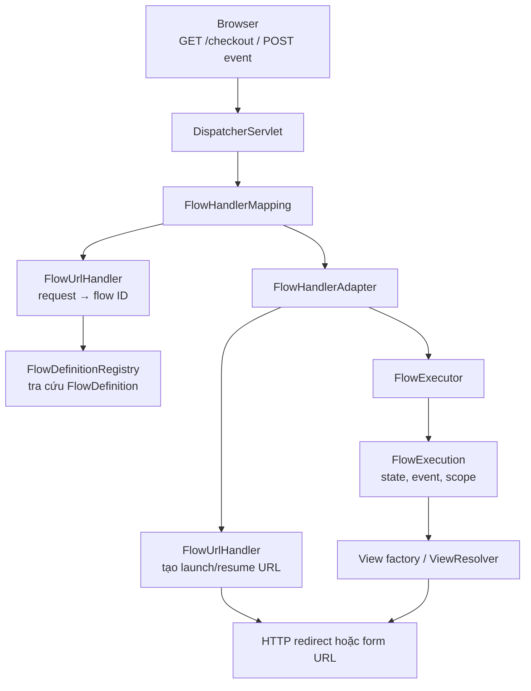
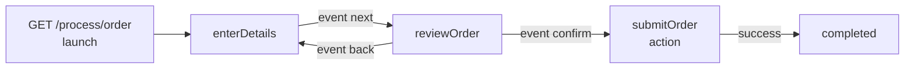

# FlowUrlHandler và cách ánh xạ đường dẫn

Trong **Spring Web Flow**, một flow không chỉ là trang web đơn lẻ mà là **hành trình có trạng thái** gồm nhiều `view-state`, `action-state`, event, transition và có thể gọi `subflow`. Người dùng thường bắt đầu hành trình bằng một URL như `/checkout`, sau đó gửi form hoặc sự kiện để tiếp tục **cùng một flow execution**. Để việc này diễn ra đúng, ứng dụng cần phân biệt giữa URL phía trình duyệt, **flow ID** mà engine sử dụng và **execution key** đại diện cho một lần chạy.

Chương **URL và điều hướng** tập trung ở đây vào **`FlowUrlHandler` và cách ánh xạ đường dẫn**. Thành phần này giúp xác định **flow nào được yêu cầu khởi động từ một HTTP request**, đồng thời tham gia tạo URL dùng để **khởi động** hoặc **tiếp tục** flow. Nó phối hợp với `FlowHandlerMapping`, `FlowHandlerAdapter`, `FlowExecutor` và `FlowDefinitionRegistry` trong tích hợp Spring MVC.

Hiểu hợp đồng URL giúp tránh các lỗi quen thuộc: một URL bất ngờ vào controller thay vì flow, một request POST tạo execution mới thay vì tiếp tục execution cũ, một URL tùy biến không mang khóa execution hoặc một đường dẫn thay đổi khiến subflow không tìm được định nghĩa.

## 1. URL, flow ID và flow execution không phải cùng một thứ

Giả sử người dùng truy cập:

```text
https://shop.example.com/app/checkout
```

Ứng dụng có flow được đăng ký với ID `checkout`. Khi bắt đầu, Web Flow tạo một **execution** riêng cho người dùng; ở các request sau, URL hoặc form action có thể bao gồm execution key, ví dụ (chỉ minh họa):

```text
https://shop.example.com/app/checkout?execution=e1s1
```

Ba giá trị thuộc ba lớp trách nhiệm khác nhau:

| Khái niệm | Ví dụ | Vai trò |
| --- | --- | --- |
| URL bên ngoài | `/app/checkout` | Đường dẫn trình duyệt gửi đến ứng dụng, bao gồm context path của webapp |
| Flow ID | `checkout` | Khóa tra cứu `FlowDefinition` trong registry |
| Execution key | `e1s1` | Định danh/tham chiếu một execution cần tiếp tục, do hạ tầng tạo và quản lý |
| State ID | `enterDetails` | State hiện tại trong định nghĩa flow |
| Event ID | `next`, `back`, `confirm` | Tín hiệu người dùng hoặc action dùng để chọn transition |

`e1s1` là một **ví dụ định dạng**, không phải giá trị có thể hard-code hay quy tắc luôn đúng. Key có thể thay đổi khi execution chuyển trạng thái và phụ thuộc `FlowExecutionRepository`. URL tùy biến phải giữ lại đúng key do engine phát ra, chứ không tự tạo giá trị giống key.

**FlowUrlHandler làm việc tại ranh giới URL ↔ flow**, còn **engine quản lý state/event/transition** bên trong. Nó không phải nơi viết logic kiểm tra đơn hàng, validation form hay quyền truy cập tài nguyên.

## 2. Vị trí của FlowUrlHandler trong Spring MVC

Một request HTTP đi qua `DispatcherServlet`. Các `HandlerMapping` cạnh tranh lựa chọn handler cho URL, sau đó `HandlerAdapter` phù hợp thực hiện công việc xử lý. Với Web Flow, sự phối hợp điển hình là:



Sơ đồ là mô hình trách nhiệm, không nhằm diễn tả chính xác mọi thứ tự gọi nội bộ. Trong một số trường hợp, handler mapping cần tra cứu registry sau khi có flow ID; adapter gọi executor để khởi động/tiếp tục execution; cơ chế tạo URL được sử dụng khi cần liên kết hoặc redirect.

| Thành phần | Trách nhiệm | Không chịu trách nhiệm |
| --- | --- | --- |
| `FlowUrlHandler` | Xác định flow ID từ request và tạo URL launch/resume | Quy tắc nghiệp vụ, danh sách state |
| `FlowHandlerMapping` | Nhận diện request phải do Web Flow xử lý | Chuyển state bằng event |
| `FlowHandlerAdapter` | Gắn handler Web Flow với `FlowExecutor` và phản hồi HTTP | Lưu mã XML của flow |
| `FlowDefinitionRegistry` | Đăng ký/tra cứu định nghĩa theo flow ID | Quyết định URL public có ý nghĩa gì |
| `FlowExecutor` | Quản lý việc launch/resume execution và xử lý event | Giải quyết JSP theo prefix/suffix |
| `ViewResolver` / `MvcViewFactoryCreator` | Biến view name thành giao diện hiển thị | Chuyển URL thành flow ID |

Vì vậy, **đăng ký được XML trong registry không bảo đảm một URL HTTP cụ thể đã được ánh xạ đến flow đó**. Ngược lại, tạo được URL `/checkout` không chứng minh engine có định nghĩa `checkout` để khởi động.

## 3. Ba thao tác khái niệm của FlowUrlHandler

Trong mô hình tích hợp servlet của Spring Web Flow 2.x, interface `FlowUrlHandler` thường bao gồm ba trách nhiệm:

1. **Xác định ID flow từ HTTP request** để hệ thống biết URL hiện tại yêu cầu flow nào.
2. **Tạo URL khởi động flow** từ một flow ID và các input phù hợp.
3. **Tạo URL tiếp tục execution** từ flow ID và flow execution key được cung cấp.

Tên API điển hình trong họ phiên bản này:

```java
// Mô tả hợp đồng API để định hướng; xác nhận chính xác signature
// và package ở phiên bản Spring Web Flow dự án sử dụng.
public interface FlowUrlHandler {
    String getFlowId(HttpServletRequest request);

    String createFlowDefinitionUrl(
        String flowId,
        AttributeMap<?> input,
        HttpServletRequest request);

    String createFlowExecutionUrl(
        String flowId,
        String flowExecutionKey,
        HttpServletRequest request);
}
```

Hai chiều đầu vào/đầu ra của handler phải **nhất quán**:

| Hành động | Input của cơ chế URL | Kết quả mong đợi |
| --- | --- | --- |
| Nhận `GET /checkout` | HTTP request | Flow ID `checkout` |
| Sinh liên kết khởi động checkout | Flow ID `checkout` và optional input | URL public có thể launch `checkout` |
| Sinh liên kết tiếp tục | Flow ID + execution key hiện hành | URL phù hợp để resume **chính execution đó** |
| Nhận request tới URL tiếp tục | HTTP request chứa đường dẫn và key | Flow ID tương ứng, adapter đọc key để resume |

Một implementation tùy biến có thể thay đổi **cách biểu diễn URL**, nhưng không nên thay đổi ý nghĩa của key hoặc tự suy ra state tiếp theo. State tiếp theo vẫn do **event** và **transition** trong definition quyết định.

## 4. Hành vi mặc định và những giới hạn cần biết

Spring Web Flow cung cấp implementation mặc định, thường được biết đến với tên `DefaultFlowUrlHandler`. Cách ánh xạ mặc định gắn với đường dẫn request theo quy ước của hạ tầng servlet/Web Flow; cách engine xây URL launch và resume cũng phụ thuộc cách DispatcherServlet được ánh xạ và cấu hình ứng dụng.

Ví dụ minh họa một cấu hình đơn giản:

```text
FlowDefinitionRegistry:
  checkout        → /WEB-INF/flows/checkout/checkout.xml
  registration    → /WEB-INF/flows/registration/registration.xml

URL public:
  /checkout       → Flow ID checkout
  /registration   → Flow ID registration

URL tiếp tục:
  /checkout?execution=<key-do-engine-cap>
```

Không nên hiểu đây là quy tắc **bất biến cho mọi servlet mapping và mọi phiên bản**. Nếu ứng dụng được triển khai dưới context path `/shop`, hoặc DispatcherServlet xử lý các đường dẫn có tiền tố `/app/*`, biểu diễn URL sẽ khác.

Khi áp dụng mặc định, hãy kiểm tra trong **môi trường thực tế**:

- `getFlowId(request)` trả ID nào đối với URL người dùng thực sự truy cập.
- `FlowHandlerMapping` có dùng registry chứa ID đó không.
- `createFlowDefinitionUrl(...)` trả đường dẫn nào khi context path khác rỗng.
- `createFlowExecutionUrl(...)` giữ execution key đúng theo hình thức adapter/repository mong đợi không.
- URL sinh ra có thể được mở và giải quyết trở lại **cùng flow ID** không.

## 5. Cấu hình registry, mapping và adapter làm nền tảng

Trong cấu hình XML phổ biến của **Spring Web Flow 2.x**, định nghĩa flow được đăng ký ở registry, sau đó executor và các bean tích hợp MVC được nối với nhau:

```xml
<beans xmlns="http://www.springframework.org/schema/beans"
       xmlns:xsi="http://www.w3.org/2001/XMLSchema-instance"
       xmlns:webflow="http://www.springframework.org/schema/webflow-config"
       xsi:schemaLocation="
           http://www.springframework.org/schema/beans
           http://www.springframework.org/schema/beans/spring-beans.xsd
           http://www.springframework.org/schema/webflow-config
           http://www.springframework.org/schema/webflow-config/spring-webflow-config.xsd">

    <webflow:flow-registry id="flowRegistry"
                           base-path="/WEB-INF/flows">
        <webflow:flow-location id="checkout"
                               path="checkout/checkout.xml" />
        <webflow:flow-location id="registration"
                               path="registration/registration.xml" />
    </webflow:flow-registry>

    <webflow:flow-executor id="flowExecutor"
                           flow-registry="flowRegistry" />

    <bean class="org.springframework.webflow.mvc.servlet.FlowHandlerMapping">
        <property name="flowRegistry" ref="flowRegistry" />
        <property name="order" value="0" />
    </bean>

    <bean class="org.springframework.webflow.mvc.servlet.FlowHandlerAdapter">
        <property name="flowExecutor" ref="flowExecutor" />
    </bean>
</beans>
```

Ví dụ này minh họa **luồng mặc định**: registry chứa hai flow ID, mapping dùng registry, adapter dùng executor. Các bean phải được nhìn thấy từ `WebApplicationContext` mà `DispatcherServlet` phục vụ; chỉ khai báo chúng trong một context không liên quan sẽ không đủ.

**Đừng nhầm tên `flowRegistry` (Spring bean ID) với `checkout` (flow definition ID).** Browser không truy cập `/flowRegistry` chỉ vì bean tên như vậy. Một flow cha tham chiếu `subflow="registration"` theo ID flow, không theo ID của bean registry.

### Mối liên hệ với flow-location và base-path

`FlowUrlHandler` giúp ánh xạ URL đến **flow ID**. `FlowDefinitionRegistry` ánh xạ **flow ID đến định nghĩa XML**. `base-path` chỉ là gốc tìm resource:

```text
GET /shop/checkout
      │
      ├─ [FlowUrlHandler] → "checkout"
      │
      └─ [FlowDefinitionRegistry]
            "checkout" → /WEB-INF/flows/checkout/checkout.xml
```

Nếu XML bị di chuyển, có thể đổi `path` đăng ký mà giữ ID `checkout`; URL công khai không nhất thiết phải thay. Ngược lại, đổi URL public cũng không yêu cầu đổi tên file XML nếu ID vẫn được ánh xạ nhất quán.

## 6. Ánh xạ đường dẫn tùy biến để có URL dễ đọc

Giả sử nhóm sản phẩm muốn URL công khai:

| URL | Flow ID |
| --- | --- |
| `/process/order` | `checkout` |
| `/account/create` | `registration` |

Trong registry, flow vẫn được đặt tên `checkout` và `registration`. Nếu sử dụng quy ước URL mặc định nhưng yêu cầu path khác flow ID, cần một **quy tắc ánh xạ tùy biến** để chuyển request thành đúng ID và tạo URL tương ứng.

Một thiết kế handler tùy biến cần quy định cả ba hàm:

```text
getFlowId(request):
  "/process/order"  -> "checkout"
  "/account/create" -> "registration"
  otherwise         -> không nhận diện flow

createFlowDefinitionUrl("checkout", input, request):
  -> contextPath + "/process/order" + query input được mã hóa đúng

createFlowDefinitionUrl("registration", input, request):
  -> contextPath + "/account/create" + query input được mã hóa đúng

createFlowExecutionUrl("checkout", key, request):
  -> contextPath + "/process/order" + query execution key được engine cấp
```

Đây là **đặc tả thuật toán**, không phải Java code compile trực tiếp. Cần triển khai theo đúng chữ ký `FlowUrlHandler` của phiên bản đang dùng, tuân thủ servlet path mapping, URL encoding và conventions của adapter/repository.

### Nguyên tắc thiết kế handler tùy biến

1. **Ánh xạ hai chiều:** nếu launch URL `/process/order` mang flow ID `checkout` thì resume URL của cùng flow cũng cần được handler nhận diện là `checkout`.
2. **Không đoán execution key:** sử dụng chính key mà engine truyền vào hàm tạo URL; không tự sinh `e1s1` hoặc giữ key cũ.
3. **Mã hóa input hợp lệ:** khi chuyển input thành query string, phải encode tên/giá trị theo quy tắc URL, bảo toàn ký tự đặc biệt và không làm mất dữ liệu.
4. **Tôn trọng context path:** ứng dụng chạy ở `/shop` và ứng dụng chạy ở root context phải cùng tuân thủ mapping.
5. **Trả kết quả rõ cho URL không thuộc flow:** không ép mọi URL lạ thành một flow mặc định và vô tình “chiếm” endpoint MVC khác.
6. **Không đẩy state ID vào URL để tự chuyển state:** flow execution quyết định state bằng event/transition, không phải tên path tự chế.
7. **Không biến URL thành kênh truyền bí mật:** input qua query string có thể bị ghi vào log, browser history hoặc analytics.

`FlowUrlHandler` nên tập trung vào **quy tắc đường dẫn**, không xử lý việc người dùng có quyền mua hàng hoặc đơn hàng có hợp lệ. Những kiểm tra đó thuộc tầng bảo mật, validation và service nghiệp vụ.

## 7. Dùng cùng quy tắc URL ở mapping và adapter

Khi tùy biến, một nguyên tắc quan trọng là **đường nhận URL và đường sinh URL phải sử dụng cùng quy tắc**. Nếu handler mapping hiểu `/process/order` là `checkout`, nhưng adapter lại sinh `/checkout?execution=...`, request tiếp theo có thể đi đến URL không được nhận diện như dự kiến.

Trong những phiên bản hỗ trợ property cấu hình tương ứng, có thể nối một implementation handler chung vào hai thành phần:

```xml
<!-- Lớp BusinessFlowUrlHandler do ứng dụng tự cài đặt.
     Kiểm tra API/property đúng với phiên bản Web Flow. -->
<bean id="businessFlowUrlHandler"
      class="com.example.web.BusinessFlowUrlHandler" />

<bean class="org.springframework.webflow.mvc.servlet.FlowHandlerMapping">
    <property name="flowRegistry" ref="flowRegistry" />
    <property name="flowUrlHandler" ref="businessFlowUrlHandler" />
    <property name="order" value="0" />
</bean>

<bean class="org.springframework.webflow.mvc.servlet.FlowHandlerAdapter">
    <property name="flowExecutor" ref="flowExecutor" />
    <property name="flowUrlHandler" ref="businessFlowUrlHandler" />
</bean>
```

**Lưu ý phiên bản:** tên method/property và hỗ trợ cấu hình được minh họa theo mô hình Spring Web Flow 2.x. Cần xác nhận class và setter thực tế trong các dependency của dự án trước khi sử dụng; nếu không hỗ trợ trực tiếp thì phải chọn điểm tùy biến tương thích thay vì cố gắn một property không tồn tại.

Không phải ứng dụng nào cũng cần tự viết `FlowUrlHandler`. Nếu URL public có thể theo ID của registry, **giữ quy ước mặc định** thường đơn giản và ít rủi ro hơn. Chỉ tùy biến khi có yêu cầu rõ như giữ URL lịch sử, đường dẫn marketing, tiền tố khu vực hoặc tách tên public khỏi tên nội bộ.

## 8. Launch flow và resume execution là hai hành động khác nhau

Giả sử flow `checkout` có các state:



Khi **launch**, engine tìm `FlowDefinition` `checkout` và bắt đầu một execution mới. Khi **resume**, engine cần tìm lại execution hiện có, sau đó xử lý event và request parameters trong ngữ cảnh đó.

```text
Request 1: GET /process/order
  URL handler → flowId = checkout
  executor launch checkout
  state enterDetails
  response cung cấp URL/key tiếp tục hiện hành

Request 2: POST <flowExecutionUrl-do-engine-cung-cap>
  event next, quantity=3
  URL handler → flowId = checkout
  adapter/executor resume execution hiện hành
  binding + validation
  state reviewOrder

Request 3: POST <URL-tiep-tuc-moi-neu-co>
  event confirm
  executor chạy action submitOrder
  chuyển theo event success/failed
```

**Không hard-code execution key trong form.** Cách thường gặp là dùng biến `flowExecutionUrl` mà Web Flow cung cấp cho view, ví dụ ở JSP:

```jsp
<form method="post" action="${flowExecutionUrl}">
    <label for="quantity">Số lượng</label>
    <input id="quantity" name="quantity" type="text" />
    <button type="submit" name="_eventId_next">Tiếp tục</button>
    <button type="submit" name="_eventId_cancel">Hủy</button>
</form>
```

`_eventId_next` minh họa cách biểu diễn event trong request. Template engine, tag library hoặc cấu hình view khác có thể cung cấp phương pháp tạo event tương đương. Điều bắt buộc là event, form data và URL/key tiếp tục phải phù hợp với execution hiện có.

Nếu người dùng gửi `POST /process/order` **không có key** khi ứng dụng yêu cầu key để resume, request có thể bị hiểu là bắt đầu flow mới hoặc bị từ chối tùy cấu hình. Bởi vậy test cần theo dõi URL thực tế mà framework tạo ra thay vì giả định mọi POST là resume.

## 9. Input trên URL và binding của form

Một link khởi động có thể mang input:

```text
/process/order?productId=42
```

Flow có thể khai báo hợp đồng input:

```xml
<input name="productId"
       type="java.lang.Long"
       required="true" />

<on-start>
    <evaluate expression="catalogService.findById(flowScope.productId)"
              result="flowScope.product" />
</on-start>
```

Điều này khác với submit biểu mẫu `view-state`:

| Dữ liệu | Điểm xử lý | Ví dụ |
| --- | --- | --- |
| Flow input khi launch | Input mapping khi bắt đầu execution | `productId=42` thành `Long` |
| Request parameter ở view-state | Binder + conversion + validation | `quantity=3` thành `Integer` |
| Event từ nút | Event handling + transition | `_eventId_next` dẫn đến `reviewOrder` |
| Execution key | Repository/adapter | Tìm lại execution đang chạy |

**URL handler không thay validator của flow.** Nếu `productId=abc` không đổi được thành `Long`, lỗi thuộc hợp đồng input khi launch, không được “chữa” bằng cách luôn ánh xạ sang một product ID mặc định. Nếu `quantity=-2` được bind thành số nguyên nhưng không hợp lệ, validator của form phải chặn transition `next`.

Khi tạo URL launch với input bằng code, nên sử dụng API tạo URL của Web Flow và cơ chế encoding tương thích. Việc ghép thủ công chuỗi query có thể làm mất dấu `&`, `?`, Unicode hoặc ký tự đặc biệt trong giá trị; cũng dễ tạo lỗi khi ứng dụng nằm dưới context path khác.

## 10. Subflow không nhất thiết có URL public riêng

Flow cha `checkout` có thể gọi flow con `addressVerification`:

```xml
<subflow-state id="verifyAddress" subflow="addressVerification">
    <input name="address"
           value="flowScope.checkoutForm.shippingAddress" />
    <transition on="verified" to="reviewOrder" />
    <transition on="rejected" to="editAddress" />
</subflow-state>
```

Khi đi vào `verifyAddress`, engine tìm **Flow ID `addressVerification`** trong registry. Nó không bắt buộc chuyển trình duyệt sang URL `/addressVerification`. Flow con có các state và outcome riêng, còn bên cha tiếp tục thực thi sau khi nhận kết quả.

Do đó:

- `subflow="addressVerification"` là **tham chiếu definition**, không phải lời gọi HTTP.
- `verifyAddress` là **state ID** trong flow cha, không phải một endpoint độc lập.
- Mapping URL của `checkout` vẫn liên quan tới execution chính mà trình duyệt đang tiếp tục.
- Input/output của subflow được ánh xạ ở ranh giới flow cha–con, không đồng nghĩa chuyển query string qua URL ngoài.

Nếu flow con đồng thời được phép launch độc lập qua URL, đó là một quyết định cấu hình và bảo mật khác; cần bảo đảm input bắt buộc, quyền truy cập và các state khởi đầu vẫn hợp lệ khi không có flow cha.

## 11. Context path, servlet path, reverse proxy và URL encoding

Đường dẫn mà `FlowUrlHandler` nhìn thấy có thể chịu ảnh hưởng của cách triển khai:

```text
Public URL:
  https://shop.example.com/store/process/order

Proxy route:
  /store/process/order → internal /app/process/order

Servlet context:
  /app

DispatcherServlet mapping:
  /
```

Một implementation dùng trực tiếp `request.getRequestURI()` rồi so sánh với `"/process/order"` sẽ sai nếu không xử lý context path. Ngược lại, lấy `substring` tùy tiện với path không kiểm soát có thể đưa ra flow ID sai hoặc gây lỗi với URL lạ.

Những điểm cần kiểm tra trong môi trường thật:

1. **Context path:** ứng dụng được deploy tại `/`, `/shop` hoặc `/app` có sinh đúng URL tương ứng không.
2. **Servlet mapping:** `DispatcherServlet` phục vụ `/` hay một tiền tố như `/app/*`; URL handler phải phù hợp với đường dẫn servlet nhìn thấy.
3. **Reverse proxy:** public scheme/host/path có thể khác request nội bộ. Nếu dùng forwarded headers, cần cấu hình proxy đáng tin cậy và xử lý đúng ở hạ tầng web.
4. **URL encoding:** khoảng trắng, dấu tiếng Việt, `+`, `&`, `?`, ký tự Unicode và percent encoding không được làm đổi flow ID hoặc input.
5. **Trailing slash/case:** `/process/order` và `/process/order/` có được coi là cùng route không? `/Order` có khác `/order` không? Chọn quy tắc nhất quán.
6. **Query parameters:** execution key và input không được xóa khi tạo redirect hoặc form action.
7. **URL public ổn định:** khi đổi cấu trúc folder của flow XML, tránh thay URL người dùng nếu không cần thiết.

Với URL được sinh ở server, nên tránh đưa `request.getHeader("Host")` hoặc `X-Forwarded-*` chưa kiểm chứng vào redirect tuyệt đối. Cấu hình proxy/trust boundary là vấn đề bảo mật độc lập với logic ánh xạ flow ID.

## 12. Phạm vi bảo mật của FlowUrlHandler

`FlowUrlHandler` chỉ là một lớp định tuyến, không phải cơ chế phân quyền. Một người biết URL `/process/order` chưa đương nhiên được quyền mua hàng; một execution key tồn tại chưa chứng minh người gửi request là chủ thể được phép thao tác.

Các quy tắc an toàn:

| Rủi ro | Giải pháp thiết kế |
| --- | --- |
| Nhận mọi path thành tên flow tùy ý | Dùng danh sách mapping hợp lệ hoặc quy tắc whitelist rõ ràng |
| URL lạ bị ánh xạ vào flow có quyền cao | Chỉ expose flow có chủ đích; kiểm tra quyền bằng Spring Security và service |
| Execution key bị chia sẻ/đoán/đánh cắp | Dựa vào chính sách repository/session và bảo vệ HTTP; không tự tạo key |
| Đưa thông tin nhạy cảm vào URL launch | Không đưa token, mật khẩu hay dữ liệu thanh toán bí mật vào query string |
| Redirect ra host không đáng tin cậy | Không dùng input chưa kiểm chứng để dựng URL đích |
| Path encoding gây nhầm hoặc bypass | Chuẩn hóa và đối chiếu đường dẫn một cách nhất quán, không tự decode nhiều lần |
| Resume lại thao tác ghi sau refresh/retry | Service cần transaction/idempotency; URL handler không bảo đảm chống gửi trùng |

Ngoài ra, không nên suy diễn tên state từ path query để chuyển người dùng thẳng tới `completed` hoặc `adminApproval`. Đường đi bên trong flow phải được quyết định bằng event, validation, quyền truy cập và transition mà engine hỗ trợ.

## 13. Kiểm thử ánh xạ URL và hành vi tiếp tục flow

Kiểm thử nên có **ba lớp**, từ đơn vị ánh xạ đến tích hợp thật:

1. **Unit test cho FlowUrlHandler tùy biến:** mỗi public path được ánh xạ đúng ID; URL được sinh ra đúng với context path, input và execution key; URL lạ không được nhận diện là flow.
2. **Integration test Spring MVC:** `DispatcherServlet` chọn `FlowHandlerMapping` và `FlowHandlerAdapter` cho các route flow; controller thông thường vẫn nhận route riêng; `FlowExecutor` khởi động và resume.
3. **Hành trình qua nhiều request:** browser hoặc MockMvc giữ session/key, submit event, đi qua binding/validation rồi quay lại, thử lại và kết thúc.

### Ma trận tối thiểu cho FlowUrlHandler

| Given/When | Then cần xác nhận |
| --- | --- |
| `GET /process/order` | Xác định Flow ID `checkout` |
| `GET /account/create` | Xác định Flow ID `registration` |
| `GET /products` | Không “chiếm” route MVC nếu không đăng ký là flow |
| Sinh launch URL cho `checkout` | Nhận `/process/order`, có context path đúng |
| Sinh launch URL có `productId=42` | Query input được mã hóa đúng và khi launch nhận `Long(42)` |
| Sinh resume URL với key engine cấp | URL chứa đúng key và tiếp tục đúng execution |
| Truy cập public path có trailing slash | Hành vi rõ ràng theo quy ước (nhận hoặc từ chối) |
| Deploy dưới `/shop` | URL sinh có đúng context path, không mất hay lặp tiền tố |
| Route qua proxy có path prefix | Public URL và redirect nhất quán với cấu hình proxy |
| Ký tự đặc biệt trong input | URL round-trip không làm thay giá trị |
| URL launch không có input bắt buộc | Flow xử lý lỗi khởi động theo hợp đồng |
| Resume với key sai/hết hạn | Hạ tầng xử lý lỗi execution; không khởi động nhầm execution khác |
| Người dùng back/edit/confirm | Engine chọn đúng state theo event, không theo tên URL |

### Một kiểm thử HTTP minh họa

Nếu ứng dụng đã có test `WebApplicationContext` chứa đầy đủ Web Flow, có thể dùng `MockMvc`:

```java
import static org.junit.jupiter.api.Assertions.*;
import static org.springframework.test.web.servlet.request.MockMvcRequestBuilders.get;

import org.junit.jupiter.api.Test;
import org.springframework.beans.factory.annotation.Autowired;
import org.springframework.test.context.junit.jupiter.SpringJUnitConfig;
import org.springframework.test.context.web.WebAppConfiguration;
import org.springframework.test.web.servlet.MockMvc;
import org.springframework.test.web.servlet.MvcResult;
import org.springframework.test.web.servlet.setup.MockMvcBuilders;
import org.springframework.web.context.WebApplicationContext;
import org.springframework.webflow.mvc.servlet.FlowHandler;

// Mẫu yêu cầu tài nguyên test-webflow-mvc.xml thực sự tồn tại
// và có đầy đủ mapping, adapter, registry, executor, view.
@SpringJUnitConfig(locations = "classpath:/spring/test-webflow-mvc.xml")
@WebAppConfiguration
class FlowUrlMappingIntegrationTest {

    @Autowired
    WebApplicationContext webContext;

    @Test
    void publicRouteIsHandledByWebFlow() throws Exception {
        MockMvc mvc = MockMvcBuilders.webAppContextSetup(webContext).build();

        MvcResult result = mvc.perform(
            get("/process/order")).andReturn();

        assertNotNull(result.getHandler());
        assertTrue(result.getHandler() instanceof FlowHandler);
    }
}
```

Đây là **mẫu assertion**, không phải test độc lập chạy được nếu thiếu cấu hình test context. Hãy nạp đầy đủ registry, executor, handler mapping, adapter và view cho ứng dụng. Nếu test dùng Spring TestContext theo JUnit 5, cần khai báo extension hoặc cơ chế bootstrap tương thích; `@WebAppConfiguration` một mình không tự tạo Spring context.

`MockMvc` có thể kiểm tra mapping, redirect và một phần render nhưng không thực thi đầy đủ JSP engine. Khi cần kiểm chứng nội dung JSP, template, cookie và proxy thật, hãy bổ sung bài test với servlet container hoặc browser.

### Kiểm thử round-trip quan trọng

Một phép thử có giá trị cao đối với URL tùy biến là:

```text
given:
  flow ID "checkout"
  input productId=42

when:
  createFlowDefinitionUrl(...)

then:
  URL public là /process/order?productId=42
  getFlowId(request từ URL đó) = "checkout"
  engine launch đúng flow và nhận input productId

when:
  engine tạo execution key K
  createFlowExecutionUrl("checkout", K, ...)

then:
  URL resume vẫn dùng /process/order
  key K được bảo toàn
  request dùng URL này tiếp tục đúng execution
```

Nếu phép thử chỉ kiểm tra `getFlowId` mà bỏ qua `createFlowExecutionUrl`, custom handler có thể **khởi động được flow nhưng không tiếp tục được**, lỗi chỉ xuất hiện khi người dùng nhấn nút ở màn hình thứ hai.

## 14. Chẩn đoán sự cố theo đúng lớp

| Triệu chứng | Thành phần cần kiểm tra trước |
| --- | --- |
| `GET /process/order` trả 404 | URL handler, flow handler mapping, registry/flow ID |
| URL vào controller thông thường | Thứ tự `HandlerMapping`, route MVC trùng |
| URL ánh xạ thành ID `process/order` thay vì `checkout` | Quy tắc getFlowId của handler tùy biến |
| Có ID nhưng không có flow XML | Registry đăng ký `flow-location`/`base-path` sai |
| Launch hoạt động, submit sang bước hai thất bại | Resume URL, execution key, session, adapter |
| GET redirect liên tục | Quy tắc tạo URL và quy tắc nhận URL không nhất quán |
| Context path xuất hiện hai lần | Hàm tạo URL ghép context path sai |
| Thiếu query input sau redirect | Tạo launch URL không bảo toàn input |
| Event hợp lệ nhưng vẫn ở form | Binding, validation hoặc tên event/transition |
| Flow chuyển đúng state nhưng view không render | `MvcViewFactoryCreator` / `ViewResolver` / template |
| Key sai hoặc hết hạn | `FlowExecutionRepository` / HTTP error handling |
| Subflow không tìm thấy | Flow ID của subflow và registry, không phải URL public |
| Test chạy ở localhost, lỗi sau proxy | Scheme/host/path forwarded, context path và URL encoding |

Trình tự chẩn đoán nên là:

```text
1. Request URI / context path / servlet path thực tế là gì?
2. FlowUrlHandler suy ra Flow ID nào?
3. FlowHandlerMapping có chọn FlowHandler tương ứng không?
4. Registry có định nghĩa Flow ID đó không?
5. Adapter launch hay resume, execution key/session có đúng không?
6. Flow nhận event nào; binding/validation có ngăn transition không?
7. View/redirect URL được tạo như thế nào và có quay lại đúng mapping không?
```

Việc kiểm tra từng lớp giúp tránh thay đổi XML flow chỉ vì một lỗi ở URL encoding hoặc sửa handler mapping khi nguyên nhân thật là execution key đã hết hạn.

## 15. Bài thực hành: URL public khác Flow ID

Tạo hai định nghĩa flow `checkout` và `registration`, nhưng muốn expose:

```text
/process/order  → checkout
/account/create → registration
```

Thực hiện:

1. Đăng ký hai flow trong `FlowDefinitionRegistry` bằng ID ổn định.
2. Viết một quy tắc ánh xạ `FlowUrlHandler` cho hai đường dẫn public; mọi URL khác không thuộc hai flow phải không bị handler chiếm nhầm.
3. Tạo URL launch cho mỗi flow và kiểm tra có/không có context path `/shop`.
4. Tạo URL launch checkout với input `productId=42`; xác nhận flow khai báo `Long productId` nhận đúng kiểu.
5. Khởi động checkout qua `FlowHandlerMapping`/`FlowHandlerAdapter` rồi ghi nhận execution URL/key do Web Flow cung cấp.
6. Gửi form `quantity=3` với event `next` bằng URL tiếp tục; xác nhận flow sang màn hình xác nhận, không launch execution mới.
7. Gửi `quantity=abc` hoặc `-2`; xác nhận form binding/validation giữ người dùng tại màn hình nhập.
8. Thử event `back`, `cancel` và `confirm` để kiểm tra đường đi theo event chứ không theo tên path.
9. Bổ sung kiểm thử với trailing slash, URL encoding, key sai/hết hạn và một controller MVC có route riêng.
10. Deploy dưới context path khác hoặc phía sau reverse proxy thử nghiệm, xác nhận redirect/URL launch/resume vẫn nhất quán.

Kết quả đạt yêu cầu khi **URL nhận vào suy đúng Flow ID**, **URL được sinh có thể quay trở lại cùng mapping**, và **execution được tiếp tục bằng key hiện hành qua nhiều request**. Các chuyển trạng thái bên trong vẫn do event, transition, binding và validation quyết định, trong khi URL handler chỉ xử lý giao diện đường dẫn giữa HTTP và flow.

Trong Spring Web Flow, `FlowUrlHandler` là cầu nối giữa **đường dẫn mà người dùng nhìn thấy** và **Flow ID mà engine hiểu**. Hiểu ba thao tác nhận flow ID, tạo launch URL và tạo resume URL giúp thiết kế URL ổn định mà không đánh mất state, session hay execution key. Phối hợp đúng với `FlowHandlerMapping`, `FlowHandlerAdapter`, registry và các kiểm thử nhiều request sẽ giữ cho hành trình web có thể điều hướng, phục hồi và phát triển mà không rải logic chuyển trang khắp controller.
