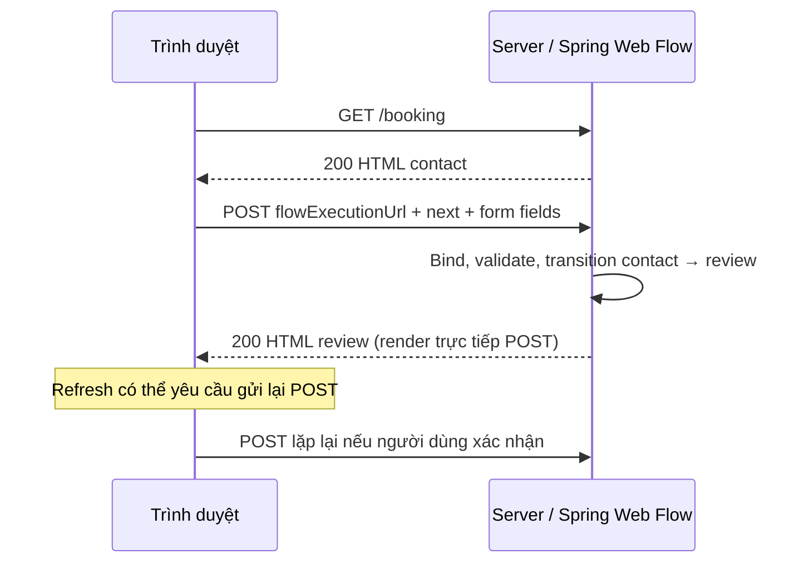
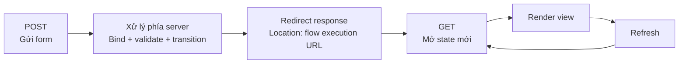
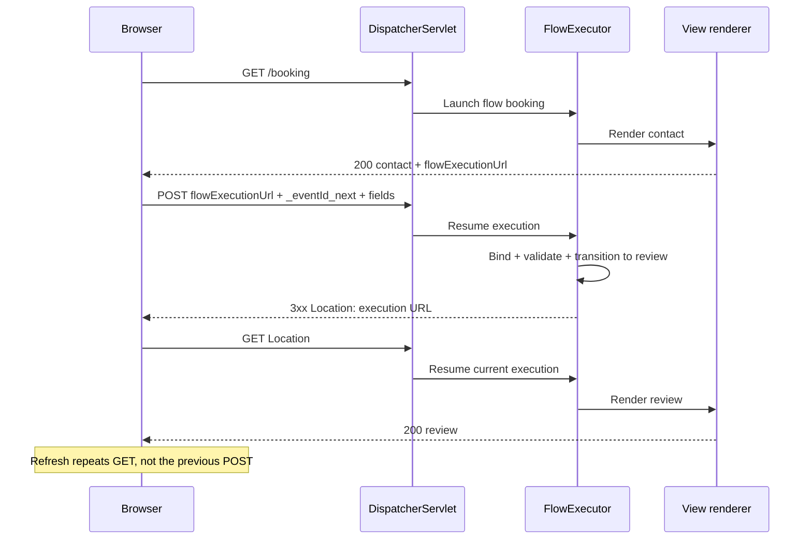

# Redirect khi vào view-state và mô hình Post/Redirect/Get trong Spring Web Flow

Trong một hành trình nhiều bước, người dùng thường gửi biểu mẫu bằng **POST**, sau đó thấy màn hình kế tiếp. Nếu server trả HTML trực tiếp cho request POST, thao tác Refresh có thể khiến trình duyệt hỏi gửi lại biểu mẫu. Với một thao tác tạo lịch hẹn hoặc gửi đơn hàng, việc gửi lại có thể gây khó hiểu, thậm chí tạo dữ liệu trùng nếu service không có cơ chế bảo vệ.

**Post/Redirect/Get (PRG)** giải quyết vấn đề điều hướng bằng cách để server xử lý POST, trả về một phản hồi redirect, rồi trình duyệt gửi GET để hiển thị kết quả. Trong **Spring Web Flow (SWF)**, thuộc tính `redirect` của `view-state` có thể được dùng để yêu cầu redirect khi flow đi vào state đó. Bài học này giải thích cách cấu hình, cách URL execution tham gia vào PRG, những trường hợp validation không thành công, và các kiểm thử cần có để bảo đảm hành trình vẫn giữ dữ liệu đúng.

Bài thuộc chương **URL và điều hướng** của module **SPRING_WEB_FLOW**. Module học cách mô hình hóa hành trình web bằng **state, event, transition và subflow**, đồng thời thực hành **form binding, validation, scope/phiên, tích hợp Spring MVC và phục hồi lỗi**. PRG là một phần của thiết kế URL và điều hướng: flow engine quyết định trạng thái kế tiếp, còn redirect quyết định cách trình duyệt nhận và mở màn hình đó.

## 1. Vấn đề khi render trực tiếp phản hồi POST

Giả sử người dùng đang ở view-state `contact`, nhập thông tin và bấm **Tiếp tục**. Request được gửi bằng POST. Nếu server xử lý transition rồi trả thẳng HTML của `review` trong chính response POST, thanh địa chỉ và lịch sử trình duyệt có thể vẫn gắn với request POST.



Không phải mọi POST đều nguy hiểm như nhau, nhưng trình duyệt có thể cảnh báo **Confirm Form Resubmission** khi người dùng Refresh hoặc quay lại trang được tạo từ POST. Với thao tác có side effect, người dùng có thể không biết liệu yêu cầu trước đã được xử lý hay chưa.

Một lỗi thiết kế phổ biến là xem PRG như “thêm một redirect cho đẹp”. Thực tế, PRG là **hợp đồng giữa phương thức HTTP và cách hiển thị kết quả**:

- POST dùng để gửi dữ liệu hoặc yêu cầu thay đổi trạng thái.
- Server xử lý binding, validation và nghiệp vụ.
- Server trả redirect đến một URL có thể mở bằng GET.
- Trình duyệt GET URL đó để xem màn hình.
- Refresh trang kết quả lặp GET, không tự gửi lại POST trước đó.

## 2. PRG là gì?

PRG là viết tắt của **Post / Redirect / Get**:



Ví dụ theo hành trình đặt lịch:

| Giai đoạn | HTTP | Hành động |
|---|---|---|
| Mở form | `GET /booking` | Bắt đầu flow và render `contact` |
| Gửi thông tin | `POST <flowExecutionUrl>` | Bind field, validate, phát event `next` |
| Điều hướng | `3xx Location: ...` | Server yêu cầu browser mở URL execution |
| Render bước sau | `GET <flowExecutionUrl>` | Tiếp tục execution và hiển thị `review` |
| Refresh | `GET <flowExecutionUrl>` | Render lại state hiện tại theo execution |

**PRG không có nghĩa chuyển sang một flow mới.** Redirect thường tiếp tục **cùng flow execution**, với state mới sau transition. URL có thể chứa execution key do SWF phát hành; key này là dữ liệu opaque, không được tự tạo hoặc hardcode.

### 2.1. Vì sao Refresh sau PRG an toàn hơn?

Sau khi trình duyệt theo redirect và tải màn hình bằng GET, Refresh lặp lại GET. Nó không tự gửi lại body POST đã dùng để chuyển state. Đây là lợi ích chính của PRG.

Tuy vậy, PRG **không bảo đảm side effect chỉ chạy một lần trong mọi tình huống**. Người dùng vẫn có thể nhấn nút xác nhận hai lần, mở hai tab hoặc gửi lại một request cũ. Service cần idempotency, ràng buộc duy nhất hoặc cơ chế giao dịch thích hợp cho thao tác ghi dữ liệu.

## 3. Redirect khi vào view-state trong Spring Web Flow

Spring Web Flow cho phép cấu hình thuộc tính `redirect` trên `view-state`. Ví dụ:

```xml
<view-state id="review"
            view="booking/review"
            redirect="true">
    <transition on="back"
                to="contact"
                bind="false"
                validate="false"/>
    <transition on="confirm"
                to="persist"
                bind="false"
                validate="false"/>
</view-state>
```

Khi flow **đi vào** view-state `review`, `redirect="true"` yêu cầu SWF dùng redirect để đưa trình duyệt tới URL của flow execution trước khi view được hiển thị. Nhờ đó, sau một POST tạo transition sang `review`, trình duyệt có thể nhận redirect và thực hiện GET để render state mới.

Các điểm cần nhớ:

- `redirect` là thuộc tính cấu hình của **view-state**.
- Nó điều khiển cách trình duyệt được đưa tới view khi state được vào; nó không thay thế transition.
- Transition `on="next" to="review"` vẫn là quyết định của flow engine về state kế tiếp.
- SWF tạo/duy trì URL execution; view nên dùng URL do framework cung cấp.
- Cần kiểm tra hành vi thực tế của phiên bản SWF, URL handler, servlet mapping và renderer đang dùng.

### 3.1. Redirect không phải là tên khác của transition

Hai khái niệm trả lời hai câu hỏi:

| Khái niệm | Câu hỏi | Ví dụ |
|---|---|---|
| Transition | Flow chuyển sang state nào khi nhận event? | `next → review` |
| Redirect | Browser nhận response thế nào để mở view? | POST response → 3xx → GET |
| Flow ID | Định nghĩa hành trình nào? | `booking` |
| Execution key | Lần chạy cụ thể nào? | Key do SWF cấp |
| View name | Template nào được render? | `booking/review` |

Một transition có thể thành công mà view được render trực tiếp trong response hiện tại nếu không có redirect phù hợp. Ngược lại, redirect HTTP tự nó không quyết định logic nghiệp vụ hay chuyển state nào.

## 4. Ví dụ flow đặt lịch với PRG

Flow đơn giản gồm `contact`, `review`, `persist` và `confirmation`:

```xml
<?xml version="1.0" encoding="UTF-8"?>
<flow xmlns="http://www.springframework.org/schema/webflow"
      xmlns:xsi="http://www.w3.org/2001/XMLSchema-instance"
      xsi:schemaLocation="
          http://www.springframework.org/schema/webflow
          http://www.springframework.org/schema/webflow/spring-webflow.xsd">

    <var name="draft"
         class="com.example.booking.BookingDraft"/>

    <view-state id="contact"
                view="booking/contact"
                model="draft">
        <binder>
            <binding property="customerName" required="true"/>
            <binding property="email" required="true"/>
        </binder>
        <transition on="next" to="review"/>
        <transition on="cancel" to="cancelled"
                    bind="false" validate="false"/>
    </view-state>

    <view-state id="review"
                view="booking/review"
                model="draft"
                redirect="true">
        <transition on="back" to="contact"
                    bind="false" validate="false"/>
        <transition on="confirm" to="persist"
                    bind="false" validate="false"/>
    </view-state>

    <action-state id="persist">
        <evaluate expression="bookingAction.submit(draft)"/>
        <transition on="success" to="confirmation"/>
    </action-state>

    <view-state id="confirmation"
                view="booking/confirmation"
                redirect="true">
        <transition on="finish" to="completed"
                    bind="false" validate="false"/>
    </view-state>

    <end-state id="completed"/>
    <end-state id="cancelled"/>
</flow>
```

Ví dụ minh họa cấu trúc và mục đích của `redirect="true"`. Để chạy trong dự án, cần có JavaBean `BookingDraft`, bean `bookingAction`, view template và cấu hình flow registry/executor/MVC. Thuộc tính `model="draft"` giúp binder của từng view-state biết đối tượng cần bind. `bookingAction.submit(draft)` phải được triển khai theo hợp đồng action của SWF và trả về outcome tương ứng với event `success`. Nếu action ném exception, framework không mặc nhiên biến mọi exception thành event `failure`; cần thiết kế nhánh lỗi hoặc exception handler riêng.

Trong ví dụ:

1. Người dùng GET entry URL để vào `contact`.
2. POST `next` gửi dữ liệu contact.
3. Nếu binding và validation thành công, flow chuyển sang `review`.
4. Vì `review` có `redirect="true"`, SWF điều hướng browser tới URL execution để GET và render review.
5. Khi xác nhận, action `persist` xử lý lưu.
6. Flow chuyển tới `confirmation`; state này cũng bật redirect để hiển thị kết quả qua GET.

Không cần bật redirect cho mọi state một cách máy móc. Chọn các điểm vào view-state mà việc hiển thị sau POST cần tuân theo PRG, sau đó kiểm thử cả hành trình thành công lẫn lỗi.

### 4.1. Form cần dùng flowExecutionUrl

Một JSP form có thể dùng:

```jsp
<%@ taglib prefix="form" uri="http://www.springframework.org/tags/form" %>

<form:form id="contactForm"
           method="post"
           action="${flowExecutionUrl}"
           modelAttribute="draft">

    <label for="customerName">Tên khách hàng</label>
    <form:input id="customerName" path="customerName"/>
    <form:errors path="customerName" cssClass="field-error"/>

    <label for="email">Email</label>
    <form:input id="email" path="email"/>
    <form:errors path="email" cssClass="field-error"/>

    <button type="submit" name="_eventId_next">
        Tiếp tục
    </button>
    <button type="submit" name="_eventId_cancel">
        Hủy
    </button>
</form:form>
```

`flowExecutionUrl` là URL tiếp tục **execution hiện tại**. Nó thường chứa path và tham số mà SWF cần để nhận diện flow/execution. Không viết cứng `/booking?execution=e1s1`, vì execution key được phát hành theo repository và có thể thay đổi theo request/snapshot.

Nếu ứng dụng dùng Spring Security, form POST cần CSRF token theo cấu hình. Nếu view không dùng JSP, hãy dùng cơ chế tương đương của template engine để đưa URL execution và event parameter vào form.

## 5. Một chuỗi HTTP PRG hoàn chỉnh

Hãy quan sát luồng sau:



Ở response redirect, kiểm tra:

- Status code thực tế (thường là một phản hồi 3xx theo cơ chế SWF/servlet đang dùng).
- Header `Location` trỏ đến URL tiếp tục execution hợp lệ.
- URL giữ đúng context path/servlet mapping khi có reverse proxy.
- Browser theo redirect bằng GET theo contract PRG.
- Request GET tiếp theo dùng đúng session/cookie.
- Nội dung render là state mà flow vừa chuyển tới.

**Không mặc định status luôn là 303.** Các phiên bản/framework và cơ chế redirect có thể phát ra mã 3xx khác nhau. PRG mô tả chuỗi phương thức POST → redirect → GET; nếu ứng dụng tự điều khiển redirect HTTP, hãy chọn semantics phù hợp và xác minh bằng integration test thay vì chỉ đoán từ mã status.

## 6. Validation thất bại có tự động đi qua PRG không?

Đây là trường hợp cần chú ý. Người dùng POST `email=invalid` ở state `contact`. Binder có thể chuyển dữ liệu, validator phát hiện lỗi, transition `next` không xảy ra và flow vẫn ở state `contact`.

Nếu view được render trực tiếp trong response POST, Refresh có thể yêu cầu gửi lại POST. Thuộc tính redirect trên view-state được mô tả là redirect **khi state được vào**; một lỗi validation giữ execution ở state hiện tại không nhất thiết là một lần vào state mới. Vì vậy, không nên suy luận rằng chỉ đặt `redirect="true"` ở mọi view-state sẽ biến mọi response POST, kể cả lỗi validation, thành PRG.

### 6.1. Xử lý validation đúng

Một thiết kế thường gặp:

1. Giữ nguyên execution hiện tại khi validation thất bại.
2. Giữ các giá trị hợp lệ và message gắn với field.
3. Render lại form với lỗi để người dùng sửa.
4. Chỉ khi transition thành công sang view-state đích mới thực hiện redirect theo cấu hình.
5. Kiểm thử riêng trường hợp validation fail và thành công.

Không nên redirect sang một flow mới chỉ để tránh resubmit; cách đó có thể làm mất draft và lỗi validation.

Nếu sản phẩm yêu cầu **PRG ngay cả khi validation thất bại**, cần thiết kế riêng để lưu trạng thái lỗi/input an toàn trong execution hoặc flash mechanism, rồi redirect tới GET có thể khôi phục chúng. Cách này phụ thuộc khả năng lưu message, binding result và dữ liệu từ chối của phiên bản SWF/view integration; phải kiểm thử kỹ. Đừng tự chuyển giá trị không hợp lệ vào model typed (ví dụ `"abc"` thành `Integer`) rồi xóa lỗi conversion.

### 6.2. Back và Cancel không nên bị validation chặn

Ví dụ:

```xml
<transition on="back"
            to="contact"
            bind="false"
            validate="false"/>

<transition on="cancel"
            to="cancelled"
            bind="false"
            validate="false"/>
```

Cấu hình này cho phép điều hướng mà không buộc người dùng hoàn tất các field của bước hiện tại. Nếu state đích có `redirect="true"`, browser có thể được redirect khi flow đi vào state đích. Hãy kiểm tra rằng dữ liệu hợp lệ đã nhập trước đó vẫn được giữ trong scope theo thiết kế.

## 7. Redirect ở view-state và redirect ra ngoài ứng dụng

Không phải mọi redirect đều cùng mục đích.

| Loại | Ví dụ | Điều khiển bởi |
|---|---|---|
| Redirect khi vào view-state | POST `next` → redirect → GET `review` | Thuộc tính `redirect` của view-state và SWF |
| Redirect khi hoàn tất một flow | Chuyển tới trang kết quả hoặc điểm vào khác | Cấu hình end-state/handler/điều hướng ứng dụng phù hợp |
| Redirect tới URL ngoài | Đưa người dùng tới cổng thanh toán bên ngoài | Logic tích hợp ngoài và cơ chế redirect an toàn |
| Internal transition | `contact → review` | Flow definition; không nhất thiết là HTTP redirect |
| Redirect do Spring Security | Chưa đăng nhập → trang login | Security filter/entry point |

**Redirect khi vào view-state không tự có nghĩa redirect tới một website khác.** Thông thường nó là redirect trong bối cảnh flow execution để trình duyệt mở view-state tương ứng.

Khi tích hợp cổng thanh toán hoặc hệ thống bên ngoài, cần thiết kế callback/return URL, xác minh chữ ký hoặc trạng thái giao dịch và chống giả mạo. Không dùng `redirect="true"` như cơ chế bảo vệ URL đích hay xác minh giao dịch.

### 7.1. Tránh open redirect

Không lấy URL đích tùy ý từ request, ví dụ:

```text
/booking?returnUrl=https://attacker.example
```

rồi chuyển hướng trực tiếp mà không kiểm tra. Nếu ứng dụng cần `returnUrl`, hãy giới hạn vào allowlist hoặc URL nội bộ được xác định rõ. Flow ID và execution key cũng không phải bằng chứng người dùng được phép thực hiện nghiệp vụ.

## 8. Browser history khi sử dụng PRG

PRG làm lịch sử trình duyệt dễ dự đoán hơn:

- Sau POST thành công, browser theo redirect tới GET.
- Trang hiện tại trong history là kết quả GET.
- Refresh lặp GET.
- Back có thể quay lại GET trước đó hoặc snapshot URL trước, tùy cách flow và repository quản lý execution history.

Tuy nhiên, **nút Back của browser không đồng nghĩa event `back` trong flow**. Event `back` là một transition được định nghĩa rõ trong XML. Browser Back là thao tác điều hướng lịch sử URL của tab. Nếu người dùng quay lại một URL execution cũ, SWF sẽ xử lý theo chính sách snapshot/repository và trạng thái còn tồn tại.

Một chiến lược điều hướng tốt thường cung cấp nút “Quay lại” trong giao diện để phát event `back`, đồng thời vẫn xử lý an toàn khi browser Back được sử dụng.

### 8.1. Không tạo redirect loop

Một vòng lặp có thể xuất hiện khi:

- URL redirect sinh ra lại trỏ tới endpoint bị rewrite sai.
- Custom `FlowUrlHandler` tạo URL không được `FlowHandlerMapping` nhận diện.
- Reverse proxy thêm/bỏ context path không nhất quán.
- Một controller tự redirect lại entry URL trong khi request vẫn được xử lý như launch mới.
- Cấu hình redirect tùy biến lặp lại mà không có điểm dừng.

Khi gặp nhiều response 3xx liên tiếp, kiểm tra chuỗi `Location` trong Network tab hoặc HTTP trace. Không chỉ xem trang cuối cùng không mở được.

## 9. Execution URL và session phải được giữ qua redirect

Redirect chỉ có ích nếu request GET tiếp theo resume đúng execution. SWF phát hành URL execution để view tiếp tục flow; ứng dụng cần bảo toàn URL đó qua form action và response redirect.

Ví dụ mang tính minh họa:

```text
POST /booking?execution=<key-A>
    ↓
302 Location: /booking?execution=<key-B>
    ↓
GET /booking?execution=<key-B>
```

`key-A` và `key-B` là ký hiệu giả lập; **không đảm bảo** mọi repository/version đều đổi key theo chính xác mô hình này ở mọi request. Hãy coi execution key là opaque và luôn dùng URL mới do SWF tạo ra.

Các điểm cần kiểm tra:

1. Form action được render từ `flowExecutionUrl`.
2. Response redirect có `Location` hợp lệ.
3. Trình duyệt giữ session cookie khi GET theo redirect.
4. Reverse proxy giữ đúng scheme/host/context path theo cấu hình.
5. Request GET tiếp theo resume execution mong đợi, không launch flow mới.
6. Khi session hết hạn hoặc key cũ không còn hợp lệ, ứng dụng phản hồi rõ ràng.

Không đặt bản nháp chung vào `sessionScope` chỉ để “đảm bảo dữ liệu sống qua redirect”. Redirect cùng execution đã là cơ chế tiếp tục flow; dữ liệu theo từng hành trình nên nằm trong scope phù hợp như `flowScope`.

## 10. PRG không thay thế idempotency và transaction

PRG giảm khả năng người dùng Refresh và vô tình gửi lại POST, nhưng không phải cơ chế exactly-once.

Ví dụ người dùng bấm **Xác nhận** hai lần trong lúc mạng chậm:

1. Hai POST có thể được gửi gần nhau.
2. Một request có thể đã ghi database nhưng browser chưa nhận response.
3. Người dùng gửi lại hoặc mở tab khác và xác nhận lần nữa.
4. Hai execution khác nhau có thể cùng tạo hai bản ghi nếu service không có ràng buộc.

Với thao tác có side effect, hãy kết hợp:

- **Idempotency key** hoặc request identifier do server quản lý.
- Ràng buộc duy nhất phù hợp ở database.
- Transaction và xử lý xung đột nghiệp vụ.
- Kiểm tra quyền và trạng thái hiện tại trước khi ghi.
- Trang confirmation chỉ đọc kết quả đã lưu, không chạy lại lệnh ghi.

Ví dụ service contract:

```java
public interface BookingService {
    BookingResult submit(
        BookingDraft draft,
        String idempotencyKey
    );
}
```

Đây là chữ ký minh họa. Ứng dụng phải quản lý idempotency key theo người dùng và yêu cầu nghiệp vụ, lưu kết quả để request lặp nhận lại cùng kết quả, đồng thời không coi execution key của SWF là idempotency key mặc định.

### 10.1. Chỉ redirect sau khi biết kết quả nghiệp vụ

Không nên redirect sang trang “Đặt lịch thành công” ngay sau khi nhận POST nếu service chưa xác nhận đã ghi thành công. Nếu ghi thất bại, flow phải đi tới view-state lỗi hoặc quay lại bước phù hợp với thông báo an toàn.

Một flow action có thể trả outcome rõ ràng `success` hoặc `failure`; flow transition xử lý từng outcome. Cần thiết kế hợp đồng action tương ứng với phiên bản SWF và exception handling của dự án. **Đừng bắt mọi exception rồi trả về success chỉ để tránh browser resubmit.**

## 11. Thông báo và dữ liệu sau redirect

Một màn hình sau redirect cần biết nội dung gì để hiển thị:

- Dữ liệu đã được bind và lưu trong flow scope.
- ID/kết quả nghiệp vụ đã được service trả về.
- Message ngắn hạn được lưu ở cơ chế phù hợp.
- Thông tin không nên lộ trong URL hoặc log.

Nếu dùng `MessageContext`, `MessageBuilder` hoặc flash scope, hãy kiểm tra vòng đời thực tế của message qua redirect trong phiên bản SWF. Không mặc định mọi loại message hoặc lỗi conversion đều tồn tại qua bất kỳ custom redirect nào.

Ví dụ thông báo thành công có thể dùng message code:

```properties
booking.submit.success=Yêu cầu đặt lịch đã được ghi nhận.
booking.submit.failure=Chưa thể gửi yêu cầu. Vui lòng thử lại.
```

Trang confirmation có thể hiển thị booking reference đã lưu. Nếu redirect làm mất message do thiết kế scope sai, hãy sửa nơi lưu/đọc thông báo hoặc dùng kết quả nghiệp vụ bền vững; không ghép câu thông báo vào URL query string nếu có dữ liệu nhạy cảm.

### 11.1. Validation errors khác thông báo sau thao tác thành công

Lỗi validation gắn với field như `email` hoặc `requestedDate` thường cần hiển thị ngay tại form. Thông báo thành công sau khi lưu có thể nằm ở trang confirmation. Hai loại message có mục đích và vòng đời khác nhau.

Nếu flow vẫn ở cùng view-state vì validation fail, phải kiểm tra:

- Có giữ giá trị người dùng vừa nhập không?
- Lỗi binding/validation có đúng property path không?
- View renderer có đọc được lỗi không?
- Refresh có gửi lại POST trong trường hợp fail không?
- Có cần chiến lược PRG riêng cho invalid input không?

## 12. AJAX và redirect

Với form gửi toàn trang, browser xử lý HTTP redirect theo cách điều hướng tài liệu. Với AJAX/fetch, redirect có thể được theo theo quy tắc của XHR/fetch nhưng **không nhất thiết thay thế nội dung trang theo UX mong muốn**.

Ví dụ, request fetch nhận redirect rồi theo tới GET có thể nhận HTML của view mới, nhưng JavaScript cần xử lý response đó. Nếu ứng dụng đang dùng SWF partial rendering hoặc fragment updates, redirect toàn trang có thể không phù hợp với hợp đồng client.

Vì vậy:

- Không áp dụng `redirect="true"` đồng loạt cho mọi state có AJAX fragment mà chưa kiểm thử.
- Phân biệt redirect điều hướng toàn trang với render fragment.
- Xác định client nhận status/Location/body như thế nào.
- Nếu cần chuyển trang, dùng cơ chế điều hướng rõ ràng phía client theo response đã được xác thực.
- Không để AJAX tự coi một HTML login page hoặc lỗi 403 là nội dung fragment thành công.

## 13. Kiểm thử PRG qua Spring MVC

Flow execution test giúp xác nhận state/transition, nhưng để chứng minh PRG cần kiểm thử **HTTP method và redirect response**.

### 13.1. Kiểm thử chuỗi POST → redirect → GET

Một test dùng `MockMvc` có thể tổ chức như sau:

```java
@SpringBootTest
@AutoConfigureMockMvc
class BookingPrgIT {

    @Autowired
    MockMvc mvc;

    @Test
    void nextRedirectsToReviewAndRefreshUsesGet()
            throws Exception {

        MvcResult start = mvc.perform(get("/booking"))
                .andReturn();

        MockHttpSession session = (MockHttpSession)
                start.getRequest().getSession(false);

        String action = extractFlowExecutionUrl(start);

        MvcResult post = mvc.perform(
                post(action)
                    .session(session)
                    .with(csrf())
                    .param("_eventId_next", "")
                    .param("customerName", "An")
                    .param("email", "an@example.test"))
                .andReturn();

        assertThat(post.getResponse().getStatus())
                .isBetween(300, 399);

        String location = post.getResponse().getHeader("Location");
        assertThat(location).isNotBlank();

        MvcResult getReview = mvc.perform(
                get(location).session(session))
                .andExpect(status().isOk())
                .andReturn();

        assertThat(getReview.getResponse().getContentAsString())
                .contains("an@example.test");
    }

    // extractFlowExecutionUrl phải đọc action URL từ view thực tế.
}
```

Đây là **khung kiểm thử minh họa**, cần bổ sung import, helper, view, security và cấu hình SWF của dự án. `extractFlowExecutionUrl` phải đọc action URL do SWF render; không hardcode execution key. Nếu response redirect được cấu hình qua một cơ chế khác, assertion status cần bám contract thật thay vì khóa cứng một mã 3xx cụ thể.

Với JSP, `MockMvc` có thể chỉ mô phỏng forward đến JSP và không render toàn bộ HTML. Khi cần trích form action từ HTML JSP thật, dùng embedded servlet container hoặc test môi trường render tương đương.

### 13.2. Kiểm tra Refresh không gửi lại POST

Sau khi đã theo redirect và nhận GET trang review:

1. Ghi lại request method là GET.
2. Gọi lại chính URL GET đó bằng Refresh mô phỏng.
3. Xác nhận response vẫn hiển thị review.
4. Xác nhận service chưa bị gọi thêm lần nữa chỉ do GET/Refresh.

Không chỉ kiểm tra URL thanh địa chỉ; phải quan sát request thực tế trong test hoặc Network tab.

### 13.3. Kiểm tra validation fail riêng

Gửi email sai hoặc thiếu một field:

- Flow ở lại `contact`.
- Lỗi được gắn đúng field.
- Dữ liệu hợp lệ khác được giữ.
- Xác định response có redirect hay render trực tiếp theo cấu hình thực tế.
- Refresh trong trường hợp này phải được hiểu và kiểm soát theo chính sách đã chọn.

Test này tránh kết luận sai rằng `redirect="true"` bảo đảm mọi POST đều kết thúc bằng GET.

### 13.4. Kiểm tra không lưu trùng

Dùng fake/mock service có bộ đếm lần gọi hoặc database test:

- POST confirm một lần.
- Theo redirect đến confirmation.
- Refresh trang confirmation nhiều lần.
- Xác nhận số bản ghi và số lần gọi thao tác ghi không tăng.
- Gửi lại request confirm theo tình huống mô phỏng và kiểm tra idempotency.

Đây là test **nghiệp vụ và persistence**, không thể được thay thế bằng assertion “response là 302”.

## 14. Chẩn đoán khi redirect không hoạt động

| Triệu chứng | Nguyên nhân có thể | Cách kiểm tra |
|---|---|---|
| POST trả 200 và render view mới | State đích không bật redirect hoặc cấu hình không được áp dụng | Kiểm tra `redirect` trên view-state đích và version SWF |
| POST trả 3xx nhưng browser tới URL sai | URL handler/context path/proxy rewrite | Xem header `Location` và request tiếp theo |
| Redirect loop | URL sinh ra không được mapping nhận đúng hoặc custom redirect lặp | Ghi lại chuỗi Location và handler được chọn |
| GET sau redirect không tìm được execution | Key/session không hợp lệ hoặc repository không khôi phục | Kiểm tra session cookie, key và repository |
| Validation lỗi nhưng vẫn thấy cảnh báo resubmit | Transition không xảy ra, view được render từ POST | Kiểm thử invalid-input path riêng |
| Trang confirmation xuất hiện nhưng dữ liệu chưa lưu | Redirect trước khi service hoàn tất hoặc outcome sai | Kiểm tra action result/transaction |
| Refresh confirmation tạo bản ghi trùng | Trang kết quả còn thực hiện side effect | Tách POST command và GET result; thêm idempotency |
| AJAX nhận HTML nhưng trang không đổi | Client chưa xử lý response/redirect | Kiểm tra fetch/XHR và hợp đồng fragment |

### 14.1. Xem Network tab

Khi debug trong trình duyệt:

1. Mở Developer Tools → Network.
2. Bật Preserve log để giữ các request qua redirect.
3. Submit form.
4. Quan sát POST, status, `Location` và GET theo sau.
5. Xác nhận URL mới vẫn thuộc đúng flow/execution.
6. Kiểm tra cookie/session và CSRF khi request bị chặn.

Không chia sẻ screenshot hoặc HAR có cookie, authorization header, CSRF token, execution key hoặc dữ liệu cá nhân mà chưa làm sạch.

### 14.2. Xem log phía server

Có thể tăng mức log trong môi trường phát triển:

```properties
logging.level.org.springframework.web.servlet=DEBUG
logging.level.org.springframework.webflow=DEBUG
```

Dùng log để phân biệt:

- MVC có nhận request và chọn `FlowHandler` không?
- Flow executor đang launch hay resume execution?
- Event nào được phát?
- State nào được vào?
- View nào được render?
- Redirect URL được tạo theo cơ chế nào?

Chỉ bật TRACE khi cần và trong phạm vi an toàn. Không ghi nguyên cookie, execution key, form data nhạy cảm hoặc thông tin xác thực vào log production.

## 15. Bài tập thực hành: PRG cho quy trình đặt hàng

Tạo flow `order` gồm:

```text
contact → quantity → review → persist → confirmation
```

**Yêu cầu:**

1. Tại `contact`, người dùng nhập họ tên/email.
2. POST `next` thành công chuyển sang `quantity`.
3. Cấu hình redirect tại view-state đích phù hợp để browser nhận GET sau transition.
4. Tại `quantity`, gửi số lượng và ngày nhận; test cả conversion fail và validation fail.
5. Chỉ khi dữ liệu hợp lệ mới đi đến `review`.
6. POST `confirm` gọi service lưu đơn; chỉ outcome thành công mới vào `confirmation`.
7. Cấu hình confirmation hiển thị qua GET; Refresh không gửi lại POST.
8. Nút `back` phát event của flow và không bị validation ở bước hiện tại chặn ngoài dự kiến.
9. Dùng flow execution URL do SWF tạo; không tự ghép execution key.
10. Thêm idempotency cho thao tác ghi để hai POST confirm không tạo hai đơn.
11. Viết HTTP integration test kiểm tra response 3xx, Location, GET sau redirect và Refresh.
12. Viết test validation fail để xác định rõ response behavior, thông báo và dữ liệu được giữ.

### Câu hỏi tự kiểm tra

**1. `redirect="true"` trên view-state có tự chuyển state không?** Không. Transition quyết định state; redirect quyết định cách browser được điều hướng khi view-state được vào.

**2. Vì sao POST thành công nên được theo sau bởi GET?** Để Refresh trang kết quả lặp GET thay vì yêu cầu browser gửi lại POST.

**3. Có thể hardcode `execution=e1s1` trong form không?** Không. URL và key do SWF phát hành cho execution hiện tại.

**4. Validation fail có luôn được PRG tự động không?** Không thể giả định. Nếu flow vẫn ở state hiện tại, nó có thể render view ngay từ POST; cần test và thiết kế riêng nếu muốn redirect cả invalid path.

**5. PRG có ngăn người dùng bấm Confirm hai lần không?** Không. Cần idempotency, transaction và ràng buộc dữ liệu phù hợp.

**6. Browser Back có tương đương event `back` không?** Không. Một bên là lịch sử URL của trình duyệt, một bên là transition được định nghĩa trong flow.

**7. Vì sao AJAX cần kiểm thử riêng?** Vì redirect toàn trang và fragment response có thể có cách xử lý khác nhau ở client.

## 16. Checklist trước khi đưa PRG vào flow

- [ ] Đã xác định các POST cần chuyển sang GET trước khi hiển thị kết quả.
- [ ] Transition vẫn chịu trách nhiệm quyết định state kế tiếp.
- [ ] `redirect="true"` được đặt ở đúng view-state cần redirect khi vào.
- [ ] Form dùng `flowExecutionUrl` của execution hiện tại.
- [ ] Response redirect có `Location` hợp lệ và request GET tiếp theo resume đúng execution.
- [ ] Session, context path, servlet mapping và proxy không làm mất execution URL.
- [ ] Validation fail được test riêng; lỗi và giá trị nhập không bị mất.
- [ ] Back/Cancel hoạt động theo event/transition của flow.
- [ ] Confirmation chỉ đọc kết quả; không chạy lại side effect khi Refresh.
- [ ] Service có idempotency/transaction/ràng buộc phù hợp với thao tác ghi.
- [ ] HTTP integration test kiểm tra method, 3xx, Location và GET sau redirect.
- [ ] AJAX/fragment view được kiểm tra riêng nếu ứng dụng có sử dụng.
- [ ] Không hardcode execution key, không ghi token/session vào log.

**Ghi nhớ:** `redirect="true"` giúp Spring Web Flow điều hướng browser khi đi vào một **view-state**; PRG tạo chuỗi **POST → redirect → GET** để Refresh trang kết quả không gửi lại POST trước đó. Flow engine vẫn quản lý state và event, còn execution URL giúp browser tiếp tục đúng lần chạy. Hãy kiểm thử cả đường đi thành công, validation thất bại, Back/Refresh và thao tác lưu lặp; PRG cải thiện điều hướng nhưng idempotency và transaction vẫn phải được xử lý ở tầng nghiệp vụ.

