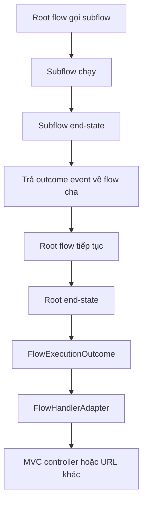
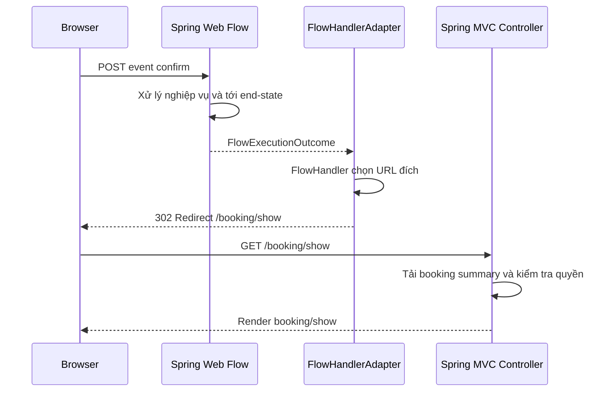

# Xử lý kết quả kết thúc để về MVC controller hoặc trang khác

Trong **Spring Web Flow**, một flow thường điều phối một hành trình có điểm bắt đầu, nhiều bước nhập liệu và một kết quả cuối cùng. Ví dụ quy trình đặt phòng có thể kết thúc bằng xác nhận thành công, hủy đặt phòng hoặc từ chối do hết chỗ. Sau khi flow kết thúc, ứng dụng thường cần chuyển người dùng sang một trang khác: một Spring MVC controller hiển thị chi tiết booking, trang danh sách, dashboard hoặc một website bên ngoài.

Spring Web Flow cung cấp hai cách chính để thực hiện bước bàn giao:

- Dùng **custom `FlowHandler`** để đọc `FlowExecutionOutcome` và quyết định URL redirect theo kết quả của flow.
- Khai báo **`externalRedirect:`** trên `view-state` hoặc `end-state` khi đích đến đã biết ngay trong flow definition.

Flow cũng có thể khai báo output trên từng `end-state`. Output này là hợp đồng dữ liệu mà adapter hoặc handler nhận được khi flow kết thúc. Bài học thuộc chương **URL và điều hướng**, tập trung vào cách đọc outcome, xuất dữ liệu có chủ đích, chuyển từ flow sang MVC controller/trang khác, phân biệt redirect nội bộ và bên ngoài, truyền output qua Spring MVC Flash Scope và kiểm thử toàn bộ quá trình bàn giao.

## 1. Điều gì xảy ra khi flow kết thúc?

Một `end-state` kết thúc flow session đang hoạt động. Nếu đó là root flow session, toàn bộ flow execution kết thúc và Spring Web Flow tạo ra một **flow execution outcome**. Outcome gồm:

- `id`: ID của `end-state` đã được đi tới.
- `output`: các thuộc tính output mà end-state khai báo.

Ví dụ:

```xml
<end-state id="bookingConfirmed">
    <output name="bookingId" value="booking.id" />
    <output name="confirmationNumber"
            value="booking.confirmationNumber" />
</end-state>

<end-state id="bookingCancelled" />
```

Khi flow kết thúc tại `bookingConfirmed`, outcome có ID `bookingConfirmed` và output chứa `bookingId`, `confirmationNumber`. Khi kết thúc tại `bookingCancelled`, outcome có ID `bookingCancelled` và không có output nào được khai báo.

`FlowExecutionOutcome` là đối tượng Spring Web Flow dùng để biểu diễn kết quả đó:

```java
String outcomeId = outcome.getId();
AttributeMap<Object> output = outcome.getOutput();

Object bookingId = output.get("bookingId");
```

ID outcome cho biết **nhánh nghiệp vụ đã kết thúc**; output mang dữ liệu cần bàn giao cho bước tiếp theo. Không nên suy ra dữ liệu nghiệp vụ từ tên URL hoặc tự đọc lại toàn bộ flow scope sau khi execution đã kết thúc.

### End-state của subflow và root flow khác nhau

Nếu `end-state` kết thúc một subflow, flow execution chưa kết thúc. Web Flow pop flow session con khỏi execution stack và trả outcome event cho flow cha để cha tiếp tục điều hướng. Chỉ khi root flow session kết thúc, outcome mới được chuyển tới Spring MVC `FlowHandlerAdapter` như kết quả hoàn tất của execution.



Vì vậy, không đặt logic redirect sang controller ở end-state của một subflow nếu ý định là kết thúc toàn bộ quy trình. Subflow nên trả outcome cho flow cha; root flow mới quyết định khi nào bàn giao ra ngoài.

## 2. Khai báo output trên end-state

`output` khai báo thuộc tính mà flow trả về khi kết thúc tại một end-state cụ thể. Ví dụ flow đặt phòng:

```xml
<flow xmlns="http://www.springframework.org/schema/webflow">

    <input name="hotelId" type="java.lang.Long" required="true" />

    <on-start>
        <evaluate expression="bookingService.createDraft(hotelId)"
                  result="flowScope.booking" />
    </on-start>

    <view-state id="enterDetails" view="booking/details">
        <transition on="review" to="reviewBooking" />
    </view-state>

    <view-state id="reviewBooking" view="booking/review">
        <transition on="confirm" to="bookingConfirmed" />
        <transition on="cancel" to="bookingCancelled" />
    </view-state>

    <end-state id="bookingConfirmed">
        <output name="bookingId" value="booking.id" />
        <output name="confirmationNumber"
                value="booking.confirmationNumber" />
    </end-state>

    <end-state id="bookingCancelled" />
</flow>
```

Output được khai báo bên trong end-state vì mỗi kết quả có thể trả về một tập dữ liệu khác nhau. Trong ví dụ, nhánh xác nhận trả mã booking và mã xác nhận; nhánh hủy không cần trả hai giá trị đó.

Nếu không ghi `value`, output được lấy từ biến trong flow scope cùng tên với output. Khi cần đổi tên hoặc tính giá trị khác, dùng `value` để chỉ rõ expression nguồn:

```xml
<end-state id="bookingConfirmed">
    <output name="bookingId" value="booking.id" />
    <output name="displayName"
            value="booking.hotel.displayName" />
</end-state>
```

### Chỉ xuất dữ liệu cần thiết

Flow output là hợp đồng với phần tiếp theo của ứng dụng. Nên xuất:

- ID tài nguyên mà controller cần tải lại.
- Mã xác nhận hoặc trạng thái hiển thị.
- Một vài giá trị nhỏ phục vụ điều hướng.

Tránh xuất toàn bộ entity graph, thông tin xác thực, dữ liệu thanh toán hoặc object nội bộ của flow. Controller nên tải dữ liệu cần hiển thị từ service theo ID và kiểm tra quyền truy cập bằng người dùng hiện tại.

## 3. FlowHandler là điểm mở rộng cho bàn giao sau khi kết thúc

Trong môi trường Servlet/Spring MVC, `FlowHandler` là extension point để tùy chỉnh cách một flow được gọi và xử lý khi kết thúc. Handler có thể:

1. Xác định flow ID cần chạy.
2. Tạo input map cho execution mới.
3. Xử lý `FlowExecutionOutcome` khi flow kết thúc.
4. Xử lý exception không được flow xử lý.

Thông thường, chỉ cần kế thừa `AbstractFlowHandler` và override các method thực sự cần. Các method không override dùng hành vi mặc định.

Method quan trọng trong bài này:

```java
public String handleExecutionOutcome(
        FlowExecutionOutcome outcome,
        HttpServletRequest request,
        HttpServletResponse response)
```

Method trả về một chuỗi mô tả resource cần redirect tới. Giá trị trả về `null` có nghĩa handler chưa xử lý outcome và để `FlowHandlerAdapter` áp dụng hành vi mặc định.

## 4. Cấu hình FlowHandlerMapping và FlowHandlerAdapter

Spring MVC cần biết request nào thuộc flow và dùng adapter nào để thực thi flow. Cấu hình XML điển hình:

```xml
<bean class="org.springframework.webflow.mvc.servlet.FlowHandlerMapping">
    <property name="flowRegistry" ref="flowRegistry" />
    <property name="order" value="0" />
</bean>

<bean class="org.springframework.webflow.mvc.servlet.FlowHandlerAdapter">
    <property name="flowExecutor" ref="flowExecutor" />
</bean>
```

`FlowHandlerMapping` ánh xạ URL path sang flow definition trong `FlowDefinitionRegistry`. Ví dụ URL `/hotels/booking` tìm flow có ID `hotels/booking`. `FlowHandlerAdapter` nhận handler đã được mapping và điều phối việc start hoặc resume execution.

Khi request tới một flow:

1. `DispatcherServlet` tìm handler qua các `HandlerMapping`.
2. `FlowHandlerMapping` xác định flow ID từ URL hoặc handler tương ứng.
3. `FlowHandlerAdapter` dùng `FlowExecutor` để start execution mới hoặc resume execution hiện có.
4. Khi root flow kết thúc, adapter nhận outcome.
5. Adapter gọi `FlowHandler.handleExecutionOutcome(...)` nếu handler tương ứng có override.
6. Handler trả URL redirect; adapter gửi HTTP redirect tới resource đích.

`FlowHandlerAdapter` là adapter cho flow trong Spring MVC, không phải controller nghiệp vụ để tự viết từng endpoint flow. Controller thông thường vẫn xử lý request sau khi redirect tới URL của nó.

## 5. Đăng ký custom FlowHandler theo flow ID

Bean name của custom `FlowHandler` phải khớp với ID của flow mà handler quản lý. Ví dụ:

```xml
<bean name="hotels/booking"
      class="com.example.booking.BookingFlowHandler" />
```

Với mapping này, request đi tới flow ID `hotels/booking` sẽ dùng `BookingFlowHandler` để xử lý input, outcome hoặc exception tùy method được override.

Có thể khai báo handler bằng annotation component nếu tên bean được đặt đúng:

```java
@Component("hotels/booking")
public class BookingFlowHandler extends AbstractFlowHandler {
    // Override các callback cần thiết.
}
```

Nếu tên bean không khớp flow ID, handler có thể không được tìm thấy và adapter dùng hành vi mặc định. Khi debug, kiểm tra flow ID mà mapping suy ra và tên bean thực tế trong Spring application context.

## 6. Ví dụ: chuyển tới MVC controller theo outcome

Giả sử flow đặt phòng có hai kết quả:

- `bookingConfirmed`: điều hướng tới controller hiển thị chi tiết booking.
- `bookingCancelled`: quay lại danh sách khách sạn.

Custom handler:

```java
package com.example.booking.web;

import javax.servlet.http.HttpServletRequest;
import javax.servlet.http.HttpServletResponse;

import org.springframework.webflow.execution.FlowExecutionOutcome;
import org.springframework.webflow.mvc.servlet.AbstractFlowHandler;

public class BookingFlowHandler extends AbstractFlowHandler {

    @Override
    public String handleExecutionOutcome(
            FlowExecutionOutcome outcome,
            HttpServletRequest request,
            HttpServletResponse response) {

        if ("bookingConfirmed".equals(outcome.getId())) {
            Object bookingId = outcome.getOutput().get("bookingId");
            return "contextRelative:/booking/show?bookingId=" + bookingId;
        }

        if ("bookingCancelled".equals(outcome.getId())) {
            return "contextRelative:/hotels";
        }

        return "contextRelative:/";
    }
}
```

`handleExecutionOutcome` nhận outcome sau khi root flow kết thúc. Handler chọn đích đến theo outcome ID và có thể lấy dữ liệu từ `outcome.getOutput()`.

Controller đích:

```java
@Controller
public class BookingController {

    private final BookingService bookingService;

    public BookingController(BookingService bookingService) {
        this.bookingService = bookingService;
    }

    @GetMapping("/booking/show")
    public String showBooking(
            @RequestParam("bookingId") Long bookingId,
            Model model,
            Principal principal) {

        BookingSummary summary =
            bookingService.findSummaryForUser(bookingId, principal.getName());
        model.addAttribute("booking", summary);
        return "booking/show";
    }
}
```

Controller tải lại summary theo ID và người dùng hiện tại. Cách này giữ flow output nhỏ, đồng thời để service kiểm tra ownership/authorization trước khi trả dữ liệu.

Trong ví dụ, `bookingId` là số nguyên dài nên phép nối chuỗi không tạo ký tự URL đặc biệt. Nếu output chứa chuỗi tự do, phải encode query parameter đúng cách bằng `UriComponentsBuilder` hoặc một cơ chế URI builder; không nối trực tiếp chuỗi do người dùng kiểm soát vào URL redirect.

## 7. FlowHandler trả về URL nào?

Chuỗi trả về từ `handleExecutionOutcome` được diễn giải theo các prefix redirect:

| Prefix | Ý nghĩa |
| --- | --- |
| Không có prefix, ví dụ `/hotels/index` | Mặc định tương đối với servlet mapping hiện tại |
| `servletRelative:` | Tương đối với servlet hiện tại |
| `contextRelative:` | Tương đối với context path của ứng dụng web |
| `serverRelative:` | Tương đối với server root |
| `http://` hoặc `https://` | URL đầy đủ tới resource |

Ví dụ:

```java
return "servletRelative:/booking/show";
return "contextRelative:/hotels";
return "serverRelative:/portal/home";
return "https://partner.example.com/return";
```

Nếu ứng dụng deploy dưới context path `/shop` và muốn đi tới controller trong cùng ứng dụng, `contextRelative:/booking/show` giúp xác định rõ đích đến theo web application context. Nếu không dùng prefix, `/booking/show` được hiểu tương đối với servlet mapping hiện tại, điều này có thể tạo URL khác mong đợi khi `DispatcherServlet` không map ở `/`.

Các prefix này cũng được hỗ trợ trong flow definition thông qua directive `externalRedirect:` trên `view-state` hoặc `end-state`.

## 8. Khi nào dùng externalRedirect: ngay trong flow definition?

Nếu đích đến đã cố định và không cần logic Java chọn theo outcome, có thể khai báo redirect ngay trên end-state:

```xml
<end-state id="showCatalog"
           view="externalRedirect:contextRelative:/catalog" />

<end-state id="visitPartner"
           view="externalRedirect:https://partner.example.com/return" />
```

`externalRedirect:` yêu cầu Web Flow gửi trình duyệt tới resource bên ngoài flow. Đích đến có thể là một controller trong cùng ứng dụng, một servlet resource hoặc website khác.

### Redirect tới MVC controller với output

Flow có thể khai báo output trên end-state có redirect:

```xml
<end-state id="finish"
           view="externalRedirect:summary">
    <output name="confirmationNumber"
            value="booking.confirmationNumber" />
</end-state>
```

Đây là cách khai báo gọn khi:

- Đích đến không phụ thuộc nhiều nhánh nghiệp vụ.
- URL có thể đặt ngay trong flow definition.
- Controller đích cần nhận output qua Spring MVC Flash Scope.

Để adapter tự lưu flow output vào MVC flash scope, bật cấu hình:

```xml
<bean class="org.springframework.webflow.mvc.servlet.FlowHandlerAdapter">
    <property name="flowExecutor" ref="flowExecutor" />
    <property name="saveOutputToFlashScopeOnRedirect" value="true" />
</bean>
```

Tính năng `saveOutputToFlashScopeOnRedirect` **tắt mặc định** vì lý do tương thích ngược. Khi bật, flow output được lưu vào MVC flash scope trước khi redirect nội bộ tương đối với servlet để controller/view đích có thể đọc ở request sau. Ví dụ `externalRedirect:summary` dùng resource tương đối với servlet mapping hiện tại; nếu chọn prefix khác, hãy xác nhận nó thuộc kiểu redirect mà adapter hỗ trợ truyền output.

Controller:

```java
@GetMapping("/booking/summary")
public String summary(
        @ModelAttribute("confirmationNumber") String confirmationNumber,
        Model model) {
    BookingSummary summary =
        bookingService.findSummaryByConfirmationNumber(confirmationNumber);
    model.addAttribute("booking", summary);
    return "booking/summary";
}
```

Trong ví dụ thực tế, nếu flash attribute có thể vắng mặt hoặc kiểu không đúng, controller nên xử lý trường hợp đó rõ ràng. Không dùng MVC flash scope như nơi lưu trạng thái lâu dài; đây là dữ liệu truyền qua redirect.

## 9. FlowHandler hay externalRedirect:?

Hai cơ chế đều có thể đưa người dùng ra khỏi flow, nhưng phù hợp với những nhu cầu khác nhau:

| Tiêu chí | Custom `FlowHandler` | `externalRedirect:` |
| --- | --- | --- |
| Nơi khai báo | Java bean gắn với flow ID | Flow XML trên view-state/end-state |
| Quyết định đích đến | Có thể dựa trên outcome ID, output, request hoặc response | Đích đến được khai báo trong flow definition |
| Logic rẽ nhánh | Phù hợp khi nhiều outcome có đích khác nhau | Phù hợp khi đích cố định |
| Coupling | Flow definition không phải chứa URL controller cụ thể | Flow definition biết URL đích |
| Truyền output | Handler có thể đọc output và tạo URL; có thể dùng MVC flash tùy adapter/config | Có thể dùng `saveOutputToFlashScopeOnRedirect` để controller đọc output |
| Kiểm thử | Unit test handler và MVC integration test | Flow execution test và redirect integration test |

Gợi ý lựa chọn:

- Dùng `FlowHandler` khi outcome `confirmed`, `cancelled`, `expired` hoặc các kết quả khác cần đích đến riêng.
- Dùng `externalRedirect:` khi một end-state luôn chuyển tới cùng một trang.
- Dùng MVC flash output khi controller đích cần dữ liệu nhỏ sau redirect và không muốn nhét dữ liệu đó vào query string.
- Dùng flow output mapping để định nghĩa rõ dữ liệu được bàn giao trong cả hai trường hợp.

## 10. Hành vi mặc định khi không có custom FlowHandler

Không phải flow nào cũng cần custom handler. Khi `handleExecutionOutcome` không được override hoặc trả về `null`, `FlowHandlerAdapter` dùng hành vi mặc định.

Trong cấu hình Spring MVC tiêu chuẩn:

- Khi flow kết thúc mà chưa gửi final response, adapter có thể bắt đầu một execution mới của cùng flow.
- Output của execution vừa kết thúc được chuyển thành input cho execution mới theo default handling.
- Khi client truy cập execution đã kết thúc hoặc hết hạn và xảy ra `NoSuchFlowExecutionException`, default handler cố gắng khởi động lại flow.
- Exception khác thường được chuyển cho Spring MVC `ExceptionResolver`, trừ khi custom handler xử lý riêng.

Hành vi này hữu ích cho flow có thể khởi động lại, nhưng có thể không phải điều mong muốn khi nghiệp vụ yêu cầu chuyển sang trang controller cụ thể. Nếu cần redirect theo kết quả nghiệp vụ, override `handleExecutionOutcome` và trả URL rõ ràng.

**Đừng nhầm default restart với redirect sang controller.** Nếu handler trả `null`, nó đang nhường quyền xử lý cho adapter, không có nghĩa flow sẽ tự tìm controller dựa trên outcome ID.

## 11. Tùy chỉnh input map khi flow được khởi chạy

`FlowHandler` còn có `createExecutionInputMap(HttpServletRequest request)`. Mặc định, các request parameter hiện tại được đưa vào flow input map. Có thể override khi chỉ muốn nhận một số input được phép:

```java
public class BookingFlowHandler extends AbstractFlowHandler {

    @Override
    public MutableAttributeMap<Object> createExecutionInputMap(
            HttpServletRequest request) {

        LocalAttributeMap<Object> input = new LocalAttributeMap<>();
        String hotelId = request.getParameter("hotelId");

        if (hotelId != null) {
            input.put("hotelId", Long.valueOf(hotelId));
        }
        return input;
    }
}
```

Ví dụ chỉ chuyển `hotelId` vào flow. Trong ứng dụng thật, cần xử lý conversion error, input thiếu và authorization. Flow cũng nên khai báo `<input name="hotelId" type="java.lang.Long" required="true" />` để xác định contract ở phía flow.

Không dùng `createExecutionInputMap` để tin mọi tham số client gửi. Input vẫn phải được kiểm tra trong service và theo quy tắc bảo mật.

## 12. Tùy chỉnh Flow ID và ánh xạ handler

Mặc định, Flow ID có thể được suy ra từ `pathInfo` của request. Ví dụ `/app/hotels/booking` có thể ánh xạ tới flow ID `hotels/booking`.

Nếu URL không phản ánh flow ID trực tiếp, custom handler có thể override `getFlowId()`:

```java
public class CheckoutFlowHandler extends AbstractFlowHandler {

    @Override
    public String getFlowId() {
        return "checkout";
    }
}
```

Handler có thể tùy chỉnh cả input và outcome, nhưng cần giữ mapping rõ ràng. Bean name của handler vẫn cần tương ứng với flow mà handler áp dụng.

## 13. Trả dữ liệu qua FlowExecutionOutcome an toàn

`FlowExecutionOutcome.getOutput()` là một `AttributeMap<Object>`. Vì vậy output có thể chứa nhiều kiểu object, nhưng nên giới hạn vào kiểu nhỏ và ổn định.

Ví dụ không nên:

```xml
<end-state id="bookingConfirmed">
    <output name="booking" value="booking" />
</end-state>
```

Việc xuất toàn bộ entity có thể:

- Tạo coupling giữa flow và controller.
- Kéo theo lazy association hoặc object graph lớn.
- Làm dữ liệu cũ không phù hợp sau deploy.
- Đưa field nội bộ hoặc dữ liệu nhạy cảm ra ngoài boundary.

Nên xuất:

```xml
<end-state id="bookingConfirmed">
    <output name="bookingId" value="booking.id" />
    <output name="confirmationNumber"
            value="booking.confirmationNumber" />
</end-state>
```

Controller tải summary theo ID. Nếu output được đưa vào URL query, encode từng giá trị. Nếu output không nên xuất hiện trong URL hoặc cần giữ nguyên object/value phức tạp, dùng MVC flash scope qua cấu hình adapter hoặc một cơ chế lưu trạng thái server-side phù hợp.

## 14. Xử lý nhiều outcome trong một handler

Flow có thể có nhiều end-state. Nên dùng `switch` hoặc nhánh rõ ràng để xử lý tất cả outcome dự kiến:

```java
@Override
public String handleExecutionOutcome(
        FlowExecutionOutcome outcome,
        HttpServletRequest request,
        HttpServletResponse response) {

    switch (outcome.getId()) {
        case "bookingConfirmed":
            return confirmedLocation(outcome);
        case "bookingCancelled":
            return "contextRelative:/hotels";
        case "bookingExpired":
            return "contextRelative:/booking/expired";
        default:
            return "contextRelative:/";
    }
}

private String confirmedLocation(FlowExecutionOutcome outcome) {
    Object bookingId = outcome.getOutput().get("bookingId");
    if (bookingId == null) {
        return "contextRelative:/booking/problem";
    }
    return "contextRelative:/booking/show?bookingId=" + bookingId;
}
```

Default branch giúp xử lý outcome mới được thêm sau này. Với hệ thống cần phát hiện cấu hình sai, có thể ghi log outcome không nhận diện và chuyển tới trang lỗi phù hợp thay vì âm thầm đưa người dùng về trang chủ.

Nếu `bookingId` là dữ liệu bắt buộc, nên xem việc thiếu output là lỗi contract và ghi nhận bằng log/metric. Không để controller đích phải đoán outcome nào vừa xảy ra.

## 15. Redirect ra website bên ngoài và bảo vệ open redirect

Spring Web Flow hỗ trợ redirect tới URL đầy đủ `http://` hoặc `https://`. Điều này hữu ích khi cần quay lại cổng thanh toán, hệ thống đối tác hoặc trang xác thực ngoài.

Tuy nhiên, không được nhận URL đích tùy ý từ request rồi trả thẳng cho `FlowHandler` hoặc đặt vào `externalRedirect:`. Nếu kẻ tấn công kiểm soát URL, ứng dụng có thể trở thành open redirect, dùng domain tin cậy để lừa người dùng.

Thực hành an toàn:

- Dùng danh sách host/path cho phép.
- Ưu tiên URL cố định trong cấu hình ứng dụng.
- Nếu cần chọn đích theo đối tác, dùng mã đối tác để tra URL từ cấu hình server-side.
- Không nối query string bằng dữ liệu chưa encode.
- Không dùng flow output làm URL đích nếu output đó có thể bị client sửa.
- Kiểm tra scheme và host trước khi trả redirect.

Ví dụ:

```java
private String partnerReturnLocation(String partnerCode) {
    if ("PAYMENT_A".equals(partnerCode)) {
        return "https://pay-a.example.com/return";
    }
    if ("PAYMENT_B".equals(partnerCode)) {
        return "https://pay-b.example.com/return";
    }
    return "contextRelative:/payment/error";
}
```

URL được chọn từ cấu hình server-side, không lấy nguyên văn từ query parameter.

## 16. Exception khi bàn giao và FlowHandler.handleException

Ngoài outcome, `FlowHandler` có thể override `handleException(FlowException, request, response)` để xử lý exception chưa được Web Flow xử lý.

Ví dụ:

```java
@Override
public String handleException(
        FlowException exception,
        HttpServletRequest request,
        HttpServletResponse response) {

    if (exception instanceof NoSuchFlowExecutionException) {
        return "contextRelative:/booking/restart";
    }
    return null;
}
```

Ví dụ này minh họa điểm mở rộng, nhưng cần kiểm tra loại exception cụ thể và chính sách của ứng dụng. Khi trả `null`, handler nhường cho default exception handling. Những lỗi không xử lý nên được chuyển tiếp tới Spring MVC exception resolver hoặc cơ chế xử lý lỗi đã cấu hình.

Không dùng exception handler để che mọi lỗi bằng redirect về trang chủ. Lỗi nghiệp vụ, execution hết hạn, lỗi lập trình và lỗi hạ tầng cần có cách xử lý và logging khác nhau.

## 17. PRG và redirect sau khi flow kết thúc

Spring Web Flow mặc định dùng **POST-REDIRECT-GET** khi đi vào view-state. Sau khi xử lý event từ form POST, browser được redirect tới URL execution rồi render view bằng GET. Điều này giúp refresh và Back hoạt động dễ dự đoán.

Khi flow kết thúc, redirect sang controller tiếp tục cùng nguyên tắc:



Browser gửi GET mới tới controller. Controller không nhận lại flow execution đang kết thúc; nó nhận request độc lập và dữ liệu được truyền qua URL, MVC flash scope hoặc một kho lưu trạng thái phù hợp.

## 18. Kiểm thử outcome và redirect

Nên kiểm thử ở nhiều tầng để xác nhận cả logic lựa chọn URL lẫn HTTP redirect thật.

### Unit test cho FlowHandler

Có thể tạo `FlowExecutionOutcome` với ID và output giả lập:

```java
@Test
public void confirmedOutcomeRedirectsToBooking() {
    LocalAttributeMap<Object> output = new LocalAttributeMap<>();
    output.put("bookingId", 42L);

    FlowExecutionOutcome outcome =
        new FlowExecutionOutcome("bookingConfirmed", output);

    BookingFlowHandler handler = new BookingFlowHandler();
    String location = handler.handleExecutionOutcome(
        outcome, new MockHttpServletRequest(),
        new MockHttpServletResponse());

    assertEquals(
        "contextRelative:/booking/show?bookingId=42",
        location);
}
```

Unit test này kiểm tra mapping outcome sang location. Nó không chứng minh `FlowHandlerAdapter` thực sự gửi redirect hoặc MVC controller đích hoạt động.

### Integration test với FlowHandlerAdapter/MockMvc

Kiểm tra:

1. Request khởi động flow được `FlowHandlerMapping` ánh xạ đúng flow.
2. Event xác nhận đưa flow tới end-state đúng.
3. Flow output có đúng key và giá trị.
4. Handler được tìm thấy theo bean name khớp flow ID.
5. Adapter trả redirect tới controller đích.
6. GET controller đích trả view/response mong đợi.
7. Output không bị đưa vào URL nếu dùng MVC flash scope.
8. Redirect ra host bên ngoài chỉ tới host được phép.

### Ma trận kiểm thử

| Kịch bản | Kết quả mong đợi |
| --- | --- |
| Outcome `bookingConfirmed` | Redirect tới controller chi tiết booking |
| Outcome `bookingCancelled` | Redirect về danh sách |
| Outcome `bookingExpired` | Redirect tới trang bắt đầu lại |
| Outcome không nhận diện | Vào default route an toàn hoặc xử lý lỗi có log |
| Output thiếu `bookingId` | Không tạo URL sai; dùng error/fallback route |
| Handler trả `null` | Adapter áp dụng default handling |
| Handler trả `contextRelative:` | URL tính theo context path ứng dụng |
| End-state dùng `externalRedirect:` | Adapter redirect tới resource được chỉ định |
| MVC flash output bật | Controller đích đọc được output ở request sau |
| MVC flash output tắt | Không giả định output tự xuất hiện trong controller |
| Execution đã hết hạn | Exception handler/default policy hoạt động đúng |
| Subflow kết thúc | Parent nhận outcome event; chưa redirect khỏi ứng dụng |

## 19. Lỗi thường gặp khi điều hướng sau end-state

| Triệu chứng | Nguyên nhân có thể | Hướng xử lý |
| --- | --- | --- |
| Flow kết thúc nhưng browser quay lại URL flow | Không có custom outcome handler; adapter dùng default restart | Override `handleExecutionOutcome` hoặc khai báo `externalRedirect:` |
| Handler không được gọi | Bean name không khớp flow ID hoặc mapping dùng flow khác | Kiểm tra FlowHandlerMapping và tên bean |
| Controller không nhận booking ID | End-state chưa khai báo output hoặc tên output sai | Kiểm tra `<output>` và `outcome.getOutput()` |
| Redirect URL sai context path | Dùng path tương đối servlet khi mong path tương đối ứng dụng | Dùng `contextRelative:` |
| Query parameter bị hỏng | Nối chuỗi chưa encode | Dùng URI builder/encode từng giá trị |
| Output không có trong MVC controller | `saveOutputToFlashScopeOnRedirect` chưa bật hoặc redirect không thuộc trường hợp hỗ trợ | Kiểm tra adapter property và kiểu redirect |
| Controller nhận entity detached/proxy lỗi | Xuất toàn bộ entity qua output | Xuất ID/DTO nhỏ và tải lại qua service |
| Subflow redirect ra controller quá sớm | Nhầm subflow end-state với root flow end-state | Trả outcome về parent; để root flow kết thúc |
| Redirect ra host lạ | URL đích lấy từ request hoặc output không tin cậy | Allowlist host/path và kiểm tra scheme |
| Flow lỗi rồi luôn về trang chủ | Exception handler bắt quá rộng | Phân loại lỗi, giữ nguyên exception không xử lý |

## 20. Bài thực hành: bàn giao flow booking cho MVC controller

Xây dựng flow `hotels/booking` có ba end-state:

- `bookingConfirmed`: hoàn tất đặt phòng.
- `bookingCancelled`: người dùng hủy.
- `bookingExpired`: phiên đặt phòng hết hạn.

Yêu cầu:

1. Khai báo output `bookingId` và `confirmationNumber` trên `bookingConfirmed`.
2. Tạo `BookingFlowHandler extends AbstractFlowHandler`.
3. Override `handleExecutionOutcome` để map từng outcome tới một URL khác nhau.
4. Đăng ký handler bằng bean name `hotels/booking`.
5. Cấu hình `FlowHandlerMapping` và `FlowHandlerAdapter` dùng registry/executor của ứng dụng.
6. Tạo `BookingController` xử lý GET `/booking/show` và tải summary theo ID + principal.
7. Dùng `contextRelative:` để tránh phụ thuộc servlet mapping.
8. Thử một end-state dùng `view="externalRedirect:summary"` và bật `saveOutputToFlashScopeOnRedirect`.
9. So sánh controller đọc dữ liệu từ query parameter với đọc từ MVC flash scope.
10. Viết unit test cho handler và integration test cho redirect/GET controller.
11. Thêm test cho output thiếu, outcome không nhận diện, execution hết hạn và URL ngoài allowlist.

Tiêu chí hoàn thành: root flow kết thúc đúng outcome, output chỉ chứa dữ liệu cần bàn giao, browser được redirect tới controller/trang đúng, controller tải dữ liệu và kiểm tra quyền độc lập, các trường hợp hủy/hết hạn có đích đến rõ ràng.

## 21. Tài liệu tham khảo

- [Spring Web Flow 2.5.1 Reference Guide — Spring MVC Integration](https://docs.spring.io/spring-webflow/docs/2.5.1.RELEASE/reference/htmlsingle/): cấu hình `FlowHandlerMapping`, `FlowHandlerAdapter`, custom `FlowHandler`, redirect prefix và MVC flash output.
- [FlowHandler API — Spring Web Flow 2.5.1](https://docs.spring.io/spring-webflow/docs/2.5.1.RELEASE/api/org/springframework/webflow/mvc/servlet/FlowHandler.html): các callback xác định flow ID, tạo input map, xử lý outcome và exception.
- [AbstractFlowHandler API — Spring Web Flow 2.5.1](https://docs.spring.io/spring-webflow/docs/2.5.1.RELEASE/api/org/springframework/webflow/mvc/servlet/AbstractFlowHandler.html): hành vi mặc định và quy tắc diễn giải redirect location.
- [FlowHandlerAdapter API — Spring Web Flow 2.5.1](https://docs.spring.io/spring-webflow/docs/2.5.x/api/org/springframework/webflow/mvc/servlet/FlowHandlerAdapter.html): adapter thực thi flow, xử lý outcome, redirect và tùy chọn lưu output vào MVC flash scope.
- [FlowExecutionOutcome API — Spring Web Flow 2.5.1](https://docs.spring.io/spring-webflow/docs/2.5.x/api/org/springframework/webflow/execution/FlowExecutionOutcome.html): outcome ID và output attribute map trả về khi execution kết thúc.

`end-state` xác định kết quả của flow và dữ liệu được xuất; `FlowHandler` hoặc `externalRedirect:` quyết định trình duyệt đi đâu sau đó. Khi root flow bàn giao output nhỏ, dùng URL đúng phạm vi, kiểm tra quyền ở controller đích và kiểm thử redirect qua adapter thật, ứng dụng có thể kết nối quy trình Web Flow với phần còn lại của Spring MVC mà không làm lẫn trách nhiệm giữa hai lớp.
