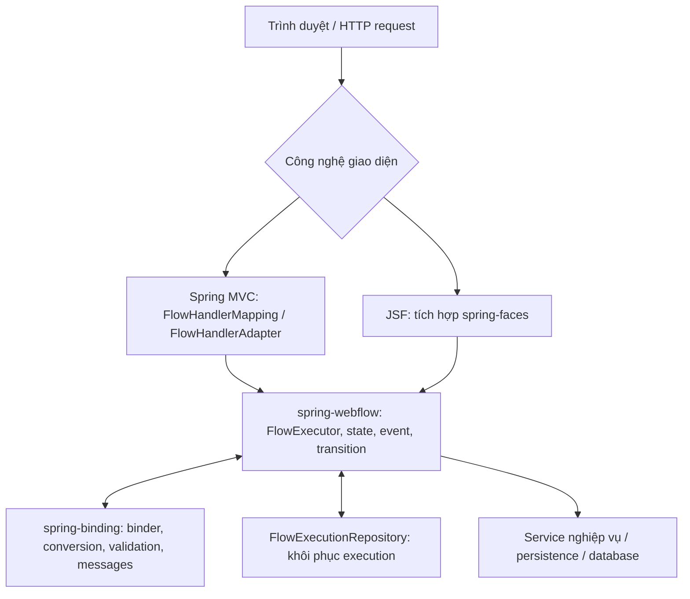
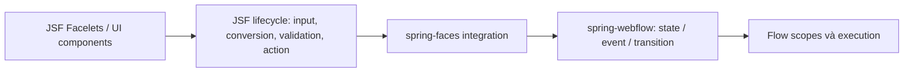
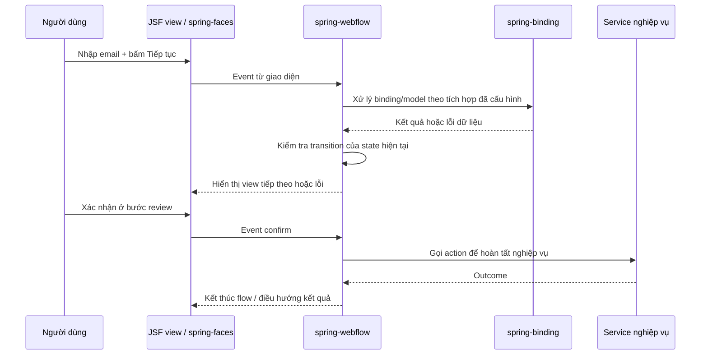

# Vai trò của spring-webflow, spring-binding và spring-faces

Khi bắt đầu sử dụng **Spring Web Flow** (`SPRING_WEB_FLOW`), người học dễ thấy nhiều tên artifact giống nhau trong `pom.xml` hoặc `build.gradle`: `spring-webflow`, `spring-binding` và `spring-faces`. Chúng cùng thuộc hệ sinh thái Spring Web Flow nhưng giải quyết **những trách nhiệm khác nhau**. Hiểu đúng ranh giới của từng module giúp chọn dependency vừa đủ, phân tích lỗi binding/điều hướng và tránh trộn các thư viện không tương thích khi nâng cấp.

Chương **Nền tảng và phiên bản** đặt ba module vào bức tranh chung của ứng dụng web nhiều bước: **state → event → transition**, form binding và validation, lưu dữ liệu trong scope, điều hướng với Spring MVC hoặc JavaServer Faces (JSF), rồi khôi phục flow sau mỗi HTTP request. Bài dùng ví dụ một luồng đăng ký tài khoản để minh họa. Các tên artifact và cấu trúc giải thích ở đây phản ánh cách tổ chức quen thuộc của dòng Spring Web Flow 2.x; với các dòng hoặc bản phát hành khác, cần kiểm tra tài liệu và artifact thực tế trước khi áp dụng.

## 1. Tại sao Spring Web Flow có nhiều module?

Một ứng dụng đăng ký tài khoản có thể cần thực hiện:

1. Hiển thị biểu mẫu thông tin tài khoản.
2. Nhận input, chuyển kiểu, kiểm tra các trường.
3. Khi người dùng bấm **Tiếp tục**, chuyển sang bước xem lại.
4. Khi bấm **Quay lại**, giữ dữ liệu đã nhập.
5. Khi bấm **Xác nhận**, gọi service tạo tài khoản và kết thúc flow.

Để đáp ứng cả năm thao tác, framework cần ba nhóm khả năng:

- **Điều phối quy trình:** định nghĩa state, event, transition, scope và vòng đời một flow execution.
- **Binding và validation:** nhận giá trị từ biểu mẫu, gán vào model, chuyển kiểu, thông báo lỗi cho người dùng.
- **Tích hợp công nghệ giao diện:** chuyển yêu cầu HTTP và sự kiện từ Spring MVC hoặc JSF thành tương tác với flow, sau đó render màn hình phù hợp.

Ba artifact tương ứng có thể hình dung như sau:



Sơ đồ nhấn mạnh **trách nhiệm**, không phải sơ đồ phụ thuộc Maven chính xác cho mọi phiên bản. Chẳng hạn `spring-binding` thường xuất hiện như dependency của `spring-webflow`, còn `spring-faces` chỉ cần khi tích hợp JSF có hỗ trợ ở dòng phiên bản đích.

## 2. Bảng so sánh nhanh ba artifact

| Artifact | Trách nhiệm chính | Thành phần hoặc vấn đề nổi bật | Khi nào thường cần? |
| --- | --- | --- | --- |
| `org.springframework.webflow:spring-webflow` | **Bộ máy flow**: định nghĩa, thực thi, điều hướng và quản lý state | `FlowDefinitionRegistry`, `FlowExecutor`, `view-state`, `action-state`, `transition`, các scope | Khi ứng dụng sử dụng Spring Web Flow để quản lý quy trình nhiều bước |
| `org.springframework.webflow:spring-binding` | **Hạ tầng binding** được Web Flow sử dụng: chuyển kiểu, gán thuộc tính, validation và thông báo lỗi | Bean property binding, conversion, message/validation infrastructure trong `org.springframework.binding.*` | Thường được kéo vào như dependency của `spring-webflow`; chỉ khai báo trực tiếp khi ứng dụng dùng API này hoặc build yêu cầu |
| `org.springframework.webflow:spring-faces` | **Tích hợp Web Flow với JSF/Jakarta Faces**, kết nối vòng đời UI component với flow | Xử lý view JSF, event và navigation theo tích hợp Faces/Web Flow của phiên bản đó | Khi ứng dụng thật sự dùng JSF và đã xác nhận phiên bản `spring-faces` tương thích |

Tên group/artifact trong bảng là cách đặt tên thường gặp. Không được suy ra có thể chọn **bất kỳ** phiên bản nào cho chúng: cần kiểm tra release notes, repository và dependency tree của chính dự án.

Một điểm dễ nhầm: `spring-faces` không phải “bộ máy flow thay cho spring-webflow”; nó là lớp tích hợp giao diện. Tương tự, `spring-binding` không phải framework điều hướng; nó phục vụ thao tác dữ liệu được bộ máy flow sử dụng.

## 3. spring-webflow: bộ máy điều phối state và transition

`spring-webflow` là phần trung tâm. Nó mô hình hóa một quy trình web như **một flow definition**: tập hợp các state, event và transition. Framework quản lý việc bắt đầu flow, tiếp tục flow theo execution key, chạy action, giữ dữ liệu trong scope và kết thúc flow.

Các khái niệm cốt lõi:

| Khái niệm | Cách hiểu | Ví dụ đăng ký tài khoản |
| --- | --- | --- |
| `FlowDefinitionRegistry` | Lưu và tra cứu **định nghĩa** flow theo ID | Flow có ID `registration` |
| `FlowExecutor` | Điều phối **một lần thực thi** flow, chạy state và xử lý event | Lần đăng ký tài khoản đang diễn ra |
| `FlowExecutionRepository` | Lưu/khôi phục một execution hoặc snapshot theo cấu hình | Người dùng gửi form ở bước 2 |
| `view-state` | State chờ người dùng tương tác với một view | `enterAccount`, `reviewAccount` |
| `action-state` | State thực hiện action/service và xử lý outcome | `createAccount` |
| `transition` | Quy tắc đi từ state hiện tại sang state khác khi có event | `on="continue" to="reviewAccount"` |
| `end-state` | Kết thúc flow | `completed`, `cancelled` |
| `flowScope` | Dữ liệu tồn tại trong vòng đời một flow execution | Biến `registration` chứa form |

Một flow XML mẫu:

```xml
<?xml version="1.0" encoding="UTF-8"?>
<flow xmlns="http://www.springframework.org/schema/webflow"
      xmlns:xsi="http://www.w3.org/2001/XMLSchema-instance"
      xsi:schemaLocation="
          http://www.springframework.org/schema/webflow
          http://www.springframework.org/schema/webflow/spring-webflow-2.0.xsd"
      start-state="enterAccount">

    <var name="registration"
         class="com.example.registration.RegistrationForm" />

    <view-state id="enterAccount"
                view="registration/account"
                model="registration">
        <transition on="continue" to="reviewAccount" />
        <transition on="cancel" to="cancelled" bind="false" />
    </view-state>

    <view-state id="reviewAccount"
                view="registration/review">
        <transition on="back" to="enterAccount" />
        <transition on="confirm" to="createAccount" />
    </view-state>

    <action-state id="createAccount">
        <evaluate expression="registrationService.create(registration)" />
        <transition on="success" to="completed" />
    </action-state>

    <end-state id="completed" />
    <end-state id="cancelled" />
</flow>
```

Ý chính của ví dụ là **Web Flow quyết định luồng đi qua các màn hình và action như thế nào**. Đây không phải ứng dụng chạy độc lập: cần thêm `RegistrationForm`, service, cấu hình registry/executor, MVC/JSF integration và view tương ứng.

Đặc biệt, logic `registrationService.create(...)` phải xử lý transaction, xác thực, kiểm tra quyền và tính idempotent theo yêu cầu nghiệp vụ. `spring-webflow` điều phối thời điểm gọi service; nó không tự động trở thành lớp lưu database hay dịch vụ quản lý người dùng.

## 4. spring-binding: nhận form và bảo đảm dữ liệu vào đúng model

Người dùng không gửi trực tiếp object Java khi submit HTML form. HTTP request mang các tham số như:

```text
email=an@example.test
age=21
_eventId_continue=1
```

Ứng dụng cần gán `email` và `age` vào một instance `RegistrationForm`. Nếu `age` được khai báo `Integer`, một cơ chế chuyển kiểu cần đổi `"21"` thành số nguyên; nếu `age=abc`, cần ghi nhận lỗi thay vì âm thầm coi dữ liệu hợp lệ.

`spring-binding` cung cấp nền tảng cho các thao tác **binding, conversion, validation và message context** mà Web Flow sử dụng. Phần lớn người viết flow tiếp cận các khả năng này thông qua `view-state`, `model`, `binder` và cơ chế báo lỗi chứ không cần tự lập trình từng class nội bộ.

JavaBean mẫu:

```java
package com.example.registration;

public class RegistrationForm {
    private String email;
    private Integer age;

    public RegistrationForm() {
    }

    public String getEmail() {
        return email;
    }

    public void setEmail(String email) {
        this.email = email;
    }

    public Integer getAge() {
        return age;
    }

    public void setAge(Integer age) {
        this.age = age;
    }
}
```

Khai báo binder cụ thể trong một `view-state`:

```xml
<view-state id="enterAccount"
            view="registration/account"
            model="registration">
    <binder>
        <binding property="email" required="true" />
        <binding property="age" required="true" />
    </binder>

    <transition on="continue" to="reviewAccount" />
    <transition on="cancel" to="cancelled" bind="false" />
</view-state>
```

Đoạn này thực hiện ba việc:

1. `model="registration"` chọn **đối tượng đích** để binder cập nhật.
2. `<binding property="...">` khai báo **các thuộc tính được phép nhận** từ form.
3. `required="true"` quy định thông tin đầu vào bắt buộc theo binder.

Nếu yêu cầu nghiệp vụ là `age >= 18` hoặc email phải có định dạng hợp lệ, vẫn cần **validation** tương ứng. Binding thành công chỉ chứng minh có thể gán/chuyển kiểu dữ liệu; nó chưa chứng minh giá trị hợp lệ về nghiệp vụ.

### Phân biệt binding, conversion và validation

| Bước | Câu hỏi | Trường hợp ví dụ |
| --- | --- | --- |
| Binding | Field `age` có gắn được vào property đích không? | `age` phải có setter hoặc đường gán hợp lệ |
| Conversion | `"21"` có đổi thành `Integer` được không? | `"abc"` gây lỗi chuyển kiểu |
| Validation | Người dùng có đủ điều kiện đăng ký không? | `age=12` đổi kiểu được nhưng có thể không hợp lệ |
| Message | Thông tin lỗi được trả đến view ra sao? | Thông báo cạnh input `age` |

Trình tự thực tế phụ thuộc cách cấu hình binder, validator và transition. Một lỗi conversion/validation có thể khiến view được hiển thị lại; không nên coi sự kiện `continue` được gửi là bằng chứng flow đã chuyển state thành công.

## 5. spring-binding khác Spring MVC WebDataBinder thế nào?

Một ứng dụng dùng Spring MVC có thể quen với `@ModelAttribute`, `WebDataBinder` và các converter/validator của Spring MVC. Đây là điểm cần phân biệt:

- **Spring MVC** có cơ chế binding đối tượng trong controller hoặc handler do MVC quản lý.
- **Spring Web Flow** có quá trình binding model **theo view-state và flow execution**, sử dụng hạ tầng của Web Flow/Spring Binding.
- Hai cơ chế có thể dùng những khái niệm chung như bean property, converter, validator hoặc message, nhưng **không nên giả định** mọi customization của MVC sẽ tự động áp dụng cho mọi Web Flow expression và binder.

Ví dụ, thêm một formatter hoặc converter vào cấu hình Spring MVC chưa chắc đã cấu hình đúng conversion service mà **flow builder** đang sử dụng. Khi giá trị ngày tháng, enum hoặc tiền tệ không chuyển kiểu được trong flow, cần kiểm tra conversion service của đúng tầng.

Spring Binding không thay thế Spring MVC request mapping. Request vẫn phải đi qua cấu hình định tuyến đến flow; binding chỉ bắt đầu khi có model và view-state phù hợp.

## 6. spring-faces: tích hợp riêng cho ứng dụng dùng JSF

**JavaServer Faces (JSF)** là một công nghệ giao diện dựa trên component, có vòng đời request/render, các component nhập liệu, converter, validator và navigation. Trong hệ Jakarta EE mới, JSF thường được gọi là **Jakarta Faces**.

Với ứng dụng sử dụng JSF để render màn hình của flow, `spring-faces` là module **tích hợp Spring Web Flow với JSF**. Nó giúp hai hệ thống phối hợp về view rendering, event và navigation dựa trên khả năng mà **dòng Spring Web Flow/JSF cụ thể** hỗ trợ.



Những vấn đề cần hiểu khi dùng `spring-faces`:

- JSF có **vòng đời component riêng**, nên form postback, converter, validator và thông báo lỗi cần được kiểm thử theo cơ chế JSF.
- Web Flow vẫn xác định **quy trình tổng thể**: state đang hiển thị, event nào đưa tới transition nào, dữ liệu nào tồn tại trong scope.
- Các scope và biến trong flow cần được tích hợp đúng để view JSF có thể tham chiếu tới model đang được quản lý.
- Sự kiện từ JSF action phải được nối với cơ chế điều hướng của Web Flow theo cấu hình adapter.
- Không thể coi một component JSF bất kỳ, kể cả thư viện bên thứ ba, là tương thích chỉ vì có artifact `spring-faces` trên classpath.

Ví dụ Facelets để minh họa phía giao diện:

```xml
<h:form xmlns:h="http://xmlns.jcp.org/jsf/html">
    <h:outputLabel for="email" value="Email" />
    <h:inputText id="email" value="#{registration.email}" />
    <h:message for="email" />

    <h:commandButton value="Tiếp tục" action="continue" />
</h:form>
```

Đây chỉ là ví dụ về **JSF component và action outcome**, không phải một view Web Flow hoàn chỉnh chạy độc lập. Namespace Facelets và quy tắc ánh xạ event cần xác minh theo **đúng bản JSF/Jakarta Faces và Web Flow**: không tự copy URI của ứng dụng JSF thế hệ cũ vào runtime Jakarta mới. Trong một bản Jakarta Faces mới, namespace component cũng có thể thay đổi theo tài liệu của dòng ấy.

### Khi nào không cần spring-faces?

Nếu dự án dùng **Spring MVC + JSP**, **Thymeleaf** hoặc một view technology không qua JSF, phần điều phối flow vẫn do `spring-webflow` thực hiện. Khi đó, `spring-faces` thường **không cần**; thêm nó chỉ làm tăng số dependency và rủi ro tương thích JSF ngoài phạm vi.

Đặc biệt, **Spring form tags** trong JSP là công nghệ form riêng của Spring MVC, không phải bằng chứng ứng dụng đang sử dụng `spring-faces`.

## 7. Chọn dependency theo công nghệ giao diện

Một dự án Spring MVC sử dụng Web Flow thường bắt đầu từ artifact trung tâm:

```xml
<!-- Maven: Web Flow cho ứng dụng Spring MVC -->
<properties>
    <spring-webflow.version>TARGET_VERIFIED_VERSION</spring-webflow.version>
</properties>

<dependencies>
    <dependency>
        <groupId>org.springframework.webflow</groupId>
        <artifactId>spring-webflow</artifactId>
        <version>${spring-webflow.version}</version>
    </dependency>
</dependencies>
```

Trong nhiều bản Web Flow, `spring-webflow` **đã kéo `spring-binding` qua dependency transitively**. Vì vậy, không cần khai báo `spring-binding` trực tiếp chỉ để form binding hoạt động, miễn là dependency tree thực tế đã có nó và không có exclusion làm mất.

Nếu ứng dụng **dùng trực tiếp API** từ `org.springframework.binding.*`, hoặc chính sách build yêu cầu khai báo các dependency được dùng trực tiếp, có thể khai báo `spring-binding` cùng phiên bản tương thích:

```xml
<dependency>
    <groupId>org.springframework.webflow</groupId>
    <artifactId>spring-binding</artifactId>
    <version>${spring-webflow.version}</version>
</dependency>
```

Nếu ứng dụng sử dụng **JSF với bản spring-faces được xác nhận hỗ trợ**, thêm tích hợp Faces:

```xml
<dependency>
    <groupId>org.springframework.webflow</groupId>
    <artifactId>spring-faces</artifactId>
    <version>${spring-webflow.version}</version>
</dependency>
```

`TARGET_VERIFIED_VERSION` là **placeholder**, không phải version có thể build ngay. Cùng property phiên bản chỉ thể hiện ý định **đồng bộ phiên bản các module** trong cùng một dòng phát hành; hãy kiểm tra artifact nào thực sự được phát hành, các dependency bắt buộc và ma trận hỗ trợ trước khi dùng.

Ví dụ Gradle Groovy DSL tương ứng:

```groovy
def webFlowVersion = providers.gradleProperty("springWebflowVersion").get()

dependencies {
    implementation "org.springframework.webflow:spring-webflow:$webFlowVersion"

    // Chỉ khi dùng trực tiếp API spring-binding:
    // implementation "org.springframework.webflow:spring-binding:$webFlowVersion"

    // Chỉ khi dùng JSF và đã xác minh tích hợp của bản đích:
    // implementation "org.springframework.webflow:spring-faces:$webFlowVersion"
}
```

```properties
# gradle.properties - thay bằng phiên bản đã xác minh
springWebflowVersion=TARGET_VERIFIED_VERSION
```

Một ứng dụng Spring MVC cũng cần các thành phần Spring MVC, view resolver và cấu hình HTTP tương ứng. Artifact `spring-webflow` không tự tạo đầy đủ controller, security, persistence hoặc tất cả cấu hình view cho mọi loại ứng dụng.

## 8. Dependency tree cho thấy quan hệ thật ở runtime

Một khai báo trực tiếp chỉ là **ý định của build**, không bảo đảm runtime resolve đúng phiên bản. Dependency management, BOM, exclusion hoặc conflict resolution có thể làm phiên bản cuối khác mong muốn.

Với Maven:

```bash
mvn dependency:tree -Dincludes=org.springframework.webflow
```

Với Gradle:

```bash
./gradlew dependencies --configuration runtimeClasspath
./gradlew dependencyInsight --dependency spring-binding --configuration runtimeClasspath
```

Trên Windows, dùng wrapper `gradlew.bat` phù hợp. Những lệnh trên là ví dụ để người học chạy trong **dự án ứng dụng** có build tương ứng.

Dữ liệu nên ghi lại sau khi chạy:

| Cần xác minh | Kết quả mong muốn |
| --- | --- |
| `spring-webflow` | Có đúng version được phê duyệt, không bị ép thành bản khác |
| `spring-binding` | Có mặt khi cần và dùng version tương thích với Web Flow |
| `spring-faces` | Chỉ có khi tích hợp JSF cần nó và hỗ trợ dòng đích |
| Spring Framework | Tổ hợp module Web/MVC/Context/TX tương thích với Web Flow |
| JSF/Jakarta Faces | Có API và implementation được hỗ trợ nếu dùng Faces |
| Servlet/Jakarta Servlet | API phù hợp với container và dòng Spring đang dùng |
| Validation/conversion | Provider và các converter phù hợp công nghệ giao diện/binding |
| Thư viện trùng/xung đột | Không có binary API hoặc namespace bị trộn gây lỗi |

**Không nhất thiết cứ có nhiều artifact Web Flow là sai.** Ba artifact cùng tồn tại có thể đúng trong ứng dụng JSF. Vấn đề là liệu chúng có đúng **một tổ hợp hỗ trợ** và phục vụ đúng công nghệ giao diện của ứng dụng hay không.

## 9. Phiên bản và ranh giới javax/Jakarta

Tên ba artifact có thể giữ quen thuộc, nhưng **API Java EE/Jakarta EE** mà mỗi phiên bản tương tác không nhất thiết giống nhau. Khi nâng cấp nền tảng, cần xét cả chuỗi:

```text
JDK
  ↓
Spring Framework / Spring Boot (nếu có)
  ↓
Spring Web Flow + Spring Binding
  ↓
Spring MVC hoặc Spring Faces / JSF
  ↓
Servlet container, validation, security, persistence
```

Các ví dụ dễ gặp:

- Dòng Servlet cũ sử dụng `javax.servlet.*`; nền tảng Jakarta Servlet mới sử dụng `jakarta.servlet.*`. Hai loại class này không hoán đổi được bằng cách thêm cùng lúc hai API JAR.
- Với JSF, `javax.faces.*` và `jakarta.faces.*` thuộc những hệ API khác nhau. Bản `spring-faces` và JSF implementation phải tương thích **về chữ ký Java lẫn vòng đời view**.
- Các constraint validation cũng có các thế hệ `javax.validation.*` và `jakarta.validation.*`; cần đồng bộ cả API và implementation.
- Nếu ứng dụng dùng Spring Boot BOM, không được mặc định BOM đó quản lý mọi artifact của Spring Web Flow. Hãy xác minh dependency management của phiên bản Boot đích.

Không nên đưa ra ma trận kiểu “Web Flow X luôn chạy với Framework Y” khi chưa tra **release notes/reference documentation của bản đích**. Đặc biệt, việc Spring Framework đích hỗ trợ Jakarta không tự chứng minh một artifact `spring-faces` của dòng cũ cũng tương thích Jakarta Faces.

### Tài liệu cần mở khi khóa phiên bản

- [Spring Web Flow project](https://spring.io/projects/spring-webflow): thông tin dự án và đường dẫn tài liệu.
- [Spring Web Flow releases](https://github.com/spring-projects/spring-webflow/releases): các bản phát hành, release notes hoặc tài liệu liên quan.
- [Spring Web Flow repository](https://github.com/spring-projects/spring-webflow): nguồn code và build metadata theo tag.
- [Spring Framework reference](https://docs.spring.io/spring-framework/reference/): yêu cầu nền tảng và cấu hình MVC phù hợp.

Các đường dẫn là **điểm bắt đầu tra cứu**. Khi lập quyết định nâng cấp, phải chọn đúng tag/version và đọc release notes của **các bản trung gian** giữa hiện tại và đích, cùng tài liệu JSF/Servlet nếu dùng.

## 10. Một request đi qua ba module như thế nào?

Giả sử ứng dụng sử dụng JSF. Người dùng mở flow `registration`, nhập `email` và bấm **Tiếp tục**:



Sơ đồ này thể hiện **sự phối hợp khái niệm**. Trong triển khai JSF thật, một số chuyển kiểu/validation của component xảy ra trong JSF lifecycle; không phải mọi field đều đi qua cùng một đường gọi binder như JSP. Tài liệu và kiểm thử của phiên bản tích hợp đang dùng mới quyết định chính xác trình tự callback.

Với **Spring MVC + JSP/Thymeleaf**, thành phần `spring-faces` không tham gia: request được MVC adapter chuyển đến `FlowExecutor`, Web Flow dùng binding infrastructure của nó để xử lý model theo cấu hình view-state, rồi trả view qua view resolver.

## 11. Hai cấu hình ứng dụng để lựa chọn

### Trường hợp A: đăng ký qua Spring MVC + JSP hoặc Thymeleaf

Kiến trúc có thể gồm:

- `spring-webflow` điều phối flow `registration`.
- `spring-binding` đi vào classpath qua dependency Web Flow và hỗ trợ form binding/validation của view-state.
- Spring MVC `FlowHandlerMapping` và `FlowHandlerAdapter` định tuyến request.
- View JSP/Thymeleaf render form và gửi event, thường dùng URL tiếp tục do Web Flow tạo.

Minh họa cấu hình Spring XML khi namespace `webflow` đã được khai báo:

```xml
<webflow:flow-registry id="flowRegistry">
    <webflow:flow-location
        id="registration"
        path="/WEB-INF/flows/registration/registration-flow.xml" />
</webflow:flow-registry>

<webflow:flow-executor
    id="flowExecutor"
    flow-registry="flowRegistry" />

<bean class="org.springframework.webflow.mvc.servlet.FlowHandlerMapping">
    <property name="flowRegistry" ref="flowRegistry" />
</bean>

<bean class="org.springframework.webflow.mvc.servlet.FlowHandlerAdapter">
    <property name="flowExecutor" ref="flowExecutor" />
</bean>
```

Đoạn cấu hình chưa bao gồm namespace declarations, `DispatcherServlet`, view resolver và các bean nghiệp vụ. Nó minh họa mối quan hệ **registry → executor → MVC mapping/adapter**; không cần `spring-faces` chỉ vì ứng dụng có form.

### Trường hợp B: đăng ký bằng JSF/Facelets

Ứng dụng có thể tiếp tục dùng `spring-webflow` quản lý flow, `spring-binding` phục vụ khả năng binding chung của framework, và `spring-faces` nối với UI component/JSF lifecycle. Bên cạnh ba artifact, cần **JSF API + implementation + view technology** đúng dòng tương thích và cấu hình integration của bản Web Flow đích.

Không tự áp cấu hình FlowHandlerAdapter MVC ở Trường hợp A thành toàn bộ cấu hình JSF. Đường xử lý JSF postback, EL, FacesServlet, view handler và integration cụ thể phải được thiết lập theo tài liệu của phiên bản được chọn.

Nếu ứng dụng dùng JSF có nhiều component, converter hoặc stateful widget, phần kiểm thử riêng cho **view restoration**, postback và validation là bắt buộc để đánh giá tích hợp hoạt động đúng.

## 12. Dấu hiệu lỗi và module cần kiểm tra trước

| Hiện tượng | Thành phần cần xem đầu tiên | Bằng chứng cần thu thập |
| --- | --- | --- |
| Flow ID không được tìm thấy | `spring-webflow` registry/MVC mapping | Flow ID, tài nguyên XML, `FlowDefinitionRegistry` |
| `BeanCreationException` khi dựng executor | `spring-webflow` và cấu hình Spring | `Caused by`, bean bị thiếu, version conflict |
| Event gửi đúng mà không chuyển state | Flow state/transition và validation | State ID, event ID, message lỗi trên view |
| Input `age=abc` không được chuyển kiểu | Binding/conversion của Web Flow hoặc JSF converter | Field, kiểu Java đích, converter, lỗi chi tiết |
| Thông báo form không hiển thị | Message/validation/view integration | Message context, JSP/JSF renderer/tag và lifecycle |
| JSF postback hoặc action không tiếp tục flow | `spring-faces`, JSF và Web Flow integration | JSF version, view ID, event, Faces lifecycle, log |
| `ClassNotFoundException` liên quan Faces | JSF/Faces API hoặc `spring-faces` version | Class name, dependency tree, `javax` hay `jakarta` |
| `NoSuchMethodError` ở Web Flow/Binding | Xung đột binary dependency | Version `spring-webflow`/`spring-binding` đã resolve |
| Refresh/Back mất state | `FlowExecutionRepository`, session và flow configuration | Execution key, timeout, chính sách snapshot |
| Lỗi security khi submit | Spring Security/CSRF và flow integration | HTTP status, filter chain, token và quyền |

Bảng là **gợi ý bước đầu**, không phải kết luận tự động. Một lỗi form có thể do view gửi sai field, model không có setter, validation đang chặn transition hoặc session đã mất; cần đi từ request thực tế tới flow state rồi mới quy lỗi cho artifact.

Có thể bật logging trong ứng dụng Spring Boot để thu thập ngữ cảnh:

```properties
logging.level.org.springframework.webflow=DEBUG
logging.level.org.springframework.binding=DEBUG
```

Nếu dùng JSF, bật thêm logger theo công cụ JSF implementation được chọn. Các package logger và lượng thông tin thực tế khác nhau theo phiên bản; tránh ghi dữ liệu form nhạy cảm hoặc execution key đầy đủ vào log công khai.

## 13. Kiểm thử tối thiểu để chứng minh các module phối hợp đúng

Không nên dùng “dự án biên dịch được” làm tiêu chí duy nhất. Nên kiểm tra theo tầng:

| Nhóm test | Mục tiêu | Cách xác nhận |
| --- | --- | --- |
| Dependency | Module và version resolved hợp lệ | In dependency tree, kiểm tra artifact trùng, version sai và javax/Jakarta |
| Registry | `spring-webflow` tạo được flow | ApplicationContext khởi động, flow ID có mặt |
| State/event | Điều hướng đúng | Submit event `continue`, `back`, `cancel`, `confirm` |
| Binding | Model nhận đúng property | Form gửi `email`, `age=21`; object có giá trị đúng |
| Conversion | Kiểu input chính xác | `age=abc` bị từ chối với lỗi phù hợp |
| Validation | Nghiệp vụ chặn dữ liệu sai | `age` dưới giới hạn không được chuyển sang bước xác nhận |
| Scope | Dữ liệu giữ qua nhiều state | Quay lại màn hình trước không mất form ngoài dự kiến |
| HTTP/session | Execution được khôi phục đúng | Refresh, Back/Forward, timeout, nhiều tab |
| JSF (nếu dùng) | `spring-faces` tích hợp đúng JSF | Postback, converter, validator, action, view restoration |
| Security | Flow được bảo vệ | Kiểm tra CSRF, xác thực, phân quyền action nhạy cảm |

Ví dụ chuỗi kiểm thử đăng ký:

1. Mở `/registration` (theo URL mapping của dự án) và xác nhận state đầu là `enterAccount`.
2. Gửi form chứa `email` hợp lệ và `age=abc`. View giữ ở bước hiện tại, xuất hiện thông báo lỗi chuyển kiểu.
3. Sửa thành `age=21` rồi gửi event `continue`, xác nhận state chuyển sang `reviewAccount`.
4. Bấm `back`, xác nhận model còn dữ liệu đã nhập.
5. Bấm `confirm`, xác nhận service nghiệp vụ thực thi với dữ liệu đã validate; flow kết thúc đúng.
6. Nếu dùng JSF, chạy lại chuỗi qua JSF postback, không chỉ gọi trực tiếp executor trong unit test.

Nếu test binding thất bại, hãy tìm cụ thể lỗi ở **tên input, getter/setter, converter, validator hoặc lifecycle**, thay vì vội thêm `spring-binding` một lần nữa khi artifact đã nằm trong classpath.

## 14. Những hiểu lầm phổ biến

**“Muốn dùng Web Flow phải khai báo cả ba artifact.”** Không đúng với ứng dụng Spring MVC/JSP thông thường: `spring-webflow` là module chính, `spring-binding` thường transitively có sẵn, còn `spring-faces` chỉ phục vụ ứng dụng JSF tương thích.

**“spring-binding tự động validate mọi nghiệp vụ.”** Binding và conversion không thay thế quy tắc nghiệp vụ. Field có thể chuyển kiểu thành công nhưng vẫn không hợp lệ, và validator phải được đăng ký/cấu hình đúng.

**“spring-faces là công nghệ giao diện được dùng tự động khi có flow XML.”** Không. Flow XML là định nghĩa điều hướng; view được render qua công nghệ giao diện và adapter đã cấu hình. Thêm artifact không tự thay đổi JSP thành JSF.

**“Các module cùng groupId thì luôn tương thích với mọi bản Spring Framework.”** Không. Cần đối chiếu baseline Java, Spring, Servlet, Validation và JSF của chính phiên bản đích. Đặc biệt, ranh giới `javax.*`/`jakarta.*` có thể gây lỗi binary dù dependency resolve được.

**“Sửa phiên bản spring-webflow là đủ.”** Các dependency bắc cầu và integration adapter có thể bị ảnh hưởng. Nên ghi lại dependency tree trước/sau rồi chạy regression test của flow quan trọng.

## 15. Bài thực hành: chọn dependency đúng cho ba ứng dụng

Cho ba ứng dụng cùng muốn dùng flow đăng ký:

- **Ứng dụng A:** Spring MVC + Thymeleaf, flow nhiều bước, không sử dụng JSF.
- **Ứng dụng B:** Spring MVC + JSP, muốn dùng trực tiếp một API trong `org.springframework.binding.*` từ mã ứng dụng.
- **Ứng dụng C:** JSF/Facelets + Spring Web Flow, có custom JSF validator và cần postback trong view-state.

**Câu hỏi:**

1. Artifact nào là **bắt buộc về chức năng điều phối** trong cả ba ứng dụng?
2. Khi nào cần khai báo `spring-binding` trực tiếp?
3. Ứng dụng nào cần xem xét `spring-faces`?
4. Vì sao chưa thể chốt version của ba artifact chỉ dựa trên việc cùng groupId?
5. Nêu tối thiểu ba kiểm thử riêng cho ứng dụng C.

**Gợi ý lời giải:**

| Ứng dụng | Lựa chọn dependency ban đầu | Điều phải xác minh |
| --- | --- | --- |
| A | `spring-webflow`; `spring-binding` do dependency tree cung cấp khi có yêu cầu | Spring MVC mapping/adapter, binder, view Thymeleaf và flow state |
| B | `spring-webflow`; có thể khai báo trực tiếp `spring-binding` vì mã nguồn dùng API của module đó | Đồng bộ phiên bản, tránh khai báo trùng gây override |
| C | `spring-webflow` + `spring-faces` đúng dòng; `spring-binding` theo dependency tree | Tương thích JSF/Servlet/Jakarta, postback, custom converter/validator và view restoration |

Version phải được xác minh từ bản phát hành cụ thể và compatibility matrix của Spring Framework, JDK, Servlet và JSF. Với ứng dụng C, kiểm thử ít nhất: **JSF action kích hoạt đúng event của flow**, **validator/converter JSF xử lý input sai đúng cách**, và **quay lại/reload view vẫn giữ trạng thái theo thiết kế**. Nên bổ sung kiểm thử session timeout, nhiều tab và quyền truy cập ở những quy trình có dữ liệu quan trọng.

**Điểm cần nhớ:** `spring-webflow` là **bộ máy điều phối**, `spring-binding` là **hạ tầng nhận và kiểm tra dữ liệu**, còn `spring-faces` là **tầng tích hợp với JSF khi được sử dụng**. Hiểu rõ trách nhiệm và phiên bản tương thích của từng module giúp triển khai hành trình nhiều bước qua state, event và transition với Spring MVC hoặc Faces mà không phải trộn lẫn logic điều hướng, binding và công nghệ view.
