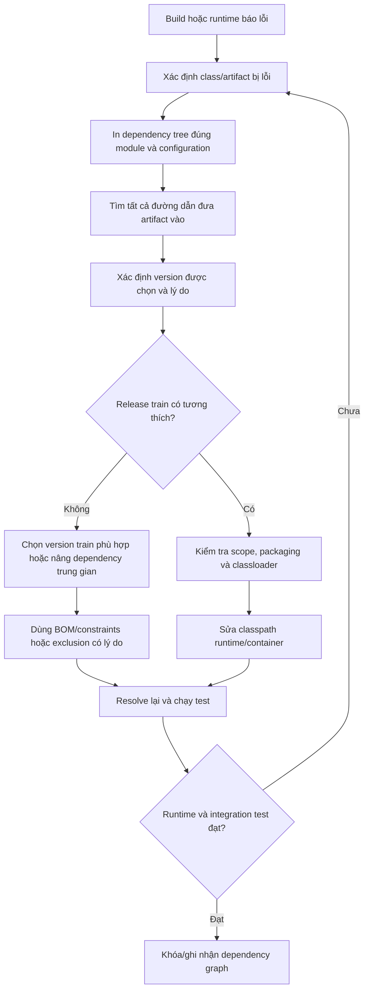

# Kiểm tra dependency bắc cầu và xung đột phiên bản

## 1. Vì sao dependency bắc cầu cần được kiểm tra?

Một ứng dụng **Spring Web Flow** (**SPRING_WEB_FLOW**) không chỉ chạy nhờ một JAR **spring-webflow**. Framework này sử dụng Spring Framework, Spring Binding, Spring MVC và có thể tích hợp Spring Security, Jakarta Faces, validation provider, logging cùng nhiều thư viện khác. Những thư viện mà dependency trực tiếp kéo theo được gọi là **transitive dependencies** (dependency bắc cầu).

Ví dụ, ứng dụng khai báo Spring Web Flow, nhưng metadata của thư viện này lại yêu cầu các module Spring khác. Một starter hoặc adapter trong dự án cũng có thể yêu cầu những module đó ở version khác. Build tool phải giải quyết toàn bộ graph để tạo classpath cuối cùng.

Vấn đề không chỉ là “có hai version trong file build”. Điều cần xác định là:

- Dependency nào đưa artifact vào graph?
- Có bao nhiêu đường dẫn cùng dẫn tới một artifact?
- Phiên bản nào thực sự được chọn ở compile classpath và runtime classpath?
- Quy tắc nào khiến build tool chọn phiên bản đó?
- Version được chọn có tương thích với Spring Web Flow, Spring Framework, Spring Security, Java và Servlet container đang chạy không?
- Có artifact bị loại khỏi classpath do scope, optional dependency hoặc exclusion không?

> **Nguyên tắc:** Đọc dependency graph đã được resolve, tìm đường dẫn đưa phiên bản xung đột vào dự án, rồi kiểm tra classpath thực tế. Sau đó mới chọn cách quản lý version, constraint hoặc exclusion.

Bài thuộc chương **Nền tảng và phiên bản** của module **SPRING_WEB_FLOW**. Module hướng dẫn mô hình hóa hành trình nhiều bước qua state, event, transition và subflow; thực hành form binding, validation, scope/phiên, tích hợp Spring MVC, kiểm thử và phục hồi lỗi. Dependency graph đúng giúp các thành phần đó dùng được cùng một bộ API khi compile và khi chạy.

### Mục tiêu học tập

Sau bài này, bạn có thể:

1. Giải thích dependency trực tiếp, dependency bắc cầu và dependency graph.
2. Phân biệt version được yêu cầu với version build tool thực sự chọn.
3. Hiểu quy tắc mediation của Maven và conflict resolution của Gradle.
4. Dùng Maven dependency tree, Gradle dependencies và dependencyInsight.
5. Quản lý version bằng BOM, dependencyManagement, platform và constraints.
6. Xác định khi nào nên dùng direct dependency, exclusion hoặc version constraint.
7. Kiểm tra sự tương thích giữa Spring Web Flow, Spring Framework, Spring Security, Java và Jakarta APIs.
8. Chẩn đoán lỗi compile/runtime do thiếu class, API không tương thích hoặc classpath bị trộn.

## 2. Dependency trực tiếp, bắc cầu và tọa độ artifact

Một dependency được khai báo trực tiếp trong pom.xml hoặc build.gradle(.kts) là **direct dependency**. Dependency mà thư viện đó khai báo trong metadata của nó là **transitive dependency** đối với ứng dụng của bạn.

Ví dụ:

```text
application
├── spring-webflow
│   ├── spring-binding
│   ├── spring-core
│   ├── spring-context
│   └── spring-webmvc
└── reporting-starter
    └── spring-core
```

Sơ đồ chỉ minh họa quan hệ; các cạnh và phiên bản thực tế phải lấy từ metadata của đúng release đang dùng. spring-core có thể xuất hiện qua nhiều nhánh. Build tool phải quyết định phiên bản nào được đưa vào cấu hình classpath.

### 2.1. Tọa độ dependency

Trong Maven, một artifact thường được nhận diện bằng:

```text
groupId : artifactId : type : classifier : version
```

Trong Gradle, notation phổ biến là:

```text
group:name:version
```

Ví dụ Spring Web Flow:

```text
org.springframework.webflow:spring-webflow:4.0.2
```

Không chỉ nhìn artifactId hoặc tên JAR. Hai artifact khác groupId có thể chứa các class trùng tên; ngược lại, cùng một thư viện có thể được chia thành nhiều module có version cần đồng bộ.

### 2.2. Version được khai báo và version được resolve

Giả sử:

- Ứng dụng khai báo spring-webflow:4.0.2.
- Một thư viện khác kéo theo spring-core:6.2.19.
- Spring Web Flow 4.0.2 được phát hành cùng bộ dependency Spring Framework 7.0.11.

Trong file build, bạn có thể không khai báo trực tiếp spring-core. Tuy vậy, dependency graph vẫn phải chọn một version cho spring-core. Phiên bản được chọn mới là thứ quyết định API xuất hiện trong classpath.

Cần phân biệt ba khái niệm:

| Khái niệm | Ý nghĩa |
| --- | --- |
| Requested version | Version mà một dependency yêu cầu trong metadata hoặc build file |
| Selected/resolved version | Version build tool chọn sau khi áp dụng mediation, constraints, BOM và rules |
| Packaged/runtime version | JAR thực sự được đưa vào ứng dụng hoặc được classloader của container nạp |

Ba giá trị này có thể khác nhau. Kiểm tra file build chỉ cho biết yêu cầu; dependency report và artifact đóng gói cho biết kết quả thực tế.

## 3. Phiên bản Spring Web Flow và bộ dependency tương thích

Không nên ghép các module Spring tùy ý chỉ vì chúng có tên tương tự. Spring Web Flow có các release train tương ứng với thế hệ Spring Framework và Jakarta APIs.

| Spring Web Flow | Nền tảng chính | Dấu mốc release cần lưu ý |
| --- | --- | --- |
| 2.5.x | Thế hệ Java 8/Spring Framework 5 và Java EE cũ | Tài liệu 2.5.x nêu Java 8+ và Spring 5.0+ |
| 3.0.x | Java 17+, Spring Framework 6, Jakarta EE | Tài liệu 3.0.2 nêu Java 17+ và Spring Framework 6.0+ |
| 4.0.x | Thế hệ Spring Framework 7 và Jakarta EE mới hơn | Release 4.0.0 chuyển baseline sang Spring 7/Jakarta EE 11; kiểm tra yêu cầu của patch release đang dùng |

Tại ngày 25/11/2026, release notes của dự án ghi nhận:

| Spring Web Flow | Spring Framework được nâng trong release | Spring Security được nâng trong release |
| --- | --- | --- |
| 3.0.2 | 6.2.19 | 6.5.11 |
| 4.0.2 | 7.0.11 | 7.0.9 |

Đây là thông tin dependency upgrade trong release notes, hữu ích để nhận diện release train. Nó không thay thế việc đọc requirements, BOM và compatibility notes của toàn bộ ứng dụng. Một ứng dụng có thể còn phụ thuộc vào Spring Boot, Spring Security, Jakarta Servlet, Jakarta Faces, validation provider và container; tất cả phải cùng tương thích.

### 3.1. Chọn đúng release train

- Ứng dụng đang ở Spring Framework 6/Jakarta EE 10 thường xem xét Web Flow 3.0.x và kiểm tra đúng patch version.
- Ứng dụng nâng lên Spring Framework 7/Jakarta EE 11 cần xem xét Web Flow 4.0.x.
- Ứng dụng cũ dùng Spring 5/Java EE không thể chỉ thay version Web Flow thành 3.x hoặc 4.x mà bỏ qua migration sang Jakarta.
- Không dùng Web Flow 4.x để ép một ứng dụng vẫn chạy Spring Framework 6 tiếp tục hoạt động.
- Không giữ Web Flow 2.5.x rồi thay riêng spring-core, spring-webmvc bằng Spring 6/7 mà chưa có kế hoạch migration được hỗ trợ.

### 3.2. Các nhóm module cần đồng bộ

| Nhóm | Artifact thường gặp | Điều cần kiểm tra |
| --- | --- | --- |
| Spring Web Flow | spring-webflow, spring-binding | Cùng release train Web Flow |
| Spring Framework | spring-core, spring-beans, spring-context, spring-expression, spring-web, spring-webmvc | Các module Framework nên được quản lý cùng version |
| Spring Security | spring-security-core, spring-security-web, spring-security-config | Cùng release train Security và tương thích Spring Framework |
| Spring Faces (nếu dùng JSF) | spring-faces | Cùng release Web Flow; tương thích Jakarta Faces implementation |
| Servlet/Jakarta | jakarta.servlet-api, Jakarta EE APIs | API version phù hợp container; scope đúng |
| Logging | slf4j-api, Logback hoặc Log4j2 bridge/provider | Tránh nhiều provider hoặc bridge vòng lặp |
| Validation | Jakarta Validation API, Hibernate Validator | API và provider cùng thế hệ Jakarta |

Không cần khai báo mọi artifact trong bảng thành direct dependency. Hãy khai báo trực tiếp những API mà source code của ứng dụng sử dụng, còn các module nội bộ được quản lý theo BOM/metadata tương thích.

## 4. Dependency scope và classpath thực tế

Một dependency có thể xuất hiện trong compile classpath nhưng không có trong runtime classpath, hoặc chỉ có trong test. Vì vậy, “build đã compile” chưa chứng minh ứng dụng deploy sẽ chạy được.

### 4.1. Maven scopes

| Scope | Compile classpath | Runtime classpath | Test classpath | Ghi chú |
| --- | --- | --- | --- | --- |
| compile | Có | Có | Có | Mặc định, truyền tới project phụ thuộc |
| provided | Có | Không theo runtime classpath Maven | Có | Container/JDK dự kiến cung cấp |
| runtime | Không | Có | Có | Chỉ cần khi chạy |
| test | Không | Không | Có | Chỉ dùng cho test |
| system | Có | Có | Có | Trỏ tới JAR trên máy; khó tái lập |
| import | Không phải scope runtime | Không | Không | Dùng cho POM BOM trong dependencyManagement |

Ví dụ Servlet API thường dùng scope provided trong WAR nếu container cung cấp API đó. Nếu đặt sai scope, compile có thể thành công nhưng runtime thiếu class, hoặc WAR đóng gói API container không mong đợi.

### 4.2. Gradle configurations

Với Java plugin, các cấu hình thường cần kiểm tra:

| Configuration | Mục đích |
| --- | --- |
| compileClasspath | Classpath biên dịch source chính |
| runtimeClasspath | Classpath chạy ứng dụng |
| testCompileClasspath | Classpath biên dịch test |
| testRuntimeClasspath | Classpath chạy test |
| annotationProcessor | Processor khi compile |
| buildscript classpath | Plugin/build logic, không phải application runtime |

Đừng chỉ chạy báo cáo cho compileClasspath. Một conflict có thể chỉ xuất hiện ở runtimeClasspath hoặc testRuntimeClasspath.

### 4.3. JAR do container cung cấp

Trong ứng dụng WAR, một số API được container cung cấp. Nếu vừa đóng gói Servlet API trong WEB-INF/lib, vừa dùng API khác version từ container, classloader có thể nạp sai lớp. Kiểm tra:

- Scope của Servlet/Jakarta API.
- Danh sách JAR trong WEB-INF/lib.
- Shared libraries của application server.
- Phiên bản Servlet/Jakarta mà container hỗ trợ.
- Classloader delegation policy của container nếu có cấu hình đặc biệt.

## 5. Maven mediation: vì sao version nào được chọn?

Maven dùng quy tắc **nearest definition** để mediation dependency version. Nó chọn phiên bản của artifact nằm gần project nhất trong dependency tree. Nếu hai version ở cùng độ sâu, khai báo xuất hiện trước được chọn.

Ví dụ:

```text
application
├── webflow-adapter
│   └── spring-core:6.2.19
└── legacy-integration
    └── utility
        └── spring-core:6.1.14
```

Trong ví dụ này, spring-core:6.2.19 nằm gần project hơn nên Maven chọn nó theo quy tắc nearest definition.

Nếu hai nhánh có cùng độ sâu, thứ tự khai báo dependency trong POM có thể quyết định version được chọn. Vì thế, không thể suy luận “Maven luôn chọn version cao nhất”. Đó là một khác biệt quan trọng so với cách resolve mặc định của Gradle.

### 5.1. Direct dependency có thể thắng transitive dependency

Nếu ứng dụng khai báo trực tiếp:

```xml
<dependency>
    <groupId>org.springframework</groupId>
    <artifactId>spring-core</artifactId>
    <version>7.0.11</version>
</dependency>
```

dependency trực tiếp ở độ sâu 1 có thể thắng một version được kéo theo ở độ sâu lớn hơn. Tuy nhiên, việc khai báo trực tiếp chỉ để “ép cho build chạy” có thể tạo một bộ Spring không đồng nhất nếu các module khác vẫn ở version cũ.

### 5.2. dependencyManagement quản lý version nhưng không tự thêm dependency

Ví dụ:

```xml
<dependencyManagement>
    <dependencies>
        <dependency>
            <groupId>org.springframework</groupId>
            <artifactId>spring-core</artifactId>
            <version>7.0.11</version>
        </dependency>
    </dependencies>
</dependencyManagement>
```

dependencyManagement chỉ quy định version/scope/exclusions khi artifact đó được khai báo hoặc xuất hiện trong graph. Nó không tự thêm spring-core vào project.

Trong ứng dụng Spring Boot, BOM thường quản lý cả bộ Spring Framework và nhiều thư viện liên quan. Hãy để một BOM phù hợp làm nguồn version trung tâm, thay vì thêm nhiều version override rời rạc.

## 6. Xem dependency tree bằng Maven

Lệnh đầu tiên nên chạy khi nghi ngờ xung đột:

```bash
mvn dependency:tree
```

Lệnh này hiển thị cây dependency đã được Maven resolve cho project hiện tại.

### 6.1. Hiển thị cả những node bị loại khi mediation

```bash
mvn dependency:tree -Dverbose
```

-Dverbose giúp nhìn thấy những dependency node bị omitted do conflict hoặc rule resolve. Điều này hữu ích khi chỉ nhìn cây mặc định không thấy đường dẫn yêu cầu version khác.

### 6.2. Lọc nhóm Spring

```bash
mvn dependency:tree -Dverbose -Dincludes=org.springframework:*,org.springframework.security:*,org.springframework.webflow:*
```

Có thể lọc riêng một artifact:

```bash
mvn dependency:tree -Dverbose -Dincludes=org.springframework:spring-core
mvn dependency:tree -Dverbose -Dincludes=org.springframework:spring-webmvc
mvn dependency:tree -Dverbose -Dincludes=org.springframework.security:spring-security-core
```

Đọc output theo ba câu hỏi:

1. Artifact được kéo vào bởi dependency trực tiếp nào?
2. Có bao nhiêu đường dẫn đưa artifact đó vào graph?
3. Version nào được chọn và version nào bị omitted?

Nếu project là multi-module, chạy lệnh tại đúng module cần kiểm tra hoặc chọn module bằng Maven reactor options. Cây của parent aggregator không nhất thiết giống classpath của một module web cụ thể.

### 6.3. Kiểm tra POM sau khi kế thừa parent/BOM/profile

```bash
mvn help:effective-pom -Doutput=target/effective-pom.xml
```

Effective POM giúp thấy cấu hình sau khi Maven áp dụng parent POM, properties, dependency management và active profiles. Dùng nó khi file pom.xml không ghi version trực tiếp nhưng version vẫn xuất hiện trong kết quả resolve.

### 6.4. Phân tích dependency đã khai báo

```bash
mvn dependency:analyze
mvn dependency:analyze-dep-mgt
```

- dependency:analyze giúp nhận diện dependency được dùng nhưng chưa khai báo trực tiếp hoặc dependency khai báo mà bytecode không sử dụng.
- dependency:analyze-dep-mgt giúp tìm mismatch giữa dependency management và dependency sau khi resolve.

Các lệnh này bổ trợ việc đọc tree; chúng không chứng minh API binary tương thích hoặc kiểm tra mọi tình huống runtime.

## 7. Đọc dependency tree Maven theo một tình huống thực tế

Giả sử project có hai dependency trực tiếp:

```xml
<dependencies>
    <dependency>
        <groupId>org.springframework.webflow</groupId>
        <artifactId>spring-webflow</artifactId>
        <version>4.0.2</version>
    </dependency>

    <dependency>
        <groupId>com.example</groupId>
        <artifactId>legacy-reporting-adapter</artifactId>
        <version>2.4.0</version>
    </dependency>
</dependencies>
```

Giả sử tree cho thấy spring-webflow kéo theo Spring Framework 7.x, còn legacy-reporting-adapter kéo theo một module Spring Framework 6.x. Đây là dấu hiệu cần điều tra, nhưng chưa đủ để kết luận runtime sẽ lỗi.

Hãy làm theo thứ tự:

1. Xác định artifact cụ thể xung đột, ví dụ spring-core hay spring-webmvc.
2. Xem version 6.x được kéo theo từ adapter nào.
3. Kiểm tra adapter có release mới hỗ trợ Spring 7 hay không.
4. Xem adapter có thật sự cần dependency cũ hay metadata của nó chỉ khai báo version cũ.
5. Chọn upgrade adapter, dùng BOM phù hợp hoặc exclusion có kiểm soát.
6. Chạy lại tree và kiểm tra compile/runtime/test classpath.

**Không sửa bằng cách thêm hàng loạt direct dependency cho từng module Spring.** Nếu spring-core, spring-beans, spring-context, spring-web và spring-webmvc bị lệch version, sửa từng module có thể khiến graph càng khó kiểm soát.

## 8. Xem dependency graph và conflict bằng Gradle

Gradle có hai task quan trọng:

- dependencies: hiển thị dependency tree theo configuration.
- dependencyInsight: giải thích vì sao một dependency cụ thể được chọn và nó đến từ đâu.

### 8.1. Hiển thị runtime classpath

```bash
./gradlew dependencies --configuration runtimeClasspath
```

Để kiểm tra test runtime:

```bash
./gradlew dependencies --configuration testRuntimeClasspath
```

Trong multi-project build:

```bash
./gradlew :web-app:dependencies --configuration runtimeClasspath
```

Thay web-app bằng tên module thực tế. Với Windows, dùng gradlew.bat thay cho ./gradlew.

### 8.2. Tìm lý do chọn spring-core

```bash
./gradlew dependencyInsight --dependency org.springframework:spring-core --configuration runtimeClasspath
```

Có thể truy vấn module khác:

```bash
./gradlew dependencyInsight --dependency org.springframework:spring-webmvc --configuration runtimeClasspath
./gradlew dependencyInsight --dependency org.springframework.security:spring-security-core --configuration runtimeClasspath
```

Báo cáo insight cho biết đường dẫn đưa dependency vào và lý do chọn version, chẳng hạn conflict resolution, constraint hoặc forced version. Đọc phần selection reason thay vì chỉ nhìn version cuối.

### 8.3. Kiểm tra dependency của build plugin

```bash
./gradlew buildEnvironment
```

Lệnh này xem dependency của build script/plugin classpath. Nó khác application runtimeClasspath. Một plugin build có thể dùng thư viện version khác mà không nhất thiết đưa thư viện đó vào ứng dụng khi chạy.

### 8.4. Cách Gradle giải quyết version

Với các version yêu cầu khác nhau của cùng một module, Gradle mặc định thường chọn version cao hơn. Tuy nhiên, constraints, platforms, rich version constraints, dependency substitution và resolution rules có thể làm thay đổi kết quả.

Vì vậy, không nên nói “Gradle luôn chọn version cao nhất” mà không đọc selection reason. Hãy dùng dependencyInsight để biết chính xác vì sao version đó được chọn.

## 9. So sánh Maven và Gradle

| Tình huống | Maven | Gradle mặc định |
| --- | --- | --- |
| Cùng artifact có hai version ở độ sâu khác nhau | Chọn nearest definition | Thường chọn version cao hơn |
| Cùng độ sâu | Dependency khai báo trước thắng | Conflict resolution/constraints quyết định |
| Quản lý version tập trung | dependencyManagement, BOM | Platform/BOM, constraints, version catalog |
| Xem toàn graph | dependency:tree | dependencies |
| Xem lý do chọn một module | Tree verbose và effective POM | dependencyInsight |
| Loại dependency bắc cầu | exclusions | exclude(...) |
| Khóa kết quả resolve | Build/repository controls và plugin phù hợp | Dependency locking |

Một version được chọn theo quy tắc mặc định không nhất thiết là version tương thích nhất với toàn ứng dụng. Build tool giải quyết graph theo chính sách của nó; người phát triển vẫn phải xác minh compatibility.

## 10. Quản lý version bằng BOM và dependency constraints

**BOM (Bill of Materials)** là POM đóng vai trò tập hợp version được quản lý. Nó giúp các module thuộc cùng một hệ sinh thái dùng những version đã được kiểm thử cùng nhau.

### 10.1. Maven: import BOM

Nếu ứng dụng dùng Spring Boot, có thể để Boot BOM quản lý bộ Spring Framework, Spring Security và nhiều thư viện khác:

```xml
<properties>
    <spring-boot.version>4.0.10</spring-boot.version>
</properties>

<dependencyManagement>
    <dependencies>
        <dependency>
            <groupId>org.springframework.boot</groupId>
            <artifactId>spring-boot-dependencies</artifactId>
            <version>4.0.10</version>
            <type>pom</type>
            <scope>import</scope>
        </dependency>
    </dependencies>
</dependencyManagement>

<dependencies>
    <dependency>
        <groupId>org.springframework.webflow</groupId>
        <artifactId>spring-webflow</artifactId>
        <version>4.0.2</version>
    </dependency>
</dependencies>
```

Ví dụ dùng Spring Boot BOM 4.0.10, có bộ Spring Framework 7.0.11 và Spring Security 7.0.9 tương ứng với các dependency upgrade được ghi trong release notes của Web Flow 4.0.2. Đây là điểm khởi đầu để minh họa alignment, không phải bảo đảm mọi tích hợp bên ngoài Boot đều tương thích; vẫn cần kiểm tra Servlet/Jakarta APIs, các starter khác và classpath thực tế.

Nếu project đã dùng Spring Boot parent/BOM, tránh import thêm một BOM khác chỉ để ép một vài module Spring mà không hiểu precedence của dependency management. Xem effective POM để biết version cuối cùng.

### 10.2. Maven: khai báo dependencyManagement không làm dependency tự xuất hiện

Ví dụ spring-core nằm trong dependencyManagement chỉ quản lý version khi nó được yêu cầu. Nếu source code trực tiếp dùng class của spring-core, hãy khai báo dependency trực tiếp theo nguyên tắc quản lý của dự án thay vì phụ thuộc tình cờ vào transitive dependency.

### 10.3. Gradle: dùng platform

Với Gradle native BOM support:

```kotlin
dependencies {
    implementation(platform(
        "org.springframework.boot:spring-boot-dependencies:BOOT_BOM_VERSION"
    ))

    implementation("org.springframework.webflow:spring-webflow:4.0.2")
}
```

Thay BOOT_BOM_VERSION bằng phiên bản Boot BOM mà ứng dụng đã chọn. platform(...) đưa các dependency constraints từ BOM vào quá trình resolve.

### 10.4. platform và enforcedPlatform

| Cơ chế | Ý nghĩa |
| --- | --- |
| platform(...) | Áp dụng constraints từ BOM; các constraints và yêu cầu khác vẫn tham gia resolve |
| enforcedPlatform(...) | Áp đặt version từ BOM mạnh hơn, có thể ghi đè yêu cầu từ dependency khác |

enforcedPlatform là công cụ mạnh và có thể ảnh hưởng cả dependency consumer nếu được xuất bản từ library. Ưu tiên platform/constraints thông thường; chỉ dùng enforced platform khi có chính sách version bắt buộc và đã kiểm tra tác động.

### 10.5. Không trộn nhiều nguồn quản lý version

Một project có thể có parent POM, imported BOM, direct dependency version, Gradle platform và resolution rule. Nếu nhiều nơi cùng quản lý một artifact, việc debug trở nên khó hơn.

Hãy ghi rõ một nguồn quản lý chính cho mỗi nhóm:

- Spring Framework modules.
- Spring Security modules.
- Spring Web Flow modules.
- Jakarta APIs và implementation.
- Logging/JSON/validation providers.

## 11. Direct dependency, optional dependency và exclusion

### 11.1. Khi nào cần khai báo trực tiếp?

Nếu source code của ứng dụng import class từ một artifact, hãy cân nhắc khai báo nó trực tiếp. Ví dụ, ứng dụng gọi API của Spring Security thì dependency tương ứng nên được thể hiện rõ trong build, thay vì chỉ được kéo vào nhờ một starter khác.

Điều này giúp build file mô tả đúng phụ thuộc của source code và tránh việc dependency biến mất khi một thư viện trung gian thay đổi metadata.

### 11.2. Optional dependency

Một thư viện có thể đánh dấu dependency của nó là optional. Khi đó dependency đó không nhất thiết được truyền sang ứng dụng sử dụng thư viện. Nếu ứng dụng thực sự dùng tính năng cần dependency optional, ứng dụng phải khai báo dependency phù hợp.

Đừng giả định rằng chỉ vì một tính năng của thư viện có thể tích hợp JSF, validation hoặc logging thì implementation tương ứng luôn có sẵn trong classpath.

### 11.3. Exclusion trong Maven

Ví dụ loại một dependency bắc cầu khỏi một nhánh:

```xml
<dependency>
    <groupId>com.example</groupId>
    <artifactId>legacy-reporting-adapter</artifactId>
    <version>2.4.0</version>
    <exclusions>
        <exclusion>
            <groupId>org.springframework</groupId>
            <artifactId>spring-core</artifactId>
        </exclusion>
    </exclusions>
</dependency>
```

Sau exclusion, nếu ứng dụng vẫn cần spring-core, dependency phù hợp phải được cung cấp qua BOM hoặc khai báo rõ. Exclusion không tự thay thế artifact đã bị loại.

**Exclusion gắn với một đường dependency.** Nếu spring-core vẫn được kéo vào qua nhánh khác, nó vẫn xuất hiện trong graph. Kiểm tra tree sau khi sửa.

### 11.4. Exclusion trong Gradle

```kotlin
dependencies {
    implementation("com.example:legacy-reporting-adapter:2.4.0") {
        exclude(
            group = "org.springframework",
            module = "spring-core"
        )
    }
}
```

Chỉ loại dependency khi bạn hiểu adapter cần API nào và có artifact thay thế tương thích. Exclude spring-core, spring-webmvc hoặc spring-security-core một cách máy móc có thể biến version conflict thành ClassNotFoundException lúc chạy.

## 12. Vì sao cùng group chưa chắc là cùng một bộ tương thích?

Spring Framework được chia thành nhiều module. Các module có thể cùng tên phiên bản nhưng nếu bị trộn release, một module có thể gọi method mà module khác chưa có.

Ví dụ nhóm Framework:

```text
org.springframework:spring-core
org.springframework:spring-beans
org.springframework:spring-context
org.springframework:spring-expression
org.springframework:spring-aop
org.springframework:spring-web
org.springframework:spring-webmvc
org.springframework:spring-test
```

Nên quản lý chúng như một release train thống nhất bằng BOM hoặc dependency management tương ứng.

Spring Security cũng có nhiều module:

```text
org.springframework.security:spring-security-core
org.springframework.security:spring-security-web
org.springframework.security:spring-security-config
org.springframework.security:spring-security-test
```

Đồng bộ Spring Framework không tự động chứng minh Spring Security tương thích. Hãy xem version mapping/release notes của cả hai.

### 12.1. Tránh pha trộn javax và jakarta

Một ứng dụng cũ có thể dùng javax.servlet.*, javax.faces.* hoặc API Java EE. Spring Framework 6 và Web Flow 3 chuyển sang Jakarta namespace; Spring 7/Web Flow 4 tiếp tục ở thế hệ Jakarta mới.

javax.servlet:javax.servlet-api và jakarta.servlet:jakarta.servlet-api là hai API khác nhau. Chúng không thể thay thế cho nhau chỉ bằng cách ép version. Lỗi có thể xuất hiện dưới dạng ClassNotFoundException, NoClassDefFoundError hoặc lỗi triển khai servlet.

Hãy kiểm tra đồng thời:

- Spring Framework và Spring Web Flow release train.
- Servlet API mà container cung cấp.
- JSF/Faces implementation nếu có.
- Bean Validation API/provider.
- javax.* hay jakarta.* trong imports và dependencies.
- provided/runtime scope và JAR được đóng gói.

## 13. Nhận diện triệu chứng xung đột phiên bản

| Triệu chứng | Ý nghĩa thường gặp | Hướng kiểm tra |
| --- | --- | --- |
| NoSuchMethodError | Runtime nạp class có method signature khác với lúc compile | Version của artifact chứa class, compile/runtime tree |
| NoClassDefFoundError | Class cần thiết không có hoặc không thể khởi tạo lúc runtime | Scope, exclusion, packaging, dependency bị thiếu |
| ClassNotFoundException | Classloader không tìm thấy tên class được yêu cầu | Runtime classpath, container libraries, namespace |
| AbstractMethodError | Implementation không còn khớp interface/abstract class lúc runtime | Version API và implementation |
| IncompatibleClassChangeError | Kiểu thành viên/class thay đổi không tương thích binary | Các JAR chứa cùng class hoặc version khác nhau |
| UnsupportedClassVersionError | Bytecode được build bằng Java cao hơn runtime hỗ trợ | JDK compile target và Java runtime |
| ClassCastException với class cùng tên | Hai class cùng tên được nạp bởi classloader khác nhau hoặc từ JAR khác | Classloader và vị trí class |
| Lỗi javax/jakarta | API namespace không cùng thế hệ | Framework, Servlet container, Faces/Validation |
| Cảnh báo nhiều SLF4J providers | Có nhiều logging backend/provider trên classpath | Dependency tree logging |
| Test chạy nhưng deploy lỗi | Test/runtime/package/container classpath khác nhau | runtimeClasspath, WAR/JAR và server libs |

### 13.1. Compile thành công không có nghĩa runtime tương thích

Compiler chỉ kiểm tra API có trong compile classpath. Nếu runtime classpath chọn một version cũ hơn hoặc container cung cấp class khác, ứng dụng vẫn có thể compile nhưng lỗi khi thực thi đường code liên quan.

Ví dụ, source gọi SomeApi.newMethod(). Compile classpath có version chứa method này, nhưng runtime classpath nạp version cũ không có method. JVM phát sinh NoSuchMethodError khi đường code được thực thi.

### 13.2. Hai version cùng coordinate và hai JAR trùng class là hai vấn đề khác

Build tool thường resolve một version cho cùng một module coordinate. Nhưng hai artifact khác tọa độ vẫn có thể đóng gói class cùng tên. Dependency tree có thể không nhận diện đây là cùng một module.

Khi nghi ngờ duplicate classes, kiểm tra JAR thực tế và classloader. Có thể cần công cụ phân tích duplicate class hoặc xem nội dung archive, không chỉ xem version conflict report.

## 14. Kiểm tra JAR thực sự được đóng gói

Dependency tree phản ánh graph đã resolve, nhưng ứng dụng deploy có thể thêm/thay JAR qua plugin, assembly, container hoặc thư mục shared library.

### 14.1. Maven: build classpath

```bash
mvn dependency:build-classpath -Dmdep.outputFile=target/classpath.txt
```

Lệnh này ghi classpath dependency vào file. Dùng để đối chiếu với cấu hình runtime, nhưng không thay thế việc kiểm tra WAR/JAR cuối cùng.

### 14.2. Kiểm tra executable JAR hoặc WAR

Với Spring Boot executable JAR, dependency thường nằm trong BOOT-INF/lib. Với WAR, dependency ứng dụng thường nằm trong WEB-INF/lib.

Có thể liệt kê archive bằng công cụ JDK/zip:

```bash
jar tf target/application.jar
jar tf target/application.war
```

Tìm các JAR Spring trong danh sách và xác nhận không có hai version của cùng module được đóng gói ngoài dự kiến. Với WAR triển khai lên application server, còn phải kiểm tra shared libraries mà server cung cấp.

### 14.3. Kiểm tra class đến từ JAR nào

Khi một class được nạp sai version, có thể xem nguồn class bằng cách:

- Bật class loading log của JVM theo phiên bản Java.
- Ghi nhận ProtectionDomain/CodeSource của class trong môi trường debug.
- Dùng công cụ xem nội dung JAR để tìm class.
- Kiểm tra classloader delegation của container.

Không phỏng đoán chỉ từ tên dependency trong pom.xml; classloader có thể nạp class từ nơi khác.

## 15. Quy trình xử lý conflict có kiểm soát

Dùng quy trình sau khi gặp conflict trong Spring Web Flow:



### Bước 1: Lấy lỗi đầu tiên và artifact liên quan

Đọc stack trace từ exception đầu tiên có ý nghĩa, không chỉ dòng cuối. Ghi nhận:

- Class hoặc method không tìm thấy.
- Module có khả năng chứa class.
- Lỗi xảy ra khi compile, test, startup hay request runtime.
- Chỉ một môi trường hay mọi môi trường đều gặp.

### Bước 2: Xác định classpath đang lỗi

- Compile error: xem compile classpath.
- Test error: xem test runtime classpath.
- Production runtime: xem runtime classpath, archive và container.
- Plugin/build error: xem build plugin classpath.

### Bước 3: Tìm mọi đường dẫn dependency

Dùng Maven tree hoặc Gradle insight. Ghi lại dependency trực tiếp đưa module xung đột vào graph. Không sửa version trước khi biết nguồn.

### Bước 4: Đối chiếu release train

Kiểm tra Spring Web Flow, Spring Framework, Spring Security, Jakarta API và Java. Xác định một release train mục tiêu trước khi chỉnh từng module.

### Bước 5: Chọn cách sửa nhỏ nhất

Ưu tiên theo thứ tự:

1. Nâng dependency trung gian lên release tương thích.
2. Dùng BOM/platform phù hợp để quản lý cả nhóm module.
3. Thêm direct dependency nếu source code thật sự sử dụng API đó hoặc cần khai báo rõ version theo chính sách.
4. Dùng constraint để giới hạn version được phép.
5. Exclude một transitive dependency khi có artifact thay thế tương thích và đã kiểm tra mọi đường dẫn.
6. Chỉ dùng force/enforced rule khi có lý do kỹ thuật rõ và có test bảo vệ.

### Bước 6: Resolve và kiểm tra lại

Chạy lại tree/insight, xác nhận version selected và classpath runtime. Sau đó chạy compile, unit test, integration test, đóng gói và kiểm tra ứng dụng trên đúng Servlet container.

## 16. Ví dụ sửa một xung đột trong dự án Web Flow

Giả sử dự án nâng lên Spring Web Flow 4.0.2 nhưng một adapter cũ vẫn kéo theo Spring Framework 6.x.

### 16.1. Phát hiện

Chạy:

```bash
mvn dependency:tree -Dverbose -Dincludes=org.springframework:*
```

Báo cáo cho thấy một số module Framework bị yêu cầu ở cả 6.x và 7.x. Điều đó cho biết adapter cũ cần được điều tra.

### 16.2. Sửa từ nguồn dependency

Kiểm tra release mới của adapter. Nếu có version hỗ trợ Spring 7, nâng adapter trước. Đây thường là cách tốt nhất vì adapter có thể đã dùng API cũ đã thay đổi.

Nếu adapter không có release phù hợp, cân nhắc:

- Thay adapter bằng thư viện tương thích.
- Tách integration cũ khỏi ứng dụng đang nâng Spring.
- Dùng exclusion có kiểm soát nếu adapter vẫn tương thích với version được quản lý.
- Giữ ứng dụng ở release train cũ cho tới khi có lộ trình nâng cấp đầy đủ.

Không nên ép spring-core:7.x vào một adapter chưa được kiểm tra với Spring 7 rồi coi build thành công là bằng chứng tương thích.

### 16.3. Xác minh sau sửa

- Tree không còn module Spring 6.x ngoài dự kiến.
- Các module Spring Framework cùng release train.
- Spring Security thuộc line tương thích.
- Test runtime classpath không thiếu dependency.
- Ứng dụng khởi động và xử lý request flow thật.
- WAR/JAR không đóng gói thêm bản Spring cũ từ thư mục lib hoặc plugin.

## 17. Reproducible build và kiểm soát dependency lâu dài

Sau khi conflict đã được xử lý, cần giữ kết quả resolve ổn định.

### 17.1. Tránh dynamic version không kiểm soát

Ví dụ Gradle:

```kotlin
dependencies {
    implementation("org.springframework.webflow:spring-webflow:4.+")
}
```

Dynamic version có thể resolve sang release khác ở lần build sau. Với ứng dụng production, ưu tiên version cụ thể hoặc dependency constraints được quản lý có chủ đích.

Trong Maven, tránh SNAPSHOT hoặc version range nếu không có quy trình kiểm soát repository và release.

### 17.2. Gradle dependency locking

Có thể bật dependency locking cho cấu hình cần tái lập:

```kotlin
dependencyLocking {
    lockAllConfigurations()
}
```

Sau khi bật, chạy task resolve/build với tùy chọn ghi lock state theo quy trình của dự án:

```bash
./gradlew dependencies --write-locks
```

Lock file giúp ghi lại version đã resolve. Khi nâng dependency, cập nhật lock file có review và chạy lại test; không xóa lock file chỉ để làm cho build xanh.

### 17.3. Maven Enforcer và kiểm tra hội tụ

Maven Enforcer có thể áp dụng rule như dependencyConvergence để phát hiện nhiều version của cùng artifact trong graph. Rule này có thể làm build fail ngay cả khi Maven vẫn resolve được theo nearest definition.

Dùng rule này khi nhóm muốn graph nhất quán và có khả năng xử lý các nhánh xung đột. Không bật một cách máy móc trên project legacy chưa có baseline, vì nó có thể phát hiện nhiều vấn đề tồn tại từ trước cần được xử lý theo kế hoạch.

### 17.4. Theo dõi security advisories

Dependency conflict và dependency có lỗ hổng là hai việc khác nhau, nhưng cùng cần version graph chính xác. Hãy theo dõi release notes và security advisories của Spring Web Flow, Spring Framework, Spring Security và các thư viện transitive.

Spring Web Flow 3.0.2 và 4.0.1 được công bố để sửa các vấn đề bảo mật liên quan Unified EL data binding và JS remoting response. Web Flow 4.0.2 là maintenance release mới hơn trong nhánh 4.0 tại ngày của bài. Không giữ bản cũ chỉ vì dependency graph hiện tại resolve thành công.

## 18. Checklist và câu hỏi tự luyện

### Checklist kiểm tra dependency

- [ ] Đã xác định đúng Maven module hoặc Gradle project cần kiểm tra.
- [ ] Đã xem đúng compile, runtime và test classpath.
- [ ] Đã in dependency tree/insight thay vì chỉ đọc build file.
- [ ] Đã tìm các đường dẫn đưa artifact xung đột vào graph.
- [ ] Đã phân biệt requested version và selected version.
- [ ] Đã kiểm tra quy tắc mediation của build tool.
- [ ] Đã xác định Spring Web Flow release train.
- [ ] Các module Spring Framework được quản lý đồng bộ.
- [ ] Các module Spring Security tương thích Spring Framework.
- [ ] Jakarta Servlet/Faces/Validation APIs phù hợp container.
- [ ] Scope provided, runtime, test và Gradle configurations được đặt đúng.
- [ ] Exclusion có lý do và có dependency thay thế.
- [ ] JAR/WAR cuối cùng không chứa version ngoài dự kiến.
- [ ] Unit, integration và runtime tests đã chạy trên môi trường tương thích.
- [ ] Dependency lock/BOM/Enforcer rules được cập nhật và review.

### Câu hỏi tự luyện

1. Dependency trực tiếp khác dependency bắc cầu ở điểm nào?
2. Vì sao version trong pom.xml không nhất thiết là version cuối cùng trong runtime classpath?
3. Maven nearest-definition hoạt động ra sao? Nếu hai version cùng độ sâu thì sao?
4. Gradle dependencies và dependencyInsight giải quyết hai câu hỏi nào khác nhau?
5. dependencyManagement có tự thêm dependency vào Maven project không?
6. provided khác runtime và test như thế nào?
7. Vì sao compile thành công nhưng runtime vẫn có thể phát sinh NoSuchMethodError?
8. Tại sao không nên ép spring-core sang version mới nếu spring-webmvc và các module Spring khác vẫn cũ?
9. Exclusion trong Maven có loại artifact khỏi mọi nhánh dependency không?
10. Khi nào nên dùng BOM/platform thay vì khai báo version từng module?
11. platform khác enforcedPlatform trong Gradle ở điểm nào?
12. Vì sao javax.servlet và jakarta.servlet không thể thay thế chỉ bằng cách đổi version?
13. Khi nào cần kiểm tra WEB-INF/lib hoặc BOOT-INF/lib ngoài dependency tree?
14. Maven Enforcer dependencyConvergence có tác dụng gì và vì sao nó có thể làm build fail?
15. Vì sao một dependency graph resolve thành công vẫn cần integration test?
16. Làm thế nào xác định một lỗi đến từ dependency của ứng dụng hay từ shared library của Servlet container?

## Tài liệu tham khảo

- [Spring Web Flow 3.0.2 Reference Guide — Requirements and Artifacts](https://docs.spring.io/spring-webflow/docs/3.0.2/reference/)
- [Spring Web Flow Releases](https://github.com/spring-projects/spring-webflow/releases)
- [Spring Web Flow 3.0.2 and 4.0.1 Available Now — Spring Blog](https://spring.io/blog/2026/06/10/spring-webflow-4-0-1-and-3-0-2-available-now/)
- [Apache Maven — Introduction to the Dependency Mechanism](https://maven.apache.org/guides/introduction/introduction-to-dependency-mechanism)
- [Apache Maven Dependency Plugin — dependency:tree](https://maven.apache.org/plugins/maven-dependency-plugin/tree-mojo.html)
- [Apache Maven Dependency Plugin — Usage](https://maven.apache.org/plugins/maven-dependency-plugin/usage.html)
- [Gradle User Manual — Viewing and Debugging Dependencies](https://docs.gradle.org/current/userguide/viewing_debugging_dependencies.html)
- [Gradle User Manual — Using Resolution Rules](https://docs.gradle.org/current/userguide/resolution_rules.html)
- [Spring Boot Gradle Plugin — Managing Dependencies](https://docs.spring.io/spring-boot/gradle-plugin/managing-dependencies.html)
- [Spring Boot 4.0.10 Available Now — Spring Blog](https://spring.io/blog/2026/11/20/spring-boot-4-0-10-available-now)
- [Spring Framework — Supported Versions](https://github.com/spring-projects/spring-framework/wiki/Spring-Framework-Versions)

Các ví dụ tập trung vào Maven và Gradle trên JVM. Version trong bảng là dấu mốc release notes tại ngày 25/11/2026; khi áp dụng, hãy kiểm tra release notes, compatibility requirements, BOM và classpath thực tế của ứng dụng đang triển khai.
