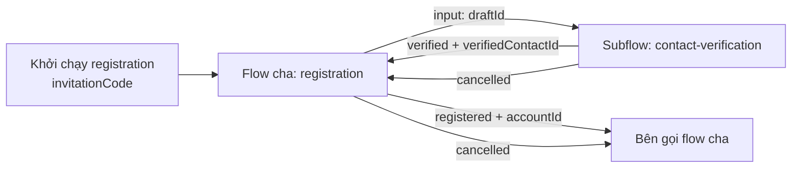

# Chia một hành trình lớn thành các flow có hợp đồng riêng

Một hành trình web gồm nhiều bước thường bắt đầu đơn giản: hiển thị form, nhận dữ liệu, kiểm tra rồi chuyển màn hình. Khi hệ thống lớn hơn, một hành trình đăng ký có thể phải thu thập hồ sơ, xác minh email, chọn gói dịch vụ và xác nhận thanh toán. Nếu tất cả bước được đặt trong một flow với hàng chục state và transition, các nhánh quay lại, hủy, lỗi và thử lại sẽ khó kiểm soát.

**Spring Web Flow (SWF)** cho phép tổ chức hành trình thành một **flow cha** điều phối nghiệp vụ chính và các **subflow** đảm nhiệm những quy trình con có trách nhiệm rõ ràng. Mỗi subflow công bố *dữ liệu đầu vào*, *những kết quả kết thúc* và *dữ liệu trả về*. Phần cha chỉ cần biết hợp đồng đó, không cần biết các màn hình hay cách lưu trạng thái bên trong phần con.

Bài học này hướng dẫn cách xác định ranh giới subflow, thiết kế hợp đồng input/output và kết nối các flow bằng `<subflow-state>`, kèm ví dụ Spring Web Flow XML, các tình huống lỗi và cách kiểm thử.

## 1. Khi nào một flow lớn trở nên khó bảo trì?

Giả sử ứng dụng có hành trình đăng ký tài khoản:

1. Nhận mã mời và tạo bản nháp đăng ký.
2. Nhập thông tin tài khoản.
3. Xác minh số điện thoại hoặc email.
4. Kiểm tra thông tin và chọn xác nhận.
5. Tạo tài khoản chính thức rồi hiển thị kết quả.

Nếu dồn tất cả vào một flow, sơ đồ trạng thái sẽ phình to khi bước xác minh bổ sung nhiều nhánh: gửi mã, hết hạn, nhập sai mã, gửi lại, hủy. Ngay cả khi hành trình cha chỉ quan tâm **đã xác minh thành công hay chưa**, nó vẫn phải trực tiếp duy trì các transition nhỏ của bước con.

Tình trạng này dẫn đến một số vấn đề:

| Vấn đề | Biểu hiện | Hướng xử lý bằng subflow |
| --- | --- | --- |
| Flow chính quá nhiều state | Khó tìm bước chịu trách nhiệm khi phát sinh lỗi | Đóng gói nhóm state thành một quy trình con |
| Cùng một quy trình lặp lại | Đăng ký, đổi email, khôi phục tài khoản đều có bước xác minh | Tạo một subflow xác minh dùng được ở nhiều nơi |
| Logic nội bộ bị rò rỉ | Flow cha biết tên mọi state xác minh | Cha chỉ biết `verified` và `cancelled` |
| Phụ thuộc vào dữ liệu ngầm | State con đọc/sửa trực tiếp nhiều biến ngoài phạm vi | Truyền input có tên và xuất output rõ ràng |
| Test khó cô lập | Muốn thử đường đi đăng ký phải dựng toàn bộ luồng xác minh | Kiểm thử riêng hợp đồng con và transition cha |

Mục tiêu của việc tách flow là tạo một **ranh giới nghiệp vụ có ý nghĩa**, chứ không phải tách mỗi view-state thành một subflow.

## 2. Vai trò của flow cha, subflow và hợp đồng dữ liệu

Flow cha sở hữu **mục tiêu cuối cùng** và quyết định cần thực hiện các quy trình con theo thứ tự nào. Subflow sở hữu **các state, form, transition và xử lý lỗi nội bộ** của một công việc con.

Ví dụ, flow `registration` cần kết quả xác minh liên hệ để hoàn tất đăng ký. Nó gọi flow `contact-verification` và chỉ cần biết:

```text
Tên flow con: contact-verification

INPUT
  draftId: long, bắt buộc

OUTCOME
  verified
    OUTPUT verifiedContactId: long
  cancelled
    không có output bắt buộc

NGỮ NGHĨA
  verified  = service đã xác minh một phương thức liên hệ hợp lệ
  cancelled = người dùng từ bỏ bước xác minh
```

Hai thành phần thường bị nhầm:

- **Outcome** là tên `end-state` mà subflow kết thúc, ví dụ `verified`. Flow cha dùng outcome để chọn transition.
- **Output** là tập thuộc tính được xuất ở `end-state` đó, ví dụ `verifiedContactId`. Flow cha lấy output trong event tương ứng.

Hợp đồng có thể được hình dung bằng sơ đồ:



Đường đi thành công và đường đi hủy là **hai hợp đồng kết quả khác nhau**. Không thể giả định `verifiedContactId` luôn có mặt khi subflow kết thúc.

## 3. Chọn ranh giới subflow dựa trên trách nhiệm

Một đoạn hành trình phù hợp để tách thành subflow khi nó có đủ các đặc điểm sau:

1. **Mục tiêu riêng:** Có thể mô tả bằng một động từ và đối tượng rõ ràng, chẳng hạn “xác minh liên hệ”, “chọn địa chỉ giao hàng”, “chấp nhận điều khoản”.
2. **Điểm vào được xác định:** Biết trước dữ liệu cần thiết để bắt đầu, chẳng hạn `draftId` hoặc `orderId`.
3. **Điểm ra hữu hạn:** Có một số outcome rõ ràng, chẳng hạn `verified`, `cancelled`, `expired`.
4. **Trạng thái nội bộ độc lập:** Những form, attempt counter hay màn hình phụ không cần xuất cho flow cha.
5. **Có khả năng phát triển hoặc tái sử dụng riêng:** Logic có thể thay đổi trong khi hợp đồng giao tiếp giữ ổn định.

Ngược lại, chỉ nên giữ trong flow cha nếu bước đó là thao tác điều hướng đơn giản, chỉ có một view và không tạo ra ranh giới nghiệp vụ riêng. Tách quá nhỏ làm xuất hiện nhiều input/output không cần thiết và khiến việc theo dõi hành trình khó hơn.

### 3.1. So sánh các lựa chọn tổ chức

| Lựa chọn | Khi phù hợp | Đặc điểm |
| --- | --- | --- |
| Thêm một `view-state` | Chỉ cần màn hình mới trong cùng quy trình | Cùng flow scope, điều hướng trực tiếp |
| Thêm `action-state` hoặc `decision-state` | Gọi service hoặc rẽ nhánh dựa trên điều kiện | Không nhất thiết tạo giao diện mới |
| Tạo `subflow-state` | Có quy trình con nhiều bước, outcome và dữ liệu trả về riêng | Cha chờ subflow kết thúc, nhận event/output |
| Tạo flow top-level độc lập | Người dùng bắt đầu một hành trình khác qua URL hoặc chức năng riêng | Có vòng đời khởi chạy/kết thúc độc lập |
| Đưa logic vào Spring service | Quy tắc nghiệp vụ, kiểm tra quyền, truy cập database | Dùng chung được ngoài web flow, không sở hữu màn hình |

Một subflow có thể gọi service bên dưới; service không nên phụ thuộc vào tên state của Web Flow. Nhờ vậy việc xác minh mã có thể được dùng thêm ở API hoặc tác vụ nền nếu cần.

## 4. Khai báo input ở ranh giới flow

Mỗi flow có thể khai báo `<input>` ở cấp gốc. Đây là danh sách dữ liệu mà bên gọi được phép và/hoặc bắt buộc phải cung cấp khi khởi chạy.

```xml
<flow xmlns="http://www.springframework.org/schema/webflow"
      xmlns:xsi="http://www.w3.org/2001/XMLSchema-instance"
      xsi:schemaLocation="http://www.springframework.org/schema/webflow
                          http://www.springframework.org/schema/webflow/spring-webflow.xsd">

    <input name="draftId" type="long" required="true" />

    <on-start>
        <evaluate expression="verificationService.prepare(draftId)"
                  result="flowScope.contactForm" />
    </on-start>

    <!-- Các state nội bộ nằm ở đây. -->
</flow>
```

Ý nghĩa những thuộc tính quan trọng:

| Thuộc tính | Cách dùng | Hệ quả |
| --- | --- | --- |
| `name` | `name="draftId"` | Tên input công khai; phải khớp tên được truyền từ bên gọi |
| `type` | `type="long"` | Yêu cầu giá trị có kiểu thích hợp hoặc có thể được chuyển đổi sang kiểu đó |
| `required` | `required="true"` | Input phải hiện diện và đáp ứng ràng buộc bắt buộc |
| `value` | `value="flowScope.draftId"` | Khi khai báo trong flow, cho biết biểu thức **đích nhận** input |

Nếu không chỉ định biểu thức đích, input theo tên được lưu trong `flowScope` của flow được khởi chạy. Chẳng hạn, `draftId` có thể được đọc bởi biểu thức `draftId` hoặc `flowScope.draftId`.

**Phân biệt:** `required="true"` và `type="long"` kiểm tra tính hiện diện/kiểu dữ liệu, không xác minh được ID này thuộc về người đăng nhập. Service phải kiểm tra quyền sở hữu, trạng thái bản nháp và quyền thực hiện thao tác trước khi gửi mã xác minh.

## 5. Gọi flow con bằng `<subflow-state>`

Flow cha sử dụng `<subflow-state>` để tạm giao quyền điều hướng cho flow con:

```xml
<subflow-state id="verifyContact" subflow="contact-verification">
    <input name="draftId" value="flowScope.draft.id" />

    <transition on="verified" to="review">
        <evaluate expression="registrationService.attachContact(
                  flowScope.draft.id,
                  currentEvent.attributes.verifiedContactId)" />
    </transition>

    <transition on="cancelled" to="editProfile" />
</subflow-state>
```

Đọc đoạn XML theo thứ tự:

1. Khi flow cha chuyển tới state `verifyContact`, Spring Web Flow tìm và khởi chạy định nghĩa flow có ID `contact-verification`.
2. `<input name="draftId" value="flowScope.draft.id" />` tính biểu thức ở **flow cha** và chuyển giá trị sang flow con dưới tên `draftId`.
3. Flow cha tạm ngừng tại subflow-state trong khi flow con thực hiện các state nội bộ.
4. Khi flow con đi đến một `end-state`, ID của end-state trở thành event trả về cho flow cha.
5. Nếu event là `verified`, flow cha lấy output `verifiedContactId` qua `currentEvent.attributes.verifiedContactId`, rồi quay lại `review`.
6. Nếu event là `cancelled`, flow cha quay về `editProfile`, không yêu cầu output xác minh.

**Điểm dễ nhầm:** `value` trong `<input>` *của subflow-state* là biểu thức **nguồn gửi đi** từ cha; còn `value` trong `<input>` *của flow con* là biểu thức **đích nhận**. Hai nơi có cùng tên thẻ nhưng vai trò khác nhau.

### 5.1. Tên state khác với tên flow

Trong `<subflow-state id="verifyContact" subflow="contact-verification">`:

- `id="verifyContact"` là tên state nội bộ của **flow cha**. Các transition bên trong flow cha có thể chuyển tới ID này.
- `subflow="contact-verification"` là ID định nghĩa **flow con** đã được `FlowDefinitionRegistry` nhận diện.

Không bắt buộc hai tên phải giống nhau. Trên thực tế, nên đặt tên state thể hiện **vai trò trong hành trình cha**, còn tên flow con thể hiện **chức năng có thể tái sử dụng**.

## 6. Xuất kết quả khi subflow kết thúc

Flow con định nghĩa từng nhánh kết thúc thông qua `<end-state>`. Thêm `<output>` nếu nhánh đó cần trả dữ liệu:

```xml
<end-state id="verified">
    <output name="verifiedContactId"
            value="flowScope.verificationResult.contactId" />
</end-state>

<end-state id="cancelled" />
```

Ở nhánh `verified`, flow cha nhận event tương đương:

```text
event.id = "verified"
event.attributes = {
    "verifiedContactId": 712L
}
```

Đó chỉ là mô hình giá trị để diễn giải. Ở transition của flow cha, dùng biểu thức EL `currentEvent.attributes.verifiedContactId` thay cho cố truy cập trực tiếp `flowScope.verificationResult` của flow con.

Nếu `verifiedContactId` thực sự được tạo ra khi service xác minh thành công, việc công bố output ở end-state tạo thành một hợp đồng dễ kiểm tra. Nếu trạng thái xác minh có thể chưa hoàn tất, flow không được chuyển đến `verified`.

Các quy tắc thiết kế output hữu ích:

- Chỉ xuất dữ liệu mà bên gọi cần cho quyết định kế tiếp, thường là ID hoặc DTO kết quả nhỏ.
- Không xuất mật khẩu, mã OTP, secret, token nội bộ hoặc toàn bộ object của form chỉ để tiện truy cập.
- Tên output nên thể hiện ý nghĩa nghiệp vụ; tránh tên phụ thuộc vào class hoặc field nội bộ.
- Xác định output nào xuất hiện ở từng outcome; đừng dùng một danh sách output “có thể có” không rõ nghĩa.
- Giữ kiểu dữ liệu và ý nghĩa ổn định khi nhiều flow cha sử dụng cùng một subflow.

## 7. Ví dụ đầy đủ: registration gọi contact-verification

Ta sẽ xây dựng hai flow dạng XML. Đây là ví dụ minh họa Spring Web Flow; ứng dụng cần cung cấp các bean `registrationService`, `verificationService`, đối tượng form và view tương ứng.

### 7.1. Flow cha `registration-flow.xml`

```xml
<flow xmlns="http://www.springframework.org/schema/webflow"
      xmlns:xsi="http://www.w3.org/2001/XMLSchema-instance"
      xsi:schemaLocation="http://www.springframework.org/schema/webflow
                          http://www.springframework.org/schema/webflow/spring-webflow.xsd">

    <!-- Đầu vào của hành trình đăng ký. -->
    <input name="invitationCode" required="true" />

    <on-start>
        <evaluate expression="registrationService.begin(invitationCode)"
                  result="flowScope.draft" />
        <evaluate expression="registrationService.newProfileForm(draft.id)"
                  result="flowScope.profileForm" />
    </on-start>

    <view-state id="editProfile" model="profileForm">
        <transition on="next" to="saveProfile" />
        <transition on="cancel" to="cancelled"
                    bind="false" validate="false" />
    </view-state>

    <action-state id="saveProfile">
        <evaluate expression="registrationService.saveProfile(
                  draft.id, profileForm)" />
        <transition on="success" to="verifyContact" />
    </action-state>

    <!-- Giao toàn bộ thao tác xác minh cho flow con. -->
    <subflow-state id="verifyContact" subflow="contact-verification">
        <input name="draftId" value="draft.id" />

        <transition on="verified" to="review">
            <evaluate expression="registrationService.attachContact(
                      draft.id,
                      currentEvent.attributes.verifiedContactId)" />
        </transition>

        <transition on="cancelled" to="editProfile" />
    </subflow-state>

    <view-state id="review">
        <transition on="confirm" to="activateAccount" />
        <transition on="back" to="editProfile" />
        <transition on="cancel" to="cancelled" />
    </view-state>

    <action-state id="activateAccount">
        <evaluate expression="registrationService.activate(draft.id)"
                  result="flowScope.accountId" />
        <transition on="success" to="registered" />
    </action-state>

    <!-- Kết quả của hành trình cha dành cho MVC/bên gọi. -->
    <end-state id="registered">
        <output name="accountId" value="flowScope.accountId" />
    </end-state>

    <end-state id="cancelled" />
</flow>
```

Điểm quan trọng của ví dụ là `registration` không chứa state gửi OTP, nhập OTP hoặc xử lý OTP sai. Mọi bước đó thuộc `contact-verification`. Khi nghiệp vụ xác minh thay đổi, cha vẫn có thể giữ nguyên transition `on="verified"` và tên output `verifiedContactId`.

Ví dụ giả định các lệnh gọi service hoàn tất thành công sẽ tạo ra event `success` thông thường. Một ứng dụng triển khai đầy đủ cần thêm cách xử lý exception, validation và trạng thái lỗi nghiệp vụ, đặc biệt ở `saveProfile` và `activateAccount`.

### 7.2. Flow con `contact-verification-flow.xml`

```xml
<flow xmlns="http://www.springframework.org/schema/webflow"
      xmlns:xsi="http://www.w3.org/2001/XMLSchema-instance"
      xsi:schemaLocation="http://www.springframework.org/schema/webflow
                          http://www.springframework.org/schema/webflow/spring-webflow.xsd">

    <!-- Hợp đồng do flow con công bố. -->
    <input name="draftId" type="long" required="true" />

    <on-start>
        <evaluate expression="verificationService.newContactForm(draftId)"
                  result="flowScope.contactForm" />
    </on-start>

    <view-state id="enterContact" model="contactForm">
        <transition on="sendCode" to="sendChallenge" />
        <transition on="cancel" to="cancelled"
                    bind="false" validate="false" />
    </view-state>

    <action-state id="sendChallenge">
        <evaluate expression="verificationService.sendCode(
                  draftId, contactForm)"
                  result="flowScope.challengeId" />
        <evaluate expression="verificationService.newCodeForm()"
                  result="flowScope.codeForm" />
        <transition on="success" to="enterCode" />
    </action-state>

    <view-state id="enterCode" model="codeForm">
        <transition on="verify" to="checkCode" />
        <transition on="resend" to="sendChallenge"
                    bind="false" validate="false" />
        <transition on="cancel" to="cancelled"
                    bind="false" validate="false" />
    </view-state>

    <action-state id="checkCode">
        <evaluate expression="verificationService.checkCode(
                  draftId, challengeId, codeForm)"
                  result="flowScope.verificationResult" />
        <transition on="success" to="decideVerification" />
    </action-state>

    <decision-state id="decideVerification">
        <if test="verificationResult.valid"
            then="verified"
            else="enterCode" />
    </decision-state>

    <end-state id="verified">
        <output name="verifiedContactId"
                value="verificationResult.contactId" />
    </end-state>

    <end-state id="cancelled" />
</flow>
```

Flow con tự quyết định khi nào gửi mã, tạo form nhập mã và kiểm tra kết quả. Service `checkCode` trong ví dụ trả một kết quả có thuộc tính `valid` và `contactId`. Nếu sai mã, `decision-state` quay lại `enterCode` để thử tiếp; nếu đúng mã, chuyển đến `verified`. Trong môi trường thực, service phải quản lý số lần thử, thời gian hết hạn, giới hạn gửi lại và chính sách chống lạm dụng.

### 7.3. Diễn tiến dữ liệu qua hai ranh giới

| Mốc | Nguồn | Đích | Ý nghĩa |
| --- | --- | --- | --- |
| Bắt đầu đăng ký | Request/input map | `registration.invitationCode` | Quyền mở hành trình từ mã mời |
| Vào subflow | `registration.draft.id` | `contact-verification.draftId` | Chỉ truyền ID bản nháp cần xác minh |
| Xác minh thành công | `contact-verification.verificationResult.contactId` | Event `verified`, output `verifiedContactId` | Công bố kết quả xác minh |
| Nhận kết quả | `currentEvent.attributes.verifiedContactId` | `registrationService.attachContact` | Gắn liên hệ đã xác minh với bản nháp |
| Kết thúc đăng ký | `registration.accountId` | Output `accountId` của `registered` | Bên gọi nhận ID tài khoản |
| Hủy subflow | End-state `cancelled` | Transition `cancelled` của cha | Trở lại nhập hồ sơ, không đọc `verifiedContactId` |

Ở đây ta có **hai tầng hợp đồng**: `registration` có đầu vào và đầu ra riêng với bên gọi, còn `contact-verification` có hợp đồng riêng với `registration`. Một flow có thể vừa là subflow trong hành trình lớn, vừa được tái sử dụng bởi flow khác với cùng giao diện.

## 8. Scope và vòng đời khi đi vào subflow

Web Flow quản lý nhiều scope để lưu trạng thái. Việc tách subflow làm cho phạm vi sở hữu dữ liệu rõ hơn:

| Vùng dữ liệu | Vòng đời/khả năng nhìn thấy | Ví dụ |
| --- | --- | --- |
| `requestParameters` và `requestScope` | Request HTTP hiện tại | Nút người dùng vừa bấm, query parameter |
| `viewScope` | Dữ liệu gắn với view-state hiện hành | Thông tin chỉ phục vụ một màn hình |
| `flowScope` của cha | Thuộc flow cha, không phải biến công khai của flow con | `draft`, `profileForm`, `accountId` |
| `flowScope` của con | Thuộc flow con, được tạo khi subflow bắt đầu | `contactForm`, `challengeId`, `verificationResult` |
| `conversationScope` | Có thể chia sẻ trong toàn conversation bao gồm các flow liên quan | Ngữ cảnh thật sự dùng chung xuyên các flow |
| `flashScope` | Dữ liệu ngắn hạn phục vụ hiển thị/tương tác kế tiếp | Thông báo sau chuyển state |

**Không dùng việc chia sẻ `conversationScope` làm thay thế mặc định cho hợp đồng input/output.** Khi mọi thành phần đọc cùng một map toàn cục, khó biết ai tạo, sửa hoặc bắt buộc phải cung cấp từng giá trị. Chỉ dữ liệu thực sự thuộc toàn conversation mới nên nằm ở đây.

Ví dụ, flow cha có `flowScope.draft` và flow con có `flowScope.contactForm`. Cha không nên tham chiếu trực tiếp `contactForm`; con không nên phụ thuộc vào các field trong `draft` mà cha chưa công bố. Thay vào đó, cha truyền `draftId` và nhận `verifiedContactId`.

Ngoài phạm vi truy cập, chú ý vòng đời dữ liệu: đối tượng trong flow scope có thể được lưu/khôi phục giữa nhiều request. Tránh lưu kết nối database, stream, EntityManager hoặc đối tượng không phù hợp với cơ chế snapshot/serialization. Nếu một hành trình phải phục hồi qua việc hết session, nên lưu trạng thái nghiệp vụ bền vững tại service/database thay vì chỉ dựa vào bộ nhớ flow.

## 9. Phân biệt hủy subflow với hủy cả hành trình

Một outcome có cùng tên `cancelled` nhưng ý nghĩa phụ thuộc vào cấp flow:

```text
Người dùng hủy ở màn hình nhập mã:
  contact-verification -> end-state cancelled
  registration -> transition về editProfile
  Toàn bộ registration vẫn đang chạy.

Người dùng hủy ở màn hình nhập hồ sơ:
  registration -> end-state cancelled
  Toàn bộ hành trình registration kết thúc.
```

Flow con không thể tự suy ra rằng “hủy xác minh” đồng nghĩa “hủy đăng ký”. **Flow cha sở hữu chính sách sau khi subflow kết thúc.** Một cha khác, ví dụ `change-email`, có thể nhận cùng `cancelled` nhưng điều hướng về trang cài đặt tài khoản thay vì form hồ sơ.

Đây là một lợi ích của reuse: subflow chỉ đảm bảo kết quả nghiệp vụ của chính nó. Quyết định tiếp theo do bên gọi quản lý.

## 10. Làm thế nào để tái sử dụng subflow cho nhiều hành trình?

Giả sử flow `contact-verification` cần được dùng từ cả `registration` và `change-email`. Có hai cách phổ biến:

**Cách 1 — Giữ hợp đồng theo khái niệm chung.** Subflow nhận `subjectId` và `verificationPurpose`, nhưng chỉ nên áp dụng nếu service thực sự xử lý các chủ thể thống nhất và có chính sách rõ ràng. Không dùng input chung chung `payload: Object` để che đi các kiểu dữ liệu khác biệt.

**Cách 2 — Dùng một hợp đồng lõi và adapter tại từng bên gọi.** Ví dụ subflow nhận `verificationRequestId` do service tạo trước. Flow đăng ký và flow đổi email đều tạo request phù hợp, rồi truyền ID. Subflow không cần biết ID thuộc đăng ký hay đổi email:

```xml
<!-- Bên gọi A: registration. -->
<subflow-state id="verifyContact" subflow="contact-verification">
    <input name="verificationRequestId"
           value="flowScope.registrationVerificationRequestId" />
    <transition on="verified" to="review">
        <evaluate expression="registrationService.attachContact(
                  draft.id, currentEvent.attributes.verifiedContactId)" />
    </transition>
    <transition on="cancelled" to="editProfile" />
</subflow-state>
```

```xml
<!-- Bên gọi B: change-email, dùng cùng subflow với input chuẩn hóa. -->
<subflow-state id="verifyNewEmail" subflow="contact-verification">
    <input name="verificationRequestId"
           value="flowScope.emailChangeVerificationRequestId" />
    <transition on="verified" to="applyChange">
        <evaluate expression="accountService.acceptVerifiedContact(
                  accountId, currentEvent.attributes.verifiedContactId)" />
    </transition>
    <transition on="cancelled" to="settings" />
</subflow-state>
```

Hai đoạn trên minh họa **một thiết kế hợp đồng thay thế** cho ví dụ `draftId` ở phần 7: nếu chọn `verificationRequestId`, định nghĩa flow con cũng phải đổi input tương ứng. Không được ghép hai đoạn gọi này với nguyên flow con nhận `draftId` mà không cập nhật hợp đồng.

Lợi ích là subflow không hiểu hoặc phụ thuộc vào loại hành trình cha. Tuy nhiên, service phải chịu trách nhiệm kiểm tra quyền của verification request và ngữ nghĩa của `verifiedContactId` trước khi công bố kết quả.

### 10.1. Tránh tạo subflow “vạn năng”

Không nên gom nhiều quy trình không liên quan chỉ vì chúng cùng có màn hình nhập dữ liệu. Một subflow với hàng chục cờ `mode` như `isRegistration`, `isPayment`, `isPasswordReset` thường trở thành một flow lớn khác, khó kiểm thử hơn trước khi tách.

Hãy ưu tiên ranh giới bền vững như `verify-contact` hoặc `choose-shipping-address`. Nếu hai hành trình chỉ chia sẻ một ít logic, đưa phần chung vào service thay vì ép hai flow phải dùng chung subflow.

## 11. Quản lý lỗi, timeout và giao dịch

Ranh giới flow là ranh giới **điều hướng và dữ liệu**, không tự động tạo một ranh giới transaction database:

| Tình huống | Hướng xử lý |
| --- | --- |
| Thiếu input hoặc sai kiểu | Từ chối khởi chạy; hiển thị lỗi phù hợp ở tầng xử lý request/exception |
| Input đúng kiểu nhưng không được phép | Service xác thực quyền và trạng thái của tài nguyên; từ chối truy cập |
| Form subflow không hợp lệ | Ở lại view-state, hiển thị lỗi bind/validation |
| Mã xác minh sai | Dùng decision-state hoặc event nghiệp vụ riêng để thử lại có giới hạn |
| Mã hết hạn | Định nghĩa outcome `expired` hoặc luồng gửi mã mới rõ ràng nếu bên gọi cần biết |
| Người dùng hủy trong subflow | Trả outcome `cancelled`; cha quyết định tiếp tục hay kết thúc toàn bộ |
| Service lỗi, mạng chập chờn | Xác định chính sách retry, trạng thái phục hồi và hiển thị thông báo |
| Session/flow execution hết hiệu lực | Tạo đường quay lại hoặc phục hồi từ dữ liệu đã lưu bền vững |
| Người dùng gửi xác nhận hai lần | Service cần chống tạo kết quả trùng; thiết kế idempotency khi phù hợp |

Ví dụ, `registrationService.activate(draft.id)` nên đảm bảo tính nguyên tử và chống tạo tài khoản trùng cho cùng bản nháp. Tách thành `subflow-state` không tự cung cấp transaction, lock hay idempotency.

Khi cần xử lý lỗi xác minh ở cấp cha, có thể công bố một outcome `expired` riêng ở con:

```xml
<!-- Định nghĩa trong flow con. -->
<end-state id="expired" />
```

```xml
<!-- Transition bổ sung trong subflow-state của cha. -->
<transition on="expired" to="verificationExpired" />
```

Sau đó cha hiển thị hướng dẫn hoặc tạo verification request mới. Nếu bổ sung outcome ở con, phải kiểm tra tất cả nơi gọi hiện tại có cần xử lý outcome mới hay không.

## 12. Tổ chức file và cấu hình nhận diện flow

Một cách tổ chức định nghĩa theo mục đích có thể là:

```text
src/main/webapp/WEB-INF/flows/
├── registration/
│   ├── registration-flow.xml
│   ├── editProfile.jsp
│   └── review.jsp
└── contact-verification/
    ├── contact-verification-flow.xml
    ├── enterContact.jsp
    └── enterCode.jsp
```

Đây chỉ là ví dụ bố trí thư mục; tên/thư mục view phụ thuộc `FlowViewResolver` và cấu hình view của ứng dụng. Điều quan trọng là registry phải tìm được flow có ID được dùng trong `subflow="contact-verification"`.

Trong ứng dụng tích hợp Spring MVC, `FlowHandlerMapping` và `FlowHandlerAdapter` hỗ trợ khởi chạy và tiếp tục flow từ HTTP request. Flow top-level thường được mở theo URL; subflow được khởi chạy từ một `subflow-state` của cha trong cùng quá trình thực thi. Một flow XML nằm trên đĩa chưa đủ để gọi được nếu `FlowDefinitionRegistry` chưa đăng ký đúng ID.

Nên giữ tên flow ổn định khi nó đã được gọi từ nhiều nơi, đồng thời tách logic nghiệp vụ sang Spring service để XML chỉ tập trung vào điều hướng, binding, event và mapping dữ liệu.

## 13. Kiểm thử độc lập hợp đồng và điều phối

Tách subflow cho phép kiểm thử **ba cấp**:

1. **Flow con:** kiểm tra yêu cầu input, các state nội bộ, nhánh hủy/kiểm tra sai và giá trị output của end-state thành công.
2. **Flow cha:** giả lập subflow trả `verified` hoặc `cancelled` để xác nhận transition và service action của cha.
3. **Tích hợp:** chạy luồng thực từ request/flow execution qua nhiều bước, xác minh dữ liệu nhận từ cha, trả lại cha và hành vi với session/validation.

Spring Web Flow cung cấp công cụ kiểm thử như `AbstractXmlFlowExecutionTests` và `MockExternalContext`. Một khung kiểm thử có thể bắt đầu như sau:

```java
// Bên trong class test kế thừa AbstractXmlFlowExecutionTests.
MutableAttributeMap input = new LocalAttributeMap();
input.put("invitationCode", "INVITE-123");

MockExternalContext context = new MockExternalContext();
startFlow(input, context);
assertCurrentStateEquals("editProfile");
```

Đây là đoạn khung minh họa: test thực tế cần tải XML tương ứng và mock các service. Với flow con, dùng input map có `draftId`. Với flow cha, dùng cơ chế mock subflow của bộ kiểm thử Web Flow khi cần cô lập hành vi con, rồi kiểm tra event/output nhận được.

Bảng kiểm thử đề xuất:

| Test | Dữ liệu/hành động | Kết quả kỳ vọng |
| --- | --- | --- |
| Thiếu input con | Không cung cấp `draftId` | Flow con không khởi chạy thành công |
| Input sai kiểu | `draftId="abc"` | Chuyển đổi kiểu thất bại |
| Bắt đầu con | `draftId=100L` | Service chuẩn bị form cho đúng draft |
| Xác minh sai | `checkCode` trả `valid=false` | Quay lại `enterCode`, chưa có output thành công |
| Xác minh đúng | `checkCode` trả `valid=true` với `contactId=712L` | End-state `verified`, output `verifiedContactId=712L` |
| Hủy flow con | Event `cancel` | End-state `cancelled`, không có `verifiedContactId` |
| Flow cha gọi con | Cha có `draft.id=100L` | Input của subflow là `draftId=100L` |
| Cha nhận kết quả | Subflow trả `verified` + `verifiedContactId=712L` | Gọi `attachContact(100L, 712L)`, tới `review` |
| Cha nhận hủy | Subflow trả `cancelled` | Quay `editProfile`, không gọi `attachContact` |
| Cha đăng ký xong | Service trả `accountId=500L` | End-state `registered`, output `accountId=500L` |

**Đừng chỉ kiểm tra tên end-state.** Một bug phổ biến là subflow đến `verified` nhưng quên xuất `verifiedContactId`, khiến flow cha nhận event đúng mà dữ liệu rỗng.

## 14. Các lỗi thiết kế thường gặp

### 14.1. Đọc xuyên scope của nhau

**Dấu hiệu:** flow con đòi `flowScope.draft` của cha, hoặc cha phụ thuộc vào `flowScope.contactForm` của con.

**Cách sửa:** khai báo input/output mang đúng ý nghĩa nghiệp vụ. Dùng `conversationScope` chỉ khi đó là ngữ cảnh dùng chung có chủ đích.

### 14.2. Nhầm outcome với output

**Dấu hiệu:** khai báo `<end-state id="verified">` rồi cho rằng cha tự có `verifiedContactId`, hoặc đặt `<output name="verified">` thay cho outcome.

**Cách sửa:** outcome là ID end-state; output là thẻ `<output>` bên trong end-state; cha xử lý event bằng `on="verified"` và đọc dữ liệu qua `currentEvent.attributes`.

### 14.3. Đặt tên input không khớp

**Dấu hiệu:** cha truyền `<input name="draftId".../>` nhưng con khai báo `<input name="registrationId".../>`.

**Cách sửa:** coi danh sách input của con là hợp đồng công khai. Với rename, cập nhật toàn bộ caller và test trước khi triển khai.

### 14.4. Sử dụng output ở nhánh hủy

**Dấu hiệu:** transition `cancelled` vẫn truy cập `currentEvent.attributes.verifiedContactId`, dẫn đến giá trị không tồn tại.

**Cách sửa:** xác định output theo outcome; chỉ đọc output ở nhánh bảo đảm cung cấp nó.

### 14.5. Subflow trực tiếp điều hướng tới màn hình của cha

**Dấu hiệu:** con biết URL hoặc state `review` của từng flow cha và cố điều khiển thay.

**Cách sửa:** con phát outcome; cha tự chọn state kế tiếp. Đây là điều kiện giúp tái sử dụng subflow.

### 14.6. Đưa toàn bộ dữ liệu vào map chung

**Dấu hiệu:** mọi flow đều biết `conversationScope.registration` gồm hàng chục field và tùy ý sửa.

**Cách sửa:** giảm dữ liệu truyền qua ranh giới, chọn ID/DTO cần thiết và để service quản lý dữ liệu bền vững.

### 14.7. Xem subflow là một transaction

**Dấu hiệu:** cho rằng kết thúc ở `verified` đảm bảo các thao tác database trước đó đã commit nguyên tử với thao tác của cha.

**Cách sửa:** thiết kế transaction tại service và kiểm soát retry/idempotency riêng.

## 15. Bài tập thực hành

Hãy thiết kế một flow `checkout` có các bước rà soát giỏ hàng, chọn địa chỉ giao hàng, chọn phương thức thanh toán và xác nhận đặt hàng.

**Yêu cầu:**

1. Tách `select-shipping-address` thành subflow nhận `cartId` và trả outcome `selected` với output `addressId`; outcome `cancelled` không có output.
2. Flow `checkout` truyền `cartId` và chỉ cập nhật giỏ hàng khi nhận `selected`.
3. Chọn một ranh giới khác có thể tái sử dụng, ví dụ `apply-coupon`, rồi giải thích vì sao nên/không nên là subflow.
4. Thiết kế ít nhất ba nhánh lỗi: giỏ hàng không thuộc người dùng, địa chỉ đã bị xóa, phiên làm việc hết hạn.
5. Viết bảng test cho input thiếu, chọn thành công, hủy và thử lại sau lỗi.

Gợi ý kiểm tra lời giải: flow cha có biết các state nội bộ của `select-shipping-address` không? Subflow có tự chuyển tới trang “đặt hàng thành công” của cha không? ID địa chỉ có đi qua output được khai báo không? Có kiểm tra quyền sử dụng địa chỉ trước khi liên kết với giỏ hàng không?

## 16. Ghi nhớ khi thiết kế flow lớn

- Chỉ tách subflow ở **ranh giới công việc có ý nghĩa** và có hợp đồng đầu vào/đầu ra rõ ràng.
- `<subflow-state id="..." subflow="...">` là nơi cha gọi con; `<input>` tại đây chuyển giá trị từ cha sang tên input của con.
- `<input>` ở flow con xác định dữ liệu con cần để khởi chạy; `<output>` tại từng `<end-state>` xác định dữ liệu con công bố khi kết thúc.
- Tên `end-state` trở thành event để cha chọn transition; output của con được cha đọc qua `currentEvent.attributes.<tenOutput>` ở transition đó.
- Cha quyết định điều hướng sau `verified`, `cancelled` hoặc `expired`; con chỉ chịu trách nhiệm công việc của mình.
- Giữ flow scope của cha/con độc lập về mặt hợp đồng; dùng service để kiểm tra quyền, quản lý transaction, lưu bền vững và hỗ trợ phục hồi.
- Kiểm thử cả **outcome lẫn output**, nhất là nhánh hủy và các nơi tái sử dụng subflow.

**Tài liệu tra cứu:** Spring Web Flow Reference Guide (các mục về flow definition, subflows, input/output mapping, scopes và testing flows) và API `org.springframework.webflow.test.execution.AbstractXmlFlowExecutionTests`.
