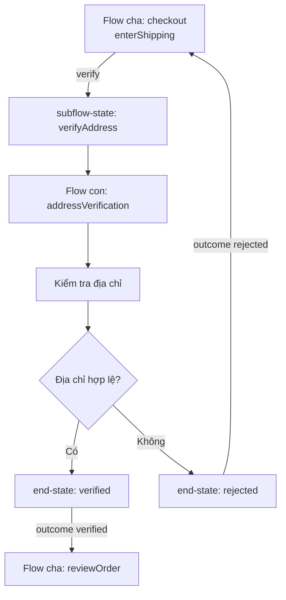
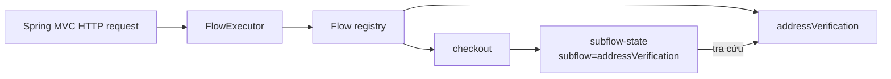

# Khai báo subflow-state và tra cứu flow con

Trong **Spring Web Flow**, một hành trình web nhiều bước được mô tả bằng các **state**, **event** và **transition**. Khi một phần hành trình đủ độc lập để dùng lại, chẳng hạn xác minh địa chỉ, chọn phương thức giao hàng hoặc xác nhận danh tính, ta có thể tách phần đó thành một **flow con (subflow)**. Flow cha gọi flow con qua `subflow-state`; khi flow con kết thúc, flow cha nhận outcome và tiếp tục điều hướng.

Bài học thuộc chương **Subflow và tái sử dụng**, tập trung vào hai câu hỏi: **khai báo `<subflow-state>` thế nào để truyền dữ liệu và nhận kết quả?** và **Spring Web Flow tìm flow con qua tên/ID nào, từ registry nào?** Những điểm này liên quan trực tiếp đến quản lý scope, phiên, binding, validation, tích hợp Spring MVC và khôi phục hành trình khi gặp lỗi.

## 1. Subflow-state là gì?

`subflow-state` là **một trạng thái trong flow cha** dùng để bắt đầu một flow khác. Nó chứa tham chiếu tới định nghĩa flow con và những transition xử lý **outcome** khi flow con kết thúc.

Ví dụ quy trình đặt hàng:



Trong sơ đồ, `verifyAddress` là ID của **state gọi** bên trong flow `checkout`, còn `addressVerification` là ID của **định nghĩa flow con** được đăng ký. Hai tên này có mục đích khác nhau và không bắt buộc trùng nhau.

Khi flow cha vào `verifyAddress`, Web Flow khởi động flow con. Nếu flow con đang ở `view-state`, người dùng sẽ tương tác với view của flow con; nếu nó đi qua `action-state`, các action được thực thi theo định nghĩa. Khi flow con đến `end-state`, flow con kết thúc và outcome của end-state được flow cha dùng để chọn transition.

**Một `subflow-state` không phải lời gọi phương thức Java và cũng không phải đường dẫn tới trang HTML.** Nó là lời gọi đến một định nghĩa flow có state, event, transition và vòng đời thực thi riêng.

## 2. Khi nào nên tách một đoạn hành trình thành flow con?

Giả sử ba quy trình `checkout`, `editProfile` và `registerAccount` đều cần xác minh địa chỉ. Nếu từng flow tự khai báo các state chọn địa chỉ, kiểm tra tính hợp lệ, cho sửa và xác nhận, mọi thay đổi quy tắc xác minh phải được cập nhật ba lần. Thay vào đó, mỗi flow cha có thể gọi cùng một flow con `addressVerification` và chỉ quyết định phải làm gì khi nhận kết quả.

| Tình huống | Lựa chọn hợp lý | Lý do |
| --- | --- | --- |
| Bước giao diện có nhiều state và được gọi từ nhiều hành trình | `subflow-state` | Tái sử dụng cả quy trình tương tác |
| Một thao tác service không cần màn hình | `action-state` | Không cần tạo thêm một flow để gọi một method đơn giản |
| Chỉ kiểm tra điều kiện và rẽ nhánh | `decision-state` | Diễn đạt phân nhánh ngắn gọn |
| Màn hình nhập liệu và nhận event người dùng | `view-state` | Binding, validation và tương tác tại view |
| Quy trình đã hoàn tất | `end-state` | Trả outcome hoặc kết thúc flow |

Một flow con hữu ích khi có **hợp đồng đầu vào, đầu ra và outcome rõ ràng**, quản lý được trạng thái riêng và có thể kiểm thử độc lập. Không nên chia một hành trình thành quá nhiều flow con chỉ vì mỗi bước có vài dòng XML: việc phân tách quá nhỏ làm khó theo dõi dữ liệu và đường đi.

## 3. Cú pháp `subflow-state` trong flow cha

Hình thức cơ bản:

```xml
<subflow-state id="verifyAddress" subflow="addressVerification">
    <input name="address"
           value="flowScope.checkoutForm.shippingAddress" />

    <transition on="verified" to="reviewOrder" />
    <transition on="rejected" to="editAddress" />
</subflow-state>
```

Ý nghĩa từng phần:

| Thành phần | Vai trò |
| --- | --- |
| `id="verifyAddress"` | Định danh state gọi flow con, duy nhất trong flow cha |
| `subflow="addressVerification"` | Tham chiếu ID của flow con mà Web Flow cần tra cứu |
| `<input name="address" ... />` | Truyền giá trị vào hợp đồng input của flow con |
| `on="verified"` | Nhận outcome `verified` khi flow con kết thúc |
| `to="reviewOrder"` | State tiếp theo của flow cha sau outcome đó |
| `on="rejected"` | Xử lý kết quả từ chối do flow con trả về |

`<input>` ở đây dùng **biểu thức trong ngữ cảnh flow cha** để lấy giá trị, rồi truyền giá trị đó vào flow con dưới tên `address`. Flow con có thể khai báo chính input này bằng `<input name="address" ... />`.

**Không dùng tên state kết thúc của flow con làm ID của flow con.** Chẳng hạn `verified` là outcome/end-state, trong khi `addressVerification` mới là định nghĩa được tra cứu qua thuộc tính `subflow`.

## 4. Flow con được tra cứu từ đâu?

Spring Web Flow quản lý các định nghĩa flow bằng **flow registry** (thường thông qua `FlowDefinitionRegistry`). Khi gặp `subflow="addressVerification"`, hạ tầng thực thi phải tìm được một định nghĩa flow với ID tương ứng thông qua cấu hình registry và các thành phần tạo flow được sử dụng.

Sơ đồ quan hệ:



Có hai việc phải phân biệt:

1. **Đăng ký định nghĩa flow:** registry biết ID `addressVerification` ứng với tệp XML nào.
2. **Gọi flow từ flow cha:** `subflow-state` dùng ID đó để yêu cầu engine bắt đầu một execution của flow con.

`subflow` **không mặc nhiên là URL trình duyệt**, đường dẫn vật lý đến tệp XML hay tên một Spring bean nghiệp vụ. Nếu flow con không được đăng ký hoặc không được registry mà runtime sử dụng nhìn thấy, việc gọi flow con sẽ không thể thực hiện đúng, dù tệp XML vẫn tồn tại trên ổ đĩa.

### Ví dụ đăng ký tường minh bằng flow registry

Trong cấu hình XML dự án sử dụng namespace `webflow-config`, có thể khai báo registry và hai flow như sau:

```xml
<beans xmlns="http://www.springframework.org/schema/beans"
       xmlns:xsi="http://www.w3.org/2001/XMLSchema-instance"
       xmlns:webflow="http://www.springframework.org/schema/webflow-config"
       xsi:schemaLocation="
           http://www.springframework.org/schema/beans
           http://www.springframework.org/schema/beans/spring-beans.xsd
           http://www.springframework.org/schema/webflow-config
           http://www.springframework.org/schema/webflow-config/spring-webflow-config.xsd">

    <webflow:flow-registry id="flowRegistry"
                           base-path="/WEB-INF/flows">
        <webflow:flow-location id="checkout"
                               path="checkout/checkout.xml" />
        <webflow:flow-location id="addressVerification"
                               path="address-verification/verify.xml" />
    </webflow:flow-registry>

    <webflow:flow-executor id="flowExecutor"
                           flow-registry="flowRegistry" />
</beans>
```

Giả sử dự án thực sự chứa hai resource ở dưới `/WEB-INF/flows`. Khi đó registry ánh xạ:

| Flow ID | Resource ví dụ | Được dùng ở đâu? |
| --- | --- | --- |
| `checkout` | `checkout/checkout.xml` | Flow chính được yêu cầu khởi động |
| `addressVerification` | `address-verification/verify.xml` | Được `subflow-state` của `checkout` tham chiếu |

Ví dụ phù hợp cách cấu hình thường gặp của **Spring Web Flow 2.x**; cú pháp namespace, thuộc tính đường dẫn và nơi cấu hình registry phải được đối chiếu với phiên bản ứng dụng. Trong thực tế còn có thể đăng ký bằng **location pattern** để tự phát hiện nhiều flow. Khi sử dụng pattern, phải kiểm tra ID được suy ra từ resource có đúng với tên trong `subflow` hay không; tệp được phát hiện không đồng nghĩa nó có ID như ta dự đoán.

### Tra cứu flow theo ID hay theo đường dẫn?

ID là **hợp đồng truy cập** giữa flow cha và registry. Không nên lấy tên tệp hoặc tên folder làm bằng chứng rằng `subflow="addressVerification"` sẽ hoạt động. Nếu đăng ký tường minh ID là `addressVerification` thì chính tên đó cần được dùng để gọi; nếu project dùng quy tắc suy ID từ đường dẫn thì cần kiểm tra ID thực tế do registry công bố.

Trong những ứng dụng có nhiều module/registry hoặc cùng tên flow, cần tránh xung đột ID và xác nhận registry/flow builder mà flow cha sử dụng có thể phân giải tham chiếu đến flow con. Khi có lỗi, nên kiểm tra **ID thực tế, registry thực tế và đường dẫn resource** trước khi nghi ngờ transition.

## 5. Ví dụ hoàn chỉnh: flow cha gọi flow xác minh địa chỉ

Giả sử model `CheckoutForm` có property `shippingAddress` kiểu `String`. Flow cha `checkout` chứa trang nhập địa chỉ, state gọi subflow, trang xác nhận và hai kết quả kết thúc.

**Flow cha — `checkout.xml`:**

```xml
<?xml version="1.0" encoding="UTF-8"?>
<flow xmlns="http://www.springframework.org/schema/webflow"
      xmlns:xsi="http://www.w3.org/2001/XMLSchema-instance"
      xsi:schemaLocation="
          http://www.springframework.org/schema/webflow
          http://www.springframework.org/schema/webflow/spring-webflow.xsd">

    <var name="checkoutForm" class="com.example.checkout.CheckoutForm" />

    <view-state id="editAddress"
                view="checkout/address"
                model="checkoutForm">
        <binder>
            <binding property="shippingAddress" required="true" />
        </binder>

        <transition on="verify" to="verifyAddress" />
        <transition on="cancel" to="cancelled"
                    bind="false" validate="false" />
    </view-state>

    <subflow-state id="verifyAddress" subflow="addressVerification">
        <input name="address"
               value="flowScope.checkoutForm.shippingAddress" />

        <transition on="verified" to="reviewOrder">
            <set name="flowScope.normalizedAddress"
                 value="currentEvent.attributes.normalizedAddress" />
        </transition>
        <transition on="rejected" to="editAddress" />
    </subflow-state>

    <view-state id="reviewOrder" view="checkout/review">
        <transition on="edit" to="editAddress" />
        <transition on="confirm" to="completed" />
    </view-state>

    <end-state id="completed" view="checkout/completed" />
    <end-state id="cancelled" />
</flow>
```

Lưu ý rằng `normalizedAddress` chỉ được gán sau outcome `verified`. Màn hình xác nhận nên sử dụng địa chỉ đã chuẩn hóa khi có, đồng thời xóa/tính lại dữ liệu phụ thuộc nếu người dùng quay lại sửa địa chỉ. Mọi xử lý ghi đơn hàng thật hoặc kiểm tra quyền truy cập cần đặt ở bước nghiệp vụ phù hợp; transition `confirm` đi thẳng đến `completed` trong ví dụ chỉ để làm rõ luồng gọi subflow.

### Flow con — `verify.xml`:

Flow con khai báo đầu vào `address`, gọi một dịch vụ để kiểm tra địa chỉ, cho người dùng xác nhận kết quả rồi kết thúc bằng một trong hai outcome:

```xml
<?xml version="1.0" encoding="UTF-8"?>
<flow xmlns="http://www.springframework.org/schema/webflow"
      xmlns:xsi="http://www.w3.org/2001/XMLSchema-instance"
      xsi:schemaLocation="
          http://www.springframework.org/schema/webflow
          http://www.springframework.org/schema/webflow/spring-webflow.xsd">

    <input name="address" type="java.lang.String" required="true" />

    <action-state id="checkAddress">
        <evaluate expression="addressService.verify(flowScope.address)"
                  result="flowScope.verificationResult" />
        <transition on="success" to="routeResult" />
    </action-state>

    <decision-state id="routeResult">
        <if test="flowScope.verificationResult.valid"
            then="confirmAddress"
            else="rejected" />
    </decision-state>

    <view-state id="confirmAddress" view="address/confirm">
        <transition on="accept" to="verified" />
        <transition on="edit" to="rejected" />
    </view-state>

    <end-state id="verified">
        <output name="normalizedAddress"
                value="flowScope.verificationResult.normalizedAddress" />
    </end-state>
    <end-state id="rejected" />
</flow>
```

Đoạn ví dụ giả định bean `addressService.verify(String)` trả về đối tượng có thuộc tính `valid` kiểu boolean và `normalizedAddress` kiểu `String`. Các lớp, bean và view tương ứng phải được ứng dụng cung cấp. Khi action kết thúc thành công, kết quả của `evaluate` được lưu vào `flowScope.verificationResult`; state `routeResult` chọn hiển thị màn hình xác nhận hay trả outcome `rejected`.

Với nhánh `verified`, `<output>` trên `end-state` công bố dữ liệu ra cho bên gọi. Khi subflow kết thúc, outcome có thể được xử lý trong transition của `subflow-state`; ví dụ đọc `currentEvent.attributes.normalizedAddress` để đưa vào `flowScope.normalizedAddress` của flow cha. Cần kiểm thử cơ chế mapping và cú pháp biểu thức trên phiên bản Web Flow được dự án sử dụng, vì đây là ranh giới giữa hai scope của hai flow khác nhau.

## 6. Trình tự một lần gọi và trả kết quả

Sự phối hợp giữa flow cha và flow con có thể được đọc theo sáu bước:

1. Người dùng đang ở `editAddress` của flow `checkout` và gửi event `verify`.
2. Binding/validation của `view-state` hoàn tất theo cấu hình, sau đó transition dẫn vào `verifyAddress`.
3. Spring Web Flow tra cứu flow con `addressVerification` theo tham chiếu `subflow` trong cấu hình registry khả dụng.
4. Input mapper lấy `flowScope.checkoutForm.shippingAddress` trong flow cha, truyền sang input `address` của flow con.
5. Flow con chạy qua `checkAddress`, `routeResult` và có thể dừng ở `confirmAddress` để chờ người dùng. Khi đến `end-state`, nó trả outcome `verified` hoặc `rejected`; nếu là `verified`, dữ liệu `normalizedAddress` được xuất ra.
6. Flow cha nhận outcome, thực hiện transition tương ứng và tiếp tục ở `reviewOrder` hoặc `editAddress`.

```text
checkout/editAddress
   --event verify-->
checkout/verifyAddress (subflow-state)
   --lookup "addressVerification"-->
addressVerification/checkAddress
   --result valid-->
addressVerification/confirmAddress
   --event accept-->
addressVerification/end-state verified
   --output normalizedAddress-->
checkout/subflow transition on="verified"
   --set flowScope.normalizedAddress-->
checkout/reviewOrder
```

**Chuyển từ flow cha vào subflow không đồng nghĩa tạo một request HTTP mới.** Khi có state tự động, Web Flow có thể thực thi nhiều bước trong cùng một lượt xử lý. Khi gặp `view-state` của flow con, tương tác người dùng ở request sau tiếp tục execution phù hợp. Cơ chế lưu execution key và session phụ thuộc FlowExecutionRepository, không phải mỗi flow con có một URL bắt buộc riêng.

## 7. Scope của flow cha và flow con

Hai flow có thể có dữ liệu riêng trong `flowScope`. Đừng giả định `flowScope.checkoutForm` trong flow cha tự động xuất hiện dưới cùng tên bên trong flow con:

| Dữ liệu | Nơi sinh ra | Cách truyền đúng ý nghĩa |
| --- | --- | --- |
| `checkoutForm.shippingAddress` | Flow cha | `<input name="address" value="..."/>` |
| `address` | Input của flow con | Được flow con đọc qua `flowScope.address` theo khai báo |
| `verificationResult` | Action của flow con | Giữ trong `flowScope` của flow con |
| `normalizedAddress` | Output của `end-state verified` | Flow cha nhận và lưu bằng transition sau outcome |
| Dữ liệu chung cả conversation | `conversationScope` | Chia sẻ có chủ đích nếu thực sự cần |

**Ưu tiên hợp đồng input/output thay cho truy cập vòng qua scope khác.** Nhờ đó flow con có thể được gọi từ `checkout` hoặc `editProfile` mà không cần biết flow cha đặt tên biến thế nào.

Với các object Java có thể thay đổi (mutable), truyền một reference sang flow con không nhất thiết tạo bản sao độc lập. Nếu service hoặc màn hình của flow con thay đổi object đó, cần xem xét những tác dụng phụ đối với dữ liệu của flow cha và cơ chế lưu trạng thái. Những dữ liệu cần trả về rõ ràng nên được thể hiện bằng output, tránh dựa vào việc thay đổi ngầm trên object đầu vào.

`conversationScope` có thể hữu ích khi các flow trong cùng conversation phải chia sẻ dữ liệu, nhưng dễ làm tăng coupling nếu lạm dụng. Đối tượng được giữ qua các request còn phải phù hợp chiến lược lưu/khôi phục `FlowExecutionRepository`.

## 8. Tính đúng đắn của input, output và outcome

Một `subflow-state` tạo ra ba hợp đồng cần đối chiếu độc lập:

| Hợp đồng | Phía flow cha | Phía flow con | Nếu không khớp |
| --- | --- | --- | --- |
| Định nghĩa | `subflow="addressVerification"` | Registry có flow ID `addressVerification` | Không tìm được flow con |
| Input | `<input name="address" .../>` | `<input name="address" ... required="true"/>` | Thiếu/sai kiểu input khi bắt đầu |
| Outcome | `<transition on="verified".../>` | `<end-state id="verified">` | Không có transition đích cho outcome |
| Output | Đọc `normalizedAddress` sau outcome | `<output name="normalizedAddress" .../>` | Flow cha không nhận được dữ liệu mong đợi |

Khi thiết kế flow con có thể tái sử dụng, nên mô tả tên, kiểu và ý nghĩa của input/output, danh sách outcome hợp lệ và trường hợp lỗi. Ví dụ:

```text
Flow: addressVerification
Input:
  address: String, bắt buộc
Outcomes:
  verified: địa chỉ đã được xác nhận
  rejected: người dùng sửa hoặc địa chỉ không đạt điều kiện
Output khi verified:
  normalizedAddress: String
```

Không nên dùng outcome `success` chung chung cho mọi hành vi nếu bên gọi cần phân biệt “người dùng đã xác minh”, “người dùng hủy” và “dịch vụ lỗi”. Tên outcome có ý nghĩa giúp flow cha dễ hiểu và dễ kiểm thử.

## 9. Những lỗi thường gặp khi tra cứu flow con

| Triệu chứng | Nguyên nhân thường gặp | Cách kiểm tra |
| --- | --- | --- |
| Flow cha chạy được nhưng gọi subflow thất bại | ID trong `subflow` không tồn tại trong registry | So khớp chính xác ID đã đăng ký |
| Resource XML tồn tại nhưng vẫn không tìm được flow | Đường dẫn đúng nhưng resource chưa được đăng ký hoặc sai registry | Kiểm tra khai báo `flow-location` / `flow-location-pattern` và cấu hình executor |
| Flow con được tìm thấy nhưng không khởi động | Thiếu input bắt buộc hoặc input sai kiểu | So sánh `<input>` ở cha và con, kiểm thử input mapping |
| Flow con kết thúc nhưng cha không chuyển tiếp | Outcome end-state không khớp `on` ở cha | So sánh ID end-state và transition event |
| Flow cha không có dữ liệu sau khi con kết thúc | Output không khai báo hoặc không mapping lại | Kiểm tra output của end-state và biểu thức đọc output ở cha |
| Chỉ lỗi khi đi qua một nhánh hiếm | Expression, bean hoặc view trên nhánh đó không hợp lệ | Chạy từng nhánh trong flow-execution test |
| Hai flow có ID gây nhầm lẫn | Đăng ký nhiều định nghĩa với tên trùng/không rõ | Đặt ID riêng biệt, kiểm tra danh sách flow IDs trong registry |
| Quay lại flow cha làm mất dữ liệu | Dùng scope sai hoặc cập nhật object ngoài hợp đồng | Kiểm tra flowScope, input/output và vòng đời execution |

**Tìm flow con là một bước của cấu hình điều hướng, không phải truy vấn database để tìm entity nghiệp vụ.** Nếu định nghĩa `addressVerification` không được registry phân giải, việc sửa `addressService` sẽ không giải quyết được lỗi tra cứu ID.

### Thứ tự chẩn đoán hiệu quả

1. Kiểm tra `subflow` của state gọi có đúng ID không.
2. Kiểm tra resource XML và ID thực tế đã đăng ký trong flow registry.
3. Kiểm tra registry đó có được `FlowExecutor` / flow builder sử dụng không.
4. Kiểm tra input bắt buộc và kiểu của dữ liệu đầu vào.
5. Kiểm tra end-state outcome và các transition xử lý outcome.
6. Chỉ sau đó mới kiểm tra biểu thức, Spring bean, validation và nội dung view của flow con.

Việc tách từng lớp lỗi giúp tránh tình trạng thay đổi XML điều hướng khi nguyên nhân thật sự là resource chưa được đăng ký, hoặc ngược lại.

## 10. Binding, validation, quyền truy cập và lỗi trong subflow

Flow con có thể chứa `view-state` của riêng nó, nên cũng có thể thực hiện form binding và validation khi người dùng tương tác. Đừng nhầm **input mapping** của subflow với **data binding từ HTTP form**:

- `<input>` chuyển dữ liệu từ **flow cha sang flow con** khi khởi động subflow.
- Binding trong `view-state` chuyển dữ liệu từ **request vào model** khi người dùng submit màn hình tương ứng.
- Validation kiểm tra dữ liệu đã có kiểu và những quy tắc liên quan trước khi cho phép transition tiếp tục.
- Kiểm tra nghiệp vụ và phân quyền vẫn phải được thực thi ở service, nhất là khi dữ liệu thay đổi giữa các request.

Nếu flow cha truyền `customerId` cho flow con, bên flow con không nên tin rằng chỉ vì ID có kiểu `Long` thì người dùng hiện tại được phép truy cập khách hàng đó. Tương tự, subflow xác minh địa chỉ có thể báo `rejected` do input không phù hợp, còn lỗi hệ thống tạm thời nên được phân loại với thông báo, exception handler hoặc outcome riêng nếu có thể phục hồi.

Với nút **Hủy** hay **Quay lại** tại view của flow con, có thể cấu hình transition bỏ binding/validation khi mục đích là điều hướng mà không lưu dữ liệu chưa hoàn chỉnh:

```xml
<transition on="cancel" to="cancelled"
            bind="false" validate="false" />
```

Đoạn này chỉ áp dụng khi `cancelled` là state đích hợp lệ trong flow con và phần cha xử lý outcome `cancelled` nếu cần. Không sao chép nút hủy một cách máy móc: nếu parent chỉ xử lý `verified` và `rejected`, cần thêm transition cho `cancelled` trước khi cho flow con phát outcome đó.

## 11. Kiểm thử việc tìm flow con và trở về flow cha

Cần có **kiểm thử độc lập flow con** và **kiểm thử tích hợp cha–con**. Unit test dịch vụ xác minh địa chỉ chưa chứng minh registry tìm được flow con, cũng chưa chứng minh outcome đưa flow cha tới đúng state.

### Kiểm thử đăng ký flow

Ở mức cấu hình, cần xác nhận registry có ID dự kiến, ví dụ theo API tra cứu của phiên bản Spring Web Flow đang dùng:

```java
// Phác thảo test; flowRegistry lấy từ Spring test context.
FlowDefinition child = flowRegistry.getFlowDefinition(
    "addressVerification");

assertNotNull(child);
assertEquals("addressVerification", child.getId());
```

Đây là minh họa thao tác **lookup theo flow ID**. Khi code thật, cần import các kiểu tương ứng và chạy test trong context có chính registry của ứng dụng. Nếu dự án dùng location pattern, nên kiểm tra ID thực tế ở registry thay vì suy từ tên tệp.

### Ma trận kiểm thử điều hướng

| Given / When | Then cần xác nhận |
| --- | --- |
| Flow cha ở `editAddress`, người dùng gửi `verify` với form hợp lệ | Engine vào `verifyAddress` và khởi động đúng `addressVerification` |
| Địa chỉ được truyền từ cha | `flowScope.address` của con có đúng giá trị đầu vào |
| Service trả địa chỉ không hợp lệ | Flow con kết thúc `rejected`, flow cha trở lại `editAddress` |
| Service hợp lệ, người dùng gửi `accept` | Flow con kết thúc `verified`, flow cha vào `reviewOrder` |
| Flow con xuất `normalizedAddress` | Flow cha nhận đúng output và lưu theo mapping |
| Người dùng sửa địa chỉ rồi gọi lại flow con | Subflow nhận **giá trị mới**, không dùng kết quả chuẩn hóa cũ |
| ID `subflow` cố tình sai trong cấu hình test riêng | Test phát hiện thiếu flow definition trước khi điều hướng |
| Flow con phát một outcome cha chưa xử lý | Test bộc lộ khoảng trống transition |
| Flow con có lỗi service được phân loại | Flow hiển thị hoặc xử lý lỗi theo hợp đồng phục hồi đã thiết kế |
| Người dùng quay lại/refresh qua nhiều request | Dữ liệu, state và execution key nhất quán với repository |

Tại cấp flow-execution test, có thể dùng **Spring Web Flow Test support** để khởi động flow, gửi event qua mock external context và kiểm tra active state. Các action phụ thuộc database hoặc API ngoài nên dùng fake/mock. Tuy nhiên không nên mock cả engine Web Flow nếu mục tiêu là kiểm chứng quá trình gọi subflow và transition trở về.

### Kiểm tra số lần gọi và tính nhất quán

Nếu trong subflow có thao tác ghi dữ liệu hoặc gọi thanh toán, test cần kiểm tra tác dụng phụ khi người dùng retry, back hoặc refresh. `subflow-state` tự nó không cung cấp idempotency: service vẫn cần cơ chế tránh tạo giao dịch trùng. Tình huống hợp lệ nhất là test toàn bộ chuỗi request và xác nhận dữ liệu được phục hồi đúng.

## 12. Tổ chức subflow để tái sử dụng và bảo trì

Một flow con có thể tái sử dụng nên có ranh giới rõ:

1. **Tên định danh ổn định:** flow ID là hợp đồng, không buộc caller biết vị trí vật lý của XML.
2. **Input tối thiểu:** chỉ truyền giá trị cần thiết, thay vì chuyển toàn bộ object graph không liên quan.
3. **Output công khai:** cung cấp dữ liệu mà caller cần dùng sau khi flow con kết thúc.
4. **Outcome có nghĩa:** `verified`, `rejected`, `cancelled` diễn đạt kết quả tốt hơn một `done` không rõ ngữ cảnh.
5. **Scope có chủ đích:** dữ liệu nội bộ trong flow con, dữ liệu cần trả đi qua output, dữ liệu chia sẻ conversation chỉ khi cần.
6. **Xử lý lỗi có quy ước:** những lỗi có thể phục hồi được trình bày thành nhánh riêng; ngoại lệ chưa xử lý được quản lý qua cơ chế exception handling.
7. **Test độc lập và tích hợp:** flow con đúng khi chạy riêng; flow cha đúng khi gọi qua registry và nhận outcome.

Việc gọi subflow qua ID cũng giúp thay đổi cách tổ chức tệp. Chẳng hạn chuyển `verify.xml` sang vị trí mới chỉ cần điều chỉnh cấu hình registry tương ứng mà không phải sửa mọi caller, miễn flow ID và hợp đồng input/output/outcome được giữ ổn định.

Không nên lạm dụng `conversationScope` để “chia sẻ cho tiện” mọi thông tin giữa flow cha và flow con: mô hình như vậy làm các flow phụ thuộc ngầm vào nhau và khó kiểm thử độc lập.

## 13. Bài thực hành: tái sử dụng flow xác minh địa chỉ

Hãy tạo hai flow cha `checkout` và `editProfile`, cả hai đều gọi flow con `addressVerification`. Mỗi flow cha có cách dùng output khác nhau: `checkout` sử dụng địa chỉ đã chuẩn hóa cho giao hàng, `editProfile` dùng địa chỉ đó để cập nhật hồ sơ.

Yêu cầu:

1. Đăng ký cả ba flow trong registry và xác nhận ID thật của từng flow.
2. Tại mỗi flow cha, khai báo một `subflow-state` trỏ tới `addressVerification`, truyền input `address` từ scope thích hợp.
3. Tại flow con, khai báo input bắt buộc, một bước kiểm tra dữ liệu và các end-state `verified` / `rejected`.
4. Khi `verified`, xuất `normalizedAddress`; flow cha nhận output và tiếp tục điều hướng đến màn hình thích hợp.
5. Khi `rejected`, mỗi flow cha quay về màn hình riêng của nó, giữ dữ liệu người dùng cần sửa.
6. Thử đổi tên ID trong `subflow` thành một giá trị không được đăng ký để xác nhận test nhận diện được lỗi lookup.
7. Gửi input thiếu hoặc sai kiểu để kiểm tra hợp đồng đầu vào và thông báo lỗi.
8. Chạy test qua nhiều request, sửa địa chỉ rồi thử lại; bảo đảm sử dụng dữ liệu mới và không gây side effect trùng.

Kết quả đạt yêu cầu khi **cùng một flow con** được tra cứu qua ID từ hai flow cha, xử lý dữ liệu theo hợp đồng chung và trả outcome/output để mỗi flow cha tự quyết định bước kế tiếp.

Trong Spring Web Flow, `subflow-state` là ranh giới nối **điều hướng của flow cha** với **quy trình tái sử dụng của flow con**. Muốn ranh giới này hoạt động tin cậy, cần khai báo đúng `subflow`, bảo đảm flow registry tra cứu được ID, truyền input minh bạch và ánh xạ outcome/output khi flow con kết thúc. Khi bổ sung kiểm thử binding, validation, scope, session và các nhánh phục hồi, những hành trình web nhiều bước trở nên dễ bảo trì mà vẫn giữ trách nhiệm điều hướng tập trung trong định nghĩa flow.
