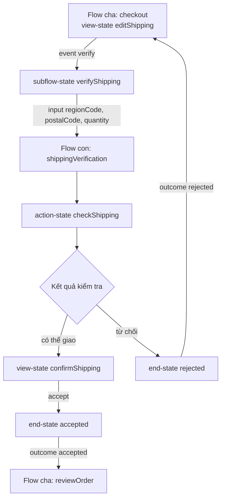
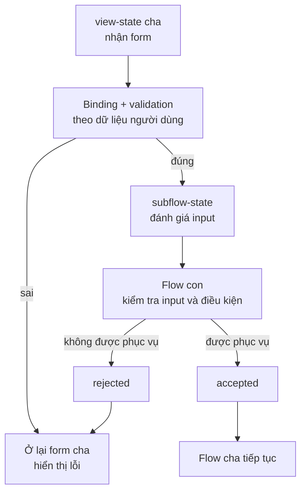

# Truyền input từ flow cha xuống flow con

Trong **Spring Web Flow**, một hành trình web dài có thể được chia thành nhiều **flow** nhỏ. Flow cha điều phối các bước chính, còn flow con xử lý một quy trình có thể tái sử dụng, như xác minh địa chỉ giao hàng, kiểm tra điều kiện đăng ký hoặc xác nhận thông tin thanh toán. Khi flow cha đến `subflow-state`, nó cần truyền những dữ liệu mà flow con phải biết để bắt đầu công việc.

Chủ đề **Truyền input từ flow cha xuống flow con** trong chương **Subflow và tái sử dụng** tập trung vào hợp đồng dữ liệu tại ranh giới này: flow cha lấy giá trị ở đâu, khai báo `<input>` như thế nào, flow con nhận dữ liệu ra sao, lỗi thiếu/sai kiểu được xử lý ở đâu và kiểm thử quá trình truyền dữ liệu như thế nào.

Cách thiết kế input rõ ràng giúp Spring Web Flow mô hình hóa hành trình qua **state, event, transition và subflow** mà không phải phân tán logic điều hướng vào controller Spring MVC. Nó cũng giúp quản lý binding, validation, scope và các bước phục hồi khi người dùng quay lại hoặc một dịch vụ gặp lỗi.

## 1. Input của subflow là hợp đồng giữa hai flow

Giả sử một hệ thống đặt hàng có flow `checkout` và một flow riêng `shippingVerification` để kiểm tra khả năng giao hàng. Flow cha đã thu thập mã vùng giao hàng, mã bưu chính và số lượng hàng. Flow con cần ba thông tin đó để đánh giá, nhưng không cần biết flow cha lưu chúng trong bean nào.



Trong sơ đồ có ba loại tên khác nhau:

| Tên | Vai trò | Ví dụ |
| --- | --- | --- |
| State gọi trong flow cha | Nơi kích hoạt việc chạy flow con | `verifyShipping` |
| ID của flow con | Định nghĩa mà Web Flow tra cứu trong flow registry | `shippingVerification` |
| Tên input | Trường dữ liệu trao đổi giữa hai flow | `regionCode`, `postalCode`, `quantity` |

**Flow cha quyết định giá trị truyền đi; flow con quyết định dữ liệu nào là bắt buộc và cách sử dụng dữ liệu đó.** Hai phía cần thống nhất tên, kiểu và ý nghĩa của từng input.

## 2. Cú pháp truyền input ngay trong subflow-state

Một cấu hình tối thiểu của flow cha:

```xml
<subflow-state id="verifyShipping" subflow="shippingVerification">
    <input name="regionCode"
           value="flowScope.checkoutForm.regionCode" />
    <input name="postalCode"
           value="flowScope.checkoutForm.postalCode" />
    <input name="quantity"
           value="flowScope.checkoutForm.quantity" />

    <transition on="accepted" to="reviewOrder" />
    <transition on="rejected" to="editShipping" />
</subflow-state>
```

Giải thích:

- `subflow-state` là state của **flow cha**; thuộc tính `subflow` tham chiếu ID của một định nghĩa flow khác.
- Mỗi `<input>` bên trong state này xác định **tên đầu vào phía flow con** qua `name`.
- Thuộc tính `value` là biểu thức được đánh giá trong **ngữ cảnh của flow cha** khi bắt đầu flow con, chẳng hạn đọc property của object trong `flowScope`.
- Các `transition` của `subflow-state` xử lý **outcome khi flow con kết thúc**, không phải kết quả chuyển kiểu input.

Ví dụ, biểu thức `flowScope.checkoutForm.quantity` được đánh giá ở flow cha và có thể tạo ra một đối tượng `Integer`. Nó được truyền cho flow con dưới tên `quantity`. Bên trong flow con, một object hay biến thuộc `flowScope` của flow cha không tự động hiện diện với cùng tên; cần có khai báo input nhận dữ liệu.

Lưu ý: `<input>` trong `subflow-state` có nhiệm vụ **mapping dữ liệu giữa hai flow**. Nó khác với `<input>` khai báo ở cấp flow con, là nơi mô tả **hợp đồng input mà flow con tiếp nhận**.

## 3. Khai báo đầu vào ở phía flow con

Ở phần đầu định nghĩa flow con `shippingVerification`, khai báo:

```xml
<input name="regionCode"
       type="java.lang.String"
       required="true" />

<input name="postalCode"
       type="java.lang.String"
       required="true" />

<input name="quantity"
       type="java.lang.Integer"
       required="true" />
```

Ba khai báo này cho biết:

| Thuộc tính | Ý nghĩa |
| --- | --- |
| `name` | Tên input mà flow con mong đợi; cần khớp với `name` ở phía flow cha |
| `type` | Kiểu Java dự kiến của dữ liệu khi flow con bắt đầu |
| `required="true"` | Yêu cầu caller cung cấp input tương ứng |

Trong cách mapping input phổ biến của Spring Web Flow 2.x, giá trị input được đặt vào phạm vi flow khi flow con khởi động. Vì vậy các state và biểu thức của flow con có thể truy cập `flowScope.regionCode`, `flowScope.postalCode` và `flowScope.quantity`.

**`required` và `type` là các ràng buộc ở ranh giới input, không thay thế validation nghiệp vụ.** Ví dụ `quantity = -3` vẫn là một đối tượng `Integer` hợp lệ về kiểu; service của flow con phải kiểm tra số lượng có được phép giao hay không. Tương tự, một chuỗi mã bưu chính có thể được truyền đúng kiểu nhưng vẫn không thuộc vùng được phục vụ.

### Đối chiếu hai phía

```text
Flow cha                               Flow con
---------------------------------------------------------------
<input name="regionCode"              <input name="regionCode"
       value="...regionCode" />               type="String" .../>

<input name="postalCode"              <input name="postalCode"
       value="...postalCode" />               type="String" .../>

<input name="quantity"                <input name="quantity"
       value="...quantity" />                 type="Integer" .../>
```

`name` ở phía cha tạo **khóa** cho input gửi đi, không bắt buộc phải trùng tên property được tham chiếu trong `value`. Ví dụ nếu form của cha có property `deliveryZone`, vẫn có thể đặt `name="regionCode" value="flowScope.checkoutForm.deliveryZone"` để giữ hợp đồng của flow con ổn định.

## 4. Ví dụ hoàn chỉnh: truyền dữ liệu giao hàng từ checkout

Giả sử model form của ứng dụng gồm ba trường sau:

```java
package com.example.checkout;

import java.io.Serializable;

public class CheckoutForm implements Serializable {
    private String regionCode;
    private String postalCode;
    private Integer quantity;

    public String getRegionCode() {
        return regionCode;
    }

    public void setRegionCode(String regionCode) {
        this.regionCode = regionCode;
    }

    public String getPostalCode() {
        return postalCode;
    }

    public void setPostalCode(String postalCode) {
        this.postalCode = postalCode;
    }

    public Integer getQuantity() {
        return quantity;
    }

    public void setQuantity(Integer quantity) {
        this.quantity = quantity;
    }
}
```

Đây là form model minh họa: ứng dụng thật cần validator riêng, view template và các service nghiệp vụ tương ứng.

### 4.1. Định nghĩa flow cha: checkout.xml

```xml
<?xml version="1.0" encoding="UTF-8"?>
<flow xmlns="http://www.springframework.org/schema/webflow"
      xmlns:xsi="http://www.w3.org/2001/XMLSchema-instance"
      xsi:schemaLocation="
          http://www.springframework.org/schema/webflow
          http://www.springframework.org/schema/webflow/spring-webflow.xsd">

    <var name="checkoutForm" class="com.example.checkout.CheckoutForm" />

    <view-state id="editShipping"
                view="checkout/shipping"
                model="checkoutForm">
        <binder>
            <binding property="regionCode" required="true" />
            <binding property="postalCode" required="true" />
            <binding property="quantity" required="true" />
        </binder>

        <transition on="verify" to="verifyShipping" />
        <transition on="cancel" to="cancelled"
                    bind="false" validate="false" />
    </view-state>

    <subflow-state id="verifyShipping" subflow="shippingVerification">
        <input name="regionCode"
               value="flowScope.checkoutForm.regionCode" />
        <input name="postalCode"
               value="flowScope.checkoutForm.postalCode" />
        <input name="quantity"
               value="flowScope.checkoutForm.quantity" />

        <transition on="accepted" to="reviewOrder" />
        <transition on="rejected" to="editShipping" />
    </subflow-state>

    <view-state id="reviewOrder" view="checkout/review">
        <transition on="edit" to="editShipping" />
        <transition on="finish" to="completed" />
    </view-state>

    <end-state id="completed" />
    <end-state id="cancelled" />
</flow>
```

Điểm đáng chú ý: **binding ở `editShipping` diễn ra trước khi người dùng chuyển sang `verifyShipping` theo event `verify`**, với điều kiện validation/transition được cấu hình đúng. Sau khi binding, `checkoutForm.quantity` là `Integer`, và biểu thức input truyền giá trị đã có kiểu sang flow con.

Để hành trình an toàn, validator của `editShipping` nên kiểm tra mã vùng không rỗng, mã bưu chính có định dạng phù hợp và số lượng lớn hơn 0. Việc định nghĩa `required="true"` ở binder chưa tự bao phủ mọi ràng buộc nội dung.

### 4.2. Định nghĩa flow con: shippingVerification.xml

```xml
<?xml version="1.0" encoding="UTF-8"?>
<flow xmlns="http://www.springframework.org/schema/webflow"
      xmlns:xsi="http://www.w3.org/2001/XMLSchema-instance"
      xsi:schemaLocation="
          http://www.springframework.org/schema/webflow
          http://www.springframework.org/schema/webflow/spring-webflow.xsd">

    <input name="regionCode" type="java.lang.String" required="true" />
    <input name="postalCode" type="java.lang.String" required="true" />
    <input name="quantity" type="java.lang.Integer" required="true" />

    <on-start>
        <evaluate
            expression="shippingCheckService.check(
                flowScope.regionCode,
                flowScope.postalCode,
                flowScope.quantity)"
            result="flowScope.shippingCheck" />
    </on-start>

    <decision-state id="routeCheck">
        <if test="flowScope.shippingCheck.eligible"
            then="confirmShipping"
            else="rejected" />
    </decision-state>

    <view-state id="confirmShipping" view="shipping/confirm">
        <transition on="accept" to="accepted" />
        <transition on="change" to="rejected" />
    </view-state>

    <end-state id="accepted" />
    <end-state id="rejected" />
</flow>
```

Ví dụ giả định Spring bean `shippingCheckService` cung cấp phương thức `check(String regionCode, String postalCode, Integer quantity)` trả một object có property boolean `eligible`. Trong ứng dụng thật, service phải xử lý mã vùng không tồn tại, quyền truy cập và lỗi mạng hoặc dữ liệu nghiệp vụ.

Flow con sử dụng ba giá trị ngay trong `<on-start>`. Điều này minh họa thời điểm input đã được mapping cho flow con: khi các bước khởi động của flow con cần dữ liệu, chúng đọc các input đã được khai báo trong `flowScope` của **chính flow con**.

Khi outcome `accepted` hoặc `rejected` được phát từ end-state, flow cha sẽ chọn transition tương ứng. **Outcome là kết quả đi ngược lên flow cha**; nó không phải input. Nếu flow con cần gửi thêm dữ liệu như phí vận chuyển hoặc mã chuẩn hóa, hãy thiết kế **output mapping** riêng; các ví dụ ở đây chỉ tập trung vào đường truyền input từ cha xuống con.

## 5. Input được đánh giá tại thời điểm nào?

Không nên xem `<input value="...">` như một liên kết dữ liệu tự cập nhật liên tục. Biểu thức `value` được sử dụng khi flow cha **đi vào subflow-state để khởi động flow con**.

Xét trình tự:

```text
Request 1:
  editShipping, quantity = 2
  event verify
     → bind checkoutForm.quantity = Integer(2)
     → vào verifyShipping
     → input quantity = 2
     → khởi động shippingVerification

Request 2:
  bên trong flow con, người dùng chọn change
     → subflow kết thúc rejected
     → flow cha trở lại editShipping

Request 3:
  người dùng sửa quantity = 5
  event verify
     → bind checkoutForm.quantity = Integer(5)
     → gọi lại verifyShipping
     → input quantity = 5
```

Việc vào lại `subflow-state` tạo **một lượt truyền input mới** với giá trị hiện tại trong flow cha. Nếu flow cha đã thay đổi model nhưng lại đặt một giá trị đã tính từ lần trước trong scope mà không cập nhật, input có thể bị cũ. Vì vậy các kết quả phụ thuộc địa chỉ, số lượng hoặc lựa chọn giao hàng phải được tính lại khi dữ liệu gốc thay đổi.

**Không có yêu cầu tạo một HTTP request mới chỉ để truyền input.** Những state tự động có thể tiếp tục chạy trong cùng lượt xử lý. Khi flow con gặp `view-state`, execution tạm dừng để chờ tương tác theo cơ chế request/session của Web Flow.

## 6. Giá trị truyền đi lấy từ scope nào?

Ở phía flow cha, `value` có thể đọc những biến hợp lệ trong ngữ cảnh biểu thức của flow. Lựa chọn phổ biến và dễ hiểu là truyền dữ liệu đã được xác định rõ trong `flowScope`:

```xml
<input name="quantity"
       value="flowScope.checkoutForm.quantity" />
```

| Nơi lưu phía cha | Khi nào nên lấy để truyền? | Điều cần lưu ý |
| --- | --- | --- |
| `flowScope` | Model hoặc kết quả đã thu thập qua nhiều bước | Phù hợp nhất với dữ liệu hành trình nhiều request |
| `viewScope` | Giá trị riêng của view-state đang hoạt động | Phải xét thời điểm rời view và vòng đời view scope |
| `requestScope` | Thông tin tạm trong cùng lượt request | Không dựa vào dữ liệu request cũ ở lần tiếp tục sau |
| `flashScope` | Giá trị ngắn hạn, thường phục vụ thông báo | Không thích hợp làm kho dữ liệu nghiệp vụ chính |
| `conversationScope` | Dữ liệu được chia sẻ trong conversation và các subflow liên quan | Dễ tạo phụ thuộc ngầm; chỉ dùng khi có lý do rõ ràng |

**Flow con có flowScope riêng.** Khi subflow nhận `regionCode` vào `flowScope.regionCode`, đó là dữ liệu được mapping vào context của nó. Dù flow cha có object `flowScope.checkoutForm`, flow con không nên phụ thuộc việc truy cập thẳng object này nếu hợp đồng chỉ yêu cầu ba trường.

Cần phân biệt **scope riêng** với **sao chép object**. Nếu một input là đối tượng Java có thể thay đổi (mutable), việc truyền tham chiếu có thể khiến cả hai phía quan sát được thay đổi trên cùng object trong một số cấu hình. `<input>` không tự động bảo đảm deep copy. Với dữ liệu quan trọng, hãy chọn value object bất biến hoặc tạo DTO/copy phù hợp trước khi truyền; kiểm thử theo chiến lược lưu execution đang dùng.

## 7. Kiểu dữ liệu, conversion và giá trị thiếu

Khi flow cha có `quantity` kiểu `Integer` và flow con khai báo `type="java.lang.Integer"`, hai phía thống nhất kiểu và tránh phải parse lại chuỗi. Trường hợp cha truyền chuỗi `"5"` trong khi con yêu cầu số nguyên có thể dựa vào khả năng conversion của Spring Binding/Web Flow nếu được cấu hình, nhưng nên **chuẩn hóa dữ liệu tại bước nhập** rồi truyền giá trị đúng kiểu.

| Giá trị phía cha | Khai báo phía con | Kết quả cần thiết kế/kiểm thử |
| --- | --- | --- |
| `Integer(5)` | `Integer`, required | Đúng kiểu, có thể sử dụng khi khởi động |
| `"5"` | `Integer`, required | Có thể cần conversion; phụ thuộc service chuyển kiểu và cấu hình |
| `"abc"` | `Integer`, required | Lỗi chuyển kiểu input, không được dùng giá trị giả |
| `null` hoặc không truyền | `Integer`, required | Đầu vào không đáp ứng hợp đồng; cần xử lý lỗi rõ |
| `null` hoặc không truyền | Input tùy chọn | Flow con phải định nghĩa hành vi khi giá trị không có |
| `-5` | `Integer`, required | Đúng kiểu nhưng không hợp lệ về nghiệp vụ; cần validation |

Một input tùy chọn có thể được khai báo mà không yêu cầu `required="true"`, nhưng việc thiếu giá trị **không biến nó thành giá trị mặc định có ý nghĩa nghiệp vụ**. Nếu flow con xử lý `promoCode` tùy chọn, service phải chấp nhận trường hợp giá trị không có hoặc flow phải thiết lập mặc định theo quy tắc rõ ràng.

**Lỗi mapping input không đồng nghĩa outcome `rejected`.** Nếu flow con không khởi động được vì thiếu input bắt buộc hoặc lỗi conversion, nó có thể thất bại trong quá trình bắt đầu flow trước khi đi đến end-state `rejected`. Transition `on="rejected"` của flow cha chỉ xử lý outcome mà flow con **thực sự phát ra**, không tự bắt mọi exception.

### Định dạng dữ liệu

Các chuỗi như ngày giao hàng `25/12/2026` hoặc số tiền `1.250,50` phụ thuộc locale và quy ước định dạng. Nên convert chúng thành `LocalDate`, `BigDecimal` hoặc kiểu nghiệp vụ thích hợp ở ranh giới form/binding, rồi truyền **object có kiểu** sang flow con. Không phụ thuộc vào việc mỗi subflow tự đoán format theo thiết lập locale của máy chủ.

Với kiểu Java Time và custom value object, mức hỗ trợ conversion mặc định khác nhau theo phiên bản Web Flow và ConversionService. Khi bổ sung converter, cần phân biệt `org.springframework.core.convert.ConversionService` của Spring Core/MVC với `org.springframework.binding.convert.service.ConversionService` trong các phiên bản Spring Web Flow sử dụng Spring Binding.

## 8. Validation nên diễn ra ở flow cha hay flow con?

**Hai bên cần kiểm tra các điều kiện khác nhau theo trách nhiệm.** Flow cha kiểm tra dữ liệu được nhập ở form của mình; flow con kiểm tra hợp đồng đầu vào và các điều kiện riêng của quy trình được tái sử dụng.

Trong ví dụ:

- Tại `editShipping` của flow cha: đảm bảo `quantity` là số nguyên dương, `regionCode` và `postalCode` có định dạng cơ bản phù hợp.
- Khi nhận input của flow con: đảm bảo ba đầu vào bắt buộc hiện diện và có kiểu mà flow con sử dụng.
- Tại `shippingCheckService`: kiểm tra vùng giao, số lượng, tình trạng phục vụ và dữ liệu nghiệp vụ đang có hiệu lực.
- Trước khi thực hiện tác vụ ghi: service tiếp tục kiểm tra quyền truy cập và các bất biến nghiệp vụ, vì dữ liệu có thể thay đổi giữa các request.



Đây là phân công logic, không có nghĩa framework tự động kích hoạt mọi validator chỉ nhờ khai báo model. Nếu dùng Spring Validator hoặc Bean Validation, cần xác nhận cách đăng ký validator và điều kiện kích hoạt trong phiên bản Web Flow thực tế.

### Các event không dùng để chấp nhận dữ liệu

Khi người dùng nhấn **Hủy** trên form chưa hoàn chỉnh, transition có thể bỏ binding/validation:

```xml
<transition on="cancel" to="cancelled"
            bind="false" validate="false" />
```

Nhưng với event `verify` đi vào subflow, không nên tắt validation tùy tiện. Nếu flow cha cho phép input sai qua ranh giới, flow con phải xử lý cả các lỗi mà form lẽ ra nên phát hiện sớm, khiến việc tái sử dụng và thông báo cho người dùng trở nên khó hơn.

## 9. Chọn dữ liệu input nhỏ và ổn định

Có hai cách truyền dữ liệu phổ biến:

**Truyền từng giá trị cần thiết** (như ví dụ ba field):

```xml
<input name="regionCode" value="flowScope.checkoutForm.regionCode" />
<input name="postalCode" value="flowScope.checkoutForm.postalCode" />
<input name="quantity" value="flowScope.checkoutForm.quantity" />
```

**Truyền một DTO chuyên dụng** nếu nhiều field cùng thuộc một hợp đồng:

```xml
<input name="shippingRequest"
       value="flowScope.shippingRequest" />
```

Flow con có thể khai báo:

```xml
<input name="shippingRequest"
       type="com.example.shipping.ShippingRequest"
       required="true" />
```

| Lựa chọn | Lợi ích | Hạn chế/cảnh báo |
| --- | --- | --- |
| Từng input nguyên thủy/value object | Hợp đồng dễ quan sát, ít coupling | Khai báo nhiều trường khi số lượng tăng |
| DTO chuyên dụng | Gom các trường liên quan, hỗ trợ version hóa hợp đồng | Cần quản lý tương thích schema/serialization |
| Toàn bộ entity hoặc session object | Ít cần viết mapping ban đầu | Dễ rò dữ liệu không cần thiết, phụ thuộc vào caller và rủi ro mutable object |

**Ưu tiên những giá trị flow con thực sự cần.** Flow xác minh vận chuyển không nên phải nhận toàn bộ `CheckoutSession` chứa thông tin thanh toán hay quyền hạn chỉ để kiểm tra mã bưu chính. Nếu cần xem dữ liệu mới nhất hoặc kiểm tra quyền, có thể truyền ID hợp lệ rồi tra cứu ở tầng service theo quyền người dùng hiện tại.

## 10. Truyền input không làm flow con tự khởi động ngoài registry

Ví dụ `subflow="shippingVerification"` chỉ hoạt động nếu định nghĩa flow đó được đăng ký và có thể được runtime phân giải qua **FlowDefinitionRegistry** phù hợp.

Một cấu hình đăng ký tường minh theo phong cách Spring Web Flow 2.x:

```xml
<webflow:flow-registry id="flowRegistry"
                       base-path="/WEB-INF/flows">
    <webflow:flow-location id="checkout"
                           path="checkout/checkout.xml" />
    <webflow:flow-location id="shippingVerification"
                           path="shipping/verification.xml" />
</webflow:flow-registry>
```

Đoạn cấu hình giả định namespace `webflow` đã được khai báo và các resource tồn tại dưới `/WEB-INF/flows`. Khi dùng mẫu tự dò tìm resource (`flow-location-pattern`), cần xác nhận ID được đăng ký **thực sự là `shippingVerification`**. Tên của tệp XML không tự chứng minh ID flow con.

Nếu flow registry không tìm được định nghĩa được tham chiếu, subflow sẽ không khởi động đúng và input không có nơi nhận. Vì vậy quá trình chẩn đoán cần kiểm tra **ID subflow → registry → resource**, rồi mới xét đến giá trị input và service của flow con.

### Phân biệt input với điều hướng và HTTP request

- `subflow="shippingVerification"` là **ID flow**, không phải URL để redirect trình duyệt.
- `<input name="regionCode" ... />` là mapping giữa hai flow, không phải tham số HTTP bắt buộc do browser phải gửi trực tiếp.
- Event `verify` là tín hiệu để rời view-state của cha và vào subflow-state.
- Outcome `accepted` / `rejected` là tín hiệu flow con gửi về flow cha khi kết thúc.
- `FlowHandlerMapping`, `FlowHandlerAdapter` và `FlowExecutor` vận hành request qua Spring MVC; chúng không thay đổi ý nghĩa của hợp đồng input giữa hai flow.

## 11. Bảo mật và độ tin cậy ở ranh giới flow con

Một flow con có thể được gọi từ nhiều flow cha, nên nó không nên tin tưởng tất cả caller đều đã kiểm tra đầy đủ dữ liệu. Các nguyên tắc quan trọng:

1. **Không trao quyền chỉ dựa vào input.** `customerId=42` được truyền đúng kiểu chưa chứng minh người dùng có quyền truy cập khách hàng 42. Quyền truy cập phải được kiểm tra ở service hoặc tầng bảo mật phù hợp.
2. **Giới hạn field có thể bind từ HTTP.** Form của cha nên dùng binder whitelist hoặc form model chuyên dụng, tránh để request thay đổi `approved`, `paid` hay `role`.
3. **Kiểm tra ràng buộc nghiệp vụ tại nơi thực thi.** Tồn kho, giá, quyền truy cập và khả năng giao hàng có thể thay đổi giữa request nhập liệu và request xác nhận.
4. **Chú ý dữ liệu nhạy cảm.** Tránh truyền mật khẩu, token hoặc thông tin thanh toán không cần thiết qua flowScope/conversationScope; việc lưu execution có thể khiến dữ liệu được giữ lâu hơn một request.
5. **Không dựa vào mutable object làm kênh output ngầm.** Nếu flow con sửa object của cha, rất khó xác định đâu là kết quả chính thức. Thiết kế output rõ khi cần trả dữ liệu và kiểm thử tác dụng phụ.
6. **Xử lý retry an toàn.** Subflow có side effect phải có transaction/idempotency ở service nếu người dùng có thể quay lại hoặc thử lại; `subflow-state` tự nó không chống gửi trùng.

Lỗi thiếu/sai input cần được phân biệt với lỗi nghiệp vụ như không đủ hàng. Không nên bắt mọi exception và trả outcome `accepted` hoặc `rejected` tùy tiện; các lỗi kỹ thuật cần có chính sách phục hồi và quan sát phù hợp.

## 12. Kiểm thử hợp đồng input từ cha xuống con

Nên có **hai lớp kiểm thử**: kiểm thử flow con với input xác định và kiểm thử flow cha đi qua `subflow-state` thực tế. Kiểm thử unit cho service không đủ để chứng minh các khai báo `name` và `value` khớp nhau.

### 12.1. Kiểm thử flow con độc lập

Với `shippingVerification`, hãy khởi động flow con trong môi trường test với input map giả lập:

```text
Given input:
  regionCode  = "HCM"
  postalCode  = "700000"
  quantity    = Integer(3)

When:
  start flow shippingVerification
  shippingCheckService.check(...) trả eligible = true

Then:
  flowScope.regionCode  = "HCM"
  flowScope.postalCode  = "700000"
  flowScope.quantity    = Integer(3)
  active state          = confirmShipping
```

Nếu service trả `eligible = false`, flow con phải kết thúc với outcome `rejected`. Với input thiếu/sai kiểu, cần xác minh cơ chế khởi động flow phát hiện lỗi hợp đồng thay vì service vô tình nhận giá trị mặc định.

Ở các phiên bản Spring Web Flow 2.x, test support cung cấp các API giúp khởi động execution cùng input map và mock external context; chữ ký Java cụ thể phải theo version đang dùng. Nên mock/fake `shippingCheckService` để kiểm tra mapping và điều hướng mà không phụ thuộc mạng hay hệ thống giao hàng thật.

### 12.2. Kiểm thử tích hợp cha–con

Một test tích hợp cần bắt đầu ở `editShipping` của flow cha, nhập form rồi kích hoạt event `verify`:

```text
Given:
  flow checkout ở editShipping
  checkoutForm.quantity = 2

When:
  submit event verify
  request gửi regionCode=HCM
              postalCode=700000
              quantity=5

Then:
  service bên shippingVerification nhận:
    regionCode = "HCM"
    postalCode = "700000"
    quantity = Integer(5)
  service không nhận quantity cũ = 2
```

Ví dụ này rất quan trọng vì nó chứng minh **binding ở form cha đã cập nhật model trước khi biểu thức `<input value="...">` được đánh giá**.

| Kịch bản | Assertion tối thiểu |
| --- | --- |
| Form cha hợp lệ, event `verify` | Đúng flow con được khởi động và nhận đủ ba input |
| Người dùng đổi quantity từ 2 thành 5 | Flow con nhận 5 ở lần gọi mới |
| quantity không parse được | Flow cha ở lại form; flow con chưa được khởi động |
| quantity âm, validator từ chối | Flow cha ở lại form; service con chưa chạy |
| Caller bỏ input `regionCode` bắt buộc | Test nhận diện lỗi input mapping/khởi động |
| Caller truyền sai tên `postal_code` | Flow con thiếu `postalCode`; test thất bại rõ |
| Đúng input nhưng sai kiểu `quantity` | Có lỗi conversion hoặc kiểm tra hợp đồng |
| Service con chấp nhận | Outcome `accepted` đưa flow cha đến `reviewOrder` |
| Service con từ chối | Outcome `rejected` đưa flow cha về `editShipping` |
| Đi lại `verify` sau khi sửa form | Subflow nhận dữ liệu mới, không dùng kết quả cũ |
| Gửi request với execution key hết hạn | Ứng dụng xử lý khôi phục flow theo cấu hình, không rò dữ liệu |

Đối với test hành vi, nên assert **state hiện tại**, input thực tế của service giả lập, dữ liệu trong scope và **số lần gọi service**. Riêng trường hợp flow con có view xác nhận, test cần gửi thêm event `accept` và xác minh outcome chuyển về flow cha.

### 12.3. Kiểm tra khi chạy qua Spring MVC

Ở mức HTTP, integration test có thể khởi động `checkout` qua URL flow, giữ session/execution key, POST event `verify` cùng các field form và xác nhận rằng request tiếp theo được Web Flow tiếp tục đúng. Những phần tích hợp thường gồm `FlowHandlerMapping`, `FlowHandlerAdapter`, `FlowExecutor` và `ViewResolver` tương ứng với view hiện tại.

**Không cần yêu cầu trình duyệt gọi trực tiếp URL của flow con** chỉ để truyền input. Flow cha có thể bắt đầu flow con bên trong execution hiện tại. Những lỗi HTTP như mất session/key hoặc thiếu CSRF token cần được phân biệt với lỗi hợp đồng input giữa hai flow.

## 13. Các lỗi thường gặp và cách chẩn đoán

| Triệu chứng | Nguyên nhân có khả năng | Cách kiểm tra |
| --- | --- | --- |
| Subflow không khởi động | ID `subflow` sai hoặc registry không tìm thấy flow | Kiểm tra flow ID, registry và resource đăng ký |
| Flow con báo thiếu input | `name` phía cha không khớp khai báo phía con | So khớp từng tên input và `required` |
| Flow con nhận `null` | Biểu thức `value` lấy sai property/scope hoặc dữ liệu chưa được thiết lập | Xác minh dữ liệu cha trước khi vào `subflow-state` |
| Flow con nhận giá trị cũ | Form cha chưa bind giá trị mới, hoặc cha truyền dữ liệu được cache trước đó | Kiểm tra event, binding và lúc đánh giá `value` |
| Input đúng kiểu chuỗi nhưng service yêu cầu số | Hợp đồng `type` hoặc converter chưa phù hợp | Chuyển kiểu tại form, thống nhất kiểu Java ở hai phía |
| Flow con nhận object nhưng thay đổi ngoài mong đợi | Hai phía cùng tham chiếu object mutable | Dùng value object/DTO hoặc copy rõ ràng |
| Service bên con không được gọi | Input lỗi, flow con chưa vào action-state hoặc validation chặn | Kiểm tra state, input mapping và thông báo lỗi |
| Flow con xong nhưng cha không đi tiếp | Outcome không khớp transition của `subflow-state` | So sánh ID end-state và event `on` |
| Vào lại flow con vẫn thấy kết quả cũ | Dữ liệu phụ thuộc chưa được tính lại hoặc scope chọn sai | Theo dõi lần gọi mới và dữ liệu flowScope |
| Chỉ lỗi sau refresh hoặc Back | Session/execution key và chiến lược repository khác giả định | Test nhiều request với key do engine sinh |

Thứ tự chẩn đoán thường hiệu quả là **kiểm tra state cha → giá trị biểu thức input → hợp đồng khai báo của con → kết quả khởi động → state/action của con → outcome trở về cha**. Ghi rõ input trong test hoặc logging đã được làm sạch dữ liệu nhạy cảm giúp tìm đúng nguồn lỗi.

## 14. Bài thực hành: cùng một subflow nhận input từ hai flow cha

Hãy xây dựng hai flow cha `checkout` và `editProfile`, cùng sử dụng flow con `shippingVerification`. Hai flow cha có mô hình dữ liệu khác nhau:

- `checkout` lưu `flowScope.checkoutForm.regionCode` và `flowScope.checkoutForm.postalCode`.
- `editProfile` lưu `flowScope.profileForm.deliveryZone` và `flowScope.profileForm.zipCode`.

Yêu cầu:

1. Đăng ký `shippingVerification` vào flow registry với một ID ổn định.
2. Khai báo ba input bắt buộc `regionCode`, `postalCode` và `quantity` ở flow con, đúng kiểu Java.
3. Tại `checkout`, truyền ba giá trị từ `checkoutForm`.
4. Tại `editProfile`, mapping `deliveryZone → regionCode`, `zipCode → postalCode` và truyền một quantity mặc định có ý nghĩa nghiệp vụ cho quy trình này.
5. Kiểm tra form cha trước khi chuyển sang subflow; không gọi service con khi dữ liệu không hợp lệ.
6. Giả lập outcome `accepted` và `rejected`; bảo đảm mỗi flow cha quay về đúng màn hình riêng của nó.
7. Kiểm thử giá trị thiếu, tên input sai và dữ liệu kiểu không tương thích.
8. Cho người dùng quay lại sửa dữ liệu rồi gọi subflow lần nữa; xác nhận input mới được sử dụng.
9. Nếu chọn truyền DTO thay cho ba trường riêng, kiểm tra tác dụng phụ của object mutable và chiến lược lưu execution.

Để hoàn thành bài thực hành, không chỉ cần kiểm tra trang có hiển thị hay không, mà phải xác minh **đúng dữ liệu đã vượt qua ranh giới cha–con**, đúng thời điểm, đúng kiểu và đúng lần thực thi.

Thiết kế input tốt giúp một flow con hoạt động độc lập với cách flow cha tổ chức giao diện hoặc lưu form. Trong **Spring Web Flow**, `<input>` ở `subflow-state` chuyển giá trị được đánh giá trong ngữ cảnh cha, còn `<input>` ở flow con định nghĩa hợp đồng tiếp nhận. Khi thống nhất tên, kiểu, validation và phạm vi dữ liệu, các hành trình nhiều bước dễ tái sử dụng, có đường phục hồi rõ ràng và có thể được kiểm thử độc lập lẫn tích hợp.
