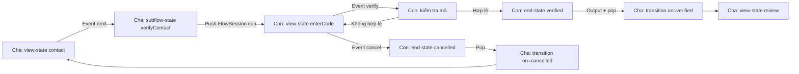
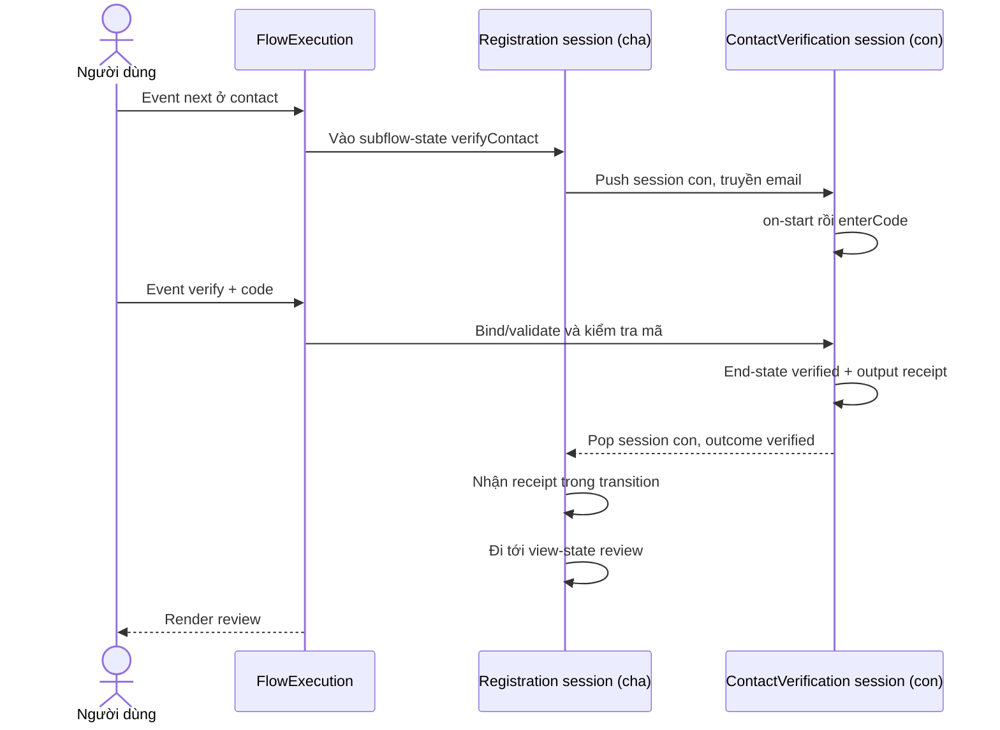

# Flow cha tạm dừng khi flow con đang hoạt động trong Spring Web Flow

Giả sử một người dùng đang hoàn tất biểu mẫu đăng ký dịch vụ. Sau bước nhập thông tin liên hệ, hệ thống yêu cầu xác minh email bằng mã OTP. Trong lúc người dùng nhập mã, wizard đăng ký **không được tự động đi tiếp** đến màn hình thanh toán; nhưng thông tin đã nhập ở wizard cũng không được biến mất. Sau khi xác minh thành công hoặc hủy, người dùng phải quay về đúng vị trí mà flow cha đang chờ.

Đây là hành vi cốt lõi của **subflow** trong Spring Web Flow (`SPRING_WEB_FLOW`): khi một `subflow-state` gọi flow con, **flow cha tạm dừng tại state gọi**, flow con trở thành flow đang hoạt động, rồi trả một kết quả để flow cha tiếp tục. Cơ chế này giúp mô hình hóa hành trình web nhiều bước bằng state, event và transition rõ ràng, đồng thời tái sử dụng các quy trình xác minh, chọn địa chỉ, xác nhận điều khoản hoặc phê duyệt ở nhiều flow khác nhau.

Bài học thuộc chương **Subflow và tái sử dụng**, tập trung trực tiếp vào thời điểm cha tạm dừng, cơ chế dispatch event cho con, quản lý scope và vòng đời quay về cha; các ví dụ gắn với form binding, validation, Spring MVC, bảo mật và phục hồi execution.

**Kết quả học tập:** Sau bài này, bạn có thể:

- Giải thích vì sao flow cha **tạm dừng** nhưng `FlowExecution` vẫn đang chạy.
- Mô tả ngăn xếp `FlowSession` khi push subflow và pop lúc subflow hoàn tất.
- Viết `<subflow-state>`, truyền `<input>`, nhận outcome và `<output>` bằng transition của cha.
- Phân biệt event thuộc flow con với event/transition của flow cha.
- Giữ form model của cha qua nhiều request, không nhầm `flowScope` của hai flow.
- Thiết kế nhánh thành công, hủy, từ chối, lỗi và timeout mà không làm lộ dữ liệu hoặc lặp tác vụ.
- Kiểm thử trạng thái đang hoạt động, hành vi back/refresh, nhiều tab và quyền truy cập.

## 1. "Tạm dừng flow cha" chính xác nghĩa là gì?

Khi flow cha đi vào một state thông thường như `view-state contact`, nó chờ người dùng phát event tiếp theo. Nếu transition dẫn đến **`subflow-state`**, Web Flow bắt đầu một **flow session con** trong cùng lần thực thi logic.

Tại thời điểm này có ba điều cần phân biệt:

1. **Flow cha còn tồn tại:** thông tin như biểu mẫu nhập dở và state `verifyContact` của cha được giữ trong ngữ cảnh execution.
2. **Flow cha không tự tiếp tục các transition của mình:** nó đang đợi flow con kết thúc để nhận một outcome tương ứng.
3. **Flow con hoạt động:** các event tiếp theo được giải quyết trong state machine của flow con đang ở đỉnh ngăn xếp.

Vì vậy, **tạm dừng flow cha không phải tạm dừng toàn bộ web application, chặn thread HTTP hay giữ transaction database mở**. Trong khi người dùng nhìn thấy form nhập mã ở flow con, server vẫn có thể trả response và kết thúc request như bình thường. Lần HTTP request sau sẽ resume `FlowExecution` và tiếp tục phiên flow đang active.

| Khái niệm | Trước khi gọi subflow | Trong lúc flow con hoạt động | Sau khi con hoàn tất |
| --- | --- | --- | --- |
| `FlowExecution` | Đang chạy flow cha | Vẫn là cùng một execution logic | Tiếp tục chạy cha |
| Active `FlowSession` | Session cha | Session con | Session cha |
| State của cha | `contact` hoặc state trước đó | `subflow-state verifyContact` | State đích của transition nhận kết quả |
| State của con | Chưa có phiên con | Ví dụ `enterCode` | Phiên con kết thúc |
| `flowScope` của cha | Chứa dữ liệu cha | Vẫn tồn tại, không tự bị xóa | Còn để tiếp tục wizard |
| `flowScope` của con | Chưa tồn tại | Chứa dữ liệu riêng của con | Hết vòng đời của session con |

### Sơ đồ một lần gọi và trả kết quả



Hệ thống không tạo một thread riêng cho subflow. Một flow con vẫn là **các bước của cùng một hành trình**, chỉ được cô lập bởi definition, session, state và hợp đồng dữ liệu.

## 2. Ngăn xếp `FlowSession`: ai đang có quyền nhận event?

Spring Web Flow phân biệt:

- **Flow definition:** bản thiết kế các state/transition, có thể tái sử dụng.
- **FlowExecution:** một lượt chạy cụ thể, có khóa và trạng thái phục vụ nhiều HTTP request.
- **FlowSession:** một phiên của một flow definition bên trong execution.
- **Flow-session stack:** ngăn xếp các phiên flow được gọi lồng nhau; phiên ở đỉnh là phiên đang hoạt động.

Trước khi gọi flow con:

```text
FlowExecution X
  conversationScope
  stack (đáy → đỉnh):
    [registration]  ← active; state = contact
```

Trong lúc gọi flow con:

```text
FlowExecution X
  conversationScope
  stack (đáy → đỉnh):
    [registration]       state = verifyContact; đang chờ
    [contactVerification] state = enterCode; active
```

Sau khi flow con kết thúc `verified`:

```text
FlowExecution X
  conversationScope
  stack (đáy → đỉnh):
    [registration]  ← active; state = review
```

**Push:** Web Flow vào `subflow-state`, đánh giá các input và khởi chạy session con, đưa session này lên đỉnh stack.

**Pop:** Flow con đi tới `end-state`; output/outcome được trả về, session con được kết thúc và gỡ khỏi stack. Session cha trở lại active để xử lý transition tương ứng với outcome đó.

Cách hình dung này theo nguyên tắc **LIFO — vào sau, ra trước**. Nếu con `contactVerification` lại gọi flow `captchaCheck`, stack sẽ là `[registration, contactVerification, captchaCheck]`. `captchaCheck` phải hoàn tất trước khi `contactVerification` có thể tiếp tục bình thường và cuối cùng trả kết quả cho `registration`.

### Không phải hai flow đồng thời xử lý hai event

Giả sử `registration` có transition `on="pay"` ở state `review`. Khi active session đang là `contactVerification.enterCode`, client cố gửi `_eventId=pay` không có nghĩa flow cha sẽ bỏ qua subflow để thực hiện thanh toán. Web Flow xử lý event trong ngữ cảnh **state active**; cần transition hợp lệ tại state này.

Do đó, không thiết kế front-end bằng cách phát event cho cha trong khi subflow đang chờ mã. Hãy cho flow con trả về **outcome** rõ ràng; sau đó cha quyết định bước kế tiếp.

## 3. Ví dụ flow cha: dừng ở `subflow-state`

Giả sử flow cha `registration` nhận `registrationId`, nạp bản nháp, cho nhập thông tin liên hệ rồi bắt đầu flow con `contactVerification`.

```xml
<?xml version="1.0" encoding="UTF-8"?>
<flow xmlns="http://www.springframework.org/schema/webflow"
      xmlns:xsi="http://www.w3.org/2001/XMLSchema-instance"
      xsi:schemaLocation="http://www.springframework.org/schema/webflow
                          http://www.springframework.org/schema/webflow/spring-webflow-2.0.xsd">

    <input name="registrationId" type="java.lang.Long" required="true" />
    <var name="contactForm" class="com.example.registration.ContactForm" />

    <on-start>
        <evaluate expression="registrationService.requireEditableDraft(registrationId)"
                  result="flowScope.draft" />
    </on-start>

    <view-state id="contact"
                view="registration/contact"
                model="contactForm">
        <binder>
            <binding property="email" required="true" />
            <binding property="phone" />
        </binder>

        <transition on="next" to="verifyContact" />
        <transition on="cancel" to="cancelled" bind="false" />
    </view-state>

    <subflow-state id="verifyContact" subflow="contactVerification">
        <input name="email" value="contactForm.email" />

        <transition on="verified" to="review">
            <set name="flowScope.verificationReceipt"
                 value="currentEvent.attributes.verificationReceipt" />
        </transition>

        <transition on="cancelled" to="contact" />
    </subflow-state>

    <view-state id="review" view="registration/review">
        <transition on="back" to="contact" />
        <transition on="submit" to="persistRegistration" />
    </view-state>

    <action-state id="persistRegistration">
        <evaluate expression="registrationService.submit(
                                registrationId,
                                contactForm,
                                verificationReceipt)" />
        <transition on="success" to="completed" />
        <transition on="rejected" to="review" />
    </action-state>

    <end-state id="completed" view="registration/completed" />
    <end-state id="cancelled" view="registration/cancelled" />
</flow>
```

**Giới hạn ví dụ:** `ContactForm`, các bean `registrationService` và phương thức `requireEditableDraft`/`submit` là thành phần ứng dụng tự xây dựng. Cần triển khai validation, quyền trên `registrationId`, transaction và xử lý exception. `submit` được thiết kế minh họa để cung cấp outcome `success` hoặc `rejected` mà action-state có thể xử lý; không giả định mọi exception tự trở thành event `rejected`.

### Điểm quan trọng trong flow cha

| Cấu hình | Trách nhiệm |
| --- | --- |
| `<view-state id="contact" model="contactForm">` | Binding/validation dữ liệu được nhập ở bước liên hệ |
| `<transition on="next" to="verifyContact" />` | Rời view-state của cha để gọi flow con |
| `<subflow-state id="verifyContact" subflow="contactVerification">` | **Điểm cha tạm dừng** và session con được kích hoạt |
| `<input name="email" value="contactForm.email" />` | Truyền dữ liệu cần thiết sang flow con |
| `<transition on="verified" to="review">` | Chỉ chạy khi flow con kết thúc bằng outcome `verified` |
| `currentEvent.attributes.verificationReceipt` | Đọc output của flow con từ event kết thúc subflow |
| `<transition on="cancelled" to="contact" />` | Cho phép flow cha quay lại biểu mẫu khi con bị hủy |

Trạng thái của cha **không chuyển ngay sang `review` khi bước `contact` phát event `next`**. Flow cha trước tiên vào `verifyContact`, rồi chờ flow con hoàn tất. Chỉ sau khi outcome `verified` quay về, transition của cha mới được chọn.

Khi flow con bị hủy, cha quay lại `contact` và có thể giữ `contactForm.email` đã nhập trong flow scope. Việc giữ dữ liệu này **không phụ thuộc** vào việc con có trả output hay không.

## 4. Ví dụ flow con: tự nhận event cho tới khi kết thúc

Flow `contactVerification` có nhiệm vụ nhận email và xác thực mã. Nó có state, form, validation và outcome riêng.

```xml
<?xml version="1.0" encoding="UTF-8"?>
<flow xmlns="http://www.springframework.org/schema/webflow"
      xmlns:xsi="http://www.w3.org/2001/XMLSchema-instance"
      xsi:schemaLocation="http://www.springframework.org/schema/webflow
                          http://www.springframework.org/schema/webflow/spring-webflow-2.0.xsd">

    <input name="email" type="java.lang.String" required="true" />
    <var name="codeForm" class="com.example.verification.CodeForm" />

    <on-start>
        <evaluate expression="verificationService.prepareChallenge(email)"
                  result="flowScope.challengeHint" />
    </on-start>

    <view-state id="enterCode"
                view="verification/enterCode"
                model="codeForm">
        <binder>
            <binding property="code" required="true" />
        </binder>

        <transition on="verify" to="checkCode" />
        <transition on="cancel" to="cancelled" bind="false" />
    </view-state>

    <action-state id="checkCode">
        <evaluate expression="verificationService.verify(email, codeForm.code)"
                  result="flowScope.verificationResult" />
        <transition on="success" to="decideResult" />
    </action-state>

    <decision-state id="decideResult">
        <if test="verificationResult.accepted"
            then="verified" else="enterCode" />
    </decision-state>

    <end-state id="verified">
        <output name="verificationReceipt"
                value="verificationResult.receipt" />
    </end-state>

    <end-state id="cancelled" />
</flow>
```

Các kiểu `CodeForm`, `VerificationResult` và các method `prepareChallenge`, `verify` do ứng dụng định nghĩa. Ví dụ giả định `verify` trả một object có getter `isAccepted()` và `getReceipt()`; nếu mã sai, `accepted=false`, nếu đúng, `receipt` là chứng cứ xác minh do server phát hành. Khi xảy ra lỗi kỹ thuật, cần cơ chế exception handling riêng thay vì giả định action luôn trả `success`. Đường kiểm tra mã phải giới hạn số lần thử, thời hạn mã, tần suất gửi lại và hành vi chống dò mã.

### Trong lúc `enterCode` hiển thị

- Active FlowSession là `contactVerification`, **không phải** `registration`.
- Form model `codeForm` thuộc session của flow con.
- Event `verify` được giải quyết trong state `enterCode` của flow con.
- Nếu validation form lỗi, người dùng có thể vẫn ở `enterCode`; cha tiếp tục tạm dừng.
- Nếu `verify` đi qua `checkCode` rồi kết quả là chưa được chấp nhận, decision-state đưa người dùng trở lại `enterCode`; cha **vẫn** tạm dừng.
- Khi đi tới `end-state verified` hoặc `cancelled`, phiên con kết thúc, cha mới được phép tiếp tục.

**Lưu ý về `prepareChallenge`:** đây có thể là một action có side effect như tạo hoặc gửi mã xác minh. Nếu người dùng quay lại flow cha rồi vào subflow lần nữa, `on-start` của **session con mới** có thể chạy lại. Service cần idempotency/rate limit và không phát mã vô hạn chỉ vì client lặp event.

### Biểu mẫu của con gửi về cùng execution đang chạy

Trong JSP thuộc flow con:

```jsp
<form method="post" action="${flowExecutionUrl}">
    <label for="code">Mã xác minh</label>
    <input id="code" name="code"
           autocomplete="one-time-code" />

    <button type="submit" name="_eventId_verify" value="1">
        Xác minh
    </button>
    <button type="submit" name="_eventId_cancel" value="1">
        Hủy xác minh
    </button>
</form>
```

`flowExecutionUrl` tiếp tục **FlowExecution hiện tại**, vốn đang có session con active. Không cần và không nên tự tạo một URL launch riêng cho `contactVerification` để gửi mã từ form này. Nếu một flow con được thiết kế cho cả việc chạy độc lập, hợp đồng input và cách khởi chạy riêng vẫn phải được quản lý rõ ràng.

Với Spring Security, POST cần CSRF token đúng theo cấu hình, và mã xác minh không được ghi vào log hoặc URL query. Validation phía client chỉ hỗ trợ UX; service cần xác thực mã thực sự.

## 5. Khi con kết thúc, outcome được biến thành event của cha

Một `end-state` của flow con đóng vai trò **điểm trở về**. Khi session con kết thúc, Web Flow trả thông tin kết thúc lên `subflow-state` đang chờ ở flow cha.

Ví dụ:

```xml
<!-- Bên flow con -->
<end-state id="verified">
    <output name="verificationReceipt"
            value="verificationResult.receipt" />
</end-state>
```

```xml
<!-- Bên flow cha -->
<subflow-state id="verifyContact" subflow="contactVerification">
    <input name="email" value="contactForm.email" />
    <transition on="verified" to="review">
        <set name="flowScope.verificationReceipt"
             value="currentEvent.attributes.verificationReceipt" />
    </transition>
    <transition on="cancelled" to="contact" />
</subflow-state>
```

Phân biệt:

| Phần tử | Cung cấp thông tin gì? |
| --- | --- |
| `end-state id="verified"` | **Outcome ID**: tên kết quả kết thúc của flow con |
| `<output name="verificationReceipt" ...>` | **Dữ liệu output**: chứng cứ hoặc kết quả chi tiết trả về |
| `transition on="verified"` ở cha | Quy tắc chọn bước tiếp theo khi con trả outcome đó |
| `currentEvent.attributes.verificationReceipt` | Dữ liệu trả về mà action của transition cha có thể đọc |

Việc nhận output **không xảy ra bằng cách cho cha truy cập trực tiếp `flowScope` của con sau khi con đã bị pop**. Hãy dùng hợp đồng output rõ ràng hoặc biến/context chung có chủ đích, thay vì phụ thuộc vào dữ liệu nội bộ của session đã kết thúc.

### Timeline trước và sau khi kết thúc con



Mô tả này ở mức **lifecycle**, không khẳng định mỗi mũi tên là một HTTP request riêng. Trong một request, Web Flow có thể đi qua action-state/decision-state và kết thúc subflow trước khi dừng ở view-state của cha.

## 6. Tại sao cha phải chờ thay vì chạy song song?

Đây không chỉ là chi tiết triển khai; nó là **hợp đồng điều phối** của subflow:

1. **Bảo vệ thứ tự nghiệp vụ:** không được thanh toán trước khi xác minh xong.
2. **Cô lập logic:** flow con tự xử lý gửi mã, nhận mã, hiển thị lỗi và thử lại.
3. **Giữ nguyên bối cảnh cha:** biểu mẫu và dữ liệu cha không bị khởi tạo lại chỉ vì đang xác minh.
4. **Lấy kết quả rõ ràng:** cha phân nhánh theo `verified`/`cancelled` hoặc outcome khác đã khai báo.
5. **Tái sử dụng:** cùng flow xác minh có thể được gọi từ đăng ký, đổi email hoặc đặt hàng nếu input/output contract phù hợp.

Subflow **không phải** cơ chế chạy hai tác vụ bất đồng bộ song song. Nếu nghiệp vụ cần gửi email nền, chờ phê duyệt của bên thứ ba trong nhiều ngày hoặc nhận callback độc lập, ứng dụng cần kiến trúc queue/job/event và cơ chế persist workflow phù hợp; đừng giữ HTTP thread hoặc transaction mở chờ kết quả chỉ nhờ một `subflow-state`.

Tương tự, màn hình flow con có thể cho người dùng quay qua lại giữa nhiều view-state; điều này vẫn là hoạt động **trong session con**, không có nghĩa cha đã tiếp tục.

## 7. Scope và dữ liệu khi cha tạm dừng

Đây là nơi xuất hiện nhiều lỗi nhất. Cùng một execution có thể chứa nhiều flow session, mỗi session có `flowScope` riêng.

| Scope | Nơi quản lý | Ví dụ khi con đang active |
| --- | --- | --- |
| `requestScope` | Một lần xử lý request | Thông tin tạm của event vừa gửi |
| `viewScope` | View-state đang hoạt động | Thông báo lỗi ở `enterCode` |
| `flowScope` của cha | Session `registration` | `contactForm`, `draft`, sau đó `verificationReceipt` |
| `flowScope` của con | Session `contactVerification` | `codeForm`, `challengeHint`, `verificationResult` |
| `conversationScope` | Conversation chứa các phiên flow liên quan | Correlation ID thực sự cần dùng chung |
| HTTP session | Tầng servlet/security | Ngữ cảnh phiên HTTP, có thể chứa nhiều execution |
| Database | Dữ liệu nghiệp vụ đã được commit | Hồ sơ đăng ký, phiên bản ghi nhận |

### Ngăn xếp với scope tách biệt

```text
FlowExecution X
│
├─ conversationScope
│  └─ correlationId
│
├─ FlowSession registration          (đang chờ)
│  └─ flowScope
│     ├─ contactForm.email
│     ├─ contactForm.phone
│     └─ draft
│
└─ FlowSession contactVerification   (active)
   └─ flowScope
      ├─ codeForm.code
      ├─ challengeHint
      └─ verificationResult
```

Khi session con active, biểu thức `flowScope` không tự trỏ đến scope của cha. Nếu con cần email, hãy gửi `<input name="email" value="contactForm.email" />` từ cha rồi khai báo `<input name="email" ... />` trong con. Muốn trả dữ liệu về, dùng `<output>` và transition của cha.

**Cẩn thận với object mutable:** scope cha và scope con riêng biệt **không bảo đảm deep-copy** object truyền bằng input. Nếu truyền một `ContactForm` mutable rồi con sửa trực tiếp thuộc tính, cha có thể nhìn thấy thay đổi qua cùng tham chiếu trước cả khi con kết thúc. Khi cần cô lập bản nháp:

- Truyền ID hoặc DTO bất biến/đã sao chép.
- Đưa các trường thực sự cần thiết vào input, không truyền toàn bộ entity đồ sộ.
- Trả dữ liệu đã chấp thuận bằng output.
- Chỉ nhập dữ liệu trả về vào cha sau khi outcome thích hợp xuất hiện.

`conversationScope` có thể chia sẻ ngữ cảnh trong cùng conversation, nhưng không nên dùng nó như cách lách hợp đồng input/output. Việc chia sẻ quá nhiều dữ liệu khiến subflow khó tái sử dụng, khó kiểm thử và dễ tạo side effect ngoài ý muốn.

## 8. Form binding và validation không làm cha "thức dậy"

Ở state `enterCode` của con, form submit `_eventId_verify` được binding vào `codeForm` của **con**. Nếu validation lỗi:

1. Model con nhận dữ liệu hợp lệ về kiểu theo binder cho phép.
2. Validator phát hiện sai định dạng/thiếu dữ liệu.
3. Web Flow giữ người dùng tại `enterCode` hoặc xử lý theo cấu hình lỗi.
4. Cha tiếp tục chờ ở `verifyContact`.

Nếu mã có định dạng hợp lệ nhưng dịch vụ xác minh từ chối, decision-state có thể quay lại `enterCode`. Đây là **transition nội bộ của con**, không phải outcome gửi về cha. Cha chỉ tiếp tục khi con thực sự đi vào `end-state`.

### Nút Hủy của con khác nút Hủy của cha

Trong XML mẫu, nút `cancel` ở flow con đi vào `end-state id="cancelled"`. Cha nhận outcome `cancelled` và chuyển về `contact`: **toàn bộ registration chưa bị hủy**.

Nếu nghiệp vụ muốn hủy cả hành trình khi user hủy xác minh, chỉ cần cha định nghĩa khác:

```xml
<transition on="cancelled" to="cancelled" />
```

Điểm đích `cancelled` ở đây là `end-state` của **flow cha**. Điều đó minh họa sự khác biệt giữa **kết thúc một subflow** và **kết thúc execution gốc**: quyết định cuối cùng thuộc transition của cha khi nhận outcome con.

Nếu người dùng cần bỏ qua validation để hủy, `bind="false"` trên transition trong view-state của **con** phù hợp. Nhưng khi muốn quay lại mà giữ mã đã nhập, cần phân biệt `bind="false"` với `validate="false"`; tắt binding sẽ không lấy các giá trị mới chưa được gửi vào model.

## 9. Lặp lại subflow và tác động của việc quay lại

Giả sử xác minh thành công, cha chuyển tới `review`. Người dùng bấm `back` về `contact`, đổi email, rồi `next` lần nữa:

- Cha **đi vào lại** `subflow-state verifyContact`.
- Web Flow khởi chạy **FlowSession con mới** của `contactVerification`.
- `on-start` của con có thể chạy lại, tạo thử thách mã mới.
- Kết quả xác minh cũ trong `flowScope.verificationReceipt` của cha cần được **vô hiệu hóa** nếu email hoặc điều kiện nghiệp vụ thay đổi.

Không coi việc `verificationReceipt` vẫn tồn tại trong scope cha là bằng chứng người dùng vừa xác minh **email mới**. Phải gắn receipt với đối tượng/giá trị cụ thể, thời hạn hiệu lực và trạng thái xác minh do server kiểm tra.

Một cách diễn tả chính sách rõ ràng là:

```text
contact(email=A)
  → verifyContact(A)
  → verified(A), receipt-A
  → review
  → back, đổi thành email=B
  → verifyContact(B)
  → verified(B), receipt-B
  → review
  → submit: service xác minh receipt-B áp dụng cho email=B
```

Nếu nghiệp vụ cho phép giữ một kết quả xác minh khi người dùng quay lại nhưng **không thay đổi email**, service có thể kiểm tra receipt còn hợp lệ thay vì gửi mã mới. Quyết định này nên được thực hiện có chủ đích; không phụ thuộc vào việc frontend có nút `back` hay không.

### Browser Back khác event Back trong flow

- Nút **Quay lại** của ứng dụng phát event theo transition hiện tại.
- Nút **Back/Forward** của browser di chuyển giữa các mục lịch sử URL hoặc cache; nó không phải event `back` được Web Flow tự suy diễn.
- Refresh trên view-state của flow con thường chỉ tải lại URL tương ứng, không tự push thêm session con — trừ khi request dẫn tới **launch một flow mới** hoặc một hành trình khác theo cấu hình.
- Khóa execution/snapshot có thể hết hạn; browser còn URL cũ không có nghĩa Web Flow khôi phục được stack.

Do đó, kiểm thử Back/Refresh cần quan sát request HTTP, execution key, active session/state và dữ liệu form của cả cha lẫn con.

## 10. Lỗi, hủy và phục hồi khi con chưa trả outcome

Không phải mọi thất bại đều là một kết quả kết thúc bình thường. Cần phân biệt **outcome nghiệp vụ có kiểm soát** với **exception kỹ thuật**.

| Tình huống | Cách thiết kế | Tác động tới cha |
| --- | --- | --- |
| Mã sai nhưng được phép thử lại | Con ở lại `enterCode`, báo lỗi và giới hạn thử | Cha tiếp tục tạm dừng |
| Người dùng chọn Hủy xác minh | Con vào `end-state cancelled` | Pop session con; cha theo transition `on="cancelled"` |
| Xác minh thành công | Con vào `end-state verified` với output | Pop con; cha nhận `verificationReceipt` và chuyển state |
| Không thể gửi mã do service tạm lỗi | Có nhánh retry/lỗi dự kiến hoặc exception handling rõ ràng | Không tự suy ra outcome `cancelled` |
| Không đủ quyền với email/tài khoản | Service từ chối; xử lý security exception | Không cho tiếp tục đăng ký trái phép |
| Execution/session hết hạn | Request không thể resume, cần recovery path | Không thể tùy tiện pop stack không khôi phục được |
| Input cha gửi không hợp lệ | Kiểm tra input contract, validation và service | Không tạo session con với context đoán mò |

Ví dụ khi cần trả lỗi nghiệp vụ có tên rõ ràng, flow con có thể dùng `end-state id="unavailable"`. Flow cha sẽ định nghĩa:

```xml
<subflow-state id="verifyContact" subflow="contactVerification">
    <input name="email" value="contactForm.email" />
    <transition on="verified" to="review" />
    <transition on="cancelled" to="contact" />
    <transition on="unavailable" to="verificationUnavailable" />
</subflow-state>
```

Đây là **biến thể trích đoạn**; cần bổ sung `end-state unavailable` trong flow con và state `verificationUnavailable` trong cha. Một exception chưa xử lý không tự biến thành event `unavailable`; ứng dụng phải có logic ánh xạ/điều hướng hoặc cơ chế exception handling phù hợp.

### Có nên tự động "trả về cha" khi service lỗi?

Không phải lúc nào cũng đúng. Nếu lỗi ngắn hạn và người dùng có thể thử lại, giữ flow con ở state cho phép retry giúp bảo toàn ý định của họ. Nếu input không còn hợp lệ, cần cho sửa ở flow cha. Nếu lỗi là bảo mật hoặc trạng thái nghiêm trọng, phải từ chối rõ ràng, không âm thầm cho qua bước xác minh.

Hãy thiết kế từng outcome có ngữ nghĩa rõ ràng: `verified` không thể đồng nghĩa với “service không báo lỗi”; `cancelled` không nên được dùng để nuốt mọi exception.

## 11. Tác động tới transaction và idempotency

Người dùng có thể dừng ở flow con hàng phút. **Không giữ database transaction, lock hoặc kết nối mở trong thời gian chờ nhập mã**. Mỗi thao tác service nên dùng transaction ngắn khi cần đọc/ghi, còn dữ liệu bản nháp nằm ở scope/repository thích hợp.

Ví dụ ranh giới nghiệp vụ:

| Thời điểm | Công việc | Transaction/side effect |
| --- | --- | --- |
| Cha launch | Tải bản nháp đăng ký | Read-only hoặc transaction ngắn |
| Con `on-start` | Chuẩn bị/gửi challenge | Side effect có kiểm soát, giới hạn tần suất và tránh gửi lặp |
| Con `verify` | Kiểm tra mã và tạo receipt | Thao tác ngắn; receipt ràng buộc email/thời hạn |
| Con `end-state verified` | Trả output cho cha | Bản thân việc pop không phải database commit của toàn bộ wizard |
| Cha `review` | Hiển thị bản xem trước | Không chốt dữ liệu |
| Cha `submit` | Kiểm tra lại quyền, receipt và dữ liệu rồi lưu | Transaction ghi và cơ chế chống ghi trùng |

Chỉ vì Web Flow lưu được `FlowExecution` qua nhiều HTTP request không có nghĩa trạng thái trong `flowScope` đã được **commit trong database**.

Nếu việc đăng ký tạo bản ghi chính thức, service nên kiểm tra:

- Người dùng hiện tại có quyền với `registrationId`.
- Email được submit khớp email mà receipt xác nhận.
- Receipt không hết hạn, không bị thu hồi và không bị tái sử dụng sai mục đích.
- Bản nháp chưa được submit thành công trước đó.
- Những ràng buộc duy nhất và optimistic locking được database thực thi phù hợp.

**Chống gửi trùng:** PRG sau POST hay vô hiệu hóa nút submit chỉ giảm rủi ro UX; chúng không thay thế idempotency/unique constraint khi hai request tới gần đồng thời.

## 12. Bảo mật khi cha đang chờ con

Một flow con có thể được tái sử dụng trong các hành trình có mức quyền khác nhau. Không nên xem việc được phép mở **flow cha** là lý do để bỏ toàn bộ kiểm tra ở **flow con**.

| Lớp kiểm tra | Điều cần bảo vệ |
| --- | --- |
| Authentication/CSRF ở Spring Security | Request tiếp tục execution và các POST |
| `<secured>` của Web Flow khi được tích hợp | Quyền vào flow, state và transition phù hợp |
| Input contract của subflow | Kiểu dữ liệu, trường bắt buộc và nguồn dữ liệu tin cậy |
| Binder/validation của view-state con | Chỉ bind `code`, không để request ghi trạng thái `verified=true` |
| Service xác minh | Số lần thử, thời hạn, email/tài khoản và xác minh thực sự |
| Service submit của cha | Quyền trên bản nháp, receipt, dữ liệu hiện tại và transaction |

Execution key là dữ liệu định tuyến một lượt thực thi, **không phải chứng chỉ phân quyền**. Nếu role bị thu hồi hoặc thông tin đăng ký thay đổi khi người dùng đang nhập mã, service ở request tiếp theo phải kiểm tra lại. Không đọc `requestParameters.approved` hay `requestParameters.verified` để bỏ qua kết quả subflow.

Nếu trong con chứa mã OTP hoặc token, tránh ghi chúng vào URL query, access log và các đối tượng flow được lưu lâu hơn cần thiết. Dữ liệu đầu ra của con nên là chứng cứ hoặc ID ngắn hạn do server kiểm soát, không phải bí mật thô được hiển thị cho client.

## 13. Kiểm thử flow cha tạm dừng đúng cách

Chỉ nhìn thấy trang `review` ở cuối không đủ chứng minh cơ chế cha–con đúng. Cần quan sát **flow session nào đang active, state nào đang chờ, scope dữ liệu và outcome**.

| Ca kiểm thử | Bước thực hiện | Kỳ vọng |
| --- | --- | --- |
| Launch cha | Mở `registration` với ID hợp lệ | Active session là `registration`, state `contact` |
| Bắt đầu con | Từ `contact` gửi `next` hợp lệ | Cha ở `verifyContact` và tạm dừng; active session chuyển sang `contactVerification` |
| Truyền input | Cha gửi `contactForm.email` | Con nhận input `email` đã định nghĩa |
| Form con | Submit `code` thiếu | Báo lỗi binding/validation, cha chưa đi tới `review` |
| Mã sai | `verify` trả kết quả từ chối | Quay lại `enterCode`, cha tiếp tục chờ |
| Mã đúng | `verify` được chấp nhận | Con tới `end-state verified` và trả `verificationReceipt` |
| Resume cha | Nhận outcome `verified` | Session con pop, cha nhận output và vào `review` |
| Hủy con | Từ `enterCode` gửi event `cancel` | Con kết thúc `cancelled`, cha trở lại `contact` |
| Dữ liệu cha còn nguyên | Xác minh sai/hủy rồi quay về cha | `contactForm.email` và `phone` đã bind còn đúng |
| Scope cô lập | Con tạo `flowScope.challengeHint` | Không tự xuất hiện trong `flowScope` cha |
| Vào subflow lần hai | Cha quay lại, đổi email rồi gọi lại con | Có session con mới; challenge/receipt gắn email mới |
| Flow con gọi cháu | `contactVerification` gọi subflow khác | Stack push thêm phiên và pop theo LIFO |
| Exception chưa xử lý | Service xác minh ném lỗi | Không giả định tự trả event `cancelled`; có recovery policy rõ ràng |
| Refresh view con | F5 ở `enterCode` trên URL execution hợp lệ | Không tự khởi tạo lại cha; hành vi render theo cấu hình |
| Nhiều execution độc lập | Launch wizard hai lần ở hai tab | Scope và stack độc lập, không trộn dữ liệu |
| Hai tab cùng key | Sao chép execution URL sang tab khác | Xử lý snapshot/concurrency theo repository |
| Execution hết hạn | Gửi event dùng key cũ | Không tiếp tục trái ngữ cảnh; có đường bắt đầu lại |
| Đủ quyền và quyền bị thu hồi | Đổi authority trong lúc con đang mở | Service từ chối thao tác không còn được phép |
| Submit lặp | Hai request submit cha gần đồng thời | Không tạo hai đăng ký chính thức |

### Cách test theo từng tầng

**Flow test:** sử dụng công cụ kiểm thử Web Flow để launch, signal event, xem active state/session và xác nhận dữ liệu ở cha vẫn nguyên khi con đang active. Nếu dùng mock service, mô phỏng `verificationResult.accepted=false` trước rồi `true`.

**Integration test Spring MVC/Web Flow:** kiểm tra URL tiếp tục execution, POST event, CSRF, thông báo binding/validation và việc server trở lại view của cha sau end-state của con. Đừng tự giả định số lần redirect hoặc cấu trúc key giống nhau giữa các phiên bản.

**Service/database test:** gọi trực tiếp `verify` và `submit` với mã sai, mã hết hạn, receipt thuộc email khác, role thiếu hoặc request submit lặp. Bảo đảm dữ liệu đã lưu không bị ghi sai và transaction được xử lý đúng.

### Gợi ý debug

1. Ghi log **flow definition ID, state ID và correlation ID** (không log mã OTP, token hoặc key còn giá trị).
2. Trước khi vào `verifyContact`, kiểm tra `registration` là active session.
3. Sau khi gọi subflow, xác nhận active session là `contactVerification`.
4. Khi nhận `verify` sai, xác nhận cha vẫn đang chờ ở `verifyContact`.
5. Sau `end-state verified`, xác nhận active session quay lại `registration`, outcome và output được nhận chính xác.
6. Đối chiếu request HTTP khi Refresh/Back để phân biệt browser history với state machine.

## 14. Những hiểu lầm thường gặp

| Hiểu lầm | Hậu quả | Cách hiểu đúng |
| --- | --- | --- |
| "Tạm dừng flow cha nghĩa là treo HTTP thread" | Thiết kế transaction/tài nguyên giữ mở vô lý | Execution có thể tạm dừng giữa các request; không giữ thread chờ người dùng |
| "Flow con là execution hoàn toàn riêng, luôn có URL riêng" | Launch nhầm flow mới, mất liên kết cha–con | Subflow-state tạo phiên con trong execution đang có |
| "Con active thì transition của cha vẫn nhận event trực tiếp" | Có thể thiết kế bypass xác minh | Event xử lý trong active session; cha chờ outcome |
| "Hủy flow con luôn hủy toàn wizard" | Mất thông tin người dùng | Outcome `cancelled` do transition của cha quyết định |
| "Con tự nhìn thấy `flowScope` cha" | Lỗi null hoặc rò rỉ phụ thuộc | Truyền input và trả output rõ ràng |
| "Flow scope khác nhau tức object input được sao chép sâu" | Side effect khi cùng tham chiếu mutable | Dùng ID/DTO bất biến hoặc sao chép theo nhu cầu |
| "Mỗi lần refresh là thêm một session con" | Hiểu sai vòng đời | Chỉ push khi flow thực sự đi vào subflow-state để gọi con |
| "Kết thúc con là database đã commit" | Nhầm bản nháp với dữ liệu chính thức | Giao dịch do service điều khiển |
| "Receipt còn trong cha thì email mới đã được xác minh" | Bỏ qua thay đổi dữ liệu sau xác minh | Gắn receipt với giá trị, thời hạn và quyền hiện tại |
| "Có execution key là đủ quyền" | Nguy cơ truy cập sai tài nguyên | Xác thực và phân quyền ở server/service |
| "Exception sẽ tự biến thành outcome cancelled" | Nuốt lỗi bảo mật hoặc kỹ thuật | Xử lý exception khác với end-state nghiệp vụ |

## 15. Bài tập: wizard đặt lịch với subflow xác minh số điện thoại

Thiết kế flow cha `appointment` gồm `chooseSlot`, `contact`, `verifyPhone`, `review`, `saveAppointment`. Flow con `phoneVerification` gồm `requestCode`, `enterCode`, `checkCode` và hai outcome `verified`/`cancelled`.

1. Tại `contact`, bind tên và số điện thoại vào form model của cha; từ event `next` chuyển tới `subflow-state verifyPhone`.
2. Truyền `phone` vào con bằng `<input>`; không truyền toàn bộ dữ liệu lịch hẹn nếu con không cần.
3. Con tạo challenge với hạn mức và thời hạn, nhận `code` qua form model riêng, thử lại khi mã sai.
4. Khai báo `<end-state id="verified">` với output `verificationReceipt`; ở cha đọc output trong transition `on="verified"`.
5. Khi con `cancelled`, cho cha trở lại `contact` và bảo toàn form. Giải thích lý do đây không phải end-state của flow cha.
6. Tạo nhánh mã hết hạn cho phép gửi lại có kiểm soát; không dùng exception kỹ thuật làm tên outcome giả.
7. Từ `review`, quay về `contact`, thay số điện thoại rồi vào subflow lần nữa; bảo đảm receipt cũ không còn hợp lệ với số mới.
8. Tạo test cho stack `[appointment, phoneVerification]`, active session, input/output, hai execution độc lập, trình duyệt Refresh và execution hết hạn.
9. Chỉ khi người dùng xác nhận ở cha mới gọi service `saveAppointment` có transaction, kiểm tra khung giờ, quyền, receipt và chống đặt lịch trùng.

**Câu hỏi tự đánh giá:**

- Khi con đang ở `enterCode`, flow cha ở state nào và event được dispatch cho session nào?
- Nếu con trả `cancelled`, có bắt buộc toàn execution kết thúc không?
- Làm sao để cha nhận `verificationReceipt` mà không truy cập `flowScope` của con sau khi pop?
- Vì sao `conversationScope` không phải mặc định tốt nhất để trao đổi dữ liệu cha–con?
- Nếu người dùng quay lại và đổi email/số điện thoại, receipt cũ nên được xử lý thế nào?
- Refresh tại view-state của flow con có tự động gọi lại `on-start` của con không?
- Vì sao không giữ database transaction mở trong lúc người dùng đang nhập OTP?

## Ghi nhớ

Trong Spring Web Flow, khi flow cha vào một **`subflow-state`**, cha **tạm dừng tại điểm gọi**, còn flow con trở thành **FlowSession active ở đỉnh ngăn xếp** của cùng `FlowExecution`. Event tiếp theo được xử lý trong flow con; binding, validation và các transition nội bộ của con **không tự đưa cha đi tiếp**. Khi con vào `end-state`, Web Flow trả **outcome/output**, pop session con, rồi cha chọn transition tương ứng và tiếp tục hành trình. Thiết kế subflow hiệu quả cần hợp đồng input/output rõ ràng, scope đúng vòng đời, xử lý hủy/lỗi tách biệt và service bảo đảm quyền, transaction, idempotency khi dữ liệu thực sự được ghi.
