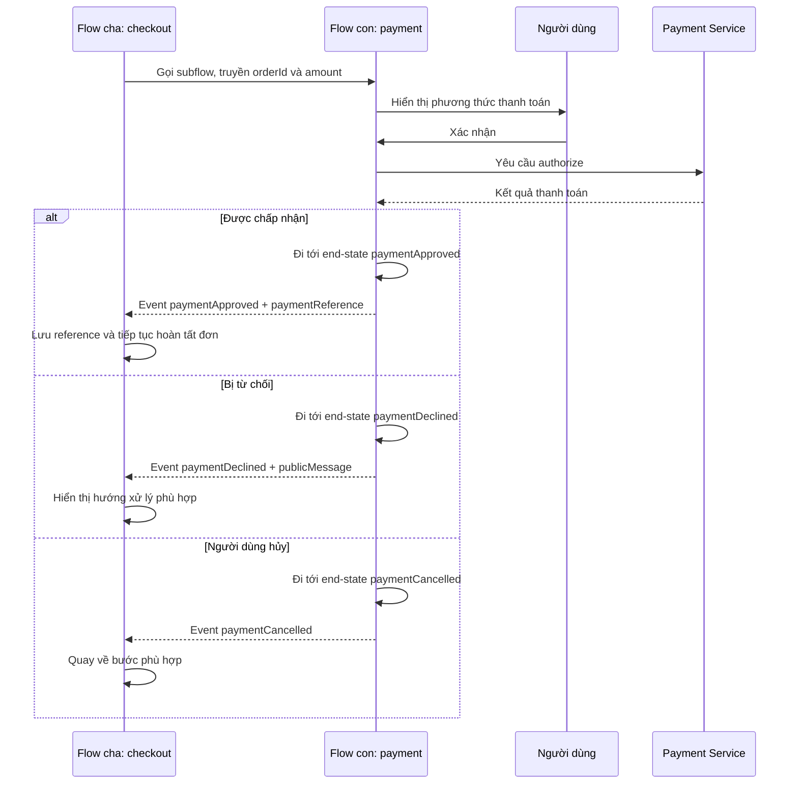
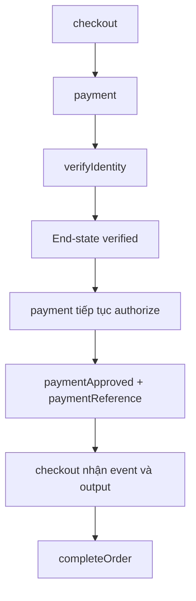

# Nhận output và sự kiện kết quả từ flow con

Trong **Spring Web Flow**, một flow cha có thể ủy quyền một phần hành trình cho flow con (*subflow*). Flow con tự xử lý các màn hình, event, validation và action của nó. Khi hoàn tất, flow con trả về một **sự kiện kết quả** và có thể mang theo **các giá trị output** để flow cha tiếp tục công việc.

Ví dụ, flow thanh toán đơn hàng gọi flow con `payment`. Flow con hiển thị phương thức thanh toán, kiểm tra thông tin, gọi dịch vụ thanh toán và kết thúc theo một trong các kết quả: `paymentApproved`, `paymentDeclined`, `paymentCancelled` hoặc `paymentTemporarilyUnavailable`. Flow cha cần biết **kết quả nào đã xảy ra** và, nếu thành công, nhận **mã tham chiếu thanh toán** để hoàn tất đơn hàng.

Bài này thuộc chương **Subflow và tái sử dụng** của module **SPRING_WEB_FLOW**. Trọng tâm là cơ chế trao đổi dữ liệu qua ranh giới flow: khai báo input ở flow con, ánh xạ input từ flow cha, khai báo output ở end-state, nhận output trong event của `subflow-state` và chọn transition tiếp theo. Nội dung cũng kết nối với state/event/transition, scope, validation, Spring MVC, transaction, bảo mật và kiểm thử.

Sau bài học, bạn có thể:

1. Phân biệt **ID của end-state** (sự kiện kết quả) với **output attribute** (dữ liệu kết quả).
2. Khai báo input cho flow con và truyền dữ liệu từ flow cha bằng `<input>`.
3. Khai báo output ở `<end-state>` và đọc chúng qua `currentEvent.attributes` trong flow cha.
4. Thiết kế nhiều kết quả như thành công, từ chối, hủy và lỗi tạm thời.
5. Giữ đúng dữ liệu qua `flowScope`, không phụ thuộc vào scope nội bộ của flow con sau khi nó kết thúc.
6. Kiểm thử cả tên event, giá trị output, trường hợp thiếu output và việc xử lý lặp an toàn.

## 1. Flow con kết thúc bằng một kết quả có ý nghĩa

Giả sử flow cha `checkout` đang xử lý đơn hàng. Trước khi hoàn tất, nó gọi flow con `payment` để thu thập thông tin thanh toán.

Flow con có thể kết thúc theo nhiều đường:

| End-state ID trong flow con | Ý nghĩa nghiệp vụ | Dữ liệu có thể trả về |
| --- | --- | --- |
| `paymentApproved` | Thanh toán được xác nhận | Mã tham chiếu giao dịch, thời điểm xác nhận |
| `paymentDeclined` | Nhà cung cấp từ chối thanh toán | Thông báo an toàn cho người dùng, mã lý do công khai |
| `paymentCancelled` | Người dùng chủ động hủy bước thanh toán | Thường không cần dữ liệu |
| `paymentTemporarilyUnavailable` | Dịch vụ thanh toán tạm thời chưa thể xử lý | Thời gian thử lại gợi ý hoặc mã trạng thái an toàn |

Trong Web Flow, khi flow con đi tới một `end-state`, ID của end-state đó trở thành **event kết quả** mà `subflow-state` ở flow cha nhận được. Flow cha dùng tên event trong `<transition on="...">` để chọn nhánh tiếp theo.

Ngoài event ID, end-state có thể khai báo một hoặc nhiều `<output>`. Những output này được gắn vào **attributes của event kết quả**. Trong transition tương ứng của flow cha, có thể đọc chúng qua `currentEvent.attributes.<tên-output>`.

Hai phần có vai trò khác nhau:

- **Event ID trả lời:** flow con đã kết thúc theo kết quả nào?
- **Output trả lời:** kết quả đó mang theo dữ liệu gì?

Ví dụ: `paymentApproved` là event ID; `paymentReference` là output attribute. Không nên dùng một chuỗi duy nhất như `"APPROVED:TX-123"` để vừa mã hóa loại kết quả vừa nhét dữ liệu vào đó.

## 2. Sơ đồ trao đổi giữa flow cha và flow con



Luồng này cho thấy flow cha **không cần biết từng view-state nội bộ** của flow con. Nó chỉ cần biết hợp đồng kết thúc mà flow con công bố: những end-state nào có thể xảy ra và output nào đi kèm từng kết quả.

Sự tách biệt đó giúp tái sử dụng flow con. Một flow `payment` có thể được gọi từ nhiều flow cha khác nhau nếu các bên thống nhất cùng một hợp đồng input/output/outcome.

## 3. Phân biệt input, event kết quả và output

| Thành phần | Hướng dữ liệu | Được khai báo ở đâu? | Ví dụ |
| --- | --- | --- | --- |
| Input | Flow cha → flow con | `<input>` ở flow con và mapping `<input>` trong `<subflow-state>` của cha | `orderId`, `amount` |
| Event kết quả | Flow con → flow cha | ID của `<end-state>` con; transition cha khớp ID đó | `paymentApproved` |
| Output | Flow con → flow cha | `<output>` trong end-state con | `paymentReference` |
| Transition cha | Phản ứng với kết quả | `<transition on="paymentApproved">` trong subflow-state cha | Đi tới `orderCompleted` |

Ví dụ hợp đồng:

```xml
<!-- Trong payment-flow.xml -->
<flow>
    <input name="orderId" type="java.lang.String"/>
    <input name="amount" type="java.math.BigDecimal"/>

    ...

    <end-state id="paymentApproved">
        <output name="paymentReference"
                value="flowScope.paymentResult.reference"/>
    </end-state>
</flow>
```

Flow cha truyền input:

```xml
<!-- Trong checkout-flow.xml -->
<subflow-state id="pay" subflow="payment">
    <input name="orderId" value="flowScope.orderId"/>
    <input name="amount" value="flowScope.totalAmount"/>

    <transition on="paymentApproved" to="completeOrder">
        <set name="flowScope.paymentReference"
             value="currentEvent.attributes.paymentReference"/>
    </transition>
</subflow-state>
```

Khi flow con kết thúc ở `paymentApproved`, flow cha nhận event cùng attribute `paymentReference`. Transition có thể sao chép output đó vào flow scope của cha trước khi tiếp tục.

**Output không phải input của flow cha tự động được cập nhật ở mọi nơi.** Nó xuất hiện trên event kết quả của subflow; flow cha phải chủ động đọc và đặt vào biến mà các state tiếp theo sử dụng.

## 4. Đăng ký flow con trong FlowDefinitionRegistry

Thuộc tính `subflow` của `<subflow-state>` tham chiếu tới **flow ID** được registry nhận diện. Vì vậy, flow con cần được đăng ký như một flow definition.

Ví dụ Spring XML:

```xml
<webflow:flow-registry id="flowRegistry"
                       xmlns:webflow="http://www.springframework.org/schema/webflow-config">
    <webflow:flow-location
        id="checkout"
        path="/WEB-INF/flows/checkout/checkout-flow.xml"/>

    <webflow:flow-location
        id="payment"
        path="/WEB-INF/flows/payment/payment-flow.xml"/>
</webflow:flow-registry>
```

Trong ví dụ:

- `checkout` là flow cha.
- `payment` là flow con.
- `path` là vị trí file định nghĩa flow trong ứng dụng.
- `subflow="payment"` ở flow cha phải trùng với ID registry `payment`.

Cấu hình thực tế có thể dùng namespace XML hoặc Java configuration tùy phiên bản. Điều cần giữ nhất quán là **ID flow được tham chiếu** và **định nghĩa flow được registry nạp**. Một file XML nằm trong thư mục dự án nhưng chưa được registry phát hiện không tự động trở thành subflow có thể gọi.

Bố cục ví dụ:

```text
WEB-INF/
  flows/
    checkout/
      checkout-flow.xml
    payment/
      payment-flow.xml
```

Không gọi trực tiếp URL file XML từ trình duyệt. Flow cha gọi flow con qua `subflow-state`; registry và `FlowExecutor` quản lý việc tạo/tiếp tục execution.

## 5. Khai báo input ở flow con

Flow con công bố những dữ liệu nó cần từ caller bằng `<input>` ở cấp root `<flow>`:

```xml
<flow xmlns="http://www.springframework.org/schema/webflow"
      xmlns:xsi="http://www.w3.org/2001/XMLSchema-instance"
      xsi:schemaLocation="
        http://www.springframework.org/schema/webflow
        http://www.springframework.org/schema/webflow/spring-webflow.xsd"
      start-state="enterPayment">

    <input name="orderId" type="java.lang.String"/>
    <input name="amount" type="java.math.BigDecimal"/>
    <input name="currency" type="java.lang.String"/>

    <var name="paymentDraft"
         class="com.example.payment.PaymentDraft"/>

    ...
</flow>
```

Các input là **hợp đồng đầu vào** của flow con. Trong biểu thức của flow con, các giá trị input có thể được tham chiếu theo tên đã khai báo; nếu cần đưa chúng vào một object khác hoặc chuẩn hóa, hãy thực hiện ở action phù hợp.

Ví dụ, flow con cần `orderId` để hiển thị mã đơn và `amount` để cho người dùng xác nhận số tiền. Nó không cần biết flow cha đặt tên biến tổng tiền là `totalAmount` hay `checkoutTotal`; việc ánh xạ tên cha sang tên input con thuộc trách nhiệm của `<subflow-state>`.

### Chọn input tối thiểu

Chỉ truyền dữ liệu mà flow con thật sự cần. Ví dụ thanh toán chỉ cần:

- Mã đơn hàng.
- Số tiền và đơn vị tiền tệ đã được server tính.
- Mã định danh yêu cầu logic để đối chiếu idempotency nếu contract yêu cầu.

Không truyền toàn bộ object session, toàn bộ đơn hàng hoặc thông tin nhạy cảm không liên quan. Nếu flow con cần nhiều trường, cân nhắc một DTO input có cấu trúc rõ ràng thay vì danh sách tham số rời rạc.

### Kiểu dữ liệu và kiểm tra input

`type` giúp khai báo kiểu dự kiến cho input. Flow cha cần truyền giá trị tương thích; nếu không, quá trình khởi chạy subflow có thể thất bại do chuyển đổi/kiểu dữ liệu. Dù input đã được khai báo kiểu, flow con vẫn phải kiểm tra các bất biến nghiệp vụ và quyền truy cập cần thiết. Không coi dữ liệu đến từ flow cha là đáng tin tuyệt đối chỉ vì nó không đến trực tiếp từ một form ở flow con.

## 6. Ánh xạ input trong subflow-state của flow cha

Trong flow cha, `<subflow-state>` gọi flow con và ánh xạ từng input:

```xml
<subflow-state id="pay" subflow="payment">
    <input name="orderId"
           value="flowScope.orderId"/>

    <input name="amount"
           value="flowScope.totalAmount"/>

    <input name="currency"
           value="flowScope.currency"/>

    <transition on="paymentApproved" to="completeOrder"/>
    <transition on="paymentDeclined" to="paymentRejected"/>
    <transition on="paymentCancelled" to="cancelled"/>
</subflow-state>
```

Quy tắc đọc:

- `name` phải khớp tên input mà flow con khai báo.
- `value` là biểu thức lấy dữ liệu từ ngữ cảnh flow cha.
- Mỗi `<input>` truyền một giá trị vào flow con.
- Các transition trong subflow-state chờ **event kết thúc của flow con**, không phải mọi event nội bộ trong view-state con.

Không nên viết:

```xml
<!-- Sai hợp đồng: tên input không khớp khai báo ở flow con. -->
<input name="total" value="flowScope.totalAmount"/>
```

nếu flow con chỉ khai báo `<input name="amount" .../>`. Khi tên không khớp, input bắt buộc có thể không được cấp đúng và flow con có thể lỗi lúc khởi tạo hoặc không nhận được giá trị mong đợi.

### Input là tham chiếu hay bản sao?

Khi truyền một object mutable làm input, không nên giả định Web Flow luôn deep-copy object. Tùy biểu thức, kiểu dữ liệu và cách mapping, flow con có thể nhận cùng object reference. Nếu flow con sửa object đó, flow cha có thể quan sát thay đổi. Để tránh side effect khó đoán:

- Ưu tiên truyền ID hoặc DTO input bất biến.
- Nếu cần chỉnh sửa, tạo bản nháp riêng trong flow con.
- Chỉ đưa kết quả cần thiết trở lại qua output.
- Viết test để xác minh hành vi chia sẻ object nếu cố ý dùng chung reference.

## 7. Khai báo output trong end-state của flow con

Một `end-state` có thể công bố dữ liệu trả về qua các phần tử `<output>`:

```xml
<end-state id="paymentApproved">
    <output name="paymentReference"
            value="flowScope.paymentResult.reference"/>
    <output name="approvedAt"
            value="flowScope.paymentResult.approvedAt"/>
</end-state>
```

Khi flow con kết thúc tại state này:

- Event ID là `paymentApproved`.
- Event attribute `paymentReference` chứa giá trị từ biểu thức đã khai báo.
- Event attribute `approvedAt` chứa thời điểm xác nhận.
- Flow cha có thể đọc các giá trị này trong transition xử lý event `paymentApproved`.

Một end-state khác có thể trả output khác:

```xml
<end-state id="paymentDeclined">
    <output name="publicMessage"
            value="flowScope.paymentResult.publicMessage"/>
    <output name="publicReasonCode"
            value="flowScope.paymentResult.publicReasonCode"/>
</end-state>

<end-state id="paymentCancelled"/>
```

`paymentCancelled` không khai báo output vì caller chỉ cần biết người dùng đã hủy. Không cần trả một chuỗi rỗng để thay cho output không tồn tại.

**Chọn output có chủ đích:** chỉ công bố dữ liệu mà flow cha cần. Không trả số thẻ, CVV, access token, stack trace, thông tin nội bộ của nhà cung cấp hoặc toàn bộ object thanh toán nếu chỉ cần một mã tham chiếu.

## 8. Output được nhận như event attributes ở flow cha

Giả sử flow con kết thúc bằng:

```xml
<end-state id="paymentApproved">
    <output name="paymentReference"
            value="flowScope.paymentResult.reference"/>
</end-state>
```

Flow cha khai báo transition tương ứng:

```xml
<subflow-state id="pay" subflow="payment">
    <input name="orderId" value="flowScope.orderId"/>
    <input name="amount" value="flowScope.totalAmount"/>

    <transition on="paymentApproved" to="completeOrder">
        <set name="flowScope.paymentReference"
             value="currentEvent.attributes.paymentReference"/>
    </transition>
</subflow-state>
```

Ở đây:

- `on="paymentApproved"` khớp ID end-state của flow con.
- `currentEvent` là event kết quả đang được flow cha xử lý.
- `currentEvent.attributes.paymentReference` lấy output có tên `paymentReference`.
- `<set>` lưu output vào flow scope của flow cha để các state tiếp theo sử dụng.

Có thể đọc nhiều output trong cùng transition:

```xml
<transition on="paymentApproved" to="completeOrder">
    <set name="flowScope.paymentReference"
         value="currentEvent.attributes.paymentReference"/>
    <set name="flowScope.paymentApprovedAt"
         value="currentEvent.attributes.approvedAt"/>
</transition>
```

Hoặc dùng `<evaluate>` khi cần gọi logic chuyển đổi:

```xml
<transition on="paymentApproved" to="completeOrder">
    <evaluate expression="paymentMapper.toReceipt(currentEvent.attributes)"
              result="flowScope.paymentReceipt"/>
</transition>
```

`paymentMapper` là bean do ứng dụng định nghĩa. Nếu dùng mapper, hãy kiểm tra output bắt buộc trước khi tạo receipt; không biến thiếu attribute thành một kết quả thành công giả.

### Output không tự động nằm trong flowScope của cha

Một hiểu nhầm thường gặp là sau khi subflow kết thúc, mọi biến trong `flowScope` của nó được gộp vào flow cha. Điều này không phải hợp đồng nên dựa vào. **Chỉ các output được khai báo ở end-state** được công bố cho caller theo cách có chủ đích. Flow cha đọc event attributes và tự lưu những giá trị cần dùng.

## 9. Flow con hoàn chỉnh: thanh toán với nhiều kết quả

Ví dụ `payment-flow.xml`. Các class `PaymentDraft`, `PaymentResult` và bean `paymentService` là thành phần ứng dụng cần cung cấp.

```xml
<?xml version="1.0" encoding="UTF-8"?>
<flow xmlns="http://www.springframework.org/schema/webflow"
      xmlns:xsi="http://www.w3.org/2001/XMLSchema-instance"
      xsi:schemaLocation="
        http://www.springframework.org/schema/webflow
        http://www.springframework.org/schema/webflow/spring-webflow.xsd"
      start-state="enterPayment">

    <input name="orderId" type="java.lang.String"/>
    <input name="amount" type="java.math.BigDecimal"/>
    <input name="currency" type="java.lang.String"/>

    <var name="paymentDraft"
         class="com.example.payment.PaymentDraft"/>

    <view-state id="enterPayment"
                view="payment/enter"
                model="paymentDraft">
        <binder>
            <binding property="methodToken"/>
        </binder>

        <transition on="confirm" to="authorize"
                    bind="true" validate="true"/>
        <transition on="cancel" to="paymentCancelled"
                    bind="false" validate="false"/>
    </view-state>

    <view-state id="reviewPayment" view="payment/review">
        <transition on="back" to="enterPayment"/>
        <transition on="authorize" to="authorize"/>
        <transition on="cancel" to="paymentCancelled"/>
    </view-state>

    <action-state id="authorize">
        <evaluate
            expression="paymentService.authorize(
                orderId,
                amount,
                currency,
                paymentDraft.methodToken
            )"
            result="flowScope.paymentResult"/>
        <transition on="success" to="classifyResult"/>
    </action-state>

    <decision-state id="classifyResult">
        <if test="flowScope.paymentResult.approved"
            then="paymentApproved"
            else="checkRetryable"/>
    </decision-state>

    <decision-state id="checkRetryable">
        <if test="flowScope.paymentResult.retryable"
            then="paymentTemporarilyUnavailable"
            else="paymentDeclined"/>
    </decision-state>

    <end-state id="paymentApproved">
        <output name="paymentReference"
                value="flowScope.paymentResult.reference"/>
        <output name="approvedAt"
                value="flowScope.paymentResult.approvedAt"/>
    </end-state>

    <end-state id="paymentDeclined">
        <output name="publicMessage"
                value="flowScope.paymentResult.publicMessage"/>
    </end-state>

    <end-state id="paymentTemporarilyUnavailable">
        <output name="retryAfterSeconds"
                value="flowScope.paymentResult.retryAfterSeconds"/>
    </end-state>

    <end-state id="paymentCancelled"/>
</flow>
```

Flow con có bốn kết quả công bố. Bên trong nó có hai view-state và một action-state, nhưng flow cha không cần biết các state đó. Caller chỉ nhận event khi flow con đi đến một trong các end-state.

**Lưu ý về ví dụ:** expression gọi service được xuống dòng để dễ đọc; trong file XML thật, có thể viết biểu thức trên một dòng nếu parser/schema hoặc cấu hình expression language của phiên bản đang dùng yêu cầu. Phương thức service phải trả DTO có các property tương ứng và xử lý lỗi theo contract.

### Có thể dùng action-state trực tiếp thay vì decision-state không?

Có. Nếu action/service trả về một event đã phân loại, có thể dùng transition từ action-state tới end-state tương ứng. Ví dụ:

```xml
<action-state id="authorize">
    <evaluate expression="paymentAction.authorize(paymentDraft)"/>
    <transition on="approved" to="paymentApproved"/>
    <transition on="declined" to="paymentDeclined"/>
</action-state>
```

Đây là **phương án thay thế**. Ví dụ chính chọn lưu `PaymentResult` rồi dùng decision-state để làm rõ việc phân loại kết quả. Chọn một mô hình nhất quán; không cần vừa phát event outcome từ action vừa phân loại lại cùng kết quả trong decision-state.

## 10. Flow cha nhận event và output để tiếp tục đơn hàng

Ví dụ `checkout-flow.xml`:

```xml
<?xml version="1.0" encoding="UTF-8"?>
<flow xmlns="http://www.springframework.org/schema/webflow"
      xmlns:xsi="http://www.w3.org/2001/XMLSchema-instance"
      xsi:schemaLocation="
        http://www.springframework.org/schema/webflow
        http://www.springframework.org/schema/webflow/spring-webflow.xsd"
      start-state="reviewOrder">

    <var name="order"
         class="com.example.checkout.OrderDraft"/>

    <view-state id="reviewOrder" view="checkout/review">
        <transition on="pay" to="pay"/>
        <transition on="cancel" to="cancelled"/>
    </view-state>

    <subflow-state id="pay" subflow="payment">
        <input name="orderId" value="flowScope.order.id"/>
        <input name="amount" value="flowScope.order.totalAmount"/>
        <input name="currency" value="flowScope.order.currency"/>

        <transition on="paymentApproved" to="completeOrder">
            <set name="flowScope.order.paymentReference"
                 value="currentEvent.attributes.paymentReference"/>
            <set name="flowScope.order.paymentApprovedAt"
                 value="currentEvent.attributes.approvedAt"/>
        </transition>

        <transition on="paymentDeclined" to="paymentRejected">
            <set name="flowScope.paymentMessage"
                 value="currentEvent.attributes.publicMessage"/>
        </transition>

        <transition on="paymentTemporarilyUnavailable"
                    to="paymentRetry">
            <set name="flowScope.retryAfterSeconds"
                 value="currentEvent.attributes.retryAfterSeconds"/>
        </transition>

        <transition on="paymentCancelled" to="cancelled"/>
    </subflow-state>

    <action-state id="completeOrder">
        <evaluate expression="orderService.complete(order)"/>
        <transition on="success" to="completed"/>
    </action-state>

    <view-state id="paymentRejected" view="checkout/payment-rejected">
        <transition on="tryAnotherMethod" to="pay"/>
        <transition on="cancel" to="cancelled"/>
    </view-state>

    <view-state id="paymentRetry" view="checkout/payment-retry">
        <transition on="retry" to="pay"/>
        <transition on="cancel" to="cancelled"/>
    </view-state>

    <end-state id="completed" view="checkout/completed"/>
    <end-state id="cancelled" view="checkout/cancelled"/>
</flow>
```

Cách hoạt động:

1. `reviewOrder` nhận event `pay` và chuyển tới `subflow-state` `pay`.
2. Web Flow tạo/khởi chạy flow con có ID `payment` trong registry.
3. Các phần tử `<input>` lấy dữ liệu từ `flowScope.order` của cha và cấp cho input tương ứng ở flow con.
4. Flow con xử lý giao diện và nghiệp vụ thanh toán.
5. Khi flow con đi đến end-state, event ID của end-state được trả về `pay`.
6. Transition của cha khớp event ID và đọc các output qua `currentEvent.attributes`.
7. Flow cha lưu các output cần giữ vào `flowScope.order` hoặc biến khác rồi chuyển state.

Nếu flow con trả `paymentDeclined`, flow cha đi tới `paymentRejected`; nếu trả `paymentCancelled`, flow cha đi tới `cancelled`. Một event không có transition tương ứng sẽ không được xử lý theo nhánh mong muốn; hãy định nghĩa rõ tất cả outcome mà subflow có thể trả.

### Vì sao lưu output vào order trong flow cha?

`paymentReference` là dữ liệu cần cho bước hoàn tất đơn và có thể cần hiển thị ở trang kết quả. `currentEvent.attributes` chỉ là nơi nhận dữ liệu của event hiện tại; lưu vào model cha làm cho state tiếp theo có một vị trí dữ liệu rõ ràng. Không cần sao chép mọi output nếu parent chỉ dùng nó một lần.

## 11. Hợp đồng output: tên, kiểu, tính bắt buộc và dữ liệu an toàn

Output là API giữa hai flow. Vì vậy cần thiết kế như một hợp đồng có version và được kiểm thử.

| Output | Kiểu gợi ý | Có bắt buộc? | Mục đích |
| --- | --- | --- | --- |
| `paymentReference` | `String` | Có nếu approved | Tham chiếu giao dịch |
| `approvedAt` | `Instant` hoặc kiểu thời gian phù hợp | Theo contract | Thời điểm xác nhận |
| `publicMessage` | `String` | Có nếu declined | Thông điệp an toàn |
| `retryAfterSeconds` | `Integer` | Có nếu retryable | Gợi ý thời gian chờ |
| `internalProviderResponse` | Không công bố | Không | Dữ liệu nội bộ không cần cho caller |

Một vài quy tắc:

- Dùng tên output ổn định, mô tả ý nghĩa thay vì chi tiết implementation.
- Chỉ công bố output ở end-state cần nó; không bắt mọi end-state phải trả cùng một tập field.
- Ghi rõ field nào bắt buộc cho mỗi event outcome.
- Dùng DTO/kiểu dữ liệu có thể lưu/khôi phục theo cơ chế execution nếu output được giữ trong scope.
- Không trả dữ liệu bí mật hoặc thông tin nội bộ của provider.
- Nếu output là object mutable, quy định rõ ai sở hữu và ai được phép sửa.
- Nếu contract thay đổi, cập nhật flow cha, flow con và test tương ứng cùng lúc.

### Output không có giá trị

Nếu biểu thức output trả `null` hoặc output không được khai báo ở end-state, parent có thể không nhận được dữ liệu cần thiết. Đừng coi null là một giá trị thành công hợp lệ nếu contract yêu cầu payment reference.

Có thể kiểm tra output trước khi gọi action hoàn tất đơn:

```xml
<transition on="paymentApproved" to="validatePaymentOutput">
    <set name="flowScope.paymentReference"
         value="currentEvent.attributes.paymentReference"/>
</transition>

<decision-state id="validatePaymentOutput">
    <if test="flowScope.paymentReference != null"
        then="completeOrder"
        else="paymentIntegrationError"/>
</decision-state>
```

Đây là ví dụ kiểm tra phòng vệ. Trong thực tế, có thể xác thực kiểu và tính hợp lệ trong mapper/action thay vì rải điều kiện vào XML. Nếu thiếu output bắt buộc, cần xem đó là lỗi tích hợp/contract và log để điều tra, không tự tạo mã giao dịch giả.

## 12. Event kết quả không phải event nội bộ của flow con

Giả sử flow con có:

- `enterPayment` với event `confirm`.
- `reviewPayment` với event `authorize`.
- `authorize` action-state với event `success`.
- End-state `paymentApproved`.

Flow cha **không** nhận trực tiếp `confirm`, `authorize` hay `success`. Những event đó được xử lý bên trong flow con. Chỉ khi child đi tới end-state, event kết quả của subflow mới được trả cho caller.

| Event hoặc state | Nơi xử lý | Flow cha nhìn thấy? |
| --- | --- | --- |
| `confirm` từ form payment | View-state trong child | Không |
| `authorize` từ màn review | View-state trong child | Không |
| `success` từ action-state child | Nội bộ child, dẫn tới decision | Không |
| `paymentApproved` | End-state child | Có, như event kết quả |
| `paymentDeclined` | End-state child | Có |
| `paymentCancelled` | End-state child | Có |

Không nên viết transition trong parent `on="confirm"` với kỳ vọng nó bắt nút xác nhận của child. Parent chỉ xử lý các outcome được child công bố. Cách phân tầng này giúp flow cha không phụ thuộc vào cách child bố trí view hoặc tên event nội bộ.

## 13. Phân biệt outcome nghiệp vụ với exception kỹ thuật

Một flow con có thể kết thúc theo kết quả nghiệp vụ đã định nghĩa:

- Thanh toán được chấp nhận.
- Thanh toán bị từ chối.
- Người dùng hủy.
- Dịch vụ đang tạm thời không sẵn sàng nhưng đã được phân loại.

Các trường hợp này có thể là end-state/outcome rõ ràng. Trong khi đó, exception chưa xử lý như lỗi cấu hình, bug hoặc lỗi hạ tầng không nên tự động biến thành `paymentDeclined`.

| Tình huống | Cách biểu diễn phù hợp |
| --- | --- |
| Nhà cung cấp từ chối thẻ theo kết quả nghiệp vụ | End-state `paymentDeclined` |
| Người dùng bấm Hủy | End-state `paymentCancelled` |
| Provider timeout nhưng có chính sách retry an toàn | Outcome `paymentTemporarilyUnavailable` nếu service đã phân loại |
| Timeout sau khi provider có thể đã thu tiền | Trạng thái chưa xác định; tra cứu theo idempotency key trước khi retry |
| Lỗi cấu hình bean hoặc `NullPointerException` | Exception handling/ghi log; không giả thành decline |
| Input amount không hợp lệ | Validation hoặc lỗi hợp đồng input trước khi authorize |

Không bắt mọi exception rồi chuyển thành end-state “paymentDeclined”. Việc đó che giấu lỗi kỹ thuật và khiến flow cha đưa ra thông báo sai. Nếu child cần chuyển lỗi đã phân loại thành outcome, hãy bắt đúng loại exception và bảo đảm service đã xác định trạng thái giao dịch.

### Kết quả chưa xác định sau timeout

Đặc biệt với thanh toán, timeout không đồng nghĩa giao dịch chưa được xử lý. Nếu provider đã thu tiền nhưng response bị mất, retry bằng một idempotency key mới có thể thu tiền lần thứ hai.

Thiết kế an toàn:

1. Flow cha truyền một mã yêu cầu logic ổn định vào child.
2. Child giữ mã đó qua các lần thử.
3. Payment service gửi cùng idempotency key tới provider nếu provider hỗ trợ.
4. Khi retry, service tra cứu kết quả trước hoặc lặp lại cùng key theo contract.
5. Chỉ trả `paymentApproved` khi có bằng chứng kết quả thành công.
6. Nếu chưa thể xác định, trả trạng thái phục hồi phù hợp hoặc để exception handler xử lý; không tuyên bố đã từ chối.

## 14. Scope của flow cha và flow con sau khi subflow kết thúc

Flow cha và flow con có execution context riêng. Dữ liệu nội bộ child không tự động trở thành dữ liệu parent.

| Dữ liệu | Nơi lưu trong lúc child chạy | Sau khi child kết thúc |
| --- | --- | --- |
| `paymentDraft` | Flow scope của child | Không truy cập trực tiếp như model đang hoạt động của parent |
| `paymentResult` | Flow scope của child | Chỉ giá trị được khai báo trong output được công bố qua event |
| `orderId`, `amount` | Input của child | Parent vẫn giữ dữ liệu gốc của nó |
| `paymentReference` | Output event attribute | Parent có thể copy vào flow scope của mình |
| `order` | Flow scope của parent | Vẫn tồn tại khi parent tiếp tục |
| Payment record đã commit | Database/provider | Tồn tại ngoài cả hai flow |

Nếu child cần chia sẻ dữ liệu với flow cha/con theo một conversation rộng hơn, có thể cân nhắc `conversationScope` khi đúng mô hình. Nhưng **input/output tường minh thường dễ kiểm thử và ít phụ thuộc hơn** cho hợp đồng giữa hai flow. Đừng sử dụng conversation scope như cách chia sẻ mọi biến mà không xác định ai sở hữu dữ liệu.

### Đối tượng output có mutable không?

Nếu output trả một DTO mutable, parent và child có thể cùng tham chiếu tới object đó tùy cách mapping. Một DTO bất biến hoặc một bản sao dữ liệu đơn giản giúp giảm rủi ro parent vô tình sửa kết quả mà child đã tạo. Đặc biệt không đưa entity JPA đang gắn persistence context, connection hoặc resource đang mở qua ranh giới subflow.

## 15. Flow lồng nhau và hợp đồng nhiều tầng

Flow cha có thể gọi flow con, và flow con có thể tiếp tục gọi một subflow khác. Ví dụ:



Trong cấu trúc này:

- `verifyIdentity` trả outcome và output cho `payment`.
- `payment` dùng kết quả xác minh để quyết định có tiếp tục authorize không.
- Khi `payment` kết thúc, `checkout` chỉ nhận contract mà `payment` công bố.
- Output của flow cháu không tự nhảy qua hai ranh giới để xuất hiện trong flow ông. Mỗi tầng cần nhận rồi công bố lại những giá trị mà caller tiếp theo cần.

Ví dụ, nếu `verifyIdentity` trả `identityVerified` với output `verificationId`, flow `payment` có thể lưu nó trong scope của mình. Nếu `checkout` cũng cần biết verificationId, `payment` phải đưa giá trị đó vào output của end-state thích hợp. Điều này giữ mỗi flow có API rõ ràng.

### Tránh để flow cha phụ thuộc chi tiết nội bộ

Không để parent kiểm tra `paymentDraft.methodToken` hoặc state ID `enterPayment` của child. Nếu child thay giao diện hoặc cách xác thực, caller không nên phải sửa. Parent chỉ dựa vào:

- Input được công bố.
- Các event kết quả được công bố.
- Các output attribute được công bố trên từng event.
- Quy tắc bảo đảm về tính nhất quán của kết quả.

## 16. Xử lý nhiều output và nhiều nhánh trong flow cha

Một subflow có thể có nhiều end-state, mỗi state trả tập output riêng. Parent phải định nghĩa transition cho từng outcome mà caller cần xử lý.

```xml
<subflow-state id="pay" subflow="payment">
    <input name="orderId" value="flowScope.orderId"/>
    <input name="amount" value="flowScope.totalAmount"/>

    <transition on="paymentApproved" to="completeOrder">
        <set name="flowScope.paymentReference"
             value="currentEvent.attributes.paymentReference"/>
        <set name="flowScope.approvedAt"
             value="currentEvent.attributes.approvedAt"/>
    </transition>

    <transition on="paymentDeclined" to="paymentRejected">
        <set name="flowScope.paymentMessage"
             value="currentEvent.attributes.publicMessage"/>
    </transition>

    <transition on="paymentCancelled" to="cancelled"/>

    <transition on="paymentTemporarilyUnavailable"
                to="paymentRetry">
        <set name="flowScope.retryAfterSeconds"
             value="currentEvent.attributes.retryAfterSeconds"/>
    </transition>
</subflow-state>
```

Không nên dùng một transition chung cho mọi outcome nếu các nhánh cần xử lý khác nhau. Ví dụ, `paymentDeclined` có thể cho đổi phương thức, `paymentCancelled` có thể hủy checkout, còn `paymentTemporarilyUnavailable` cần thông báo chờ và retry có kiểm soát.

Nếu một outcome không cần output, transition không phải đọc attribute. Nếu output bắt buộc bị thiếu, hãy đưa execution vào nhánh lỗi tích hợp hoặc handler có log rõ ràng.

## 17. Bảo mật, transaction và dữ liệu nhạy cảm

Output từ child là dữ liệu server-side, nhưng vẫn phải tuân thủ nguyên tắc bảo mật:

- **Input:** không tin dữ liệu chỉ vì flow cha truyền vào. Child/service cần kiểm tra amount, order ownership, currency và quyền thanh toán.
- **Output:** chỉ trả mã tham chiếu, trạng thái và thông tin caller cần. Không đưa token thanh toán, số thẻ đầy đủ, CVV hoặc raw provider response vào event attributes.
- **Authorization:** service kiểm tra người dùng có quyền thao tác trên order được truyền vào.
- **Transaction:** ranh giới transaction của child/service phải được thiết kế rõ; việc child kết thúc không tự đảm bảo các side effect bên ngoài đã commit theo cùng một transaction với parent.
- **Idempotency:** retry/re-enter subflow không được tạo giao dịch trùng. Giữ request ID ổn định cho cùng một yêu cầu logic.
- **Logging:** log event ID, correlation ID và loại lỗi; tránh log thông tin thanh toán nhạy cảm.
- **Output rendering:** escape dữ liệu hiển thị ở JSP/Facelets và không đưa nội dung provider chưa tin cậy thẳng vào HTML.

Đặc biệt, parent không nên đánh dấu đơn hàng hoàn tất chỉ vì nhận event có tên `paymentApproved` nếu output bắt buộc như `paymentReference` thiếu hoặc service hoàn tất đơn chưa thành công. Hãy xác minh contract ở điểm nhận.

## 18. Kiểm thử hợp đồng input/output/outcome

Kiểm thử cần xác nhận cả **event ID** lẫn **attributes**. Chỉ assert parent đã tới state `completeOrder` chưa chứng minh mã tham chiếu được truyền đúng.

| ID | Kịch bản | Kỳ vọng |
| --- | --- | --- |
| T1 | Registry nạp parent và child | ID `checkout` và `payment` tồn tại |
| T2 | Parent gọi `pay` | Child nhận đúng `orderId`, `amount`, `currency` |
| T3 | Child đi tới `paymentApproved` | Parent nhận event ID đúng |
| T4 | Approved có output | `currentEvent.attributes.paymentReference` có giá trị |
| T5 | Parent lưu output | `flowScope.order.paymentReference` đúng |
| T6 | Child đi tới `paymentDeclined` | Parent đi tới `paymentRejected` |
| T7 | Declined có public message | Parent nhận đúng message an toàn |
| T8 | Người dùng hủy child | Parent xử lý `paymentCancelled` |
| T9 | Child trả retryable | Parent hiển thị hướng retry |
| T10 | End-state thiếu output bắt buộc | Không hoàn tất đơn giả; phát hiện lỗi contract |
| T11 | Tên output ở parent sai | Test phát hiện attribute không có |
| T12 | Child không kết thúc | Parent vẫn ở subflow-state, không nhận outcome sớm |
| T13 | Exception không dự kiến trong child | Đi theo exception handling, không giả thành decline |
| T14 | Input amount sai/âm | Bị từ chối ở validation/service |
| T15 | Retry cùng yêu cầu thanh toán | Không thu tiền/ghi giao dịch hai lần |
| T16 | Hai parent execution khác nhau | Input/output không bị trộn |
| T17 | Output chứa dữ liệu nhạy cảm | Không công bố field ngoài contract |
| T18 | Flow con lồng thêm flow cháu | Output chỉ truyền qua từng tầng đã khai báo |

### Pseudocode kiểm thử flow cha

```text
startFlow("checkout")
  -> currentState == "reviewOrder"

mockPaymentApproved(
  paymentReference = "PAY-REF-1001",
  approvedAt = fixedInstant
)

submitEvent("pay")
  -> childFlowId == "payment"
  -> childInput.orderId == parentFlow.order.id
  -> childInput.amount == parentFlow.order.totalAmount

completeChildAt("paymentApproved")
  -> parentCurrentState == "completeOrder"
  -> parentFlowScope.paymentReference == "PAY-REF-1001"
  -> parentFlowScope.approvedAt == fixedInstant
```

Đây là pseudocode mô tả assertion, không phải API test chạy trực tiếp. Có thể dùng test support của Spring Web Flow để khởi chạy parent flow, điều khiển subflow/event và kiểm tra scope. Với service thanh toán, cần unit/integration test riêng cho transaction, idempotency và việc không lộ dữ liệu nhạy cảm.

### Kiểm thử trực tiếp end-state output

Một test child flow nên xác minh:

1. Input được nhận đúng tên và kiểu.
2. Action tạo kết quả có trạng thái approved.
3. Flow con đi tới `paymentApproved`.
4. End-state công bố `paymentReference` và `approvedAt`.
5. Parent transition đọc đúng tên output.
6. Khi kết quả declined, end-state khác không vô tình trả output approved.
7. Khi thiếu giá trị bắt buộc, test phát hiện thay vì chấp nhận null.

## 19. Các lỗi thường gặp

| Sai lầm | Hậu quả | Cách sửa |
| --- | --- | --- |
| Nhầm event ID với output name | Parent transition không khớp outcome | Event ID lấy từ end-state ID |
| Khai báo output ở view-state thay vì end-state | Caller không nhận được output theo contract mong muốn | Khai báo `<output>` tại end-state |
| Flow cha không khai báo transition cho một end-state | Outcome không có nhánh xử lý | Liệt kê mọi end-state công khai và định nghĩa transition |
| Input name không trùng tên ở child | Child thiếu dữ liệu hoặc lỗi khởi chạy | Đối chiếu `<input>` hai phía |
| Đọc `paymentReference` trực tiếp như biến parent | Giá trị không tồn tại trong scope của parent | Đọc `currentEvent.attributes.paymentReference` |
| Nghĩ mọi flowScope của child tự gộp vào parent | Parent phụ thuộc dữ liệu nội bộ child | Chỉ dùng end-state output |
| Output null nhưng parent vẫn hoàn tất | Dữ liệu giao dịch thiếu | Kiểm tra output bắt buộc trước khi hoàn tất |
| Truyền object mutable và sửa trong child | Parent bị side effect ngoài dự kiến | Dùng DTO/ID và output tường minh |
| Dùng event nội bộ child trong parent | Parent không nhận event đó | Chỉ transition theo end-state outcome |
| Bắt mọi exception thành paymentDeclined | Che lỗi hạ tầng/bug, thông báo sai | Phân loại exception và outcome riêng |
| Retry tạo request ID mới | Có thể tạo giao dịch trùng | Giữ idempotency key ổn định |
| Output chứa provider response thô | Lộ dữ liệu nội bộ/nhạy cảm | Dùng DTO công khai tối thiểu |

### Chẩn đoán theo thứ tự

Khi parent không nhận được kết quả mong đợi, hãy kiểm tra:

1. Flow con đã được registry đăng ký với đúng ID chưa?
2. `subflow="..."` có trùng ID đó không?
3. Input name và type hai phía có khớp không?
4. Flow con có thực sự đi tới end-state không?
5. End-state ID có trùng `transition on` của parent không?
6. Output được khai báo ở end-state nào?
7. Tên attribute mà parent đọc có trùng `<output name>` không?
8. Transition action có lưu giá trị vào scope của parent không?
9. Output có null hoặc sai kiểu không?
10. Lỗi có phải exception kỹ thuật thay vì outcome nghiệp vụ không?

## 20. Bài thực hành: flow con xác minh địa chỉ giao hàng

Hãy xây dựng flow cha `checkout` gọi flow con `addressVerification` trước khi tạo vận đơn.

**Input của flow con:**

- `orderId`: mã đơn hàng.
- `postalCode`: mã bưu chính người dùng đã nhập.
- `addressDraft`: DTO địa chỉ cần xác minh, nếu contract yêu cầu.

**Các end-state của flow con:**

| End-state | Ý nghĩa | Output |
| --- | --- | --- |
| `addressVerified` | Địa chỉ được xác minh | `normalizedAddress`, `verificationId` |
| `addressRejected` | Địa chỉ không hợp lệ/không phục vụ | `publicMessage` |
| `addressCancelled` | Người dùng hủy | Không bắt buộc |
| `verificationUnavailable` | Dịch vụ xác minh tạm thời không khả dụng | `retryAfterSeconds` |

Flow cha cần:

1. Truyền input qua `<subflow-state>`.
2. Chờ event ID kết quả từ flow con.
3. Khi `addressVerified`, đọc `currentEvent.attributes.normalizedAddress` và `verificationId`, lưu vào flow scope cha.
4. Khi `addressRejected`, hiển thị lý do an toàn và cho sửa địa chỉ.
5. Khi `addressCancelled`, quay lại bước phù hợp.
6. Khi `verificationUnavailable`, hiển thị hướng retry có giới hạn.
7. Chỉ tạo vận đơn sau khi service kiểm tra lại địa chỉ và quyền truy cập.
8. Kiểm thử trường hợp output thiếu, input sai tên, execution hết hạn và hai checkout chạy song song.

Đầu ra mong đợi gồm sơ đồ parent/child, flow XML hai phía, bảng input/output/outcome, mã DTO/action, và test xác nhận cả event lẫn attributes.

## 21. Checklist trước khi hoàn tất

- [ ] Flow con được đăng ký trong registry với ID ổn định.
- [ ] `subflow-state` tham chiếu đúng ID flow con.
- [ ] Input được khai báo ở root flow con.
- [ ] Mapping `<input>` ở parent có đúng tên và biểu thức nguồn.
- [ ] Flow con kiểm tra input và quyền ở tầng thích hợp.
- [ ] Mỗi kết quả công khai có end-state riêng với ID rõ nghĩa.
- [ ] Output được khai báo trong đúng end-state.
- [ ] Parent transition `on` khớp ID end-state.
- [ ] Parent đọc output qua `currentEvent.attributes`.
- [ ] Output cần dùng sau transition được lưu vào scope của parent.
- [ ] Không giả định scope nội bộ child tự động gộp vào parent.
- [ ] Các nhánh declined/cancelled/retryable được xử lý riêng.
- [ ] Exception không dự kiến không bị giả thành outcome nghiệp vụ.
- [ ] Output không chứa thông tin nhạy cảm hoặc dữ liệu nội bộ không cần thiết.
- [ ] Retry dùng cùng idempotency key cho cùng yêu cầu logic.
- [ ] Có test input mapping, event ID, output attributes, null output và exception.

**Kết luận:** giao tiếp giữa flow cha và flow con trong Spring Web Flow nên được thiết kế như một hợp đồng tường minh. **Input** cho biết child cần gì; **end-state ID** cho biết child kết thúc theo kết quả nào; **end-state output** mang dữ liệu kết quả về dưới dạng event attributes; và **transition của parent** quyết định cách tiếp tục. Khi các phần này được đặt tên nhất quán và kiểm thử ở cả hai phía, subflow có thể tái sử dụng mà không khiến flow cha phụ thuộc vào state hoặc biến nội bộ của flow con.
