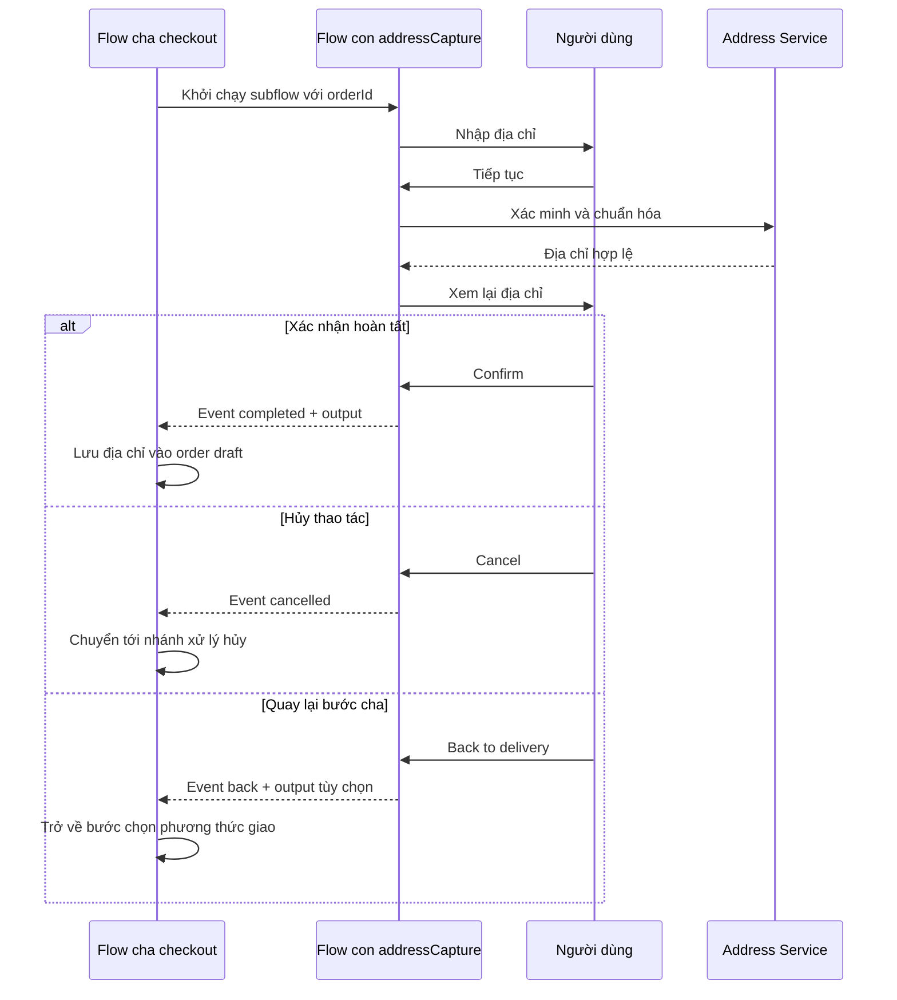
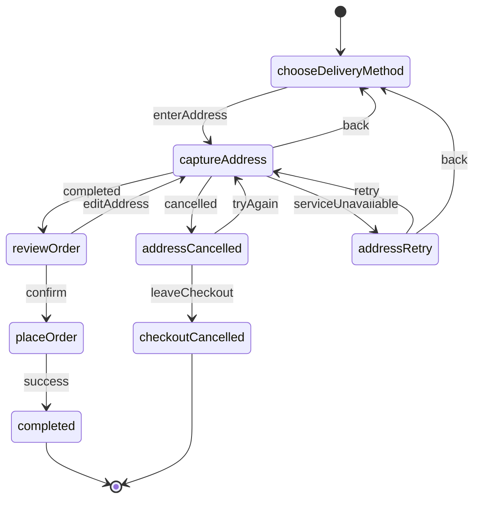

# Thiết kế kết quả hoàn thành, hủy và quay lại

Một flow con (*subflow*) thường đảm nhiệm một phần hành trình có thể tái sử dụng: nhập địa chỉ giao hàng, xác minh danh tính, chọn phương thức vận chuyển hoặc thanh toán. Khi phần việc đó kết thúc, flow cha cần biết **người dùng đã hoàn thành, chủ động hủy hay muốn quay lại bước trước** để chọn cách tiếp tục phù hợp.

Trong Spring Web Flow, những kết quả này nên được thiết kế thành **các end-state có ID rõ nghĩa**. ID của end-state trở thành event kết quả mà `subflow-state` ở flow cha nhận được. Nếu cần mang dữ liệu về, end-state công bố thêm các giá trị bằng `<output>`; flow cha đọc chúng qua `currentEvent.attributes` trong transition tương ứng.

Bài này thuộc chương **Subflow và tái sử dụng** của module **SPRING_WEB_FLOW**. Nội dung áp dụng cách mô hình hóa state, event, transition và subflow để quản lý hành trình nhiều bước; đồng thời kết nối với form binding, validation, scope, phiên, Spring MVC, transaction, kiểm thử và phục hồi khi flow execution gặp lỗi.

Sau bài học, bạn có thể:

1. Phân biệt kết quả **hoàn thành**, **hủy** và **quay lại** ở ranh giới flow con.
2. Thiết kế end-state ID như một hợp đồng outcome ổn định cho caller.
3. Ánh xạ từng outcome sang transition riêng trong `subflow-state` của flow cha.
4. Quyết định dữ liệu nào cần trả về qua `output` và dữ liệu nào nên bỏ.
5. Phân biệt event quay lại bên trong flow con với outcome `back` kết thúc flow con để trả quyền điều khiển cho flow cha.
6. Xử lý hủy mà không vô tình xóa dữ liệu nghiệp vụ đã tồn tại hoặc tạo side effect không thể đảo ngược.
7. Kiểm thử mọi outcome, output, binding, validation, retry và trường hợp flow execution hết hạn.

## 1. Ba kết quả là ba ý định khác nhau

Xét flow cha `checkout` đang cần người dùng nhập địa chỉ giao hàng. Nó gọi flow con `addressCapture` để nhập, xác minh và xem lại địa chỉ.

Flow con có thể kết thúc theo ba ý định cơ bản:

| Kết quả | Ý nghĩa | Flow cha thường làm gì? |
| --- | --- | --- |
| `completed` | Người dùng hoàn tất công việc trong flow con và kết quả đã sẵn sàng cho bước tiếp theo | Nhận dữ liệu đã xác minh, lưu vào draft của cha và tiếp tục |
| `cancelled` | Người dùng chủ động bỏ thao tác đang thực hiện | Hủy bước con, đưa cha tới màn hủy hoặc cho chọn hành động khác |
| `back` | Người dùng muốn rời flow con để trở lại bước trước của flow cha | Trở về state cha phù hợp, có thể giữ một phần dữ liệu nhập dở |

Không nên gộp ba kết quả thành một event `done` rồi dùng một cờ boolean để suy luận người dùng muốn gì. Khi outcome được đặt tên rõ ràng, state machine của flow cha dễ đọc và dễ kiểm thử hơn.

### Hoàn thành không đồng nghĩa toàn bộ nghiệp vụ đã commit

`completed` chỉ nói rằng **phần việc do flow con đảm nhiệm đã hoàn tất theo hợp đồng của nó**. Ví dụ, flow con đã xác minh và chuẩn hóa địa chỉ. Flow cha vẫn có thể cần kiểm tra phí vận chuyển, tính lại tổng đơn, kiểm tra tồn kho hoặc lưu đơn hàng.

Nếu flow con xử lý một giao dịch có side effect, hãy xác định chính xác thời điểm side effect được commit. Một end-state mang tên `completed` không tự tạo transaction và cũng không bảo đảm các hệ thống bên ngoài đã hoàn tất.

### Hủy không đồng nghĩa quay lại

`cancelled` thể hiện người dùng muốn bỏ thao tác. `back` thể hiện người dùng muốn tiếp tục hành trình từ bước trước. Hai hành vi có thể có chính sách lưu dữ liệu khác nhau:

- Khi `back`, ứng dụng có thể giữ bản nháp để người dùng quay lại chỉnh sửa.
- Khi `cancelled`, ứng dụng có thể bỏ dữ liệu tạm của flow con.
- Dữ liệu của flow cha như giỏ hàng hoặc đơn hàng đang tạo vẫn có thể được giữ, trừ khi người dùng chọn hủy toàn bộ checkout.

### Back trong trình duyệt không phải outcome back

Nút Back của trình duyệt có thể hiển thị trang cache hoặc gửi một execution URL cũ. Nó không tự động phát event `back` cho Web Flow. Outcome `back` trong bài này là một **event do flow con chủ động kết thúc**, được tạo từ một transition mà ứng dụng định nghĩa.

## 2. Ranh giới giữa flow cha và flow con

Flow con quản lý các state nội bộ của nó. Flow cha chỉ cần quan tâm tới những outcome mà child công bố.



Flow cha không cần biết child có các state `editAddress`, `reviewAddress` hay `verifyAddress`. Nó chỉ cần biết child có thể trả về `completed`, `cancelled` hoặc `back`, và output nào có thể xuất hiện cùng mỗi kết quả.

Đây là hợp đồng giúp tái sử dụng: cùng một flow con có thể được gọi từ checkout, trang quản lý địa chỉ hoặc quy trình tạo đơn nội bộ nếu các caller tuân thủ cùng input/outcome/output contract.

## 3. Event kết quả được tạo từ end-state ID

Trong Spring Web Flow, khi flow con đi tới một `end-state`, ID của end-state trở thành event kết quả trả về cho `subflow-state` của flow cha.

Ví dụ:

```xml
<end-state id="completed"/>
<end-state id="cancelled"/>
<end-state id="back"/>
```

Flow cha có thể khai báo:

```xml
<subflow-state id="captureAddress" subflow="addressCapture">
    <transition on="completed" to="reviewOrder"/>
    <transition on="cancelled" to="addressCancelled"/>
    <transition on="back" to="chooseDeliveryMethod"/>
</subflow-state>
```

Các tên phải khớp chính xác:

| End-state ID ở child | Transition `on` ở parent |
| --- | --- |
| `completed` | `on="completed"` |
| `cancelled` | `on="cancelled"` |
| `back` | `on="back"` |

Nếu child kết thúc ở `cancelled` nhưng parent chỉ khai báo `on="cancel"`, hai tên không khớp. Flow cha sẽ không có nhánh outcome mà child vừa trả về. Vì vậy hãy xem end-state ID như một phần API, không phải tên hiển thị tùy ý.

**Event kết quả khác event nội bộ.** Các event `continue`, `edit`, `confirm` trong view-state của child chỉ được child xử lý. Parent không nhận trực tiếp chúng. Parent chỉ nhận event khi child đi tới end-state.

## 4. Thiết kế outcome contract trước khi viết XML

Trước khi triển khai, hãy lập bảng outcome cho flow con. Ví dụ `addressCapture`:

| Outcome | Khi nào phát ra? | Output được công bố | Parent tiếp tục |
| --- | --- | --- | --- |
| `completed` | Địa chỉ đã được xác minh và người dùng xác nhận | `normalizedAddress`, `verificationId` | `reviewOrder` |
| `cancelled` | Người dùng chọn hủy thao tác nhập địa chỉ | Không bắt buộc | `addressCancelled` |
| `back` | Người dùng muốn quay lại chọn phương thức giao hàng | `partialAddress` nếu cần giữ bản nháp | `chooseDeliveryMethod` |
| `serviceUnavailable` | Dịch vụ xác minh tạm thời không thể xử lý | `retryAfterSeconds` nếu có | `addressRetry` |

Một contract tốt trả lời được:

- Những outcome nào có thể xảy ra?
- Điều kiện nào khiến child phát ra từng outcome?
- Output nào bắt buộc theo từng outcome?
- Dữ liệu nào là bản nháp và dữ liệu nào đã được xác nhận?
- Parent sẽ làm gì với từng outcome?
- Nếu output thiếu hoặc sai kiểu thì xử lý ra sao?
- Retry có thể lặp side effect hay không?

Không cần ép mọi outcome trả cùng một tập output. `cancelled` có thể không cần dữ liệu; `completed` cần địa chỉ chuẩn hóa; `back` chỉ trả bản nháp nếu parent có yêu cầu giữ lại.

## 5. Phân biệt quay lại bên trong child và trả outcome back cho parent

Đây là điểm dễ nhầm nhất khi thiết kế flow nhiều màn.

Giả sử child có các state:

- `editAddress`: nhập địa chỉ.
- `reviewAddress`: xem lại địa chỉ.
- `verifyAddress`: xác minh.
- Các end-state `completed`, `cancelled`, `back`.

Có hai kiểu “quay lại”:

**Quay lại trong child:** người dùng đang ở `reviewAddress`, bấm Sửa. Child chuyển về `editAddress` nhưng vẫn tiếp tục chạy. Đây là transition nội bộ:

```xml
<view-state id="reviewAddress" view="address/review">
    <transition on="edit" to="editAddress"/>
</view-state>
```

**Quay lại flow cha:** người dùng chọn “Quay về chọn phương thức giao hàng”. Child kết thúc ở end-state `back`, rồi parent tiếp nhận event và chuyển sang state cha trước đó:

```xml
<view-state id="reviewAddress" view="address/review">
    <transition on="edit" to="editAddress"/>
    <transition on="backToDelivery" to="back"
                bind="false" validate="false"/>
</view-state>

<end-state id="back"/>
```

Không dùng end-state `back` cho nút Sửa nếu người dùng vẫn cần ở trong child để cập nhật địa chỉ. Ngược lại, không chỉ chuyển về `editAddress` nếu yêu cầu thực sự là đóng child và trả quyền điều khiển về parent.

## 6. Xác định dữ liệu nào được giữ khi quay lại

Kết quả `back` không bắt buộc phải trả output. Hãy chọn chính sách dữ liệu theo trải nghiệm mong muốn.

| Chính sách | Child trả gì? | Parent làm gì? |
| --- | --- | --- |
| Quay lại và bỏ thay đổi chưa xác nhận | Không output | Giữ dữ liệu parent trước khi mở child |
| Quay lại và giữ bản nháp đã nhập | Output `partialAddress` | Copy bản nháp vào flow scope parent |
| Quay lại nhưng chỉ giữ một số field | Output các giá trị được chọn, ví dụ `postalCode` | Cập nhật đúng field cần thiết |
| Quay lại và tải lại dữ liệu từ nguồn chuẩn | Chỉ trả outcome `back` | Parent hoặc lần gọi child sau tải lại từ service |

Nếu child nhận một object mutable từ parent rồi sửa trực tiếp, dữ liệu có thể đã thay đổi ngay cả khi child kết thúc bằng `back` hoặc `cancelled`. Khi cần quyền kiểm soát rõ ràng, hãy để child tạo bản nháp riêng, hoặc truyền ID/DTO đầu vào rồi công bố dữ liệu được chọn qua output.

## 7. Khai báo input và biến riêng của flow con

Ví dụ child nhận `orderId` từ parent, sau đó tải bản nháp địa chỉ của đơn hàng. Child sở hữu object `addressDraft` trong flow scope riêng của nó.

```xml
<flow xmlns="http://www.springframework.org/schema/webflow"
      xmlns:xsi="http://www.w3.org/2001/XMLSchema-instance"
      xsi:schemaLocation="
        http://www.springframework.org/schema/webflow
        http://www.springframework.org/schema/webflow/spring-webflow.xsd"
      start-state="editAddress">

    <input name="orderId" type="java.lang.String"/>

    <var name="addressDraft"
         class="com.example.shipping.AddressDraft"/>

    <on-start>
        <evaluate expression="addressService.loadDraft(orderId)"
                  result="flowScope.addressDraft"/>
    </on-start>

    ...
</flow>
```

`orderId` là input contract của child. `addressDraft` là model nội bộ do child quản lý. Việc tải draft được đặt trong `on-start`, nên không tạo lại object mỗi lần view render.

Khi flow cha gọi child, nó ánh xạ input:

```xml
<subflow-state id="captureAddress" subflow="addressCapture">
    <input name="orderId" value="flowScope.order.id"/>
    ...
</subflow-state>
```

Tên `orderId` ở parent phải trùng với input child công bố. Child vẫn cần kiểm tra quyền truy cập vào đơn hàng; input do parent truyền không thay thế authorization ở service.

## 8. Xây dựng flow con với ba kết quả

Ví dụ sau mô tả child có màn nhập, màn xem lại và các outcome kết thúc. Các class `AddressDraft`, `AddressService`, `AddressAction` và view tương ứng do ứng dụng cung cấp.

```xml
<?xml version="1.0" encoding="UTF-8"?>
<flow xmlns="http://www.springframework.org/schema/webflow"
      xmlns:xsi="http://www.w3.org/2001/XMLSchema-instance"
      xsi:schemaLocation="
        http://www.springframework.org/schema/webflow
        http://www.springframework.org/schema/webflow/spring-webflow.xsd"
      start-state="editAddress">

    <input name="orderId" type="java.lang.String"/>

    <var name="addressDraft"
         class="com.example.shipping.AddressDraft"/>

    <on-start>
        <evaluate expression="addressService.loadDraft(orderId)"
                  result="flowScope.addressDraft"/>
    </on-start>

    <view-state id="editAddress"
                view="address/edit"
                model="addressDraft">
        <binder>
            <binding property="recipientName"/>
            <binding property="phone"/>
            <binding property="street"/>
            <binding property="wardCode"/>
            <binding property="postalCode"/>
        </binder>

        <transition on="continue"
                    to="reviewAddress"
                    bind="true"
                    validate="true"/>

        <transition on="cancel"
                    to="cancelled"
                    bind="false"
                    validate="false"/>

        <transition on="backToDelivery"
                    to="back"
                    bind="true"
                    validate="false"/>
    </view-state>

    <view-state id="reviewAddress" view="address/review">
        <transition on="edit" to="editAddress"/>

        <transition on="confirm"
                    to="prepareAddress"
                    bind="false"
                    validate="false"/>

        <transition on="cancel"
                    to="cancelled"
                    bind="false"
                    validate="false"/>

        <transition on="backToDelivery"
                    to="back"
                    bind="false"
                    validate="false"/>
    </view-state>

    <action-state id="prepareAddress">
        <evaluate expression="addressAction.prepare(addressDraft)"/>
        <transition on="success" to="completed"/>
        <transition on="invalid" to="editAddress"/>
        <transition on="unavailable" to="serviceUnavailable"/>
    </action-state>

    <end-state id="completed">
        <output name="normalizedAddress"
                value="flowScope.addressDraft.normalizedAddress"/>
        <output name="verificationId"
                value="flowScope.addressDraft.verificationId"/>
    </end-state>

    <end-state id="cancelled"/>

    <end-state id="back">
        <output name="partialAddress"
                value="flowScope.addressDraft"/>
    </end-state>

    <end-state id="serviceUnavailable">
        <output name="retryAfterSeconds"
                value="flowScope.addressDraft.retryAfterSeconds"/>
    </end-state>
</flow>
```

Cách đọc:

- `continue` là event nội bộ chuyển từ nhập sang xem lại.
- `edit` là event nội bộ quay lại màn nhập.
- `confirm` gọi action chuẩn bị kết quả.
- `completed`, `cancelled`, `back`, `serviceUnavailable` là các end-state; ID của chúng trở thành outcome trả về parent.
- `completed` công bố dữ liệu đã chuẩn hóa.
- `cancelled` không công bố output.
- `back` công bố bản nháp nếu parent muốn giữ phần đã nhập.
- `serviceUnavailable` trả thời gian thử lại gợi ý, không trả stack trace hoặc nội dung lỗi nội bộ.

### Vì sao action chuẩn bị kết quả nằm trước end-state?

Màn review chưa đủ để kết luận dữ liệu hợp lệ ở cấp nghiệp vụ. Action `addressAction.prepare` có thể chuẩn hóa địa chỉ, xác minh khả năng giao hàng và tạo verification ID. Nếu action trả outcome `invalid`, child quay lại màn nhập. Nếu dịch vụ không sẵn sàng, child kết thúc bằng outcome riêng để parent quyết định cách phục hồi.

Method được gọi từ `<evaluate>` cần tuân theo contract action/outcome phù hợp với phiên bản Web Flow đang dùng. Trong ứng dụng thật, có thể dùng một class triển khai `Action` để trả về các event chuẩn hóa như `success`, `invalid` và `unavailable`.

## 9. Flow cha ánh xạ completed, cancelled và back

Flow cha gọi `addressCapture` từ state `chooseDeliveryMethod`. Mỗi outcome được xử lý bằng transition riêng.

```xml
<subflow-state id="captureAddress" subflow="addressCapture">
    <input name="orderId" value="flowScope.order.id"/>

    <transition on="completed" to="reviewOrder">
        <set name="flowScope.order.deliveryAddress"
             value="currentEvent.attributes.normalizedAddress"/>
        <set name="flowScope.order.addressVerificationId"
             value="currentEvent.attributes.verificationId"/>
    </transition>

    <transition on="cancelled" to="addressCancelled"/>

    <transition on="back" to="chooseDeliveryMethod">
        <set name="flowScope.order.addressDraft"
             value="currentEvent.attributes.partialAddress"/>
    </transition>

    <transition on="serviceUnavailable" to="addressRetry">
        <set name="flowScope.retryAfterSeconds"
             value="currentEvent.attributes.retryAfterSeconds"/>
    </transition>
</subflow-state>
```

Ý nghĩa từng nhánh:

- **completed:** parent nhận địa chỉ đã chuẩn hóa và verification ID, sau đó chuyển tới review đơn hàng.
- **cancelled:** parent đi tới màn giải thích hoặc lựa chọn tiếp theo theo chính sách hủy.
- **back:** parent trở về state chọn phương thức giao hàng; nếu cần, nó lưu bản nháp do child trả về.
- **serviceUnavailable:** parent hiển thị trạng thái tạm thời và cho retry có giới hạn.

`currentEvent.attributes` chỉ chứa output mà end-state tương ứng đã công bố. Không đọc `partialAddress` ở transition `completed` nếu end-state `completed` không khai báo output đó. Không đọc `verificationId` ở transition `cancelled` nếu child không công bố nó.

## 10. Cấu hình parent hoàn chỉnh để thấy đường đi

Ví dụ rút gọn `checkout-flow.xml`:

```xml
<?xml version="1.0" encoding="UTF-8"?>
<flow xmlns="http://www.springframework.org/schema/webflow"
      xmlns:xsi="http://www.w3.org/2001/XMLSchema-instance"
      xsi:schemaLocation="
        http://www.springframework.org/schema/webflow
        http://www.springframework.org/schema/webflow/spring-webflow.xsd"
      start-state="chooseDeliveryMethod">

    <var name="order"
         class="com.example.checkout.OrderDraft"/>

    <view-state id="chooseDeliveryMethod"
                view="checkout/delivery-method">
        <transition on="enterAddress" to="captureAddress"/>
        <transition on="cancelCheckout" to="checkoutCancelled"/>
    </view-state>

    <subflow-state id="captureAddress" subflow="addressCapture">
        <input name="orderId" value="flowScope.order.id"/>

        <transition on="completed" to="reviewOrder">
            <set name="flowScope.order.deliveryAddress"
                 value="currentEvent.attributes.normalizedAddress"/>
            <set name="flowScope.order.addressVerificationId"
                 value="currentEvent.attributes.verificationId"/>
        </transition>

        <transition on="cancelled" to="addressCancelled"/>

        <transition on="back" to="chooseDeliveryMethod">
            <set name="flowScope.order.addressDraft"
                 value="currentEvent.attributes.partialAddress"/>
        </transition>

        <transition on="serviceUnavailable" to="addressRetry">
            <set name="flowScope.retryAfterSeconds"
                 value="currentEvent.attributes.retryAfterSeconds"/>
        </transition>
    </subflow-state>

    <view-state id="addressCancelled"
                view="checkout/address-cancelled">
        <transition on="tryAgain" to="captureAddress"/>
        <transition on="leaveCheckout" to="checkoutCancelled"/>
    </view-state>

    <view-state id="addressRetry"
                view="checkout/address-retry">
        <transition on="retry" to="captureAddress"/>
        <transition on="back" to="chooseDeliveryMethod"/>
    </view-state>

    <view-state id="reviewOrder" view="checkout/review">
        <transition on="editAddress" to="captureAddress"/>
        <transition on="confirm" to="placeOrder"/>
        <transition on="cancelCheckout" to="checkoutCancelled"/>
    </view-state>

    <action-state id="placeOrder">
        <evaluate expression="orderService.place(order)"/>
        <transition on="success" to="completed"/>
    </action-state>

    <end-state id="completed" view="checkout/completed"/>
    <end-state id="checkoutCancelled" view="checkout/cancelled"/>
</flow>
```

Sơ đồ tổng quát:



Flow cha không truy cập các state `editAddress` hoặc `reviewAddress` bên trong child. Nó chỉ biết `captureAddress` có thể kết thúc theo các outcome đã định nghĩa.

## 11. Phân biệt hủy subflow với hủy toàn bộ nghiệp vụ

Một nút Hủy trong child có thể chỉ có nghĩa “không tiếp tục nhập địa chỉ”. Nó không nhất thiết có nghĩa “hủy toàn bộ đơn hàng”.

| Hành động | Phạm vi tác động | Ví dụ |
| --- | --- | --- |
| Hủy thao tác con | Đóng child, bỏ phần việc đang nhập | Không tiếp tục thay địa chỉ |
| Quay lại | Đóng child, trở về bước cha trước đó | Quay về chọn phương thức giao |
| Hủy checkout | Kết thúc flow cha | Người dùng bỏ toàn bộ quá trình đặt hàng |
| Hủy giao dịch đã khởi tạo | Có thể cần thao tác bù/compensation | Hủy một booking hoặc payment authorization |

Đừng đặt event `cancelled` của child trực tiếp tới end-state `checkoutCancelled` của parent nếu nghiệp vụ muốn người dùng vẫn có thể chọn phương thức giao khác. Hãy để parent quyết định ý nghĩa của outcome đó.

### Hủy không tự động rollback side effect bên ngoài

Nếu child đã tạo một reservation, giữ chỗ hoặc payment authorization, kết thúc flow bằng `cancelled` không tự đảo ngược thao tác đó. Cần có service/action bù phù hợp, ví dụ release reservation hoặc void authorization. Chỉ thực hiện khi hệ thống xác định side effect đã xảy ra và chính sách cho phép đảo ngược.

Đối với dữ liệu nhập form chưa lưu, hủy có thể chỉ cần bỏ draft nội bộ. Đối với dữ liệu đã commit, phải có quy trình nghiệp vụ riêng.

## 12. Phân biệt Back với nút Sửa và Back của trình duyệt

Có ít nhất ba hành vi khác nhau cùng được gọi là “quay lại” trong giao diện:

1. **Sửa dữ liệu trong child:** transition từ `reviewAddress` về `editAddress`; child vẫn hoạt động.
2. **Quay lại parent:** child kết thúc ở end-state `back`; parent nhận event và chuyển state.
3. **Back của browser:** browser hiển thị trang trước hoặc gửi request dùng URL/snapshot cũ; không nhất thiết phát event Web Flow nào.

Tên nút trên giao diện không quyết định state machine. Điều quyết định là event được gửi và transition nào xử lý event đó.

Nếu dùng JSF hoặc Ajax, cần bảo đảm event `backToDelivery` được gửi tới execution URL hiện tại. Không dựa vào `history.back()` để thay thế outcome `back` của subflow, vì thao tác đó không bảo đảm parent nhận được kết quả hay lưu output.

## 13. Output cho từng outcome: chỉ trả những gì caller cần

Output được khai báo ở end-state. Ví dụ:

```xml
<end-state id="completed">
    <output name="normalizedAddress"
            value="flowScope.addressDraft.normalizedAddress"/>
    <output name="verificationId"
            value="flowScope.addressDraft.verificationId"/>
</end-state>

<end-state id="back">
    <output name="partialAddress"
            value="flowScope.addressDraft"/>
</end-state>

<end-state id="cancelled"/>
```

Parent đọc output trong transition tương ứng:

```xml
<transition on="completed" to="reviewOrder">
    <set name="flowScope.order.deliveryAddress"
         value="currentEvent.attributes.normalizedAddress"/>
</transition>

<transition on="back" to="chooseDeliveryMethod">
    <set name="flowScope.order.addressDraft"
         value="currentEvent.attributes.partialAddress"/>
</transition>

<transition on="cancelled" to="addressCancelled"/>
```

Lợi ích của việc trả output tối thiểu:

- Parent chỉ phụ thuộc vào dữ liệu được công bố.
- Child có thể thay đổi cấu trúc nội bộ mà không làm parent bị ảnh hưởng.
- Dễ kiểm tra field bắt buộc theo từng outcome.
- Tránh vô tình đưa token, dữ liệu nội bộ hoặc object graph lớn qua ranh giới flow.

Nếu `partialAddress` là object mutable, cần xác định quyền sở hữu sau khi parent nhận. Có thể trả DTO bất biến hoặc bản sao dữ liệu thay vì chia sẻ cùng một object có thể bị hai flow sửa.

## 14. Xử lý output thiếu hoặc không hợp lệ

Giả sử outcome `completed` yêu cầu `normalizedAddress` và `verificationId`. Nếu một trong hai output bị null, parent không nên tiếp tục đặt hàng như thể địa chỉ đã xác minh.

Có thể kiểm tra trong action của parent:

```xml
<transition on="completed" to="validateAddressResult">
    <set name="flowScope.normalizedAddress"
         value="currentEvent.attributes.normalizedAddress"/>
    <set name="flowScope.verificationId"
         value="currentEvent.attributes.verificationId"/>
</transition>

<decision-state id="validateAddressResult">
    <if test="flowScope.normalizedAddress != null
              and flowScope.verificationId != null"
        then="reviewOrder"
        else="addressIntegrationError"/>
</decision-state>
```

Đây là ví dụ kiểm tra phòng vệ. Ứng dụng có thể gom việc xác minh output vào một mapper/action để XML gọn hơn. Nếu output bắt buộc thiếu, hãy xem đó là lỗi contract giữa các flow, log correlation ID và đưa tới nhánh lỗi tích hợp.

Không thay output thiếu bằng chuỗi rỗng hoặc giá trị mặc định rồi tiếp tục commit. Điều đó che giấu lỗi và tạo trạng thái nghiệp vụ không nhất quán.

## 15. Hủy và quay lại khi form đang có lỗi binding/validation

Một tình huống thực tế: người dùng nhập số điện thoại sai định dạng, sau đó muốn hủy hoặc quay lại bước giao hàng. Nếu transition `cancel` hoặc `back` luôn bind và validate toàn bộ form, người dùng có thể bị mắc kẹt ở màn lỗi.

Có thể cấu hình bỏ qua binding/validation khi rời child:

```xml
<transition on="cancel"
            to="cancelled"
            bind="false"
            validate="false"/>

<transition on="backToDelivery"
            to="back"
            bind="false"
            validate="false"/>
```

Nhưng điều này có nghĩa những thay đổi chưa bind có thể không được trả về parent. Nếu muốn giữ một phần dữ liệu nhập dở khi quay lại, hãy chọn chính sách rõ ràng:

- Bind các field cần giữ nhưng tắt validation bắt buộc của bước hoàn tất.
- Dùng action sao chép các giá trị hợp lệ vào một DTO partial trước khi kết thúc.
- Không trả dữ liệu nhập dở nếu người dùng đã chọn Hủy.
- Kiểm tra conversion error riêng; `validate="false"` không có nghĩa mọi lỗi binding đều biến mất.

`cancelled` và `back` có thể có chính sách binding khác nhau. Ví dụ, `back` giữ bản nháp đã nhập còn `cancelled` bỏ mọi thay đổi. Không cần ép hai transition dùng cùng cấu hình.

## 16. Outcome nghiệp vụ và exception kỹ thuật

End-state nên biểu diễn các kết quả đã được ứng dụng hiểu và phân loại. Exception bất ngờ cần được xử lý bằng cơ chế exception handler/logging thích hợp.

| Tình huống | Cách biểu diễn phù hợp |
| --- | --- |
| Địa chỉ hợp lệ, đã chuẩn hóa | End-state `completed` |
| Người dùng bỏ thao tác | End-state `cancelled` |
| Người dùng muốn về bước chọn giao hàng | End-state `back` |
| Dịch vụ xác minh tạm thời không sẵn sàng, trạng thái đã biết | Outcome `serviceUnavailable` |
| Địa chỉ không thuộc vùng phục vụ | Có thể là view-state thông báo để sửa hoặc outcome nghiệp vụ riêng |
| Lỗi cấu hình bean, `NullPointerException` | Exception handling, log và trang lỗi phù hợp |
| Timeout, chưa rõ dịch vụ đã xử lý hay chưa | Trạng thái chưa xác định; tra cứu theo request/correlation ID trước retry |

Không bắt mọi exception rồi kết thúc child bằng `cancelled`. Làm vậy khiến parent hiểu nhầm lỗi hệ thống là người dùng chủ động hủy.

Nếu service trả về trạng thái nghiệp vụ rõ ràng, child có thể chuyển tới end-state tương ứng. Nếu exception chưa được phân loại, để cơ chế exception handling xử lý và ghi nhận lỗi kỹ thuật.

## 17. Retry sau serviceUnavailable

Một outcome tạm thời không sẵn sàng cần có chính sách retry:

- Số lần thử tối đa.
- Khoảng chờ tối thiểu/tối đa.
- Có cần yêu cầu người dùng xác nhận lại không.
- Request trước đó đã tạo side effect hay chưa.
- Cùng yêu cầu logic có giữ cùng idempotency key không.

Parent có thể hiển thị màn retry:

```xml
<view-state id="addressRetry" view="checkout/address-retry">
    <transition on="retry" to="captureAddress"/>
    <transition on="back" to="chooseDeliveryMethod"/>
    <transition on="cancelCheckout" to="checkoutCancelled"/>
</view-state>
```

Khi retry bằng cách mở lại child, parent nên truyền cùng order ID và cùng định danh yêu cầu logic nếu service cần đối chiếu lần thử trước. Không tạo idempotency key mới cho mỗi lần click nếu các lần click là cùng một thao tác nghiệp vụ.

Nếu timeout xảy ra sau khi service có thể đã xác minh hoặc đặt giữ tài nguyên, hãy truy vấn trạng thái trước khi gọi lại. Không giả định timeout nghĩa là server chưa làm gì.

## 18. Registry và tên flow con

Flow cha tham chiếu child qua flow ID được đăng ký trong `FlowDefinitionRegistry`. Ví dụ:

```xml
<webflow:flow-registry id="flowRegistry"
                       xmlns:webflow="http://www.springframework.org/schema/webflow-config">
    <webflow:flow-location
        id="checkout"
        path="/WEB-INF/flows/checkout/checkout-flow.xml"/>

    <webflow:flow-location
        id="addressCapture"
        path="/WEB-INF/flows/address/address-capture-flow.xml"/>
</webflow:flow-registry>
```

Trong parent:

```xml
<subflow-state id="captureAddress"
               subflow="addressCapture">
    ...
</subflow-state>
```

Giá trị `subflow="addressCapture"` phải trùng ID registry. Đường dẫn file không phải flow ID và cũng không phải URL công khai để browser gọi trực tiếp.

Nếu flow con không được registry nạp hoặc ID sai, parent không thể khởi chạy child; lỗi này xảy ra trước khi có outcome `completed`, `cancelled` hay `back`.

## 19. Kiểm thử ba outcome và dữ liệu trả về

Kiểm thử phải chứng minh cả **event ID** lẫn **output attributes** và hành vi parent sau khi nhận outcome.

| ID | Kịch bản | Kỳ vọng |
| --- | --- | --- |
| T1 | Parent gọi child | Đúng flow ID được khởi chạy |
| T2 | Parent truyền `orderId` | Child nhận đúng input |
| T3 | Child hoàn tất xác minh | Kết thúc ở `completed` |
| T4 | Child `completed` có output | Parent nhận `normalizedAddress` và `verificationId` |
| T5 | Parent nhận `completed` | Chuyển tới `reviewOrder`, lưu output vào order draft |
| T6 | Người dùng hủy child | Kết thúc ở `cancelled` |
| T7 | Parent nhận `cancelled` | Đi tới `addressCancelled`, không giả định child đã hoàn tất |
| T8 | Người dùng quay lại parent | Child kết thúc ở `back` |
| T9 | Parent nhận `back` | Trở về `chooseDeliveryMethod` |
| T10 | `back` có partial output | Parent lưu đúng bản nháp nếu contract yêu cầu |
| T11 | Sửa địa chỉ trong child | `reviewAddress` → `editAddress`, child vẫn chạy |
| T12 | Validation lỗi rồi chọn Back | Không bị validation bắt buộc chặn nếu policy cho phép |
| T13 | Service tạm thời không sẵn sàng | Outcome `serviceUnavailable` được xử lý riêng |
| T14 | Output bắt buộc bị null | Parent không đặt hàng với kết quả thiếu |
| T15 | Parent thiếu transition cho outcome | Test phát hiện contract không đầy đủ |
| T16 | Child ném exception bất ngờ | Không bị giả thành `cancelled` |
| T17 | Retry cùng yêu cầu | Không tạo side effect trùng |
| T18 | Hai parent execution độc lập | Input/output không lẫn |
| T19 | Browser Back dùng execution cũ | Xử lý stale/expired execution theo chính sách |
| T20 | Child bị hủy sau side effect | Có hành động bù phù hợp nếu nghiệp vụ yêu cầu |

### Pseudocode kiểm thử outcome

```text
startFlow("checkout")
  -> assertState("chooseDeliveryMethod")

submitEvent("enterAddress")
  -> assertCurrentState("captureAddress")
  -> assertSubflowId("addressCapture")

completeChildAt("completed",
  normalizedAddress = normalized,
  verificationId = "VERIFY-100"
)
  -> assertParentState("reviewOrder")
  -> assertFlowScope("order.deliveryAddress", normalized)
  -> assertFlowScope("order.addressVerificationId", "VERIFY-100")

startChildAgain()
completeChildAt("back", partialAddress = partial)
  -> assertParentState("chooseDeliveryMethod")
  -> assertFlowScope("order.addressDraft", partial)

startChildAgain()
completeChildAt("cancelled")
  -> assertParentState("addressCancelled")
```

Đây là pseudocode mô tả assertion, không phải API test chạy trực tiếp. Có thể dùng Spring Web Flow test support để khởi chạy flow, phát event và kiểm tra state/scope; dùng mock service để điều khiển kết quả. Test HTTP hoặc trình duyệt cần xác minh form, execution URL và hành vi thực tế của các nút.

### Test event và output riêng biệt

Một test chỉ kiểm tra parent đã tới `reviewOrder` có thể bỏ sót việc `verificationId` không được truyền. Hãy assert:

1. Child kết thúc ở end-state đúng.
2. Parent nhận đúng event ID.
3. Attribute có tên đúng và giá trị đúng.
4. Transition action lưu output vào đúng scope parent.
5. State kế tiếp đọc được dữ liệu đó.

Làm tương tự với `back` và `partialAddress`. Với `cancelled`, xác nhận parent không cố đọc output không được công bố.

## 20. Chẩn đoán khi parent không xử lý đúng kết quả

| Triệu chứng | Nguyên nhân có thể | Cách kiểm tra |
| --- | --- | --- |
| Parent không rời `subflow-state` | Child chưa tới end-state | Xem state cuối và transition của child |
| Parent không có transition phù hợp | End-state ID và `on` không khớp | So sánh chính xác tên outcome |
| Parent vào đúng state nhưng thiếu địa chỉ | Child chưa khai báo output hoặc parent đọc sai attribute | Kiểm tra `<output name>` và `currentEvent.attributes` |
| `completed` nhưng output null | Biểu thức output trỏ sai property hoặc service chưa tạo giá trị | Kiểm tra object trước end-state |
| `back` làm mất bản nháp | End-state `back` không trả output hoặc parent không lưu output | Kiểm tra contract partial output |
| `cancelled` xóa cả order | Parent gắn outcome hủy child với hủy toàn checkout | Tách state và chính sách hủy |
| Nút Sửa đóng child | Dùng end-state `back` thay vì transition nội bộ | Chuyển event `edit` về state edit trong child |
| Browser Back không phát outcome | Browser history không phải flow event | Gửi event qua execution URL hiện tại |
| Retry tạo giao dịch trùng | Mỗi lần thử tạo request ID mới hoặc thiếu idempotency | Kiểm tra service/provider contract |
| Lỗi kỹ thuật hiển thị thành Cancelled | Exception bị bắt quá rộng | Phân loại outcome và exception riêng |

Quy trình kiểm tra:

1. Xác nhận registry có flow ID đúng.
2. Xác nhận parent đã khởi chạy đúng child.
3. Ghi lại state child ngay trước khi kết thúc.
4. Kiểm tra transition dẫn tới end-state.
5. Đối chiếu end-state ID với parent transition `on`.
6. Kiểm tra output được khai báo ở đúng end-state.
7. Kiểm tra biểu thức output và tên attribute parent đọc.
8. Kiểm tra action `<set>` đã lưu dữ liệu vào scope parent.
9. Kiểm tra nhánh xử lý có phân biệt `completed`, `cancelled`, `back` và exception.
10. Kiểm tra stale execution, timeout và retry nếu lỗi chỉ xuất hiện sau một thời gian.

## 21. Bài thực hành: flow con chọn phương thức giao hàng

Hãy tạo flow cha `checkout` gọi flow con `shippingMethod`.

Flow con có các bước chọn nhà vận chuyển, xem phí và xác nhận. Thiết kế outcome:

| Outcome | Điều kiện | Output |
| --- | --- | --- |
| `completed` | Người dùng xác nhận phương thức giao và phí đã được tính | `methodId`, `shippingQuoteId`, `shippingFee` |
| `cancelled` | Người dùng hủy việc chọn phương thức | Không bắt buộc |
| `back` | Người dùng muốn quay về chọn địa chỉ | `partialSelection` nếu cần giữ lựa chọn dở |
| `quoteUnavailable` | Dịch vụ báo giá tạm thời không khả dụng | `retryAfterSeconds` |

Yêu cầu thực hành:

1. Đăng ký `shippingMethod` trong FlowDefinitionRegistry.
2. Khai báo input `orderId` và địa chỉ đã xác minh cần thiết.
3. Dùng view-state nội bộ cho màn chọn phương thức và xem phí.
4. Nút Sửa quay lại state trước trong child; nút Quay về địa chỉ kết thúc child bằng outcome `back`.
5. Nút Hủy kết thúc bằng `cancelled`.
6. Khi hoàn tất, end-state `completed` công bố ba output.
7. Parent ánh xạ `completed` tới `reviewOrder`, `back` tới state chọn địa chỉ, `cancelled` tới màn hủy bước giao hàng và `quoteUnavailable` tới màn retry.
8. Chỉ lưu phương thức giao vào order draft sau khi output đã được kiểm tra.
9. Kiểm tra phí báo giá còn hiệu lực trước khi đặt hàng; không tin quote cũ sau thời gian hết hạn.
10. Viết test cho từng outcome, output thiếu, browser Back, timeout, retry và hai checkout chạy song song.

Đầu ra mong đợi: sơ đồ parent/child, XML hai flow, bảng outcome/output, mô tả chính sách hủy/quay lại, test matrix và giải thích ranh giới side effect.

## 22. Checklist thiết kế kết quả subflow

- [ ] Có contract outcome rõ ràng trước khi viết XML.
- [ ] `completed`, `cancelled` và `back` biểu diễn ba ý định riêng.
- [ ] Mỗi outcome được công bố bằng một end-state ID ổn định.
- [ ] Parent có transition `on` khớp từng end-state ID.
- [ ] Event nội bộ của child không bị nhầm với event kết quả trả về parent.
- [ ] Nút Sửa trong child dùng transition nội bộ.
- [ ] Nút quay về parent kết thúc child bằng outcome riêng.
- [ ] Chính sách giữ/bỏ dữ liệu khi Back được định nghĩa rõ.
- [ ] Output chỉ chứa dữ liệu caller cần và được khai báo ở end-state tương ứng.
- [ ] Parent đọc output qua `currentEvent.attributes` và lưu vào scope của parent nếu cần.
- [ ] Không giả định flow scope của child tự động nhập vào parent.
- [ ] Hủy child không tự động hủy toàn bộ nghiệp vụ hoặc rollback side effect bên ngoài.
- [ ] Exception kỹ thuật không bị chuyển thành outcome hủy một cách tùy tiện.
- [ ] Retry dùng idempotency key ổn định và kiểm tra trạng thái trước khi lặp side effect.
- [ ] Có test cho mọi outcome, output, validation, timeout và execution cũ.

**Kết luận:** thiết kế kết quả `completed`, `cancelled` và `back` giúp flow con trả quyền điều khiển về flow cha theo một hợp đồng dễ hiểu. `completed` báo phần việc con đã sẵn sàng cho bước tiếp theo; `cancelled` báo người dùng bỏ thao tác; `back` yêu cầu parent quay lại bước trước. End-state ID xác định event, output mang dữ liệu cần thiết và transition của parent quyết định đường đi tiếp. Khi tách rõ điều hướng nội bộ, hủy nghiệp vụ và quay lại caller, subflow có thể tái sử dụng mà không làm flow cha phụ thuộc vào chi tiết bên trong child.
