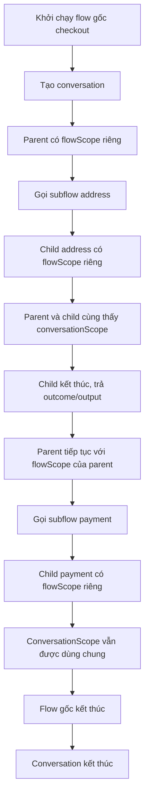

# Phân biệt flowScope riêng với conversationScope dùng chung

Một hành trình Spring Web Flow có thể gồm flow cha và nhiều flow con. Mỗi flow cần giữ dữ liệu riêng cho phần việc mình quản lý, đồng thời đôi khi cần chia sẻ một số ngữ cảnh giữa các flow trong cùng hành trình. Spring Web Flow cung cấp hai phạm vi quan trọng cho hai nhu cầu đó: **flow scope** và **conversation scope**.

`flowScope` thuộc về một flow execution. Flow cha và flow con có flow scope riêng, nên bản nháp hoặc trạng thái nội bộ của child không tự động trở thành biến trong parent. `conversationScope` được chia sẻ giữa các flow execution thuộc cùng một conversation, thường gồm flow gốc và các subflow được gọi bên trong nó. Vì vậy parent và child có thể cùng đọc một ngữ cảnh chung trong khi vẫn giữ model và trạng thái riêng.

Bài này thuộc chương **Subflow và tái sử dụng** của module **SPRING_WEB_FLOW**. Nội dung kết nối cách tổ chức state, event, transition và subflow với form binding, validation, quản lý scope, phiên, Spring MVC, kiểm thử và phục hồi flow execution. Mục tiêu là chọn đúng nơi lưu dữ liệu, giữ ranh giới giữa các flow rõ ràng và tránh chia sẻ trạng thái ngoài ý muốn.

Sau bài học, bạn có thể:

1. Giải thích vòng đời của `flowScope` và `conversationScope`.
2. Phân biệt flow scope của parent với flow scope của child.
3. Xác định dữ liệu nào chỉ thuộc một flow và dữ liệu nào cần dùng chung trong một conversation.
4. Khởi tạo và truy cập context dùng chung bằng `conversationScope`.
5. Dùng input/output của subflow cho dữ liệu đi qua ranh giới parent/child một cách tường minh.
6. Tránh xung đột tên, chia sẻ object mutable và phụ thuộc ngầm giữa các flow.
7. Kiểm thử phạm vi nhìn thấy, vòng đời, cách ly giữa hai conversation và hành vi khi execution/session hết hạn.

## 1. Hai câu hỏi để chọn scope

Khi một giá trị được tạo trong flow, hãy hỏi:

- **Ai sở hữu giá trị này?** Chỉ flow hiện tại hay nhiều flow trong cùng một hành trình?
- **Giá trị cần tồn tại đến khi nào?** Đến khi state kết thúc, khi flow hiện tại kết thúc hay đến khi toàn bộ conversation kết thúc?

Ví dụ checkout gọi ba subflow: chọn địa chỉ, chọn phương thức giao hàng và thanh toán.

| Dữ liệu | Chủ sở hữu phù hợp | Lý do |
| --- | --- | --- |
| `addressDraft` đang được sửa trong child địa chỉ | `flowScope` của child địa chỉ | Chỉ child này quản lý form và validation của địa chỉ |
| `paymentDraft` đang được sửa trong child thanh toán | `flowScope` của child thanh toán | Là trạng thái riêng của bước thanh toán |
| `shippingQuote` đang được tính trong child giao hàng | `flowScope` của child giao hàng | Chỉ child giao hàng cần model và kết quả tạm này |
| `orderDraft` do checkout quản lý | `flowScope` của parent | Parent sở hữu toàn bộ đơn hàng đang tạo |
| `orderId` hoặc `workflowId` dùng chung qua nhiều subflow | Có thể đặt trong `conversationScope` | Các child trong cùng hành trình cần tham chiếu cùng một ngữ cảnh |
| Locale hoặc currency thống nhất cho toàn checkout | Có thể đặt trong `conversationScope` | Nhiều child cần cùng giá trị |
| Kết quả thanh toán trả về parent | Output của child, sau đó parent lưu vào `flowScope` | Đây là dữ liệu đi qua một ranh giới flow cụ thể |
| Đơn hàng đã được xác nhận | Database | Cần tồn tại độc lập với flow execution và session |

Không chọn scope chỉ vì biến đó “cần tồn tại lâu”. Hãy bắt đầu từ quyền sở hữu và ranh giới sử dụng của dữ liệu.

## 2. Vòng đời của flowScope

`flowScope` là phạm vi dữ liệu của một flow execution. Trong cùng execution, dữ liệu có thể được sử dụng qua nhiều state và request cho tới khi flow đó kết thúc.

Ví dụ flow đăng ký:

```xml
<flow xmlns="http://www.springframework.org/schema/webflow"
      start-state="enterDetails">

    <var name="registrationDraft"
         class="com.example.registration.RegistrationDraft"/>

    <view-state id="enterDetails"
                view="registration/details"
                model="registrationDraft">
        <transition on="next" to="review"/>
    </view-state>

    <view-state id="review" view="registration/review">
        <transition on="edit" to="enterDetails"/>
        <transition on="confirm" to="completed"/>
    </view-state>

    <end-state id="completed"/>
</flow>
```

Biến khai báo ở cấp flow bằng `<var>` được đặt trong flow scope. `registrationDraft` tồn tại khi người dùng chuyển từ `enterDetails` sang `review`, quay lại sửa rồi xác nhận. Khi flow execution kết thúc, flow scope của execution đó kết thúc theo.

### Flow cha và flow con có flow scope riêng

Giả sử parent có:

```xml
<var name="orderDraft"
     class="com.example.checkout.OrderDraft"/>
```

Child có:

```xml
<var name="paymentDraft"
     class="com.example.payment.PaymentDraft"/>
```

Hai biến thuộc hai flow execution khác nhau. Child không tự động truy cập được `flowScope.orderDraft` của parent, và parent không tự động đọc được `flowScope.paymentDraft` của child.

Ngay cả khi hai flow cùng khai báo biến tên `draft`, mỗi flow scope vẫn thuộc execution riêng. Tên giống nhau không làm chúng trở thành cùng một object.

### Parent vẫn giữ flow scope khi child đang chạy

Khi parent đi vào `subflow-state`, parent tạm chờ kết quả của child. Flow scope của parent vẫn thuộc execution parent; child có flow scope riêng trong lúc hoạt động. Khi child kết thúc, parent tiếp tục xử lý outcome. Dữ liệu child cần trả về phải được công bố qua output hoặc một cơ chế chia sẻ được thiết kế rõ ràng.

## 3. Vòng đời của conversationScope

`conversationScope` là phạm vi dùng chung giữa các flow execution thuộc cùng một conversation.

Một conversation thường bắt đầu khi một flow gốc được khởi chạy. Khi flow gốc gọi subflow, child tham gia cùng conversation và có thể đọc/ghi conversation scope đó. Khi child kết thúc, conversation vẫn tiếp tục vì parent vẫn đang chạy. Conversation scope kết thúc khi conversation gốc kết thúc theo vòng đời Web Flow.



Điểm cần nhớ:

- Mỗi flow execution có flow scope riêng.
- Các flow execution trong cùng conversation chia sẻ conversation scope.
- Kết thúc một child không đồng nghĩa kết thúc conversation.
- Kết thúc flow gốc làm conversation kết thúc theo vòng đời của nó.
- Conversation scope không phải kho lưu trữ bền vững cho dữ liệu nghiệp vụ.

Conversation scope không tự động chia sẻ giữa mọi flow của cùng một người dùng. Hai flow gốc được khởi chạy độc lập thường tạo hai conversation riêng, dù chúng cùng nằm trong một HTTP session.

## 4. So sánh các phạm vi dữ liệu

| Scope | Phạm vi nhìn thấy | Vòng đời điển hình | Dữ liệu phù hợp |
| --- | --- | --- | --- |
| `requestScope` | Request hiện tại | Một lần xử lý request | Giá trị tạm khi xử lý event |
| `flashScope` | Request/transition kế tiếp theo cơ chế Web Flow | Ngắn hạn | Thông báo hoặc dữ liệu chuyển tiếp |
| `viewScope` | Một view-state | Từ khi vào đến khi rời view-state | Bộ lọc, trạng thái riêng của màn |
| `flowScope` | Một flow execution | Đến khi flow đó kết thúc | Model và dữ liệu nội bộ của flow |
| `conversationScope` | Các flow execution trong cùng conversation | Đến khi conversation kết thúc | Ngữ cảnh cần chia sẻ giữa parent và subflow |
| HTTP session | Các request thuộc cùng phiên HTTP | Đến khi session hết hạn/invalidated | Trạng thái cấp phiên theo thiết kế ứng dụng |
| Database | Nhiều phiên và nhiều execution | Theo chính sách lưu trữ | Đơn hàng, bản nháp cần khôi phục, dữ liệu đã commit |

### Conversation scope không phải HTTP session

HTTP session có thể chứa nhiều conversation Web Flow và nhiều flow execution. Một conversation thường hẹp hơn session: nó gom các flow execution liên quan trong cùng một hành trình.

Đặt dữ liệu vào `conversationScope` không có nghĩa dữ liệu sẽ còn mãi cho tới khi người dùng đăng xuất. Ngược lại, một attribute trong HTTP session có thể tồn tại sau khi conversation đã kết thúc. Hai scope có vòng đời và mục đích khác nhau.

### Conversation scope không phải database

Conversation scope phục vụ điều phối một hành trình đang chạy. Nếu session hết hạn, execution repository loại bỏ conversation hoặc người dùng cần tiếp tục công việc sau nhiều ngày, dữ liệu trong conversation scope không phải bản lưu nghiệp vụ đáng tin cậy. Hãy lưu dữ liệu cần khôi phục vào database và dùng ID để tải lại.

## 5. Khi nào nên dùng flowScope?

Dùng flow scope khi dữ liệu thuộc quyền sở hữu của một flow và không cần các flow khác thao tác trực tiếp.

Các trường hợp thường gặp:

- Form model của một wizard.
- Kết quả tạm của action trong flow.
- Trạng thái validation hoặc lựa chọn chỉ có ý nghĩa trong flow hiện tại.
- Dữ liệu trung gian giữa các state.
- Dữ liệu child cần giữ trong suốt quá trình nhập/xác minh nhưng không cần công khai với parent cho đến khi kết thúc.

Ví dụ child thanh toán:

```xml
<flow xmlns="http://www.springframework.org/schema/webflow"
      start-state="enterPayment">

    <input name="orderId" type="java.lang.String"/>

    <var name="paymentDraft"
         class="com.example.payment.PaymentDraft"/>

    <on-start>
        <evaluate expression="paymentService.prepare(orderId)"
                  result="flowScope.paymentDraft"/>
    </on-start>

    <view-state id="enterPayment"
                view="payment/details"
                model="paymentDraft">
        <transition on="review" to="reviewPayment"
                    bind="true" validate="true"/>
    </view-state>

    <view-state id="reviewPayment" view="payment/review">
        <transition on="edit" to="enterPayment"/>
        <transition on="authorize" to="authorizePayment"/>
    </view-state>

    ...
</flow>
```

`paymentDraft` thuộc flow scope của child. Parent chỉ cần truyền `orderId` và chờ outcome/output. Parent không cần biết child lưu số lần thử, lựa chọn form hay trạng thái validation nội bộ như thế nào.

## 6. Khi nào nên dùng conversationScope?

Dùng conversation scope khi nhiều flow trong cùng một conversation thật sự cần đọc hoặc cập nhật một ngữ cảnh chung.

Ví dụ checkout có thể cần dùng chung:

- ID của đơn hàng đang được xử lý.
- Locale hoặc currency thống nhất.
- Correlation ID của toàn hành trình.
- Một context điều phối nhỏ để các subflow biết workflow hiện tại.
- Một số lựa chọn chung được nhiều child đọc và parent quản lý.

Ví dụ parent khởi tạo context:

```xml
<flow xmlns="http://www.springframework.org/schema/webflow"
      start-state="selectItems">

    <var name="orderDraft"
         class="com.example.checkout.OrderDraft"/>

    <on-start>
        <evaluate expression="checkoutContextFactory.create(orderDraft.id)"
                  result="conversationScope.checkoutContext"/>
    </on-start>

    ...
</flow>
```

Sau khi khởi tạo, các flow trong cùng conversation có thể đọc `conversationScope.checkoutContext`. Ví dụ child giao hàng cần currency/locale dùng chung:

```xml
<flow xmlns="http://www.springframework.org/schema/webflow"
      start-state="chooseMethod">

    <input name="orderId" type="java.lang.String"/>

    <on-start>
        <evaluate expression="shippingService.loadOptions(
                    orderId,
                    conversationScope.checkoutContext.currency,
                    conversationScope.checkoutContext.locale)"
                  result="flowScope.shippingOptions"/>
    </on-start>

    ...
</flow>
```

Trong thiết kế thực tế, nếu `currency` và `locale` chỉ là input của child, truyền chúng qua `<input>` thường tạo contract tường minh và dễ tái sử dụng hơn. Ví dụ truy cập trực tiếp conversation scope ở trên chỉ phù hợp khi context đó được chủ ý chia sẻ giữa nhiều flow trong cùng conversation.

### Dữ liệu trong conversation scope nên nhỏ và ổn định

Ưu tiên ID, mã locale, currency, correlation ID và context điều phối. Tránh đặt toàn bộ object graph của đơn hàng, danh sách kết quả lớn hoặc model form của nhiều child vào conversation scope.

Nếu nhiều child cùng cần dữ liệu nghiệp vụ, cân nhắc giữ bản chuẩn trong service/database và chia sẻ ID trong conversation scope. Mỗi child tải phần dữ liệu mà nó cần theo quyền truy cập của chính nó.

## 7. Dùng input/output khi dữ liệu đi qua ranh giới parent/child

Conversation scope không phải cách duy nhất để chia sẻ dữ liệu. Khi dữ liệu chỉ cần đi từ parent sang child hoặc từ child về parent, contract input/output thường rõ ràng hơn.

Parent truyền input:

```xml
<subflow-state id="payment" subflow="payment">
    <input name="orderId" value="flowScope.orderDraft.id"/>
    <input name="currency"
           value="conversationScope.checkoutContext.currency"/>

    <transition on="authorized" to="reviewOrder">
        <set name="flowScope.paymentReference"
             value="currentEvent.attributes.paymentReference"/>
    </transition>
</subflow-state>
```

Child công bố input và output:

```xml
<flow xmlns="http://www.springframework.org/schema/webflow"
      start-state="enterPayment">

    <input name="orderId" type="java.lang.String"/>
    <input name="currency" type="java.lang.String"/>

    <var name="paymentDraft"
         class="com.example.payment.PaymentDraft"/>

    <end-state id="authorized">
        <output name="paymentReference"
                value="flowScope.paymentDraft.reference"/>
    </end-state>
</flow>
```

Cách này giúp child có thể được gọi từ một parent khác không có cùng conversation context. Child chỉ cần nhận các input đã công bố và trả output theo hợp đồng.

**Quy tắc chọn nhanh:**

- Dữ liệu thuộc riêng một flow: `flowScope`.
- Dữ liệu đi qua ranh giới parent/child một lần: `<input>` và `<output>`.
- Dữ liệu thật sự dùng chung giữa nhiều flow trong cùng conversation: `conversationScope`.
- Dữ liệu cần tồn tại sau khi flow/conversation kết thúc: database hoặc kho lưu trữ bền vững.

## 8. Ví dụ đầy đủ: parent giữ model riêng, child giữ model riêng

Giả sử checkout có `orderDraft` ở parent và `paymentDraft` ở child. Parent truyền `orderId`; child chuẩn bị payment draft, xử lý xác nhận và trả `paymentReference`.

Parent:

```xml
<flow xmlns="http://www.springframework.org/schema/webflow"
      start-state="reviewOrder">

    <var name="orderDraft"
         class="com.example.checkout.OrderDraft"/>

    <on-start>
        <evaluate expression="checkoutContextFactory.create(orderDraft.id)"
                  result="conversationScope.checkoutContext"/>
    </on-start>

    <view-state id="reviewOrder" view="checkout/review">
        <transition on="pay" to="capturePayment"/>
    </view-state>

    <subflow-state id="capturePayment" subflow="payment">
        <input name="orderId" value="flowScope.orderDraft.id"/>

        <transition on="authorized" to="completeCheckout">
            <set name="flowScope.orderDraft.paymentReference"
                 value="currentEvent.attributes.paymentReference"/>
        </transition>

        <transition on="cancelled" to="reviewOrder"/>
    </subflow-state>

    <action-state id="completeCheckout">
        <evaluate expression="orderService.complete(orderDraft)"/>
        <transition on="success" to="completed"/>
    </action-state>

    <end-state id="completed"/>
</flow>
```

Child:

```xml
<flow xmlns="http://www.springframework.org/schema/webflow"
      start-state="enterPayment">

    <input name="orderId" type="java.lang.String"/>

    <var name="paymentDraft"
         class="com.example.payment.PaymentDraft"/>

    <on-start>
        <evaluate expression="paymentService.prepare(orderId)"
                  result="flowScope.paymentDraft"/>
    </on-start>

    <view-state id="enterPayment"
                view="payment/details"
                model="paymentDraft">
        <transition on="review" to="reviewPayment"
                    bind="true" validate="true"/>
        <transition on="cancel" to="cancelled"
                    bind="false" validate="false"/>
    </view-state>

    <view-state id="reviewPayment" view="payment/review">
        <transition on="edit" to="enterPayment"/>
        <transition on="confirm" to="authorize"/>
        <transition on="cancel" to="cancelled"/>
    </view-state>

    <action-state id="authorize">
        <evaluate expression="paymentService.authorize(paymentDraft)"
                  result="flowScope.authorization"/>
        <transition on="success" to="authorized"/>
        <transition on="declined" to="declined"/>
    </action-state>

    <end-state id="authorized">
        <output name="paymentReference"
                value="flowScope.authorization.reference"/>
    </end-state>

    <end-state id="declined"/>
    <end-state id="cancelled"/>
</flow>
```

Hai flow scope có model riêng:

- Parent sở hữu `orderDraft`.
- Child sở hữu `paymentDraft` và `authorization`.
- Child không sửa trực tiếp object `orderDraft` của parent.
- Parent nhận `paymentReference` qua output rồi quyết định cập nhật order draft.
- Cả hai có thể đọc `conversationScope.checkoutContext` nếu cần ngữ cảnh dùng chung đã được khởi tạo.

Đây là cách tổ chức giúp thay đổi form thanh toán mà không buộc flow checkout phụ thuộc vào cấu trúc nội bộ của child.

## 9. Truy cập conversationScope trong flow cha và flow con

Vì conversation scope được chia sẻ trong cùng conversation, parent có thể khởi tạo context và child có thể đọc context đó.

Parent:

```xml
<on-start>
    <evaluate expression="checkoutContextFactory.create(orderDraft.id)"
              result="conversationScope.checkoutContext"/>
</on-start>
```

Child:

```xml
<on-start>
    <evaluate expression="shippingService.loadOptions(
                orderId,
                conversationScope.checkoutContext.locale)"
              result="flowScope.shippingOptions"/>
</on-start>
```

Sau khi child kết thúc, parent vẫn có thể đọc context chung:

```xml
<transition on="optionsSelected" to="reviewOrder">
    <set name="flowScope.selectedShippingMethod"
         value="currentEvent.attributes.methodId"/>
    <set name="flowScope.lastShippingLocale"
         value="conversationScope.checkoutContext.locale"/>
</transition>
```

Không nên dùng conversation scope để child ghi mọi kết quả thay cho output. Nếu kết quả là một phần contract của child, hãy công bố bằng `<output>` để parent biết rõ outcome nào mang dữ liệu nào.

## 10. Chú ý khi chia sẻ object mutable

Conversation scope chứa object có thể được nhiều flow truy cập. Nếu object là mutable, thay đổi từ child có thể được parent hoặc child khác nhìn thấy vì các flow đang dùng cùng object trong context chung.

Ví dụ:

```xml
<set name="conversationScope.checkoutContext.currentStep"
     value="'payment'"/>
```

Sau khi child cập nhật `currentStep`, parent đọc context sẽ thấy giá trị mới. Đây là hành vi mong muốn nếu field được thiết kế để chia sẻ.

Nhưng nếu child sửa một object lớn như `conversationScope.orderDraft`, parent có thể thấy các thay đổi ngay cả khi child kết thúc bằng `cancelled`. Outcome `cancelled` không tự rollback các thay đổi object đã được chia sẻ.

Để tránh điều đó:

- Giữ dữ liệu trong flow scope riêng khi child đang chỉnh sửa.
- Chỉ cập nhật shared context khi thay đổi đã được chấp nhận.
- Dùng DTO nhỏ, bất biến hoặc ID thay vì chia sẻ object graph lớn.
- Nếu cần cập nhật chung, thực hiện qua service có quy tắc nghiệp vụ và transaction rõ ràng.
- Định nghĩa ai là owner của từng field trong context.

Một phép gán qua `<set>` không phải thao tác deep copy. Nếu gán một object mutable vào conversation scope, hãy giả định các nơi giữ cùng tham chiếu có thể nhìn thấy thay đổi của nhau, trừ khi ứng dụng chủ động tạo bản sao.

## 11. Tránh xung đột tên trong conversation scope

Vì nhiều flow cùng nhìn thấy conversation scope, tên biến chung như `draft`, `result`, `status` dễ bị ghi đè hoặc hiểu nhầm.

Không gian tên nên phản ánh context:

```text
conversationScope.checkoutContext
conversationScope.checkoutContext.orderId
conversationScope.checkoutContext.locale
conversationScope.checkoutContext.currency
conversationScope.checkoutContext.correlationId
```

Tránh tạo nhiều key chung không có prefix:

```text
conversationScope.draft
conversationScope.result
conversationScope.status
```

Nếu child payment ghi `conversationScope.status = "done"` rồi child shipping cũng ghi key đó, parent không thể biết status thuộc bước nào. Dùng object context có property rõ nghĩa hoặc key namespaced như `paymentStatus`, `shippingStatus`.

Tốt hơn nữa, nếu trạng thái chỉ cần parent biết sau khi child kết thúc, trả nó bằng output thay vì ghi vào context chung.

## 12. Conversation scope không tạo transaction hay đồng bộ nghiệp vụ

Chia sẻ một object qua conversation scope không làm các thay đổi trở thành một transaction thống nhất.

Ví dụ child payment cập nhật `conversationScope.checkoutContext.paymentStatus = "AUTHORIZED"`, sau đó service lưu đơn hàng thất bại. Conversation context có thể đang thể hiện trạng thái đã authorize trong khi database chưa hoàn tất order. Ứng dụng cần xác định nguồn dữ liệu chuẩn và quy trình bù/đối soát.

Không dùng conversation scope làm nơi duy nhất ghi nhận payment đã capture hay chưa, đơn hàng đã commit hay chưa, reservation đã được xác nhận hay chưa, số lượng tồn kho chính thức hoặc trạng thái cần audit/phục hồi sau session timeout.

Conversation scope phù hợp để điều phối luồng đang chạy. Service/database vẫn chịu trách nhiệm về tính đúng đắn nghiệp vụ, transaction, idempotency và compensation.

## 13. Conversation scope và nhiều tab/trình duyệt

Không nên đồng nhất conversation với người dùng hoặc HTTP session.

Một session có thể chứa nhiều conversation. Ví dụ người dùng mở hai checkout độc lập trong hai tab và mỗi tab khởi chạy một flow gốc mới. Hai conversation có context riêng, dù cùng session cookie.

Nếu người dùng nhân đôi tab đang chạy và giữ lại execution URL/conversation hiện tại, hai tab có thể tiếp tục cùng một conversation hoặc các snapshot liên quan tùy execution repository và cách browser gửi request. Khi đó, không giả định hai tab có context độc lập.

Nếu nghiệp vụ yêu cầu hai tab chỉnh sửa cùng một order, cần có draft ID, version/concurrency control và chính sách cập nhật rõ ràng. Không dựa vào conversation scope để giải quyết xung đột ghi đồng thời.

### Không chia sẻ qua các conversation độc lập

Nếu một màn quản lý địa chỉ mở flow gốc riêng, nó không tự động thấy `conversationScope.checkoutContext` của checkout đang mở ở tab khác. Hãy truyền ID qua URL/request có kiểm soát hoặc tải context từ service/database theo quyền của người dùng.

## 14. Conversation scope, session timeout và persistence

Conversation scope tồn tại theo vòng đời conversation Web Flow, nhưng conversation vẫn phụ thuộc vào cơ chế lưu trữ flow execution và session của ứng dụng.

Các trường hợp cần lưu ý:

- HTTP session hết hạn có thể khiến người dùng không thể tiếp tục execution đang chạy.
- Flow execution repository có thể hết hạn hoặc loại bỏ snapshot/conversation.
- Server restart hoặc session replication phụ thuộc cấu hình repository và khả năng lưu trữ/serialize object.
- Conversation scope không phải bản backup độc lập.
- Kết thúc flow gốc làm conversation kết thúc theo lifecycle của Web Flow.

Nếu object trong scope cần được serialize bởi repository hoặc môi trường session replication, hãy bảo đảm kiểu dữ liệu phù hợp với cấu hình đó. Đừng giả định mọi object Java đều có thể lưu qua mọi repository.

Khi người dùng cần khôi phục checkout sau nhiều giờ/ngày, lưu draft vào database với ID và version. Khi mở lại flow, xác thực quyền rồi tải draft vào flow scope mới. Có thể khởi tạo conversation context mới từ draft đã lưu.

## 15. Bảo mật dữ liệu trong các scope

Scope là cơ chế quản lý vòng đời, không phải ranh giới bảo mật hay cơ chế phân quyền.

Không lưu password, access token, session secret, CVV hoặc dữ liệu thanh toán nhạy cảm trong conversation scope để các child có thể đọc tùy ý. Dùng token ngắn hạn hoặc reference do service quản lý, và chỉ truyền dữ liệu tối thiểu cần thiết.

Khi child nhận `orderId` qua input hoặc đọc ID trong conversation context, service vẫn phải xác minh:

- Người dùng hiện tại có quyền truy cập order đó không?
- Order có thuộc tenant/account hiện tại không?
- Trạng thái order có cho phép thao tác không?
- Payment/authorization reference có thuộc đúng order không?

Không tin conversation scope chỉ vì dữ liệu được tạo ở parent. Flow có thể resume qua request khác, dữ liệu có thể stale và quyền truy cập có thể thay đổi. Authorization phải được kiểm tra ở service hoặc tầng bảo mật phù hợp.

## 16. Chẩn đoán khi child không thấy dữ liệu parent

| Triệu chứng | Nguyên nhân thường gặp | Hướng kiểm tra |
| --- | --- | --- |
| Child không đọc được `flowScope.orderDraft` | Child có flow scope riêng | Truyền input hoặc dùng context chung có chủ đích |
| Parent không đọc được `flowScope.paymentDraft` sau child | Child scope không phải parent scope | Công bố output ở end-state |
| Child không thấy `conversationScope.checkoutContext` | Context chưa được khởi tạo hoặc không cùng conversation | Kiểm tra flow gốc, thứ tự khởi tạo và cách launch |
| Flow độc lập không thấy context của checkout | Hai flow thuộc conversation khác nhau | Tải context từ service hoặc truyền ID hợp lệ |
| Giá trị chung bị child khác ghi đè | Key không namespaced hoặc shared mutable object | Tách property, dùng output và xác định owner |
| Dữ liệu mất sau khi child kết thúc | Child flow scope đã kết thúc | Lưu output vào parent scope trước khi tiếp tục |
| Context còn nhưng dữ liệu nghiệp vụ sai | Shared object bị sửa hoặc dữ liệu stale | Kiểm tra owner, version và nguồn dữ liệu chuẩn |
| Dữ liệu mất sau timeout | Conversation/execution hết hạn | Khôi phục từ database nếu có draft bền vững |

Quy trình chẩn đoán:

1. Ghi lại flow ID, execution và state hiện tại.
2. Xác định biến nằm trong flow scope của parent, flow scope của child hay conversation scope.
3. Xác nhận parent và child có thuộc cùng conversation không.
4. Kiểm tra context đã được khởi tạo trước khi child đọc chưa.
5. Kiểm tra input mapping nếu dữ liệu được truyền qua contract.
6. Kiểm tra end-state output và `currentEvent.attributes` nếu dữ liệu đi từ child về parent.
7. Tìm mọi `<set>` hoặc action có thể ghi đè shared context.
8. Kiểm tra session/execution expiry và repository persistence.
9. Kiểm tra service/database nếu dữ liệu cần tồn tại ngoài conversation.
10. Xác nhận authorization và version trước khi dùng dữ liệu chung.

## 17. Kiểm thử ranh giới flowScope và conversationScope

Một test nên chứng minh rằng hai flow scope tách biệt trong khi conversation scope được chia sẻ trong cùng conversation.

| ID | Kịch bản | Kỳ vọng |
| --- | --- | --- |
| T1 | Khởi chạy flow gốc | Parent có flow scope riêng |
| T2 | Parent khởi tạo conversation context | `conversationScope.checkoutContext` tồn tại |
| T3 | Parent gọi child | Child có flow scope mới |
| T4 | Child khai báo biến cùng tên với parent | Hai biến flow scope độc lập |
| T5 | Child đọc conversation context | Thấy context do parent khởi tạo trong cùng conversation |
| T6 | Child cập nhật field context được phép chia sẻ | Parent thấy giá trị mới sau khi child trả quyền điều khiển |
| T7 | Child kết thúc | Child flow scope kết thúc; parent flow scope vẫn còn |
| T8 | Child trả output | Parent đọc qua `currentEvent.attributes` |
| T9 | Parent gọi child thứ hai | Child thứ hai thấy cùng conversation context |
| T10 | Khởi chạy flow gốc thứ hai | Conversation context độc lập |
| T11 | Một child bị cancel | Không tự động rollback thay đổi shared object đã thực hiện |
| T12 | Parent kết thúc | Conversation kết thúc theo lifecycle |
| T13 | Session hết hạn | Không giả định context vẫn còn để tiếp tục |
| T14 | Repository cần serialize | Object đáp ứng yêu cầu serialization của cấu hình |
| T15 | Hai tab dùng execution khác nhau | Xác nhận conversation/execution thực tế, không suy đoán theo session |
| T16 | User không còn quyền với order | Service từ chối dù context còn order ID |

### Pseudocode kiểm thử

```text
startFlow("checkout")
  -> assertFlowScope("orderDraft", exists)
  -> assertConversationScope("checkoutContext", exists)

submitEvent("capturePayment")
  -> assertParentState("capturePayment")
  -> assertChildFlowScope("paymentDraft", exists)
  -> assertChildCannotReadParentFlowScope("orderDraft")
  -> assertConversationScopeVisibleToChild("checkoutContext")

submitChildEvent("authorize")
  -> childEndsAt("authorized")
  -> assertParentFlowScope("orderDraft", stillExists)
  -> assertConversationScope("checkoutContext", stillExists)
  -> assertOutput("paymentReference", expectedReference)

startFlow("checkout")
  -> assertConversationScope("checkoutContext", independentFromFirst)
```

Đây là pseudocode mô tả assertion, không phải API test có thể chạy nguyên văn. Dùng test support của phiên bản Spring Web Flow để khởi chạy flow và gửi event; kiểm tra scope qua test context hoặc instrumentation phù hợp. Nếu test harness không expose trực tiếp conversation scope, có thể dùng một bean/action test chỉ đọc các giá trị cần xác nhận. Không biến pseudocode thành lời khẳng định về tên method của một phiên bản thư viện cụ thể.

### Test phát hiện shared mutable object

Tạo context dùng chung, để child thay đổi một property rồi xác nhận parent nhìn thấy thay đổi. Sau đó thử hủy child và xác nhận việc kết thúc bằng `cancelled` không tự rollback property. Test này làm rõ vì sao không nên sửa trực tiếp business draft dùng chung trước khi nghiệp vụ được chấp nhận.

### Test cách ly hai conversation

Khởi chạy hai flow gốc với hai order ID khác nhau. Ghi hai context riêng rồi gọi child trong từng conversation. Xác nhận child của conversation A không thấy context B. Đây là test quan trọng để phát hiện việc vô tình đặt dữ liệu vào HTTP session attribute dùng chung thay vì conversation scope.

## 18. Các sai lầm thường gặp

| Sai lầm | Hậu quả | Cách sửa |
| --- | --- | --- |
| Nghĩ parent và child dùng chung `flowScope` | Child không thấy biến parent hoặc parent không thấy biến child | Dùng input/output hoặc conversation context có chủ đích |
| Dùng `conversationScope` cho mọi form model | Các child ghi đè dữ liệu của nhau | Đặt model riêng trong flow scope |
| Nghĩ conversation scope là HTTP session | Dữ liệu tồn tại sai vòng đời hoặc bị trộn giữa nhiều flow | Phân biệt conversation với session |
| Nghĩ conversation scope là database | Mất dữ liệu khi execution/session hết hạn | Lưu draft nghiệp vụ bền vững ở database |
| Trả output bằng cách ghi shared context cho mọi trường hợp | Caller phụ thuộc ngầm vào child | Dùng end-state output cho kết quả qua ranh giới |
| Đặt object mutable lớn trong conversation scope | Thay đổi của một child lan sang các flow khác | Chia sẻ ID/context nhỏ, giữ draft riêng |
| Dùng key chung như `status` | Child ghi đè trạng thái của child khác | Namespaced key hoặc context object có property rõ |
| Nghĩ cancel sẽ rollback conversation scope | Shared object vẫn giữ thay đổi đã ghi | Dùng draft riêng và commit sau xác nhận |
| Khởi chạy flow độc lập rồi mong thấy context cũ | Flow thuộc conversation khác | Truyền ID hoặc tải dữ liệu từ service |
| Không xét repository/serialization | Execution có thể không phục hồi như dự định | Kiểm tra yêu cầu lưu trữ của repository |
| Tin order ID trong context mà không kiểm tra quyền | Có thể truy cập dữ liệu sai tenant/user | Authorization ở service mỗi lần thao tác |

## 19. Bài thực hành: checkout chia sẻ context qua ba subflow

Hãy thiết kế flow gốc `checkout` gọi ba child: `addressCapture`, `shippingMethod` và `payment`.

Yêu cầu:

1. Parent sở hữu `orderDraft` trong flow scope.
2. Khi bắt đầu, parent tạo `conversationScope.checkoutContext` gồm `orderId`, `currency`, `locale` và `correlationId`.
3. `addressCapture` có `addressDraft` riêng trong flow scope.
4. `shippingMethod` có `shippingSelection` và `shippingQuote` riêng trong flow scope.
5. `payment` có `paymentDraft` và `authorization` riêng trong flow scope.
6. Mỗi child nhận input rõ ràng cho dữ liệu cần thiết, chẳng hạn `orderId`; chỉ đọc conversation context trực tiếp khi đó là chủ đích chia sẻ.
7. Mỗi child trả kết quả qua end-state output: địa chỉ đã xác minh, quote ID/phí, payment reference.
8. Parent đọc output qua `currentEvent.attributes` và cập nhật `orderDraft` của chính parent.
9. Conversation context chỉ chứa dữ liệu điều phối nhỏ, không chứa toàn bộ form model hay thông tin thanh toán nhạy cảm.
10. Viết test chứng minh flow scope riêng, conversation scope chung trong cùng conversation và cách ly hai checkout độc lập.
11. Thử child bị cancel sau khi sửa draft; xác nhận parent không nhận draft nếu child không công bố output và không sửa shared object.
12. Thử session timeout; mô tả cách tải lại order draft từ database để tạo conversation mới.

Đầu ra mong đợi: sơ đồ parent/child, XML rút gọn của flow gốc và ba child, bảng phân bổ dữ liệu theo scope, test matrix và giải thích chính sách phục hồi.

## 20. Checklist chọn scope

- [ ] Xác định owner của từng biến trước khi chọn scope.
- [ ] Dữ liệu chỉ thuộc một flow execution nằm trong `flowScope`.
- [ ] Parent và child được xem là hai flow scope riêng.
- [ ] Dữ liệu đi qua một ranh giới flow được truyền bằng input/output khi phù hợp.
- [ ] `conversationScope` chỉ chứa context thật sự cần chia sẻ trong cùng conversation.
- [ ] Parent khởi tạo shared context trước khi child sử dụng.
- [ ] Key trong conversation scope có namespace và owner rõ ràng.
- [ ] Không đặt form model hoặc object graph lớn vào shared context nếu không cần.
- [ ] Hiểu rằng object mutable được chia sẻ có thể làm thay đổi lan sang flow khác.
- [ ] Không coi conversation scope là HTTP session hoặc database.
- [ ] Có chính sách cho session timeout, execution expiry và khôi phục draft.
- [ ] Kiểm tra serialization theo repository/deployment thực tế nếu cần.
- [ ] Service vẫn kiểm tra authorization và trạng thái nghiệp vụ.
- [ ] Có test cách ly hai conversation và test shared state giữa parent/child.

**Kết luận:** `flowScope` giữ dữ liệu thuộc một flow execution; `conversationScope` chia sẻ ngữ cảnh giữa các flow execution trong cùng một conversation. Parent và child nên giữ model riêng, dùng input/output để trao đổi kết quả qua ranh giới và chỉ dùng conversation scope cho context chung có chủ đích. Phân chia như vậy giúp subflow tái sử dụng được, hạn chế xung đột dữ liệu và giữ vòng đời của từng giá trị phù hợp với hành trình nghiệp vụ.
