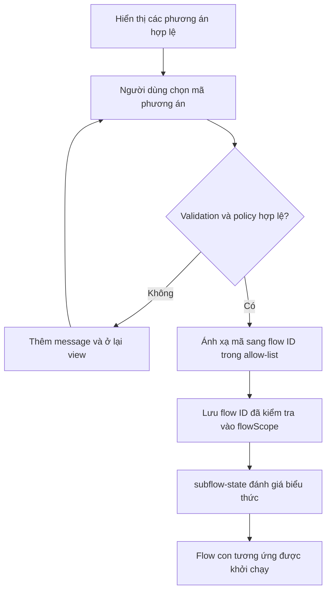

# Chọn flow con bằng biểu thức và kiểm soát tập lựa chọn

Subflow giúp tách một phần hành trình web thành flow độc lập để nhiều flow cha có thể tái sử dụng. Trong trường hợp đơn giản, flow cha luôn gọi cùng một flow con, chẳng hạn mọi đơn hàng đều đi qua flow `payment`. Nhưng có những hành trình cần chọn flow con theo dữ liệu hoặc lựa chọn của người dùng: giao hàng tận nơi hay nhận tại cửa hàng, thanh toán bằng chuyển khoản hay ví điện tử, xác minh cá nhân hay doanh nghiệp.

Spring Web Flow cho phép thuộc tính `subflow` của `subflow-state` nhận một biểu thức. Biểu thức được đánh giá khi flow đi vào state và phải trả về ID của flow con cần khởi chạy. Cơ chế này tạo ra khả năng điều phối linh hoạt, nhưng cũng đòi hỏi ứng dụng kiểm soát tập flow được phép gọi. Một lựa chọn do trình duyệt gửi lên không được trở thành quyền gọi tùy ý bất kỳ flow nào trong registry.

## 1. Subflow cố định và subflow được chọn động

Với subflow cố định, flow cha chỉ định trực tiếp flow ID trong định nghĩa:

```xml
<subflow-state id="payOrder" subflow="payment">
    <input name="orderId" value="flowScope.orderId" />
    <transition on="paymentCompleted" to="completeOrder" />
    <transition on="paymentCancelled" to="reviewOrder" />
</subflow-state>
```

Mỗi lần flow đi vào `payOrder`, Spring Web Flow khởi chạy flow có ID `payment`. Cách này phù hợp khi quy trình con không thay đổi theo dữ liệu.

Với subflow động, thuộc tính `subflow` là biểu thức trả về flow ID:

```xml
<subflow-state id="runFulfillment"
               subflow="flowScope.fulfillmentFlowId">
    <input name="orderId" value="flowScope.orderId" />
    <transition on="completed" to="fulfillmentCompleted" />
    <transition on="cancelled" to="reviewOrder" />
</subflow-state>
```

Ở ví dụ này, `flowScope.fulfillmentFlowId` được đánh giá khi state `runFulfillment` được thực thi. Nếu giá trị là `fulfillment/delivery`, flow đó được gọi; nếu là `fulfillment/pickup`, flow nhận hàng tại cửa hàng được gọi. Các ID phải tương ứng với flow definition đã đăng ký trong `FlowDefinitionRegistry`.

Điểm quan trọng là biểu thức trả về một ID đã được ứng dụng lựa chọn và kiểm soát. Thuộc tính `subflow` không phải nơi để ghép chuỗi tùy ý từ request hoặc nhận nguyên một biểu thức do người dùng nhập.

## 2. Kiến trúc chọn flow con

Một thiết kế dễ kiểm soát chia quá trình thành bốn bước:

1. **Cung cấp lựa chọn:** flow tải các phương án phù hợp với đơn hàng và người dùng hiện tại.
2. **Nhận lựa chọn nghiệp vụ:** view gửi một mã lựa chọn như `DELIVERY` hoặc `PICKUP`, không gửi flow ID tùy ý.
3. **Kiểm tra và ánh xạ:** service xác minh phương án vẫn được phép dùng, sau đó ánh xạ mã lựa chọn sang flow ID cố định trong allow-list.
4. **Khởi chạy subflow:** flow cha lưu flow ID đã được kiểm tra vào scope và chuyển đến `subflow-state` có biểu thức động.



Flow cha chịu trách nhiệm điều phối. Service hoặc một selector chuyên trách chịu trách nhiệm xác định lựa chọn có hợp lệ và được phép trong ngữ cảnh hiện tại hay không. Flow con thực hiện quy trình chuyên biệt của nó.

## 3. Cung cấp danh sách lựa chọn cho view

Danh sách lựa chọn nên được tính từ dữ liệu nghiệp vụ và quyền của người dùng. Ví dụ, một đơn hàng có thể chỉ được giao tận nơi nếu địa chỉ nằm trong khu vực phục vụ; phương án nhận tại cửa hàng chỉ xuất hiện khi cửa hàng còn khả năng tiếp nhận.

Flow có thể tải danh sách khi vào view-state:

```xml
<view-state id="chooseFulfillment" model="fulfillmentForm">
    <on-entry>
        <evaluate expression="fulfillmentService.availableOptions(flowScope.orderId)"
                  result="viewScope.fulfillmentOptions" />
    </on-entry>
    <transition on="continue" to="resolveFulfillment" />
    <transition on="back" to="reviewOrder" validate="false" />
</view-state>
```

`fulfillmentOptions` là dữ liệu dành cho view, ví dụ danh sách các đối tượng có `code` và `label`. View hiển thị mã `DELIVERY` với nhãn “Giao tận nơi” và mã `PICKUP` với nhãn “Nhận tại cửa hàng”. Không cần gửi tên flow nội bộ trong option của form.

Danh sách có thể thay đổi theo đơn hàng, quốc gia, tenant, vai trò, feature flag hoặc trạng thái tồn kho. Không nên tạo một danh sách tĩnh ở giao diện rồi giả định rằng mọi phương án luôn khả dụng. Service phải tính lại tính khả dụng khi xử lý lựa chọn vì trạng thái có thể thay đổi giữa lúc hiển thị và lúc người dùng gửi form.

## 4. Ánh xạ lựa chọn sang flow ID được phép

Giả sử form gửi `fulfillmentChoice`. Một selector phía server ánh xạ mã này sang các flow ID cố định:

```java
import org.springframework.stereotype.Component;

@Component("fulfillmentFlowSelector")
public class FulfillmentFlowSelector {

    private final FulfillmentService fulfillmentService;

    public FulfillmentFlowSelector(FulfillmentService fulfillmentService) {
        this.fulfillmentService = fulfillmentService;
    }

    public String resolve(String choice, String orderId) {
        if (choice == null
                || !fulfillmentService.isOptionAvailable(orderId, choice)) {
            throw new IllegalArgumentException("Unsupported fulfillment option");
        }

        switch (choice) {
            case "DELIVERY":
                return "fulfillment/delivery";
            case "PICKUP":
                return "fulfillment/pickup";
            default:
                throw new IllegalArgumentException("Unsupported fulfillment option");
        }
    }
}
```

Đây là ví dụ minh họa; `FulfillmentService.isOptionAvailable` cần kiểm tra cả mã lựa chọn, đơn hàng, người dùng hiện tại và chính sách truy cập của ứng dụng. Nếu người dùng không có quyền chọn một phương án, selector phải từ chối ngay cả khi mã đó tồn tại trong switch.

Flow ID được giữ trong code phía server. Người dùng chỉ gửi một mã lựa chọn thuộc giao ước của form. Ngay cả khi request bị sửa thành `ADMIN`, `internal/report` hoặc một ID flow khác, selector vẫn từ chối vì không có ánh xạ hợp lệ. Việc một flow có trong registry không đồng nghĩa mọi người dùng đều được phép khởi chạy flow đó.

Trong hệ thống lớn, allow-list có thể được biểu diễn bằng cấu hình hoặc enum thay vì switch. Dù chọn cách nào, cần bảo đảm danh sách có thể kiểm tra, review và kiểm thử được. Tránh tạo flow ID bằng cách nối chuỗi từ dữ liệu không tin cậy, chẳng hạn `"fulfillment/" + request.getParameter("type")`.

## 5. Gán kết quả selector vào flow scope

Sau khi nhận lựa chọn, flow gọi selector để nhận flow ID hợp lệ và lưu vào `flowScope`. Sau đó, `subflow-state` sử dụng biểu thức đó:

```xml
<action-state id="resolveFulfillment">
    <evaluate expression="fulfillmentFlowSelector.resolve(
                    flowScope.fulfillmentForm.fulfillmentChoice,
                    flowScope.orderId)"
              result="flowScope.fulfillmentFlowId" />
    <transition to="runFulfillment" />
</action-state>

<subflow-state id="runFulfillment"
               subflow="flowScope.fulfillmentFlowId">
    <input name="orderId" value="flowScope.orderId" />
    <transition on="completed" to="fulfillmentCompleted" />
    <transition on="cancelled" to="reviewOrder" />
</subflow-state>
```

Khi flow đi vào `resolveFulfillment`, biểu thức gọi bean `fulfillmentFlowSelector`. Giá trị trả về được lưu trong `flowScope.fulfillmentFlowId`. State kế tiếp đánh giá thuộc tính `subflow` và khởi chạy flow tương ứng.

Trong XML thực tế, biểu thức có thể được viết trên một dòng; xuống dòng ở ví dụ chỉ nhằm dễ đọc. Tên bean phải có trong Spring application context mà flow sử dụng. Tên property của form phải khớp model và binding trong view-state.

Không nên lưu lựa chọn chưa được kiểm tra vào biến dùng trực tiếp bởi `subflow-state`. Nếu cần lưu mã người dùng chọn để hiển thị lại form, hãy lưu nó riêng như `fulfillmentChoice`; chỉ `fulfillmentFlowId` mới là kết quả ánh xạ từ selector đã kiểm tra.

## 6. Validation trước khi chuyển sang action-state

Form validator kiểm tra dữ liệu cơ bản và xác nhận lựa chọn thuộc tập phương án đang hiển thị. Ví dụ:

```java
import org.springframework.binding.message.MessageBuilder;
import org.springframework.webflow.execution.ValidationContext;
import org.springframework.stereotype.Component;

@Component
public class FulfillmentFormValidator {

    public void validateChooseFulfillment(
            FulfillmentForm form, ValidationContext context) {

        if (form.getFulfillmentChoice() == null
                || form.getFulfillmentChoice().trim().isEmpty()) {
            context.getMessageContext().addMessage(new MessageBuilder()
                    .error()
                    .source("fulfillmentChoice")
                    .code("fulfillment.choice.required")
                    .defaultText("Vui lòng chọn phương thức nhận hàng.")
                    .build());
        }
    }
}
```

Validator giúp phản hồi nhanh cho người dùng khi chưa chọn phương án. Tuy nhiên, kiểm tra không rỗng chưa đủ để bảo vệ việc chọn subflow. Selector vẫn phải kiểm tra allow-list và tính khả dụng theo ngữ cảnh hiện tại. Form có thể được gửi trực tiếp mà không đi qua giao diện hoặc dữ liệu có thể thay đổi sau validation.

Nếu muốn kiểm tra mã lựa chọn ngay trong validator, có thể gọi service để xác nhận nó thuộc tập phương án hiện hành. Dù vậy, service được gọi ở thời điểm ánh xạ vẫn phải kiểm tra lại trước khi trả flow ID. Đây là bước bảo vệ cuối cùng trước khi flow cha chuyển sang state gọi subflow.

## 7. Truyền input và nhận kết quả từ subflow

Subflow thường cần dữ liệu từ flow cha, ví dụ `orderId`, `customerId` hoặc một context gọn. Dùng các phần tử `input` của `subflow-state` để ánh xạ dữ liệu vào flow con:

```xml
<subflow-state id="runFulfillment"
               subflow="flowScope.fulfillmentFlowId">
    <input name="orderId" value="flowScope.orderId" />
    <input name="customerId" value="flowScope.customerId" />
    <transition on="completed" to="fulfillmentCompleted" />
    <transition on="cancelled" to="reviewOrder" />
</subflow-state>
```

Flow con khai báo các input tương ứng trong `input` mapping của nó hoặc sử dụng input mapping theo cấu hình flow. Hợp đồng input nên ổn định và nhỏ gọn: truyền ID hoặc dữ liệu cần thiết, rồi để service của flow con tải trạng thái mới nhất từ nguồn dữ liệu nghiệp vụ.

Flow con kết thúc bằng một `end-state` có ID biểu thị kết quả. ID này trở thành event trả về cho flow cha, vì vậy transition `on="completed"` hoặc `on="cancelled"` phải khớp với end-state của flow con được chọn. Nếu nhiều subflow có thể được chọn động, chúng nên tuân thủ cùng một giao ước event và input. Khi hợp đồng không giống nhau, flow cha phải phân biệt kết quả theo từng loại hoặc chuẩn hóa chúng qua một lớp điều phối.

Nếu cần trả dữ liệu kết quả như mã vận đơn hoặc mã điểm nhận hàng, hãy khai báo output ở flow con và ánh xạ output trong `subflow-state` theo cấu hình của phiên bản Spring Web Flow đang dùng. Chỉ trả các giá trị mà flow cha thực sự cần; tránh chia sẻ toàn bộ object graph giữa hai flow.

## 8. Kiểm soát tập flow có thể được gọi

Allow-list cần được xác định ở phía server. Một số tiêu chí kiểm soát thường gặp:

| Tiêu chí | Câu hỏi cần kiểm tra |
|---|---|
| Registry | Flow ID có được đăng ký và có thể khởi chạy trong môi trường hiện tại không? |
| Phân quyền | Người dùng hiện tại có quyền dùng phương án này không? |
| Ngữ cảnh nghiệp vụ | Phương án có áp dụng cho đơn hàng, tài khoản hoặc tenant hiện tại không? |
| Trạng thái | Tồn kho, khu vực phục vụ hoặc feature flag còn cho phép lựa chọn không? |
| Hợp đồng | Subflow có nhận đúng input và trả các event mà flow cha xử lý không? |
| Vận hành | Flow có được bật trong môi trường hiện tại hay đang bị vô hiệu hóa? |

Flow registry chỉ xác định flow definition nào có thể được tìm thấy. Nó không tự thay thế authorization. Ứng dụng cần một policy hoặc service kiểm tra quyền trước khi chọn flow ID.

Không nên:

- Nhận trực tiếp `subflowId` từ query parameter, hidden field hoặc JSON request rồi đưa vào thuộc tính `subflow`.
- Cho người dùng gửi một biểu thức EL hoặc tên bean để framework đánh giá.
- Dùng đường dẫn file do client cung cấp để tìm flow definition.
- Coi việc flow ID tồn tại trong registry là bằng chứng người dùng có quyền gọi flow đó.
- Để flow con tự quyết định quyền truy cập mà không kiểm tra lại các tài nguyên và hành động nghiệp vụ mà nó thao tác.

Ngay cả khi flow cha đã kiểm tra quyền, flow con vẫn cần bảo vệ các thao tác quan trọng của chính nó. Một flow con có thể được gọi từ nhiều flow cha hoặc từ entry point khác; không nên dựa vào một đường đi duy nhất để bảo đảm an toàn.

## 9. Xử lý lựa chọn không hợp lệ và flow không tồn tại

Có hai nhóm lỗi cần phân biệt:

**Lựa chọn không hợp lệ hoặc không được phép:** selector không ánh xạ được mã lựa chọn, hoặc phương án không còn khả dụng. Đây là kết quả có thể dự kiến. Ứng dụng có thể thêm message vào `MessageContext`, quay lại view chọn phương án và tải lại danh sách hợp lệ.

**Flow ID không được đăng ký hoặc flow không thể khởi chạy:** đây thường là lỗi cấu hình hoặc triển khai. Nếu allow-list tham chiếu đến ID không có trong registry, flow có thể thất bại khi khởi chạy subflow. Cần phát hiện lỗi này trong kiểm thử cấu hình và ghi log đủ thông tin để vận hành chẩn đoán.

Không nên xử lý cả hai nhóm bằng cách bắt mọi exception rồi chuyển người dùng sang một flow mặc định. Làm vậy có thể che lỗi cấu hình và vô tình đưa người dùng sang quy trình không phù hợp. Với lựa chọn bị từ chối, hiển thị thông báo và yêu cầu chọn lại; với lỗi cấu hình, sử dụng exception handling và thông báo lỗi phù hợp.

Nếu danh sách lựa chọn thay đổi trong lúc người dùng đang ở form, khi họ gửi request selector cần tính lại khả năng sử dụng. Ví dụ, điểm nhận hàng vừa đóng hoặc dịch vụ giao hàng vừa bị tạm dừng. Người dùng nên được quay lại bước chọn với danh sách đã cập nhật.

## 10. Scope, trạng thái và dữ liệu dùng chung

`flowScope` phù hợp để giữ dữ liệu điều phối trong flow cha, như mã lựa chọn và flow ID đã được selector xác nhận. `viewScope` phù hợp với danh sách lựa chọn chỉ cần trong view hiện tại. Dữ liệu của subflow thuộc execution riêng của flow con và nên có vòng đời độc lập.

Ví dụ phân chia:

| Dữ liệu | Scope gợi ý | Lý do |
|---|---|---|
| `fulfillmentOptions` | `viewScope` | Danh sách hiển thị ở màn hình chọn phương án |
| `fulfillmentChoice` | `flowScope` hoặc model form theo vòng đời cần thiết | Giữ lựa chọn để flow cha tiếp tục hoặc hiển thị lại |
| `fulfillmentFlowId` | `flowScope` | ID đã được selector ánh xạ và kiểm tra |
| `orderId` | `flowScope` | Định danh nghiệp vụ được truyền cho subflow |
| Trạng thái nội bộ của giao hàng | Scope thuộc flow con hoặc database | Không cần đưa toàn bộ trạng thái chuyên biệt vào flow cha |

Không lưu object request/response, transaction, connection hoặc tài nguyên có vòng đời ngắn vào scope của flow. Hãy giữ ID và dữ liệu tối thiểu; flow con gọi service để tải dữ liệu hiện hành. Khi flow con hoàn tất, flow cha nhận event và các output đã được khai báo theo hợp đồng.

## 11. Kiểm thử lựa chọn subflow động

Kiểm thử cần xác minh cả ánh xạ lẫn quyền gọi. Một số trường hợp quan trọng:

1. Mã `DELIVERY` được ánh xạ đến đúng flow ID `fulfillment/delivery`.
2. Mã `PICKUP` được ánh xạ đến đúng flow ID `fulfillment/pickup`.
3. Mã không nằm trong allow-list bị từ chối.
4. Mã hợp lệ về cú pháp nhưng không khả dụng cho đơn hàng hiện tại bị từ chối.
5. Người dùng không có quyền không thể gọi flow chỉ dành cho nhóm khác.
6. Flow ID trong allow-list đều tồn tại trong registry của môi trường triển khai.
7. Subflow nhận đủ input bắt buộc và trả về event mà flow cha có transition tương ứng.
8. Nếu phương án ngừng khả dụng giữa lúc hiển thị form và lúc submit, selector từ chối và flow đưa người dùng về bước chọn lại.
9. Request gửi trực tiếp một flow ID hoặc biểu thức giả mạo không thể thay đổi kết quả ánh xạ.

Nên có unit test cho selector để kiểm tra toàn bộ allow-list và policy, cùng kiểm thử tích hợp khởi chạy flow cha với từng lựa chọn. Kiểm thử tích hợp xác minh biểu thức `subflow` thực sự đánh giá đúng ID và flow registry tìm được definition mong muốn.

## 12. Lỗi thiết kế thường gặp

- **Đưa raw flow ID từ request vào `subflow`:** người dùng có thể thử gọi flow khác trong registry. Hãy nhận mã lựa chọn nghiệp vụ và ánh xạ bằng allow-list phía server.
- **Chỉ kiểm tra danh sách ở giao diện:** request có thể bị sửa hoặc trạng thái có thể thay đổi. Hãy xác minh lại trong selector/service trước khi gọi subflow.
- **Lẫn mã lựa chọn với flow ID:** mã như `DELIVERY` là giao ước của form; `fulfillment/delivery` là ID nội bộ. Giữ hai giá trị riêng.
- **Allow-list chứa flow ID không tồn tại:** lỗi chỉ xuất hiện khi người dùng chọn nhánh đó. Kiểm tra registry bằng integration test hoặc kiểm tra cấu hình khi khởi động.
- **Các subflow trả event không thống nhất:** flow cha không biết xử lý kết quả. Chuẩn hóa event hoặc phân nhánh tường minh.
- **Truyền quá nhiều dữ liệu qua input:** flow cha và con phụ thuộc chặt vào nhau. Ưu tiên truyền ID và hợp đồng nhỏ gọn.
- **Coi registry là cơ chế phân quyền:** registry chỉ quản lý định nghĩa flow. Authorization phải được kiểm tra bằng policy/service.
- **Dùng một fallback chung cho mọi lỗi:** lỗi lựa chọn và lỗi cấu hình bị trộn lẫn. Phân loại và xử lý riêng.

## 13. Nguyên tắc áp dụng

1. Dùng biểu thức trong thuộc tính `subflow` khi flow ID cần được quyết định lúc chạy.
2. Giữ mã lựa chọn do người dùng gửi riêng với flow ID nội bộ.
3. Cung cấp danh sách phương án dựa trên ngữ cảnh và quyền hiện tại.
4. Ánh xạ lựa chọn sang một tập flow ID allow-list ở phía server.
5. Kiểm tra lại tính khả dụng và authorization ngay trước khi khởi chạy subflow.
6. Lưu flow ID đã xác nhận vào scope phù hợp rồi mới chuyển đến `subflow-state`.
7. Chuẩn hóa input, output và end-state event giữa các subflow có thể được chọn động.
8. Kiểm thử mã lạ, phương án hết hiệu lực, quyền truy cập, registry và từng nhánh subflow.

Biểu thức giúp `subflow-state` chọn flow con theo ngữ cảnh chạy, còn allow-list và policy bảo đảm flow cha chỉ khởi chạy những quy trình đã được ứng dụng cho phép. Khi tách mã lựa chọn khỏi flow ID, xác minh lại điều kiện ở server và giữ hợp đồng input/event ổn định, ứng dụng có thể tái sử dụng nhiều subflow mà vẫn kiểm soát được hành trình và quyền truy cập.
