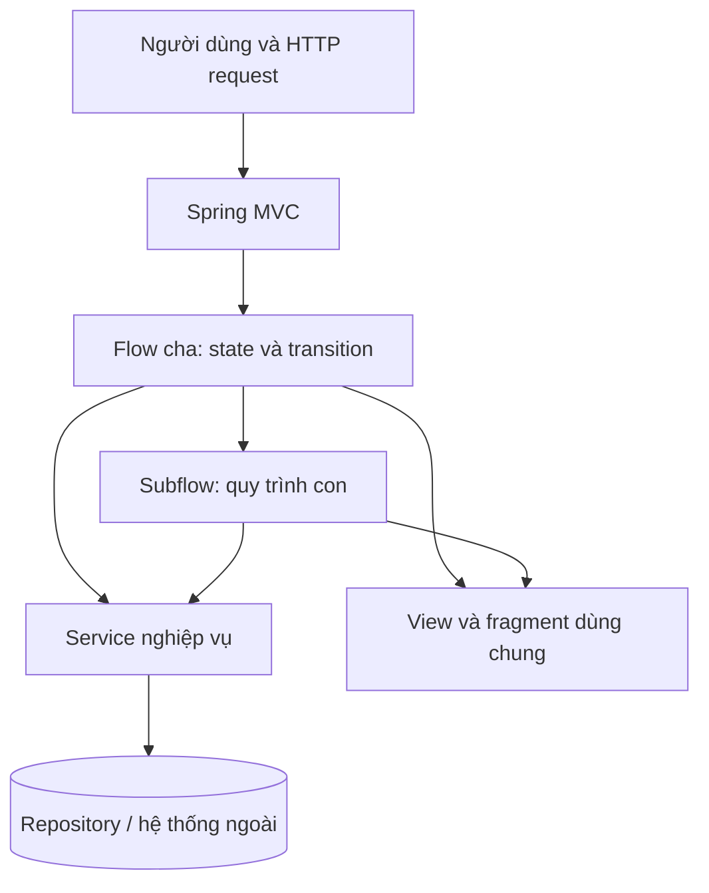

# Chọn subflow, service hay view dùng chung theo trách nhiệm

Trong chương **Subflow và tái sử dụng**, bài này giúp chọn đúng cách tái sử dụng khi xây dựng ứng dụng Spring Web Flow. Một quy trình con có state, event và kết quả riêng nên được tách thành **subflow**. Một phép tính hoặc thao tác nghiệp vụ không cần điều phối giao diện nên thuộc về **service**. Một phần giao diện xuất hiện ở nhiều màn hình nên được tổ chức thành **view dùng chung** hoặc fragment. Chọn đúng ranh giới giúp flow dễ đọc, logic nghiệp vụ có thể kiểm thử độc lập và giao diện không bị gắn chặt vào một quy trình cụ thể.

Spring Web Flow mô hình hóa hành trình nhiều bước qua state, event, transition và subflow. Nó tích hợp với Spring MVC để nhận request và hiển thị view; còn service đảm nhiệm quy tắc nghiệp vụ, dữ liệu và các thao tác có tính nhất quán. Tái sử dụng không có nghĩa là gom mọi thứ vào một flow lớn hoặc tách mọi thao tác thành flow nhỏ. Hãy dựa vào trách nhiệm và vòng đời của phần cần dùng lại.

## 1. Ba loại trách nhiệm cần phân biệt

| Thành phần | Trách nhiệm chính | Có quản lý state điều hướng riêng? | Ví dụ |
| --- | --- | --- | --- |
| Subflow | Điều phối một quy trình con gồm nhiều bước, có điểm bắt đầu, state, event và kết quả kết thúc. | Có, với flow execution của chính nó. | Xác minh địa chỉ, thanh toán, đăng ký thành viên. |
| Service | Thực hiện nghiệp vụ, truy cập dữ liệu, áp dụng quy tắc và phối hợp hệ thống. | Không. Service không sở hữu hành trình giao diện. | Tính báo giá, kiểm tra tồn kho, xác nhận đơn hàng. |
| View dùng chung | Hiển thị một phần hoặc toàn bộ giao diện có thể xuất hiện ở nhiều màn hình. | Không. View không quyết định flow state. | Form địa chỉ, phần tóm tắt đơn hàng, thanh điều hướng. |

Có thể xem mối quan hệ giữa chúng như sau:



Flow cha và subflow quyết định **khi nào** một bước được thực hiện và người dùng đi tiếp theo nhánh nào. Service quyết định **nghiệp vụ được phép làm gì** và thực thi thao tác đó. View quyết định **thông tin được trình bày ra sao**. Một thành phần có thể gọi thành phần khác, nhưng không nên nhận luôn trách nhiệm của thành phần đó.

## 2. Khi nào nên tạo subflow?

Tạo subflow khi phần quy trình có vòng đời điều phối độc lập và có ý nghĩa nghiệp vụ rõ ràng. Một subflow thường phù hợp nếu có một hoặc nhiều đặc điểm:

- Có nhiều state hoặc nhiều lựa chọn mà flow cha không cần biết chi tiết.
- Có các event kết thúc rõ ràng như `verified`, `paid`, `cancelled` hoặc `rejected`.
- Có thể được gọi từ nhiều flow cha khác nhau.
- Cần quản lý dữ liệu riêng trong `flowScope` của quy trình con.
- Có thể kiểm thử riêng các nhánh thành công, hủy và lỗi.
- Flow cha chỉ cần truyền một số input và nhận kết quả cuối cùng.

Ví dụ, quy trình thanh toán có thể gồm chọn phương thức, xác nhận thông tin, chuyển sang cổng thanh toán, chờ callback và hiển thị kết quả. Flow đặt hàng không cần quản lý tất cả state đó; nó chỉ cần biết thanh toán thành công, bị từ chối hoặc bị hủy. Đây là ranh giới tốt cho subflow.

Ngược lại, nếu chỉ cần gọi một service để tính thuế rồi chuyển sang state review, không cần tạo subflow chỉ để bao một lời gọi Java. Một `action-state` hoặc action trong transition đã thể hiện đủ bước đó.

## 3. Khai báo subflow với input và output

Giả sử flow cha đang xử lý đơn hàng và cần xác minh địa chỉ. Flow cha chỉ truyền `customerId` vào subflow `addressVerification`:

```xml
<subflow-state id="verifyAddress" subflow="addressVerification">
    <input name="customerId" value="flowScope.customer.id" />

    <transition on="verified" to="calculateQuote">
        <evaluate expression="currentEvent.attributes.addressId"
                  result="flowScope.verifiedAddressId" />
    </transition>

    <transition on="cancelled" to="editOrder" />
    <transition on="rejected" to="addressRejected" />
</subflow-state>
```

Flow con khai báo input và trả kết quả ở end state:

```xml
<flow xmlns="http://www.springframework.org/schema/webflow"
      xmlns:xsi="http://www.w3.org/2001/XMLSchema-instance"
      xsi:schemaLocation="http://www.springframework.org/schema/webflow
                          https://www.springframework.org/schema/webflow/spring-webflow.xsd">

    <input name="customerId" />

    <view-state id="chooseAddress" view="address/choose">
        <transition on="submit" to="checkAddress" />
        <transition on="cancel" to="cancelled" />
    </view-state>

    <action-state id="checkAddress">
        <evaluate expression="addressService.verify(customerId, flowScope.address)"
                  result="flowScope.verification" />
        <transition on="verified" to="verified" />
        <transition on="rejected" to="rejected" />
    </action-state>

    <end-state id="verified">
        <output name="addressId" value="flowScope.verification.addressId" />
    </end-state>

    <end-state id="cancelled" />
    <end-state id="rejected" />
</flow>
```

Đây là ví dụ cấu trúc; flow con cần có model và bean tương ứng được cấu hình trong ứng dụng. Các transition trên flow cha khớp với ID end state của flow con. Khi subflow kết thúc, flow cha nhận event kết thúc; các output được đưa vào `currentEvent.attributes`. Flow cha đọc `addressId` và lưu vào `flowScope` riêng của nó.

Input/output tạo thành hợp đồng giữa hai flow. Chỉ truyền những giá trị flow con cần để thực hiện quy trình và chỉ xuất những kết quả flow cha cần dùng. Tránh để flow cha đọc trực tiếp nhiều biến nội bộ của subflow qua `conversationScope`, vì điều đó khiến hai flow phụ thuộc vào cấu trúc triển khai của nhau.

## 4. Khi nào chỉ cần gọi service?

Service phù hợp với thao tác nghiệp vụ không cần một hành trình giao diện độc lập. Ví dụ tính báo giá từ đơn hàng:

```java
public class QuoteService {

    public Quote calculate(Order order, String addressId) {
        // Kiểm tra dữ liệu và quy tắc nghiệp vụ.
        // Tính giá hàng, phí vận chuyển, thuế và tổng tiền.
        // Trả về kết quả; không điều khiển view hoặc flow state.
        return quoteCalculator.calculate(order, addressId);
    }
}
```

Flow gọi service trong action state:

```xml
<action-state id="calculateQuote">
    <evaluate expression="quoteService.calculate(flowScope.order, flowScope.verifiedAddressId)"
              result="flowScope.quote" />
    <transition to="reviewOrder" />
</action-state>

<view-state id="reviewOrder" view="order/review">
    <transition on="confirm" to="confirmOrder" />
    <transition on="edit" to="editOrder" />
</view-state>
```

Service không biết người dùng đang ở state `calculateQuote` hay `reviewOrder`. Nó nhận input, thực hiện quy tắc và trả kết quả. Flow quyết định bước tiếp theo dựa trên kết quả đó.

Đặt logic nghiệp vụ trong service có một số lợi ích:

- Có thể gọi cùng nghiệp vụ từ nhiều flow, controller, API hoặc tác vụ nền.
- Unit test không cần khởi tạo flow execution hoặc view resolver.
- Có thể quản lý transaction, quyền truy cập và phối hợp repository ở tầng nghiệp vụ.
- Tránh lặp quy tắc trong nhiều biểu thức SpEL hoặc action XML.

Nếu service có thể trả về nhiều kết quả nghiệp vụ dự kiến, hãy dùng kiểu kết quả rõ ràng hoặc exception nghiệp vụ theo quy ước của ứng dụng. Flow có thể dùng decision state để rẽ nhánh. Không để service trả về tên view hoặc tự redirect trình duyệt; điều đó sẽ trộn nghiệp vụ với điều phối giao diện.

## 5. Khi nào nên dùng view hoặc fragment dùng chung?

Tạo view dùng chung khi cùng một phần giao diện xuất hiện ở nhiều màn hình và có cấu trúc hiển thị tương tự. Ví dụ form địa chỉ có thể được dùng trong flow tạo đơn hàng, cập nhật hồ sơ và đăng ký thành viên.

Với JSP, có thể tách fragment:

```jsp
<%-- /WEB-INF/views/fragments/address-fields.jsp --%>
<%@ taglib prefix="form" uri="http://www.springframework.org/tags/form" %>

<div class="address-fields">
    <label for="street">Đường</label>
    <form:input path="street" id="street" />
    <form:errors path="street" />

    <label for="city">Thành phố</label>
    <form:input path="city" id="city" />
    <form:errors path="city" />
</div>
```

View của từng flow có thể include fragment trong form gắn với model attribute phù hợp:

```jsp
<%@ taglib prefix="form" uri="http://www.springframework.org/tags/form" %>

<form:form method="post" modelAttribute="address">
    <jsp:include page="/WEB-INF/views/fragments/address-fields.jsp" />
    <input type="hidden" name="_flowExecutionKey" value="${flowExecutionKey}" />
    <button type="submit" name="_eventId_submit" value="true">Lưu địa chỉ</button>
</form:form>
```

Fragment này giả định các view sử dụng model có cùng thuộc tính `street` và `city`. Nếu model khác nhau, hãy chuẩn hóa view model hoặc tạo fragment nhận tham số rõ ràng. Với Thymeleaf, có thể dùng fragment; với template engine khác, dùng cơ chế include/component tương ứng.

View dùng chung không có flow scope, không phát event kết thúc subflow và không được dùng để đặt quy tắc nghiệp vụ. Nó chỉ tái sử dụng cấu trúc giao diện. Flow vẫn quyết định event nào được gửi, state nào nhận event và dữ liệu nào được bind.

## 6. Chọn đúng ranh giới theo tình huống

| Tình huống | Lựa chọn phù hợp | Lý do |
| --- | --- | --- |
| Một quy trình thanh toán có nhiều màn hình, callback và kết quả `paid`/`cancelled`. | Subflow | Có vòng đời điều phối riêng và kết quả kết thúc rõ ràng. |
| Cần tính tổng tiền từ đơn hàng và địa chỉ. | Service | Là quy tắc nghiệp vụ, không cần giao diện hoặc flow execution riêng. |
| Nhiều màn hình dùng chung form địa chỉ. | View fragment | Chỉ cần tái sử dụng cấu trúc trình bày và binding. |
| Một bước cần gọi service rồi chuyển state. | Action trong flow hoặc `action-state` | Không có quy trình con đủ độc lập để tách. |
| Cùng quy trình xác minh được gọi từ nhiều flow cha. | Subflow, kết hợp service | Subflow tái sử dụng điều phối; service tái sử dụng quy tắc xác minh. |
| Cùng quy tắc kiểm tra địa chỉ được dùng trong nhiều nơi. | Service/validator | Quy tắc nghiệp vụ nên có một nơi thực thi nhất quán. |
| Một phần tóm tắt đơn hàng xuất hiện ở nhiều view. | View fragment | Nội dung trình bày có thể tái sử dụng độc lập với state. |

Một thiết kế có thể phối hợp cả ba. Subflow xác minh địa chỉ có thể gọi `AddressService` để kiểm tra dữ liệu và render một fragment địa chỉ ở nhiều view state. Mỗi thành phần làm đúng một việc, vì vậy có thể thay đổi cách trình bày mà không ảnh hưởng quy tắc nghiệp vụ hoặc hợp đồng output của subflow.

## 7. Tránh các kiểu tái sử dụng sai ranh giới

**Tạo subflow chỉ để gọi một phương thức.** Cách này thêm flow execution, input/output mapping và test điều phối mà không có lợi ích về vòng đời. Hãy gọi service từ action state.

**Đưa toàn bộ quy trình vào service.** Service bắt đầu quyết định màn hình nào cần hiển thị hoặc event nào người dùng phải gửi sẽ khiến nghiệp vụ phụ thuộc giao diện. Hãy để flow điều phối, service trả kết quả nghiệp vụ.

**Đặt quy tắc nghiệp vụ trong JSP hoặc fragment.** Điều kiện hiển thị có thể nằm ở view, nhưng kiểm tra quyền, giá, trạng thái đơn hàng hoặc điều kiện thanh toán phải nằm ở service/domain layer. Người dùng có thể gửi request trực tiếp mà không đi qua thao tác giao diện.

**Dùng conversation scope thay cho hợp đồng output.** Chia sẻ quá nhiều dữ liệu giữa flow cha và flow con khiến việc thay đổi flow con có thể làm hỏng flow cha. Dùng input/output mapping cho dữ liệu cần đi qua ranh giới kết thúc; chỉ dùng `conversationScope` khi hai flow thật sự cần truy cập cùng dữ liệu trong lúc cả hai còn hoạt động.

**Tách subflow quá nhỏ.** Nếu một subflow chỉ có một view state và không có khả năng tái sử dụng hoặc vòng đời riêng, nó có thể làm sơ đồ khó theo dõi hơn. Chỉ tách khi tên quy trình con mô tả được một trách nhiệm có ý nghĩa.

**Tái sử dụng view nhưng giả định model giống nhau.** Fragment dùng binding path cố định có thể lỗi khi model attribute hoặc field name khác nhau. Chuẩn hóa view model, truyền tham số rõ ràng và kiểm tra cả form lẫn field errors ở từng nơi sử dụng.

## 8. Kiểm thử từng loại thành phần

Không nên dùng một loại test để xác nhận tất cả trách nhiệm. Hãy kiểm thử riêng từng lớp rồi kiểm tra tích hợp giữa chúng.

| Thành phần | Kiểm thử phù hợp | Nội dung cần xác nhận |
| --- | --- | --- |
| Service | Unit test | Quy tắc nghiệp vụ, dữ liệu đầu vào sai, kết quả thành công/thất bại và transaction khi cần. |
| Subflow | Flow execution test | Input được nhận đúng, event kết thúc đúng, output được xuất và nhánh hủy/lỗi hoạt động. |
| Flow cha | Flow execution test | Gọi đúng subflow, đọc `currentEvent.attributes`, xử lý từng end event và tiếp tục đúng state. |
| View fragment | MVC/view integration test | Binding path, model attribute, field errors, locale và nội dung hiển thị. |
| Tích hợp tổng thể | MVC integration test | URL flow, session/execution key, service wiring, view resolver và request qua nhiều bước. |

Ví dụ test cho service nên xác nhận `QuoteService.calculate` trả tổng tiền đúng khi có địa chỉ hợp lệ và từ chối dữ liệu không hợp lệ. Test này không cần Spring Web Flow.

Test subflow nên khởi chạy flow con với `customerId` giả, gửi event submit và kiểm tra end state `verified` cùng output `addressId`. Test riêng `cancelled` và `rejected` để xác nhận không có output thành công bị giữ lại.

Test flow cha cần xác nhận khi subflow phát event `verified`, transition lưu `currentEvent.attributes.addressId` vào `flowScope.verifiedAddressId` và đi đến `calculateQuote`. Khi subflow bị hủy, flow cha phải đi đến `editOrder`. Đây là nơi kiểm tra hợp đồng giữa hai flow.

Với view fragment, render các view cha sử dụng fragment trong đúng model context. Xác nhận field được bind đúng model, lỗi được hiển thị đúng field và không có hai phần tử HTML trùng `id` khi fragment được dùng nhiều lần trên cùng trang.

## 9. Lộ trình refactor khi phát hiện flow khó tái sử dụng

Giả sử flow đặt hàng đang chứa nhiều logic tính tiền, kiểm tra địa chỉ và thanh toán trong các biểu thức dài. Có thể refactor theo các bước:

1. Liệt kê các state và xác định đoạn nào là quy trình con có nhiều bước hoặc kết quả riêng.
2. Tách quy trình con có ranh giới rõ ràng thành subflow, xác định input và các end event/output.
3. Di chuyển phép tính, kiểm tra quyền và thao tác dữ liệu sang service; giữ biểu thức flow ngắn để gọi service và lưu kết quả.
4. Tách các phần giao diện lặp lại thành JSP/Thymeleaf fragment; thống nhất model và binding path.
5. Viết unit test cho service, flow execution test cho subflow/flow cha và test render cho view dùng chung.
6. Chạy kiểm thử tích hợp qua các request liên tiếp để xác nhận session, execution key, URL mapping và binding vẫn hoạt động.

Không refactor chỉ vì một đoạn XML dài. Hãy tách khi có trách nhiệm độc lập, có thể gọi lại hoặc có vòng đời cần quản lý riêng. Giữ tên subflow, service và fragment theo nghiệp vụ để người đọc hiểu mục đích mà không cần lần theo toàn bộ mã nguồn.

## 10. Checklist chọn cách tái sử dụng

- Phần cần dùng lại có state, event, transition và điểm kết thúc riêng không? Nếu có, cân nhắc subflow.
- Nó có thực hiện quy tắc hoặc thao tác nghiệp vụ mà không cần điều khiển UI không? Đặt trong service.
- Nó chỉ là cấu trúc trình bày lặp lại giữa các màn hình không? Tạo view fragment hoặc component.
- Flow cha và subflow đã có hợp đồng input/output tối thiểu chưa?
- Service có thể được unit test độc lập và không phụ thuộc tên view/state không?
- Fragment có model attribute và binding path rõ ràng không?
- Các nhánh hủy, từ chối, lỗi và thành công đều được kiểm thử chưa?
- Dữ liệu chia sẻ có đúng vòng đời và không làm lộ trạng thái nội bộ của subflow không?

Khi chọn đúng ranh giới, Spring Web Flow chịu trách nhiệm điều phối hành trình; service giữ quy tắc nghiệp vụ có thể tái sử dụng; view fragment giữ phần trình bày nhất quán. Ba lớp có thể kết hợp trong cùng một ứng dụng nhưng vẫn có hợp đồng rõ ràng, giúp mở rộng quy trình và kiểm thử từng phần dễ dàng hơn.
