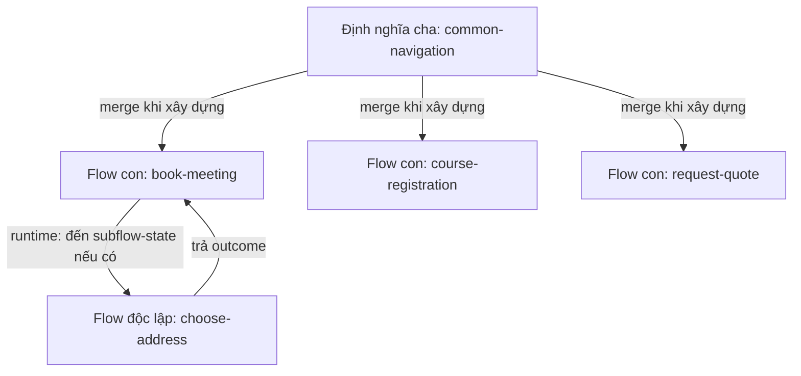
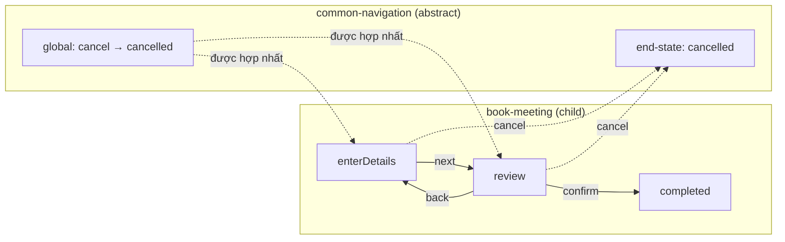

# Mục tiêu tái sử dụng cấu hình bằng flow inheritance trong Spring Web Flow

## 1. Bài toán: nhiều hành trình, nhiều phần cấu hình giống nhau

Trong **Spring Web Flow (SWF)**, một *flow* mô tả hành trình web bằng các `state`, `event` và `transition`. Flow có thể kết hợp với `view-state` để nhập biểu mẫu, `subflow-state` để gọi hành trình con, các scope để giữ dữ liệu giữa các request, cùng với xử lý lỗi và tích hợp Spring MVC.

Giả sử một hệ thống có ba hành trình:

- **Đặt lịch tư vấn:** điền thông tin → xem lại → xác nhận.
- **Đăng ký khóa học:** điền thông tin → chọn khóa → xác nhận.
- **Yêu cầu báo giá:** nhập yêu cầu → xem lại → gửi đi.

Nội dung riêng của mỗi hành trình khác nhau nhưng chúng cùng có nhu cầu xử lý nút **Hủy**, trang kết thúc khi người dùng hủy và một số quy tắc xử lý lỗi. Nếu sao chép toàn bộ cấu hình XML giữa các flow, một thay đổi nhỏ ở quy tắc dùng chung phải được thực hiện tại nhiều nơi. Dễ xuất hiện tình trạng flow này đã sửa, flow kia vẫn chạy quy tắc cũ.

**Flow inheritance (kế thừa định nghĩa flow)** cho phép khai báo một phần cấu hình trong *parent flow* rồi đưa phần đó vào các *child flow*. Mục tiêu là tái sử dụng những phần thực sự có cùng ý nghĩa trong nhiều hành trình, trong khi mỗi flow con giữ các bước nghiệp vụ và dữ liệu riêng.

Bài thuộc chương **Kế thừa định nghĩa**; trọng tâm là hiểu **vì sao cần flow inheritance, nó tái sử dụng cái gì, được hợp nhất như thế nào và khi nào không nên sử dụng**.

### Sau bài học, bạn có thể

1. Nhận ra những cấu hình lặp lại phù hợp để đưa vào parent flow.
2. Giải thích khác biệt giữa **kế thừa định nghĩa** với **gọi subflow** và kế thừa class Java.
3. Viết flow cha trừu tượng và flow con kế thừa ở cấp flow bằng thuộc tính `parent`.
4. Nhận diện trường hợp kế thừa ở cấp state, hiểu giới hạn một parent state và quy tắc cùng loại state.
5. Phân tích nguyên tắc **merge (hợp nhất)**, tránh kỳ vọng override như trong hướng đối tượng.
6. Đăng ký parent flow, kiểm thử các transition kế thừa và kiểm soát ảnh hưởng khi thay đổi quy tắc dùng chung.

## 2. Mục tiêu tái sử dụng cấu hình

| Mục tiêu | Phần cấu hình có thể dùng chung | Giá trị đối với dự án |
|---|---|---|
| **Giảm trùng lặp** | `global-transitions` cho các event như `cancel`, `help`; end-state dùng chung | Bảo trì một nơi thay vì sửa hàng loạt file flow. |
| **Thống nhất hành vi** | Hướng xử lý hủy, một số exception handler, action dùng chung | Các hành trình phản ứng nhất quán với cùng một event hoặc lỗi. |
| **Dùng chung khung điều hướng** | State chung hoặc cấu hình state chung | Flow mới chỉ cần khai báo bước khác biệt. |
| **Phân tách trách nhiệm** | Parent chứa quy tắc kỹ thuật; child mô tả hành trình nghiệp vụ | Sơ đồ flow con dễ đọc, người phát triển ít nhầm lẫn. |
| **Hỗ trợ mở rộng** | Parent flow được đăng ký và tái sử dụng bởi nhiều flow | Thêm hành trình mới nhanh hơn khi dùng cùng quy ước. |
| **Giảm rủi ro khi thay đổi** | Tập trung kiểm tra quy tắc chung tại parent | Thay đổi có thể kiểm soát bằng bộ test cho mọi child. |

Tuy nhiên, kế thừa **không** có nghĩa là mọi hành trình phải dùng cùng logic nghiệp vụ. Ví dụ các flow đặt lịch và hoàn tiền có thể cùng xử lý `cancel` nhưng có yêu cầu xác thực hoặc hoàn tác dữ liệu khác nhau. Chỉ nên chia sẻ phần có **ngữ nghĩa ổn định** ở tất cả flow con.

Trong dự án lớn, cấu hình chung thường xoay quanh việc điều hướng, phản hồi lỗi và chính sách kỹ thuật. Việc tính phí, kiểm tra tồn kho, ghi đơn hàng hoặc cấp quyền cần nằm trong service phù hợp; không nên chỉ vì hai flow có cùng tên state mà buộc chúng kế thừa cùng hành vi.

## 3. Phân biệt inheritance, subflow và kế thừa Java

Tên gọi *inheritance* có thể khiến người học liên tưởng tới `extends` trong Java. Cần nắm chính xác thời điểm tái sử dụng:

| Cơ chế | Xảy ra khi nào? | Phục vụ mục đích nào? | Đặc điểm chính |
|---|---|---|---|
| **Flow inheritance** | Khi định nghĩa flow được xây dựng từ XML | Hợp nhất cấu hình parent vào child | Các phần tử tương ứng được **merge**; child không override phần tử cha như class Java. |
| **Subflow** | Khi flow **đang chạy** đến `subflow-state` | Thực hiện một hành trình con có đầu vào, kết quả và vòng đời riêng | Parent flow tạm chờ, subflow chạy rồi trả outcome. |
| **Java inheritance** | Ở cấp cấu trúc class Java | Dùng lại thuộc tính/phương thức và đa hình của class | Có thể override phương thức theo quy tắc Java. |
| **Spring bean reuse** | Khi cấu hình và gọi bean/service | Dùng chung xử lý nghiệp vụ hoặc hạ tầng | Một service có thể được gọi từ nhiều flow mà không cần inheritance. |

**Điểm cốt lõi:** kế thừa flow không tự tạo một lần gọi flow con tại runtime. Sau bước xây dựng, một định nghĩa flow đã mang các cấu hình kế thừa. Nếu cần một quy trình như xác thực hoặc chọn địa chỉ được **thực thi riêng** rồi trả kết quả về flow gọi, `subflow-state` thường phù hợp hơn.



Ba flow con có thể cùng kế thừa một quy tắc hủy nhưng mỗi flow vẫn có model, validator, service và chuỗi bước của riêng mình.

## 4. Flow-level inheritance: kế thừa cấu hình cho toàn flow

### 4.1. Định nghĩa parent dùng chung

Giả sử mọi hành trình đều cần nhận event `cancel` từ một `view-state` và kết thúc với outcome `cancelled`. Tạo file minh họa `/WEB-INF/flows/common-navigation/common-navigation.xml`:

```xml
<?xml version="1.0" encoding="UTF-8"?>
<flow xmlns="http://www.springframework.org/schema/webflow"
      abstract="true">

    <global-transitions>
        <!-- Hủy không cần bind/validate dữ liệu form hiện tại. -->
        <transition on="cancel" to="cancelled" bind="false" />
    </global-transitions>

    <end-state id="cancelled" />
</flow>
```

Ý nghĩa:

- `abstract="true"` đánh dấu định nghĩa dùng để làm cơ sở kế thừa, không dành cho người dùng khởi chạy trực tiếp.
- `<global-transitions>` định nghĩa event được áp dụng ở phạm vi các view của flow.
- `<transition on="cancel" to="cancelled" bind="false" />` định nghĩa điều hướng khi hủy; `bind="false"` giúp thao tác hủy không phụ thuộc dữ liệu người dùng vừa nhập.
- `<end-state id="cancelled" />` cung cấp state đích cho transition dùng chung.

Khi một abstract flow bị yêu cầu chạy trực tiếp, Spring Web Flow báo lỗi xây dựng flow (`FlowBuilderException`), vì đây là bản thiết kế phục vụ kế thừa. **Abstract không đồng nghĩa không cần đăng ký:** flow cha vẫn phải được tìm thấy qua `flow-registry`.

Đây là ví dụ một quy tắc chung. Với ứng dụng có yêu cầu đặc biệt như hủy giao dịch đã ghi dữ liệu, không nên mặc định chuyển thẳng đến `cancelled` mà phải kiểm tra quy trình rollback, xác nhận hủy hoặc cleanup ở service.

### 4.2. Flow con khai báo `parent`

Tạo file `/WEB-INF/flows/book-meeting/book-meeting.xml`:

```xml
<?xml version="1.0" encoding="UTF-8"?>
<flow xmlns="http://www.springframework.org/schema/webflow"
      parent="common-navigation"
      start-state="enterDetails">

    <!-- Đây là model riêng cho hành trình đặt lịch. -->
    <var name="meetingForm"
         class="com.example.meeting.MeetingForm" />

    <view-state id="enterDetails" model="meetingForm">
        <transition on="next" to="review" />
    </view-state>

    <view-state id="review">
        <transition on="back" to="enterDetails" />
        <transition on="confirm" to="completed" />
    </view-state>

    <end-state id="completed" />
</flow>
```

`MeetingForm` là Java bean minh họa, giả định đã được định nghĩa trong ứng dụng; phần render form và xác thực dữ liệu cũng cần tích hợp phù hợp. Trong ví dụ, bản thân XML child **không** khai báo lại event `cancel` hay end-state `cancelled`.

Sau khi hợp nhất:

- Flow `book-meeting` có các state riêng `enterDetails`, `review` và `completed`.
- Flow nhận `global-transitions` cho event `cancel` và có end-state `cancelled` từ parent.
- Ở màn nhập và màn review, nút `cancel` có thể kết thúc flow theo quy tắc chung.
- Event `next`, `back` và `confirm` vẫn là quy trình riêng của `book-meeting`.
- `start-state="enterDetails"` làm rõ state mở đầu; không phụ thuộc việc người đọc suy ra từ thứ tự các state sau merge.

Flow khác có thể sử dụng cùng parent:

```xml
<flow xmlns="http://www.springframework.org/schema/webflow"
      parent="common-navigation"
      start-state="chooseCourse">

    <view-state id="chooseCourse">
        <transition on="next" to="verifyRegistration" />
    </view-state>

    <view-state id="verifyRegistration">
        <transition on="submit" to="completed" />
    </view-state>

    <end-state id="completed" />
</flow>
```

Đây là ví dụ thứ hai độc lập, dành cho hành trình đăng ký khóa học. Nó dùng lại quy tắc hủy mà không cần sử dụng `MeetingForm` hoặc các state đặt lịch.

### 4.3. Phác họa kết quả kế thừa



Sơ đồ chỉ biểu diễn cấu hình kết quả một cách khái niệm: `global-transitions` áp dụng từ các view trong flow, chứ không phải tạo thêm transition XML cục bộ giống hệt trong mọi `view-state`.

## 5. Điều kiện bắt buộc: đăng ký parent trong FlowRegistry

Tên `parent="common-navigation"` là **flow ID**, không phải tên class Java và không nhất thiết trùng tên thư mục. Web Flow phải giải quyết được flow ID qua `flow-registry`.

Ví dụ cấu hình Spring XML, các đường dẫn đặt theo cấu trúc giả định ở mục trên:

```xml
<beans xmlns="http://www.springframework.org/schema/beans"
       xmlns:xsi="http://www.w3.org/2001/XMLSchema-instance"
       xmlns:webflow="http://www.springframework.org/schema/webflow-config"
       xsi:schemaLocation="
           http://www.springframework.org/schema/beans
           https://www.springframework.org/schema/beans/spring-beans.xsd
           http://www.springframework.org/schema/webflow-config
           https://www.springframework.org/schema/webflow-config/spring-webflow-config.xsd">

    <webflow:flow-registry id="flowRegistry">
        <webflow:flow-location
            id="common-navigation"
            path="/WEB-INF/flows/common-navigation/common-navigation.xml" />

        <webflow:flow-location
            id="book-meeting"
            path="/WEB-INF/flows/book-meeting/book-meeting.xml" />
    </webflow:flow-registry>

    <webflow:flow-executor id="flowExecutor" />
</beans>
```

Một ứng dụng thực tế còn cần cấu hình Spring MVC `FlowHandlerMapping`/`FlowHandlerAdapter`, resolver cho giao diện và các bean nghiệp vụ; đoạn XML trên minh họa phần **đăng ký định nghĩa để hỗ trợ inheritance**.

Nếu dùng Java config, ý tưởng tương đương là thêm cả hai resource vào `FlowDefinitionRegistryBuilder` và đặt ID nhất quán. Khi flow ID được tự động suy ra từ đường dẫn hoặc `base-path`, cần kiểm tra ID thực tế. Ví dụ `parent="common-navigation"` sẽ không giải quyết được nếu registry chỉ biết flow cha dưới ID `shared/common-navigation`.

### Preflight khi parent không được tìm thấy

1. Xác nhận file flow cha có được đăng ký trong registry đúng với flow con đang dùng hay không.
2. Đối chiếu chính xác flow ID, gồm cả `base-path` và quy tắc gán ID tự động.
3. Kiểm tra XML của parent có hợp lệ và đang dùng cùng `FlowRegistry` hay registry hierarchy có thể giải quyết ID không.
4. Đảm bảo `parent` không trỏ vòng qua chuỗi các parent khác.
5. Thử nạp các flow trong môi trường test để phát hiện lỗi cấu hình sớm.

Việc file XML xuất hiện trong thư mục dự án **không đủ** để flow con tự tìm thấy parent nếu file chưa nằm trong registry theo ID cần dùng.

## 6. State-level inheritance: dùng chung cấu hình của một state

Không phải lúc nào cũng cần đưa toàn bộ cấu hình của parent vào child. Khi nhiều view có cùng quy tắc kỹ thuật cho **một bước**, Web Flow hỗ trợ `parent` ngay trên phần tử state.

### 6.1. State làm mẫu

Giả sử muốn một số form dùng chung cách xử lý event `cancel`. Tạo parent flow với một view-state mẫu:

```xml
<!-- common-form.xml -->
<flow xmlns="http://www.springframework.org/schema/webflow"
      abstract="true">

    <view-state id="formTemplate">
        <transition on="cancel" to="cancelled" bind="false" />
    </view-state>
</flow>
```

Flow cha này phải đăng ký dưới ID `common-form`. State `formTemplate` chỉ mang cấu hình chung; nó không có model hay tên view cố định cho từng biểu mẫu.

### 6.2. Chỉ một state của child kế thừa

```xml
<!-- request-quote.xml -->
<flow xmlns="http://www.springframework.org/schema/webflow"
      start-state="enterRequest">

    <var name="quoteForm" class="com.example.quote.QuoteForm" />

    <view-state id="enterRequest"
                parent="common-form#formTemplate"
                model="quoteForm">
        <transition on="next" to="review" />
    </view-state>

    <view-state id="review">
        <transition on="back" to="enterRequest" />
        <transition on="submit" to="completed" />
    </view-state>

    <!-- State-level inheritance không tự mang theo state khác của parent. -->
    <end-state id="cancelled" />
    <end-state id="completed" />
</flow>
```

Biểu thức `parent="common-form#formTemplate"` có hai phần:

- `common-form` là **ID của parent flow** trong registry.
- `formTemplate` là **ID của state** nằm bên trong parent flow.

Phần `enterRequest` nhận transition `cancel` từ `formTemplate` và bổ sung transition `next` riêng. State `review` không dùng `parent` nên không tự nhận transition `cancel` từ `formTemplate`. Đây là khác biệt quan trọng với `global-transitions` trong flow-level inheritance.

**Giới hạn:** state-level inheritance chỉ chỉ định **một parent state**; state cha và state con phải **cùng loại**. Ví dụ `view-state` chỉ kế thừa `view-state` khác, không kế thừa từ `end-state`. Nếu dùng `parent="..."` mà flow/state không được đăng ký hoặc không đúng loại, việc xây dựng flow thất bại.

### 6.3. Chọn cấp kế thừa theo nhu cầu

| Nhu cầu | Cấp phù hợp | Lý do |
|---|---|---|
| Mọi màn trong flow dùng chung nút hủy | Flow-level inheritance | Đưa global transition vào toàn flow. |
| Chỉ một màn form dùng transition đặc biệt | State-level inheritance | Giới hạn thay đổi ở state chọn kế thừa. |
| Nhiều flow dùng chung một đoạn nghiệp vụ độc lập | `subflow-state` | Tái sử dụng bằng việc gọi flow tại runtime. |
| Nhiều flow cần cùng một phép tính/validator | Spring bean hoặc service | Chia sẻ xử lý, không cần mở rộng XML điều hướng. |

Không nên lạm dụng state-level inheritance chỉ để tái sử dụng một dòng XML đơn giản. Chi phí tìm hiểu quan hệ parent-child có thể lớn hơn lợi ích nếu quy tắc không thực sự được nhiều state chia sẻ.

## 7. Vì sao đây là merge, không phải override?

Một tính chất rất quan trọng của Spring Web Flow là **child không thay thế toàn bộ phần tử được định nghĩa ở parent như phương thức override trong Java**. Khi xây dựng định nghĩa child, engine áp dụng các quy tắc merge theo loại phần tử.

Giả sử parent và child đều có `<view-state id="review">`: đây không phải hai màn hình tên khác nhau, cũng không đơn giản là child xóa parent. SWF xem xét các cấu hình tương ứng để hợp nhất. Vì vậy nếu parent `review` chứa một transition hoặc action nào đó, cần tính tới khả năng child vẫn nhận cấu hình ấy.

### 7.1. Quy tắc khái niệm

1. Một phần tử **mergeable** ở parent có cùng loại và cùng thuộc tính khóa với child sẽ được hợp nhất nội dung.
2. Nếu không có phần tử tương ứng, phần tử từ parent được thêm vào định nghĩa child.
3. Một phần tử **non-mergeable** được đưa vào kết quả như một phần tử nguyên vẹn, thay vì merge vào phần tử cùng kiểu.
4. Thứ tự phần tử sau hợp nhất phụ thuộc quy tắc của XML Web Flow. Phần lớn phần tử bổ sung từ parent xuất hiện sau phần tử child; riêng một số action như `evaluate`, `render`, `set` được thêm ở đầu để giá trị từ action cha có thể được action con sử dụng.

Bảng sau tóm tắt một số quy tắc của tài liệu chính thức:

| Phần tử | Mergeable? | Khóa để xem là tương ứng |
|---|---|---|
| `view-state` | Có | `id` |
| `action-state` | Có | `id` |
| `decision-state` | Có | `id` |
| `subflow-state` | Có | `id` |
| `end-state` | Có | `id` |
| `transition` | Có | `on` và `on-exception` |
| `attribute` | Có | `name` |
| `input`, `output` | Có | `name` |
| `on-start`, `on-entry`, `on-exit`, `on-render`, `on-end` | Có | Hợp nhất theo loại phần tử tương ứng |
| `var` | Không | Được đưa vào kết quả nguyên vẹn |
| `exception-handler` | Không | Được đưa vào kết quả nguyên vẹn |
| `evaluate`, `set`, `render` | Không | Được đưa vào kết quả nguyên vẹn |
| `bean-import`, `persistence-context` | Không | Được đưa vào kết quả nguyên vẹn |

Khi cùng một transition hoặc state xuất hiện ở parent và child, **đừng dự đoán chỉ dựa trên trực giác rằng cấu hình child sẽ ghi đè parent**. Cần kiểm tra quy tắc merge tương ứng và kiểm thử flow kết quả, đặc biệt nếu cùng event có action hoặc điều kiện khác nhau.

### 7.2. Tình huống dễ gây bất ngờ

Parent:

```xml
<view-state id="review">
    <transition on="cancel" to="cancelled" />
</view-state>
```

Child:

```xml
<view-state id="review">
    <transition on="back" to="enterDetails" />
</view-state>
```

Khi state `review` có cùng `id`, các transition khác event có thể cùng xuất hiện sau merge. Không được kết luận rằng child chỉ còn `back` vì XML child không nhắc tới `cancel`.

Một rủi ro khác: parent có action `<evaluate>` trong `on-entry`; child cũng thêm action của mình và mong nó chạy trước. Thứ tự merge có thể khiến parent action chạy trước; nếu có tác dụng phụ hoặc phụ thuộc dữ liệu, hành vi runtime sẽ thay đổi. Vì vậy dùng chung những action ít phụ thuộc bối cảnh, có kết quả rõ ràng và có test.

### 7.3. Nhiều parent ở cấp flow

Spring Web Flow hỗ trợ **multiple inheritance** ở cấp flow:

```xml
<flow xmlns="http://www.springframework.org/schema/webflow"
      parent="common-navigation, common-auditing"
      start-state="enterDetails">

    <view-state id="enterDetails">
        <transition on="next" to="completed" />
    </view-state>

    <end-state id="completed" />
</flow>
```

Đây là đoạn minh họa; hai parent cần thực sự có mặt trong registry và có các cấu hình tương thích. SWF xử lý danh sách **theo thứ tự**: merge với parent thứ nhất, lấy kết quả đó làm child cho lần merge với parent thứ hai. Không thể coi thứ tự là vô nghĩa.

Mỗi parent nên có **một trách nhiệm rõ** để giảm xung đột tên state, event, biến và action. Khi nhiều parent cùng tạo cấu hình cho một state hoặc event, cần hiểu thứ tự hợp nhất và xác minh kết quả trong test.

## 8. Những quyết định thiết kế giúp inheritance có ích lâu dài

### 8.1. Tách “chung” và “riêng” theo ngữ nghĩa

Những lựa chọn thường có ích:

- **Chung:** điều hướng `cancel` thống nhất; xử lý một nhóm ngoại lệ kỹ thuật; state dùng cho giao diện trợ giúp giống nhau; các action chuẩn bị dữ liệu hiển thị chung.
- **Riêng:** định nghĩa DTO, logic xác nhận nghiệp vụ, điều kiện thanh toán, số bước, quyền truy cập theo tình huống, hành động lưu/hoàn tác.
- **Cần đánh giá:** validation và security policy. Có thể chia sẻ nếu bảo đảm ý nghĩa tương đương; nếu flow con có quyền/điều kiện nghiệp vụ khác, kế thừa vô điều kiện có thể không phù hợp.

Với form binding, parent không tự quyết định model thuộc `viewScope` hay `flowScope` cho mọi flow con. Hãy để child sở hữu model và các transition nghiệp vụ liên quan, trừ khi dữ liệu thực sự có cấu trúc và vòng đời đồng nhất.

### 8.2. Ưu tiên parent trừu tượng, ổn định

Các parent chỉ dùng để gom cấu hình nên khai báo `abstract="true"`. Điều này giúp thể hiện rõ mục đích, tránh lộ endpoint cho một hành trình chưa hoàn chỉnh và phát hiện cấu hình dùng sai. Tuy nhiên parent vẫn là định nghĩa cần được duy trì và đăng ký.

Một parent chỉ chứa các quy tắc dùng chung thường dễ quản lý hơn parent đầy đủ cả logic của một flow nghiệp vụ phức tạp. Đừng tạo cây nhiều tầng kế thừa nếu nhóm không thể xác định nhanh “event này bắt nguồn từ đâu”.

### 8.3. Cẩn trọng với đường dẫn tài nguyên tương đối

Một chi tiết dễ bị bỏ qua: **đường dẫn đến tài nguyên bên ngoài được khai báo trong parent có thể bị diễn giải theo thư mục của child sau merge**. Ví dụ parent ở `/WEB-INF/flows/shared/` tham chiếu `views/error` nhưng child ở `/WEB-INF/flows/booking/`; sau merge, đường dẫn tương đối có thể trỏ sang nơi khác.

Theo hướng dẫn chính thức, tài nguyên bên ngoài trong parent nên dùng **đường dẫn tuyệt đối/phù hợp cơ chế resolver** thay vì phụ thuộc thư mục của parent. Cần kiểm tra thực tế cấu hình `view`, import, message bundle và tài nguyên khác mà parent tham chiếu.

### 8.4. Xem parent như một hợp đồng

Một quy tắc trong parent có thể phục vụ nhiều flow con. Trước khi đổi parent, hãy xác định:

1. Child nào đang kế thừa parent?
2. Event/state chung nào bị tác động?
3. Có child nào định nghĩa cùng khóa `id`, `on` hoặc `on-exception` để gây merge không?
4. Có action nào thay đổi thứ tự thực thi hoặc ghi dữ liệu không?
5. Các ca test của từng child có chứng minh behavior dự kiến không?

Nên đặt tên flow ID nhất quán và mô tả ý nghĩa của parent ngay bên cạnh cấu hình chung để người bảo trì biết tác động lan truyền.

## 9. Kiểm thử cơ chế tái sử dụng và lỗi thường gặp

Flow inheritance thường được xử lý trong quá trình xây dựng định nghĩa, nên nên kiểm thử cả **nạp cấu hình** lẫn **event/runtime behavior**.

| Tình huống | Cách kiểm tra | Kỳ vọng |
|---|---|---|
| Parent đã đăng ký | Khởi tạo `FlowRegistry` có parent và child | Child được xây dựng thành công. |
| Parent thiếu trong registry | Cố tình dùng ID không tồn tại trong môi trường test | Nhận lỗi cấu hình, không âm thầm bỏ qua inheritance. |
| Hủy từ màn nhập | Khởi chạy `book-meeting`, gửi event `cancel` | Tới end-state `cancelled` dù child không khai báo transition cục bộ. |
| Hủy khi form nhập sai | Gửi dữ liệu không hợp lệ kèm event `cancel` | `bind="false"` cho phép hủy theo chính sách chung. |
| Luồng nghiệp vụ riêng | Gửi `next` rồi `confirm` hợp lệ | Vẫn đi qua `enterDetails → review → completed`. |
| State-level inheritance | Gửi `cancel` tại `enterRequest` | State kế thừa nhận transition; state khác không tự nhận. |
| Merge cùng `id` | Parent và child cùng khai báo `review` | Kiểm tra những transition/action từ cả hai bên còn tồn tại và thứ tự phù hợp. |
| Multiple inheritance | Đổi thứ tự hai ID trong `parent` ở test riêng | So sánh định nghĩa hoặc behavior để phát hiện phụ thuộc thứ tự. |
| Tài nguyên của parent | Render view/action dùng tài nguyên ngoài | Đường dẫn vẫn phân giải đúng từ ngữ cảnh child. |
| Abstract flow | Thử khởi chạy trực tiếp flow trừu tượng | Bị từ chối theo cơ chế `abstract`. |

Một bộ test tốt nên có ít nhất một ca cho **mỗi flow con chịu ảnh hưởng của parent**. Chỉ kiểm tra parent một mình không thể bảo đảm cấu hình hợp nhất của mọi child chính xác.

Trong môi trường có Spring MVC, test web có thể khởi chạy flow qua handler, gửi event bằng request rồi kiểm tra state/response. Ở cấp Web Flow, dùng test support tương ứng với phiên bản để chạy các event/state và kiểm tra outcome. Không cần chép cấu hình inheritance vào test; test nên nạp chính các flow XML để phát hiện lỗi ID, XML schema và merge.

### Tình huống chẩn đoán

**“Flow con không tìm thấy parent.”** Kiểm tra registry và ID khai báo, rồi kiểm tra location path. Không tự suy luận `parent` là đường dẫn file.

**“Child không bỏ được transition từ parent.”** Đây là hệ quả của merge. Nếu hai nghiệp vụ không chia sẻ hành vi đó, cần thiết kế lại ranh giới parent hoặc tạo parent chuyên biệt, thay vì trông chờ override kiểu Java.

**“Một action tự nhiên chạy hai lần hoặc sai thứ tự.”** Kiểm tra parent và child có cùng khối `on-entry`/`on-start` hay cùng event không; xác minh quy tắc merge và thứ tự action.

**“Một màn form biến mất dữ liệu khi chuyển state.”** Inheritance không thay thế quản lý scope. Với wizard, model thường cần `flowScope` nếu phải dùng qua nhiều bước; `viewScope` chỉ sống khi còn ở view-state tương ứng.

**“Flow chạy nhưng trang được kế thừa không render đúng.”** Kiểm tra `view` và các tài nguyên được parent tham chiếu, đặc biệt đường dẫn tương đối sau merge.

**“Thêm parent mới khiến validation/security thay đổi.”** Kiểm tra cấu hình được thêm ở flow/state, các action và chính sách điều kiện. Cần chạy lại bộ kiểm thử behavior và quyền truy cập ở mọi flow liên quan.

## 10. Bài tập thực hành: chia cấu hình hủy ra parent

Một ứng dụng có hai flow `register-member` và `book-consultation`. Mỗi flow đang tự khai báo:

```xml
<global-transitions>
    <transition on="cancel" to="cancelled" bind="false" />
</global-transitions>
<end-state id="cancelled" />
```

Hãy thực hiện theo các bước:

1. Tạo định nghĩa `common-navigation` có `abstract="true"`, chứa cấu hình hủy dùng chung.
2. Đăng ký `common-navigation` trong flow registry với đúng ID.
3. Thêm `parent="common-navigation"` vào cả hai flow con; bỏ những khai báo sao chép mà không còn cần thiết.
4. Khai báo state riêng cho mỗi child, ghi rõ `start-state` và kết thúc thành công qua end-state riêng.
5. Kiểm thử hủy tại ít nhất hai view khác nhau; thử hủy ngay khi dữ liệu form sai.
6. Bổ sung một flow `request-support` chỉ muốn xử lý `cancel` tại **một** state, rồi cân nhắc state-level inheritance so với flow-level inheritance.
7. Mô tả hậu quả khi parent bổ sung event `help` và khi một child cũng định nghĩa transition `help` với cùng khóa.

### Câu hỏi tự kiểm tra

- Parent flow có thể được khai báo `abstract="true"` mà vẫn được kế thừa không?
- Vì sao `parent="common-navigation"` cần một registry ID giải quyết được?
- Khi parent và child cùng khai báo `view-state id="review"`, cơ chế nào được áp dụng?
- Vì sao state-level inheritance chỉ tác động một state và phải ghi `flowId#stateId`?
- Tình huống nào nên chọn `subflow-state` thay vì flow inheritance?
- Vì sao mọi child cần kiểm thử lại sau khi sửa một parent dùng chung?

Nếu trả lời được các câu trên và đọc được kết quả merge của ví dụ, bạn đã nắm được mục tiêu kiến trúc của flow inheritance: **tập trung cấu hình thực sự dùng chung để mỗi hành trình giữ logic riêng, nhưng hành vi nền tảng nhất quán**.

## 11. Tài liệu tham khảo

- [Spring Web Flow 3.0.x Reference Guide — Flow Inheritance](https://docs.spring.io/spring-webflow/docs/3.0.x/reference/#_flow_inheritance): cơ chế flow-level và state-level, abstract flow, merge và danh sách phần tử mergeable/non-mergeable.
- [Spring Web Flow 3.0.x Reference Guide — Global Transitions](https://docs.spring.io/spring-webflow/docs/3.0.x/reference/): cú pháp `<global-transitions>` và event áp dụng qua các view.
- [Spring Web Flow 3.0.x Reference Guide — FlowRegistry](https://docs.spring.io/spring-webflow/docs/3.0.x/reference/): đăng ký flow, gán flow ID, `base-path` và cấu hình Spring MVC.
