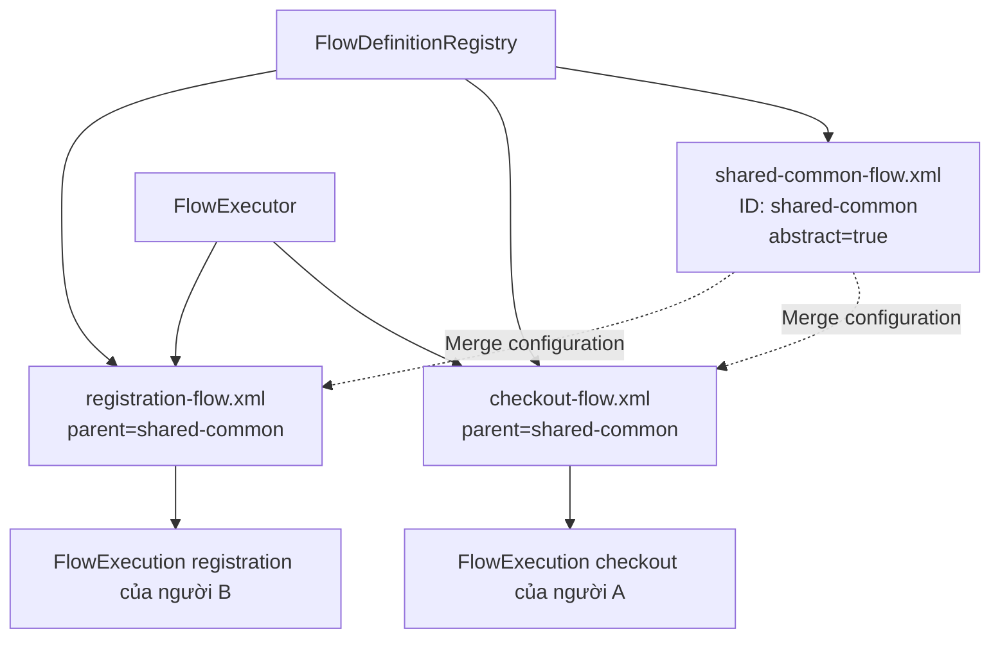
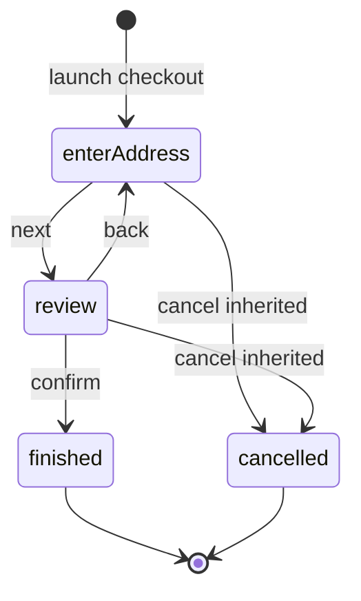
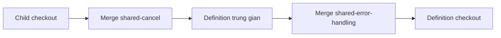

# Đăng ký flow cha và đánh dấu định nghĩa trừu tượng

## 1. Vì sao cần flow cha trong Spring Web Flow?

Trong **Spring Web Flow**, hành trình web nhiều bước được mô tả bằng các `state`, `event`, `transition` và `subflow`. Một quy trình đặt hàng có thể gồm bước nhập địa chỉ, xem lại đơn hàng và xác nhận; một quy trình đăng ký tài khoản có thể gồm nhập thông tin, xem lại và hoàn tất. Dù khác nghiệp vụ, cả hai có thể cùng có event **Hủy**, một số state dùng chung hoặc chính sách xử lý lỗi giống nhau.

**Flow inheritance (kế thừa định nghĩa flow)** cho phép khai báo các phần dùng chung ở **flow cha**, rồi hợp nhất cấu hình đó vào **flow con** trong quá trình xây dựng definition. Khi flow cha chỉ đóng vai trò khuôn mẫu, thuộc tính `abstract="true"` thể hiện rõ nó **không được khởi chạy trực tiếp**.

Bài thuộc chương **Kế thừa định nghĩa** của module `SPRING_WEB_FLOW`. Mục tiêu là đăng ký flow cha đúng ID, đánh dấu nó là trừu tượng, để flow con kế thừa, sau đó kiểm tra thực thi và các lỗi cấu hình. Các kiến thức này liên quan trực tiếp đến hành trình nhiều bước, quản lý state/phiên, validation, Spring MVC, kiểm thử và phục hồi flow.

Sau bài này, bạn có thể:

1. Phân biệt **kế thừa flow definition**, **phân cấp registry**, **kế thừa state** và **gọi subflow**.
2. Đăng ký flow cha trong `FlowDefinitionRegistry` bằng XML và Java configuration.
3. Dùng `<flow abstract="true">` cho template và `<flow parent="...">` cho flow con.
4. Tái sử dụng global transition và end-state trong nhiều flow.
5. Hiểu giới hạn của thuật toán merge, trùng ID và nhiều flow cha.
6. Kiểm tra lookup/launch, chẩn đoán lỗi và chọn phạm vi áp dụng hợp lý.

## 2. Những đối tượng nào tham gia vào kế thừa?



Registry giúp hệ thống **tra cứu định nghĩa flow theo ID**. Flow cha và các flow con phải có definition có thể tra cứu trong registry phù hợp. Flow con khai báo ID cha bằng `parent`; builder hợp nhất các phần tử cha/con rồi mới tạo định nghĩa thực thi.

**Không có một flow execution riêng cho template cha chỉ vì nó được kế thừa.** Người dùng vẫn chạy `checkout` hoặc `registration` với state và dữ liệu thuộc execution tương ứng.

| Thành phần/thuộc tính | Trách nhiệm | Ví dụ |
| --- | --- | --- |
| `FlowDefinitionRegistry` | Đăng ký và tìm definition theo ID | `shared-common`, `checkout` |
| `<flow parent="...">` | Kế thừa cấu hình một hoặc nhiều flow cha | `parent="shared-common"` |
| `<flow abstract="true">` | Đánh dấu template không được chạy trực tiếp | Root của `shared-common-flow.xml` |
| `FlowExecutor` | Launch/resume flow được phép chạy | Bắt đầu `checkout` |
| `FlowExecutionRepository` | Lưu/khôi phục execution đang chạy | Tiếp tục form checkout qua nhiều request |
| `<subflow-state>` | Gọi một flow khác lúc thực thi | Chọn địa chỉ giao hàng |

Cần phân biệt định nghĩa với dữ liệu người dùng: **flow inheritance là việc dựng định nghĩa**, không phải kế thừa HTTP session, `flowScope` hay object form của người dùng trước đó.

## 3. Đăng ký flow cha vào FlowDefinitionRegistry

Khi một flow con khai báo `parent="shared-common"`, giá trị `shared-common` là **ID của definition**. Đây không phải đường dẫn tương đối tới XML, cũng không phải tên một Spring bean. Vì vậy, chỉ tạo tệp XML cha là chưa đủ: phải **đăng ký cha trong flow registry**.

Giả sử ứng dụng có cấu trúc:

```text
src/main/webapp/WEB-INF/flows/
├── shared/
│   └── shared-common-flow.xml
├── checkout/
│   ├── checkout-flow.xml
│   └── views/
└── registration/
    └── registration-flow.xml
```

### 3.1. Đăng ký tường minh bằng Spring XML

Trong tệp cấu hình bean đã khai báo namespace `webflow`:

```xml
<webflow:flow-registry id="flowRegistry">
    <!-- Template cha: vẫn phải đăng ký để được tra cứu. -->
    <webflow:flow-location
        path="/WEB-INF/flows/shared/shared-common-flow.xml"
        id="shared-common" />

    <!-- Hai flow có thể chạy thực sự. -->
    <webflow:flow-location
        path="/WEB-INF/flows/checkout/checkout-flow.xml"
        id="checkout" />
    <webflow:flow-location
        path="/WEB-INF/flows/registration/registration-flow.xml"
        id="registration" />
</webflow:flow-registry>

<webflow:flow-executor
    id="flowExecutor"
    flow-registry="flowRegistry" />
```

Cấu hình trên đăng ký ba ID. **Thuộc tính `id` nằm ở `flow-location`** để cấp tên logic; nơi khai báo *kế thừa* và *abstract* vẫn nằm trong các tệp flow XML. Ví dụ chỉ chứa phần bean thiết yếu; ứng dụng thực tế cần `<beans>` và namespace/schema tương ứng.

Đăng ký bằng `flow-location-pattern` hoặc Java builder `addFlowLocationPattern` cũng được, nhưng ID có thể được suy từ tên file và `base-path`. Nếu nhiều flow con phụ thuộc tên cha ổn định, khai báo `id` rõ ràng giúp refactor ít rủi ro hơn.

### 3.2. Đăng ký bằng Java configuration

`AbstractFlowConfiguration` cung cấp registry/executor builder tương ứng:

```java
import org.springframework.context.annotation.Bean;
import org.springframework.context.annotation.Configuration;
import org.springframework.webflow.config.AbstractFlowConfiguration;
import org.springframework.webflow.definition.registry.FlowDefinitionRegistry;
import org.springframework.webflow.executor.FlowExecutor;

@Configuration
public class InheritanceFlowConfig extends AbstractFlowConfiguration {

    @Bean
    public FlowDefinitionRegistry flowRegistry() {
        return getFlowDefinitionRegistryBuilder()
                .addFlowLocation(
                        "/WEB-INF/flows/shared/shared-common-flow.xml",
                        "shared-common")
                .addFlowLocation(
                        "/WEB-INF/flows/checkout/checkout-flow.xml",
                        "checkout")
                .addFlowLocation(
                        "/WEB-INF/flows/registration/registration-flow.xml",
                        "registration")
                .build();
    }

    @Bean
    public FlowExecutor flowExecutor() {
        return getFlowExecutorBuilder(flowRegistry()).build();
    }
}
```

Với HTTP, Spring MVC còn cần `DispatcherServlet`, `FlowHandlerMapping`, `FlowHandlerAdapter` và view resolver. Các thành phần đó nối URL vào `FlowExecutor`; chúng không làm thay đổi cách tham chiếu parent qua flow ID.

**Lưu ý:** Đừng đăng ký một resource hai lần qua cả `flow-location` tường minh lẫn pattern trùng nhau. Cấu hình trùng tên hoặc khác ID cho cùng file gây khó chẩn đoán, nhất là khi flow con tham chiếu ID không mong muốn.

## 4. Đánh dấu định nghĩa cha bằng abstract="true"

Tệp **`shared-common-flow.xml`** cung cấp chính sách hủy dùng chung. Thuộc tính `abstract` nằm trên phần tử root của **flow definition**:

```xml
<?xml version="1.0" encoding="UTF-8"?>
<flow xmlns="http://www.springframework.org/schema/webflow"
      xmlns:xsi="http://www.w3.org/2001/XMLSchema-instance"
      xsi:schemaLocation="
        http://www.springframework.org/schema/webflow
        https://www.springframework.org/schema/webflow/spring-webflow.xsd"
      abstract="true">

    <end-state id="cancelled" />

    <global-transitions>
        <transition on="cancel" to="cancelled" />
    </global-transitions>
</flow>
```

Flow cha này không mô tả một hành trình nghiệp vụ hoàn chỉnh. Nó chỉ đưa ra `end-state` và `global-transitions` mà nhiều flow con có thể dùng. **`abstract="true"` bảo vệ khỏi việc chạy parent trực tiếp.** Theo tài liệu Spring Web Flow, cố thực thi flow abstract sẽ gây `FlowBuilderException`; lỗi có thể xuất hiện khi framework dựng/khởi chạy definition, tùy cách gọi và xử lý exception.

### Vì sao abstract flow vẫn phải ở registry?

Builder của flow con cần tra cứu ID `shared-common` để lấy các phần tử từ nó. Nếu loại cha khỏi registry chỉ vì không muốn người dùng chạy, quá trình dựng flow con có thể thất bại. **Registered** nghĩa là có thể được tham chiếu; **runnable** nghĩa là có thể khởi chạy execution. Hai khái niệm này khác nhau.

Không khai báo nhầm:

- `abstract="true"` ở phần tử **`<flow>`**: đúng cho template Web Flow.
- `id="shared-common"` trên **`<webflow:flow-location>`**: chỉ cấp tên tra cứu.
- `abstract="true"` trên Spring **`<bean>`**: cơ chế Spring BeanFactory, không làm flow XML trở thành abstract.
- `<webflow:flow-registry parent="...">`: chỉ ảnh hưởng quan hệ tra cứu giữa registry.

Đánh dấu abstract không thay thế authorization hay bảo vệ HTTP. Vẫn cần URL mapping phù hợp và Spring Security nếu flow thao tác với dữ liệu nhạy cảm.

## 5. Flow con dùng parent="shared-common"

Tệp **`checkout-flow.xml`** kế thừa template:

```xml
<?xml version="1.0" encoding="UTF-8"?>
<flow xmlns="http://www.springframework.org/schema/webflow"
      xmlns:xsi="http://www.w3.org/2001/XMLSchema-instance"
      xsi:schemaLocation="
        http://www.springframework.org/schema/webflow
        https://www.springframework.org/schema/webflow/spring-webflow.xsd"
      parent="shared-common">

    <view-state id="enterAddress" view="checkout/address">
        <transition on="next" to="review" />
    </view-state>

    <view-state id="review" view="checkout/review">
        <transition on="back" to="enterAddress" />
        <transition on="confirm" to="finished" />
    </view-state>

    <end-state id="finished" />
</flow>
```

`checkout/address` và `checkout/review` là logical view IDs; Spring MVC view resolver phải được cấu hình để tìm template. Ví dụ tập trung vào state/transition, nên chưa thêm model binding, validation, save order hay transaction.

Khi builder dựng definition `checkout`:

1. Đọc `parent="shared-common"` từ root flow con.
2. Tra cứu cha có ID `shared-common` trong registry.
3. Hợp nhất phần tử cha với các phần tử con theo quy tắc inheritance.
4. Giữ các bước `enterAddress`, `review` và `finished` của flow con.
5. Bổ sung `cancelled` và transition toàn cục `cancel` từ parent vào definition con.

Kết quả, một request tới **flow ID `checkout`** có thể phát event `cancel` ở các view-state thích hợp, dù source XML của con không lặp lại transition hủy.

| State hiện tại | Event | Kết quả | Nguồn quy tắc |
| --- | --- | --- | --- |
| `enterAddress` | `next` | `review` | Child |
| `enterAddress` | `cancel` | `cancelled` | Parent |
| `review` | `back` | `enterAddress` | Child |
| `review` | `confirm` | `finished` | Child |
| `review` | `cancel` | `cancelled` | Parent |



Trong view, một nút hủy có thể gửi sự kiện qua tên `_eventId_cancel`. Form action cần giữ **execution key hiện hành** do Web Flow đưa vào URL; không tự ghép một key bất biến.

Ví dụ ý tưởng submit của Web Flow qua Spring MVC:

```html
<!-- Thay CURRENT_FLOW_EXECUTION_URL bằng URL do view/Web Flow cấp. -->
<form method="post" action="CURRENT_FLOW_EXECUTION_URL">
    <button type="submit" name="_eventId_next">Tiếp tục</button>
    <button type="submit" name="_eventId_cancel">Hủy</button>
</form>
```

Trong ứng dụng thật, render action URL bằng cú pháp của JSP/Thymeleaf/template engine đang dùng, thay vì đặt nguyên literal placeholder này vào trang.

## 6. Thứ tự dựng và thời điểm phát hiện lỗi

Cần phân biệt ba thời điểm:

| Giai đoạn | Hoạt động | Lưu ý |
| --- | --- | --- |
| Đăng ký registry | Gắn `shared-common` với file cha; gắn `checkout` với file con | Parent vẫn được đăng ký dù abstract |
| Dựng flow con | Builder tìm parent và merge thành định nghĩa checkout | ID không tồn tại hoặc XML sai có thể làm thất bại |
| Khởi chạy | Executor tạo một execution từ definition checkout | Không tạo execution riêng cho template cha |

Registry/holder có thể xây dựng definition **khi được yêu cầu**, tùy cấu hình. Vì vậy việc Spring context khởi động thành công chưa chắc chứng minh tất cả quan hệ parent hợp lệ. Khi viết test, nên yêu cầu **dựng definition con** thay vì chỉ kiểm tra tên bean/ID trong registry.

Ngược lại, cố khởi chạy `shared-common` là hành vi sai theo thiết kế. Đây không phải một đường kiểm tra “parent có đăng ký hay chưa”; để kiểm tra đăng ký có thể dùng `registry.containsFlowDefinition("shared-common")`, còn để kiểm tra child có dựng được dùng `registry.getFlowDefinition("checkout")`.


## 7. Cách Web Flow hợp nhất cha và con

Kế thừa flow **không giống Java `extends`**. Trong Java, lớp con có thể override một method để thay thế method cha. Trong Spring Web Flow, các phần tử ở parent và child được **merge theo quy tắc của ngôn ngữ định nghĩa**. Phần tử mới từ parent được thêm vào child; phần tử có loại/khóa tương ứng có thể được hợp nhất sâu.

### 7.1. Mergeable và non-mergeable

| Nhóm | Phần tử | Quy tắc chính |
| --- | --- | --- |
| Mergeable | `flow` | Root flow luôn được hợp nhất |
| Mergeable | `view-state`, `action-state`, `decision-state`, `subflow-state`, `end-state` | Cùng loại và cùng `id` thì merge |
| Mergeable | `transition` | Đối chiếu `on` hoặc `on-exception` |
| Mergeable | `input`, `output`, `attribute` | Đối chiếu theo `name` |
| Mergeable | `on-start`, `on-end`, `on-entry`, `on-exit`, `on-render` | Phần tử tương ứng được hợp nhất |
| Non-mergeable | `evaluate`, `render`, `set` | Giữ các action riêng; thứ tự có thể được sắp xếp khi merge |
| Non-mergeable | `var`, `exception-handler`, `bean-import`, `persistence-context` | Được giữ nguyên như những phần tử độc lập |

Danh sách thể hiện các phần tử quan trọng; để hiểu trường hợp đặc biệt, cần tham chiếu bảng đầy đủ trong *Inheritance Algorithm* của tài liệu Spring Web Flow.

**Ví dụ trùng state ID:** Nếu parent có `<view-state id="review">` và child cũng có `<view-state id="review">`, Web Flow xử lý theo thuật toán hợp nhất. Nó **không tự xóa hoàn toàn state cha** và thay bằng cấu hình con. Nếu muốn state con độc lập, thường nên đặt ID khác hoặc thiết kế template để tránh xung đột ngoài dự kiến.

**Ví dụ trùng transition:** Nếu parent và child cùng có `<transition on="cancel">`, hai transition có khóa tương ứng nên có thể bị merge theo quy tắc cụ thể. Không nên xem đây là một cách “định nghĩa lại để vô hiệu hóa transition cha”. Cần test state machine với event thực tế.

### 7.2. Thứ tự của action có thể quan trọng

Tài liệu mô tả: nhiều phần tử cha không khớp được thêm **sau** các phần tử con, nhưng một số action như `evaluate`, `render` và `set` có thể được đặt **trước** để child sử dụng dữ liệu do parent tạo ra.

Ví dụ nếu parent gắn action tạo `flowScope.auditContext` và child sử dụng giá trị đó để chọn màn hình, cần kiểm tra thứ tự hợp nhất/trình tự thực thi thay vì chỉ đọc XML con.

Những action có tác dụng phụ như tạo đơn hàng, trừ tiền hoặc gửi email không phù hợp để gắn mù vào template rồi dùng trong mọi child. Hãy để service nghiệp vụ quản lý idempotency/transaction và test các đường chạy liên quan.

## 8. Kế thừa từ nhiều flow cha

Flow-level inheritance cho phép **nhiều parent**, phân tách bằng dấu phẩy trong thuộc tính `parent`:

```xml
<flow xmlns="http://www.springframework.org/schema/webflow"
      parent="shared-cancel, shared-error-handling">

    <!-- Các state riêng của flow con -->
</flow>
```

Cả `shared-cancel` và `shared-error-handling` phải có definition có thể tra cứu. Thuật toán áp dụng cha theo **thứ tự trong danh sách**: merge parent thứ nhất, lấy kết quả làm child cho lần merge thứ hai, rồi tiếp tục.



Điều này cho phép tạo những template nhỏ, chuyên trách, nhưng cũng mang rủi ro nếu nhiều parent có cùng state ID/transition event. Đừng giả định parent cuối sẽ “override” parent trước theo quy tắc đơn giản. Khi dùng nhiều parent, cần test các state và global transitions thực sự của flow con.

Có thể tạo một parent chỉ chứa transition hủy, parent khác chứa exception handlers. Nếu nhiều flow cùng dùng chung cả hai, khai báo rõ hai ID theo thứ tự thống nhất giữa các child.

## 9. Đường dẫn resource của parent có thể bị thay đổi ngữ cảnh

Tài liệu Spring Web Flow lưu ý: khi một flow parent được merge vào child, các **đường dẫn tương đối** bên trong parent có thể được diễn giải **tương đối theo thư mục của child**. Nếu hai flow nằm ở thư mục khác nhau, một view hay resource từ parent có thể không còn được tìm đúng chỗ.

Ví dụ cần cân nhắc:

```xml
<!-- Tệp /WEB-INF/flows/shared/shared-common-flow.xml -->
<view-state id="genericFailure" view="failure" />
```

Nếu view `failure` là tệp nằm cạnh parent, nhưng child ở `/WEB-INF/flows/checkout/`, Web Flow có thể tìm tài nguyên tương đối theo child sau khi merge. Tùy cấu hình resolver, lỗi biểu hiện bằng việc thiếu view khi render.

Cách giảm rủi ro:

1. Dùng đường dẫn **tuyệt đối** cho tài nguyên ngoài flow cha khi cần.
2. Dùng logical view IDs có quy ước ổn định nếu view resolver không phụ thuộc vị trí file.
3. Test cùng template với ít nhất hai child đặt ở thư mục khác nhau.
4. Đừng dùng `../` tương đối trong parent khi cấu trúc thư mục còn thay đổi.

Đây là vấn đề dựng và phân giải resource, **không liên quan đến execution key** hay dữ liệu trong `flowScope`.

## 10. Phân biệt các kiểu quan hệ “cha”

### 10.1. Flow inheritance và state inheritance

Kế thừa ở cấp state có cú pháp `parent="flow-id#state-id"` trên state con:

```xml
<view-state id="shippingAddress"
            parent="shared-form#baseAddress"
            view="checkout/address">
    <!-- Cấu hình riêng cho shippingAddress -->
</view-state>
```

Ở đây, `shared-form` là ID flow được đăng ký; `baseAddress` là ID của **một view-state** trong flow đó. Hai state phải cùng loại, ví dụ `view-state` chỉ có thể kế thừa `view-state`. Khác với flow-level inheritance, **một state chỉ có một parent state**.

| Thuộc tính | Flow-level inheritance | State-level inheritance |
| --- | --- | --- |
| Đặt tại | Root `<flow>` | `<view-state>`, `<action-state>`… phù hợp |
| Giá trị | Flow IDs | `flowId#stateId` |
| Số parent | Có thể nhiều parent | Một parent |
| Phạm vi hợp nhất | Toàn flow definition | Chỉ state cụ thể |
| Điều kiện thêm | Parent flow đăng ký | Parent flow đăng ký và state cùng loại |

### 10.2. Flow inheritance và phân cấp FlowDefinitionRegistry

Một registry cũng có thuộc tính `parent` nhưng ý nghĩa hoàn toàn khác:

```xml
<webflow:flow-registry id="sharedFlowRegistry">
    <webflow:flow-location
        id="shared-common"
        path="/WEB-INF/flows/shared/shared-common-flow.xml" />
</webflow:flow-registry>

<webflow:flow-registry
    id="checkoutRegistry"
    parent="sharedFlowRegistry">
    <webflow:flow-location
        id="checkout"
        path="/WEB-INF/flows/checkout/checkout-flow.xml" />
</webflow:flow-registry>
```

Đây là **registry hierarchy**: khi registry con không tìm thấy một ID, nó có thể nhờ registry cha tra cứu tiếp. Quan hệ này **không tự hợp nhất mọi definition**. Muốn kế thừa phần tử từ `shared-common`, `checkout-flow.xml` vẫn cần `<flow parent="shared-common">`.

Trong ví dụ bài học ban đầu, cả parent và child được đăng ký vào **cùng registry** để đơn giản. Với dự án nhiều module, registry hierarchy có thể giúp chia sẻ definition trên phạm vi lớn hơn, nhưng phải kiểm tra ID nào thực sự được phân giải.

### 10.3. Flow inheritance và subflow

Một `subflow-state` gọi flow khác **khi đang thực thi**:

```xml
<subflow-state id="chooseAddress" subflow="address">
    <transition on="selected" to="review" />
    <transition on="cancelled" to="enterAddress" />
</subflow-state>
```

Subflow có input/output, một flow session con và outcome trả về. Inheritance chỉ **hợp nhất cấu hình khi xây dựng definition**. Một child kế thừa global transition `cancel` không có nghĩa là nó đã gọi subflow `shared-common`.

| Câu hỏi | Kế thừa | Subflow |
| --- | --- | --- |
| Tái sử dụng điều gì? | Cấu hình definition: state, transition, handler | Một quy trình con có hành vi thực thi |
| Khi nào áp dụng? | Lúc dựng flow | Lúc execution tới `subflow-state` |
| Có khởi chạy một flow con? | Không | Có, trong conversation hiện hành |
| Có trao đổi input/output? | Không có hợp đồng gọi subflow riêng | Có thể dùng `input`/`output` |
| Khi nào phù hợp? | Quy tắc Hủy, lỗi và trạng thái chung | Chọn địa chỉ, đăng nhập, thanh toán một bước |

### 10.4. Kế thừa bean của Spring Framework

`<bean parent="...">` và `<bean abstract="true">` là cú pháp **Spring bean definition inheritance**. Nó giúp tái sử dụng thuộc tính của BeanFactory, không tham gia trực tiếp thuật toán hợp nhất state/transition của Web Flow. Hai hệ thống có tên thuộc tính giống nhau nhưng không thay thế cho nhau.

## 11. Kiểm thử cho parent abstract và child flow

### 11.1. Test registry và khả năng dựng child

Ở một Spring test context nạp được resource `/WEB-INF/flows/...`, có thể viết:

```java
import static org.junit.jupiter.api.Assertions.*;

import org.junit.jupiter.api.Test;
import org.springframework.beans.factory.annotation.Autowired;
import org.springframework.test.context.junit.jupiter.web.SpringJUnitWebConfig;
import org.springframework.webflow.definition.registry.FlowDefinitionRegistry;

@SpringJUnitWebConfig(classes = InheritanceFlowConfig.class)
class FlowInheritanceRegistryTest {

    @Autowired
    private FlowDefinitionRegistry registry;

    @Test
    void knowsParentAndChildIds() {
        assertTrue(registry.containsFlowDefinition("shared-common"));
        assertTrue(registry.containsFlowDefinition("checkout"));
    }

    @Test
    void canBuildChildDefinition() {
        assertEquals(
                "checkout",
                registry.getFlowDefinition("checkout").getId());
    }
}
```

Test thứ nhất kiểm tra đăng ký ID. Test thứ hai **buộc Web Flow dựng child definition**, nhờ vậy có khả năng phát hiện XML/parent lookup sai. Chúng chưa xác minh rằng transition hủy hoạt động từ các view-state; cần thêm execution test.

**Không viết một test yêu cầu launch `shared-common` thành công.** Nếu kiểm chứng abstract, hãy tạo test integration cố launch cha và xác nhận hệ thống từ chối với nguyên nhân `FlowBuilderException` hoặc exception bọc phù hợp với phiên bản đang dùng.

### 11.2. Test hành vi transition kế thừa

Thay vì chỉ test registry, dùng hỗ trợ kiểm thử Spring Web Flow (như `AbstractXmlFlowExecutionTests`, nếu tương thích phiên bản) hoặc test integration để khởi chạy `checkout` và phát event.

Những đường kiểm thử đáng có:

1. Launch checkout → state đầu là `enterAddress`.
2. Ở `enterAddress`, gửi event `next` → `review`.
3. Ở `review`, gửi event `back` → `enterAddress`.
4. Ở `enterAddress`, gửi event `cancel` → kết thúc ở `cancelled`.
5. Ở `review`, gửi event `cancel` → cũng kết thúc ở `cancelled`.
6. Tạo thêm flow `registration` kế thừa cùng parent → event `cancel` hoạt động tại view tương ứng.
7. Nếu dùng nhiều parent, kiểm tra thứ tự action và xử lý event trùng.

Test state machine chưa bảo đảm mọi view render đúng. Với ứng dụng Spring MVC cần thêm test đường URL, view resolver, session timeout và việc xử lý event thật trong request.

### 11.3. Bảng chẩn đoán

| Hiện tượng | Nguyên nhân thường gặp | Kiểm tra |
| --- | --- | --- |
| Flow con báo thiếu parent | Parent XML chưa đăng ký, hoặc ID không khớp `parent` | `flow-location id`, registry và XML root |
| Không thể chạy flow cha | Parent có `abstract="true"` | Hành vi có chủ đích; dùng URL của child |
| Event `cancel` không hoạt động ở child | Quên `parent` hoặc merge không như mong đợi | Source XML child và global transitions |
| Có state/action bất ngờ sau khi kế thừa | Trùng ID/khóa dẫn tới merge | Bảng mergeable và non-mergeable |
| Hành động ở parent chạy trước action child | Thứ tự merge action | `on-start`, `evaluate` và side effect |
| View từ parent trả lỗi không tìm thấy | Resource path tương đối bị thay đổi theo child | Dùng path tuyệt đối, kiểm tra resolver |
| URL `/checkout` không tới flow | Chưa có `FlowHandlerMapping`/`FlowHandlerAdapter` | MVC wiring và registry ID |
| Form ở child mất dữ liệu giữa các request | Execution/session/repository hoặc scope sai | `FlowExecutionRepository`, `flowScope` |
| Flow chạy nhưng validation chặn chuyển bước | Binder/validator báo lỗi | Kiểm tra form/model/transition, không sửa registry |

## 12. Những nguyên tắc cần nhớ khi thiết kế template

**Định nghĩa template có trách nhiệm rõ ràng.** Flow cha thích hợp cho global transitions, handler dùng chung và các state thực sự tái sử dụng. Một template quá lớn khiến child khó dự đoán khi merge.

**Giữ ID cha ổn định.** Dùng `id` tường minh; đừng để thay tên file làm thay đổi một hợp đồng `parent` được nhiều flow tham chiếu.

**Đánh dấu abstract ngay trong XML cha.** Cờ `abstract="true"` diễn tả việc không được chạy trực tiếp. Đăng ký cha trong registry để builder vẫn có thể tra cứu.

**Tránh coi merge là override.** Khi các state, transition hoặc input có khóa giống nhau, Web Flow có thể hợp nhất nội dung; cần kiểm thử thay vì tin rằng child sẽ thay thế toàn bộ parent.

**Kiểm soát resource path và thứ tự action.** Parent được dùng ở các thư mục khác nhau nên tránh relative path dễ vỡ. Những action kế thừa có thể được đặt trước các action child.

**Lựa chọn công cụ đúng bài toán.** Tái sử dụng XML definition → inheritance; quy trình có execution riêng → subflow; nghiệp vụ dùng chung → Spring service; phục hồi phiên/draft → repository và persistence, không phải `abstract`.

### Câu hỏi tự luyện

1. Tại sao parent đã có file XML nhưng `<flow parent="shared-common">` vẫn có thể lỗi?
2. Thuộc tính `abstract="true"` đặt trên `<flow>` hay `<webflow:flow-location>`? Vì sao?
3. Parent abstract không được launch, vậy vì sao vẫn phải đăng ký trong registry?
4. `parent="shared-cancel, shared-error-handling"` khác gì `parent="shared-cancel"` về thuật toán?
5. Khi child và parent cùng có `view-state id="review"`, Web Flow có override toàn bộ cấu hình không?
6. Khi nào nên dùng `flowId#stateId` thay vì root `<flow parent="flowId">`?
7. `<webflow:flow-registry parent="...">` có tự làm flow con kế thừa definition cha không?
8. Gọi `<subflow-state subflow="address">` có tương đương kế thừa flow `address` không?
9. Vì sao một view path tương đối trong template cha có thể lỗi khi child ở thư mục khác?
10. Test `containsFlowDefinition("shared-common")` đã đủ chứng minh event `cancel` hoạt động trong child chưa?

## Tài liệu tham khảo

- [Spring Web Flow 3.0.x Reference Guide — Flow Inheritance](https://docs.spring.io/spring-webflow/docs/3.0.x/reference/#_flow_inheritance)
- [Spring Web Flow 3.0.x Reference Guide — Abstract Flows](https://docs.spring.io/spring-webflow/docs/3.0.x/reference/#_abstract_flows)
- [Spring Web Flow 3.0.x Reference Guide — Inheritance Algorithm](https://docs.spring.io/spring-webflow/docs/3.0.x/reference/#_inheritance_algorithm)
- [Spring Web Flow 3.0.x Reference Guide — Flow Registry Options](https://docs.spring.io/spring-webflow/docs/3.0.x/reference/#_flow_registry_options)
- [Spring Web Flow source — Inheritance parent sample](https://github.com/spring-projects/spring-webflow/blob/main/spring-webflow/src/test/java/org/springframework/webflow/engine/model/builder/xml/flow-inheritance-parent.xml)

Những ví dụ tập trung vào kiến trúc kế thừa định nghĩa trong Spring Web Flow 3.0.x. Khi triển khai thực tế, cần đối chiếu phiên bản Spring Web Flow/Spring Framework đang dùng, view resolver và cấu hình execution repository, rồi kiểm thử với dữ liệu và HTTP requests phù hợp.
