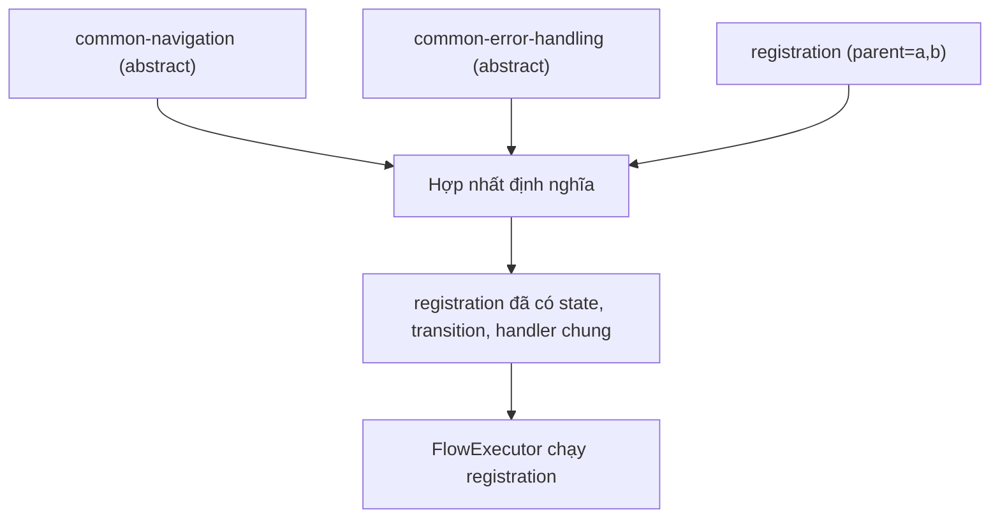
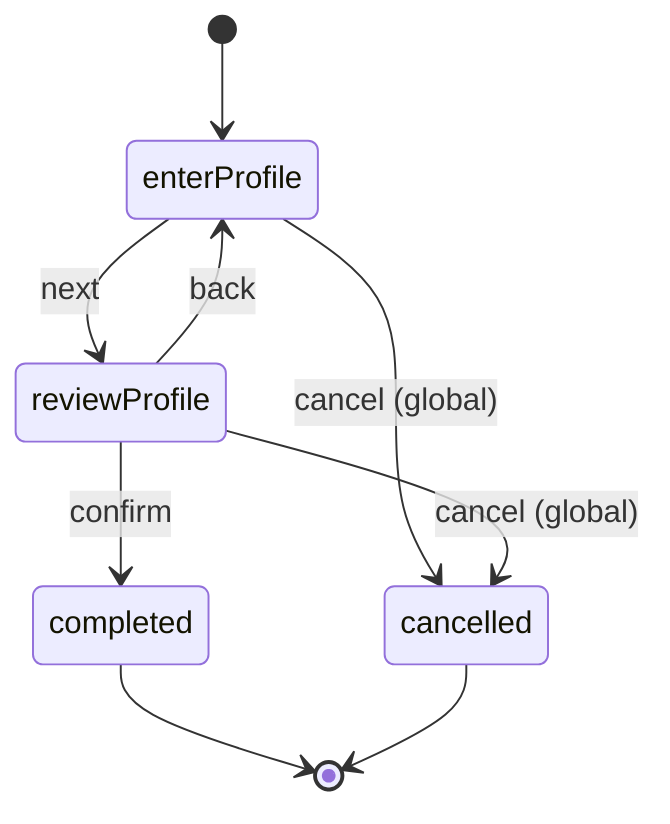

# Kế thừa ở mức flow bằng thuộc tính parent

## 1. Vấn đề: nhiều flow có chung quy tắc điều hướng

Trong **Spring Web Flow (SWF)**, mỗi flow mô hình hóa một hành trình web nhiều bước bằng `state`, `event`, `transition`, action và đôi khi cả `subflow`. Khi ứng dụng có nhiều hành trình như đăng ký tài khoản, gửi yêu cầu hỗ trợ và đặt hàng, một số hành vi thường lặp lại:

- Ở nhiều màn hình, event `cancel` kết thúc hành trình.
- Nhiều flow có cùng một `end-state` hoặc màn hình báo lỗi dùng chung.
- Một số quy tắc xử lý exception hoặc khởi tạo metadata được áp dụng ở nhiều flow.
- Các nhóm flow có thể chia sẻ một tập state/transition cơ bản, sau đó bổ sung các bước riêng.

Nếu sao chép toàn bộ những khai báo đó vào từng file XML, việc thay đổi một quy tắc dùng chung dễ dẫn đến sai lệch giữa các flow. **Kế thừa định nghĩa (flow inheritance)** giúp gom phần chung vào một **flow cha** và khai báo quan hệ kế thừa trong **flow con** bằng thuộc tính `parent`:

```xml
<flow parent="common-navigation">
    <!-- Các state và hành vi riêng của flow này -->
</flow>
```

Đây là cơ chế **tái sử dụng và hợp nhất cấu hình flow tại lúc xây dựng định nghĩa**, không phải việc runtime gọi flow cha như một subflow. Flow con vẫn được khởi chạy theo ID của nó và chuyển state theo định nghĩa đã hợp nhất.

> Phạm vi bài này là **`parent` trên phần tử gốc `<flow>`** (kế thừa ở mức flow). Không nhầm với `parent` trên `<view-state>` (kế thừa riêng một state), hoặc `parent` trên `<webflow:flow-registry>` (phân cấp registry).

## 2. Cú pháp chính xác của thuộc tính parent

Một flow con có thể kế thừa **một** hoặc **nhiều** flow cha:

```xml
<!-- Một flow cha -->
<flow parent="common-navigation">
    <!-- ... -->
</flow>

<!-- Nhiều flow cha, được xử lý theo thứ tự liệt kê -->
<flow parent="common-navigation, common-error-handling">
    <!-- ... -->
</flow>
```

`parent` là **danh sách các flow ID trong `FlowDefinitionRegistry`**, phân tách bằng dấu phẩy. Đó không phải đường dẫn hệ thống tệp, class Java hay tên Spring bean.

Các hệ quả cần nhớ:

1. `parent="common-navigation"` yêu cầu registry tìm được flow có ID `common-navigation`.
2. `parent="a, b"` hợp nhất flow con với `a` trước, rồi dùng kết quả đó để hợp nhất với `b`. **Thứ tự khai báo có ý nghĩa** khi các định nghĩa có phần trùng nhau.
3. Các phần tử chung có thể được đưa vào flow con theo luật hợp nhất của Web Flow; những phần tử có cùng khóa có thể được **merge**, không phải tùy ý thay thế.
4. Flow cha có thể khai báo `abstract="true"` nếu chỉ được dùng như một bản cấu hình chung.
5. Flow con vẫn có thể định nghĩa `start-state` rõ ràng, giữ riêng đường đi và kết quả của hành trình.

Sơ đồ:



Đường mũi tên ở đây mô tả **quá trình dựng định nghĩa**, không mô tả subflow call khi người dùng đang thao tác.

## 3. Ví dụ đầy đủ: chia sẻ thao tác Hủy giữa các flow

Giả sử một ứng dụng có flow `registration` cho đăng ký tài khoản và flow `support-request` cho gửi yêu cầu hỗ trợ. Cả hai phải hỗ trợ `cancel`, nhưng mỗi flow giữ các view và event riêng.

Ta tạo một flow cha `common-navigation` để định nghĩa `global-transitions` và state kết thúc.

### 3.1. Flow cha: `common-navigation.xml`

Ví dụ đường dẫn `/WEB-INF/flows/common/common-navigation.xml`:

```xml
<?xml version="1.0" encoding="UTF-8"?>
<flow xmlns="http://www.springframework.org/schema/webflow"
      xmlns:xsi="http://www.w3.org/2001/XMLSchema-instance"
      xsi:schemaLocation="
          http://www.springframework.org/schema/webflow
          http://www.springframework.org/schema/webflow/spring-webflow.xsd"
      abstract="true">

    <end-state id="cancelled" />

    <global-transitions>
        <transition on="cancel" to="cancelled" />
    </global-transitions>

</flow>
```

Trong file này:

- `abstract="true"` tuyên bố flow cha chỉ dùng để tái sử dụng cấu hình.
- `cancelled` là `end-state` mà các flow con có thể tham chiếu.
- `global-transitions` tạo transition cho event `cancel` trên các state mà cơ chế chuyển trạng thái cho phép áp dụng.
- File không cần định nghĩa biểu mẫu đăng ký hoặc yêu cầu hỗ trợ; đó là trách nhiệm của flow con.

**Tại sao dùng `global-transitions`?** Vì hành động Hủy thường có ý nghĩa xuyên suốt hành trình, không chỉ tại một màn hình. Flow con có thể thêm các transition của từng state mà không phải chép lại `<transition on="cancel" ... />` ở mọi nơi.

### 3.2. Flow con: `registration.xml`

Ví dụ `/WEB-INF/flows/registration/registration.xml`:

```xml
<?xml version="1.0" encoding="UTF-8"?>
<flow xmlns="http://www.springframework.org/schema/webflow"
      xmlns:xsi="http://www.w3.org/2001/XMLSchema-instance"
      xsi:schemaLocation="
          http://www.springframework.org/schema/webflow
          http://www.springframework.org/schema/webflow/spring-webflow.xsd"
      parent="common-navigation"
      start-state="enterProfile">

    <view-state id="enterProfile">
        <transition on="next" to="reviewProfile" />
    </view-state>

    <view-state id="reviewProfile">
        <transition on="back" to="enterProfile" />
        <transition on="confirm" to="completed" />
    </view-state>

    <end-state id="completed" />

</flow>
```

Tài liệu này định nghĩa hai màn hình `enterProfile` và `reviewProfile`, một kết quả `completed`, và quy định start state rõ ràng bằng `start-state="enterProfile"`. Chúng ta cố ý chưa đưa binding/validation của biểu mẫu vào ví dụ để tập trung vào kế thừa.

Khi registry xây dựng flow `registration`, cấu hình từ `common-navigation` được hợp nhất. Flow con có thể nhận event `cancel` từ màn hình đăng ký hoặc màn hình xác nhận và đi tới `cancelled` mà không cần khai báo lại transition trong từng state.

### 3.3. Kết quả định nghĩa sau hợp nhất

Ta có thể hình dung **kết quả logic** như sau (đây là sơ đồ tổng hợp nhằm giải thích, không phải một file XML do Web Flow bắt buộc sinh ra):

```text
FlowDefinition: registration
│
├─ start-state: enterProfile                     [của con]
├─ view-state: enterProfile                      [của con]
│    └─ event next → reviewProfile
├─ view-state: reviewProfile                     [của con]
│    ├─ event back → enterProfile
│    └─ event confirm → completed
├─ end-state: completed                          [của con]
├─ end-state: cancelled                          [thừa hưởng từ cha]
└─ global transition: cancel → cancelled         [thừa hưởng từ cha]
```

Hành trình có thể diễn ra:



**Điểm mấu chốt:** `registration` được thực thi như một flow đã có cấu hình chung. Việc kế thừa `common-navigation` không tự sinh ra một `FlowSession` riêng dành cho parent; `FlowSession` mới chỉ xuất hiện khi flow thực sự gọi subflow bằng `subflow-state`.

## 4. Flow cha phải được đăng ký trong flow registry

Chỉ tạo file `common-navigation.xml` và ghi `parent="common-navigation"` ở con **chưa bảo đảm** engine có thể tìm được cha. Flow cha phải có trong registry, giống các flow khác.

Ví dụ cấu hình XML của Spring (trong file cấu hình đã khai báo namespace `webflow`):

```xml
<webflow:flow-registry id="flowRegistry">

    <webflow:flow-location
            path="/WEB-INF/flows/common/common-navigation.xml"
            id="common-navigation" />

    <webflow:flow-location
            path="/WEB-INF/flows/registration/registration.xml"
            id="registration" />

    <webflow:flow-location
            path="/WEB-INF/flows/support/support-request.xml"
            id="support-request" />

</webflow:flow-registry>
```

Nhờ `id="common-navigation"`, định nghĩa cha được nhận diện nhất quán, không phụ thuộc vào vị trí tương đối của file. Cấu hình `flowRegistry` cần được nối với `FlowExecutor` và các thành phần tích hợp Spring MVC của ứng dụng theo cách thông thường.

Nếu không ghi ID rõ ràng, Spring Web Flow có thể suy ID từ vị trí hoặc tên file theo quy ước `FlowRegistry` và `base-path`. Với module lớn, **khai báo ID tường minh cho những parent được dùng chung** giảm nguy cơ thay đường dẫn rồi làm hỏng tham chiếu `parent`.

Một lỗi hay gặp là ghi:

```xml
<!-- Sai ý nghĩa: parent không phải đường dẫn file -->
<flow parent="/WEB-INF/flows/common/common-navigation.xml">
```

Trừ khi registry thực sự dùng nguyên chuỗi đó làm ID, Web Flow không tìm được parent. Cách đúng trong ví dụ là `parent="common-navigation"`.

## 5. abstract="true": bảo vệ các flow chỉ dùng làm khuôn chung

Nhiều parent chỉ chứa global transition, exception handler hoặc state dùng chung. Chúng **không có hành trình người dùng hoàn chỉnh** và không nên được khởi chạy như một flow độc lập.

```xml
<flow xmlns="http://www.springframework.org/schema/webflow"
      xmlns:xsi="http://www.w3.org/2001/XMLSchema-instance"
      xsi:schemaLocation="
          http://www.springframework.org/schema/webflow
          http://www.springframework.org/schema/webflow/spring-webflow.xsd"
      abstract="true">

    <!-- Định nghĩa được tái sử dụng bởi các flow con -->

</flow>
```

Khi cố khởi chạy trực tiếp một abstract flow, Web Flow từ chối bằng lỗi dựng flow, chẳng hạn `FlowBuilderException` theo mô tả của tài liệu. Tính `abstract` **không loại flow khỏi registry**: parent vẫn cần được registry nhận diện để con có thể kế thừa.

Đừng nhầm điều này với abstract class của Java. Parent flow không tham gia chuỗi gọi method hay một instance Java được khởi tạo khi flow con chạy; nó cung cấp phần tử cấu hình cho quá trình hợp nhất.

## 6. Kế thừa nhiều flow cha và thứ tự hợp nhất

Spring Web Flow cho phép **nhiều parent** ở mức `<flow>`:

```xml
<flow xmlns="http://www.springframework.org/schema/webflow"
      xmlns:xsi="http://www.w3.org/2001/XMLSchema-instance"
      xsi:schemaLocation="
          http://www.springframework.org/schema/webflow
          http://www.springframework.org/schema/webflow/spring-webflow.xsd"
      parent="common-navigation, common-error-handling"
      start-state="enterProfile">

    <!-- Các state riêng của registration -->

</flow>
```

Giả sử:

- `common-navigation` định nghĩa `cancel → cancelled`.
- `common-error-handling` cung cấp `end-state id="failed"` và global transition ứng với event lỗi phù hợp.
- `registration` định nghĩa các state `enterProfile`, `reviewProfile`, `completed`.

Engine lấy định nghĩa con, hợp nhất với parent thứ nhất, sau đó với parent thứ hai. **Kết quả trung gian được coi là "con" ở lần hợp nhất kế tiếp**. Đây là lý do không nên xem hai parent như hai interface Java độc lập rồi kỳ vọng không có xung đột.

Ví dụ parent thứ hai chỉ cung cấp một quy tắc điều hướng lỗi:

```xml
<flow xmlns="http://www.springframework.org/schema/webflow"
      xmlns:xsi="http://www.w3.org/2001/XMLSchema-instance"
      xsi:schemaLocation="
          http://www.springframework.org/schema/webflow
          http://www.springframework.org/schema/webflow/spring-webflow.xsd"
      abstract="true">

    <end-state id="failed" />

    <global-transitions>
        <transition on="fatalError" to="failed" />
    </global-transitions>

</flow>
```

Vì hai parent ở ví dụ dùng hai event và hai `end-state` khác nhau, mục đích của chúng rõ ràng. Nếu cả hai định nghĩa `on="cancel"` trỏ đến các target khác nhau, cần kiểm tra **quy tắc merge**, không được mặc định "parent khai báo sau sẽ ghi đè parent khai báo trước". Sự trùng lặp cần được giải quyết có chủ đích và kiểm thử với flow sau dựng.

## 7. Thuật toán hợp nhất: không phải override kiểu Java

Đây là phần dễ gây lỗi nhất.

Trong Java, lớp con có thể `@Override` một method của lớp cha. Trong Spring Web Flow, **inheritance là phép hợp nhất cấu trúc XML theo luật của từng phần tử**. Khi định nghĩa con và cha có phần tử cùng loại, cùng khóa theo quy tắc, chúng thường được **merge**; phần tử chỉ có ở cha được thêm vào kết quả.

### 7.1. Những phần tử có thể merge

Bảng sau tổng hợp các khóa so khớp quan trọng theo tài liệu Spring Web Flow:

| Phần tử | Khóa đối chiếu khi merge | Ý nghĩa thực tế |
|---|---|---|
| `flow` | Luôn merge | Hợp nhất định nghĩa con với parent |
| `view-state` | `id` | Trùng ID thì kết hợp nội dung state |
| `action-state`, `decision-state` | `id` | Trùng ID cần kiểm tra hành vi state sau merge |
| `subflow-state`, `end-state` | `id` | Trùng ID có ý nghĩa cấu trúc, không thể hiểu đơn giản là replace |
| `input`, `output` | `name` | Khai báo cùng tên được xét để merge |
| `attribute` | `name` | Metadata cùng tên có thể kết hợp theo luật phần tử |
| `transition` | `on` và `on-exception` | Các transition cùng điều kiện là điểm dễ xung đột |
| `if` | `test` | Nhánh điều kiện trùng biểu thức được xét để merge |
| `on-start`, `on-end` | Luôn merge | Các action của cha/con cùng tham gia lifecycle |
| `on-entry`, `on-exit`, `on-render` | Luôn merge | Các action ở state cha/con được kết hợp |
| `secured` | `attributes` | Quy tắc security cần xem sau merge |

Vì vậy, nếu parent có `<view-state id="review">` và con cũng có `<view-state id="review">`, chúng **không mặc nhiên là hai view-state độc lập** và cũng **không mặc nhiên lấy nguyên state của con để thay thế state cha**. Kết quả phải được hiểu bằng luật merge ở mức `view-state` và các phần tử con bên trong.

### 7.2. Các phần tử không merge với phần tử tương ứng

Nhóm **non-mergeable** được giữ như các phần tử trong kết quả, không được hòa nội dung để thành một phần tử duy nhất theo khóa:

- `bean-import`
- `evaluate`
- `exception-handler`
- `persistence-context`
- `render`
- `set`
- `var`

**Không merge không đồng nghĩa bị bỏ qua.** Ví dụ, hai `evaluate` riêng biệt ở `on-start` vẫn có thể cùng xuất hiện trong danh sách action sau khi hợp nhất.

Tài liệu cũng mô tả quy tắc **vị trí chèn**: phần lớn phần tử được lấy từ parent được thêm sau phần tử hiện có ở child; riêng các action như `evaluate`, `render`, `set` được chèn **ở đầu**. Điều này cho phép action chung của parent cung cấp dữ liệu cho action của child, nhưng cũng có nghĩa **thứ tự side effect là điều bắt buộc phải xem lại khi thêm parent**.

### 7.3. Ví dụ một lifecycle hook ở parent

Parent:

```xml
<on-start>
    <evaluate expression="flowAuditService.markStart()" />
</on-start>
```

Child:

```xml
<on-start>
    <evaluate expression="registrationService.prepare()" />
</on-start>
```

Vì `on-start` là mergeable, cả hai action đều tham gia cấu hình kết quả. Theo quy tắc chèn action của parent, `markStart()` được đặt trước action con trong trường hợp này. Nếu cả hai thao tác có side effect, phải kiểm thử thứ tự và khả năng lặp; không dùng việc kế thừa để lén thực hiện giao dịch nghiệp vụ không rõ ràng.

Đặc biệt, việc thêm một `on-start` chung có thể làm tất cả flow con gọi thêm một service. Nên giữ action của parent đơn giản, idempotent khi phù hợp, và không phụ thuộc vào biến chỉ có ở một flow con cụ thể.

### 7.4. Các lỗi thiết kế do trùng ID/khóa

Giả sử parent có:

```xml
<view-state id="review">
    <transition on="cancel" to="cancelled" />
</view-state>
```

Child có:

```xml
<view-state id="review">
    <transition on="cancel" to="reviewCancelled" />
</view-state>
```

Đây là **điểm xung đột cần phân tích**, vì `view-state` được so bằng `id` còn `transition` được so bằng `on`/`on-exception`. Đừng viết tài liệu nội bộ rằng `reviewCancelled` chắc chắn "override" `cancelled`. Hãy chọn lại thiết kế: đưa quy tắc cancel vào một nơi chung ổn định, đặt event khác tên, hoặc tách parent theo mục đích.

Nếu các state trùng ID nhưng khác loại (`view-state` so với `end-state`), không có cơ sở để coi chúng là một cặp tương thích. Rà soát và sửa ID trước khi chạy thay vì phụ thuộc vào hành vi lỗi tình cờ lúc nạp flow.

## 8. Khác gì kế thừa ở mức state?

Có hai dạng kế thừa trong XML Web Flow:

```xml
<!-- Flow-level: hợp nhất toàn bộ định nghĩa flow -->
<flow parent="common-navigation, common-error-handling">
    ...
</flow>

<!-- State-level: kế thừa một state cụ thể -->
<view-state id="enterContact"
            parent="common-forms#contactForm">
    ...
</view-state>
```

| Tiêu chí | `<flow parent="...">` | `<view-state parent="...">` |
|---|---|---|
| Phạm vi | Cả định nghĩa flow | Chỉ một state |
| Dạng giá trị | Một hoặc nhiều **flow ID**, cách nhau bởi dấu phẩy | Một **flow ID#state ID** |
| Số parent | Cho phép nhiều flow cha | Một state cha |
| Loại phần tử | Flow → flow | State cùng loại → state cùng loại |
| Trường hợp phù hợp | Chia sẻ states, transitions, handlers, hooks | Chia sẻ cấu trúc một màn hình/state |

Điểm chung là các phần tử cũng được xét theo luật hợp nhất. Tuy nhiên, **state-level inheritance không có cú pháp danh sách nhiều parent** và yêu cầu state cha/con cùng loại, ví dụ `view-state` kế thừa một `view-state`.

Bài này tập trung vào kế thừa toàn flow. Khi chỉ muốn dùng chung một màn hình nhiều field hoặc transition của một state, hãy cân nhắc state-level inheritance hoặc component view riêng để tránh đưa quá nhiều state chung vào flow con.

## 9. Khác gì parent registry và subflow?

Ba tính năng sau đều liên quan "flow cha" nhưng giải quyết vấn đề khác nhau:

| Cơ chế | Khai báo | Mục đích | Có thêm bước runtime không? |
|---|---|---|---|
| **Flow definition inheritance** | `<flow parent="common">` | Hợp nhất định nghĩa khi xây flow | Không tạo lần chạy parent riêng |
| **Registry hierarchy** | `<webflow:flow-registry parent="sharedFlowRegistry">` | Lookup flow ID ở registry cha khi registry hiện tại không tìm thấy | Chỉ ảnh hưởng tra cứu định nghĩa |
| **Subflow invocation** | `<subflow-state id="payment" subflow="payment">` | Gọi một hành trình con có input/output và outcome riêng | Có `FlowSession` của subflow |

Ví dụ một checkout có thể **vừa** kế thừa `common-navigation` để có event cancel, **vừa** gọi `payment` subflow để thực hiện bước thanh toán. Hai khái niệm tương thích và độc lập: inheritance giúp tái sử dụng cấu hình, còn subflow giúp tổ chức hành trình đang chạy.

## 10. Những lưu ý khi parent chứa tài nguyên và bảo mật

### 10.1. Đường dẫn view và resource

Khi hai flow ở hai thư mục khác nhau, đường dẫn tài nguyên tương đối trong parent có thể được diễn giải **tương đối với thư mục của child sau khi merge**. Tài liệu Spring Web Flow khuyến nghị dùng đường dẫn **tuyệt đối** cho tài nguyên bên ngoài được tham chiếu trong parent.

Ví dụ:

```xml
<!-- Dễ sai khi parent và child ở khác thư mục -->
<view-state id="commonError" view="errors/commonError" />

<!-- Rõ ràng hơn khi dùng shared JSP -->
<view-state id="commonError"
            view="/WEB-INF/views/common/commonError.jsp" />
```

Đối với JSF, Thymeleaf hoặc view resolver riêng, hãy chọn cú pháp view ID phù hợp với resolver đang dùng. **Không phải mọi framework/view technology đều chấp nhận cùng một đường dẫn tuyệt đối như nhau**; cần xác minh hành vi resolution thực tế của ứng dụng.

### 10.2. Security không tự hoạt động chỉ vì được kế thừa

Parent có thể chứa metadata bảo mật:

```xml
<secured attributes="ROLE_USER" />
```

Nhưng để phần tử `secured` được thực thi đúng khi flow chạy, ứng dụng vẫn cần tích hợp Spring Security và `SecurityFlowExecutionListener` theo cấu hình Spring Web Flow. Một parent XML chứa `secured` **không thay thế** quy tắc xác thực/ủy quyền tại controller, service và resource.

Khi nhiều parent/child cùng khai báo `secured`, phải kiểm tra kết quả hợp nhất. Đừng giả định một khai báo con sẽ xóa hoặc nới lỏng quy tắc cha như override Java.

### 10.3. Exception handler kế thừa có thể tác động rộng

Parent có thể cung cấp `exception-handler` chung cho nhóm flow. Khi thêm parent này, lỗi trước đây được xử lý ở tầng khác có thể được listener/handler của flow bắt và chuyển hướng theo một cách mới. Hãy kiểm tra thứ tự xử lý, các exception được bắt và đường recovery.

Tránh handler chung bắt mọi exception rồi chuyển người dùng sang màn hình “thành công”; điều đó làm mất tín hiệu lỗi, phá logic transaction và gây khó điều tra vận hành.

## 11. Cách tổ chức parent dễ hiểu khi module tăng số flow

Có thể chia parent thành các tập quy tắc nhỏ:

```text
/WEB-INF/flows/
  common/
    common-navigation.xml         # cancel, back-to-home, end states chung
    common-error-handling.xml     # lỗi hệ thống, recovery
    common-security.xml           # security metadata chung
  registration/
    registration.xml               # các bước tạo tài khoản
  support/
    support-request.xml            # các bước gửi yêu cầu hỗ trợ
  checkout/
    checkout.xml                   # các bước đặt hàng
```

Ví dụ các flow con:

```xml
<!-- registration.xml -->
<flow parent="common-navigation, common-error-handling"
      start-state="enterProfile">
    ...
</flow>

<!-- support-request.xml -->
<flow parent="common-navigation, common-error-handling"
      start-state="enterRequest">
    ...
</flow>

<!-- checkout.xml -->
<flow parent="common-navigation, common-error-handling"
      start-state="reviewCart">
    ...
</flow>
```

Các đoạn ngắn này thể hiện **ý tưởng cấu hình**; trong file XML thực tế cần khai báo namespace và schema như các ví dụ đầy đủ ở trên.

Đừng tạo một `base-flow` khổng lồ chứa mọi hành vi. Parent càng lớn thì thay đổi càng tác động tới nhiều flow con. Tốt hơn là mỗi parent mang một trách nhiệm rõ ràng và có contract: những state/event ID nó cung cấp, những action/handler được chạy, và những biến nào nó cần.

### Khi nào nên kế thừa ở mức flow?

Nên dùng khi **nhiều flow** cùng có một tập cấu hình ổn định: global cancel, common error transitions, common end states hoặc shared lifecycle hooks. Khi logic chỉ được dùng đúng một lần, một khai báo trực tiếp trong flow có thể dễ hiểu hơn. Nếu cần thực thi hành trình con có input/output riêng, nên dùng `subflow-state`.

## 12. Kiểm thử sau khi thêm hoặc sửa parent

Một thay đổi nhỏ ở parent có thể ảnh hưởng nhiều flow con. Cần kiểm thử **cấu trúc đã hợp nhất** và **hành vi runtime** của từng flow có liên quan.

### 12.1. Ma trận kiểm thử ví dụ

| Tình huống | Điều cần xác minh |
|---|---|
| Registry nạp parent và child | Cả ID `common-navigation` và `registration` được resolve đúng |
| Khởi chạy abstract parent | Bị từ chối theo quy tắc abstract flow |
| Khởi chạy registration | Bắt đầu ở `enterProfile`, không bắt đầu ở state chung |
| `next` rồi `confirm` | Tới `reviewProfile`, kết thúc `completed` |
| `cancel` ở `enterProfile` | Đi tới `cancelled` từ global transition |
| `cancel` ở `reviewProfile` | Cũng đi tới `cancelled` |
| Thêm parent thứ hai | Đúng thứ tự hợp nhất, không sinh transition/state xung đột |
| Con và cha cùng dùng state ID | Kiểm tra nội dung merge có giữ hành vi dự kiến |
| Action `on-start` ở cả hai bên | Thứ tự gọi và side effect đúng |
| Resource dùng chung ở thư mục khác | View/path vẫn được resolve đúng |
| Security hoặc exception handler được kế thừa | Authorization và recovery được áp dụng như thiết kế |

### 12.2. Cách kiểm tra khi bị lỗi khởi tạo

Nếu Web Flow không nạp được flow con, kiểm tra theo thứ tự:

1. `parent` chứa **flow ID chính xác** hay nhầm đường dẫn.
2. ID parent đã được đăng ký trong `flowRegistry` chưa, kể cả các registry phân cấp liên quan.
3. XML parent có đúng namespace/XSD và không chứa phần tử sai cấu trúc không.
4. Các ID `view-state`, `action-state`, `end-state` có bị đụng nhau ngoài ý muốn không.
5. Các transition được kế thừa có `to` trỏ tới state tồn tại trong định nghĩa kết quả không.
6. Resource như view ID, template hoặc bean name có bị resolve theo ngữ cảnh child dẫn đến sai không.
7. Chuỗi kế thừa có phụ thuộc vòng hoặc tranh chấp giữa nhiều parent không.
8. Nếu flow có security và exception handler, thứ tự xử lý có phù hợp với mong đợi không.

Với kiểm thử Java, có thể dùng các tiện ích của `spring-webflow-test` hoặc cấu hình `FlowExecutor` trong kiểm thử tích hợp. Mục tiêu là chạy các event thực sự và khẳng định outcome/state, không chỉ xác minh XML có chuỗi `parent="..."`.

## 13. Lỗi thường gặp và cách sửa

**Lỗi 1 — Nhầm `parent` với đường dẫn file.** Khi flow con không tìm được parent, so khớp giá trị `parent` với **registry ID**, không phải tên thư mục.

**Lỗi 2 — Quên đăng ký flow cha.** File XML có mặt trên đĩa chưa có nghĩa đã thuộc registry. Thêm nó vào `flow-registry` bằng location hoặc location pattern phù hợp.

**Lỗi 3 — Quên `abstract="true"`.** Parent chỉ chứa cấu hình dùng chung có thể bị yêu cầu khởi chạy như flow thông thường. Đánh dấu abstract cho parent không phải hành trình độc lập.

**Lỗi 4 — Nghĩ child override parent.** Đặt cùng `transition on="cancel"` với target mới ở con không bảo đảm hành vi override. Điều chỉnh thiết kế để tránh cùng khóa có nghĩa khác nhau.

**Lỗi 5 — Parent và child có state trùng tên nhưng khác ý nghĩa.** `view-state id="review"` ở nhiều nơi dễ dẫn đến merge khó kiểm soát. Đặt tên state chung có ý nghĩa thật sự giống nhau hoặc tách parent.

**Lỗi 6 — View tương đối nằm trong parent.** Sau merge, resource có thể được resolve trong ngữ cảnh thư mục child. Dùng view ID/path rõ ràng theo view resolver.

**Lỗi 7 — Thêm parent `on-start` làm gọi action ngoài ý muốn.** Mọi child sử dụng parent sẽ nhận action đó. Kiểm tra contract biến đầu vào, side effects và thứ tự action.

**Lỗi 8 — Nhầm registry hierarchy với flow inheritance.** `<webflow:flow-registry parent="...">` chỉ liên quan lookup flow definitions; nó không tự đưa các transition của mọi flow trong registry cha vào flow con.

**Lỗi 9 — Tin rằng kế thừa security thay thế quyền nghiệp vụ.** Metadata `secured` cần đúng listener/config và dịch vụ nghiệp vụ vẫn phải kiểm tra quyền trên dữ liệu.

## 14. Bài tập thực hành

Tạo một module có ba flow definition:

1. `common-navigation` là abstract parent, định nghĩa `cancel → cancelled`.
2. `registration` có `enterProfile → reviewProfile → completed`, `parent="common-navigation"`.
3. `support-request` có `enterRequest → reviewRequest → sent`, cũng kế thừa `common-navigation`.

Sau đó:

- Đăng ký cả ba flow với ID tường minh.
- Chạy `cancel` ở các view-state khác nhau để kiểm tra global transition.
- Thêm parent `common-error-handling` với `fatalError → failed`, cho con kế thừa cả hai parent.
- Thêm `on-start` vào parent và action riêng ở child; quan sát thứ tự gọi.
- Cố tình tạo một `transition on="cancel"` khác ở child, rồi xem cấu hình/hành vi đã hợp nhất để hiểu vì sao không được giả định override.
- Đổi vị trí file parent sang thư mục khác, kiểm tra view path nếu parent có view dùng chung.

**Tiêu chí hoàn thành:** hai flow con có đường đi riêng, xử lý cancel thống nhất, parent không bị chạy trực tiếp, không phát sinh ID xung đột hoặc tác dụng phụ không chủ ý.

## 15. Ghi nhớ khi áp dụng vào dự án

- Dùng `parent` trên `<flow>` để tái sử dụng **định nghĩa flow**, không phải gọi runtime parent flow.
- Giá trị `parent` là danh sách **flow ID** từ registry; có thể có nhiều ID cách nhau bằng dấu phẩy và được hợp nhất **theo thứ tự**.
- Parent chỉ làm nền cấu hình nên khai báo `abstract="true"` và vẫn phải được đăng ký.
- Inheritance thực hiện **merge**, không có cơ chế `@Override` kiểu Java; trùng state ID hoặc transition key cần được xem xét cẩn thận.
- Khi parent cung cấp action, exception handler, security hoặc resource, phải kiểm thử ảnh hưởng lên tất cả flow con liên quan.
- Kế thừa mức flow phù hợp với quy tắc chung; subflow phù hợp với hành trình con độc lập; state-level inheritance phù hợp với một state cụ thể.

### Tài liệu tham khảo

- [Spring Web Flow 2.5.1 Reference Guide — Chapter 9: Flow Inheritance](https://docs.spring.io/spring-webflow/docs/2.5.1.RELEASE/reference/htmlsingle/#_flow_inheritance) — các kiểu kế thừa, `parent`, `abstract` và thuật toán merge.
- [Spring Web Flow 2.5.1 Reference Guide — System Setup](https://docs.spring.io/spring-webflow/docs/2.5.1.RELEASE/reference/htmlsingle/#_system_setup) — đăng ký flow definitions, đặt ID và FlowRegistry hierarchy.
- [Spring Web Flow 2.5.1 Reference Guide — Defining Flows](https://docs.spring.io/spring-webflow/docs/2.5.x/reference/html/defining-flows.html) — `view-state`, `end-state`, event và transition.
- [Spring Web Flow — Ví dụ flow inheritance trong bộ test chính thức](https://github.com/spring-projects/spring-webflow/blob/main/spring-webflow/src/test/java/org/springframework/webflow/engine/model/builder/xml/flow-inheritance-parent.xml) — minh họa `global-transitions` trong parent.
