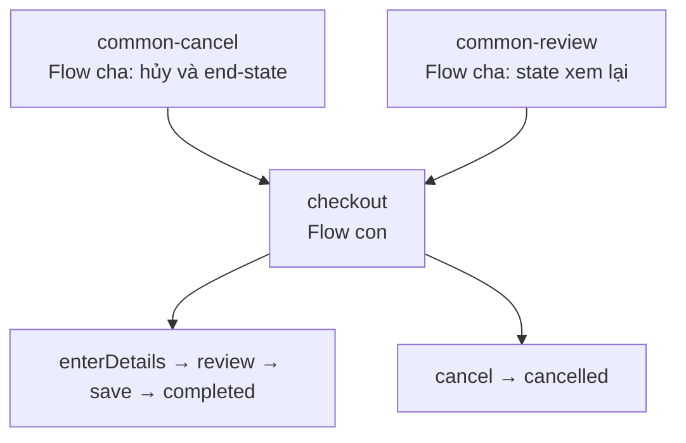
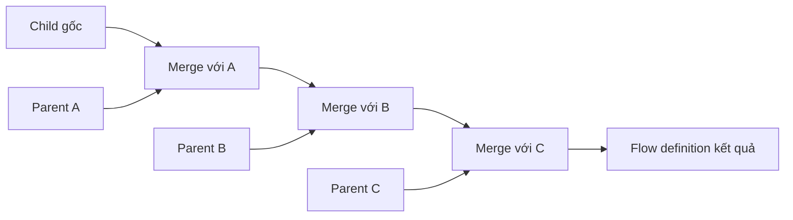

# Nhiều flow cha và thứ tự hợp nhất trong Spring Web Flow

## Mục tiêu học tập

Trong Spring Web Flow, **flow definition** mô tả hành trình web gồm các state, event, transition, subflow và điểm kết thúc. Khi nhiều hành trình có quy tắc chung như hủy thao tác, xử lý lỗi hay màn hình xem lại, có thể dùng **flow inheritance** để tái sử dụng định nghĩa mà không phải sao chép XML.

Khác với Java class, **một flow con có thể kế thừa nhiều flow cha**. Tuy nhiên, đây không phải cơ chế “flow con ghi đè mọi thứ của cha”. Các thành phần được **hợp nhất (merge)** theo thuật toán và khóa so khớp riêng; thứ tự khai báo flow cha có ý nghĩa.

Sau bài này, bạn sẽ:

1. Khai báo nhiều cha bằng `parent="flowA, flowB"` ở **cấp flow**.
2. Giải thích thứ tự áp dụng: bắt đầu từ flow con, lần lượt hợp nhất từng cha từ trái sang phải.
3. Phân biệt phần tử **mergeable** và **non-mergeable**, hiểu quy tắc so khớp ID, tên và event.
4. Nhận biết ngoại lệ về thứ tự: action như `<evaluate>`, `<set>` và `<render>` kế thừa thường được đưa **về đầu** danh sách action.
5. Phân tích va chạm giữa nhiều cha, đặc biệt khi có cùng state ID, transition event hoặc hook `on-start`/`on-render`.
6. Đăng ký các flow cha trong `FlowRegistry`, dùng `abstract="true"` và tránh lỗi đường dẫn view/resource tương đối.
7. Thiết kế ma trận kiểm thử để chứng minh cấu trúc flow sau khi hợp nhất, điều hướng, quyền và xử lý lỗi thực sự đúng.

## 1. Vì sao một flow có thể cần nhiều cha?

Giả sử hệ thống có các quy trình **đăng ký tài khoản**, **đặt lịch** và **mua hàng**. Mỗi quy trình có logic riêng, nhưng đều cần:

- Một event `cancel` kết thúc hành trình an toàn.
- Những transition chung phục vụ điều hướng hoặc khôi phục lỗi.
- Một màn hình hướng dẫn/xem lại được dùng ở nhiều nơi.
- Một số hook chuẩn bị dữ liệu hoặc thêm thông tin theo dõi.

Nếu sao chép toàn bộ các khai báo này vào mỗi flow, khi đổi hành vi hủy hoặc sửa một transition, nhóm phải cập nhật rất nhiều nơi. Inheritance cho phép đóng gói những phần chung trong **flow cha** và kết hợp chúng ở **flow con**.



Ví dụ này là **composition các định nghĩa**, không phải gọi từng flow cha như một subflow. Khi ứng dụng xây dựng `checkout`, phần cấu hình từ các cha được hợp nhất vào định nghĩa kết quả. Người dùng không phải lần lượt “chạy common-cancel rồi common-review”.

### Flow inheritance khác gì subflow?

| Tiêu chí | Flow inheritance | `subflow-state` |
| --- | --- | --- |
| Thời điểm kết hợp | Khi xây dựng định nghĩa flow | Khi một execution chuyển vào flow con |
| Mục đích | Dùng chung state, transition, hook, cấu hình | Gọi một hành trình con có input/output và outcome |
| Cú pháp ví dụ | `<flow parent="common-cancel,common-review">` | `<subflow-state id="verify" subflow="identityFlow">` |
| Vòng đời execution | Các thành phần kế thừa thuộc cùng định nghĩa flow kết quả | Flow con có ngữ cảnh thực thi trong quan hệ gọi subflow |
| Điểm cần chú ý | Thuật toán merge và trùng khóa | Truyền input/output, end-state và trở về flow cha |

Nếu nhu cầu là **gọi một bước nghiệp vụ độc lập có đầu vào/đầu ra riêng**, hãy cân nhắc subflow. Nếu nhu cầu là **trộn cấu hình dùng chung** vào nhiều flow, inheritance là lựa chọn thích hợp.

## 2. Cú pháp nhiều flow cha và điều kiện tiên quyết

Theo Spring Web Flow 3.x, thuộc tính `parent` trên phần tử gốc `<flow>` chứa danh sách **flow ID cách nhau bởi dấu phẩy**:

```xml
<flow xmlns="http://www.springframework.org/schema/webflow"
      xmlns:xsi="http://www.w3.org/2001/XMLSchema-instance"
      xsi:schemaLocation="http://www.springframework.org/schema/webflow
                          https://www.springframework.org/schema/webflow/spring-webflow.xsd"
      parent="common-cancel, common-review">

    <!-- Các state riêng của flow con -->

</flow>
```

Ở đây:

- `common-cancel` là **flow cha thứ nhất**.
- `common-review` là **flow cha thứ hai**.
- Thứ tự là thứ tự **hợp nhất các định nghĩa**, không phải thứ tự các bước người dùng phải đi qua.
- Mỗi tên phải tương ứng với một **ID flow đã đăng ký**, không phải tên Java class hay tên view.

### Các flow cha phải được đăng ký

Spring Web Flow phải tìm được flow cha trong `FlowRegistry`. Ví dụ application context có namespace `webflow` và `beans`:

```xml
<webflow:flow-registry id="flowRegistry">
    <webflow:flow-location
        path="/WEB-INF/flows/shared/common-cancel.xml"
        id="common-cancel" />

    <webflow:flow-location
        path="/WEB-INF/flows/shared/common-review.xml"
        id="common-review" />

    <webflow:flow-location
        path="/WEB-INF/flows/checkout/checkout.xml"
        id="checkout" />
</webflow:flow-registry>
```

`webflow:flow-registry` là cấu hình **Spring application context**, còn `parent` trong `<flow>` là cấu hình **flow definition**. Ví dụ này tập trung vào đăng ký và inheritance; tích hợp HTTP đầy đủ còn cần `FlowExecutor` và các thành phần Spring MVC thích hợp.

### Dùng `abstract="true"` cho flow chỉ đóng vai trò cha

```xml
<flow xmlns="http://www.springframework.org/schema/webflow"
      abstract="true">
    <!-- Cấu hình tái sử dụng -->
</flow>
```

Một flow cha chỉ chứa các phần dùng chung có thể không phải hành trình hoàn chỉnh. Đánh dấu `abstract="true"` giúp ngăn việc chạy trực tiếp flow đó: theo tài liệu Spring Web Flow, cố thực thi abstract flow dẫn đến `FlowBuilderException`.

**Đừng nhầm “đã được đăng ký” với “nên được truy cập bởi người dùng”.** Flow cha vẫn phải xuất hiện trong registry để được tham chiếu khi xây dựng flow con, nhưng có thể được đánh dấu abstract nếu không intended chạy độc lập.

## 3. Trọng tâm: thứ tự hợp nhất khi có nhiều cha

Giả sử:

```xml
<flow parent="A, B, C">
    <!-- Nội dung riêng của flow con -->
</flow>
```

Thuật toán ở cấp flow được mô tả theo thứ tự:

```text
M0 = định nghĩa con ban đầu
M1 = merge(M0, A)
M2 = merge(M1, B)
M3 = merge(M2, C)
Kết quả = M3
```

**Kết quả của lần merge trước được xem là “child” của lần merge kế tiếp.** Vì vậy, B không hợp nhất trực tiếp vào bản gốc rồi ghép tất cả sau cùng; B hợp nhất vào cấu trúc **đã nhận nội dung từ A**. C tiếp tục hợp nhất vào cấu trúc đã chứa cả A và B.



### Lưu ý: thứ tự merge khác thứ tự chạy mọi action

Một hiểu nhầm thường gặp: “Khai báo `A, B, C` thì mọi thứ từ A luôn chạy trước B, rồi tới C”.

Điều đó **không đúng nói chung**, bởi thuật toán có quy tắc về **vị trí chèn phần tử**:

- Với **phần lớn thành phần thông thường**, nội dung từ cha chưa có trong con được nối **phía sau** danh sách đang có.
- Với action như **`evaluate`, `render`, `set`**, nội dung action từ cha được thêm **vào đầu** danh sách action hiện có.
- Với thành phần trùng khóa, Web Flow cố **merge vào phần tử đang có** thay vì thay thế nguyên phần tử.

Vì thế cần phân biệt **thứ tự xử lý các flow cha** và **thứ tự cuối cùng của từng loại nội dung**. Đặc biệt, action kế thừa có thể xuất hiện theo chiều ngược với danh sách cha do thao tác chèn đầu.

## 4. Quy tắc merge: không phải override như Java

Tài liệu Spring Web Flow nêu hai nhóm:

1. **Mergeable:** nếu cùng loại và có cùng khóa, hai phần tử cố gắng hợp nhất nội dung; nếu không có phần tử cùng khóa, phần tử của cha được thêm vào con.
2. **Non-mergeable:** không hợp nhất nội dung với phần tử tương tự; các phần tử được giữ nguyên như những phần tử riêng khi được đưa vào cấu trúc kết quả.

### 4.1. Những phần tử mergeable quan trọng

| Phần tử | Khóa dùng để nhận biết tương ứng |
| --- | --- |
| `<flow>` | Luôn hợp nhất khi quan hệ cha–con được khai báo |
| `<view-state>` | `id` |
| `<action-state>` | `id` |
| `<decision-state>` | `id` |
| `<subflow-state>` | `id` |
| `<end-state>` | `id` |
| `<transition>` | Cặp `on` và `on-exception` |
| `<if>` | `test` |
| `<input>` | `name` |
| `<output>` | `name` |
| `<attribute>` | `name` |
| `<secured>` | `attributes` |
| `<on-start>`, `<on-end>` | Luôn merge |
| `<on-entry>`, `<on-exit>`, `<on-render>` | Luôn merge trong ngữ cảnh tương ứng |

Với `<transition>`, không nên chỉ nhìn thuộc tính `on`: **`on-exception` cũng tham gia khóa nhận diện** theo thuật toán. Điều này quan trọng khi một flow có cả transition theo event và transition xử lý exception.

### 4.2. Những phần tử non-mergeable

Theo tài liệu, các phần tử sau không hợp nhất thành một phần tử chỉ vì nội dung tương tự:

```text
bean-import
evaluate
exception-handler
persistence-context
render
set
var
```

Ví dụ, nếu cả cha và con cùng khai báo hai `<evaluate>` khác nhau trong `<on-start>`, hai action **có thể cùng tồn tại** trong danh sách sau merge. Đây là lý do phải quan tâm đến thứ tự và tác dụng phụ: không được giả định action của cha sẽ biến mất khi con có action riêng.

**Cảnh báo:** “Non-mergeable” không có nghĩa mọi tổ hợp trùng tên đều hợp lệ ở runtime. Nếu hai `var` hoặc hai bean import tạo ra xung đột hay phụ thuộc không thỏa mãn, cấu trúc sau merge vẫn có thể không xây dựng hoặc chạy đúng. Cần kiểm thử flow definition sau merge.

### 4.3. Merging đi xuống các phần tử con

Giả sử flow cha và flow con cùng có `view-state id="review"`:

```xml
<!-- Cha -->
<view-state id="review">
    <transition on="back" to="enterDetails" />
</view-state>
```

```xml
<!-- Con -->
<view-state id="review">
    <transition on="confirm" to="saveOrder" />
</view-state>
```

Vì cùng loại `view-state` và cùng `id`, chúng **không trở thành hai state `review` riêng biệt**. Web Flow cố hợp nhất nội dung của chúng; kết quả chứa những transition `back` và `confirm` không trùng khóa.

```text
review (sau merge)
  ├── on="confirm" → saveOrder
  └── on="back"    → enterDetails
```

Khi hai nhánh dùng **cùng event hoặc cùng state ID nhưng ý nghĩa khác nhau**, không thể xem một bên sẽ hoàn toàn ghi đè bên kia. Hãy kiểm tra tất cả action, transition, thuộc tính và security rule được hợp nhất trước khi coi flow kết quả là đúng.

## 5. Ví dụ thực hành: hai flow cha và một flow checkout

Ta xây dựng ba file định nghĩa độc lập. Các đoạn XML bên dưới là **ví dụ học tập**; không phải ba file đang được tạo trong repository. Chỉ có bài Markdown này và YAML metadata tương ứng là đối tượng công việc của STEP 4.

### 5.1. Cha A: `common-cancel.xml`

Định nghĩa cơ chế hủy dùng chung:

```xml
<?xml version="1.0" encoding="UTF-8"?>
<flow xmlns="http://www.springframework.org/schema/webflow"
      xmlns:xsi="http://www.w3.org/2001/XMLSchema-instance"
      xsi:schemaLocation="http://www.springframework.org/schema/webflow
                          https://www.springframework.org/schema/webflow/spring-webflow.xsd"
      abstract="true">

    <global-transitions>
        <transition on="cancel" to="cancelled" />
    </global-transitions>

    <end-state id="cancelled" />
</flow>
```

Cha A định nghĩa một **global transition** `cancel` và một end-state `cancelled`. Khi được kế thừa, những flow con cần bảo đảm quy tắc hủy phù hợp với nghiệp vụ. `global-transitions` áp dụng cho những view của flow theo cơ chế Web Flow; các transition cục bộ cùng event và những điều kiện đặc biệt cần được kiểm tra riêng.

### 5.2. Cha B: `common-review.xml`

Định nghĩa một state xem lại dùng chung:

```xml
<?xml version="1.0" encoding="UTF-8"?>
<flow xmlns="http://www.springframework.org/schema/webflow"
      xmlns:xsi="http://www.w3.org/2001/XMLSchema-instance"
      xsi:schemaLocation="http://www.springframework.org/schema/webflow
                          https://www.springframework.org/schema/webflow/spring-webflow.xsd"
      abstract="true">

    <view-state id="review"
                view="/WEB-INF/views/shared/review.jsp">
        <transition on="back" to="enterDetails" />
    </view-state>
</flow>
```

Cha B đặt một **hợp đồng ngầm** cho flow con:

- Flow con phải cung cấp state `enterDetails` để transition `back` có đích hợp lệ.
- View `/WEB-INF/views/shared/review.jsp` phải tồn tại hoặc được resolver xử lý phù hợp.
- Template chung phải biết dữ liệu nào sẽ được cung cấp cho màn hình review.

Đường dẫn view được viết **tuyệt đối từ gốc webapp** có chủ đích. Khi flow definition được merge vào flow con ở thư mục khác, đường dẫn resource tương đối khai báo trong cha có thể bị tính lại theo vị trí của flow con.

### 5.3. Flow con: `checkout.xml`

```xml
<?xml version="1.0" encoding="UTF-8"?>
<flow xmlns="http://www.springframework.org/schema/webflow"
      xmlns:xsi="http://www.w3.org/2001/XMLSchema-instance"
      xsi:schemaLocation="http://www.springframework.org/schema/webflow
                          https://www.springframework.org/schema/webflow/spring-webflow.xsd"
      parent="common-cancel, common-review">

    <on-start>
        <evaluate expression="checkoutFlowService.newDraft()"
                  result="flowScope.orderDraft" />
    </on-start>

    <view-state id="enterDetails"
                view="/WEB-INF/views/checkout/details.jsp"
                model="orderDraft">
        <transition on="next" to="review" />
    </view-state>

    <!-- Cùng ID với review của cha B nên các transition sẽ merge. -->
    <view-state id="review"
                view="/WEB-INF/views/shared/review.jsp">
        <transition on="confirm" to="saveOrder" />
    </view-state>

    <action-state id="saveOrder">
        <evaluate expression="checkoutCommandService.submit(orderDraft)" />
        <transition on="success" to="completed" />
    </action-state>

    <end-state id="completed" />
</flow>
```

Trong ví dụ này, các bean `checkoutFlowService` và `checkoutCommandService`, DTO `orderDraft`, JSP và cấu hình Spring MVC là thành phần ứng dụng cần cung cấp. Đoạn `submit` mô tả đường lưu thành công; hệ thống thực tế cần kiểm tra quyền, giá, tồn kho, chống gửi trùng và xử lý lỗi nghiệp vụ/transaction trước khi đi tới `completed`.

### 5.4. Diễn giải lần lượt từng lần merge

| Giai đoạn | Cấu trúc nhận thêm | Kết quả |
| --- | --- | --- |
| **M0 — Child gốc** | `enterDetails`, `review` với `confirm`, `saveOrder`, `completed` | Flow checkout cơ bản |
| **M1 — Ghép cha `common-cancel`** | Global transition `cancel`, end-state `cancelled` | Checkout có thể kết thúc bằng hủy |
| **M2 — Ghép cha `common-review`** | State `review` trùng ID; transition `back` của cha không trùng `confirm` của con | `review` có cả Back và Confirm |

**Kết quả hợp nhất về mặt hành vi**:

```text
enterDetails
  ├── next → review
  └── cancel → cancelled       [global transition được thừa hưởng]

review
  ├── back → enterDetails      [từ common-review]
  ├── confirm → saveOrder      [từ checkout]
  └── cancel → cancelled       [global transition được thừa hưởng]

saveOrder
  └── success → completed
```

`review` ở đây là **một state** với các transition đã được hợp nhất, không phải hai màn hình `review` liên tiếp. Khi người dùng nhấn Back, họ quay lại `enterDetails` trong **cùng flow checkout**, không mở execution của `common-review`.

### 5.5. Nếu đảo thứ tự hai cha thì sao?

```xml
<flow parent="common-review, common-cancel">
```

Trong ví dụ trên, hai cha cung cấp những phần khác nhau, không tranh chấp cùng khóa, nên các đường đi được kỳ vọng vẫn giống nhau. Tuy nhiên, **không được suy ra đảo thứ tự luôn an toàn**. Nếu về sau cả hai cha cùng đóng góp action vào `on-start`, cùng khai báo state/transition hoặc phụ thuộc một biến được chuẩn bị bởi cha khác, kết quả hợp nhất và thứ tự thực hiện có thể thay đổi.

Vì thế, đổi thứ tự `parent` là thay đổi cấu hình có tác động tiềm tàng, cần review và kiểm thử thay vì xem như chỉnh lại định dạng chuỗi.

## 6. Ngoại lệ quan trọng: action từ cha được chèn lên trước

Tài liệu Web Flow giải thích rằng **phần lớn** phần tử mới từ cha được thêm phía sau phần tử hiện có. Riêng action `evaluate`, `render` và `set` từ cha được thêm **ở đầu** danh sách action, để kết quả chuẩn bị của cha có thể được dùng bởi action của con.

Đây là điều dễ gây lỗi nhất khi có nhiều cha với `on-start`, `on-entry` hoặc `on-render`.

### 6.1. Thí nghiệm tư duy với ba flow

Cha A:

```xml
<flow xmlns="http://www.springframework.org/schema/webflow"
      abstract="true">
    <on-start>
        <evaluate expression="traceService.record('A')" />
    </on-start>
</flow>
```

Cha B:

```xml
<flow xmlns="http://www.springframework.org/schema/webflow"
      abstract="true">
    <on-start>
        <evaluate expression="traceService.record('B')" />
    </on-start>
</flow>
```

Con:

```xml
<flow xmlns="http://www.springframework.org/schema/webflow"
      parent="A, B">
    <on-start>
        <evaluate expression="traceService.record('CHILD')" />
    </on-start>
    <!-- Các state thực tế của flow con -->
</flow>
```

`traceService.record(...)` trong đoạn minh họa là bean giả định ghi một dấu mốc để quan sát thứ tự; không bắt buộc triển khai audit thực tế theo cách này.

Do các `on-start` container merge và những `<evaluate>` từ cha được **chèn vào đầu**, ta có thể lý giải:

| Bước merge | Danh sách action sau bước đó |
| --- | --- |
| Child ban đầu | `CHILD` |
| Merge A vào Child | `A → CHILD` |
| Merge B vào kết quả trước | `B → A → CHILD` |

Vì vậy, với đúng cấu trúc trên, **thứ tự các action `on-start` trong kết quả là B, A, CHILD** dù danh sách cha viết `A, B`. Điều này không phủ nhận việc **cha A được xử lý trước B**: lần merge thứ hai vẫn có thể đặt các action của B ở đầu danh sách đã chứa A.

**Đừng khái quát rằng toàn bộ phần tử từ B đều chạy trước A.** Quy tắc này liên quan đến cách chèn **action**. State, transition và các nhóm phần tử khác có quy tắc merge/ordering riêng.

### 6.2. Nhiều action trong cùng một cha

Nếu A có hai action theo thứ tự `A1, A2`, thuật toán chèn đầu vẫn giữ thứ tự **nội bộ** của danh sách A theo cơ chế merge thông thường. Sau khi thêm B, nhóm B có thể đứng trước nhóm A, còn từng nhóm vẫn có thứ tự của chính nó.

```text
Child ban đầu: C1, C2
Sau A:          A1, A2, C1, C2
Sau B:          B1, B2, A1, A2, C1, C2
```

Đây là lý do không nên thiết kế chuỗi phụ thuộc khó thấy như: “Cha B cần dữ liệu mà cha A thiết lập trong `on-start`” rồi chỉ dựa vào `parent="A, B"`. Nếu yêu cầu thứ tự bắt buộc, hãy **đưa chuỗi khởi tạo vào một service orchestration rõ ràng**, hoặc refactor để các cha không phụ thuộc lẫn nhau.

### 6.3. Rủi ro khi cùng ghi một biến

Ví dụ không nên mặc định an toàn:

```xml
<!-- Trong A -->
<on-start>
    <set name="flowScope.mode" value="'standard'" />
</on-start>
```

```xml
<!-- Trong B -->
<on-start>
    <set name="flowScope.mode" value="'strict'" />
</on-start>
```

Nếu cả hai action cùng tồn tại, giá trị cuối phụ thuộc vào thứ tự thực thi. Thay đổi danh sách cha có thể khiến mode khác với dự tính. Một tình huống tương tự có thể xảy ra với `on-render` khi cha và con cùng gán lại `viewScope.summary`.

Thiết kế an toàn hơn:

- Mỗi cha chịu trách nhiệm một nhóm dữ liệu riêng, đặt tên có namespace rõ.
- Không có hai cha đồng thời “sở hữu” một biến writable mà không có contract.
- Các policy quyết định mode nên được tập trung tại **một service**.
- Kiểm thử giá trị cuối của biến, không chỉ kiểm thử flow xây dựng được.

## 7. Va chạm giữa các flow cha: những trường hợp cần chủ động thiết kế

### 7.1. Trùng state ID ở hai cha

Cha A:

```xml
<view-state id="review">
    <transition on="back" to="enterDetails" />
</view-state>
```

Cha B:

```xml
<view-state id="review">
    <transition on="help" to="helpCenter" />
</view-state>
```

Flow con cũng có:

```xml
<view-state id="review" view="/WEB-INF/views/checkout/review.jsp">
    <transition on="confirm" to="saveOrder" />
</view-state>
```

Khi các state cùng loại và cùng `id`, Web Flow cố merge chúng. Kết quả có thể chứa ba transition `back`, `help`, `confirm`, miễn các state đích tồn tại. Nếu mục tiêu của B là một màn hình `review` **hoàn toàn khác** với A, đây không phải trường hợp nên trông chờ “B override A”.

### 7.2. Trùng transition event

Cha A và B cùng đưa vào `review`:

```xml
<!-- A -->
<transition on="next" to="stepA" />
```

```xml
<!-- B -->
<transition on="next" to="stepB" />
```

Hai transition có cùng khóa `on="next"` (và cùng trạng thái `on-exception` không khai báo). Thay vì hai event khác nhau, thuật toán cố **merge các transition tương ứng**. Điều này dễ gây nhầm vì cả hai đều có mục tiêu khác nhau.

**Không nên coi thứ tự cha là công cụ chọn giữa `stepA` và `stepB`**, cũng không nên dựa vào cơ chế “last writer wins” như merge một map thông thường. Cách đáng tin cậy là:

1. Thiết kế cho mỗi cha một event có tên rõ ràng, tránh trùng không chủ ý.
2. Nếu cần event `next` mang nghĩa khác nhau theo flow, để flow con **tự sở hữu** transition đó.
3. Kiểm tra flow definition đã xây dựng và test event thực tế với chính phiên bản framework đang dùng.

### 7.3. Trùng hook `on-start`, `on-render`, `on-exit`

Các hook này **merge** chứ không làm hook từ cha biến mất. Nếu cha A có logic ghi analytics ở `on-render`, cha B có logic gửi email ở `on-render`, flow con có thể vô tình thực hiện cả hai khi hiển thị lại màn hình. Đây là một ví dụ thiết kế không tốt: `on-render` có thể chạy nhiều lần, nên tác vụ có side effect phải đặt vào transition/action-state và service nghiệp vụ.

Nếu nhiều cha cần render action, phải xác định:

- Action nào đọc dữ liệu, action nào thay đổi trạng thái?
- Action nào phụ thuộc đầu ra của action khác?
- Tên biến result trong scope có bị ghi đè không?
- Tác dụng phụ có an toàn khi chạy lại và khi flow có nhiều tab không?

### 7.4. Trùng phần tử `secured` hoặc ngoại lệ

`secured` được liệt kê là mergeable theo `attributes`, còn `exception-handler` là non-mergeable. Không được coi việc flow con có một rule quyền là thao tác **xóa mọi rule được cha kế thừa**.

Khi rẽ nhánh theo quyền hoặc xử lý lỗi, hãy test với người dùng có/không có quyền, exception thực tế và thứ tự handler có thể ảnh hưởng tới kết quả. Với thao tác ghi nhạy cảm, service vẫn cần xác thực/ủy quyền ở server, kể cả khi flow đã có `<secured>`.

## 8. Cấp flow và cấp state có khả năng kế thừa khác nhau

Mặc dù chủ đề chính là **nhiều flow cha**, cần tránh nhầm với một cú pháp gần giống ở `view-state`:

```xml
<view-state id="editShipping"
            parent="common-form#editTemplate" />
```

Ở đây, chuỗi `common-form#editTemplate` gồm:

- `common-form`: ID flow sở hữu state mẫu.
- `editTemplate`: ID state mẫu bên trong flow đó.
- Ký tự `#`: ngăn cách flow ID và state ID.

**State-level inheritance chỉ cho phép một state cha** và state con phải **cùng loại** với state cha. Ví dụ, một `view-state` không thể trực tiếp kế thừa một `end-state`.

So sánh:

| Khía cạnh | Flow-level inheritance | State-level inheritance |
| --- | --- | --- |
| Nơi khai báo | `<flow parent="A, B">` | `<view-state parent="A#template">` |
| Số cha | **Nhiều** flow | **Một** state |
| Phạm vi được merge | Toàn bộ flow | State được chỉ định |
| Tham chiếu cha | Flow ID | Flow ID + `#` + state ID |
| Ý nghĩa thường gặp | Ghép hành vi và state chung | Mở rộng một mẫu state cụ thể |

Không viết:

```xml
<!-- Không hợp lệ theo quy tắc state-level inheritance -->
<view-state id="edit"
            parent="forms#baseEdit, security#securedEdit" />
```

Nếu cần hai bộ quy tắc cho cùng state, cân nhắc tách logic vào service/validator, định nghĩa một template cha phù hợp hoặc sử dụng flow-level inheritance mà kiểm soát các khóa merge rõ ràng.

## 9. Flow inheritance khác `FlowRegistry` hierarchy

Có một thuộc tính cũng mang tên `parent` ở **cấp registry**:

```xml
<webflow:flow-registry id="childRegistry"
                       parent="sharedRegistry">
    <webflow:flow-location
        path="/WEB-INF/flows/checkout/checkout.xml" />
</webflow:flow-registry>
```

Ở đây, `parent="sharedRegistry"` **không có nghĩa** tất cả flow trong child registry tự kế thừa nội dung từ flow thuộc shared registry. Nó là quan hệ tra cứu: khi registry con không tìm thấy flow ID, nó hỏi registry cha.

Trong khi đó:

```xml
<flow parent="common-cancel, common-review">
```

là yêu cầu **hợp nhất định nghĩa** của hai flow cụ thể. Hai khái niệm có thể cùng xuất hiện trong ứng dụng nhưng phục vụ hai mục đích hoàn toàn khác.

## 10. Đường dẫn resource từ flow cha có thể đổi nghĩa

Theo tài liệu chính thức, **đường dẫn resource bên ngoài trong flow cha nên dùng đường dẫn tuyệt đối**. Lý do: sau khi merge, đường dẫn tương đối từ cha có thể được hiểu tương đối theo **flow con**.

Ví dụ cấu trúc:

```text
/WEB-INF/flows/
├── shared/
│   ├── common-review.xml
│   └── review.jsp
└── checkout/
    └── checkout.xml
```

Nếu `common-review.xml` khai báo:

```xml
<view-state id="review" view="review.jsp" />
```

thì sau merge vào `checkout.xml`, `review.jsp` có thể được tìm tương đối theo `/WEB-INF/flows/checkout/`, **không còn đúng vị trí của cha**. Đây là một lỗi rất dễ bỏ qua khi các file XML nằm ở hai thư mục khác nhau.

Khai báo an toàn hơn khi dùng resource view trực tiếp:

```xml
<view-state id="review"
            view="/WEB-INF/flows/shared/review.jsp" />
```

Nếu ứng dụng dùng **tên view logic của Spring MVC**, cần cấu hình `ViewResolver` thích hợp; khi đó một tên như `shared/review` được giải quyết theo naming convention riêng thay vì coi là resource cùng thư mục flow.

**Không nhầm URL của người dùng với resource path**: `/WEB-INF/...` là resource của webapp phía server, thường không được trình duyệt truy cập trực tiếp.

## 11. Thiết kế nhiều cha mà không tạo phụ thuộc ẩn

Một flow cha tốt nên đóng gói **một mối quan tâm rõ ràng** và mô tả contract để flow con sử dụng.

| Flow cha | Trách nhiệm phù hợp | Contract cần nêu |
| --- | --- | --- |
| `common-cancel` | Global event hủy, end-state `cancelled` | Flow con chấp nhận hủy và không có bước lưu bắt buộc chưa thực hiện |
| `common-review` | State `review` và transition Back | Flow con có state `enterDetails` và dữ liệu view phù hợp |
| `common-errors` | Các handler lỗi tái sử dụng | Có message/error state, tránh chuyển nhánh thành công khi lỗi |
| `common-security` | Quy tắc bảo vệ state/transition dùng chung | Listener bảo mật được đăng ký; service kiểm tra quyền |

### Nguyên tắc thực hành

1. **Đặt tên state và event có chủ đích.** Không sử dụng chung một ID cho hai ý nghĩa nghiệp vụ khác nhau.
2. **Giữ cha abstract nếu chỉ là template.** Vẫn đăng ký trong `FlowRegistry` để được tra cứu.
3. **Không dùng thứ tự `parent` để giải quyết xung đột nghiệp vụ.** Khi va chạm, refactor hoặc làm rõ contract.
4. **Tránh các action có tác dụng phụ tại hook được kế thừa**, nhất là `on-render`.
5. **Tránh phụ thuộc thứ tự khởi tạo giữa hai cha.** Nếu cần chuỗi bắt buộc, orchestration tại service dễ kiểm thử hơn.
6. **Ưu tiên đường dẫn resource tuyệt đối trong cha**, hoặc tên logic đã có resolver tương ứng.
7. **Phân biệt đọc/ghi nghiệp vụ với flow definition.** Inheritance tái sử dụng cấu hình, không thay thế transaction, validation, session handling hoặc kiểm soát quyền ở tầng service.
8. **Cố định và kiểm thử hành vi đã merge** trước khi dùng một common flow ở nhiều module, vì thay đổi một cha có thể ảnh hưởng tới mọi flow con.

### Khi nào không nên dùng nhiều cha?

Nếu hai cha liên tục tranh cùng `view-state id`, cùng event hoặc cùng biến scope, mô hình đang có độ liên kết cao. Khi đó, cân nhắc một trong các hướng:

- Chia sẻ Java service/action và gọi rõ tại flow con.
- Dùng `subflow-state` cho hành trình con thật sự độc lập.
- Dùng một cha đã được thiết kế như template thống nhất.
- Giữ từng flow riêng nếu chi phí phân tích merge lớn hơn lợi ích tái sử dụng.

Mục tiêu không phải dùng càng nhiều cha càng tốt, mà là **dùng lại phần chung mà vẫn dự đoán được flow kết quả**.

## 12. Ma trận kiểm thử cho nhiều flow cha

Tối thiểu, cần kiểm thử cả **cấu trúc định nghĩa** và **hành vi khi thực thi**:

| Tình huống | Cách kiểm tra | Kỳ vọng |
| --- | --- | --- |
| Đăng ký thiếu một flow cha | Cấu hình `parent` tham chiếu ID không có trong registry | Phát hiện lỗi xây dựng flow, không âm thầm bỏ qua cha |
| Cha abstract | Cố khởi chạy `common-cancel` trực tiếp | Không thể chạy như flow nghiệp vụ bình thường |
| Child nhiều cha | Tải flow `checkout` | Có state/transition hợp lệ từ cả hai cha |
| `cancel` được kế thừa | Gửi event `cancel` ở view-state phù hợp | Kết thúc ở `cancelled`, không chạy `saveOrder` |
| State ID trùng | Đọc/kiểm tra `review` sau build | Chỉ có một `review`; có cả Back và Confirm |
| State đích thiếu | Xóa `enterDetails` trong một biến thể test | Phát hiện transition `back` không có đích hợp lệ |
| Action order | Ghi dấu A, B, CHILD trong `on-start` | Quan sát thứ tự theo quy tắc merge action, không suy từ dấu phẩy |
| Hoán đổi cha | Đổi thành `parent="B,A"` trong fixture kiểm thử riêng | Phát hiện bất kỳ thay đổi ngoài dự kiến |
| Hai cha cùng event | Tạo fixture cố ý trùng `on="next"` | Xác nhận cách merge và trạng thái đích đúng contract |
| Resource path | Render view lấy từ thư mục cha khác thư mục con | Không bị trỏ sai đường dẫn |
| Rule bảo mật | Gửi event đặc quyền bằng user không có quyền | Server chặn, không chỉ ẩn nút |
| Exception handler | Buộc service ném exception dự kiến | Đi đúng đường phục hồi, không báo thành công |
| Regression nhiều flow con | Thay một cha chung | Tất cả flow con liên quan vẫn qua test điều hướng |

### Cách tư duy về kiểm thử thứ tự

Một bài kiểm thử flow tích hợp có thể dùng bean ghi sự kiện theo thứ tự:

```java
public class TraceService {
    private final java.util.List<String> events =
            new java.util.ArrayList<>();

    public void record(String name) {
        events.add(name);
    }

    public java.util.List<String> snapshot() {
        return java.util.List.copyOf(events);
    }
}
```

Đây là **test helper minh họa**, không phải bean singleton an toàn cho môi trường concurrent. Trong test thực tế, dùng instance riêng cho mỗi test hoặc collector thread-safe có tách ngữ cảnh, rồi khởi chạy flow và kiểm tra `snapshot()`.

Với `parent="A, B"` và ví dụ `on-start` ở mục 6, assertion mong đợi là:

```text
["B", "A", "CHILD"]
```

Nếu chỉ test state khởi đầu mà không quan sát các hook đã được merge, lỗi thứ tự có thể không lộ ra. Mỗi lần thay đổi flow cha, test các flow con chịu ảnh hưởng là cách kiểm soát regression hiệu quả.

### Không tự kết luận từ XML thô

Để kiểm tra kết quả, hãy quan sát **flow definition đã được dựng** bởi registry/framework hoặc chạy bài test điều hướng tương ứng. Việc đọc ba XML riêng biệt mới cho biết đầu vào; các quy tắc merge quyết định nội dung cuối cùng.

Trong STEP 4, ví dụ test chỉ là tài liệu học tập; việc chạy test, QA chuyên sâu và kiểm tra tích hợp thực tế thuộc các bước phát triển/kiểm thử tiếp theo.

## 13. Các lỗi thường gặp và cách sửa

### Lỗi 1: Nhầm nhiều cha với thứ tự chạy tuần tự

**Nhầm lẫn:** `parent="A, B"` nghĩa là người dùng đi qua A rồi B trước khi vào child.

**Đúng:** Web Flow hợp nhất **định nghĩa** A và B vào child. Flow execution chạy state/transition của **định nghĩa cuối**.

### Lỗi 2: Dùng parent B để ghi đè hoàn toàn parent A

**Nhầm lẫn:** Đặt B sau A sẽ xóa mọi state hoặc action của A khi chúng có ID giống nhau.

**Đúng:** Những phần tử mergeable có cùng khóa được **hợp nhất**, còn action non-mergeable có thể cùng tồn tại. Nếu muốn thay hoàn toàn một hành vi, phải thiết kế lại contract/flow thay vì trông chờ override.

### Lỗi 3: Cứ khai báo A trước là `on-start` của A chạy trước

**Nhầm lẫn:** Thứ tự `parent="A, B"` giống danh sách lời gọi Java.

**Đúng:** Thuật toán merge cha từ trái sang phải, nhưng action của cha có thể được **chèn vào đầu**. Hãy quan sát thứ tự thực thi, kiểm thử biến được thiết lập và tránh phụ thuộc chéo ẩn.

### Lỗi 4: State của cha và con cùng ID nhưng khác loại

Ví dụ một cha định nghĩa `end-state id="review"` còn con định nghĩa `view-state id="review"`. Đây không phải cặp `view-state` cùng loại để merge nội dung. Một kết quả có state ID trùng hoặc cấu hình không phù hợp có thể gây lỗi xây dựng flow. Hãy dùng ID khác nhau và thiết kế rõ outcome/state.

### Lỗi 5: Parent resource tương đối

**Triệu chứng:** flow con không tìm được `review.jsp` dù file nằm cạnh flow cha.

**Nguyên nhân:** đường dẫn tương đối sau merge có thể trở thành tương đối theo thư mục flow con.

**Sửa:** dùng đường dẫn resource tuyệt đối hoặc tên view logic đúng với resolver.

### Lỗi 6: Flow cha có transition sang một state không tồn tại

**Triệu chứng:** global transition `cancel` hoặc state mẫu `review` dẫn tới state đích không có trong child.

**Sửa:** tài liệu hóa các state ID bắt buộc; bảo đảm định nghĩa cuối có đích hợp lệ; bổ sung test cho tất cả event kế thừa.

### Lỗi 7: Bỏ qua bảo mật vì đã kế thừa `secured`

**Triệu chứng:** một state có rule bảo vệ trên XML nhưng action service ghi dữ liệu vẫn tin form input hoặc quyền cũ.

**Sửa:** gắn security listener đúng cách và kiểm tra lại quyền/phạm vi đối tượng trong service transaction.

### Lỗi 8: Sửa một flow cha làm hỏng nhiều flow con

**Triệu chứng:** thêm transition hoặc action vào common flow làm thay đổi hành vi của nhiều hành trình không liên quan.

**Sửa:** coi common flow như một API dùng chung; có hợp đồng và bộ regression test cho các child consumers; đổi những phần tử dùng chung bằng quy trình review phù hợp.

## 14. Bài tập tự luyện

Cho ba flow:

```xml
<!-- Cha A -->
<flow xmlns="http://www.springframework.org/schema/webflow"
      abstract="true">
    <on-start>
        <evaluate expression="trace.record('A')" />
    </on-start>
    <end-state id="aborted" />
</flow>
```

```xml
<!-- Cha B -->
<flow xmlns="http://www.springframework.org/schema/webflow"
      abstract="true">
    <on-start>
        <evaluate expression="trace.record('B')" />
    </on-start>
    <view-state id="review">
        <transition on="back" to="edit" />
    </view-state>
</flow>
```

```xml
<!-- Con -->
<flow xmlns="http://www.springframework.org/schema/webflow"
      parent="A, B">
    <on-start>
        <evaluate expression="trace.record('CHILD')" />
    </on-start>
    <view-state id="edit">
        <transition on="next" to="review" />
    </view-state>
    <view-state id="review">
        <transition on="confirm" to="done" />
    </view-state>
    <end-state id="done" />
</flow>
```

**Hãy trả lời:**

1. Flow nào được merge trước? Kết quả trung gian M1 chứa gì?
2. Sau khi merge B, state `review` có bao nhiêu transition event khác nhau?
3. Trong ví dụ với action prepend, thứ tự các lời gọi `trace.record(...)` là gì?
4. Vì sao `review` vẫn không phải một flow execution con?
5. Nếu view tương đối `review.jsp` nằm cạnh flow B, nó có còn chắc chắn được tìm đúng khi flow con ở thư mục khác không?
6. Nếu đảo thành `parent="B, A"`, điều gì cần kiểm thử lại?
7. Nếu B có `transition on="confirm" to="approve"` và child đã có `on="confirm" to="done"`, tại sao không nên mặc định có hai transition độc lập?

**Đáp án định hướng:** (1) M0 được merge với A rồi mới B; (2) `back` và `confirm`, tức hai event; (3) `B, A, CHILD` theo quy tắc prepend action; (4) các state được hợp nhất vào định nghĩa flow con; (5) không, nên dùng resource tuyệt đối hoặc view resolver phù hợp; (6) thứ tự action, nội dung merge, quyền và điều hướng; (7) transition có cùng khóa được merge chứ không được chọn theo “flow viết sau ghi đè hoàn toàn”.

## 15. Tổng kết

**Nhiều flow cha** là tính năng mạnh để tái sử dụng cấu hình Spring Web Flow:

- Dùng `parent="A, B, C"` **ở cấp `<flow>`** để khai báo nhiều flow cha.
- Web Flow merge **lần lượt từ trái sang phải**: Child → Child+A → (Child+A)+B → ...
- Các phần tử **cùng loại, cùng khóa** được merge; phần tử khác khóa được thêm vào. **Không có phép override toàn phần** như thường hình dung từ Java class.
- **Phần lớn phần tử** mới từ cha nối phía sau; riêng action như `evaluate`, `set`, `render` từ cha được **chèn vào đầu**, vì vậy thứ tự chạy action có thể khác thứ tự chuỗi `parent`.
- Cha phải **được đăng ký**; dùng `abstract="true"` nếu cha không phải flow độc lập có thể chạy.
- `parent` của **state** chỉ nhận một `flowId#stateId`; `parent` của **FlowRegistry** là quan hệ tra cứu, không phải merge định nghĩa.
- Resource tương đối trong cha dễ bị sai sau merge; nên dùng đường dẫn tuyệt đối hoặc tên view logic có resolver.
- Luôn kiểm thử **định nghĩa sau merge**, các event, security, lỗi và regression ở mọi flow con sử dụng chung các cha.

### Tài liệu tham khảo

- [Spring Web Flow 3.0.2 Reference Guide — Flow Inheritance](https://docs.spring.io/spring-webflow/docs/3.0.x/reference/#flow-inheritance): multiple parents, flow-level/state-level inheritance, abstract flows.
- [Spring Web Flow 3.0.2 Reference Guide — Inheritance Algorithm](https://docs.spring.io/spring-webflow/docs/3.0.x/reference/#inheritance-algorithm): các phần tử mergeable/non-mergeable và quy tắc thêm action ở đầu.
- [Spring Web Flow 3.0.1 API — `AbstractModel`](https://docs.spring.io/spring-webflow/docs/3.0.1/api/org/springframework/webflow/engine/model/AbstractModel.html): phương thức merge danh sách và `addAtEnd`.
- [Spring Web Flow 3.0.2 Reference Guide — `FlowRegistry` options](https://docs.spring.io/spring-webflow/docs/3.0.x/reference/#flow-registry-options): đăng ký flow, ID và phân biệt parent registry.
