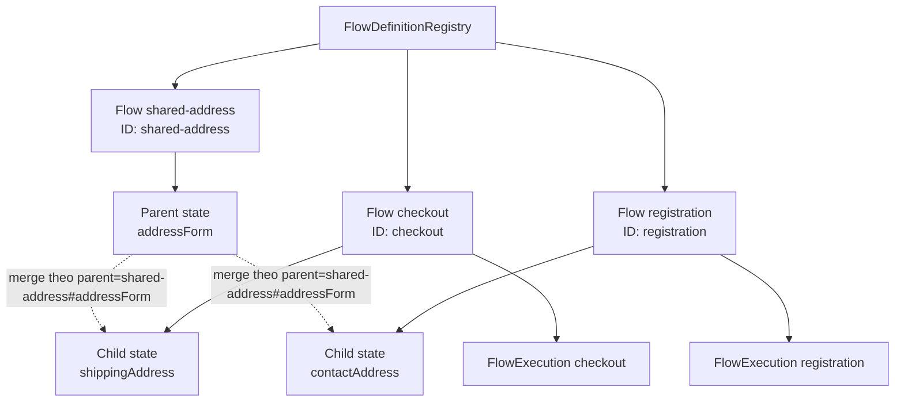
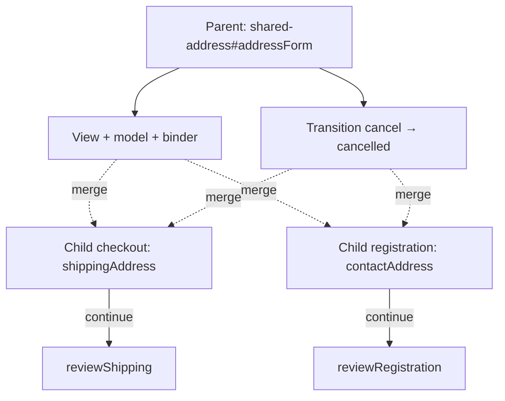

# Kế thừa state từ định danh flow#state

## 1. Tái sử dụng một state mà không kế thừa cả flow

Trong **Spring Web Flow** (`SPRING_WEB_FLOW`), một hành trình nhiều bước được mô tả bằng các state, event, transition và subflow. Một flow có thể chứa nhiều `view-state`, `action-state` hoặc `decision-state`. Khi nhiều flow cần dùng lại **cấu hình của một state cụ thể**, ta có thể dùng **state-level inheritance** (kế thừa ở cấp state).

Ví dụ, hai quy trình đều cần một bước nhập địa chỉ:

- `checkout` cần địa chỉ giao hàng.
- `registration` cần địa chỉ liên hệ.
- Cả hai form đều có các trường tên người nhận, đường, mã bưu chính; cùng quy tắc binding, cùng nút Hủy và cùng xử lý khi vào trang.
- Sau khi nhập xong, mỗi flow đi tới một state khác nhau.

Nếu chỉ muốn tái sử dụng cấu hình của **một state**, kế thừa toàn bộ flow cha là phạm vi quá rộng. Spring Web Flow cho phép child state tham chiếu trực tiếp tới parent state bằng cú pháp:

```xml
<view-state id="shippingAddress"
            parent="shared-address#addressForm" />
```

Chuỗi `shared-address#addressForm` có hai phần:

- `shared-address`: **flow ID** của flow chứa state cha, được đăng ký trong `FlowDefinitionRegistry`.
- `addressForm`: **state ID** của state cha trong flow đó.
- Dấu `#` phân cách flow ID và state ID.

State con được **hợp nhất** với state cha để tạo cấu hình state dùng trong flow con. Chỉ state được tham chiếu mới được kế thừa; các state khác và các thành phần ở cấp flow không tự động đi theo.

> **Mục tiêu:** Dùng `flowId#stateId` khi muốn mở rộng và hợp nhất một state duy nhất. Flow-level inheritance dùng `parent` ở root `<flow>` để hợp nhất cấu hình của cả flow; state-level inheritance đặt `parent` trên chính phần tử state.

Bài thuộc chương **Kế thừa định nghĩa** của module `SPRING_WEB_FLOW`. Nó tập trung vào cú pháp tham chiếu, điều kiện registry, kiểu state, merge, model/binding/validation, tài nguyên view, kiểm thử và cách phân biệt với flow inheritance và subflow.

### Sau bài này, bạn có thể

1. Đọc và viết chính xác `parent="flowId#stateId"`.
2. Đăng ký flow chứa state cha để child flow tra cứu được.
3. Chọn đúng cặp state cha/con cùng loại.
4. Xây dựng state mẫu dùng chung cho nhiều flow nhưng giữ transition riêng ở từng child.
5. Hiểu dữ liệu nào được hợp nhất và dữ liệu nào thuộc cấp flow nên phải khai báo lại.
6. Kiểm thử state kế thừa, chẩn đoán lỗi tham chiếu và quản lý view/resource path.

## 2. State-level inheritance hoạt động ở đâu?



Registry phải tìm được flow `shared-address`. Trong definition `checkout`, state `shippingAddress` chỉ lấy cấu hình của state `addressForm`. Trong definition `registration`, state `contactAddress` cũng có thể lấy cùng state đó.

Mỗi flow execution vẫn độc lập:

- `checkout` có state ID `shippingAddress` và model riêng của lần checkout.
- `registration` có state ID `contactAddress` và model riêng của lần đăng ký.
- Cả hai có thể dùng chung binder, hook hoặc transition được khai báo ở parent state.
- Không có một execution dùng chung giữa hai người dùng hoặc giữa hai flow chỉ vì chúng kế thừa cùng state.

### 2.1. State ID vẫn thuộc flow con

Ví dụ:

```xml
<view-state id="shippingAddress"
            parent="shared-address#addressForm" />
```

Khi flow `checkout` đang chạy, state ID hiện hành là `shippingAddress`, không phải `addressForm`. `addressForm` chỉ là tên state nguồn để builder tìm cấu hình cha.

Điều này quan trọng khi:

- Viết transition từ state khác tới `shippingAddress`.
- Kiểm tra current state trong flow execution test.
- Đọc log và chẩn đoán lỗi state ID.
- Dùng state ID trong các cấu hình khác của child flow.

### 2.2. Parent flow phải được đăng ký

`parent` không nhận đường dẫn file XML hoặc tên Spring bean. Nó nhận **flow ID trong registry**. Vì vậy, file chứa state cha phải được đăng ký, giống các flow definition khác.

Nếu registry cấp ID tự động từ tên file, hãy xác minh ID đó. Để cấu hình dễ đọc và ổn định khi đổi tên file, ví dụ trong bài dùng ID tường minh `shared-address`.

## 3. Cú pháp flowId#stateId và các giới hạn

Cú pháp tổng quát:

```xml
<state-element id="child-state"
               parent="registered-flow-id#parent-state-id">
    <!-- Cấu hình bổ sung của state con -->
</state-element>
```

Các quy tắc quan trọng:

1. **Một state con chỉ có một parent state.** Không khai báo danh sách nhiều state cha phân tách bằng dấu phẩy.
2. **Hai state phải cùng loại.** `view-state` kế thừa `view-state`; `action-state` kế thừa `action-state`.
3. Flow chứa state cha phải có thể được tra cứu qua registry đang dùng.
4. State ID của parent được phân giải trong flow cha; child state có ID riêng trong flow con.
5. Kế thừa tạo ra một state đã merge trong child definition, không gọi flow cha như một subflow.

| State con | Parent reference hợp lệ về loại | Parent reference không cùng loại |
| --- | --- | --- |
| `view-state` | `common#addressForm` trỏ tới `view-state` | `common#finished` nếu `finished` là `end-state` |
| `action-state` | `common#loadProfile` trỏ tới `action-state` | `common#reviewPage` nếu là `view-state` |
| `decision-state` | `common#routeEligibility` trỏ tới `decision-state` | `common#cancelled` nếu là `end-state` |
| `subflow-state` | `common#collectAddress` trỏ tới `subflow-state` | `common#reviewPage` nếu là `view-state` |
| `end-state` | `common#completed` trỏ tới `end-state` | `common#saveOrder` nếu là `action-state` |

Bảng mô tả nguyên tắc **cùng kiểu state**. Khi áp dụng, cần kiểm tra đúng tên ID và loại phần tử trong parent XML.

### 3.1. Không nhầm với parent ở root flow

Flow-level inheritance:

```xml
<flow xmlns="http://www.springframework.org/schema/webflow"
      parent="common-transitions">
    <!-- Các state của child flow -->
</flow>
```

State-level inheritance:

```xml
<flow xmlns="http://www.springframework.org/schema/webflow">
    <view-state id="shippingAddress"
                parent="shared-address#addressForm" />
</flow>
```

Ở ví dụ thứ hai, thuộc tính `parent` nằm trên `view-state`. Không cần đặt `parent="shared-address"` ở root `flow` chỉ để kế thừa một state.

## 4. So sánh flow inheritance, state inheritance và subflow

| Tiêu chí | Flow-level inheritance | State-level inheritance | Subflow |
| --- | --- | --- | --- |
| Cú pháp | `<flow parent="common">` | `<view-state parent="common#baseView">` | `<subflow-state subflow="address">` |
| Phạm vi tái sử dụng | Toàn flow definition | Một state cụ thể | Một quy trình con đang chạy |
| Số parent | Có thể nhiều flow cha | Một parent state | Một subflow được gọi tại mỗi subflow-state |
| Thời điểm | Khi xây dựng flow definition | Khi xây dựng flow definition | Khi execution đi vào subflow-state |
| Có tạo flow session con? | Không | Không | Có |
| Input/output contract | Không phải hợp đồng gọi subflow | Không phải hợp đồng gọi subflow | Có thể truyền input và nhận output |
| Phù hợp | Global transitions, exception handlers, state dùng chung ở cấp flow | Một form/state cần được mở rộng trong nhiều flow | Một hành trình con có vòng đời và outcome riêng |

**Ví dụ lựa chọn:**

- Nhiều flow cùng có global transition `cancel` và exception handler chung: flow-level inheritance.
- Nhiều flow có form địa chỉ với cùng binder và hook nhưng transition tiếp theo khác nhau: state-level inheritance.
- Nhiều flow cần chạy quy trình xác minh địa chỉ gồm nhiều màn hình, có outcome `addressVerified`: subflow.

State-level inheritance không thay thế flow-level inheritance. Nó giải quyết nhu cầu tái sử dụng **cục bộ hơn**.

## 5. Đăng ký parent flow trong FlowDefinitionRegistry

Giả sử có ba file:

```text
WEB-INF/flows/
├── shared/
│   └── address-template.xml
├── checkout/
│   └── checkout-flow.xml
└── registration/
    └── registration-flow.xml
```

Trong Spring XML, đăng ký parent flow và các child flow:

```xml
<webflow:flow-registry id="flowRegistry">
    <webflow:flow-location
        path="/WEB-INF/flows/shared/address-template.xml"
        id="shared-address" />

    <webflow:flow-location
        path="/WEB-INF/flows/checkout/checkout-flow.xml"
        id="checkout" />

    <webflow:flow-location
        path="/WEB-INF/flows/registration/registration-flow.xml"
        id="registration" />
</webflow:flow-registry>

<webflow:flow-executor
    id="flowExecutor"
    flow-registry="flowRegistry" />
```

Giá trị `id="shared-address"` là ID mà child dùng trong `parent`. Nếu bỏ ID, Web Flow có thể suy ID từ tên file và cấu hình base path; khi đó phải chắc chắn child tham chiếu đúng tên được suy ra.

Java configuration tương đương:

```java
import org.springframework.context.annotation.Bean;
import org.springframework.context.annotation.Configuration;
import org.springframework.webflow.config.AbstractFlowConfiguration;
import org.springframework.webflow.definition.registry.FlowDefinitionRegistry;
import org.springframework.webflow.executor.FlowExecutor;

@Configuration
public class CheckoutFlowConfig extends AbstractFlowConfiguration {

    @Bean
    public FlowDefinitionRegistry flowRegistry() {
        return getFlowDefinitionRegistryBuilder()
                .addFlowLocation(
                    "/WEB-INF/flows/shared/address-template.xml",
                    "shared-address")
                .addFlowLocation(
                    "/WEB-INF/flows/checkout/checkout-flow.xml",
                    "checkout")
                .addFlowLocation(
                    "/WEB-INF/flows/registration/registration-flow.xml",
                    "registration")
                .build();
    }

    @Bean
    public FlowExecutor flowExecutor() {
        return getFlowExecutorBuilder(flowRegistry()).build();
    }
}
```

Đây là ví dụ builder cho registry/executor; ứng dụng thực tế còn cần tích hợp Spring MVC và view resolver. Điểm quan trọng của state inheritance là **parent flow được đăng ký để lookup**, chứ không phải executor khởi chạy parent trước child.

### 5.1. Có thể dùng registry hierarchy không?

Spring Web Flow hỗ trợ registry cha/con. Nếu registry của child có thể tra cứu parent flow thông qua registry cha, quan hệ đó có thể phục vụ việc tìm definition. Tuy nhiên, để dễ kiểm soát, ví dụ cơ bản đăng ký parent và child trong cùng registry.

Đừng nhầm:

- `<webflow:flow-registry parent="sharedRegistry">`: quan hệ tra cứu giữa các registry.
- `parent="shared-address#addressForm"`: tham chiếu một state trong một flow definition.

Registry hierarchy không tự tạo ra state inheritance; child state vẫn cần khai báo `flowId#stateId`.

## 6. Tạo flow cha chứa state mẫu

Ví dụ `address-template.xml`:

```xml
<?xml version="1.0" encoding="UTF-8"?>
<flow xmlns="http://www.springframework.org/schema/webflow"
      xmlns:xsi="http://www.w3.org/2001/XMLSchema-instance"
      xsi:schemaLocation="
          http://www.springframework.org/schema/webflow
          https://www.springframework.org/schema/webflow/spring-webflow.xsd"
      abstract="true">

    <var name="addressDraft"
         class="com.example.address.AddressDraft" />

    <view-state id="addressForm"
                view="/WEB-INF/views/shared/addressForm.jsp"
                model="addressDraft">

        <binder>
            <binding property="recipientName" required="true" />
            <binding property="street" required="true" />
            <binding property="postalCode" required="true" />
        </binder>

        <transition on="cancel"
                    to="cancelled"
                    bind="false" />
    </view-state>

    <!-- End-state này làm flow template tự nhất quán.
         Child flow vẫn phải khai báo end-state của chính nó. -->
    <end-state id="cancelled" />
</flow>
```

Flow cha được đánh dấu `abstract="true"` vì nó chỉ đóng vai trò template và không nên được khởi chạy như một hành trình độc lập. Nếu cố chạy flow abstract, Web Flow báo `FlowBuilderException`.

Parent state `addressForm` cung cấp:

- View dùng chung `/WEB-INF/views/shared/addressForm.jsp`.
- Model name `addressDraft`.
- Binder yêu cầu các field tên người nhận, đường và mã bưu chính.
- Transition `cancel` không bind form, để người dùng có thể hủy ngay cả khi dữ liệu đang sai.

**Lưu ý quan trọng:** Flow-level inheritance không được sử dụng ở đây. Các thành phần cấp flow như `<var>` và `<end-state>` của parent **không tự động được sao chép** chỉ vì một state con tham chiếu tới `addressForm`. Child flow phải khai báo model variable và các state đích mà nó cần.

Trong ví dụ, parent có `<var name="addressDraft">` để thể hiện contract của template. Mỗi child flow cũng tự khai báo `addressDraft` trong execution của nó. Không có object model dùng chung giữa các execution.

## 7. Child flow kế thừa state và bổ sung transition riêng

Tệp `checkout-flow.xml`:

```xml
<?xml version="1.0" encoding="UTF-8"?>
<flow xmlns="http://www.springframework.org/schema/webflow"
      xmlns:xsi="http://www.w3.org/2001/XMLSchema-instance"
      xsi:schemaLocation="
          http://www.springframework.org/schema/webflow
          https://www.springframework.org/schema/webflow/spring-webflow.xsd">

    <var name="addressDraft"
         class="com.example.address.AddressDraft" />

    <view-state id="shippingAddress"
                parent="shared-address#addressForm">
        <transition on="continue" to="reviewShipping" />
    </view-state>

    <view-state id="reviewShipping"
                view="checkout/reviewShipping">
        <transition on="back"
                    to="shippingAddress"
                    validate="false" />
        <transition on="confirm" to="completed" />
    </view-state>

    <end-state id="completed" />
    <end-state id="cancelled" />
</flow>
```

State `shippingAddress` có cấu hình được hợp nhất từ `shared-address#addressForm`. Nó dùng view, model và binder ở parent, đồng thời thêm transition `continue` tới `reviewShipping`.

Child khai báo `end-state id="cancelled"` riêng vì state inheritance không mang end-state từ parent flow sang. Transition `cancel` được kế thừa có đích `cancelled`, nên đích này phải tồn tại trong child definition.

### 7.1. Flow thứ hai cũng dùng cùng state cha

Tệp `registration-flow.xml` có thể sử dụng cùng template:

```xml
<?xml version="1.0" encoding="UTF-8"?>
<flow xmlns="http://www.springframework.org/schema/webflow"
      xmlns:xsi="http://www.w3.org/2001/XMLSchema-instance"
      xsi:schemaLocation="
          http://www.springframework.org/schema/webflow
          https://www.springframework.org/schema/webflow/spring-webflow.xsd">

    <var name="addressDraft"
         class="com.example.address.AddressDraft" />

    <view-state id="contactAddress"
                parent="shared-address#addressForm">
        <transition on="continue" to="reviewRegistration" />
    </view-state>

    <view-state id="reviewRegistration"
                view="registration/review">
        <transition on="back"
                    to="contactAddress"
                    validate="false" />
        <transition on="submit" to="registered" />
    </view-state>

    <end-state id="registered" />
    <end-state id="cancelled" />
</flow>
```

Cùng một parent state tạo ra hai child state khác ID:

| Flow | Child state ID | Parent reference | Transition riêng |
| --- | --- | --- | --- |
| `checkout` | `shippingAddress` | `shared-address#addressForm` | `continue → reviewShipping` |
| `registration` | `contactAddress` | `shared-address#addressForm` | `continue → reviewRegistration` |

Nhờ vậy, form và binder được tái sử dụng, nhưng mỗi flow vẫn có luồng nghiệp vụ và state tiếp theo riêng.

### 7.2. Đường đi sau khi merge



Đây là cấu hình sau merge về mặt ý tưởng. Parent state không trở thành một state chạy riêng ở giữa child state; nó là **nguồn cấu hình** cho state con.

## 8. Điều gì được kế thừa và điều gì không?

Đây là phần quan trọng để tránh mong đợi quá mức từ `parent`.

### 8.1. Được merge ở cấp state

Tùy loại state, nội dung được merge có thể bao gồm các phần tử con như:

- Thuộc tính state phù hợp, ví dụ view/model cho `view-state`.
- Binder và binding dùng trong view-state.
- Các transition.
- `on-entry`, `on-exit` và `on-render`.
- Các action/điều kiện được khai báo bên trong state theo quy tắc merge của phần tử tương ứng.

Một parent state có thể cung cấp hành vi chung, child state bổ sung hành vi riêng. Định nghĩa cuối cùng được builder tạo từ hai phía.

### 8.2. Không được kế thừa chỉ vì state có parent

State-level inheritance **không có nghĩa** toàn bộ flow cha được copy sang child. Những phần sau thuộc cấp flow và cần child tự khai báo hoặc dùng flow-level inheritance nếu đó mới là ý định:

| Phần tử cấp flow | State-level inheritance có tự mang sang không? | Hướng xử lý |
| --- | --- | --- |
| `<var>` | Không | Khai báo flow variable trong child |
| `<input>` | Không | Khai báo input contract ở child |
| `<output>` | Không | Khai báo output trên end-state child |
| `<end-state>` ngoài state được kế thừa | Không | Khai báo đích trong child |
| `<global-transitions>` | Không | Khai báo ở child hoặc dùng flow-level inheritance |
| `<exception-handler>` cấp flow | Không | Khai báo ở child hoặc kế thừa toàn flow |
| `<persistence-context>` cấp flow | Không | Cấu hình ở đúng flow cần sử dụng |

Ví dụ parent state có transition `cancel → cancelled`. Child phải khai báo end-state `cancelled` của chính nó. Nếu child không có đích này, definition có thể không được xây dựng hợp lệ.

### 8.3. Không chia sẻ dữ liệu model giữa các flow

Hai flow có thể dùng chung class `AddressDraft` và cùng tên biến `addressDraft`, nhưng mỗi execution tạo object riêng. State inheritance không chia sẻ một instance Java giữa `checkout` và `registration`.

Nếu cần chia sẻ dữ liệu giữa nhiều flow/subflow trong **cùng một conversation**, xem xét input/output mapping hoặc `conversationScope` theo đúng mục tiêu. Nếu cần lưu bản nháp lâu dài, dùng service/database.

## 9. Quy tắc merge và xử lý trùng khóa

Spring Web Flow không coi inheritance là thao tác **thay thế toàn bộ state cha bằng state con**. Parent và child được merge theo thuật toán của flow definition language.

### 9.1. Các phần tử mergeable quan trọng

| Phần tử | Khóa merge trong tài liệu Web Flow |
| --- | --- |
| `view-state`, `action-state`, `decision-state`, `subflow-state`, `end-state` | `id` khi merge trong flow definition |
| `transition` | `on` và `on-exception` |
| `input`, `output`, `attribute` | `name` |
| `on-entry`, `on-exit`, `on-render`, `on-start`, `on-end` | Merge theo quy tắc của loại phần tử |
| `if` | `test` |

Với state-level inheritance, child đã chỉ rõ parent state qua `flowId#stateId`; nội dung của hai state sau đó được hợp nhất theo các quy tắc phần tử tương ứng.

### 9.2. Cùng event không có nghĩa child ghi đè parent

Giả sử parent có:

```xml
<transition on="cancel" to="cancelled" />
```

Child cũng khai báo:

```xml
<transition on="cancel" to="returnToCart" />
```

Không nên kỳ vọng transition child tự động **thay thế hoàn toàn** transition cha. Transition là phần tử mergeable theo event key; kết quả có thể là cấu hình đã merge chứ không phải một phép override theo kiểu Java. Nếu hai đích xung đột, hãy thiết kế lại hoặc kiểm tra chính xác kết quả bằng flow test.

Thực hành tốt:

- Parent cung cấp các event chung có ý nghĩa ổn định, ví dụ `cancel`.
- Child thêm event riêng, ví dụ `continue`, `saveDraft`.
- Nếu cùng event cần hành vi khác nhau, cân nhắc không dùng chung transition đó trong parent state; tách template hoặc dùng một service/policy được cấu hình theo context.
- Kiểm tra target của mọi transition sau merge đều tồn tại trong child flow.

### 9.3. Action và thứ tự thực thi

Các action như `evaluate`, `render` và `set` được xếp vào nhóm non-mergeable trong thuật toán của tài liệu; chúng được giữ nguyên như phần tử độc lập. Khi hợp nhất flow, các action từ parent trong một số tình huống được đưa lên trước để child có thể dùng kết quả do parent tạo.

Vì vậy, nếu parent state có `on-entry` hoặc `on-render` chứa action, child có thể nhận thêm hành vi đó. Cần kiểm thử thứ tự và số lần gọi, nhất là khi action có side effect. Không đưa thao tác tạo đơn, thanh toán hoặc gửi email vào một state mẫu nếu các child không có cùng ngữ nghĩa nghiệp vụ.

## 10. Thiết kế parent state cho form, binding và validation

State-level inheritance hữu ích khi các flow có một **hợp đồng form giống nhau**. Ví dụ, một `AddressDraft` có thể được dùng ở checkout và registration.

### 10.1. Giữ model contract ổn định

Parent state nên dựa trên các thuộc tính ổn định của model:

```java
package com.example.address;

import java.io.Serializable;

public class AddressDraft implements Serializable {
    private static final long serialVersionUID = 1L;

    private String recipientName;
    private String street;
    private String postalCode;

    public String getRecipientName() {
        return recipientName;
    }

    public void setRecipientName(String recipientName) {
        this.recipientName = recipientName;
    }

    public String getStreet() {
        return street;
    }

    public void setStreet(String street) {
        this.street = street;
    }

    public String getPostalCode() {
        return postalCode;
    }

    public void setPostalCode(String postalCode) {
        this.postalCode = postalCode;
    }
}
```

Mỗi child flow khai báo `AddressDraft` riêng trong flow scope. Parent state dùng `model="addressDraft"` và binder cho các field chung. Nếu một child cần thêm thuộc tính riêng, có thể mở rộng model hoặc xử lý riêng ở state/service tương ứng; không nên làm parent phụ thuộc vào field chỉ có ở một child.

### 10.2. Binding không thay thế validation nghiệp vụ

`<binding required="true"/>` giúp cấu hình binding cho field; nó không thay thế tất cả kiểm tra nghiệp vụ như địa chỉ có nằm trong vùng giao hàng hay mã bưu chính có thuộc quốc gia người dùng chọn hay không.

Một transition có thể gọi validator/model method:

```xml
<transition on="continue" to="reviewShipping">
    <evaluate expression="addressValidator.validate(addressDraft, messageContext)" />
</transition>
```

Nếu validation lỗi, validator phải ghi message phù hợp vào `messageContext` theo contract của Web Flow để flow giữ người dùng ở view và hiển thị thông báo. Trong ví dụ chính, parent state chỉ dùng binder cơ bản; nếu nhiều child có quy tắc khác nhau, hãy đặt validation riêng ở child transition hoặc dùng policy/validator phù hợp.

### 10.3. Tránh ràng buộc child vào một state đích không tồn tại

Parent state dùng chung nên hạn chế các transition trỏ tới state đặc thù của một flow. Ví dụ `continue → reviewShipping` không thể dùng nguyên vẹn cho registration, vì flow đó có `reviewRegistration`.

Giải pháp trong bài: parent chỉ cung cấp `cancel → cancelled`, còn mỗi child thêm `continue` với đích riêng. Điều này giữ template đủ nhỏ và có thể dùng lại.

## 11. View ID và resource path trong state được kế thừa

Tài liệu Spring Web Flow cảnh báo: **đường dẫn tương đối tới resource trong parent có thể bị phân giải theo child flow sau khi merge**. Nếu parent và child nằm ở thư mục khác nhau, view hoặc resource tương đối có thể trỏ nhầm.

Ví dụ parent state có:

```xml
<view-state id="addressForm"
            view="addressForm.jsp" />
```

Khi được dùng từ child flow ở thư mục `checkout`, view resolver có thể tìm đường dẫn tương đối theo vị trí của child flow. Vì vậy template cha nên dùng đường dẫn tuyệt đối cho resource bên ngoài:

```xml
<view-state id="addressForm"
            view="/WEB-INF/views/shared/addressForm.jsp" />
```

Cách chọn:

- **View dùng chung thật sự:** để parent chỉ rõ absolute/logical view ID ổn định.
- **View khác nhau theo từng child:** cân nhắc tách template thành các parent state khác nhau hoặc dùng view composition ở tầng JSP/Thymeleaf; đừng giả định mọi thuộc tính view sẽ được override như trong Java.
- **Resource CSS/JavaScript:** dùng URL/static-resource conventions ổn định, kiểm tra base path và context path.
- **View resolver:** test bằng URL thực và xem log khi không resolve được view.

Trong state-level inheritance, view ID vẫn là thuộc tính của view-state đã merge. State ID child và view ID có thể khác nhau; không buộc tên template phải bằng `id`.

## 12. Kiểm thử state inheritance

Một flow XML kế thừa state cần kiểm tra cả **lookup parent**, **dựng child definition** và **hành vi sau merge**.

### 12.1. Đăng ký parent resource trong test

Spring Web Flow cung cấp `AbstractXmlFlowExecutionTests` cho XML flow. Khi flow đang test có state kế thừa từ flow khác, tài liệu yêu cầu override `getModelResources(...)` để trả về resource chứa parent flow.

Ví dụ khung test:

```java
import org.springframework.webflow.test.execution.AbstractXmlFlowExecutionTests;
import org.springframework.webflow.config.FlowDefinitionResource;
import org.springframework.webflow.config.FlowDefinitionResourceFactory;

public class CheckoutFlowExecutionTests
        extends AbstractXmlFlowExecutionTests {

    @Override
    protected FlowDefinitionResource getResource(
            FlowDefinitionResourceFactory resourceFactory) {
        return resourceFactory.createFileResource(
            "src/main/webapp/WEB-INF/flows/checkout/checkout-flow.xml");
    }

    @Override
    protected FlowDefinitionResource[] getModelResources(
            FlowDefinitionResourceFactory resourceFactory) {
        return new FlowDefinitionResource[] {
            resourceFactory.createFileResource(
                "src/main/webapp/WEB-INF/flows/shared/address-template.xml")
        };
    }
}
```

`getResource(...)` trả về child flow đang test. `getModelResources(...)` cung cấp flow chứa state cha để builder phân giải `shared-address#addressForm`. Nếu có nhiều parent flow/state resources, trả về đầy đủ các resource cần thiết.

Nếu test bằng registry Spring thật thay vì test fixture XML độc lập, hãy bảo đảm registry đã đăng ký cả parent và child.

### 12.2. Test event được kế thừa

Vì parent state khai báo `cancel`, child flow phải xử lý event này:

```java
public void testCancelFromInheritedAddressState() {
    setCurrentState("shippingAddress");

    MockExternalContext context = new MockExternalContext();
    context.setEventId("cancel");

    resumeFlow(context);

    assertFlowExecutionEnded();
    assertFlowExecutionOutcomeEquals("cancelled");
}
```

Test này kiểm tra transition `cancel` đến từ parent state có mặt trong state con sau merge. Child flow cần có `end-state id="cancelled"`.

### 12.3. Test transition riêng của child

```java
public void testContinueFromShippingAddress() {
    setCurrentState("shippingAddress");

    getFlowScope().put("addressDraft", createValidAddressDraft());

    MockExternalContext context = new MockExternalContext();
    context.setEventId("continue");

    resumeFlow(context);

    assertCurrentStateEquals("reviewShipping");
}
```

`createValidAddressDraft()` là helper của test cần được định nghĩa trong class. Test xác nhận transition do child thêm vẫn hoạt động cùng cấu hình state kế thừa.

### 12.4. Test binder và model

Ngoài transition, nên kiểm tra:

- Child khai báo đúng model variable `addressDraft`.
- Field binder từ parent áp dụng ở child state.
- Field bắt buộc thiếu sẽ báo lỗi theo cấu hình validation.
- Khi form hợp lệ, event `continue` đến state đích riêng của child.
- Event `cancel` có thể chạy khi form chưa hợp lệ vì transition parent dùng `bind="false"`.
- Child thứ hai `contactAddress` cũng dùng binder/view như kỳ vọng.
- Parent state không vô tình làm child phụ thuộc vào bean/model chỉ tồn tại ở parent flow.

### 12.5. Kiểm thử lỗi tham chiếu

Các ca lỗi nên có:

1. Bỏ đăng ký flow `shared-address`.
2. Đổi ID registry nhưng không sửa `parent`.
3. Đổi state ID `addressForm` trong parent mà child vẫn tham chiếu tên cũ.
4. Child `view-state` tham chiếu tới parent `action-state`.
5. Parent state có transition trỏ tới end-state child không khai báo.
6. Parent view dùng relative resource path và child nằm ở thư mục khác.
7. Hai transition cùng event key tạo cấu hình merge ngoài mong đợi.

Test không chỉ assert context khởi động; hãy yêu cầu builder dựng **child flow definition** và chạy các event quan trọng.

## 13. Lỗi thường gặp và cách chẩn đoán

| Triệu chứng | Nguyên nhân có thể | Kiểm tra |
| --- | --- | --- |
| Không tìm thấy parent flow | Flow ID chưa đăng ký hoặc child tham chiếu sai | `flow-location id`, `parent`, registry hierarchy |
| Không tìm thấy parent state | State ID sai hoặc không nằm trong flow đã chỉ định | `flowId#stateId` và state IDs của parent |
| Lỗi khi dựng definition | Parent/child state khác loại hoặc cấu hình XML không hợp lệ | Loại phần tử, XSD, builder exception |
| Child state không có binder mong đợi | Parent state chưa được merge hoặc child đang dùng model khác tên | Parent reference, model name, binder |
| Event `cancel` không hoạt động | Transition parent không có trong merged state hoặc event không được phát đúng | View submit event, parent transition, current state |
| `cancelled` không được tìm thấy | Child thiếu end-state đích | Các state của child flow |
| Child đi tới nhầm view | Relative path của parent bị phân giải theo child | View ID, base path, view resolver |
| Child transition bị trùng/khó hiểu | Parent và child cùng khai báo event key | Merge theo `on`/`on-exception`, test state |
| Dữ liệu model mất | Nghĩ rằng `<var>` ở parent được kế thừa | Khai báo biến trong child và scope |
| Flow cha bị truy cập trực tiếp | Parent template không đánh dấu abstract | `abstract="true"` và URL mapping |
| Test không dựng được child | Quên cung cấp model resource parent | `getModelResources(...)` |
| Hai child dùng chung dữ liệu ngoài ý muốn | Đặt mutable object trong singleton Spring bean | Flow variable/scope và service design |

### 13.1. Thứ tự debug

1. Kiểm tra **flow ID** trước dấu `#` có đúng registry ID không.
2. Kiểm tra **state ID** sau dấu `#` có tồn tại trong đúng parent flow không.
3. So sánh loại state cha và con.
4. Dựng lại child definition và đọc nguyên nhân lỗi merge.
5. Xác nhận child tự khai báo biến, end-state và transition target ở cấp flow.
6. Kiểm tra view/resource path sau merge.
7. Chạy event test cho cả hành vi kế thừa và hành vi child bổ sung.

Không sửa flow executor hoặc HTTP adapter trước khi xác định lỗi nằm ở parent lookup/definition merge. State-level inheritance là việc xây dựng definition; nếu XML parent sai, thay đổi repository không giải quyết được.

## 14. Nguyên tắc thiết kế khi dùng state-level inheritance

**Chia sẻ một state có trách nhiệm rõ.** Parent state nên chứa cấu hình ổn định mà nhiều flow thật sự dùng chung, chẳng hạn form binding, hook chuẩn bị dữ liệu và event Hủy.

**Giữ child flow tự sở hữu phần nghiệp vụ.** Model variables, state đích, end-state, input/output và service riêng vẫn cần được khai báo tại flow con trừ khi bạn chủ động dùng flow-level inheritance.

**Chỉ một parent state cho mỗi child state.** Nếu cần hợp nhất nhiều cấu hình, xem xét tạo một state template tổng hợp, dùng flow-level inheritance hoặc chuyển phần dùng chung vào service/view fragment.

**Không xem merge là override.** Trùng transition event hoặc cùng phần tử có khóa có thể được merge. Hãy tránh xung đột không cần thiết và test kết quả cuối.

**Dùng resource path ổn định.** Parent ở thư mục riêng nên tránh view/resource relative path dễ bị đổi ngữ cảnh khi merge.

**Tách state inheritance khỏi runtime composition.** Khi cần flow con chạy thật, có input/output và outcome, hãy dùng `subflow-state`.

### Câu hỏi tự luyện

1. Chuỗi `shared-address#addressForm` được phân tích thành hai định danh nào?
2. Vì sao `parent` ở một `view-state` khác với `parent` ở root `flow`?
3. Flow chứa parent state có bắt buộc phải được đăng ký không?
4. Tại sao child state và parent state phải cùng loại?
5. Một child state có thể kế thừa hai parent state cùng lúc không?
6. Nếu parent state có transition `cancel → cancelled`, tại sao child flow vẫn phải khai báo end-state `cancelled`?
7. `<var>` ở parent flow có tự được copy sang child khi chỉ kế thừa một state không?
8. State ID nào được dùng khi execution đang ở child: ID parent hay ID child?
9. Khi parent và child cùng khai báo transition `on="cancel"`, có nên giả định child ghi đè parent không?
10. Vì sao view path tương đối trong parent có thể trỏ sai sau khi merge?
11. Test XML flow cần cung cấp parent resource bằng phương thức nào?
12. Khi nào nên chọn subflow thay cho state-level inheritance?

## Tài liệu tham khảo

- [Spring Web Flow 3.0.2 Reference Guide — Flow Inheritance, mục 17.3 State-level Inheritance](https://docs.spring.io/spring-webflow/docs/3.0.2/reference/#_state_level_inheritance)
- [Spring Web Flow 3.0.2 Reference Guide — Inheritance Algorithm](https://docs.spring.io/spring-webflow/docs/3.0.2/reference/#_inheritance_algorithm)
- [Spring Web Flow 3.0.2 Reference Guide — Flow Registry](https://docs.spring.io/spring-webflow/docs/3.0.2/reference/#_flow_registry_options)
- [Spring Web Flow 3.0.2 Reference Guide — Testing Flows](https://docs.spring.io/spring-webflow/docs/3.0.2/reference/#_testing_flows)
- [Spring Web Flow 3.0.2 Reference Guide — Registering Flow Dependencies for Tests](https://docs.spring.io/spring-webflow/docs/3.0.2/reference/#_registering_flow_dependencies)
- [Spring Web Flow 3.0.2 Reference Guide](https://docs.spring.io/spring-webflow/docs/3.0.2/reference/)

Các ví dụ dùng cú pháp XML của Spring Web Flow 3.0.x. Khi áp dụng trong dự án, hãy đối chiếu version đang dùng, ID registry thực tế, schema XML, view resolver và test resource path; state inheritance chỉ hợp nhất cấu hình definition của một state, không tự cung cấp model/persistence dùng chung cho các flow.
