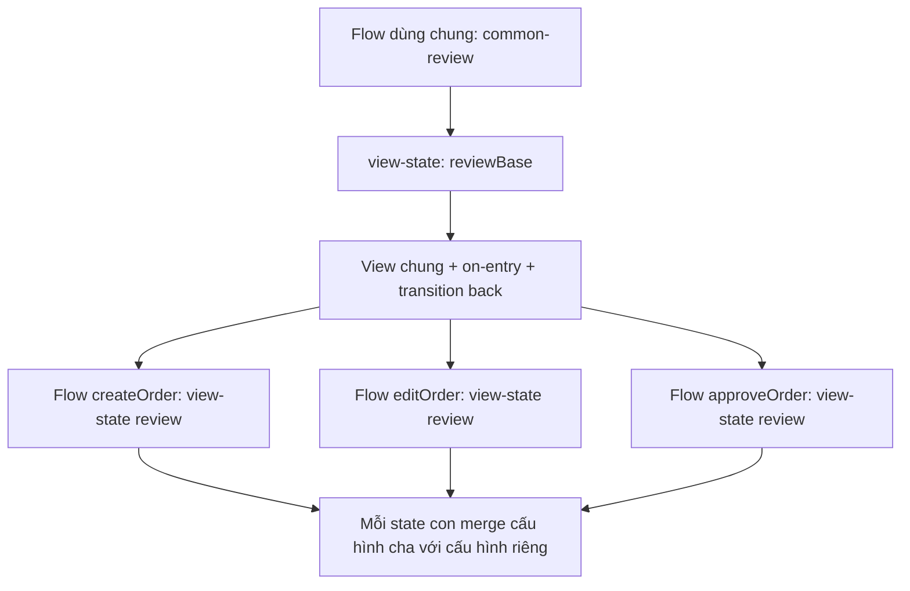

# Ràng buộc cùng loại khi kế thừa state trong Spring Web Flow

Một hệ thống đặt hàng có thể có nhiều flow: tạo đơn, sửa đơn, duyệt đơn và xem lại đơn đã lưu. Các flow này thường dùng chung một màn hình xem lại, cùng transition Quay lại, cùng hành động ghi audit và một số xử lý khi vào state. Nếu sao chép toàn bộ cấu hình màn hình qua từng flow, khi quy tắc chung thay đổi, nhóm phát triển phải sửa nhiều nơi và dễ tạo hành vi không đồng nhất.

**State-level inheritance** của Spring Web Flow cho phép một state trong flow con kế thừa cấu hình từ một state trong flow cha. Tuy nhiên, cơ chế này có một ràng buộc quan trọng: **state cha và state con bắt buộc phải cùng loại**. Một `view-state` chỉ có thể kế thừa một `view-state`; nó không thể kế thừa `action-state`, `decision-state` hay `end-state`.

Bài học thuộc chương **Kế thừa định nghĩa** của module `SPRING_WEB_FLOW`. Chúng ta sẽ làm rõ cú pháp tham chiếu state cha, vì sao hai state phải cùng loại, cách Spring Web Flow hợp nhất nội dung, cách phân biệt state-level inheritance với flow-level inheritance và cách kiểm thử cả trường hợp hợp lệ lẫn trường hợp sai loại.

Sau bài học, bạn có thể:

- Giải thích state-level inheritance và mục tiêu tái sử dụng cấu hình state.
- Viết thuộc tính `parent="flowId#stateId"` đúng cú pháp.
- Nhận diện các cặp state cùng loại và khác loại.
- Giải thích vì sao `view-state` không thể kế thừa `end-state` hoặc `action-state`.
- Phân biệt kế thừa ở cấp state với kế thừa toàn flow.
- Mô tả cách merge transition, action, input, output và các phần tử khác.
- Đăng ký flow cha trong `FlowRegistry` và dùng abstract flow làm nơi định nghĩa chung.
- Kiểm thử lỗi cấu hình, đường dẫn view, transition và kết quả sau khi kế thừa.

## 1. State-level inheritance giải quyết vấn đề gì?

Trong Spring Web Flow, một flow definition gồm các state và transition. Một state xác định một bước cụ thể của hành trình, chẳng hạn:

- `view-state`: hiển thị một view và chờ event từ người dùng.
- `action-state`: chạy action rồi điều hướng theo outcome.
- `decision-state`: đánh giá điều kiện để chọn nhánh.
- `subflow-state`: gọi một flow con và chờ kết quả.
- `end-state`: kết thúc flow với một outcome.

Các state này có vai trò và lifecycle khác nhau. Khi muốn tái sử dụng cấu hình của một state, ta cần giữ nguyên ngữ nghĩa của loại state đó.

Ví dụ, ba flow `createOrder`, `editOrder` và `approveOrder` đều có màn hình xem lại. Cả ba có thể cần:

- Cùng view hiển thị thông tin tổng hợp.
- Cùng action khi vào màn hình để nạp dữ liệu mặc định.
- Cùng transition `back` quay về bước chi tiết.
- Một số transition hoặc action riêng theo từng flow.

Ta có thể tạo một state nền trong flow dùng chung, rồi cho từng flow con kế thừa state nền đó. Như vậy, mỗi flow có một state ID riêng trong kết quả cuối cùng nhưng tái sử dụng nội dung của state cha.



**Ràng buộc cùng loại bảo đảm state sau khi merge vẫn có cùng ngữ nghĩa thực thi.** Một view-state vẫn phải có khả năng render view và nhận event; một action-state vẫn phải thực thi action; một end-state vẫn phải kết thúc flow.

## 2. Cú pháp tham chiếu state cha

State-level inheritance dùng thuộc tính `parent` ngay trên phần tử state:

```xml
<view-state id="child-state"
            parent="parent-flow#parent-view-state" />
```

Giá trị của `parent` có hai phần:

| Phần | Ý nghĩa | Ví dụ |
| --- | --- | --- |
| `parent-flow` | Flow ID của flow cha trong registry | `common-review` |
| `parent-view-state` | ID của state bên trong flow cha | `reviewBase` |
| Dấu `#` | Phân tách flow ID và state ID | `common-review#reviewBase` |

Ví dụ:

```xml
<view-state id="review"
            parent="common-review#reviewBase" />
```

Đoạn trên có nghĩa state `review` của flow hiện tại kế thừa state `reviewBase` thuộc flow có ID `common-review`.

Lưu ý:

- Flow cha phải được đăng ký trong `FlowRegistry` để Web Flow tìm thấy.
- Tham chiếu dùng **flow ID trong registry**, không nhất thiết là tên file XML.
- State cha phải tồn tại trong flow được tham chiếu.
- State con chỉ được chỉ định **một state cha**.
- State cha và state con phải cùng loại.

### Flow ID lấy từ đâu?

Khi đăng ký flow, ứng dụng có thể chỉ định ID tường minh:

```xml
<webflow:flow-registry id="flowRegistry">
    <webflow:flow-location
            id="common-review"
            path="/WEB-INF/flows/shared/common-review.xml" />
    <webflow:flow-location
            id="create-order"
            path="/WEB-INF/flows/orders/create-order.xml" />
</webflow:flow-registry>
```

Với cấu hình này, state con tham chiếu `common-review#reviewBase`. Nếu không đặt ID tường minh, FlowRegistry có quy tắc suy ra ID từ vị trí flow; khi đó cần dùng đúng ID thực tế do registry tạo ra.

**Không nhầm hai thuộc tính `parent`:**

- `<flow parent="...">` khai báo kế thừa ở **cấp toàn flow**.
- `<view-state parent="flowId#stateId">` hoặc phần tử state tương ứng khai báo kế thừa ở **cấp một state**.

## 3. Ràng buộc cùng loại là bắt buộc

Tài liệu Spring Web Flow quy định parent state và child state phải có **cùng loại phần tử**. Ví dụ được nêu trực tiếp là một `view-state` không thể kế thừa từ `end-state`; nó chỉ có thể kế thừa từ một `view-state` khác.

### Các cặp cùng loại hợp lệ

| State con | State cha | Kết quả theo ràng buộc loại |
| --- | --- | --- |
| `view-state` | `view-state` | Hợp lệ |
| `action-state` | `action-state` | Hợp lệ |
| `decision-state` | `decision-state` | Hợp lệ |
| `subflow-state` | `subflow-state` | Hợp lệ |
| `end-state` | `end-state` | Hợp lệ |

### Các cặp khác loại không hợp lệ

| State con | State cha | Vì sao sai |
| --- | --- | --- |
| `view-state` | `end-state` | View-state render view; end-state kết thúc flow |
| `view-state` | `action-state` | View-state chờ event; action-state chạy action |
| `action-state` | `decision-state` | Action-state thực thi action; decision-state chọn nhánh |
| `subflow-state` | `view-state` | Subflow-state điều phối flow con; view-state hiển thị view |
| `end-state` | `view-state` | End-state không có lifecycle render và chờ event như view-state |

Ràng buộc này là điều kiện cấu trúc của định nghĩa flow. Việc hai state có cùng tên, cùng transition hoặc cùng một số thuộc tính XML **không làm chúng trở thành cùng loại**.

### Ví dụ sai: view-state kế thừa end-state

```xml
<flow xmlns="http://www.springframework.org/schema/webflow">
    <view-state id="review"
                parent="common-review#completed" />
</flow>
```

Giả sử `common-review#completed` là một `end-state`. Định nghĩa trên sai vì state con là `view-state` trong khi state cha là `end-state`.

### Ví dụ sai: action-state kế thừa view-state

```xml
<flow xmlns="http://www.springframework.org/schema/webflow">
    <action-state id="loadSummary"
                  parent="common-review#reviewBase" />
</flow>
```

Nếu `reviewBase` là `view-state`, state `loadSummary` không thể kế thừa nó. Đổi tên ID không giải quyết được lỗi; phải chọn state cha cùng loại hoặc thiết kế lại phần dùng chung.

**Cách xử lý đúng:** nếu mục tiêu là tái sử dụng một hành động nạp dữ liệu, hãy tạo state cha dạng `action-state` và cho action-state con kế thừa. Nếu muốn tái sử dụng view và transition, hãy dùng một view-state cha.

## 4. Ví dụ hợp lệ: nhiều view-state kế thừa một view-state nền

Giả sử các flow đơn hàng đều cần một màn hình xem lại. Flow dùng chung cung cấp view, action khởi tạo và transition quay lại. Mỗi flow cụ thể bổ sung transition xác nhận riêng.

### 4.1. Flow cha chứa state nền

Tệp `common-review.xml` được đăng ký với flow ID `common-review`:

```xml
<?xml version="1.0" encoding="UTF-8"?>
<flow xmlns="http://www.springframework.org/schema/webflow"
      xmlns:xsi="http://www.w3.org/2001/XMLSchema-instance"
      xsi:schemaLocation="http://www.springframework.org/schema/webflow
                          https://www.springframework.org/schema/webflow/spring-webflow.xsd"
      abstract="true">

    <view-state id="reviewBase"
                view="/WEB-INF/views/shared/order-review">
        <on-entry>
            <evaluate expression="reviewPolicy.prepareCommonData()"
                      result="viewScope.commonData" />
        </on-entry>

        <transition on="back" to="details" />
    </view-state>

    <view-state id="details" view="/WEB-INF/views/shared/order-details">
        <transition on="next" to="reviewBase" />
    </view-state>
</flow>
```

Flow cha được đánh dấu `abstract="true"` vì nó chỉ cung cấp cấu hình dùng chung, không được thiết kế để người dùng khởi chạy trực tiếp. Một abstract flow không thể được thực thi như flow thông thường; nếu cố chạy, Web Flow ném `FlowBuilderException`.

State `reviewBase` có:

- Loại state: `view-state`.
- View chung: `/WEB-INF/views/shared/order-review`.
- Action `on-entry` để chuẩn bị dữ liệu dùng chung.
- Transition `back` quay về state `details`.

Đường dẫn view được viết **tuyệt đối**. Khi state từ flow cha được merge vào flow con, đường dẫn tương đối của tài nguyên cha có thể được diễn giải theo thư mục của flow con và gây lỗi.

### 4.2. Flow con kế thừa state nền

Tệp `create-order.xml`:

```xml
<?xml version="1.0" encoding="UTF-8"?>
<flow xmlns="http://www.springframework.org/schema/webflow"
      xmlns:xsi="http://www.w3.org/2001/XMLSchema-instance"
      xsi:schemaLocation="http://www.springframework.org/schema/webflow
                          https://www.springframework.org/schema/webflow/spring-webflow.xsd">

    <input name="orderId" type="long" required="true" />

    <view-state id="details" view="/WEB-INF/views/orders/details">
        <transition on="next" to="review" />
    </view-state>

    <view-state id="review"
                parent="common-review#reviewBase">
        <on-entry>
            <evaluate expression="orderService.loadSummary(orderId)"
                      result="viewScope.orderSummary" />
        </on-entry>

        <transition on="confirm" to="completed" />
    </view-state>

    <end-state id="completed" />
</flow>
```

Ở đây:

- `review` là **state con**, có loại `view-state`.
- `common-review#reviewBase` là **state cha**, cũng có loại `view-state`.
- State con kế thừa view chung và transition `back` từ cha.
- State con bổ sung action `on-entry` riêng để nạp tóm tắt đơn.
- State con bổ sung transition `confirm` để hoàn tất flow.

Kết quả sau khi merge là một view-state `review` thuộc flow `create-order`. Nó dùng ID của state con, nhưng nhận nội dung kế thừa từ `reviewBase`.

Trong ví dụ, transition `back` của state cha trỏ tới `details`. State `details` tồn tại trong flow con, vì vậy đích transition được xác định trong flow sau khi kế thừa. Các bean `reviewPolicy` và `orderService` là service của ứng dụng, cần được cấu hình trong Spring context.

### 4.3. Flow thứ hai tái sử dụng cùng state cha

Flow `edit-order` cũng có thể khai báo:

```xml
<view-state id="review"
            parent="common-review#reviewBase">
    <on-entry>
        <evaluate expression="orderService.loadEditableSummary(orderId)"
                  result="viewScope.orderSummary" />
    </on-entry>

    <transition on="save" to="saved" />
</view-state>
```

Flow `edit-order` tái sử dụng state nền nhưng có transition `save` riêng. Nếu state cha có transition `back` và state con có transition `save`, hai transition có thể cùng tồn tại trong state kết quả sau merge vì chúng có khóa event khác nhau.

## 5. Cùng loại không có nghĩa là sao chép nguyên xi

State-level inheritance thực hiện **merge**, không phải sao chép văn bản XML một cách đơn giản. Khi child state kế thừa parent state:

- Các phần tử có thể merge sẽ được hợp nhất theo quy tắc của từng loại phần tử.
- Phần tử chỉ có ở parent được thêm vào kết quả.
- Phần tử chỉ có ở child được giữ trong kết quả.
- Phần tử cùng loại có cùng khóa được merge nội dung con.
- Một số phần tử không merge được sẽ được giữ nguyên như phần tử độc lập.

Vì vậy, cùng loại là **điều kiện cần để bắt đầu kế thừa state**, còn kết quả thực tế phụ thuộc thuật toán merge.

### Khóa merge của các phần tử thường gặp

| Phần tử | Khóa hoặc quy tắc merge |
| --- | --- |
| `view-state` | `id` |
| `action-state` | `id` |
| `decision-state` | `id` |
| `end-state` | `id` |
| `subflow-state` | `id` |
| `transition` | `on` và `on-exception` |
| `input` | `name` |
| `output` | `name` |
| `secured` | `attributes` |
| `on-entry`, `on-exit`, `on-render` | Nội dung action được merge theo quy tắc của lifecycle element |

Ví dụ, parent và child cùng có transition `on="back"` thì nội dung transition được merge theo thuật toán. Nếu parent có `back` và child có `confirm`, chúng là hai transition khác khóa nên cùng xuất hiện trong state kết quả.

### Mergeable và non-mergeable

Một số phần tử Web Flow được thiết kế để merge khi cùng loại và cùng khóa. Một số phần tử khác được giữ nguyên, không ghép nội dung với phần tử tương tự.

| Nhóm | Ví dụ | Hệ quả |
| --- | --- | --- |
| Mergeable | `view-state`, `transition`, `on-entry`, `input`, `output` | Có thể hợp nhất nội dung theo khóa |
| Non-mergeable | `bean-import`, `evaluate`, `exception-handler`, `persistence-context`, `render`, `set`, `var` | Được giữ nguyên như phần tử độc lập |

Các action element như `evaluate`, `render` và `set` được thêm ở đầu trong một số trường hợp merge để action của parent chạy trước và kết quả có thể được action của child sử dụng. Vì vậy, thứ tự thực thi action sau merge cần được kiểm tra, không nên suy ra chỉ từ thứ tự các dòng XML trong file child.

### Ví dụ thứ tự action khi merge

Giả sử state cha và con đều có `on-entry`:

```xml
<!-- Parent state -->
<view-state id="reviewBase" view="/WEB-INF/views/shared/review">
    <on-entry>
        <evaluate expression="reviewPolicy.prepareDefaults()"
                  result="flowScope.defaults" />
    </on-entry>
</view-state>

<!-- Child state -->
<view-state id="review"
            parent="common-review#reviewBase">
    <on-entry>
        <evaluate expression="orderService.loadSummary(orderId)"
                  result="viewScope.summary" />
    </on-entry>
</view-state>
```

Parent và child có thể đóng góp các action vào cùng lifecycle element. Các action của parent được đưa vào trước theo quy tắc merge action của Web Flow; action của child có thể sử dụng dữ liệu do parent chuẩn bị. Nếu thứ tự này quan trọng với nghiệp vụ, hãy viết test để xác nhận.

## 6. Kế thừa state không giống kế thừa toàn flow

Spring Web Flow có hai hình thức:

| Tiêu chí | Flow-level inheritance | State-level inheritance |
| --- | --- | --- |
| Vị trí khai báo | Thuộc tính `parent` trên phần tử `flow` | Thuộc tính `parent` trên state |
| Phạm vi | Toàn bộ flow definition | Một state cụ thể |
| Số parent | Có thể nhiều flow cha | Chỉ một state cha |
| Cú pháp | `parent="common-transitions, common-states"` | `parent="common-review#reviewBase"` |
| Mục đích | Chia sẻ state, global transition, exception handler và cấu hình toàn flow | Mở rộng một state có sẵn |
| Quy tắc cùng loại | Không phải ràng buộc ghép cặp state-level | Parent và child state phải cùng loại |

Ví dụ flow-level inheritance:

```xml
<flow xmlns="http://www.springframework.org/schema/webflow"
      parent="common-transitions, common-exceptions">
    <view-state id="details" view="/orders/details">
        <transition on="next" to="review" />
    </view-state>
</flow>
```

Ví dụ state-level inheritance:

```xml
<view-state id="review"
            parent="common-review#reviewBase">
    <transition on="confirm" to="completed" />
</view-state>
```

Không dùng flow-level inheritance chỉ để mở rộng một state nếu không muốn nhận các thành phần khác của flow cha. Ngược lại, nếu nhiều flow cần dùng chung global transition và exception handler, kế thừa ở cấp flow thường phù hợp hơn.

### State-level inheritance chỉ có một parent

Flow-level inheritance có thể khai báo danh sách parent theo thứ tự. State-level inheritance chỉ tham chiếu **một flow và một state cha**. Nếu cần kết hợp nhiều phần dùng chung, hãy:

- Tạo một state cha tổng hợp đã kế thừa từ flow cha thích hợp, nếu thiết kế flow cho phép.
- Tách hành vi dùng chung thành action/service hoặc flow-level composition.
- Dùng subflow nếu phần dùng chung là một hành trình độc lập có input/output.

Không đặt danh sách nhiều state cha vào thuộc tính `parent` của state với kỳ vọng Web Flow sẽ tự merge nhiều state.

## 7. Parent flow phải được đăng ký và có thể đánh dấu abstract

Web Flow cần tìm thấy flow cha trong `FlowRegistry`. Đăng ký parent flow giống như đăng ký flow thông thường:

```xml
<webflow:flow-registry id="flowRegistry"
                       base-path="/WEB-INF/flows">
    <webflow:flow-location
            id="common-review"
            path="/shared/common-review.xml" />

    <webflow:flow-location
            id="create-order"
            path="/orders/create-order.xml" />
</webflow:flow-registry>
```

Nếu flow cha chỉ chứa các state dùng chung và không được chạy trực tiếp, có thể khai báo:

```xml
<flow xmlns="http://www.springframework.org/schema/webflow"
      abstract="true">
    <!-- Các state nền để flow khác kế thừa -->
</flow>
```

Flow abstract vẫn cần có mặt trong registry để được tham chiếu, nhưng không được dùng như một flow có thể launch trực tiếp. Khi một abstract flow bị chạy, Web Flow ném `FlowBuilderException`.

### Đường dẫn view và tài nguyên bên ngoài

Khi state cha được merge vào flow con, các đường dẫn tài nguyên tương đối trong parent có thể bị diễn giải tương đối theo thư mục của child flow. Tài liệu Web Flow khuyến nghị dùng **đường dẫn tuyệt đối** cho tài nguyên bên ngoài được tham chiếu từ flow cha.

Ví dụ nên ưu tiên:

```xml
<view-state id="reviewBase"
            view="/WEB-INF/views/shared/review" />
```

thay vì một đường dẫn tương đối như:

```xml
<view-state id="reviewBase"
            view="review" />
```

Điều này đặc biệt quan trọng khi parent flow và child flow nằm ở hai thư mục khác nhau.

## 8. Cách chọn đúng state cha

Trước khi thêm thuộc tính `parent`, hãy xác định state con cần tái sử dụng hành vi nào.

| Nhu cầu của state con | Loại state cha nên chọn |
| --- | --- |
| Cần view chung, binding, event và transition hiển thị | `view-state` |
| Cần chạy chung một action và cùng outcome mapping | `action-state` |
| Cần dùng chung điều kiện phân nhánh | `decision-state` |
| Cần cùng cách gọi một flow con và mapping input/output | `subflow-state` |
| Cần dùng chung outcome kết thúc | `end-state` |

Ví dụ:

- Nếu hai flow đều cần hiển thị màn hình xác nhận, tạo `view-state` nền.
- Nếu hai flow đều cần gọi `invoiceService.calculate` và rẽ nhánh theo outcome, tạo `action-state` nền.
- Nếu hai flow đều quyết định nhánh theo `isEligible`, tạo `decision-state` nền.
- Nếu hai flow đều gọi subflow `addressVerification` với hợp đồng input/output tương tự, tạo `subflow-state` nền.

Không nên chọn state cha chỉ vì nó có một đoạn XML trông giống. Hãy so sánh **ngữ nghĩa lifecycle** và loại state trước, sau đó mới xem các phần tử có thể merge.

## 9. Các lỗi thường gặp khi kế thừa state

| Biểu hiện | Nguyên nhân | Cách xử lý |
| --- | --- | --- |
| Flow không build được | State cha và con khác loại | Chọn state cha cùng loại |
| Không tìm thấy parent flow | Flow ID sai hoặc flow cha chưa đăng ký | Kiểm tra ID trong FlowRegistry |
| Không tìm thấy parent state | State ID sai trong tham chiếu sau dấu `#` | Kiểm tra state ID của flow cha |
| Transition trỏ tới state không tồn tại | State cha dùng đích không có trong flow kết quả | Định nghĩa state đích trong child hoặc sửa transition |
| View không render | Đường dẫn tương đối của parent bị diễn giải theo child | Dùng absolute view/resource path |
| Action chạy sai thứ tự | Hiểu nhầm quy tắc merge action | Kiểm tra merge algorithm và viết test |
| Transition bị lặp hoặc merge ngoài ý muốn | Parent/child có transition cùng khóa `on` | Xác định rõ cần merge nội dung hay dùng event khác |
| Mong đợi child thay thế parent | Hiểu inheritance như override Java | Thiết kế theo merge semantics của Web Flow |
| Muốn nhiều parent ở cấp state | Dùng state-level inheritance sai mục đích | Chuyển sang flow-level inheritance hoặc composition |
| Abstract flow bị launch | Dùng flow cha như flow chạy độc lập | Tạo flow concrete để launch; giữ abstract flow làm nguồn kế thừa |

### Một số nguyên tắc thiết kế giúp tránh lỗi

1. Dùng tên state cha thể hiện vai trò chung, ví dụ `reviewBase` hoặc `approvalBase`.
2. Giữ parent flow nhỏ và tập trung vào phần thực sự dùng chung.
3. Tránh để parent state phụ thuộc quá nhiều biến chỉ có ở một child flow.
4. Dùng input/flow scope và service contract rõ ràng cho dữ liệu cần chia sẻ.
5. Dùng view/resource path tuyệt đối trong parent.
6. Kiểm thử kết quả merge và đường đi thực tế của mỗi child flow.

## 10. Kiểm thử ràng buộc cùng loại

Kiểm thử cần có cả **positive case** và **negative case**.

| Ca kiểm thử | Cấu hình | Kỳ vọng |
| --- | --- | --- |
| View-state kế thừa view-state | `review` → `common-review#reviewBase` | Flow build được |
| Action-state kế thừa action-state | `load` → `common-actions#loadBase` | Flow build được |
| Decision-state kế thừa decision-state | `route` → `common-decisions#routeBase` | Flow build được |
| Subflow-state kế thừa subflow-state | `verify` → `common-subflows#verifyBase` | Flow build được |
| End-state kế thừa end-state | `completed` → `common-outcomes#completedBase` | Flow build được |
| View-state kế thừa end-state | `review` → `common#completedBase` | Định nghĩa bị từ chối vì khác loại |
| Action-state kế thừa view-state | `load` → `common#reviewBase` | Định nghĩa bị từ chối vì khác loại |
| Parent flow chưa đăng ký | `parent="missing#reviewBase"` | Không resolve được parent |
| Parent state không tồn tại | `parent="common#missingState"` | Không resolve được state cha |
| Hai transition khác event | Parent có `back`, child có `confirm` | Cả hai có trong state sau merge |
| Hai transition cùng event | Parent và child cùng `on="back"` | Nội dung merge theo quy tắc transition |
| Parent có action dùng chung | `on-entry` ở parent và child | Kiểm tra thứ tự action thực tế |
| Parent view dùng path tương đối | Parent và child ở thư mục khác | Test phát hiện lỗi resolve view; đổi sang path tuyệt đối |
| Abstract parent được gọi trực tiếp | Launch flow abstract | Ném `FlowBuilderException` |

### Kiểm thử bằng FlowExecution test

Spring Web Flow cung cấp test harness như `AbstractXmlFlowExecutionTests` để kiểm thử flow XML. Với inheritance, nên có test:

1. Nạp flow con và các flow cha trong registry test.
2. Xác nhận flow con được build thành công khi state cha và con cùng loại.
3. Launch flow con và kiểm tra state ban đầu.
4. Phát event để đi vào state kế thừa.
5. Kiểm tra view/state ID, transition được kế thừa và transition riêng của child.
6. Kiểm tra action và dữ liệu scope theo thứ tự mong muốn.
7. Tạo một định nghĩa sai loại và xác nhận quá trình build/parse từ chối.

Tên method và cách khởi tạo test harness có thể khác theo phiên bản Web Flow. Không phụ thuộc vào một thông điệp lỗi cố định nếu framework không cam kết nội dung message; hãy xác nhận lỗi cấu hình và nguyên nhân là state type mismatch.

## 11. Bài tập thực hành: màn hình xem lại đơn hàng dùng chung

Tạo flow cha `common-order-review` và hai flow con `create-order`, `edit-order`.

1. Trong flow cha, khai báo `view-state` `reviewBase` với view chung và transition `back`.
2. Đăng ký flow cha trong `FlowRegistry` với ID `common-order-review`; đánh dấu `abstract="true"` nếu không muốn launch trực tiếp.
3. Trong flow `create-order`, khai báo `view-state` `review` với `parent="common-order-review#reviewBase"`; bổ sung transition `confirm`.
4. Trong flow `edit-order`, khai báo một `view-state` khác kế thừa cùng state cha; bổ sung transition `save`.
5. Chạy cả hai flow, xác nhận view chung, transition `back` và transition riêng của từng flow hoạt động đúng.
6. Tạo thử cấu hình sai: cho `view-state` kế thừa `end-state`; xác nhận flow không build được.
7. Tạo thử cấu hình `action-state` kế thừa `view-state`; ghi lại nguyên nhân từ chối.
8. Thêm `on-entry` ở parent và child, kiểm tra thứ tự action sau merge.
9. Di chuyển parent flow sang thư mục khác, đổi view path tương đối thành tuyệt đối và kiểm tra lại.
10. Viết flow test cho positive case và negative case.

**Câu hỏi tự đánh giá:**

- Vì sao `view-state` không thể kế thừa `end-state`?
- Thuộc tính `parent` ở cấp state cần những thành phần nào?
- Vì sao state-level inheritance chỉ có một parent trong khi flow-level inheritance có thể có nhiều parent?
- Hai transition cùng event trong parent và child được xử lý như thế nào?
- Flow cha có bắt buộc phải đăng ký trong FlowRegistry không?
- Khi nào nên đánh dấu flow cha là abstract?
- Vì sao đường dẫn view tương đối trong parent có thể hỏng sau khi merge?
- Nếu chỉ muốn dùng chung một action nhưng không dùng chung view, nên kế thừa loại state nào?

## 12. Tài liệu tham khảo

- [Spring Web Flow 3.0.2 Reference Guide — Flow Inheritance](https://docs.spring.io/spring-webflow/docs/3.0.x/reference/#flow-inheritance): phần 17, bao gồm flow-level inheritance, state-level inheritance, abstract flows và merge algorithm.
- [Spring Web Flow 2.5.1 Reference Guide — Flow Inheritance](https://docs.spring.io/spring-webflow/docs/2.5.1.RELEASE/reference/htmlsingle/): phần 9, mô tả cùng ràng buộc cùng loại và cú pháp `flowId#stateId`.
- [Spring Web Flow GitHub repository](https://github.com/spring-projects/spring-webflow): mã nguồn, test và các thay đổi của flow model builder.

## Ghi nhớ

State-level inheritance cho phép một state trong flow con kế thừa và merge cấu hình từ **một state cha**. Tham chiếu có dạng `flowId#stateId`, và parent flow phải được đăng ký trong `FlowRegistry`. Điều kiện bắt buộc là **state cha và state con phải cùng loại**: view-state với view-state, action-state với action-state, decision-state với decision-state, subflow-state với subflow-state hoặc end-state với end-state. Web Flow merge các phần tử theo loại và khóa của chúng; kế thừa không đơn giản là ghi đè như Java inheritance. Hãy chọn đúng loại state, hiểu merge semantics, dùng abstract flow cho cấu hình dùng chung và kiểm thử cả trường hợp hợp lệ lẫn sai loại trước khi triển khai.
