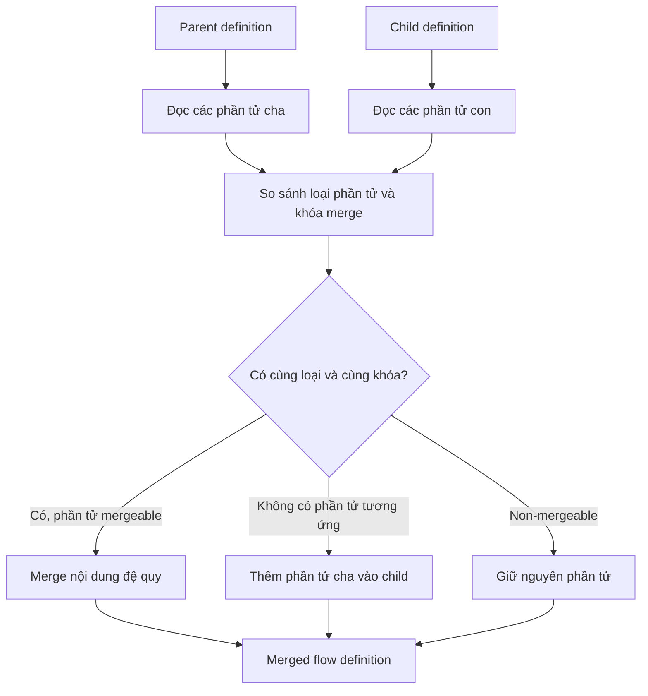
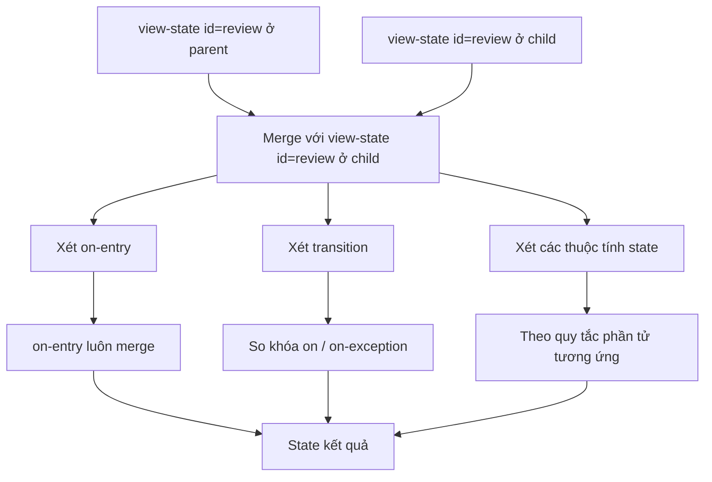

# Quy tắc hợp nhất phần tử thay vì suy diễn theo ghi đè Java

## 1. Vì sao cần hiểu thuật toán merge?

Spring Web Flow cho phép một flow hoặc một state kế thừa cấu hình từ definition cha. Mục tiêu là tái sử dụng các phần tử như state, transition, hook và metadata mà không phải sao chép nguyên một flow.

Điểm dễ gây lỗi là nhiều người đọc thuộc tính **parent** rồi suy luận theo mô hình kế thừa Java: class con khai báo lại method hoặc field thì nội dung cha bị ghi đè. **Spring Web Flow không hoạt động theo quy tắc đó.** Khi dựng definition kế thừa, engine hợp nhất cấu hình cha và con theo quy tắc riêng của từng phần tử trong Flow Definition Language.

Có hai nhóm phần tử:

- **Mergeable:** nếu phần tử cha và con cùng loại, cùng khóa nhận diện, nội dung của chúng được hợp nhất đệ quy. Nếu không có phần tử tương ứng ở con, phần tử cha được thêm vào kết quả.
- **Non-mergeable:** phần tử được giữ nguyên trong kết quả; thuật toán không hợp nhất nội dung của cha và con thành một phần tử.

Thứ tự phần tử cũng có quy tắc. Phần tử cha được thêm vào thường nằm sau phần tử con, nhưng các action như **evaluate**, **render** và **set** có ngoại lệ: action từ cha được đưa lên đầu để kết quả của action cha có thể được dùng bởi action con.

> **Cách đọc đúng:** Hãy xem inheritance như quá trình dựng một definition mới từ nhiều mảnh cấu hình. Muốn biết một phần tử có được kết hợp, được thêm riêng hay giữ nguyên, hãy kiểm tra loại phần tử, khóa merge và quy tắc thứ tự của nó.

Bài thuộc chương **Kế thừa định nghĩa** của module **SPRING_WEB_FLOW**. Module giúp mô hình hóa hành trình nhiều bước bằng state, event, transition và subflow, đồng thời thực hành form binding, validation, scope, phiên, tích hợp Spring MVC, kiểm thử và phục hồi lỗi. Bài này tập trung vào thuật toán hợp nhất để người học thiết kế parent/child definition có kết quả rõ ràng và dễ kiểm thử.

### Mục tiêu học tập

Sau bài này, bạn có thể:

1. Giải thích vì sao Web Flow inheritance không phải Java-style override.
2. Mô tả các bước thuật toán merge khi dựng child flow.
3. Nhận diện phần tử mergeable và non-mergeable.
4. Tra cứu khóa merge của từng phần tử.
5. Hiểu cách merge đệ quy, cách xử lý phần tử chỉ có ở parent và thứ tự action.
6. Tránh xung đột khi cha và con cùng khai báo transition, variable hoặc exception handler.
7. Hiểu thứ tự khi một flow kế thừa nhiều parent và giới hạn của state-level inheritance.
8. Kiểm thử definition sau merge thay vì chỉ kiểm tra từng file XML riêng lẻ.

## 2. Mô hình tư duy: kết quả là một definition đã hợp nhất

Giả sử flow cha cung cấp một state review chung. Flow con muốn thêm event confirm và một action chuẩn bị dữ liệu. Web Flow không chạy state cha rồi mới gọi state con. Nó tạo ra **một state trong child definition** có nội dung được hợp nhất từ hai phía.



Kết quả được dùng như flow definition của child. Khi một người dùng launch flow, engine tạo flow execution từ definition đó. Thuật toán merge thuộc giai đoạn xây dựng definition, không phải cơ chế chọn method động theo từng request.

### 2.1. Không có hai state chạy nối tiếp chỉ vì có inheritance

Ví dụ:

```xml
<view-state id="review" parent="shared-flow#reviewTemplate" />
```

State ID đang chạy trong child là **review**. Parent state **reviewTemplate** chỉ cung cấp cấu hình để merge. Người dùng không đi qua một state cha rồi mới tới một state con.

### 2.2. Parent không tự động thắng child, child cũng không tự động thắng parent

Câu hỏi “giá trị nào thắng?” thường xuất phát từ suy nghĩ override. Với Web Flow, câu hỏi đúng là:

- Phần tử đó có thuộc nhóm mergeable không?
- Khóa nhận diện là gì?
- Cha và con có cùng loại, cùng khóa không?
- Nếu có, nội dung con của chúng tiếp tục được merge ra sao?
- Nếu không, phần tử cha được thêm riêng hay được giữ nguyên?
- Có quy tắc thứ tự đặc biệt nào áp dụng không?

Không suy ra kết quả chỉ từ thứ tự xuất hiện trong hai file XML.

## 3. Phạm vi áp dụng của thuật toán

Spring Web Flow có hai loại inheritance:

| Loại | Nơi khai báo parent | Phạm vi |
| --- | --- | --- |
| Flow-level inheritance | Thuộc tính **parent** trên root **flow** | Hợp nhất cấu hình của cả flow |
| State-level inheritance | Thuộc tính **parent** trên một state | Hợp nhất một state cha vào một state con |

Flow-level inheritance có thể dùng nhiều parent flow, được liệt kê theo thứ tự. State-level inheritance chỉ cho phép một parent state và tham chiếu bằng định danh **flowId#stateId**. Hai state phải cùng loại, ví dụ view-state với view-state.

Dù phạm vi khác nhau, khi các phần tử được hợp nhất, nguyên tắc phân loại mergeable/non-mergeable và khóa merge của Flow Definition Language vẫn là nền tảng để hiểu kết quả.

### 3.1. Ví dụ flow-level

```xml
<flow parent="common-security, common-navigation">
    <!-- Cấu hình flow -->
</flow>
```

Hai parent flow phải có thể được tìm thấy qua registry. Flow kết quả được tạo bằng cách merge lần lượt theo thứ tự khai báo.

### 3.2. Ví dụ state-level

```xml
<view-state id="checkoutReview"
            parent="shared-checkout#reviewTemplate">
    <transition on="confirm" to="completed" />
</view-state>
```

Child state **checkoutReview** nhận cấu hình từ state **reviewTemplate** của flow **shared-checkout**. Child state không thể kế thừa đồng thời hai parent state.

## 4. Thuật toán merge theo từng bước

Có thể đọc thuật toán theo trình tự sau:

1. **Tìm parent definition.** Flow cha phải được đăng ký trong FlowDefinitionRegistry như một flow bình thường.
2. **Đọc definition cha và con.** Builder lấy các phần tử trong hai definition theo cấu trúc XML.
3. **Phân loại phần tử.** Xác định phần tử đang xét thuộc nhóm mergeable hay non-mergeable.
4. **Nếu mergeable, tìm phần tử tương ứng.** So sánh loại phần tử và khóa nhận diện được quy định cho loại đó.
5. **Nếu cùng loại và cùng khóa, merge đệ quy.** Nội dung của hai phần tử được hợp nhất; các phần tử con tiếp tục áp dụng quy tắc riêng.
6. **Nếu không có phần tử tương ứng, thêm phần tử cha.** Phần tử cha trở thành một phần của child definition.
7. **Nếu non-mergeable, giữ nguyên.** Thuật toán không hợp nhất nội dung của phần tử đó với một phần tử cùng tên ở phía còn lại.
8. **Áp dụng quy tắc thứ tự.** Phần tử cha được thêm thường nằm sau phần tử con; action evaluate, render và set từ cha được thêm ở đầu.
9. **Hoàn thành child definition.** Definition đã hợp nhất được kiểm tra và dùng để tạo execution.

### 4.1. Cùng loại và cùng khóa là điều kiện quan trọng

Giả sử parent có:

```xml
<view-state id="review">
    <transition on="cancel" to="cancelled" />
</view-state>
```

Child có:

```xml
<view-state id="review">
    <transition on="confirm" to="completed" />
</view-state>
```

Hai phần tử view-state có cùng khóa **id=review**, vì vậy chúng được merge. Các transition có khóa khác nhau nên có thể cùng tồn tại trong state kết quả.

Nếu child dùng **id=reviewOrder**, đó là một state khác. Parent state **review** không bị ghép vào state **reviewOrder** chỉ vì hai state có cùng loại.

### 4.2. Không có phần tử tương ứng thì thêm vào

Nếu parent có một end-state mà child không khai báo, end-state đó được thêm vào child flow. Nếu parent có một transition event mà child state tương ứng không có, transition cha có thể trở thành transition của state kết quả.

Đây là cơ chế tái sử dụng phần tử chung mà không cần child khai báo lại mọi thứ.

## 5. Danh sách phần tử mergeable và khóa nhận diện

Một phần tử chỉ merge với phần tử tương ứng khi thỏa điều kiện về loại và khóa. Bảng dưới đây tóm tắt các khóa theo Spring Web Flow Reference Guide 3.0.2.

| Phần tử | Khóa merge | Ý nghĩa khi thiết kế |
| --- | --- | --- |
| **action-state** | **id** | Hai action-state cùng ID được merge nội dung |
| **attribute** | **name** | Attribute cùng tên được merge |
| **decision-state** | **id** | Decision state cùng ID được merge |
| **end-state** | **id** | End state cùng ID được merge |
| **flow** | Luôn merge | Nội dung flow cha và con được hợp nhất |
| **if** | **test** | Điều kiện có cùng biểu thức test là khóa tương ứng |
| **on-end** | Luôn merge | Hook kết thúc flow được hợp nhất |
| **on-entry** | Luôn merge | Hook vào state được hợp nhất |
| **on-exit** | Luôn merge | Hook rời state được hợp nhất |
| **on-render** | Luôn merge | Hook trước khi render được hợp nhất |
| **on-start** | Luôn merge | Hook bắt đầu flow được hợp nhất |
| **input** | **name** | Input cùng tên được merge |
| **output** | **name** | Output cùng tên được merge |
| **secured** | Các attributes | Phần tử secured có cùng tập thuộc tính nhận diện được merge |
| **subflow-state** | **id** | Subflow-state cùng ID được merge |
| **transition** | **on** và **on-exception** | Transition được nhận diện bằng event hoặc exception event |
| **view-state** | **id** | View-state cùng ID được merge |

### 5.1. Khóa merge không phải mọi thuộc tính của phần tử

Ví dụ, khóa của view-state là **id**. Thuộc tính view, model hoặc các hook con không phải khóa để quyết định state nào tương ứng. Khi hai view-state có cùng ID, builder đi vào quá trình merge nội dung của chúng.

Tương tự, transition được nhận diện bằng **on** và **on-exception**. Không được coi **to** là khóa merge chỉ vì nó quyết định state đích.

### 5.2. Các phần tử con không có khóa giống nhau sẽ không ghép thành một

Nếu hai view-state có ID khác nhau, chúng là hai phần tử riêng. Nếu hai input có tên khác nhau, cả hai có thể cùng xuất hiện trong kết quả. Parent element không tìm được phần tử cùng loại và cùng khóa ở child sẽ được thêm như phần tử mới.

## 6. Phần tử non-mergeable được giữ nguyên

Theo Reference Guide 3.0.2, các phần tử sau không được hợp nhất nội dung:

| Phần tử | Vì sao cần chú ý |
| --- | --- |
| **bean-import** | Không giả định child thay thế danh sách import của parent |
| **evaluate** | Action evaluate riêng lẻ được giữ nguyên |
| **exception-handler** | Không phải cơ chế override handler theo tên |
| **persistence-context** | Cấu hình persistence context không được tự hợp nhất |
| **render** | Action render riêng lẻ được giữ nguyên |
| **set** | Action set riêng lẻ được giữ nguyên |
| **var** | Flow variable không được merge theo tên như input/attribute |

**Non-mergeable không có nghĩa phần tử bị bỏ đi.** Phần tử ở parent hoặc child được giữ nguyên trong definition kết quả, không bị chỉnh sửa bởi phép merge của chính phần tử đó.

### 6.1. Không dùng var để ghi đè biến cha

Ví dụ parent có:

```xml
<var name="checkoutDraft"
     class="com.example.checkout.CheckoutDraft" />
```

Child cũng khai báo:

```xml
<var name="checkoutDraft"
     class="com.example.checkout.CustomCheckoutDraft" />
```

Không được hiểu rằng khai báo thứ hai thay thế khai báo thứ nhất. **var** thuộc nhóm non-mergeable, nên hai khai báo không được hợp nhất thành một biến duy nhất. Tùy cấu trúc definition và validation của builder, khai báo trùng có thể khiến flow không dựng được hoặc tạo cấu hình không đúng ý định.

Hãy thiết kế một nơi sở hữu flow variable. Nếu child cần kiểu dữ liệu khác, có thể dùng tên biến riêng, factory/service chung hoặc một thiết kế inheritance khác đã được kiểm thử.

### 6.2. Exception handler không phải override theo tên

Nếu parent và child cùng khai báo exception-handler, đừng giả định handler child sẽ thay handler cha. Phần tử này non-mergeable. Hãy kiểm tra toàn bộ exception handling sau khi definition được dựng; tránh khai báo trùng hoặc mâu thuẫn.

### 6.3. Evaluate, render và set không tự ghép thành một action

Các action này là phần tử non-mergeable. Nếu parent và child đều khai báo action cùng vị trí hoặc cùng mục đích, chúng được giữ riêng theo quy tắc thứ tự, không được gộp thành một biểu thức duy nhất.

## 7. Merge đệ quy bên trong phần tử cha và con

Khi hai phần tử mergeable cùng loại và cùng khóa, thuật toán không chỉ chọn một phía. Nó tiếp tục xét các phần tử con.

Ví dụ, hai view-state có cùng ID có thể chứa:

- on-entry,
- on-exit,
- on-render,
- transition,
- binder hoặc cấu hình view-state khác.

Các phần tử con có quy tắc riêng. Chẳng hạn:

- **on-entry** luôn merge.
- **transition** merge theo **on** và **on-exception**.
- Các action **evaluate** bên trong cấu trúc được giữ nguyên như action riêng, không bị nhập thành một expression duy nhất.



### 7.1. Ví dụ hai state cùng ID

Parent:

```xml
<view-state id="review"
            view="/WEB-INF/views/shared/review.jsp">
    <on-entry>
        <evaluate expression="auditService.recordReviewOpened()" />
    </on-entry>
    <transition on="cancel" to="cancelled" />
</view-state>
```

Child:

```xml
<view-state id="review">
    <on-entry>
        <evaluate expression="checkoutService.prepareReview(order)" />
    </on-entry>
    <transition on="confirm" to="completed" />
</view-state>
```

Vì hai view-state có cùng ID, cấu hình của chúng được hợp nhất. State kết quả có cấu hình view từ parent, hai nhóm hành vi on-entry và các transition có event khác nhau.

Các action evaluate vẫn là action riêng. Quy tắc thứ tự action của parent được giải thích ở mục tiếp theo.

### 7.2. Phần tử con cùng khóa tiếp tục merge

Nếu parent và child cùng có transition **on=cancel**, chúng là hai transition có cùng khóa. Thuật toán merge transition và tiếp tục xét nội dung con. Không nên đưa hai target khác nhau vào cùng event rồi mong child override target của parent.

Nếu hành vi cancel phải khác nhau giữa các child flow, hãy tách event hoặc thiết kế parent state phù hợp hơn để tránh xung đột.

## 8. Thứ tự phần tử sau khi merge

Quy tắc thứ tự là phần quan trọng của thuật toán, vì một số action có thể phụ thuộc kết quả action khác.

Theo tài liệu Web Flow:

- Trong phần lớn trường hợp, phần tử cha được thêm vào sau các phần tử con.
- Các action **evaluate**, **render** và **set** từ parent là ngoại lệ; chúng được thêm vào đầu.
- Việc đưa action cha lên đầu giúp kết quả mà parent tạo ra có thể được dùng bởi action con.

### 8.1. Ví dụ thứ tự action

Parent:

```xml
<view-state id="review">
    <on-entry>
        <evaluate expression="contextService.loadDefaults()"
                  result="flowScope.defaults" />
    </on-entry>
</view-state>
```

Child:

```xml
<view-state id="review">
    <on-entry>
        <evaluate expression="checkoutService.prepareReview(order, defaults)" />
    </on-entry>
</view-state>
```

Vì action evaluate từ parent được đưa lên đầu, action chuẩn bị mặc định có thể chạy trước action của child. Đây là lý do parent có thể cung cấp dữ liệu chung cho phần mở rộng ở child.

### 8.2. Đừng dựa vào thứ tự file XML để đoán thứ tự chạy

Thứ tự viết parent file và child file không phải quy tắc thực thi. Hãy dựa trên thuật toán merge và xác minh bằng flow test.

Nếu hai action phụ thuộc nhau, làm rõ thứ tự bằng cách đặt action ở hook thích hợp hoặc gom logic cần thứ tự chặt vào một service method có hợp đồng rõ ràng. Không dựa vào một thứ tự tình cờ từ cách sắp xếp file.

### 8.3. Side effect trong hook kế thừa

Một on-entry được merge có thể làm cả parent action và child action chạy khi state được vào. Khi người dùng quay lại state, hook có thể chạy lại theo lifecycle bình thường.

Không đặt hành động thanh toán, gửi email hoặc tạo đơn không idempotent trong hook dùng chung nếu mọi child flow không có cùng ngữ nghĩa. Ưu tiên action chỉ đọc/chuẩn bị dữ liệu, hoặc service có idempotency rõ.

## 9. Transition: khóa event và nguy cơ xung đột

Transition là phần tử mergeable với khóa **on** và **on-exception**. Điều đó có nghĩa transition được ghép dựa trên event ID hoặc exception event mà nó xử lý.

Parent:

```xml
<view-state id="review">
    <transition on="cancel" to="cancelled" />
</view-state>
```

Child có thể thêm event riêng:

```xml
<view-state id="review">
    <transition on="confirm" to="completed" />
</view-state>
```

Hai transition có khóa khác nhau nên cả hai có thể tồn tại trong state đã merge.

### 9.1. Cùng event, khác target không phải override

Ví dụ parent khai báo:

```xml
<transition on="cancel" to="cancelled" />
```

Child khai báo:

```xml
<transition on="cancel" to="returnToCart" />
```

Không coi transition child là lệnh thay thế transition cha. Vì transition merge theo event key, đây là một điểm hợp nhất có khả năng xung đột. Tài liệu không định nghĩa nó như phép override target theo Java. Hãy tránh khai báo hai đích khác nhau cho cùng event nếu chưa xác minh kết quả builder và hành vi thực tế.

Cách thiết kế an toàn:

- Parent cung cấp event chung có cùng ý nghĩa trong mọi child.
- Child thêm event riêng khi hành vi khác nhau.
- Nếu cancel phải có target khác nhau, không đặt transition cancel đó ở parent dùng chung.
- Chạy test cho child definition sau merge để xác nhận mỗi event chỉ dẫn tới hành vi mong muốn.

### 9.2. Exception transition cũng có khóa

Transition có thể được khai báo theo exception:

```xml
<transition on-exception="com.example.PaymentException"
            to="paymentFailed" />
```

Nếu parent và child cùng xử lý một exception type, chúng có cùng khóa on-exception. Không nên dựa vào việc child ghi đè handler exception cha. Hãy thiết kế một nơi sở hữu hành vi cho exception đó hoặc tách exception type/outcome theo trách nhiệm rõ ràng.

## 10. Các hook lifecycle luôn merge

Những hook sau được ghi nhận là mergeable và luôn merge:

- **on-start**
- **on-entry**
- **on-render**
- **on-exit**
- **on-end**

Điều này hữu ích khi parent flow cần hành vi chung, còn child cần bổ sung hành vi riêng.

| Hook | Phạm vi | Câu hỏi khi thiết kế |
| --- | --- | --- |
| on-start | Khi flow bắt đầu | Parent chuẩn bị context gì cho mọi child? |
| on-entry | Khi vào state | Action cha và con có thể chạy cùng nhau không? |
| on-render | Trước khi render view | Có action nào sẽ chạy lặp khi render lại? |
| on-exit | Khi rời state | Dọn dẹp ở cha có ảnh hưởng child không? |
| on-end | Khi flow kết thúc | Có side effect nào phải idempotent không? |

### 10.1. on-render có thể chạy nhiều lần

Nếu parent thêm on-render dùng chung, mọi child kế thừa hook đó. Render lại view do validation failure, Ajax hoặc refresh có thể làm hook chạy lại. Vì vậy, hook chung nên ưu tiên tải dữ liệu hoặc chuẩn bị presentation state.

### 10.2. on-start trong flow-level inheritance

Khi parent và child có on-start, hai phần được merge. Nếu action child cần dữ liệu do parent chuẩn bị, đặt action cha trong phần phù hợp và kiểm tra thứ tự thực thi. Các action evaluate/render/set từ parent có quy tắc được đưa lên đầu trong quá trình merge.

### 10.3. Hook dùng chung cần có contract

Một hook parent nên có giả định tối thiểu:

- Không phụ thuộc vào biến chỉ tồn tại trong một child.
- Không yêu cầu service riêng của một flow cụ thể.
- Có thể chạy ở mọi child kế thừa.
- Có hành vi an toàn khi state/flow được vào lại hoặc render lại.
- Được kiểm thử trong ít nhất một child đại diện và những child có khác biệt đáng kể.

## 11. Phần tử non-mergeable và cách tránh khai báo trùng

Vì non-mergeable được giữ nguyên, các phần tử này cần một quy ước sở hữu rõ ràng.

### 11.1. var

Đặt flow variable tại flow có trách nhiệm quản lý lifecycle của nó. Không dùng khai báo var ở child để thay thế một var cùng tên ở parent.

### 11.2. exception-handler

Không khai báo cùng một handler ở cả parent và child với kỳ vọng handler child thắng. Nếu có xử lý exception chung, hãy tổ chức trong service/action hoặc cấu trúc flow phù hợp và kiểm tra definition sau merge.

### 11.3. persistence-context

Persistence context không được tự hợp nhất. Tránh khai báo context ở cả parent và child khi chưa hiểu lifecycle và cấu hình persistence mà flow sử dụng.

### 11.4. bean-import

Bean import là phần tử giữ nguyên. Không kỳ vọng import ở child làm thay đổi hoặc lọc import của parent. Kiểm tra resource được import và cách registry/build context nạp chúng.

### 11.5. evaluate, render, set

Những action này được giữ riêng. Nếu cả parent và child đều cần cùng một hành vi, cân nhắc đặt action ở đúng hook và xác định rõ thứ tự, thay vì sao chép action rồi mong thuật toán gộp chúng.

## 12. Flow kế thừa nhiều parent: thứ tự có ý nghĩa

Flow-level inheritance cho phép liệt kê nhiều parent:

```xml
<flow parent="common-a, common-b">
    <!-- Child flow -->
</flow>
```

Quy trình được thực hiện theo thứ tự:

1. Merge parent **common-a** với child.
2. Lấy kết quả lần merge thứ nhất làm child cho lần tiếp theo.
3. Merge kết quả đó với parent **common-b**.
4. Tiếp tục theo danh sách parent.

Vì kết quả merge trước được dùng trong lần merge sau, thứ tự parent có thể ảnh hưởng cấu trúc cuối cùng, đặc biệt khi các parent có phần tử cùng loại và cùng khóa.

### 12.1. Không coi nhiều parent là phép cộng không thứ tự

Hai cấu hình:

```xml
<flow parent="common-security, common-navigation">
    <!-- Cấu hình flow -->
</flow>
```

và

```xml
<flow parent="common-navigation, common-security">
    <!-- Cấu hình flow -->
</flow>
```

không nên được xem là tương đương mặc định. Hãy sắp xếp parent theo một thứ tự có chủ đích và kiểm thử các điểm giao nhau.

### 12.2. Tránh hai parent cùng định nghĩa một policy mâu thuẫn

Nếu hai parent đều cung cấp transition **cancel** nhưng target khác nhau, hoặc cùng khai báo các action có side effect, child sẽ nhận một cấu hình khó hiểu. Hãy chia nhỏ trách nhiệm parent hoặc tạo một parent tổng hợp có contract duy nhất.

### 12.3. State-level inheritance không có multiple parent

Một state chỉ tham chiếu một parent state:

```xml
<view-state id="shipping"
            parent="common-address#addressForm" />
```

Không khai báo một danh sách flowId#stateId phân tách bằng dấu phẩy. Nếu cần nhiều nguồn cấu hình, hãy cân nhắc flow-level inheritance, composition bằng subflow hoặc tách phần dùng chung thành service/view fragment.

## 13. Đường dẫn resource trong parent flow

Tài liệu Spring Web Flow lưu ý rằng **đường dẫn tương đối tới external resource trong parent flow có thể bị phân giải theo child flow sau khi merge**. Nếu parent và child nằm ở thư mục khác nhau, đường dẫn tương đối có thể trỏ sai.

Parent:

```xml
<view-state id="review"
            view="review.jsp" />
```

Giả sử parent flow nằm trong:

```text
/WEB-INF/flows/shared/
```

Child flow nằm trong:

```text
/WEB-INF/flows/checkout/
```

Sau merge, đường dẫn tương đối của parent có thể được hiểu theo thư mục child. Vì vậy, resource dùng chung nên được khai báo bằng đường dẫn tuyệt đối hoặc logical view ID ổn định:

```xml
<view-state id="review"
            view="/WEB-INF/views/shared/review.jsp" />
```

Áp dụng nguyên tắc tương tự với resource ngoài như template, view và các file cấu hình được tham chiếu từ flow. Không dùng relative path nếu parent và child không nằm cùng thư mục mà chưa kiểm tra cách resolver xử lý.

## 14. Ví dụ hoàn chỉnh: parent cung cấp review state dùng chung

Giả sử nhiều flow checkout cần cùng màn hình review, cùng audit khi vào trang và cùng event cancel. Mỗi child bổ sung hành vi chuẩn bị dữ liệu và event confirm.

### 14.1. Parent flow: shared-review.xml

```xml
<?xml version="1.0" encoding="UTF-8"?>
<flow xmlns="http://www.springframework.org/schema/webflow"
      xmlns:xsi="http://www.w3.org/2001/XMLSchema-instance"
      xsi:schemaLocation="
          http://www.springframework.org/schema/webflow
          https://www.springframework.org/schema/webflow/spring-webflow.xsd">

    <view-state id="review"
                view="/WEB-INF/views/shared/review.jsp">
        <on-entry>
            <evaluate expression="auditService.recordReviewOpened()" />
        </on-entry>
        <transition on="cancel" to="cancelled" />
    </view-state>

    <end-state id="cancelled" />
</flow>
```

Parent cung cấp view review, audit hook và transition cancel. Parent flow phải được đăng ký trong FlowDefinitionRegistry với ID **shared-review**.

### 14.2. Child flow: checkout.xml

```xml
<?xml version="1.0" encoding="UTF-8"?>
<flow xmlns="http://www.springframework.org/schema/webflow"
      xmlns:xsi="http://www.w3.org/2001/XMLSchema-instance"
      parent="shared-review"
      xsi:schemaLocation="
          http://www.springframework.org/schema/webflow
          https://www.springframework.org/schema/webflow/spring-webflow.xsd">

    <var name="order"
         class="com.example.checkout.OrderDraft" />

    <view-state id="review">
        <on-entry>
            <evaluate expression="checkoutService.prepareReview(order)" />
        </on-entry>
        <transition on="confirm" to="completed" />
    </view-state>

    <end-state id="completed" />
</flow>
```

Child khai báo state review cùng ID với parent để merge. Nó bổ sung on-entry action và transition confirm. End-state cancelled từ parent được thêm vào child flow; end-state completed thuộc child.

### 14.3. Kết quả mong đợi sau merge

State **review** trong child definition có:

- View /WEB-INF/views/shared/review.jsp từ parent.
- on-entry hook của parent và child.
- Transition **cancel → cancelled** từ parent.
- Transition **confirm → completed** từ child.

Các action evaluate vẫn là các action riêng. Action evaluate từ parent được đưa lên đầu theo quy tắc thứ tự action, để parent action có thể chuẩn bị context cho child action nếu có quan hệ dữ liệu.

### 14.4. Những điều ví dụ không làm

- Không tạo flow execution riêng cho parent.
- Không chạy state parent rồi chuyển sang state child.
- Không chia sẻ object order giữa mọi child flow.
- Không làm transition cancel của parent bị ghi đè.
- Không biến on-entry thành một action duy nhất.

## 15. Thiết kế parent/child để tránh xung đột

Một parent tốt cung cấp cấu hình chung có contract ổn định. Child mở rộng bằng phần tử có khóa riêng hoặc bổ sung nội dung không xung đột.

### 15.1. Nên đặt ở parent

- State dùng chung có cùng ý nghĩa ở mọi child.
- Transition chung có cùng event và cùng outcome.
- Hook đọc dữ liệu hoặc audit chung.
- Attribute/input/output dùng chung có contract ổn định.
- Các cấu hình bảo mật áp dụng thống nhất.

### 15.2. Nên để ở child

- State đích riêng của từng quy trình.
- Transition có ý nghĩa khác nhau theo nghiệp vụ.
- Flow variable riêng và model riêng.
- Service action có phụ thuộc đặc thù.
- View khác nhau nếu parent view không thể dùng chung.

### 15.3. Những xung đột cần tránh

| Xung đột | Vì sao nguy hiểm | Cách thiết kế |
| --- | --- | --- |
| Cùng transition event nhưng target khác | Transition merge theo event key, không phải override | Dùng event riêng hoặc bỏ transition khỏi parent |
| Cùng state ID nhưng view khác nhau | Hai state sẽ được merge | Để view chung ở parent hoặc dùng state ID riêng |
| Cùng var name ở cha và con | var non-mergeable | Chỉ khai báo ở một nơi |
| Cùng exception-handler ở hai phía | Không merge thành override | Tổ chức exception handling ở một nơi có contract |
| Nhiều action side effect trong hook chung | Có thể chạy cả action cha và con | Tách service, idempotency và test thứ tự |
| Relative resource path trong parent | Có thể phân giải theo child flow | Dùng absolute/logical resource ID |
| Hai parent cùng cung cấp policy khác nhau | Thứ tự merge làm cấu trúc khó hiểu | Chia parent theo trách nhiệm, quy định thứ tự |

## 16. Kiểm thử kết quả merge

Không chỉ kiểm tra parent XML và child XML riêng lẻ. Điều cần chứng minh là **child definition sau merge** có state, transition, action và resource đúng.

### 16.1. Kiểm tra registry và parent lookup

- Parent flow đã được đăng ký với đúng ID.
- Child tham chiếu đúng parent ID.
- Với state-level inheritance, state ID sau dấu # tồn tại.
- Parent và child state cùng loại.
- Tất cả resource được tham chiếu có thể resolve.

### 16.2. Kiểm tra phần tử mergeable

| Ca kiểm thử | Điều cần xác minh |
| --- | --- |
| Parent và child có view-state cùng ID | Một state kết quả có cấu hình được merge |
| Parent có transition cancel, child có confirm | Cả hai event có mặt |
| Parent và child có on-entry | Cả hai hành vi có mặt và thứ tự đúng |
| Parent có end-state child chưa khai báo | End-state cha được thêm vào child |
| Parent và child có input cùng name | Input được merge theo khóa name |
| Parent và child có transition cùng on | Nội dung transition được merge theo khóa; không giả định override |
| Hai parent có phần tử cùng khóa | Kết quả theo thứ tự parent đã khai báo |

### 16.3. Kiểm tra non-mergeable

- Không dựa vào khai báo var child để thay var parent.
- Không giả định exception-handler child thay exception-handler cha.
- Không giả định evaluate/set/render bị gộp thành một action.
- Xác nhận builder chấp nhận cấu hình và không có phần tử trùng gây lỗi.

### 16.4. Kiểm tra thứ tự action

Tạo test ghi nhận thứ tự gọi của parent action và child action. Xác minh evaluate/render/set từ parent được đưa lên đầu theo quy tắc merge. Nếu một action phụ thuộc kết quả action khác, test cả trường hợp state được vào lại.

### 16.5. Kiểm thử flow execution

Sau khi definition được dựng:

1. Launch child flow.
2. Xác nhận state đầu tiên đúng.
3. Gửi event được kế thừa từ parent.
4. Gửi event riêng của child.
5. Xác nhận end-state và output.
6. Kiểm tra hành vi khi event không hợp lệ.
7. Kiểm tra các exception/side effect của action theo contract.

Với XML flow test, có thể dùng test support của Spring Web Flow như `AbstractXmlFlowExecutionTests` và đăng ký parent resource trong fixture khi test child inheritance. Cách tổ chức resource phụ thuộc test harness và phiên bản framework; mục tiêu là test definition đã merge chứ không chỉ parse file child.

## 17. Lỗi thường gặp và cách chẩn đoán

| Triệu chứng | Nguyên nhân có thể | Cách kiểm tra |
| --- | --- | --- |
| Child không có state cha mong đợi | Parent chưa được đăng ký hoặc ID sai | FlowRegistry ID và parent reference |
| State child thiếu transition | Khóa event không như dự kiến hoặc state ID khác | ID state, on/on-exception |
| Child view không được dùng | Cùng state ID nên view được merge, không phải override | View ID và cấu trúc parent/child |
| Transition đi tới target không mong muốn | Cùng event key có target xung đột | So sánh cả hai transition và test definition |
| Variable bị trùng | var là non-mergeable | Khai báo flow variable ở một nơi |
| Exception handler chạy ngoài dự kiến | Handler không được override bằng merge | Kiểm tra toàn bộ handler của parent và child |
| Action chạy hai lần | Parent và child cùng có action/hook | Kiểm tra on-entry/on-render và thứ tự |
| Action child không thấy dữ liệu cha | Sai thứ tự hoặc action parent không nằm trong hook phù hợp | Test thứ tự evaluate/render/set |
| Resource view không resolve | Relative path của parent bị đổi ngữ cảnh | Dùng absolute/logical view ID |
| Hai parent tạo cấu hình khó hiểu | Parent order hoặc cùng khóa xung đột | Thứ tự danh sách parent và merge keys |
| Definition không dựng được | XML sai, parent không tồn tại hoặc cấu hình sau merge không hợp lệ | Builder exception và registry |
| State-level inheritance thất bại | State khác loại hoặc parent state ID sai | Kiểm tra loại state và flowId#stateId |

### 17.1. Trình tự debug

1. Xác nhận đúng file child và parent.
2. Xác nhận parent flow ID trong registry.
3. Xác nhận parent state ID nếu dùng state-level inheritance.
4. So sánh loại phần tử và khóa merge.
5. Phân loại phần tử là mergeable hay non-mergeable.
6. Kiểm tra phần tử con có cùng khóa và các phần tử cha được thêm riêng.
7. Kiểm tra action order.
8. Kiểm tra resource path.
9. Chạy flow execution test để xác nhận event và outcome.

Đọc lỗi builder trước khi sửa runtime executor. Phần lớn lỗi merge xuất hiện khi xây dựng flow definition, nên thay đổi execution repository hoặc HTTP adapter không giải quyết được nguyên nhân.

## 18. Checklist và câu hỏi tự luyện

### Checklist trước khi dùng inheritance

1. Xác định đang dùng flow-level hay state-level inheritance.
2. Đảm bảo parent flow được đăng ký trong registry.
3. Nếu kế thừa state, chỉ rõ một parent state và cùng loại với child.
4. Với mỗi phần tử cần chia sẻ, tra cứu khóa merge.
5. Không dựa vào Java-style override cho thuộc tính hoặc transition.
6. Tránh khai báo trùng var, exception-handler và persistence-context.
7. Xác định thứ tự action evaluate/render/set từ parent.
8. Dùng resource path tuyệt đối cho tài nguyên trong parent.
9. Với nhiều parent, quy định thứ tự và tránh cùng khóa mâu thuẫn.
10. Kiểm thử child definition sau merge và các event quan trọng.

### Câu hỏi tự luyện

1. Vì sao Web Flow inheritance không phải Java-style override?
2. Hai điều kiện nào khiến hai phần tử mergeable được ghép với nhau?
3. Nếu parent có một end-state mà child không khai báo, điều gì xảy ra?
4. Khóa merge của view-state và action-state là gì?
5. Transition được merge dựa trên thuộc tính nào?
6. Những hook nào luôn merge?
7. Vì sao var thuộc nhóm non-mergeable?
8. Non-mergeable có nghĩa phần tử bị bỏ khỏi definition kết quả không?
9. Vì sao evaluate/render/set từ parent có thứ tự đặc biệt?
10. Nếu parent và child cùng khai báo transition cancel nhưng target khác nhau, tại sao không được mong child override?
11. Nhiều parent flow được merge theo thứ tự nào?
12. State-level inheritance có thể tham chiếu nhiều parent state không?
13. Vì sao relative view path trong parent có thể bị sai sau merge?
14. Cần kiểm thử những gì để chứng minh kết quả merge đúng?
15. Vì sao test từng file XML riêng lẻ chưa đủ?

## Tài liệu tham khảo

- [Spring Web Flow 3.0.2 Reference Guide — Flow Inheritance](https://docs.spring.io/spring-webflow/docs/3.0.2/reference/#_flow_inheritance)
- [Spring Web Flow 3.0.2 Reference Guide — Inheritance Algorithm](https://docs.spring.io/spring-webflow/docs/3.0.2/reference/#_inheritance_algorithm)
- [Spring Web Flow 3.0.2 Reference Guide — Mergeable Elements](https://docs.spring.io/spring-webflow/docs/3.0.2/reference/#_mergeable_elements)
- [Spring Web Flow 3.0.2 Reference Guide — Non-mergeable Elements](https://docs.spring.io/spring-webflow/docs/3.0.2/reference/#_non_mergeable_elements)
- [Spring Web Flow 3.0.2 Reference Guide — Flow Registry](https://docs.spring.io/spring-webflow/docs/3.0.2/reference/#_flow_registry_options)
- [Spring Web Flow 3.0.2 Reference Guide — Testing Flows](https://docs.spring.io/spring-webflow/docs/3.0.2/reference/#_testing_flows)

Các ví dụ dùng XML Flow Definition Language của Spring Web Flow 3.0.x. Khi áp dụng vào dự án, hãy kiểm tra version đang dùng, schema XML, registry ID, cấu hình parent và kết quả flow builder. Merge là quy tắc dựng definition; nó không tự tạo transaction, chia sẻ flow execution hoặc bảo đảm nghiệp vụ idempotent.
