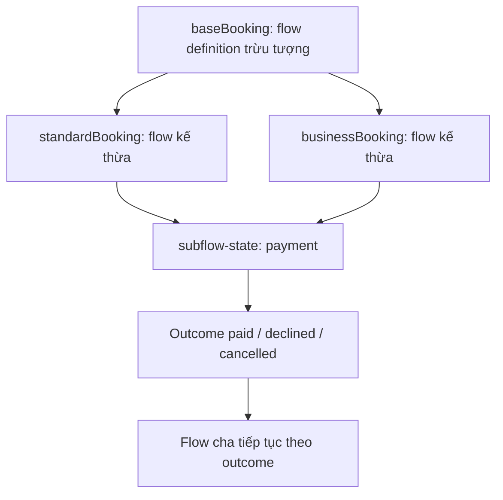

# Phân biệt tái sử dụng định nghĩa với gọi subflow

Trong chương **Kế thừa định nghĩa**, Spring Web Flow có hai cách tổ chức lại những phần luồng được dùng chung: kế thừa flow definition và gọi một subflow. Cả hai đều giúp tránh lặp logic điều hướng trong controller, nhưng giải quyết hai nhu cầu khác nhau. Kế thừa tái sử dụng cấu trúc của một flow ngay ở mức định nghĩa; subflow gọi một quy trình con riêng trong lúc flow cha đang chạy.

Với **SPRING_WEB_FLOW**, sự phân biệt này quan trọng khi thiết kế các hành trình nhiều bước. Nếu nhiều flow có cùng khung state và transition nhưng khác một vài màn hình hoặc kết quả, kế thừa định nghĩa thường phù hợp. Nếu một quy trình có vòng đời và kết quả riêng, có thể được gọi từ nhiều flow cha, subflow thường là ranh giới tốt hơn.

## 1. Hai cơ chế giải quyết hai loại tái sử dụng

Hãy hình dung hệ thống có hai hành trình: đặt phòng tiêu chuẩn và đặt phòng dành cho khách doanh nghiệp. Cả hai đều có bước xem lại thông tin, xác nhận và kết thúc. Chúng có thể dùng chung khung flow, nhưng khác view xác nhận và một số bước riêng.

Một quy trình khác là thanh toán. Thanh toán có các state, event, xử lý lỗi và kết quả riêng; nhiều hành trình đặt phòng hoặc mua hàng đều có thể gọi quy trình này. Đây là một ứng viên tự nhiên cho subflow.

| Tiêu chí | Kế thừa flow definition | Gọi subflow |
|---|---|---|
| Mục đích | Tạo flow cụ thể từ một flow definition dùng chung. | Gọi một quy trình con có thể tái sử dụng trong flow đang chạy. |
| Thời điểm kết hợp | Khi Web Flow xây dựng definition của flow con kế thừa. | Khi flow cha đi đến `subflow-state` trong lúc thực thi. |
| Cấu trúc runtime | Flow kế thừa chạy như một flow execution của chính nó. | Flow cha tạm dừng tại `subflow-state` trong khi flow con thực thi. |
| State và transition | Child flow nhận các state và transition được kế thừa, có thể bổ sung hoặc ghi đè phần cần tùy biến. | Flow con có state, transition và kết quả kết thúc riêng. |
| Trao đổi dữ liệu | Dùng model và scope của flow kế thừa; các thành phần định nghĩa được kế thừa theo cấu hình. | Dùng input/output mapping và outcome của subflow để trao đổi với flow cha. |
| Kết thúc | Kết thúc flow kế thừa theo end state của nó. | Subflow kết thúc và trả outcome cho flow cha; flow cha tiếp tục từ transition tương ứng. |

Điểm cần nhớ là kế thừa không tạo ra một flow con chạy lồng bên trong flow cha. Subflow mới là một lần thực thi flow được gọi từ một state của flow cha.

## 2. Kế thừa một flow definition

Một flow definition có thể được khai báo là `abstract="true"` để dùng làm định nghĩa cha. Flow cụ thể khai báo thuộc tính `parent` bằng ID của flow cha. Các state, transition và biến được định nghĩa chung có thể được tái sử dụng; flow con có thể bổ sung state hoặc định nghĩa lại state cùng ID để tùy biến hành vi.

Ví dụ, flow cha `baseBooking` định nghĩa bước xem lại và transition xác nhận:

```xml
<flow xmlns="http://www.springframework.org/schema/webflow"
      xmlns:xsi="http://www.w3.org/2001/XMLSchema-instance"
      xsi:schemaLocation="http://www.springframework.org/schema/webflow
                          https://www.springframework.org/schema/webflow/spring-webflow.xsd"
      abstract="true">

    <var name="booking" class="com.example.booking.BookingForm" />

    <view-state id="reviewBooking" model="booking">
        <transition on="confirm" to="completed" />
        <transition on="cancel" to="cancelled" />
    </view-state>

    <end-state id="completed" />
    <end-state id="cancelled" />
</flow>
```

Flow dành cho khách doanh nghiệp kế thừa định nghĩa này và bổ sung view cuối riêng:

```xml
<flow xmlns="http://www.springframework.org/schema/webflow"
      xmlns:xsi="http://www.w3.org/2001/XMLSchema-instance"
      xsi:schemaLocation="http://www.springframework.org/schema/webflow
                          https://www.springframework.org/schema/webflow/spring-webflow.xsd"
      parent="baseBooking"
      start-state="reviewBooking">

    <end-state id="completed" view="booking/business-confirmation" />
    <end-state id="cancelled" view="booking/cancelled" />
</flow>
```

Flow con nhận model `booking`, state `reviewBooking` và các transition từ definition cha. Nó định nghĩa lại end state để chọn view phù hợp với khách doanh nghiệp. Cả flow cha và flow con cần được đăng ký theo cách mà flow registry có thể tìm thấy definition tương ứng; giá trị `parent` phải khớp ID của definition cha.

Trong thực tế, flow cha thường không được khởi chạy trực tiếp nếu nó là abstract. Ứng dụng khởi chạy flow cụ thể kế thừa nó. Điều này giúp tránh việc người dùng truy cập nhầm một bộ khung chưa có view hoặc quy tắc hoàn chỉnh.

## 3. Bổ sung hoặc ghi đè phần cần tùy biến

Flow con không phải sao chép toàn bộ định nghĩa cha. Nó có thể giữ nguyên các state dùng chung và bổ sung state riêng cho biến thể nghiệp vụ. Nếu cần thay đổi cách một state hoạt động, child flow có thể khai báo state cùng ID để ghi đè định nghĩa tương ứng.

Ví dụ, biến thể doanh nghiệp cần thêm bước kiểm tra mã hợp đồng trước khi xem lại:

```xml
<flow parent="baseBooking" start-state="checkContract">
    <view-state id="checkContract">
        <transition on="valid" to="reviewBooking" />
    </view-state>

    <end-state id="completed" view="booking/business-confirmation" />
</flow>
```

State `reviewBooking` vẫn được kế thừa và có thể được dùng làm đích của transition từ state mới. Khi cần ghi đè một state, hãy đọc kỹ định nghĩa cuối cùng mà flow con sẽ sử dụng: không nên giả định mọi node con tự động được trộn vào state cha. Cần khai báo rõ các transition mà biến thể thực sự hỗ trợ và bảo đảm mọi đích transition đều tồn tại.

Kế thừa có ích khi các flow cùng chia sẻ phần lớn cấu trúc và chỉ khác một số điểm. Nếu flow con phải thay đổi gần như toàn bộ state graph, việc kế thừa có thể khiến quan hệ phụ thuộc khó hiểu; khi đó hãy cân nhắc tách các quy trình độc lập hoặc tạo một flow chung nhỏ hơn.

## 4. Gọi subflow từ flow cha

Subflow được gọi bằng `subflow-state`. Flow cha chỉ định flow ID ở thuộc tính `subflow`, truyền dữ liệu đầu vào qua `<input>` và khai báo transition theo outcome mà flow con trả về.

Ví dụ, flow đặt phòng gọi flow `payment` để xử lý thanh toán:

```xml
<subflow-state id="payForBooking" subflow="payment">
    <input name="amount" value="booking.total" />
    <input name="bookingReference" value="booking.reference" />

    <transition on="paid" to="completed">
        <set name="flowScope.paymentReference"
             value="currentEvent.attributes.paymentReference" />
    </transition>
    <transition on="declined" to="paymentProblem" />
    <transition on="cancelled" to="cancelled" />
</subflow-state>

<end-state id="completed" view="booking/confirmation" />
<view-state id="paymentProblem" />
<end-state id="cancelled" view="booking/cancelled" />
```

Flow `payment` nhận input, thực hiện các bước thanh toán và kết thúc bằng một outcome. Khi thanh toán thành công, end state trả mã tham chiếu:

```xml
<flow>
    <input name="amount" type="java.math.BigDecimal" />
    <input name="bookingReference" />

    <!-- Các state nhập phương thức và xác nhận thanh toán -->

    <end-state id="paid">
        <output name="paymentReference" value="payment.reference" />
    </end-state>
    <end-state id="declined" />
    <end-state id="cancelled" />
</flow>
```

ID của end state (`paid`, `declined`, `cancelled`) trở thành outcome mà flow cha dùng trong thuộc tính `on` của transition tại `subflow-state`. Output `paymentReference` được trả về trong event attributes; flow cha có thể lưu nó vào scope của mình để dùng ở các bước tiếp theo.

Flow cha chờ subflow kết thúc rồi mới tiếp tục. Nếu subflow trả outcome không có transition tương ứng, flow cha không thể đi theo nhánh mong đợi. Vì vậy, hãy khai báo rõ các outcome có thể xảy ra và quyết định cách xử lý từng trường hợp.

## 5. Khác biệt về scope và vòng đời

Kế thừa định nghĩa không tạo một ranh giới flow runtime mới. Các state kế thừa chạy trong flow execution của flow cụ thể; model và `flowScope` thuộc execution đó.

Subflow có flow scope riêng. Dữ liệu nội bộ của subflow tồn tại trong thời gian subflow chạy và được giải phóng khi subflow kết thúc. Conversation scope có thể được chia sẻ giữa flow cha và subflow trong cùng conversation. Dữ liệu mà flow cha cần sau khi subflow kết thúc nên được trả qua output hoặc được lưu ở scope phù hợp của flow cha.

| Dữ liệu | Kế thừa definition | Gọi subflow |
|---|---|---|
| Model chung | Thuộc flow execution của child flow cụ thể. | Flow cha và flow con có model/flow scope riêng; truyền dữ liệu qua input/output. |
| Biến nội bộ | Các biến được kế thừa thuộc flow cụ thể đang chạy. | Biến trong flow scope của subflow không tự trở thành biến flow scope của cha. |
| Dữ liệu chia sẻ qua nhiều bước | Giữ trong scope của flow kế thừa. | Dùng input/output, conversation scope hoặc nơi lưu bền vững tùy vòng đời. |
| Khi kết thúc | Flow cụ thể giải phóng scope của nó. | Subflow giải phóng flow scope riêng; flow cha tiếp tục và conversation vẫn còn. |

Đừng dùng conversation scope chỉ vì muốn truyền một giá trị từ subflow về cha. Với dữ liệu kết quả rõ ràng, input/output mapping làm hợp đồng giữa hai flow dễ hiểu và dễ kiểm thử hơn.

## 6. Chọn cơ chế nào cho tình huống thực tế?

Hãy dùng kế thừa definition khi các flow có cùng một quy trình tổng thể, cùng các state chính và cùng quy tắc chuyển bước. Những khác biệt thường là view, action, một số transition hoặc bước bổ sung của từng biến thể. Ví dụ: quy trình đặt phòng tiêu chuẩn và quy trình đặt phòng doanh nghiệp có chung bước nhập, xem lại và xác nhận.

Hãy dùng subflow khi phần được tái sử dụng là một quy trình nghiệp vụ có thể mô tả độc lập, có state graph riêng và có kết quả rõ ràng. Ví dụ: thanh toán, xác minh danh tính hoặc chọn địa chỉ giao hàng. Flow con nên có input/output và outcome ổn định để nhiều flow cha có thể gọi mà không cần biết chi tiết nội bộ.

Một ứng dụng có thể dùng cả hai. Các flow đặt phòng có thể kế thừa `baseBooking`, sau đó mỗi flow cụ thể gọi cùng một subflow `payment`. Kế thừa chia sẻ khung của hành trình đặt phòng; subflow đóng gói quy trình thanh toán.



## 7. Kiểm thử hai cơ chế ở đúng cấp độ

Kiểm thử kế thừa cần xác nhận flow cụ thể sau khi được xây dựng có đầy đủ state và transition mong đợi:

- Khởi chạy child flow, xác nhận start state đúng.
- Gửi event qua state được kế thừa và xác nhận transition đi đúng đích.
- Kiểm tra state bị ghi đè sử dụng view hoặc action của child flow.
- Kiểm tra biến được kế thừa có kiểu và giá trị khởi tạo đúng.
- Xác nhận flow cha abstract không bị dùng như một flow entry point ngoài ý muốn.

Kiểm thử subflow cần tách thành hai lớp:

- **Test riêng subflow:** cung cấp input, gửi các event của flow con và xác nhận từng end-state/outcome cùng output.
- **Test tích hợp flow cha:** chạy đến `subflow-state`, xác nhận input được truyền đúng, sau đó kiểm tra từng outcome đưa flow cha đến đúng state và nhận đúng output.

Ví dụ ma trận cho quy trình thanh toán:

| Input hoặc tình huống | Outcome từ subflow | Kết quả ở flow cha |
|---|---|---|
| Số tiền và mã đặt phòng hợp lệ, thanh toán thành công | `paid` kèm `paymentReference` | Đi đến `completed`, lưu mã giao dịch. |
| Cổng thanh toán từ chối | `declined` | Đi đến `paymentProblem`. |
| Người dùng hủy | `cancelled` | Đi đến end state hủy. |
| Thiếu input bắt buộc | Lỗi khởi tạo hoặc lỗi hợp đồng input | Test xác nhận lỗi được xử lý theo cấu hình, không giả định subflow hoàn tất bình thường. |

Khi kiểm thử, hãy dùng cùng flow registry và cách resolve definition như môi trường ứng dụng. Test chỉ tạo trực tiếp flow con mà không kiểm tra mapping của flow cha sẽ không phát hiện lỗi tên input, output hoặc outcome ở ranh giới tích hợp.

## 8. Lỗi thiết kế thường gặp

| Hiện tượng | Nguyên nhân cần kiểm tra |
|---|---|
| Child flow không tìm thấy parent | `parent` không khớp ID definition cha hoặc parent chưa được đăng ký trong flow registry. |
| Flow abstract bị khởi chạy trực tiếp | Definition dùng làm khuôn chưa được đánh dấu `abstract="true"` hoặc registry cho phép truy cập entry point ngoài ý muốn. |
| Transition kế thừa đi đến state không tồn tại | Child ghi đè hoặc loại bỏ state đích mà không cập nhật các transition liên quan. |
| Child flow không dùng view tùy biến | State cần thay đổi chưa được định nghĩa lại đúng ID hoặc view name của child sai. |
| Flow cha không tiếp tục sau subflow | `on` không khớp ID end state của subflow hoặc thiếu transition cho outcome đó. |
| Flow cha không nhận output | Tên output, biểu thức nguồn hoặc event attribute không khớp mapping đã khai báo. |
| Dữ liệu subflow biến mất sau khi kết thúc | Dữ liệu chỉ nằm trong flow scope của subflow nhưng flow cha chưa nhận qua output hoặc scope dùng chung. |

Khi gặp lỗi, trước hết xác định vấn đề xảy ra lúc xây dựng definition hay lúc flow đang thực thi. Lỗi `parent`, state kế thừa và ghi đè thường thuộc giai đoạn resolve/build definition; lỗi input, output và outcome thường xuất hiện ở ranh giới runtime của subflow.

## 9. Thực hành

Thiết kế hai biến thể đặt phòng và một quy trình thanh toán dùng chung.

1. Tạo flow abstract `baseBooking` với model, state xem lại và các outcome xác nhận/hủy.
2. Tạo `standardBooking` kế thừa `baseBooking`, dùng view xác nhận tiêu chuẩn.
3. Tạo `businessBooking` kế thừa cùng definition, bổ sung bước kiểm tra hợp đồng và ghi đè view xác nhận.
4. Tạo subflow `payment` nhận `amount` và `bookingReference`, trả các outcome `paid`, `declined`, `cancelled`.
5. Cho cả hai flow đặt phòng gọi `payment` bằng `subflow-state`; ánh xạ `paymentReference` về flow cha khi thành công.
6. Kiểm thử riêng hai child flow để xác nhận state kế thừa và phần tùy biến.
7. Kiểm thử subflow riêng và kiểm thử tích hợp từng outcome để xác nhận flow cha đi đúng nhánh.

Bạn hoàn thành bài khi giải thích được kế thừa definition kết hợp cấu trúc flow ở thời điểm xây dựng, subflow tạo một quy trình con lúc runtime, và chọn đúng cơ chế dựa trên ranh giới nghiệp vụ, scope cùng hợp đồng input/output.
