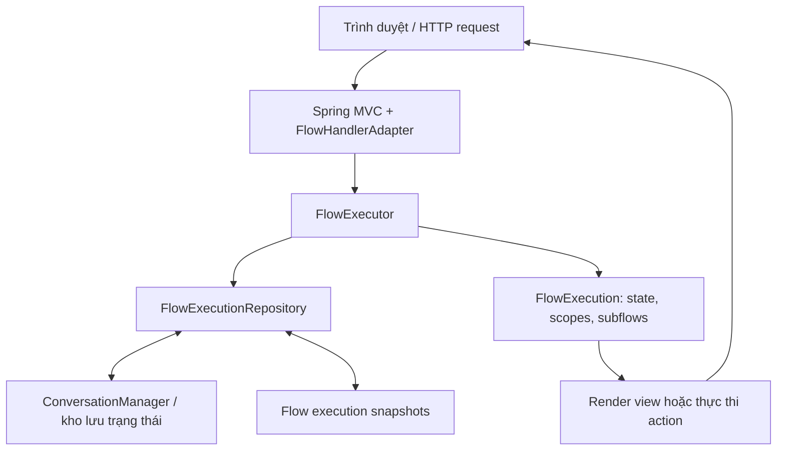
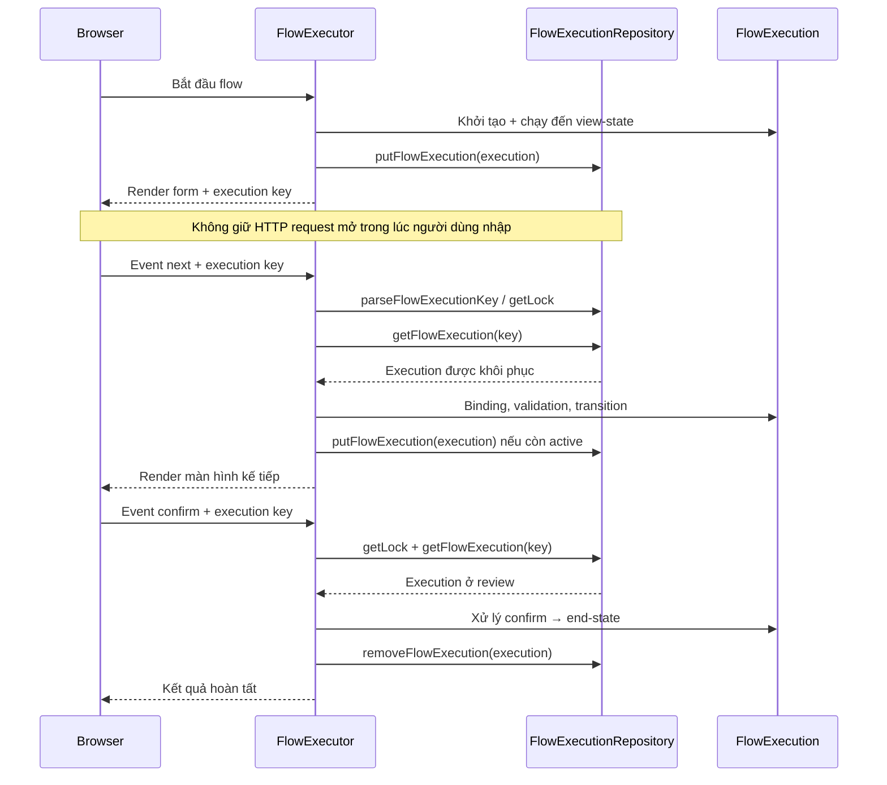

# `FlowExecutionRepository`: trách nhiệm lưu, khôi phục và xóa flow execution

## Mục tiêu học tập

Spring Web Flow cho phép mô hình hóa một hành trình web nhiều bước bằng **state**, **event**, **transition** và **subflow**. Người dùng có thể đang nhập form ở một `view-state`, dừng vài phút, rồi gửi yêu cầu HTTP tiếp theo để hoàn thành hành trình. Để tiếp tục từ đúng bước, hệ thống phải nhớ trạng thái thực thi của flow giữa các request.

Bài học trong chương **Lưu trữ execution** giải thích vai trò của **`FlowExecutionRepository`**: lưu một flow execution còn hoạt động, khôi phục nó khi nhận request tiếp theo và loại bỏ nó khi flow kết thúc. Sau khi học, bạn có thể:

- Phân biệt **flow definition**, **flow execution**, **flow execution key**, **conversation** và **snapshot**.
- Mô tả chính xác chu trình **lưu → khôi phục → cập nhật → xóa**.
- Nhận biết các phương thức cốt lõi của `FlowExecutionRepository` trong Spring Web Flow 3.x.
- Giải thích ý nghĩa của repository lock, giới hạn số execution và giới hạn snapshot.
- Phân tích lỗi session hết hạn, key không hợp lệ, truy cập song song và trạng thái đã bị xóa.
- Phân biệt việc lưu trạng thái điều hướng trong repository với việc lưu dữ liệu nghiệp vụ lâu dài trong database.

## 1. Bài toán: HTTP không giữ sẵn tiến trình Java giữa hai lần nhấn nút

Xét quy trình đăng ký dịch vụ:

```text
Nhập thông tin → Xem lại → Xác nhận → Hoàn tất
```

Khi người dùng đang ở màn hình **Xem lại**, request đã render màn hình này thường **kết thúc**. Vài phút sau, họ nhấn **Xác nhận**, tạo một HTTP request **mới**. Không có Java thread nào phải ngồi chờ giữa hai request đó.

Nhưng request mới cần biết:

1. Người dùng thuộc **lần thực thi flow nào**? Một người có thể mở nhiều tab, mỗi tab bắt đầu một lần đăng ký khác nhau.
2. Flow đã đến **state nào**? Có thể là `review`, chưa phải `completed`.
3. **Dữ liệu đã nhập** đang ở đâu? Ví dụ `flowScope.registrationDraft`.
4. Có **subflow** đang hoạt động hoặc lịch sử snapshot nào cần khôi phục không?
5. Sau khi xử lý event `confirm`, trạng thái mới có cần tiếp tục được lưu không, hay flow đã kết thúc và cần xóa?

Spring Web Flow giải quyết bằng cách phân biệt **bản định nghĩa flow** với **trạng thái thực thi của một người dùng tại một thời điểm**.

| Khái niệm | Đại diện cho | Ví dụ |
| --- | --- | --- |
| `FlowDefinition` | Cấu trúc flow đã cấu hình: state, event, transition, action | XML định nghĩa `registration-flow` |
| `FlowExecution` | Một **lần chạy cụ thể** của flow, với state và dữ liệu hiện tại | Tab A đang ở `review` với bản nháp A |
| `FlowExecutionKey` | Định danh giúp truy cập lại một execution/snapshot được quản lý | Một giá trị opaque xuất hiện trong URL flow execution |
| `FlowExecutionRepository` | Bộ phận quản lý lưu, khôi phục và loại bỏ `FlowExecution` | Thành phần được `FlowExecutor` sử dụng |
| `Conversation` | Ngữ cảnh quản lý vòng đời của một flow execution logic | Nhóm trạng thái/snapshot thuộc cùng lần chạy |
| `Snapshot` | Bản chụp trạng thái execution ở một thời điểm | Trạng thái lúc đang ở `enterDetails` |

Một **flow definition** được nhiều người dùng dùng chung, nhưng mỗi người dùng hoặc mỗi lần khởi chạy có **flow execution** riêng. Repository quản lý những execution đang hoạt động; nó không cần nhân bản định nghĩa XML cho từng request.

## 2. `FlowExecutionRepository` đứng ở đâu trong kiến trúc?

Trong ứng dụng Spring MVC tích hợp Spring Web Flow, HTTP request của một flow thường đi qua thành phần tích hợp MVC tới `FlowExecutor`. Executor khởi động hoặc tiếp tục flow và sử dụng repository để quản lý execution.



Mỗi thành phần có trách nhiệm riêng:

- **FlowExecutor** điều phối việc bắt đầu flow, tiếp tục khi có event và kết thúc flow.
- **FlowExecution** chứa trạng thái của lần chạy: state hiện tại, dữ liệu scope, stack subflow và các thông tin cần để tiếp tục.
- **FlowExecutionRepository** giữ khả năng lấy lại execution sau khi request trước đã kết thúc.
- **ConversationManager** quản lý ngữ cảnh conversation mà implementation repository sử dụng; trong cấu hình web thông dụng, dữ liệu thường gắn với HTTP session.
- **Snapshot factory** có thể tạo/khôi phục các bản chụp execution để hỗ trợ lịch sử điều hướng, tùy cấu hình.

`FlowExecutionRepository` là một **giao diện hạ tầng**, không phải nơi bạn khai báo transition hay đặt logic nghiệp vụ. Trong các flow thông thường, ứng dụng cấu hình `FlowExecutor` và để framework tự gọi repository; controller hoặc service nghiệp vụ không cần tự lấy execution ra rồi ghi lại trong mỗi request.

## 3. Ba trách nhiệm chính: lưu, khôi phục, xóa

### 3.1. Lưu execution còn hoạt động

Khi flow bắt đầu, Spring Web Flow tạo một `FlowExecution` và thực thi cho đến khi có điểm chờ, chẳng hạn `view-state` hiển thị form. Để người dùng có thể nhấn nút ở request sau, trạng thái execution cần được lưu bởi repository.

Giả sử người dùng bắt đầu form:

```text
Request #1: GET /registration
  → Khởi chạy flow "registration"
  → Vào state "enterDetails"
  → flowScope.registrationDraft được tạo
  → Lưu execution còn hoạt động
  → Render form và trả HTTP response
```

Tại thời điểm này:

- Request #1 đã hoàn tất.
- Flow **vẫn còn hoạt động**.
- Repository giữ đủ trạng thái để framework tiếp tục flow sau này.
- Trình duyệt nhận một **flow execution key** trong URL hoặc cơ chế truyền key do Web Flow hỗ trợ.

Trong API, thao tác lưu/cập nhật được thể hiện bằng:

```java
void putFlowExecution(FlowExecution flowExecution);
```

Đây là **chữ ký API để nhận diện**, không có nghĩa ứng dụng nên gọi thẳng phương thức này sau mỗi controller. `FlowExecutor` đảm nhận vòng đời thông thường.

**Lưu ý về từ “lưu”:** repository lưu **trạng thái thực thi của hành trình**, không đồng nghĩa với việc đã ghi một bản đăng ký hoàn chỉnh vào cơ sở dữ liệu nghiệp vụ. Việc lưu đơn hàng/đăng ký chính thức là trách nhiệm của service nghiệp vụ tại một bước phù hợp của flow.

### 3.2. Khôi phục execution để xử lý event mới

Người dùng điền form, nhấn **Tiếp tục**, trình duyệt gửi request:

```text
Request #2: POST /registration?execution=<flow-execution-key>
  form: fullName=...
  event: next
```

Sơ đồ trên chỉ là mô tả khái niệm; tên tham số URL và cách gửi event thực tế phụ thuộc tích hợp Web Flow và giao diện. Key cần được xem là **định danh opaque** do framework quản lý, không tự tạo từ tên state hoặc thông tin người dùng.

Trình tự xử lý:

1. Tầng Web Flow lấy chuỗi key được gửi trong request.
2. Repository **phân tích key** thành `FlowExecutionKey`.
3. Framework lấy **lock** tương ứng để kiểm soát truy cập đồng thời vào execution.
4. Repository **khôi phục `FlowExecution`** đang được quản lý.
5. Executor áp dụng event `next`, binding/validation nếu có, rồi thực hiện transition.
6. Nếu flow còn hoạt động, repository lưu trạng thái cập nhật để chờ request tiếp theo.

Phương thức phục hồi là:

```java
FlowExecution getFlowExecution(FlowExecutionKey key);
```

Kết quả là một execution được khôi phục, đủ ngữ cảnh để tiếp tục. Để tìm đúng execution, repository sử dụng key; **nó không tạo một flow hoàn toàn mới khi key cũ không còn hợp lệ**.

### 3.3. Xóa execution khi flow kết thúc

Người dùng xác nhận hoàn tất, flow đi tới `end-state` cuối cùng:

```text
Request #3: POST /registration?execution=<key-hiện-hành>
  → Khôi phục execution ở "review"
  → Nhận event "confirm"
  → Gọi service hoàn tất đăng ký
  → Đến end-state "completed"
  → Loại bỏ execution khỏi repository
  → Trả kết quả hoàn tất cho trình duyệt
```

Repository có phương thức:

```java
void removeFlowExecution(FlowExecution flowExecution);
```

Khi flow execution không còn hoạt động, framework loại bỏ trạng thái đã lưu và ngữ cảnh conversation liên quan theo cơ chế của repository. Với `DefaultFlowExecutionRepository`, khi một logical execution hoàn thành, các snapshot của execution đó cũng được vô hiệu hóa.

Điều này có hệ quả quan trọng: gửi lại URL/key của execution đã kết thúc **không phải cách hợp lệ để chạy lại bước xác nhận**. Ứng dụng nên hiển thị trang kết quả bền vững hoặc cho bắt đầu một flow mới khi cần.

**Không nhầm xóa execution với xóa dữ liệu nghiệp vụ.** Kết thúc flow và xóa bản lưu của flow không đồng nghĩa với xóa hồ sơ người dùng, đơn hàng đã xác nhận hoặc bản ghi trong database.

## 4. Vòng đời từ góc nhìn repository



Đây là **trình tự khái niệm** để hiểu trách nhiệm của các thành phần. Trong triển khai thực tế, cách tạo key, thời điểm snapshot/redirect, thao tác lock và trình tự callback nội bộ phụ thuộc implementation và cấu hình. Điểm bất biến về ý nghĩa là: **execution còn hoạt động được lưu; execution được khôi phục khi resume; execution kết thúc được loại bỏ**.

## 5. API `FlowExecutionRepository` trong Spring Web Flow 3.x

Interface `org.springframework.webflow.execution.repository.FlowExecutionRepository` cung cấp năm phương thức chính:

| Phương thức | Ý nghĩa | Khi nào liên quan? |
| --- | --- | --- |
| `parseFlowExecutionKey(String encodedKey)` | Chuyển chuỗi key thành đối tượng `FlowExecutionKey` | Khi request gửi key để tiếp tục flow |
| `getLock(FlowExecutionKey key)` | Lấy lock tương ứng với execution | Trước khi đọc/sửa/xóa execution cần bảo đảm đồng bộ |
| `getFlowExecution(FlowExecutionKey key)` | Khôi phục execution bằng key | Khi resume một flow ở request mới |
| `putFlowExecution(FlowExecution execution)` | Lưu hoặc cập nhật execution còn hoạt động | Khi flow tạm dừng chờ tiếp tục |
| `removeFlowExecution(FlowExecution execution)` | Xóa execution không còn hoạt động | Khi logical flow execution kết thúc |

Đây là các chữ ký trong interface của Web Flow 3.x. Có thể gặp tài liệu Web Flow **1.x** với phương thức khác như `generateKey(...)` và `putFlowExecution(key, execution)`; không nên sao chép chữ ký của nhánh cũ vào dự án dùng bản mới.

Một cách diễn đạt vòng đời bằng **mã giả**:

```text
if request là lần khởi chạy đầu:
    execution = FlowExecutor tạo và khởi chạy flow
else:
    key = repository.parseFlowExecutionKey(encodedKey)
    lock = repository.getLock(key)
    lock.lock()
    try:
        execution = repository.getFlowExecution(key)
        FlowExecutor tiếp tục execution với event trong request
        if execution còn active:
            repository.putFlowExecution(execution)
        else:
            repository.removeFlowExecution(execution)
    finally:
        lock.unlock()
```

Đoạn trên chỉ nhằm giải thích các trách nhiệm. **Không sử dụng làm code controller để thay thế `FlowExecutor`**: executor thật xử lý thêm việc tạo key, quản lý request context, sự kiện, render, lock, snapshot và các đường lỗi.

### Vì sao cần `FlowExecutionLock`?

Người dùng có thể nhấn đúp nút, trình duyệt có thể gửi hai request, hoặc hai tab cùng sử dụng một key. Nếu hai request cùng sửa execution mà không đồng bộ:

```text
Request A đọc state "review"      Request B đọc state "review"
        ↓                                ↓
Request A cập nhật dữ liệu         Request B cập nhật dữ liệu
        ↓                                ↓
Request A lưu trạng thái mới       Request B lưu trạng thái cũ đè lên
```

Lock giúp serialize phần truy cập execution theo cơ chế của repository. Nguyên tắc an toàn khi phải thao tác repository trực tiếp là **lấy lock trước khi khôi phục/sửa/lưu/xóa**, rồi luôn `unlock()` trong `finally`. Dù vậy, lock của repository không thay thế kiểm soát giao dịch ở database và không bảo đảm tác vụ nghiệp vụ như thanh toán chỉ được chạy một lần trong mọi tình huống.

## 6. Execution key, conversation và snapshot

### 6.1. Flow execution key dùng để làm gì?

`FlowExecutionKey` là định danh được repository sử dụng để tìm một execution đang được quản lý. Một URL minh họa có thể trông như:

```text
/checkout?execution=e1s2
```

Trong một số implementation, dạng `e1s2` thể hiện thông tin conversation/execution và snapshot. **Đây chỉ là ví dụ về dạng key**, không phải định dạng ổn định để ứng dụng tự phân tích hoặc tự ghép chuỗi.

Điều nên làm:

- Để Web Flow tạo và truyền URL/key hiện hành tới view.
- Gửi request tiếp tục flow qua URL do framework cung cấp.
- Không lưu key làm mã định danh nghiệp vụ hoặc khóa chính trong database.
- Không suy state hiện tại từ ký tự trong key.

Key xác định **trạng thái flow có thể khôi phục**, còn việc người dùng có được phép xem/sửa dữ liệu là trách nhiệm của tầng xác thực, phân quyền và nghiệp vụ.

### 6.2. Conversation quản lý một lần chạy logic

Một `Conversation` đại diện cho ngữ cảnh của một execution logic được repository quản lý. Một user session có thể tồn tại **nhiều** flow execution/conversation, chẳng hạn khi mở hai lần checkout độc lập.

`DefaultFlowExecutionRepository` làm việc với `ConversationManager`: khi một execution được gán persistent key, repository có thể khởi tạo conversation; khi flow kết thúc, repository kết thúc conversation tương ứng. Nơi conversation được cất giữ phụ thuộc `ConversationManager` và cấu hình nền tảng.

**Conversation của Web Flow không tương đương toàn bộ HTTP session**. HTTP session có thể chứa nhiều conversation; khi một conversation kết thúc, các dữ liệu session khác không mặc nhiên bị xóa.

### 6.3. Snapshot là gì, có phải một execution mới không?

Snapshot là **bản chụp trạng thái** của execution tại một thời điểm. Ví dụ một flow có thể trải qua:

```text
Snapshot S1: enterAddress, dữ liệu ban đầu
Snapshot S2: reviewOrder, dữ liệu đã nhập
Snapshot S3: shippingOptions, phương án vận chuyển đã chọn
```

Nếu repository giữ snapshot cũ, hệ thống có thể hỗ trợ một số hành vi quay lại bằng lịch sử trình duyệt. Mỗi snapshot là **mốc trạng thái của cùng lần chạy logic**, không nhất thiết là một flow mới.

`DefaultFlowExecutionRepository` sử dụng `FlowExecutionSnapshotFactory` để tạo/khôi phục snapshot và quản lý lịch sử trong `FlowExecutionSnapshotGroup`. Một implementation snapshot có thể dựa trên Java serialization; vì vậy object graph trong scope cần được cân nhắc về khả năng serialization và kích thước.

Hai lưu ý quan trọng:

1. **Snapshot không phải bản ghi nghiệp vụ bền vững.** Một snapshot cũ có thể biến mất khi bị giới hạn dung lượng, khi conversation hết hạn hoặc khi flow kết thúc.
2. **Quay lại snapshot không đồng nghĩa hoàn tác database.** Nếu một action trước đó đã tạo đơn hoặc trừ tồn kho, việc khôi phục trạng thái giao diện trước đó không tự rollback tác dụng phụ đã ghi.

## 7. Cấu hình số execution và số snapshot

Bạn có thể điều chỉnh chính sách lưu trữ bằng namespace cấu hình Spring Web Flow:

```xml
<!-- Đoạn cấu hình trong Spring application context đã khai báo namespace webflow -->
<webflow:flow-executor id="flowExecutor" flow-registry="flowRegistry">
    <webflow:flow-execution-repository
        max-executions="5"
        max-execution-snapshots="30" />
</webflow:flow-executor>
```

Đây là các thuộc tính liên quan tới repository của `FlowExecutor`, **không phải thuộc tính viết trong file định nghĩa flow** như `checkout-flow.xml`.

| Thiết lập | Phạm vi tác dụng | Hệ quả cần hiểu |
| --- | --- | --- |
| `max-executions="5"` | Số execution được giữ trong **mỗi user session**, tính qua nhiều flow definition | Khi vượt giới hạn, execution cũ nhất có thể bị loại bỏ |
| `max-execution-snapshots="30"` | Số snapshot lịch sử trên **mỗi flow execution** | Giới hạn bộ nhớ dành cho lịch sử; snapshot cũ ngoài giới hạn không còn để khôi phục |
| `max-execution-snapshots="0"` | Tắt việc tạo bản sao snapshot lịch sử | **Không** có nghĩa tắt hoàn toàn việc lưu execution hiện tại; browser Back tới key snapshot không được giữ sẽ không khôi phục được |
| `max-execution-snapshots="-1"` | Không đặt giới hạn số snapshot | Có thể tiêu tốn nhiều tài nguyên khi flow dài hoặc model lớn |

Nếu sử dụng Java configuration kế thừa cơ chế `AbstractFlowConfiguration` với `getFlowExecutorBuilder(...)`, ví dụ tương đương:

```java
@Bean
public FlowExecutor flowExecutor() {
    return getFlowExecutorBuilder(flowRegistry())
            .setMaxFlowExecutions(5)
            .setMaxFlowExecutionSnapshots(30)
            .build();
}
```

Đoạn Java trên chỉ minh họa phần dựng `FlowExecutor`; method `getFlowExecutorBuilder` đến từ class cấu hình Web Flow tương ứng, không phải một method tĩnh của `FlowExecutor`.

### Chọn giới hạn như thế nào?

Giả sử một flow checkout có 5 view-state, mỗi execution chứa bản nháp đơn với nhiều sản phẩm. Nếu mỗi người dùng mở 8 tab và mỗi tab giữ hàng chục snapshot, mức sử dụng session memory có thể tăng đáng kể.

Khi chọn cấu hình, hãy cân nhắc:

- Người dùng có cần hỗ trợ nhiều tab/flow song song không?
- Họ cần browser Back qua nhiều bước hay đã có các event `back` chính thức?
- Model trong `flowScope`/`conversationScope` có lớn hoặc khó serialization không?
- Hệ thống phải chịu bao nhiêu user session đồng thời?
- Cần có chính sách timeout/khôi phục bản nháp nghiệp vụ như thế nào?

Không có một con số tốt cho tất cả hệ thống. Nên đo dung lượng session/snapshot và kiểm thử các kịch bản sử dụng thực tế trước khi đặt giới hạn cao.

## 8. Ví dụ xuyên suốt: lưu bản nháp trong flow, ghi hồ sơ khi xác nhận

Một flow đăng ký dịch vụ có thể được mô tả như sau:

```xml
<?xml version="1.0" encoding="UTF-8"?>
<flow xmlns="http://www.springframework.org/schema/webflow"
      xmlns:xsi="http://www.w3.org/2001/XMLSchema-instance"
      xsi:schemaLocation="http://www.springframework.org/schema/webflow
                          https://www.springframework.org/schema/webflow/spring-webflow.xsd">

    <on-start>
        <evaluate expression="registrationService.newDraft()"
                  result="flowScope.registrationDraft" />
    </on-start>

    <view-state id="enterDetails"
                view="registration/details"
                model="registrationDraft">
        <transition on="next" to="review" />
        <transition on="cancel" to="cancelled" bind="false" />
    </view-state>

    <view-state id="review" view="registration/review">
        <transition on="back" to="enterDetails" />
        <transition on="confirm" to="saveRegistration" />
    </view-state>

    <action-state id="saveRegistration">
        <evaluate expression="registrationService.save(registrationDraft)" />
        <transition on="success" to="completed" />
    </action-state>

    <end-state id="completed" />
    <end-state id="cancelled" />
</flow>
```

Ví dụ giả định có bean `registrationService` với `newDraft()` tạo model và `save(...)` là action hoàn thành bình thường. View logic `registration/details`, `registration/review` cần được resolve bằng cấu hình giao diện của ứng dụng. Một ứng dụng thực tế cần xử lý thêm ngoại lệ khi lưu, CSRF, kiểm tra quyền và tránh lưu trùng.

Quan sát từ góc nhìn repository:

| Thời điểm | State/hoạt động | Repository phải hỗ trợ | Tầng nghiệp vụ |
| --- | --- | --- | --- |
| Mở form | `enterDetails` chờ người dùng | Lưu execution với `registrationDraft` trong flow scope | Chưa bắt buộc ghi đăng ký chính thức |
| Nhấn Next | Resume, bind/validate, đến `review` | Khôi phục execution cũ rồi lưu lại khi tiếp tục chờ | Dữ liệu bản nháp được sử dụng |
| Nhấn Back | Resume, trở về `enterDetails` | Khôi phục rồi lưu state hiện tại | Không tự đảo ngược database |
| Nhấn Confirm | Chạy `saveRegistration` | Khôi phục execution đang chờ | `registrationService.save(...)` thực hiện ghi nghiệp vụ |
| Đến `completed` | Execution kết thúc | Xóa/invalidate execution và snapshot liên quan | Bản đăng ký đã lưu phải sống độc lập với flow |
| Nhấn Cancel | Execution đi đến `cancelled` | Xóa execution đã kết thúc | Chính sách xử lý bản nháp đã lưu ngoài flow phải được thiết kế riêng |

Điểm cốt lõi: `flowScope.registrationDraft` tiện để đưa dữ liệu qua nhiều view-state, nhưng khi yêu cầu **khôi phục qua session hết hạn hoặc người dùng đăng nhập lại hôm sau**, cần cơ chế lưu bản nháp ở database/cache bền vững theo nghiệp vụ. Repository mặc định không bảo đảm khả năng phục hồi dài hạn đó.

## 9. Các lỗi thường gặp khi lưu hoặc khôi phục execution

### 9.1. Người dùng để form mở quá lâu

**Hiện tượng:** người dùng nhấn Next sau một thời gian dài và gặp lỗi flow execution không tồn tại.

**Nguyên nhân có thể:** session đã hết hạn, conversation bị giải phóng, execution bị loại do `max-executions`, hoặc key cũ trỏ vào snapshot không được giữ.

**Cách xử lý:** xác định nguyên nhân qua exception/log an toàn; hiển thị thông báo phiên đã hết hạn; cung cấp đường dẫn khởi chạy flow mới hoặc khôi phục bản nháp đã lưu ở tầng nghiệp vụ. Không tự phát minh key mới để gắn vào execution cũ.

### 9.2. Gửi request với key sai cú pháp

**Hiện tượng:** request không thể resume flow vì giá trị `execution` không hợp lệ.

**Nguyên nhân:** key thiếu, bị sửa, bị cắt hoặc khác với định dạng repository chấp nhận.

**Cách xử lý:** sử dụng URL do Web Flow tạo, xác nhận form/link gửi đúng execution hiện hành. Không tin tưởng input key; tránh log nguyên văn giá trị nếu không cần thiết vì key gắn với trạng thái phiên người dùng.

### 9.3. Key đúng cú pháp nhưng execution không còn

Một key có thể được parse thành công nhưng không còn tra cứu được execution:

- Flow đã hoàn thành và repository đã xóa trạng thái.
- User session bị invalidate.
- Execution quá cũ đã bị loại khỏi danh sách quản lý.
- Snapshot được yêu cầu không còn trong lịch sử.

Đây là **lỗi truy cập/khôi phục**, không có nghĩa cú pháp key hỏng. Cách phục hồi tùy tình huống; với flow đã hoàn thành, nên điều hướng tới trang kết quả dựa trên mã đơn hàng đã lưu, thay vì cho gửi lại event xác nhận.

### 9.4. Serialization thất bại khi lưu snapshot

`DefaultFlowExecutionRepository` có cơ chế snapshot; một implementation snapshot chuẩn có thể dựa trên Java serialization. Nếu model trong scope chứa object không thể serialize hoặc giữ cả object graph lớn, việc tạo/khôi phục snapshot có thể thất bại hoặc tốn bộ nhớ.

Ví dụ không nên giữ trong flow scope:

```java
// Minh họa đối tượng KHÔNG nên giữ nguyên trong flowScope:
class RegistrationDraft {
    InputStream uploadedFileStream; // tài nguyên sống, khó serialize an toàn
    java.sql.Connection connection; // kết nối hạ tầng
}
```

Thay vào đó, chỉ giữ **dữ liệu cần thiết và serializable** hoặc ID để truy xuất dữ liệu nghiệp vụ:

```java
import java.io.Serializable;

public class RegistrationDraft implements Serializable {
    private static final long serialVersionUID = 1L;

    private String name;
    private String email;
    private String attachmentId; // tham chiếu file đã lưu an toàn bên ngoài flow

    // getters/setters và validation theo ứng dụng
}
```

Đây là gợi ý thiết kế model; yêu cầu serialization cụ thể phụ thuộc snapshot factory và cách triển khai repository. Không nên giữ entity JPA đang mở session, stream, connection hoặc service singleton trong flow scope.

### 9.5. Người dùng nhấn đúp Confirm

Repository lock giúp kiểm soát truy cập đồng thời vào execution, còn việc loại bỏ execution khi kết thúc làm key cũ mất hiệu lực. Tuy nhiên, **không nên coi đó là bảo đảm exactly-once** cho mọi side effect, đặc biệt khi request bị retry hoặc có nhiều đường gọi service.

Với thanh toán/đặt hàng, service nghiệp vụ cần sử dụng cơ chế chống xử lý trùng như idempotency key nghiệp vụ, unique constraint hoặc xử lý giao dịch phù hợp. `FlowExecutionKey` không phải khóa idempotency cho giao dịch thương mại.

### 9.6. Triển khai nhiều node phía server

Nếu repository/conversation được lưu trong HTTP session trên một node, request tiếp theo đến node khác có thể không tìm được trạng thái nếu không có cơ chế chia sẻ/replication hoặc sticky session thích hợp. Hãy kiểm tra:

- Chiến lược phân phối request giữa các node.
- Cơ chế lưu và replication session trong môi trường triển khai.
- Khả năng serialize của object scope.
- Chính sách timeout, failover và triển khai phiên bản mới khi còn execution cũ.

Không mặc định rằng dùng Spring Web Flow sẽ tự tạo một distributed repository có độ bền tương đương database.

## 10. Phân biệt lưu execution và lưu dữ liệu nghiệp vụ

Đây là ranh giới quan trọng nhất khi thiết kế hệ thống nhiều bước.

| Mục tiêu | Nơi quản lý phù hợp | Ví dụ |
| --- | --- | --- |
| Tiếp tục state machine ở request sau | `FlowExecutionRepository` | Đang ở state `review` |
| Giữ thông tin tạm qua nhiều state | `flowScope` / `conversationScope` trong execution | Form đang điền |
| Nhớ lịch sử giao diện để hỗ trợ Back | Snapshot repository, nếu được bật | Trở về trạng thái form ở mốc trước |
| Lưu đơn hàng sau xác nhận | Service nghiệp vụ + database | Đơn hàng số `ORD-1001` |
| Khôi phục bản nháp vào ngày hôm sau | Kho bản nháp do ứng dụng thiết kế | `draftId` gắn tài khoản |
| Ngăn tạo đơn/thu tiền trùng | Ràng buộc nghiệp vụ/transaction/idempotency | Một request thanh toán được xử lý một lần theo khóa nghiệp vụ |

Nói cách khác, repository giữ **tiến trình hội thoại web**, còn database nghiệp vụ giữ **sự thật đã được xác nhận**. Kể cả khi bật snapshot lịch sử không giới hạn, repository cũng không tự cung cấp chức năng autosave bền vững hoặc khôi phục giao dịch.

## 11. Kịch bản kiểm thử repository cần có

Với flow đăng ký ở mục 8, các trường hợp sau giúp xác nhận hệ thống lưu, khôi phục và xóa đúng:

| Kịch bản | Hành động | Kết quả mong đợi |
| --- | --- | --- |
| **Lưu lần đầu** | Khởi chạy flow tới `enterDetails` | Có execution còn hoạt động, có URL/key để tiếp tục |
| **Resume** | Gửi Next với key hiện hành và dữ liệu hợp lệ | Đến `review`, dữ liệu bản nháp không mất |
| **Render lại** | Gửi dữ liệu form sai khi có validator | Vẫn ở `enterDetails`, thông báo lỗi được hiển thị |
| **Quay lại hợp lệ** | Gửi event Back từ `review` | Về `enterDetails`, dữ liệu còn trong `flowScope` |
| **Hoàn thành** | Gửi Confirm từ `review` | Gọi save nghiệp vụ, flow kết thúc, execution được invalidated |
| **Key cũ sau hoàn thành** | Gửi lại URL execution vừa kết thúc | Không tiếp tục được execution cũ; ứng dụng xử lý phù hợp |
| **Cancel** | Gửi Cancel ở form | Flow kết thúc, execution không còn active |
| **Giới hạn execution** | Tạo nhiều execution hơn `max-executions` trong cùng session | Execution cũ nhất có thể bị loại, key cũ không resume được |
| **Giới hạn snapshot** | Quay về một snapshot đã bị loại khỏi lịch sử | Không khôi phục được mốc đó; có thông báo/phương án phục hồi |
| **Session timeout** | Resume sau khi session hết hạn | Báo hết hạn và cho bắt đầu/khôi phục bản nháp phù hợp |
| **Hai request cạnh tranh** | Gửi event gần đồng thời từ cùng execution | Không xảy ra ghi đè trạng thái do truy cập không đồng bộ; nghiệp vụ có bảo vệ xử lý trùng |

Trong Spring Web Flow có thể kiểm thử logic bằng các tiện ích test flow để xác nhận state/event và dùng kiểm thử tích hợp MVC/HTTP để quan sát thật việc truyền execution key, session và cơ chế restore. **Unit test state transition không tự chứng minh session replication, serialization hoặc expiration hoạt động đúng**; các kịch bản đó cần môi trường tích hợp phù hợp.

Khi debug, nên theo dõi một chuỗi sự kiện tối thiểu:

```text
flowId → execution key (đã che bớt nếu cần) → state hiện tại
       → event đầu vào → lock/restore → transition
       → save hoặc remove → kết quả HTTP
```

Các dữ liệu này giúp phân biệt lỗi business validation, lỗi cấu hình transition, lỗi key/session và lỗi repository/snapshot. Tránh ghi log đầy đủ dữ liệu form nhạy cảm, object graph của flow hoặc key gắn với phiên người dùng.

## 12. Những nhầm lẫn cần tránh

**“Repository lưu tất cả flow definition của hệ thống.”** Không đúng. `FlowRegistry` quản lý các định nghĩa flow; repository quản lý **những lần thực thi đang hoạt động**.

**“Đã lưu execution là đã lưu đơn hàng.”** Không đúng. Bản nháp flow chỉ giúp tiếp tục hành trình; việc ghi dữ liệu nghiệp vụ bền vững phải do service/database xử lý.

**“HTTP request vẫn đang chạy khi người dùng nhìn form.”** Không đúng. Request render đã kết thúc; execution được tiếp tục ở request mới nhờ repository.

**“`max-execution-snapshots=0` có nghĩa không thể resume flow.”** Không đúng. Thiết lập này tắt lịch sử snapshot, không đồng nghĩa xóa cơ chế lưu trạng thái hiện tại giữa các request.

**“Bật snapshot là có thể hoàn tác mọi action.”** Không đúng. Snapshot phục hồi trạng thái execution, không rollback giao dịch hoặc tác dụng phụ đã ghi ra hệ thống ngoài.

**“Key cũ đã bị xóa thì repository tự tạo lại flow ở state cũ.”** Không đúng. Key không còn hợp lệ dẫn tới lỗi truy cập/khôi phục; khởi chạy flow mới là một luồng xử lý khác.

**“Repository lock đủ để ngăn thanh toán trùng.”** Không đúng. Lock quản lý truy cập execution, còn chống ghi nghiệp vụ trùng cần ràng buộc và giao dịch của tầng nghiệp vụ.

## 13. Câu hỏi tự kiểm tra

1. Vì sao một request POST với event `next` phải kèm định danh flow execution thay vì chỉ gửi tên state `review`?
2. Nếu `getFlowExecution(key)` trả lỗi sau khi user session hết hạn, tại sao không nên cố tự tạo một `FlowExecutionKey` mới rồi gán vào bản nháp cũ?
3. Trong `FlowExecutionRepository` 3.x, phương thức nào tương ứng với **lưu**, **khôi phục**, **xóa** và **lấy lock**?
4. `max-executions` và `max-execution-snapshots` giới hạn hai thứ khác nhau như thế nào?
5. Vì sao browser Back tới snapshot cũ không thể thay thế action nghiệp vụ “hoàn tác thanh toán”?
6. Nếu cần cho người dùng hoàn thành form vào hôm sau, đâu là dữ liệu nên lưu ở database và đâu là dữ liệu repository chỉ dùng để tiếp tục phiên hiện tại?

**Gợi ý:** Repository quản lý **vòng đời của execution đang chạy**; key xác định execution cần resume; `put/get/remove` làm việc với trạng thái flow; lock bảo vệ truy cập; snapshot lưu những mốc quá khứ khi được bật; database nghiệp vụ quản lý dữ liệu cần tồn tại lâu dài.

## 14. Kết luận

`FlowExecutionRepository` là hạ tầng cho phép Spring Web Flow **tạm dừng một hành trình ở `view-state` mà không giữ request HTTP mở**, rồi tiếp tục chính xác từ trạng thái đã lưu khi người dùng tương tác. Nó có ba trách nhiệm cốt lõi:

1. **Lưu** execution còn hoạt động, để các request sau có thể tiếp tục.
2. **Khôi phục** execution bằng key và phối hợp khóa truy cập khi xử lý event mới.
3. **Xóa** execution khi flow kết thúc, giải phóng conversation/snapshot theo chính sách của repository.

Hiểu ranh giới này giúp thiết kế các flow nhiều bước có quản lý scope, session, subflow, validation, điều hướng quay lại và phục hồi lỗi hợp lý; đồng thời tránh nhầm trạng thái giao diện tạm thời với dữ liệu nghiệp vụ cần lưu bền vững.

### Tài liệu tham khảo

- [Spring Web Flow 3.0.1 API — `FlowExecutionRepository`](https://docs.spring.io/spring-webflow/docs/3.0.1/api/org/springframework/webflow/execution/repository/FlowExecutionRepository.html): chữ ký các phương thức và quy tắc locking.
- [Spring Web Flow 3.0.0 Reference Guide — Tuning Flow Execution Persistence](https://docs.spring.io/spring-webflow/docs/3.0.0/reference/index.html): `max-executions`, `max-execution-snapshots` và ví dụ XML/Java.
- [Spring Web Flow 3.0.1 API — `DefaultFlowExecutionRepository`](https://docs.spring.io/spring-webflow/docs/3.0.1/api/org/springframework/webflow/execution/repository/impl/DefaultFlowExecutionRepository.html): thực thi repository mặc định và quản lý snapshot.
- [Spring Web Flow 3.0.1 API — `SerializedFlowExecutionSnapshotFactory`](https://docs.spring.io/spring-webflow/docs/3.0.1/api/org/springframework/webflow/execution/repository/snapshot/SerializedFlowExecutionSnapshotFactory.html): tạo và khôi phục snapshot bằng Java serialization.
