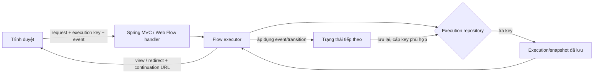
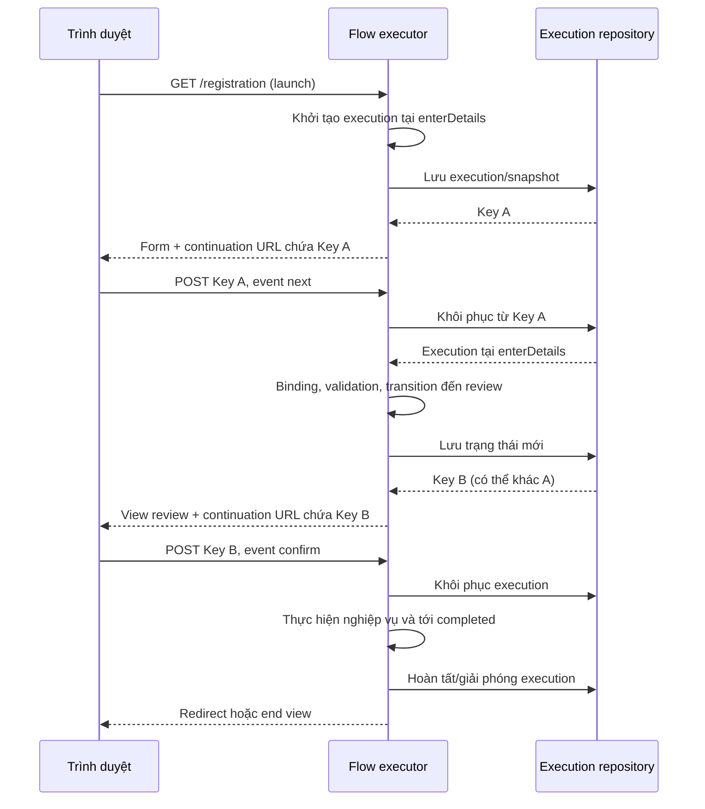
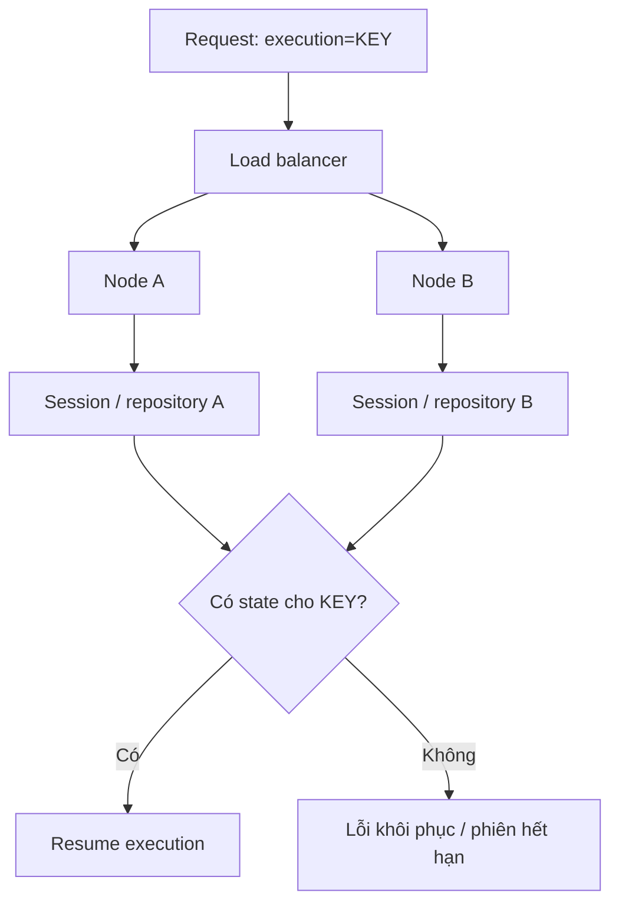

# Execution key và việc nhận diện trạng thái đã lưu trong Spring Web Flow

## 1. Tại sao Spring Web Flow cần execution key?

Spring Web Flow (SWF) được thiết kế để mô tả **hành trình web nhiều bước** bằng state, event và transition. Ví dụ, khi đặt lịch khám, người dùng chọn dịch vụ, chọn thời gian, điền thông tin rồi xác nhận. Server cần biết người dùng đang ở bước nào, dữ liệu đã nhập là gì và event `next` hoặc `confirm` phải áp dụng vào đúng hành trình nào.

HTTP là giao thức request/response. Sau khi server trả trang nhập liệu, một request khác có thể đến sau vài giây hoặc vài phút. Spring Web Flow vì vậy cần cơ chế **lưu execution** và **nhận diện đúng execution khi có request tiếp theo**. Thành phần trung tâm của cơ chế đó là **execution key**.

Hãy xét hai request:

```http
GET /app/booking HTTP/1.1
Host: example.test
```

```http
POST /app/booking?execution=e1s1 HTTP/1.1
Host: example.test
Content-Type: application/x-www-form-urlencoded

_eventId=next&serviceId=42
```

Request đầu thường yêu cầu **khởi chạy một flow mới**. Request thứ hai mang một tham số `execution` để Spring Web Flow **xác định execution cần tiếp tục**, cùng event `next` và dữ liệu form. Giá trị `e1s1` là **ví dụ minh họa một dạng key có thể gặp**; định dạng và cách sinh key phụ thuộc phiên bản, URL handler và execution repository.

> **Execution key là giá trị tham chiếu đến một flow execution được repository quản lý, và trong một số chiến lược lưu trữ nó còn nhận diện snapshot của execution.** Không nên coi key là ID đơn hàng, session ID, mã trạng thái hay địa chỉ URL bền vững.

## 2. Phân biệt các loại định danh

Nhiều sự cố vận hành bắt đầu từ việc nhầm `flow id` với `execution key` hoặc nhầm `snapshot id` với `session id`. Bảng dưới đây tách các khái niệm:

| Khái niệm | Nó nhận diện điều gì? | Ví dụ | Vòng đời |
| --- | --- | --- | --- |
| **Flow definition ID** | Bản thiết kế flow đã đăng ký | `booking` | Tồn tại khi ứng dụng có definition |
| **Flow execution** | Một lần chạy cụ thể của definition | Lần đặt lịch đang ở `selectTime` | Từ launch đến end/eviction |
| **Execution key** | Execution đã lưu, có thể kèm snapshot tùy repository | `e1s1` (minh họa) | Chỉ có ý nghĩa khi repository còn nhận ra |
| **Snapshot identifier** | Một mốc trạng thái được lưu trong cơ chế có snapshot | Phần biểu diễn snapshot trong key (nếu có) | Theo retention/cleanup của repository |
| **HTTP session ID** | Phiên HTTP của trình duyệt/khách | Cookie phiên do container cấp | Theo session timeout hoặc invalidation |
| **Event ID** | Yêu cầu thao tác trên state hiện tại | `next`, `back`, `confirm` | Gắn với request/transition |
| **Business ID** | Đối tượng nghiệp vụ đã tồn tại | `bookingId=BK-1042` | Theo vòng đời dữ liệu nghiệp vụ |

Hai người có thể cùng mở flow definition `booking` nhưng tạo **hai flow execution khác nhau**. Một người cũng có thể có hai execution trong hai tab. Vì vậy chỉ biết flow ID không đủ để nhận diện hành trình cụ thể.

Một execution đi qua các state khác nhau vẫn thuộc **cùng hành trình**, nhưng repository có thể sinh **key mới** khi lưu snapshot mới. Ngược lại, business ID như `BK-1042` có thể được truy vấn lại ngày hôm sau mà không cần một Web Flow execution còn sống.

### 2.1. Execution key có đồng nghĩa với conversation ID không?

Không nên đồng nhất hai khái niệm. Trong một số implementation lưu execution, key có thể biểu diễn **conversation** và **snapshot**. Ví dụ định dạng thường được tài liệu hoặc ví dụ minh họa dưới dạng `e1s1`, `e1s2`. Các phần chữ và số có thể khiến người đọc liên tưởng đến execution/conversation và snapshot.

Tuy nhiên, đó **không phải hợp đồng định dạng ổn định để ứng dụng tự phân tích**. Một custom repository hoặc phiên bản khác có thể biểu diễn key theo cách khác. Ứng dụng nên coi execution key là **opaque token**: lấy nguyên giá trị từ framework, truyền nguyên giá trị về framework và để framework quyết định cách đọc nó.

### 2.2. Execution key không phải thông tin xác thực

Ngay cả khi key có hình thức khó đoán, nó vẫn không thay thế được kiểm tra đăng nhập, quyền truy cập hay bảo vệ CSRF. Với repository dựa trên HTTP session, key còn phải được diễn giải trong session thích hợp. Nếu ai đó gửi key từ trình duyệt khác, không có gì bảo đảm repository sẽ tìm được execution.

Quyền được xác nhận đơn hàng hoặc xem dữ liệu khách hàng vẫn phải được kiểm tra ở tầng nghiệp vụ. **Có key không có nghĩa người gửi có quyền đối với mọi dữ liệu mà execution tham chiếu.**

## 3. Những thành phần tham gia nhận diện trạng thái đã lưu

Để hiểu key, cần nhìn vào quan hệ giữa những thành phần sau:

1. **Flow registry:** biết definition nào tương ứng với flow ID.
2. **Flow executor:** khởi chạy, tiếp tục, kết thúc và điều phối execution.
3. **Flow execution repository:** cấp/diễn giải key, lưu và khôi phục execution hoặc snapshot theo chiến lược đã chọn.
4. **Execution state:** gồm active state, scope, dữ liệu model, thông tin chuyển trạng thái và những thành phần cần thiết để resume.
5. **External context/HTTP request:** mang thông tin route, tham số `execution`, event và session phù hợp.



Trong thực tế, URL handler, repository và flow executor có thể phối hợp theo những lời gọi nội bộ khác nhau tùy version. Sơ đồ nêu **dòng xử lý khái niệm**, không phải một sequence API cố định.

### 3.1. State nào được khôi phục?

Khi repository khôi phục một execution, Spring Web Flow cần biết ít nhất:

- Flow definition nào đang được chạy, và **active state** hiện tại là state nào.
- Những dữ liệu mà execution còn giữ trong `flowScope`, `viewScope` và những scope liên quan.
- Các thông tin điều khiển cần thiết để tiếp tục transition hoặc subflow.
- Những đối tượng được repository lưu/khôi phục theo chiến lược snapshot cụ thể.

Không phải mọi dữ liệu có thể thấy ở một HTTP request đều nằm trong execution. Ví dụ, tham số request mới chỉ tồn tại ở request mới, database record phải được service truy vấn nếu chưa được lưu trong scope, còn các bean singleton của Spring thuộc application context.

### 3.2. Key dùng để tìm trạng thái, event dùng để thay đổi trạng thái

Hai ý nghĩa này độc lập:

```text
execution=e1s1   -> Tôi đang nói đến execution/snapshot nào?
_eventId=next     -> Tôi muốn thực hiện hành động gì tại state đó?
serviceId=42      -> Tôi gửi dữ liệu gì để bind/validate?
```

Nếu event `next` không có transition hợp lệ ở active state, server không tự chọn state tên `next`. Ngược lại, nếu có event hợp lệ nhưng key sai hoặc đã hết hạn, framework không thể tự biết request này nên áp dụng vào hành trình nào.

## 4. Vòng đời: launch → save → resume → save → end

Hãy hình dung flow đăng ký có ba state: `enterDetails`, `review` và `completed`.



Tên **Key A** và **Key B** là ký hiệu minh họa. Đừng mặc định mọi request đều tạo key mới, mọi state đều giữ snapshot mới, hoặc một snapshot cũ còn sử dụng được sau khi đi tới state tiếp theo; tất cả phụ thuộc repository, chính sách redirect và retention.

### 4.1. Launch

Người dùng mở route như:

```http
GET /app/registration
```

Spring MVC/FlowHandlerMapping xác định definition `registration`; flow executor tạo execution mới và chạy logic khởi tạo như `<on-start>` nếu được khai báo. Khi flow tới một view-state có thể tạm dừng, repository lưu trạng thái mà nó cần để resume.

Start URL thường **không cần execution key** vì mục tiêu là tạo hành trình mới. Một start URL có thể có `campaign` hoặc `productId`, nhưng các giá trị ấy là dữ liệu đầu vào, không thay thế key.

### 4.2. Save và tạo continuation URL

Sau khi execution dừng tại view-state, Web Flow chuẩn bị URL để lần gửi tiếp theo đưa request về đúng execution. Với tích hợp Spring MVC/JSP phổ biến, view có thể truy cập `flowExecutionUrl`:

```jsp
<form method="post" action="${flowExecutionUrl}">
    <label for="email">Email</label>
    <input type="email" id="email" name="email" required>
    <button type="submit" name="_eventId_next" value="next">
        Tiếp tục
    </button>
</form>
```

Biến `flowExecutionUrl` là URL framework cung cấp cho context view phù hợp, thường có tham số `execution`. Nếu ứng dụng dùng JSF hay một view integration khác, cách phát event và tạo action URL có thể khác; không mặc định mẫu JSP áp dụng nguyên vẹn.

### 4.3. Resume

Ở request POST kế tiếp, tầng điều phối sử dụng key từ URL để repository tìm đúng execution/snapshot. Framework sau đó bind dữ liệu form, validate và xử lý event `next` tại active state.

Ví dụ state nhập liệu:

```xml
<view-state id="enterDetails"
            view="registration/details"
            model="registrationForm">
    <binder>
        <binding property="email" required="true" />
        <binding property="fullName" required="true" />
    </binder>
    <transition on="next" to="review" />
</view-state>
```

Nếu validation không đạt, flow có thể ở lại view hiện tại và hiển thị lỗi; một event đã được gửi **không bảo đảm** transition đã xảy ra. Nếu hợp lệ, execution chuyển tới `review` và được repository lưu lại theo chính sách tương ứng.

### 4.4. End

Khi execution đi tới `end-state` và kết thúc, repository có thể giải phóng dữ liệu trạng thái gắn với hành trình đó. Execution key cũ **không được xem là một liên kết có thể tiếp tục mãi mãi**.

Nếu người dùng cần quay lại xem kết quả đã tạo, nên dẫn họ tới **URL nghiệp vụ** như `/registrations/1042` rồi tải dữ liệu từ service đã kiểm tra quyền, thay vì dựa vào URL `?execution=...`.

## 5. Execution repository quyết định ý nghĩa của key

Spring Web Flow có những chiến lược repository khác nhau. Hai nhóm hành vi cần hiểu về mặt khái niệm:

| Chiến lược lưu | Ý nghĩa khi resume | Khả năng dùng key cũ |
| --- | --- | --- |
| Chỉ giữ trạng thái execution đang hoạt động/hiện hành | Key hướng tới execution đang được quản lý | Không mặc định có lịch sử để quay về snapshot cũ |
| Giữ nhiều snapshot/continuation | Key có thể tham chiếu một phiên bản trạng thái đã lưu | Có thể khôi phục snapshot cũ **nếu còn lưu và còn hợp lệ** |

Tên lớp, mặc định và cách lưu cụ thể phụ thuộc phiên bản SWF. Trong tài liệu hoặc mã nguồn các phiên bản, bạn có thể gặp những khái niệm như **simple repository**, **continuation repository**, **flow execution key**, **execution snapshot** và **conversation manager**. Không thể dựa vào tên gọi chung để khẳng định tất cả dự án đang giữ nhiều snapshot.

### 5.1. Tại sao key có thể thay đổi qua các bước?

Nếu repository chụp một snapshot mới sau khi chuyển state, nó có thể cấp một key trỏ tới mốc đó. Vì vậy một trang `review` mới hiển thị URL continuation khác trang `enterDetails` trước đó.

Điều này hữu ích khi xử lý lịch sử điều hướng nhưng cũng có mặt trái: giữ nhiều snapshot tốn bộ nhớ hoặc dung lượng kho lưu. Khi giới hạn số snapshot, những key cũ có thể không còn được khôi phục.

### 5.2. Một key có thể dùng được bao lâu?

Không có thời gian sống cố định áp dụng cho mọi execution key. Khả năng resume phụ thuộc đồng thời vào:

1. HTTP session còn hợp lệ hay không, nếu repository gắn với session.
2. Execution đã kết thúc, bị hủy hoặc bị repository loại bỏ chưa.
3. Snapshot tương ứng còn được giữ theo chính sách retention không.
4. Request có đến đúng repository/cluster/session chứa trạng thái không.
5. Cấu hình serialization, version ứng dụng và các đối tượng trong execution có còn khôi phục được không.

Một session sống 30 phút **không có nghĩa** mọi key trong session đó chắc chắn tồn tại 30 phút. Một execution có thể kết thúc sớm, hoặc snapshot của nó bị loại trước đó.

### 5.3. Lưu trong session và lưu ngoài JVM

Ở kiểu lưu dựa trên HTTP session, repository thường lưu hoặc quản lý dữ liệu execution theo session của người dùng. Tuy nhiên, **nơi chứa HTTP session** có thể là heap node, cơ chế replication, hoặc kho ngoài như Redis tùy kiến trúc hạ tầng.

Nếu dùng kho ngoài, việc truyền một key vẫn cần đi cùng cách cấu hình để khôi phục trạng thái từ hệ thống đó. Không nên kết luận key tự chứa đủ dữ liệu execution. Nó thường chỉ là **đầu mối tra cứu**, trong khi object graph/snapshot được giữ bởi repository/session store.

## 6. Ví dụ flow đặt lịch và execution key

Giả sử ứng dụng có class `BookingForm` và bean `bookingService`. Flow cho phép chọn giờ, nhập liên hệ và xác nhận:

```xml
<?xml version="1.0" encoding="UTF-8"?>
<flow xmlns="http://www.springframework.org/schema/webflow"
      xmlns:xsi="http://www.w3.org/2001/XMLSchema-instance"
      xsi:schemaLocation="
          http://www.springframework.org/schema/webflow
          http://www.springframework.org/schema/webflow/spring-webflow.xsd">

    <var name="bookingForm"
         class="com.example.booking.BookingForm" />

    <view-state id="selectTime"
                view="booking/select-time"
                model="bookingForm">
        <transition on="next" to="enterContact" />
    </view-state>

    <view-state id="enterContact"
                view="booking/contact"
                model="bookingForm">
        <transition on="back" to="selectTime" />
        <transition on="next" to="review" />
    </view-state>

    <view-state id="review"
                view="booking/review"
                model="bookingForm">
        <transition on="back" to="enterContact" />
        <transition on="confirm" to="completed">
            <evaluate
                expression="bookingService.create(bookingForm)"
                result="flowScope.createdBooking" />
        </transition>
    </view-state>

    <end-state id="completed"
               view="externalRedirect:contextRelative:/booking/success" />
</flow>
```

Ví dụ giả định `bookingService` đã đăng ký, class `BookingForm` có các thuộc tính phù hợp, và ứng dụng đã cấu hình flow registry/executor, handler, view resolver và route kết quả. Kiểm tra binding/validation và xử lý lỗi service cần được bổ sung cho ứng dụng thật.

### 6.1. Các request có thể trông như thế nào?

| Thời điểm | Request / URL minh họa | Điều được xác định |
| --- | --- | --- |
| Bắt đầu | `GET /app/booking` | Chọn definition `booking`, tạo execution |
| Chọn thời gian | `POST /app/booking?execution=KEY_A`, event `next` | Tìm execution đang ở `selectTime`, bind dữ liệu |
| Nhập liên hệ | `POST /app/booking?execution=KEY_B`, event `next` | Tìm execution đã lưu ở `enterContact` |
| Xem lại | `POST /app/booking?execution=KEY_C`, event `confirm` | Khôi phục đúng state rồi gọi service |
| Kết thúc | Redirect tới `/app/booking/success` | Điều hướng tới kết quả nghiệp vụ |

Các giá trị `KEY_A`, `KEY_B`, `KEY_C` thể hiện **key do framework cấp ở từng thời điểm**. Không có yêu cầu rằng chúng phải khác nhau; hãy lấy key từ view/response thực tế thay vì suy ra theo số bước.

Nếu người dùng nhấn `back` từ `review`, framework xử lý một **event back được flow khai báo**. Việc đó khác với nút Back của trình duyệt, vốn có thể gửi request sử dụng một key cũ và chịu ảnh hưởng chính sách snapshot.

### 6.2. Tại sao không tự đưa state ID vào URL?

Giả sử ứng dụng dùng:

```text
/booking?state=review&serviceId=42
```

Trạng thái `review` chỉ là **tên state trong definition**, không chỉ ra những giá trị `BookingForm` đã được nhập, instance nào đang chạy hoặc snapshot nào cần khôi phục. Việc tin tưởng một tham số `state` do client gửi còn có thể cho phép người dùng bỏ qua các bước validation.

Spring Web Flow nhận diện state thông qua **execution được lưu**, rồi áp dụng event theo các transition đã khai báo. URL hoặc input từ client không nên được quyền tùy ý ép active state sang bước tiếp theo.

## 7. Stale key, Back/Refresh và nhiều tab

### 7.1. Stale key là gì?

Một **stale key** là key không còn tham chiếu được tới execution/snapshot hợp lệ trong hoàn cảnh request hiện tại. Các tình huống thường gặp:

- Session đã hết hạn hoặc bị invalidated khi logout.
- Execution đã kết thúc hay bị xóa theo giới hạn lưu trữ.
- Snapshot cũ đã bị evict vì số snapshot vượt cấu hình.
- Request mang key của session khác.
- Repository/session store bị lỗi, hoặc phiên bản mới không khôi phục được dữ liệu cũ.

Không nên gộp mọi lỗi này thành một thông báo “URL sai”. Nguyên nhân khác nhau dẫn tới cách phục hồi khác nhau, và đôi khi liên quan vấn đề hạ tầng.

### 7.2. Nút Back của trình duyệt

Trình duyệt có thể giữ một continuation URL cũ trong history. Nếu người dùng Back rồi gửi form tại trang cũ:

- Repository hỗ trợ snapshot và vẫn giữ mốc đó: có thể khôi phục trạng thái cũ.
- Repository chỉ giữ state hiện hành hoặc đã loại snapshot: có thể báo lỗi không khôi phục được.
- Flow có side effect trước đó: khôi phục trạng thái cũ **không hoàn tác** thao tác đã commit vào database.

Để người dùng quay lại sửa form, nên thiết kế transition `back` rõ ràng trong flow và kiểm thử nó. Không dùng history của trình duyệt để thay cho logic undo nghiệp vụ.

### 7.3. Refresh sau POST

Việc refresh một POST có thể khiến trình duyệt hỏi gửi lại request. Cơ chế redirect/PRG của Web Flow có thể giảm nguy cơ gửi lặp, tùy cấu hình.

Tuy nhiên, dù key còn hợp lệ, **request trùng vẫn có thể xảy ra** vì double click, retry, mạng chập chờn hoặc nhiều tab. Do đó, các service như `createBooking` cần cơ chế chống thực thi lặp phù hợp với nghiệp vụ, chẳng hạn kiểm tra ràng buộc duy nhất, idempotency key hoặc trạng thái đã xác nhận.

### 7.4. Hai tab cùng HTTP session

Khi mở hai start URL riêng biệt:

```text
Tab A: GET /booking -> execution A
Tab B: GET /booking -> execution B
```

Với repository cho phép nhiều execution, hai tab có thể hoạt động độc lập dù cùng session. Nhưng nếu **nhân bản một tab đã có continuation URL**, cả hai tab có thể dùng cùng key hoặc cùng snapshot:

```text
Tab A: /booking?execution=KEY_A
Tab B: /booking?execution=KEY_A
```

Khi gửi event gần đồng thời, hai request có thể cạnh tranh trên cùng execution. Hành vi khóa/concurrency, khôi phục snapshot và xử lý lặp phụ thuộc implementation. Cần kiểm thử vì không có bảo đảm rằng hai tab nhân bản tự tạo hai execution mới.

## 8. Execution key, session và hạ tầng phân tán

Trong môi trường một node, nhiều ứng dụng lưu execution cùng HTTP session của node đó. Với hệ thống có nhiều node, cần hiểu **key được tra ở đâu**:



Các phương án kiến trúc thường gặp:

| Phương án | Điều cần lưu ý |
| --- | --- |
| Session cục bộ + sticky session | Request cần quay về node đang giữ session; node mất có thể khiến execution mất |
| Session replication | Trạng thái phải được sao chép đúng, object graph cần hỗ trợ serialization và đồng bộ phù hợp |
| Session store bên ngoài | Node cần lấy state từ kho ngoài; theo dõi serialization, TTL, latency và cạnh tranh khi cập nhật |
| Repository tùy biến | Phải hiểu chính xác hợp đồng cấp key, khôi phục, lock, giới hạn snapshot và failure handling |

Đối với mọi phương án, key không tự bảo đảm state sẽ tồn tại. Nếu HTTP session hoặc kho snapshot bị mất, ứng dụng cần lối phục hồi phù hợp. Với flow dài, một **draft ID trong database** có thể giúp khôi phục dữ liệu quan trọng bằng flow mới sau khi session cũ hết hạn.

### 8.1. Triển khai lại ứng dụng có thể tác động ra sao?

Khi deployment đổi version class, cấu trúc flow hoặc serializer, các execution cũ có thể không còn tương thích dù key vẫn tồn tại trong session store. Các chiến lược giảm rủi ro gồm:

- Kiểm thử khôi phục state sau rollout với bản ghi session thử nghiệm.
- Xác định chính sách cho execution đang mở trong lúc deploy, ví dụ thông báo người dùng hoàn tất trước khi chuyển phiên bản.
- Lưu dữ liệu nghiệp vụ cần bảo toàn vào database/bản nháp, thay vì chỉ dựa vào flow scope.
- Giám sát tỷ lệ lỗi resume theo version, node và thời gian deploy.

## 9. Các nguyên tắc bảo mật khi xử lý execution key

Execution key thường xuất hiện ở URL, nên có thể bị ghi vào history, log, analytics hoặc referer trong một số trường hợp. Xem key như thông tin điều hướng có liên quan đến phiên, và áp dụng biện pháp bảo vệ thích hợp:

1. **Dùng HTTPS** và cấu hình session cookie an toàn; tránh lộ thông tin phiên qua kết nối không bảo vệ.
2. **Không cho phép user tự chọn state/snapshot** bằng cách tin tưởng tham số URL tùy ý. Framework phải kiểm tra key theo repository và flow.
3. **Không parse/sửa key** rồi dùng làm thông tin nghiệp vụ hoặc khóa truy cập dữ liệu; key phải được chuyển nguyên vẹn về cơ chế Web Flow.
4. **Không xem key là authorization token.** Service kiểm tra quyền trên booking/order/customer theo tài khoản hiện hành.
5. **Giữ CSRF protection** cho form POST làm thay đổi trạng thái; event `confirm` không tự cung cấp bảo vệ CSRF.
6. **Giảm mức ghi log** query parameter chứa execution key và dữ liệu form nếu log có thể được chia sẻ; khi cần correlation, dùng trace ID riêng.
7. **Không tạo link chia sẻ dài hạn** bằng continuation URL; hãy dùng URL nghiệp vụ an toàn và có xác thực.

Việc đổi tên hoặc che một phần key trong log không thay thế việc quản lý session, quyền truy cập và CSRF.

## 10. Chẩn đoán sự cố khi không khôi phục được execution

| Triệu chứng | Khả năng nguyên nhân | Bước kiểm tra |
| --- | --- | --- |
| Bấm Next quay về state đầu | Form submit tới **start URL** không chứa key | Kiểm tra `action` của form và `flowExecutionUrl` trong view |
| Server báo không tìm được execution | Key hết hiệu lực, session mất hoặc repository không thấy snapshot | Xem session, lifecycle execution, retention và log repository |
| Key đúng nhưng event không chuyển state | Sai event ID, thiếu transition hoặc validation fail | Kiểm tra `_eventId`, active state, binder/validator |
| Back rồi gửi form xảy ra lỗi | Snapshot cũ đã evict hoặc repo không hỗ trợ lịch sử cần thiết | Kiểm tra loại repository và giới hạn snapshot |
| Chỉ lỗi sau khi deploy | Cấu trúc flow/object serialized không tương thích hoặc mất session | Kiểm tra bản deploy, compatibility, session migration |
| Chỉ lỗi ở một node | Sticky session, replication hoặc session store không nhất quán | So sánh node nhận request, session ID và trạng thái kho |
| Hai tab cho kết quả không ổn định | Hai tab cùng key/snapshot hoặc vượt giới hạn execution | Kiểm thử tab mới so với tab nhân bản và concurrent resume |
| Xác nhận tạo hai đơn | Retry hoặc hai event cùng kích hoạt side effect | Thêm bảo vệ idempotency/unique constraint ở service |

Để truy vết một lỗi, nên ghi nhận **flow ID, trace/correlation ID, state, event và trạng thái tra cứu repository** ở mức đủ chẩn đoán, đồng thời hạn chế ghi raw execution key và dữ liệu cá nhân trong log chung.

### 10.1. Phân biệt lỗi “không tìm được execution” và lỗi “không đi tiếp”

Hai tình huống này thường bị nhầm:

**Không tìm được execution:** request không thể khôi phục đối tượng để xử lý. Điều tra ở tầng key, session, repository, snapshot hoặc compatibility.

**Đã khôi phục nhưng không đi tiếp:** framework có execution và active state, song event không hợp lệ, binding/validation thất bại hoặc action ném lỗi. Điều tra ở tầng event, transition, form model, service và exception handling.

Phân biệt đúng nhóm lỗi sẽ tránh sửa cấu hình snapshot khi nguyên nhân thật là validation, hoặc sửa transition khi session đã hết hạn.

## 11. Kiểm thử execution key một cách có hệ thống

Nên kiểm thử cả **vòng đời hợp lệ** và **điều kiện mất trạng thái**:

| Ca thử | Thao tác | Kỳ vọng |
| --- | --- | --- |
| Launch mới | Gọi start URL không có key | Tạo execution mới ở initial state |
| Resume hợp lệ | Dùng URL/key từ view, gửi event `next` | Khôi phục đúng execution, bind/validate và chuyển state |
| Hai execution | Mở hai start URL trong cùng session | Mỗi flow giữ dữ liệu riêng theo khả năng repository |
| Key không tồn tại | Dùng key giả hoặc key không do repository cấp | Báo lỗi có kiểm soát, không tự chọn execution khác |
| Hết session | Khởi chạy, xóa/hết session, gửi key cũ | Không rò dữ liệu; có lối bắt đầu lại hoặc phục hồi draft |
| Snapshot cũ | Giữ URL từ view cũ, tiến nhiều bước rồi gửi lại | Kết quả đúng theo chính sách retention đã cấu hình |
| Kết thúc flow | Confirm tới end-state rồi thử dùng key cũ | Không được phụ thuộc vào việc resume sau khi execution kết thúc |
| Race condition | Gửi hai event gần đồng thời cùng key | Không gây lỗi nghiệp vụ hoặc tạo dữ liệu trùng ngoài ý muốn |
| Rolling deploy | Tạo execution rồi chuyển phiên bản trong staging | Hành vi mất/khôi phục state phù hợp chính sách đã chọn |

### 11.1. Ví dụ thủ công với trình duyệt

1. Mở cửa sổ ẩn danh A, vào `/booking`; ghi nhận continuation URL mà framework cung cấp trong form.
2. Nhập dữ liệu và gửi `next`; kiểm tra trang mới có đúng dữ liệu trước đó.
3. Mở một tab mới bằng **start URL** trong cùng cửa sổ; xác nhận hành trình mới không vô tình sử dụng dữ liệu của execution cũ.
4. Sao chép continuation URL của A sang cửa sổ ẩn danh B có **session khác**; quan sát cách ứng dụng báo không thể tiếp tục khi repository không nhận ra key/session.
5. Quay về A, kết thúc flow; thử gửi lại event từ form cũ để xác nhận ứng dụng xử lý key đã hết hiệu lực một cách an toàn.

Không dùng key `e1s1` cố định trong bài test; lấy key vừa được hệ thống tạo. Với automated tests, tách phần test flow execution khỏi phần kiểm tra HTTP session/cookie và URL để dễ xác định nguyên nhân.

### 11.2. Kiểm thử khôi phục dữ liệu sau lỗi

Ví dụ flow đăng ký có 6 bước, người dùng mất session ở bước 5. Nếu mọi dữ liệu chỉ nằm trong `flowScope` thì khi key không còn hợp lệ, không thể giả định dữ liệu tự xuất hiện lại. Một thiết kế phục hồi có thể:

- Lưu bản nháp hợp lệ qua service vào database theo mốc nghiệp vụ, kèm ID và chủ sở hữu.
- Sau khi phiên hết hạn, cho người dùng xác thực lại và mở **flow mới** với input là draft ID.
- Tải lại dữ liệu đã lưu, kiểm tra quyền và version trước khi tiếp tục.
- Xử lý việc xác nhận lặp bằng ràng buộc dữ liệu/idempotency.

Điều này giữ trạng thái nghiệp vụ bền vững mà không buộc execution key tồn tại vĩnh viễn.

## 12. Bài tập vận dụng

### Bài 1 — Phân loại định danh

Ứng dụng có `flowId=checkout`, session cookie `JSESSIONID=ABC`, continuation URL `/checkout?execution=e3s4`, event `confirm` và đơn hàng `ORD-501`.

Hãy chỉ ra:

- Giá trị chọn **bản thiết kế**: `checkout`.
- Giá trị nhận diện **phiên HTTP**: cookie `JSESSIONID=ABC`.
- Giá trị để framework tìm **execution/snapshot đã lưu**: `e3s4`.
- Giá trị để chọn **transition**: `confirm`.
- Giá trị để truy vấn **đơn hàng bền vững**: `ORD-501`.

Không suy ra trạng thái `review` hay quyền sở hữu đơn hàng từ chuỗi `e3s4`.

### Bài 2 — Tìm lỗi trong form

Flow đang ở state `review` nhưng view JSP dùng:

```jsp
<form method="post" action="/app/checkout">
    <button type="submit" name="_eventId_confirm">
        Xác nhận
    </button>
</form>
```

**Câu hỏi:** vì sao có nguy cơ khởi chạy flow mới, và nên sửa như thế nào?

**Đáp án:** `/app/checkout` có thể là start URL, không mang key để tiếp tục execution đang ở `review`. Ở tích hợp JSP có biến phù hợp, dùng:

```jsp
<form method="post" action="${flowExecutionUrl}">
    <button type="submit" name="_eventId_confirm">
        Xác nhận
    </button>
</form>
```

Đồng thời tích hợp CSRF token, validation và kiểm tra quyền theo cấu hình ứng dụng. Không tự hardcode `execution=e3s4`.

### Bài 3 — Snapshot cũ

Một người đang ở bước 4, bấm Back trên trình duyệt về trang của bước 2 rồi gửi `next`. Trường hợp nào có thể xảy ra?

**Đáp án:** nếu repository còn snapshot của bước 2 và cho phép khôi phục mốc đó, request có thể được xử lý từ trạng thái cũ. Nếu snapshot đã bị loại hoặc repository không hỗ trợ, request có thể báo lỗi. Không dựa vào browser Back để hoàn tác giao dịch đã commit.

### Bài 4 — Triển khai nhiều node

Một flow khởi chạy ở node A và lưu execution trong HTTP session cục bộ. Request chứa cùng execution key sau đó đến node B, nơi không có session tương ứng.

**Câu hỏi:** execution key có đủ để B tự khôi phục dữ liệu không?

**Đáp án:** không. B phải truy cập được repository/session chứa trạng thái, qua session affinity, replication hoặc kho lưu chung phù hợp. Chuỗi key tự nó thường không mang toàn bộ object graph của execution.

## 13. Ghi nhớ

- **Flow definition ID** chọn bản thiết kế; **execution key** giúp framework tìm lần chạy đã lưu; **event ID** chọn thao tác ở active state.
- Key thường xuất hiện trong continuation URL ở tham số `execution`, nhưng **định dạng và cách diễn giải phụ thuộc implementation**. Coi key là opaque token, không parse hoặc tự tạo.
- Một repository có thể giữ execution hiện hành hoặc nhiều snapshot. **Key cũ chỉ sử dụng được nếu execution/snapshot còn hợp lệ** trong session và repository tương ứng.
- State được khôi phục từ execution gồm active state, scopes và thông tin cần để resume; **business ID** nên được lưu độc lập nếu muốn truy cập kết quả lâu dài.
- Khi xử lý sự cố, tách lỗi **không tìm được execution** khỏi lỗi **đã resume nhưng event/binding/validation thất bại**.
- Thiết kế flow nhiều bước cần xét session timeout, Back/Refresh, nhiều tab, cluster, retry, authorization, CSRF và cách khôi phục nghiệp vụ sau khi execution không còn.
