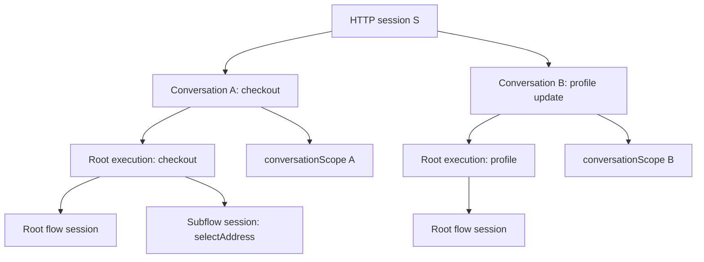
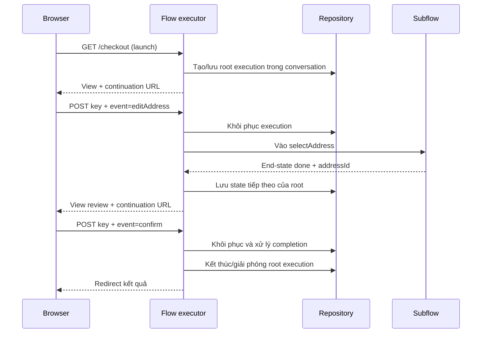
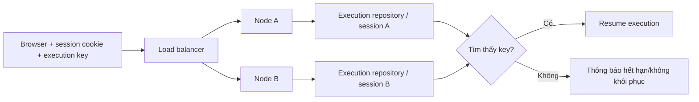

# Conversation và các execution đang hoạt động trong phiên

## 1. Một HTTP session có thể chứa nhiều hành trình

Trong **Spring Web Flow (SWF)**, người dùng thường thực hiện một nghiệp vụ qua nhiều bước: chọn sản phẩm, nhập địa chỉ, xác nhận rồi xem kết quả. Web Flow mô hình hóa hành trình bằng **state**, **event**, **transition** và **subflow**. Để tiếp tục sau mỗi request, framework cần lưu trạng thái của hành trình ở một nơi có thể truy xuất lại.

Giả sử khách hàng đăng nhập vào một cửa hàng và mở hai tab:

- **Tab A:** bắt đầu flow `checkout`, đang ở bước nhập địa chỉ.
- **Tab B:** bắt đầu một flow `checkout` khác, đang ở bước kiểm tra giỏ hàng.
- Trong Tab A, người dùng còn mở **subflow** chọn địa chỉ giao nhận trước khi quay về bước xác nhận.

Cả hai tab có thể sử dụng **cùng HTTP session**, nhưng không có nghĩa chúng chia sẻ **cùng một flow execution** hoặc **conversation**. Ngược lại, subflow trong Tab A thường tham gia vào cùng hành trình gốc và có thể chia sẻ dữ liệu ở `conversationScope` của hành trình ấy.

Đây là lý do cần phân biệt **HTTP session → conversation → flow execution/root flow và subflow → snapshot**. Nhầm những phạm vi này dễ dẫn đến mất dữ liệu giữa các bước, hai tab ảnh hưởng lẫn nhau, lỗi khi session hết hạn và giữ quá nhiều trạng thái trong bộ nhớ.

## 2. Các khái niệm cần phân biệt

| Khái niệm | Ý nghĩa | Ví dụ |
| --- | --- | --- |
| **HTTP session** | Ngữ cảnh server gắn với phiên trình duyệt/khách theo cơ chế session HTTP | Một phiên đăng nhập có cookie session |
| **Conversation** | Ngữ cảnh hành trình logic nhiều request mà cơ chế conversation/repository của Web Flow quản lý | Một lần thực hiện đặt hàng từ bắt đầu đến kết thúc |
| **Root flow execution** | Một lần chạy bắt đầu từ flow gốc, mang trạng thái đang hoạt động và dữ liệu cần resume | Execution của `checkout` trong Tab A |
| **Flow session / subflow** | Lượt thực thi một flow trong cây lời gọi flow gốc; subflow có thể được gọi trong root execution | Subflow `selectAddress` do checkout gọi |
| **Snapshot** | Mốc trạng thái execution được lưu theo khả năng/chính sách của repository | Snapshot khi dừng ở trang review |
| **Execution key** | Giá trị mà Web Flow dùng để tìm execution/snapshot cần tiếp tục | `e1s1` (chỉ minh họa một dạng key) |
| **Business ID** | Định danh dữ liệu nghiệp vụ độc lập với Web Flow | `ORDER-4028` trong database |

### 2.1. HTTP session không phải conversation

HTTP session thường do servlet container hoặc hạ tầng session quản lý. Nó có thể còn sống sau khi một flow kết thúc. Một session có thể chứa nhiều conversation/flow execution đang được repository giữ; cũng có thể không có execution nào.

**Conversation** là ranh giới logic của một hành trình được Web Flow quản lý. Với cách triển khai phổ biến, nó gắn với một root flow execution, kể cả khi hành trình đó gọi nhiều subflow. **Không nên hiểu rằng cứ mỗi HTTP session là một conversation**.

### 2.2. Conversation không phải một lần xử lý request

Một execution có thể đang **tạm dừng ở view-state**, chờ người dùng bấm Next. Dù lúc đó không có thread Java nào đang xử lý request, execution vẫn có thể còn **hoạt động theo nghĩa chưa kết thúc** và được lưu để resume.

Vì thế, “active execution” trong bài này là execution **còn tồn tại và có thể được repository quản lý để tiếp tục**. Nó không đồng nghĩa với một HTTP request đang chạy, một thread bận hoặc một người dùng đang nhìn trang ở thời điểm hiện tại.

### 2.3. Subflow không nhất thiết là execution độc lập trong session

Khi root flow gọi subflow qua `<subflow-state>`, Web Flow đưa subflow vào hành trình đang chạy và chờ sự kiện kết thúc từ flow con. Các flow session khác nhau trong một root execution có vòng đời/scope riêng, trong khi conversation có thể bao trùm root flow cùng những subflow thuộc cùng hành trình.

Không cộng mỗi subflow vào “số execution độc lập trên HTTP session” một cách máy móc khi dự trù giới hạn repository. Một số số đo nội bộ đếm flow session, số khác đếm root execution/conversation; cần biết **đơn vị** của metric đang sử dụng.

## 3. Quan hệ session, conversation và các flow đang chạy

Sơ đồ sau minh họa **một session có hai hành trình độc lập**:



**Hai conversation A và B tách biệt về dữ liệu conversation scope** dù cùng thuộc session S. Ngược lại, root flow và subflow trong A có thể cùng nhìn thấy dữ liệu ở conversation scope A.

Trong một repository được cấu hình để giữ nhiều execution, người dùng có thể đồng thời có:

```text
HTTP session S
├── Conversation A / execution checkout #1
│   ├── flowScope của root checkout
│   ├── conversationScope A
│   └── subflow selectAddress (được gọi trong hành trình A)
├── Conversation B / execution checkout #2
│   ├── flowScope của root checkout khác
│   └── conversationScope B
└── Conversation C / execution editProfile
    └── conversationScope C
```

Ngay cả khi A và B đều dùng flow definition `checkout`, chúng không nên chia sẻ một đối tượng form chỉ vì có cùng tên biến `checkoutForm`. Đây là một tính chất quan trọng để thiết kế ứng dụng hỗ trợ nhiều tab.

## 4. Conversation được tạo, dùng và kết thúc khi nào?

Một hành trình nhiều bước điển hình trải qua các mốc:

1. **Launch:** request đi vào start URL. Flow executor khởi tạo root execution; cơ chế conversation/repository chuẩn bị ngữ cảnh lưu.
2. **Pause:** execution đến `view-state`, dữ liệu cần giữ được lưu theo chính sách repository. View nhận continuation URL/key.
3. **Resume:** request tiếp theo gửi key và event. Repository nhận diện execution đã lưu rồi Web Flow xử lý transition.
4. **Call subflow:** root execution chuyển vào một flow con. `conversationScope` của hành trình vẫn là ngữ cảnh chung.
5. **Return:** subflow phát kết quả qua end-state; root flow nhận outcome và tiếp tục.
6. **End:** root flow kết thúc, repository có thể giải phóng execution/conversation tương ứng; HTTP session có thể vẫn còn sống.



Đây là **luồng khái niệm**. Số lần ghi snapshot, thời điểm redirect và cách repository quản lý conversation phụ thuộc phiên bản/configuration cụ thể; không mặc định mỗi request luôn tạo snapshot mới.

### 4.1. Flow đã kết thúc nhưng HTTP session vẫn tồn tại

Người dùng xác nhận thành công và flow đi tới `end-state`. Điều này **không tương đương** gọi `HttpSession.invalidate()`. Session có thể tiếp tục phục vụ những request khác hoặc những flow song song.

Vì thế, khi triển khai nút `cancel` hoặc `finish`, cần phân biệt:

- **Kết thúc flow**: đóng hành trình này theo logic Web Flow.
- **Đăng xuất/hết session**: kết thúc ngữ cảnh đăng nhập/HTTP session theo hạ tầng bảo mật.
- **Hủy nghiệp vụ đã lưu**: hành động ở tầng service/database, không tự xảy ra chỉ vì flow end.

### 4.2. Kết thúc root flow và kết thúc subflow khác nhau

Một subflow có thể tới `<end-state id="done">` và trả event kết quả cho parent flow. Parent flow vẫn tiếp tục từ `<subflow-state>` phù hợp. **Subflow kết thúc không mặc nhiên làm kết thúc conversation gốc**.

Ngược lại, khi root execution thực sự kết thúc, không nên kỳ vọng `conversationScope` của hành trình cũ còn là nơi lưu dữ liệu bền vững để dùng ở flow mới.

## 5. Scope nào thuộc request, flow và conversation?

| Phạm vi | Vòng đời nhìn từ Web Flow | Nơi dùng thích hợp |
| --- | --- | --- |
| `requestScope` | Dữ liệu gắn với một lần xử lý request/event | Kết quả tạm không cần giữ sang bước khác |
| `flashScope` | Dữ liệu ngắn hạn cho tương tác/hiển thị tiếp theo | Thông điệp tình trạng sau transition |
| `viewScope` | Dữ liệu của view-state hiện hành | Giá trị tạm dùng riêng ở một màn hình |
| `flowScope` | Dữ liệu gắn với flow session hiện hành; các subflow có flow scope riêng | Form hoặc biến phục vụ các state của một flow |
| `conversationScope` | Dữ liệu chung của conversation, có thể truy cập qua root flow và các subflow của cùng hành trình | Thông tin điều phối cần chia sẻ trong cây flow |
| HTTP session attributes | Dữ liệu được ứng dụng/session container duy trì trong HTTP session | Thông tin xuyên nhiều request/flow theo thiết kế rõ ràng |

**Trọng tâm:** `conversationScope` không đồng nghĩa với mọi thuộc tính của HTTP session. Nó là phạm vi do Web Flow quản lý và thường được tách giữa các root conversation.

### 5.1. Ví dụ giữ dữ liệu trong conversationScope

Trong một root flow, có thể đặt:

```xml
<on-start>
    <set name="conversationScope.checkoutChannel"
         value="'WEB'" />
    <set name="flowScope.customerId"
         value="requestParameters.customerId" />
</on-start>
```

`conversationScope.checkoutChannel` có thể được truy cập từ một subflow thuộc cùng conversation. `flowScope.customerId` thuộc flow hiện hành; nếu subflow cần `customerId`, nên truyền input tường minh.

Đây là ví dụ cú pháp, không phải xử lý dữ liệu đầu vào hoàn chỉnh. `customerId` nhận từ HTTP cần được chuyển kiểu/kiểm tra và xác nhận quyền ở service, tránh cho người dùng tự đặt ID để truy cập dữ liệu không thuộc họ.

### 5.2. Tại sao không đưa tất cả dữ liệu vào conversationScope?

Scope dài hơn thường **giữ đối tượng trong bộ nhớ lâu hơn**, có thể khiến các snapshot phình to. Ví dụ đặt cả danh sách sản phẩm, file upload hoặc entity graph lớn vào `conversationScope` chỉ để một subflow đọc sẽ tăng chi phí lưu/khôi phục.

Ưu tiên giữ trong scope:

- ID nghiệp vụ có kiểu rõ ràng;
- DTO nhỏ với những thuộc tính thực sự cần;
- lựa chọn của người dùng và trạng thái ngắn hạn của quy trình;
- thông tin không thể dễ dàng tái tạo nhưng thực sự cần cho bước kế tiếp.

Những dữ liệu lớn hoặc cần tồn tại sau khi session hết hạn nên đặt tại database/object storage rồi giữ **ID** trong flow, sau khi đã xem xét chi phí truy vấn lại và tính nhất quán nghiệp vụ.

## 6. Ví dụ xuyên suốt: root flow và subflow cùng conversation

Giả sử người dùng đang checkout và cần chọn địa chỉ. Root flow `checkout` gọi subflow `selectAddress` để trả về `addressId`. Mẫu này minh họa hai cách truyền dữ liệu: **input/output tường minh** cho giá trị nghiệp vụ và **conversationScope** cho ngữ cảnh chung.

### 6.1. Root flow `checkout-flow.xml`

```xml
<?xml version="1.0" encoding="UTF-8"?>
<flow xmlns="http://www.springframework.org/schema/webflow"
      xmlns:xsi="http://www.w3.org/2001/XMLSchema-instance"
      xsi:schemaLocation="
          http://www.springframework.org/schema/webflow
          http://www.springframework.org/schema/webflow/spring-webflow.xsd">

    <!-- Ví dụ khởi tạo dữ liệu đơn giản; ứng dụng thật phải validate ID. -->
    <on-start>
        <set name="flowScope.customerId"
             value="requestParameters.customerId" />
        <set name="conversationScope.checkoutChannel"
             value="'WEB'" />
    </on-start>

    <view-state id="review" view="checkout/review">
        <transition on="editAddress" to="editAddress" />
        <transition on="confirm" to="completed">
            <evaluate
                expression="checkoutService.placeOrder(flowScope.customerId, flowScope.addressId)"
                result="flowScope.orderId" />
        </transition>
    </view-state>

    <subflow-state id="editAddress" subflow="selectAddress">
        <input name="customerId" value="flowScope.customerId" />

        <transition on="done" to="review">
            <set name="flowScope.addressId"
                 value="currentEvent.attributes.addressId" />
        </transition>
        <transition on="cancel" to="review" />
    </subflow-state>

    <end-state id="completed"
               view="externalRedirect:contextRelative:/checkout/success" />
</flow>
```

Điểm cần chú ý:

- `flowScope.customerId` thuộc root flow và được **chuyển qua `<input>`** sang subflow.
- `conversationScope.checkoutChannel` thuộc conversation, có thể dùng chung trong cây flow này.
- Khi subflow kết thúc với outcome `done`, `currentEvent.attributes.addressId` cho root flow nhận giá trị mà subflow xuất ra.
- Root flow có thể quay lại `review` sau khi subflow đã kết thúc. Conversation của checkout vẫn còn.

### 6.2. Subflow `select-address-flow.xml`

```xml
<?xml version="1.0" encoding="UTF-8"?>
<flow xmlns="http://www.springframework.org/schema/webflow"
      xmlns:xsi="http://www.w3.org/2001/XMLSchema-instance"
      xsi:schemaLocation="
          http://www.springframework.org/schema/webflow
          http://www.springframework.org/schema/webflow/spring-webflow.xsd">

    <input name="customerId" />

    <var name="addressForm"
         class="com.example.checkout.AddressForm" />

    <view-state id="enterAddress"
                view="checkout/address"
                model="addressForm">
        <transition on="save" to="done">
            <evaluate
                expression="addressService.save(flowScope.customerId, addressForm)"
                result="flowScope.addressId" />
        </transition>
        <transition on="cancel" to="cancel"
                    bind="false" validate="false" />
    </view-state>

    <end-state id="done">
        <output name="addressId" value="flowScope.addressId" />
    </end-state>
    <end-state id="cancel" />
</flow>
```

Ví dụ giả định bean `checkoutService`, `addressService`, class `AddressForm`, hai flow ID và các view đã được đăng ký. Để chạy được, ứng dụng còn cần Spring MVC/Web Flow infrastructure, binding/validation, CSRF và xử lý lỗi phù hợp.

**Thỏa thuận input/output** khiến ranh giới subflow rõ ràng: flow con nhận `customerId`, xử lý form và trả `addressId`. Dù có `conversationScope`, đừng mặc định toàn bộ `flowScope` của flow cha trở thành biến của flow con. Truyền input/output tường minh giúp dễ kiểm thử và tái sử dụng subflow.

### 6.3. Điều gì xảy ra nếu mở checkout ở tab khác?

Nếu Tab B mở **start URL** riêng và repository cho phép tạo execution mới, Tab B có conversation mới. Nó có thể có `checkoutChannel = 'WEB'` giống giá trị của Tab A, nhưng đó vẫn là dữ liệu nằm ở **conversationScope khác nhau**.

Nếu người dùng chỉ **nhân đôi tab đã có continuation URL/key**, cả hai tab có thể tham chiếu tới **cùng execution/snapshot**. Trong trường hợp đó, chúng không độc lập và có thể ảnh hưởng lẫn nhau khi gửi event. Đây là vấn đề cần kiểm thử ở tầng repository/HTTP, không giải quyết được bằng cách đổi tên biến scope.

## 7. Các execution cùng tồn tại trong một HTTP session

Một ứng dụng có thể hỗ trợ nhiều hành trình đồng thời trong một session. Ví dụ người dùng:

1. Mở một flow `checkout` ở tab A.
2. Mở một flow `editProfile` từ start URL ở tab B.
3. Quay lại tab A và hoàn tất checkout.
4. Tiếp tục sửa hồ sơ ở tab B.

Khi cấu hình repository cho phép lưu đồng thời các execution này, việc kết thúc checkout **không đồng nghĩa** với việc phiên HTTP hay execution editProfile phải kết thúc.

### 7.1. Tại sao cần execution key?

Nếu cùng HTTP session có nhiều execution, cookie session **chỉ nhận diện phiên**, chưa đủ để chọn execution cụ thể. Continuation URL thường chứa tham số `execution` do Web Flow cấp để repository phân biệt:

```text
Tab A: /checkout?execution=KEY_A
Tab B: /editProfile?execution=KEY_B
```

Các key phải được coi là **opaque**: không phân tích cấu trúc, không tự tăng số và không dùng làm business ID. URL/action của form cần lấy từ Web Flow, ví dụ `flowExecutionUrl` ở các view JSP tích hợp phù hợp.

```jsp
<form method="post" action="${flowExecutionUrl}">
    <button type="submit" name="_eventId_confirm" value="confirm">
        Xác nhận
    </button>
</form>
```

Ở đây key chọn execution; `_eventId_confirm` phát event `confirm`. Event chỉ hợp lệ nếu active state của execution đó có transition tương ứng. Không hardcode `execution=...` trong HTML.

### 7.2. Một execution còn “active” sau khi user rời trang?

Có thể. Khi người dùng đóng tab nhưng chưa có thao tác kết thúc/cancel, repository không nhất thiết biết ngay trình duyệt đã đóng. Execution có thể vẫn được giữ cho đến khi bị giới hạn, timeout hoặc cleanup theo chính sách.

Vì vậy số execution còn lưu trong session có thể **lớn hơn số tab đang mở**. Đây là điểm quan trọng khi ước lượng bộ nhớ: không dùng riêng số request/giây hoặc số tab hiển thị để suy ra số active execution.

### 7.3. Phân biệt event `cancel` và hết hạn session

Event `cancel` được khai báo trong flow có thể dẫn tới end-state, giúp kết thúc hành trình theo logic. Khi session hết hạn, framework có thể không còn trạng thái để chạy transition hủy hay service cleanup trong flow.

Nếu cần thu hồi bản nháp/giữ chỗ trong database, hãy thiết kế cơ chế nghiệp vụ có TTL/job cleanup hoặc transaction phù hợp; không phụ thuộc hoàn toàn vào việc trình duyệt sẽ gửi event `cancel`.

## 8. Giới hạn số execution và số snapshot

Trong cấu hình XML namespace của các phiên bản SWF hỗ trợ, execution repository có thể có các tham số giới hạn như:

```xml
<webflow:flow-executor id="flowExecutor"
                       flow-registry="flowRegistry">
    <webflow:flow-execution-repository
        max-executions="5"
        max-execution-snapshots="10" />
</webflow:flow-executor>
```

Đoạn này minh họa **hai nhóm giới hạn**. Tên thuộc tính, giá trị mặc định, chính sách loại bỏ và dạng repository có hiệu lực phải được xác minh với đúng phiên bản Web Flow của dự án.

- `max-executions`: giới hạn số execution mà cơ chế lưu giữ cho ngữ cảnh repository/session tương ứng.
- `max-execution-snapshots`: giới hạn số snapshot được lưu cho một execution ở repository hỗ trợ snapshot history.

**Cả hai là ngưỡng, không phải số liệu thực tế.** Đặt giới hạn 5 không có nghĩa session nào cũng chứa 5 execution; đặt giới hạn 10 không có nghĩa mỗi execution đều giữ đúng 10 snapshot.

### 8.1. Những đánh đổi khi điều chỉnh

| Điều chỉnh | Có thể cải thiện | Có thể làm phát sinh |
| --- | --- | --- |
| Giảm số execution được giữ | Giảm session footprint khi người dùng mở nhiều flow | Tab cũ không còn resume được |
| Giảm snapshot history | Giảm bộ nhớ cho các mốc quá khứ | Browser Back/Refresh với key cũ có thể lỗi |
| Giảm session timeout | Thu hồi trạng thái khi người dùng rời đi nhanh hơn | Người nhập form dài dễ hết phiên |
| Giảm object graph trong scope | Giảm footprint của mỗi execution/snapshot | Phải thiết kế tải lại dữ liệu qua service |
| Đưa session state ra kho ngoài | Giảm phần dữ liệu lưu lâu dài trong heap node | Thêm serialization, độ trễ mạng và failure modes |

Trong flow nhiều bước, **khả năng quay lại sửa và phục hồi lỗi** là yêu cầu trải nghiệm cần kiểm thử cùng với bộ nhớ. Không chỉ giảm snapshot để đạt một con số RAM mà bỏ qua tình huống người dùng đang ở tab cũ.

### 8.2. Ước lượng số trạng thái còn lưu

Một mô hình sơ bộ để định hướng phép đo:

```text
StoredExecutions ≈ ActiveSessions × ExecutionsPerSession
StoredSnapshots  ≈ StoredExecutions × SnapshotsPerExecution
```

Giả sử 800 HTTP session đang còn sống, trung bình mỗi session có 1,5 execution còn được giữ, và mỗi execution còn 6 snapshot:

```text
StoredExecutions ≈ 800 × 1,5 = 1.200
StoredSnapshots  ≈ 1.200 × 6 = 7.200
```

Nếu snapshot có footprint tăng thêm 18 KiB/bản theo **cách đo của repository thực tế**, chỉ phần snapshot có thể vào khoảng `7.200 × 18 KiB ≈ 126,6 MiB`. Chưa gồm metadata execution, session, object dùng chung, cache, serialization tạm, JVM và GC.

Đây là giả định cho mục đích học tập; không áp dụng cứng cho repository chỉ giữ state hiện hành hoặc sử dụng cơ chế chia sẻ dữ liệu giữa snapshot. Cần tránh cộng trùng object graph khi dự trù retained heap.

## 9. Conversation và session khi chạy nhiều node

Trong hệ thống có nhiều JVM, một request mang execution key chỉ resume được khi node nhận request **có cách truy cập repository/session chứa trạng thái tương ứng**.



Các cách triển khai thường gặp:

- **Sticky session:** cố gắng đưa request tiếp theo về node đang giữ session. Cần kiểm tra failover khi node biến mất.
- **Session replication:** đồng bộ dữ liệu cần thiết sang node khác; object graph lưu trong flow phải tương thích cơ chế serialization/replication.
- **Kho session ngoài JVM:** lưu trạng thái ở nơi các node có thể truy cập, ví dụ hệ thống session store được cấu hình phù hợp. Theo dõi TTL, payload size, latency, lỗi mạng và concurrent updates.

**Execution key không tự chứa toàn bộ state.** Với nhiều repository, key chỉ là tham chiếu dùng để tra cứu dữ liệu đã lưu. Key đúng vẫn có thể không resume được khi session hết hạn, snapshot bị loại hoặc node không thấy repository tương ứng.

### 9.1. Triển khai lại ứng dụng

Các execution đang giữ có thể tham chiếu class, dữ liệu serialization hoặc flow definition của phiên bản trước. Khi deploy bản mới, việc khôi phục có thể thất bại nếu cấu trúc không tương thích.

Với quy trình dài, nên lưu bản nháp và dữ liệu nghiệp vụ đã xác nhận vào kho bền vững tại những mốc phù hợp. Sau deployment hay session expiry, người dùng có thể khởi chạy flow mới và tải lại **draft ID** đã xác thực. Đừng dựa vào việc conversation cũ sống vĩnh viễn.

## 10. Rủi ro khi nhiều request tác động cùng một execution

Hai request cùng key có thể đến gần đồng thời nếu:

- Người dùng bấm `confirm` hai lần.
- Trình duyệt retry sau mạng chậm.
- Hai tab được nhân bản từ cùng continuation URL.
- Script gửi lại request đã lưu trước đó.

Repository có thể có cơ chế khóa/điều phối riêng, nhưng ứng dụng không nên mặc định mọi request sẽ được xử lý độc lập hoặc tự động chống ghi trùng. Với thao tác nghiệp vụ, service phải bảo vệ **idempotency, tính nhất quán và kiểm soát quyền**.

Ví dụ:

```text
POST /checkout?execution=KEY_A  + event=confirm
POST /checkout?execution=KEY_A  + event=confirm
```

Ngay cả khi chỉ một request được phép tiếp tục execution, nghiệp vụ vẫn cần biết liệu đơn hàng đã được tạo trong database hay chưa. Các chiến lược có thể gồm ràng buộc duy nhất, trạng thái chuyển một lần, idempotency key có chủ đích và transaction phù hợp.

### 10.1. Bảo mật của conversation và scope

- Không đưa trực tiếp mật khẩu, thông tin thanh toán nhạy cảm hoặc file upload lớn vào `conversationScope` nếu không có nhu cầu thật sự.
- Không xem `execution` trên URL là quyền truy cập. Service phải xác định người dùng có quyền đối với `orderId`, `customerId` và các đối tượng nghiệp vụ.
- Kiểm tra input gửi từ request trước khi gán vào scope; dữ liệu ở scope không tự trở nên đáng tin chỉ vì được giữ qua nhiều bước.
- Bảo vệ các POST bằng CSRF token theo tích hợp bảo mật thực tế.
- Tránh ghi raw key, session cookie hoặc toàn bộ scope vào log; dùng correlation/trace ID đã được thiết kế phù hợp.
- Đừng dùng `conversationScope` như cache chung cho nhiều user hay nhiều root flow; nó chỉ phục vụ ngữ cảnh hành trình tương ứng.

## 11. Chẩn đoán lỗi liên quan conversation và execution

| Hiện tượng | Khả năng nguyên nhân | Kiểm tra ưu tiên |
| --- | --- | --- |
| Hai tab mới mở cùng flow và dữ liệu trộn lẫn | Lưu form trong session dùng chung hoặc biến/static không đúng phạm vi | Xác minh mỗi tab có execution key riêng, kiểm tra scope dữ liệu |
| Subflow không thấy biến của flow cha | Nhầm `flowScope` cha với scope của subflow | Khai báo `<input>`/`<output>`, xác minh conversation chung |
| Flow mới không đọc được `conversationScope` của flow cũ | Hai root conversation tách biệt hoặc flow cũ đã end | Dùng input/business ID hoặc kho dữ liệu bền vững |
| Tab cũ báo execution không tìm thấy | Giới hạn execution, snapshot eviction, timeout | Kiểm tra repository/retention và session |
| Bấm Back khiến giá trị cũ xuất hiện | Snapshot cũ được khôi phục hoặc form được render từ history | Kiểm tra key/snapshot thực tế và hành vi Back |
| Kết thúc flow nhưng session vẫn còn | HTTP session có vòng đời khác root flow | Xác nhận có cần logout hay chỉ end-state |
| Bộ nhớ tăng dù người dùng đóng tab | Execution chưa kết thúc và chưa bị cleanup | Đo số execution/session, tuổi execution, timeout |
| Chỉ lỗi khi request chuyển node | Sticky session hoặc session store/replication lỗi | Đối chiếu node, cookie, repository và TTL |
| Đơn hàng tạo hai lần khi retry | Service thiếu idempotency, có request song song | Kiểm tra transaction, unique constraint và log sự kiện |

Khi điều tra, nên biết: **session nào (dùng định danh an toàn), conversation/root execution nào, active state nào, event nào, và key/snapshot còn tồn tại hay không**. Không cần in toàn bộ dữ liệu form hoặc token vào log để phân tích đường đi.

### 11.1. “Active” trong số liệu giám sát nghĩa là gì?

Một dashboard ghi `active executions = 500` có thể đếm **execution chưa end và đang được giữ trong repository**, bao gồm những execution đang ngủ ở view-state. Dashboard ghi `active requests = 15` lại đếm request đang xử lý lúc đó.

Hai metric không mâu thuẫn. Khi thiết kế cảnh báo, hãy định nghĩa rõ **đơn vị** và **thời điểm đo**; bổ sung số snapshot/execution và tuổi execution để nhận biết hành trình bị bỏ dở.

## 12. Kiểm thử conversation và nhiều execution

Một bộ kiểm thử hữu ích nên mô tả tình huống theo hành vi thay vì phụ thuộc định dạng `execution=e1s1`:

| Ca thử | Cách thực hiện | Kỳ vọng |
| --- | --- | --- |
| Hai flow độc lập | Mở start URL hai lần trong cùng HTTP session | Hai execution độc lập nếu repository cho phép; dữ liệu form không trộn |
| Hai tab nhân bản | Nhân bản tab đang ở continuation URL | Quan sát hành vi cạnh tranh; không tự giả định tách execution |
| Root gọi subflow | Từ checkout phát event `editAddress` | Subflow vào đúng state, dùng được conversation context đã khai báo |
| Truyền input/output | Root truyền `customerId`, subflow trả `addressId` | Root nhận đúng kết quả; không phụ thuộc flowScope cha có sẵn trong subflow |
| Subflow hủy | Gửi event `cancel` trong subflow | Quay về root theo transition mà không kết thúc root execution |
| Root kết thúc | Gửi `confirm` hợp lệ tới end-state | Chỉ hành trình root đó kết thúc; session/flow khác còn theo cấu hình |
| Execution bị loại | Vượt giới hạn hoặc hết hạn session trong môi trường test | Continuation URL cũ không bị dùng để truy cập dữ liệu sai |
| Snapshot cũ | Giữ URL cũ, chuyển nhiều bước rồi gửi lại | Theo retention; thông báo/khôi phục rõ ràng |
| Đồng thời | Gửi hai event `confirm` gần cùng lúc | Không tạo giao dịch nghiệp vụ trùng |
| Multi-node | Launch ở một node, resume sau routing/failover | Repository/session strategy thực sự hỗ trợ hoặc trả lỗi có kiểm soát |

### 12.1. Kịch bản kiểm thử cụ thể

1. Trong cùng một session thử nghiệm, mở **start URL** của checkout ở tab A và tab B.
2. Tab A chọn địa chỉ `ADDRESS-A`, tab B chọn `ADDRESS-B`.
3. Kiểm tra mỗi tab giữ dữ liệu riêng sau một lượt `next`/`back`.
4. Ở tab A, phát event `editAddress` và vào subflow. Đọc `conversationScope.checkoutChannel`, xác nhận có giá trị từ root A.
5. Subflow A gửi `done` và `addressId`; root A trở lại `review`, hiển thị địa chỉ A. Tab B không bị thay đổi.
6. Kết thúc checkout ở tab A; tab B vẫn phải tiếp tục được nếu repository và session còn hợp lệ.
7. Chạy lại với giới hạn repository thấp hơn trong staging để kiểm tra lỗi key cũ, thông báo hết hạn và đường phục hồi.

Để kiểm tra flow ở mức unit/integration, có thể dùng cơ chế kiểm thử execution của Spring Web Flow với mock service. Để kiểm tra **cookie, continuation URL, nhiều tab và load balancer**, cần thêm test ở tầng HTTP/browser và session store thực tế. Hai cấp kiểm thử bổ sung cho nhau.

## 13. Bài tập tự luyện

### Bài 1 — Đếm các đơn vị

Một HTTP session đang có hai tab mở từ hai lần gọi start URL `/checkout`. Tab A đang trong subflow `selectAddress`, còn tab B ở state `review`.

**Câu hỏi:** có bao nhiêu HTTP session, bao nhiêu root execution, và subflow có nhất thiết là root execution thứ ba không?

**Gợi ý đáp án:** một HTTP session, hai root execution/conversation độc lập nếu repository cho phép; subflow của tab A nằm trong hành trình root A, không tự động được đếm như root execution thứ ba.

### Bài 2 — Chọn scope

Một flow đăng ký gọi subflow gửi OTP. Root và subflow cần cùng đọc một giá trị `registrationChannel`, nhưng một flow đăng ký độc lập ở tab khác không được dùng chung giá trị này. Nên chọn scope nào?

**Gợi ý:** `conversationScope` phù hợp cho ngữ cảnh chung của root và subflow trong cùng conversation. Với dữ liệu nghiệp vụ cụ thể, input/output tường minh vẫn giúp thiết kế dễ kiểm thử và giảm phụ thuộc ngầm.

### Bài 3 — Tìm nguyên nhân mất dữ liệu

Root lưu `flowScope.customerId` rồi gọi `selectAddress`. Subflow tham chiếu `flowScope.customerId` nhưng nhận `null`.

**Gợi ý:** các flow session có flow scope riêng. Root nên truyền `customerId` bằng `<input>`, flow con khai báo `<input name="customerId" />` và đọc biến input trong scope phù hợp.

### Bài 4 — Tab cũ không tiếp tục được

Người dùng mở tám flow khác nhau trong cùng session, trong khi repository cấu hình giới hạn năm execution. Một tab cũ gửi event `next` và báo không tìm thấy execution.

**Gợi ý:** kiểm tra chiến lược loại bỏ execution khi vượt giới hạn, session và key; cung cấp start URL hoặc cơ chế phục hồi bản nháp đã xác thực. Tăng giới hạn chỉ sau khi đo footprint và thử nghiệm nhiều tab.

### Bài 5 — Thời gian hoạt động

Người dùng đóng tab mà không bấm `cancel`. Execution vẫn được tính active trên dashboard 20 phút sau.

**Gợi ý:** active execution thường nghĩa là **chưa kết thúc và còn được repository giữ**, không có nghĩa trình duyệt còn kết nối hay server đang chạy request. Xem session TTL, repository cleanup và tuổi execution trước khi kết luận có memory leak.

## 14. Ghi nhớ

- **HTTP session có thể chứa nhiều conversation/root flow execution**; mỗi hành trình độc lập cần được nhận diện bằng execution key của Web Flow.
- **Conversation** là ngữ cảnh logic của một hành trình nhiều request; root flow và subflow thuộc cùng hành trình có thể chia sẻ `conversationScope`, trong khi mỗi flow session có `flowScope` riêng.
- **Subflow kết thúc khác root flow kết thúc**. End-state của subflow có thể trả kết quả để root tiếp tục; root end không đồng nghĩa HTTP session bị hủy.
- **Active execution** có thể đang tạm dừng tại view-state. Nó vẫn chiếm tài nguyên khi còn được repository giữ dù không có request đang chạy.
- Giới hạn execution, snapshot và session timeout quyết định sức chứa nhưng cũng ảnh hưởng Back/Refresh, nhiều tab và khả năng khôi phục.
- Ưu tiên **input/output tường minh**, scope đúng vòng đời, dữ liệu nhỏ gọn và service có kiểm tra quyền/idempotency. Dữ liệu cần tồn tại lâu hơn một conversation nên được lưu vào kho nghiệp vụ bền vững.
