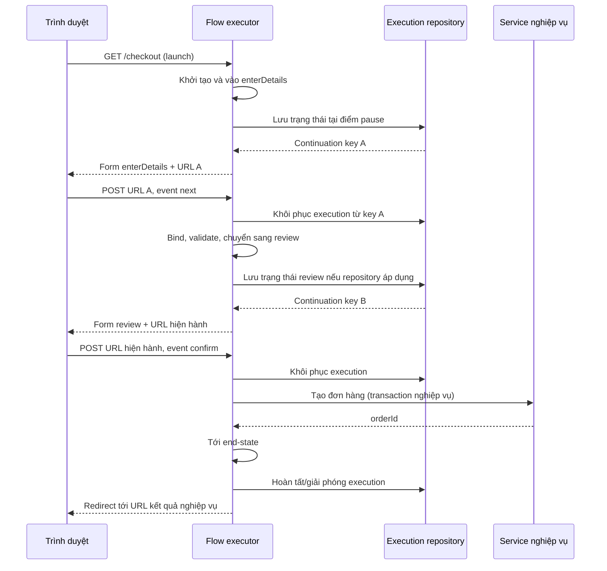
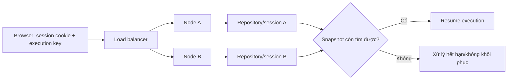

# Snapshot của flow và thời điểm tạo bản lưu trong Spring Web Flow

## 1. Snapshot giải quyết vấn đề gì?

Trong **Spring Web Flow (SWF)**, một hành trình đặt hàng có thể đi qua các `view-state` nhập thông tin, xem lại, xác nhận, gọi service và kết thúc. Mỗi HTTP request chỉ tồn tại trong một khoảng thời gian ngắn, trong khi hành trình có thể kéo dài nhiều phút. Khi trả trang cho trình duyệt, framework cần giữ đủ trạng thái để lần nhấn nút tiếp theo có thể tiếp tục **đúng flow execution**, thay vì chạy lại từ đầu.

Một số chiến lược **flow execution repository** hỗ trợ lưu **snapshot**: biểu diễn trạng thái execution tại một thời điểm có thể được dùng để khôi phục. Nhờ đó framework có thể nhận diện mốc trước đó khi trình duyệt gửi một **execution key** tương ứng, nếu mốc đó còn tồn tại và repository cho phép khôi phục.

Ví dụ người dùng đặt hàng:

```text
GET  /shop/checkout
     -> Launch flow checkout, hiển thị enterDetails.

POST /shop/checkout?execution=e1s1
     body: _eventId=next&email=an%40example.test
     -> Resume, bind/validate, chuyển sang review.

POST /shop/checkout?execution=e1s2
     body: _eventId=back
     -> Resume và chuyển về enterDetails theo transition back.
```

`e1s1` và `e1s2` là **giá trị giả định mang tính minh họa**, không phải key được phép hardcode. Một repository có thể dùng định dạng khác hoặc có cách cấp key khác; thậm chí key không nhất thiết đổi sau mọi request.

**Tư tưởng quan trọng:** snapshot là trạng thái **do Web Flow/repository quản lý** để tiếp tục một execution. Nó không phải bản sao của mã XML flow, không đồng nghĩa với transaction database, và không phải bản nháp có thể truy cập vĩnh viễn.

## 2. Bốn khái niệm thường bị nhầm

| Khái niệm | Ý nghĩa | Ví dụ |
| --- | --- | --- |
| **Flow definition** | Bản thiết kế state/event/transition được đăng ký | Flow id `checkout` |
| **Flow execution** | Một lần thực thi cụ thể, với active state và các scope | Hành trình checkout của tab A |
| **Execution snapshot** | Một mốc trạng thái execution được repository lưu theo chiến lược của nó | Mốc đang chờ ở `review` |
| **Execution key** | Giá trị dùng để repository tìm execution hoặc snapshot cần khôi phục | `execution=e1s2` trong URL minh họa |

Một flow definition có thể sinh nhiều execution. Một execution có thể trải qua nhiều state và **có thể** có nhiều snapshot. Một execution key có thể đại diện cho execution hiện hành hoặc tham chiếu một snapshot, tùy repository.

### 2.1. Snapshot không phải flow definition phiên bản 2

Giả sử đổi XML từ `<view-state id="review">` sang `<view-state id="confirmOrder">` rồi triển khai bản mới. Snapshot cũ **không phải** bản sao mã XML cũ có thể tự chạy độc lập. Việc resume vẫn chịu ảnh hưởng của definition/classes/configuration mà ứng dụng đang sử dụng và chính sách tương thích phiên bản.

Khi rolling deployment, một execution tạo từ bản cũ có thể khó khôi phục trên bản mới nếu state id, class form hoặc serialization thay đổi. Vì vậy cần chính sách cho hành trình đang dở và lưu dữ liệu nghiệp vụ quan trọng ở nơi bền vững.

### 2.2. Snapshot không phải business checkpoint bền vững

Snapshot giúp Web Flow khôi phục **trạng thái điều hướng**, còn business checkpoint là dữ liệu đã được ghi vào database hoặc hệ thống nghiệp vụ. Hai thứ có vòng đời và cơ chế nhất quán khác nhau.

Nếu service đã tạo đơn hàng rồi trình duyệt quay về snapshot trước đó, đơn hàng **không tự biến mất**. Muốn hoàn tác nghiệp vụ phải có logic compensation/rollback riêng và vẫn phải kiểm tra quyền, idempotency.

### 2.3. Session và conversation không phải snapshot

Một HTTP session có thể giữ nhiều flow execution độc lập. Mỗi root execution có conversation logic riêng và có thể gọi subflow. Snapshot, khi repository có hỗ trợ, lưu trạng thái của **execution cụ thể**; không nên hiểu rằng một snapshot duy nhất chụp toàn bộ các flow khác đang chạy trong cùng session.

## 3. Snapshot có thể chứa những gì?

Tùy implementation, snapshot cần đủ thông tin để khôi phục execution ở thời điểm lưu, ví dụ:

- Flow ID và thông tin điều phối để xác định active state hoặc chuỗi flow session/subflow đang hoạt động.
- Giá trị trong các scope thuộc execution như `flowScope`, `viewScope` và những dữ liệu conversation liên quan.
- Form model đang được nhập, các biến đã được action/evaluate tính toán và trạng thái cần cho transition tiếp theo.
- Thông tin nội bộ mà repository cần để khôi phục flow execution.

**Không kết luận tất cả đối tượng sẽ được chụp sâu theo cùng một cách.** Repository có thể serialize, sao chép hoặc giữ reference/representation nội bộ. Phần dữ liệu lưu thực tế, cơ chế chia sẻ object và chi phí bộ nhớ phụ thuộc phiên bản và loại repository.

### 3.1. Những gì snapshot thường không bảo đảm

Snapshot không tự động giữ:

1. Transaction database đang mở hoặc trạng thái kết nối JDBC.
2. Một HTTP request, response hay thread Java sống qua nhiều phút.
3. Toàn bộ session của user, mọi tab khác hoặc các nguồn dữ liệu ngoài như Redis và dịch vụ thanh toán.
4. Một tài nguyên không serializable có thể được khôi phục trên node khác.
5. Cam kết rằng dữ liệu tồn tại sau session timeout, server restart hoặc snapshot eviction.

Ví dụ sai về mặt thiết kế là đặt raw `InputStream` của file upload hoặc một `EntityManager` vào `flowScope`. Những tài nguyên này có vòng đời riêng và không nên dựa vào cơ chế snapshot để duy trì.

### 3.2. Tại sao form càng lớn thì snapshot càng tốn kém?

Một `CheckoutForm` chứa email và ID địa chỉ rất khác với form giữ toàn bộ danh sách 2.000 sản phẩm hoặc ảnh base64. Nếu repository lưu nhiều mốc có các bản sao dữ liệu lớn, chi phí bộ nhớ/serialization tăng theo số mốc được giữ.

Thường nên giữ **DTO nhỏ và ID nghiệp vụ** trong execution, còn file, entity graph lớn, bản nháp cần bền vững nên được lưu ở dịch vụ phù hợp. Khi cần hiển thị lại, service tải dữ liệu theo ID và kiểm tra quyền.

## 4. Thời điểm tạo snapshot: nhìn từ vòng đời execution

Đây là trọng tâm của bài học: **snapshot không đồng nghĩa với mỗi transition, mỗi dòng XML hoặc mỗi lần render HTML**.

Trong một execution repository có hỗ trợ snapshot, thời điểm có ý nghĩa thường gắn với việc flow đã thực thi đủ để **tạm dừng/chờ tương tác tiếp theo**, rồi framework lưu trạng thái cần thiết cho lần resume. Tuy vậy, **điểm chụp cụ thể, số snapshot giữ lại, key và việc có chụp lại trên cùng state hay không đều tùy repository, redirect policy và phiên bản**.

### 4.1. Từ start URL tới lần chờ đầu tiên

Một yêu cầu launch, ví dụ `GET /checkout`, thường:

1. Chọn flow definition qua flow registry và handler.
2. Khởi tạo flow execution, chạy các bước khởi đầu.
3. Đi qua các transition tự động nếu có, cho đến khi cần chờ event từ người dùng.
4. Chuẩn bị/lưu trạng thái có thể resume thông qua repository theo chiến lược áp dụng.
5. Render view hoặc redirect tới view theo cấu hình, đồng thời cung cấp continuation URL.

Nếu flow khởi đầu bằng một chuỗi `action-state` rồi tới `view-state`, **không nên mặc định mỗi action-state đều tạo một snapshot riêng**. Những action có thể xảy ra trong cùng lượt xử lý trước khi execution được tạm dừng.

### 4.2. Sau khi nhận event ở view-state

Khi người dùng submit:

1. Web Flow đọc key để khôi phục đúng execution/snapshot.
2. Xác định event như `next` hoặc `back`.
3. Bind/validate dữ liệu nếu cấu hình transition yêu cầu.
4. Chạy action và chuyển state.
5. Nếu execution tiếp tục tới một điểm cần chờ, repository lưu trạng thái để request sau resume.

Khi validation thất bại, execution có thể vẫn ở view-state và render lại lỗi. **Không kết luận chắc chắn có một snapshot mới chỉ vì HTML được render lại**; kết quả còn phụ thuộc cơ chế repository và chính sách về redirect/same-state.

### 4.3. Khi flow kết thúc

Khi execution đi tới `end-state` và hoàn tất, repository thường giải phóng/không còn giữ execution như một hành trình có thể resume. Không có lý do thiết kế để tạo một **continuation snapshot dùng để đi tiếp mãi** sau khi root flow kết thúc.

Nếu cần xem lại kết quả sau khi hoàn tất, hãy chuyển sang URL nghiệp vụ như `/orders/ORD-2048` và truy vấn database bằng service đã kiểm tra quyền.

### 4.4. Bảng thời điểm cần nhớ

| Tình huống | Có nên mặc định một snapshot mới? | Cách hiểu đúng |
| --- | --- | --- |
| Launch vào `view-state` đầu | **Không tuyệt đối**; repository phù hợp cần lưu trạng thái resume | Kiểm tra key và trạng thái thực sự được giữ |
| Qua `action-state` trung gian | **Không** | Transition tự động có thể ở trong cùng một lần xử lý |
| Gửi `next` tới view kế tiếp | **Có thể** tạo mốc mới khi pause | Cách chụp và cấp key phụ thuộc repository |
| Validation fail, render lại cùng view | **Không mặc định** | Chính sách snapshot và redirect-in-same-state ảnh hưởng hành vi |
| Browser Refresh một trang GET | **Không mặc định** | Refresh không có nghĩa một event nghiệp vụ mới |
| Browser Back rồi submit URL cũ | **Không tự chụp trước khi khôi phục** | Key cũ phải còn snapshot hợp lệ để resume |
| Root flow đi vào subflow | **Không mặc định mỗi lệnh gọi subflow là một snapshot** | Subflow là một phần cây thực thi; snapshot phụ thuộc điểm pause |
| Root flow tới end-state | **Không xem là snapshot có thể tiếp tục** | Hành trình hoàn thành và có thể bị repository giải phóng |

## 5. Sơ đồ thời gian: execution, pause và key



Trong sơ đồ, `key A` và `key B` là ký hiệu logic, không phải cam kết rằng key luôn thay đổi. “Lưu trạng thái” không đồng nghĩa repository luôn giữ nhiều bản snapshot lịch sử; có thể chỉ giữ trạng thái hiện hành.

**Nếu cần trả lời “snapshot được tạo chính xác tại callback nội bộ nào?”**, phải xác minh implementation repository của **phiên bản SWF thực tế**. Ở mức thiết kế flow, nên dựa trên hợp đồng “resume tại điểm tạm dừng hợp lệ”, không gắn logic nghiệp vụ vào một chi tiết snapshot nội bộ.

## 6. Ví dụ XML: các state tạm dừng và state xử lý tự động

Giả sử ứng dụng có `CheckoutForm`, `checkoutService` và hai view `checkout/details`, `checkout/review`.

```xml
<?xml version="1.0" encoding="UTF-8"?>
<flow xmlns="http://www.springframework.org/schema/webflow"
      xmlns:xsi="http://www.w3.org/2001/XMLSchema-instance"
      xsi:schemaLocation="
          http://www.springframework.org/schema/webflow
          http://www.springframework.org/schema/webflow/spring-webflow.xsd">

    <var name="checkoutForm"
         class="com.example.checkout.CheckoutForm" />

    <view-state id="enterDetails"
                view="checkout/details"
                model="checkoutForm">
        <binder>
            <binding property="email" required="true" />
            <binding property="addressId" required="true" />
        </binder>

        <transition on="next" to="review" />
        <transition on="cancel" to="cancelled"
                    bind="false" validate="false" />
    </view-state>

    <view-state id="review"
                view="checkout/review"
                model="checkoutForm">
        <transition on="back" to="enterDetails"
                    bind="false" validate="false" />
        <transition on="confirm" to="completed">
            <evaluate
                expression="checkoutService.placeOrder(checkoutForm)"
                result="flowScope.orderId" />
        </transition>
    </view-state>

    <end-state id="completed"
               view="externalRedirect:contextRelative:/checkout/success" />
    <end-state id="cancelled"
               view="externalRedirect:contextRelative:/checkout/cancelled" />
</flow>
```

Ứng dụng cần đăng ký flow ID, executor, handler mapping/adapter, bean `checkoutService`, view resolver, form class và cơ chế validation/CSRF. Ví dụ tập trung vào ranh giới giữa các `view-state`, không phải project hoàn chỉnh.

### 6.1. Điểm nào có khả năng gắn với snapshot?

Trong hành trình này:

- `enterDetails`: execution tạm dừng để người dùng nhập form. Repository cần lưu trạng thái phục vụ lần gửi `next`.
- Sau `next` hợp lệ, `review`: execution tạm dừng lần nữa; repository có thể lưu mốc mới để nhận `confirm` hoặc `back`.
- `confirm`: gọi service rồi tới `completed`; khi root flow kết thúc, không nên chờ một continuation key mới để tiếp tục đơn hàng.
- `cancel`: đi tới `cancelled` và kết thúc hành trình; không mặc định tạo snapshot có thể dùng mãi.

Việc nhấn `next` mà validation không đạt có thể chỉ khiến `enterDetails` được render lại. Snapshot/key tiếp theo **phải lấy từ response/view hiện hành**, không được suy ra bằng cách tăng số.

### 6.2. View phải dùng URL tiếp tục thật

Ở JSP tương thích Spring MVC/Web Flow:

```jsp
<form method="post" action="${flowExecutionUrl}">
    <label for="email">Email</label>
    <input id="email" name="email" type="email">

    <label for="addressId">Mã địa chỉ</label>
    <input id="addressId" name="addressId">

    <button type="submit" name="_eventId_next" value="next">
        Tiếp tục
    </button>
</form>
```

`flowExecutionUrl` được Web Flow cung cấp trong ngữ cảnh view phù hợp, giúp form gửi request về **execution hiện tại**. Không hardcode `/checkout?execution=e1s1` vì key có thể khác trên mỗi lần chạy và có thể thay đổi theo snapshot.

Với JSF hoặc view integration khác, cơ chế truyền event/URL có thể khác mẫu JSP. Khi kiểm thử, hãy dựa vào **request/response thực tế của stack đang sử dụng**.

## 7. Snapshot, execution key và URL của trình duyệt

Trong tích hợp Spring MVC/Web Flow phổ biến:

```text
Start URL:
    /checkout

Continuation URL minh họa:
    /checkout?execution=e1s1

Event request:
    POST /checkout?execution=e1s1
    _eventId=next&email=an%40example.test
```

Tham số `execution` xác định trạng thái cần khôi phục theo repository; `_eventId` chọn hành động trong active state. Hai giá trị này không thay thế nhau.

### 7.1. Tại sao không phân tích `e1s1`?

Một số ví dụ hoặc implementation sử dụng key trông như `e1s1`, `e1s2`, gợi ý phần nhận diện execution/conversation và snapshot. Tuy nhiên **format là chi tiết implementation**, không phải API nghiệp vụ:

- Không tự tạo `e1s3` từ `e1s2`.
- Không lấy chữ số `s2` để suy luận người dùng đang ở bước 2.
- Không dùng `e1` làm `orderId`.
- Không giả định key cũ còn hợp lệ khi đã có key mới.
- Không giữ continuation URL như liên kết bookmark hoặc email để dùng sau vài ngày.

Repository có thể loại snapshot cũ, kết thúc execution hoặc mất session. Ngay cả key có cú pháp hợp lệ vẫn có thể không tìm ra trạng thái.

### 7.2. HTTP session vẫn có vai trò

Với repository dựa trên HTTP session, key thường chỉ có nghĩa trong ngữ cảnh session chứa execution. Người dùng cùng lúc mở hai root flow khác nhau có thể có **cùng session cookie nhưng các key khác nhau**.

Sao chép URL continuation sang trình duyệt khác không có session gốc không bảo đảm resume được. Nếu xây dựng một repository tùy biến, ứng dụng vẫn phải kiểm tra auth/authorization chặt chẽ; không coi sự hiện diện của key là bằng chứng quyền truy cập.

## 8. Snapshot khác với browser Back và transition back

Hai thao tác tưởng giống nhau nhưng có thể tạo kết quả khác:

**Event `back` của flow:** trang hiện tại gửi event `back` về execution đang chạy. Flow definition có `<transition on="back" to="enterDetails">` nên framework điều hướng theo quy tắc của state machine.

**Nút Back của trình duyệt:** trình duyệt mở lại trang hoặc URL đã lưu trong history. Nếu submit từ trang cũ, request có thể mang key của snapshot cũ. Repository có thể khôi phục, có thể báo key không còn hợp lệ, hoặc hành vi bị ảnh hưởng bởi cấu hình redirect.

| Câu hỏi | Event `back` | Browser Back |
| --- | --- | --- |
| Ai quyết định state đích? | Transition trong flow definition | History và trạng thái URL/snapshot thực tế |
| Cần event được khai báo? | Có, để chuyển theo flow | Không cần event để xem trang cũ; submit sau đó mới phát event |
| Có cần key còn hợp lệ? | Có, để resume execution hiện hành | Có nếu request thực sự quay lại server để resume snapshot |
| Có hoàn tác database không? | Không tự động | Không |
| Có nên dùng để thực hiện nghiệp vụ quay lại? | **Nên ưu tiên** | Không thay thế transition chính thức |

### 8.1. Redirect và Post/Redirect/Get

Web Flow có thể dùng redirect khi execution tạm dừng ở view-state. Chiến lược **Post/Redirect/Get (PRG)** giúp giảm tình huống trình duyệt hỏi gửi lại POST khi Refresh. Nhưng redirect **không đồng nghĩa** một snapshot mới được tạo, và PRG **không bảo đảm** service không bị gọi trùng qua retry/double click.

Những tùy chọn redirect khi pause hoặc redirect lại cùng view-state cần được kiểm tra theo phiên bản/cấu hình dự án. Một thay đổi redirect policy có thể thay đổi URL người dùng nhìn thấy và hành vi history, vì thế phải kiểm thử Back/Refresh sau khi điều chỉnh.

### 8.2. Khi validation thất bại

Giả sử người dùng đang ở `enterDetails`, nhấn `next` với email sai định dạng:

1. Request gửi key và event `next`.
2. Binding/validation phát hiện lỗi.
3. Web Flow có thể giữ người dùng ở view-state, hiển thị lỗi và dữ liệu đã nhập.
4. View sau lỗi có thể được render/redirect theo cấu hình.

Không suy luận “đã có một snapshot mới” chỉ từ việc user thấy trang được render lại. Trong test, hãy lấy URL/key mới nhất mà view cung cấp và xem repository đã lưu gì nếu cần xác minh retention.

## 9. Cấu hình repository và số snapshot được giữ

Một số phiên bản/cấu hình Spring Web Flow cho phép khai báo giới hạn repository như:

```xml
<webflow:flow-executor id="flowExecutor"
                       flow-registry="flowRegistry">
    <webflow:flow-execution-repository
        max-executions="5"
        max-execution-snapshots="10" />
</webflow:flow-executor>
```

Đoạn XML là **mẫu minh họa cấu hình namespace** cho stack có hỗ trợ các thuộc tính này. Phải đối chiếu cú pháp, mặc định và semantics chính xác với phiên bản Spring Web Flow/repository đang sử dụng.

| Tham số | Mục đích | Điểm dễ hiểu sai |
| --- | --- | --- |
| `max-executions` | Hạn chế số execution được giữ trong ngữ cảnh repository/session tương ứng | Không phải session nào cũng luôn giữ ngần ấy execution |
| `max-execution-snapshots` | Hạn chế số mốc snapshot/execution ở repository có hỗ trợ | Không có nghĩa mỗi event đều ghi một snapshot hoặc luôn giữ đủ số mốc |

### 9.1. Khi chạm giới hạn

Tùy implementation, repository có thể loại execution hoặc snapshot cũ để tuân thủ giới hạn. Một tab mở từ trước có continuation URL tham chiếu trạng thái đã bị loại. Người dùng quay lại và bấm Next có thể gặp lỗi **không thể khôi phục execution/snapshot**.

Giảm giới hạn có thể giảm bộ nhớ nhưng ảnh hưởng Back/Refresh, nhiều tab và thời gian hoàn thành flow. Tăng giới hạn có thể hỗ trợ lịch sử dài hơn nhưng tiêu tốn thêm RAM hoặc dung lượng session store. **Chọn giá trị bằng đo đạc và kiểm thử thực tế**, không dựa trên số bước XML.

### 9.2. Cần đo trạng thái hiện hành hay lịch sử?

Một repository chỉ giữ trạng thái hiện hành và một repository giữ lịch sử nhiều snapshot có **khác biệt quan trọng**. Hỏi trước khi tối ưu:

1. Implementation nào đang dùng?
2. Có tạo snapshot khi pause không? Mốc nào được giữ?
3. Lưu ở heap, HTTP session được replicate hay kho ngoài JVM?
4. Số snapshot/execution thực đo là bao nhiêu theo workload?
5. Khi old key bị evict, ứng dụng báo lỗi và phục hồi thế nào?

Không nên coi `max-execution-snapshots="10"` là bằng chứng chắc chắn đang có 10 snapshot tại mọi thời điểm.

## 10. Bộ nhớ, serialization và hiệu năng

Một cách ước lượng thô khi snapshot có footprint lưu độc lập:

```text
M_snapshots ≈ S × E × K × D

S = số HTTP session có xét tới tải trên node
E = số root execution còn lưu trung bình/session
K = số snapshot còn giữ trung bình/execution
D = footprint tăng thêm/snapshot (byte hoặc KiB)
```

Giả sử tại giờ cao điểm một node có:

- `S = 1.200` HTTP session.
- `E = 1,5` execution/session.
- `K = 8` snapshot/execution.
- `D = 24 KiB` mỗi snapshot theo **phép đo có kiểm soát**.

Ta có:

```text
M_snapshots ≈ 1.200 × 1,5 × 8 × 24 KiB
            = 345.600 KiB
            = 337,5 MiB
```

Đây **chưa phải** toàn bộ heap của Web Flow hoặc `-Xmx`. Còn metadata execution, thuộc tính session, application cache, bản sao tạm khi serialize/deserialize, chi phí JVM/GC và các request xử lý đồng thời.

Nếu snapshot chia sẻ reference hoặc được lưu ở dạng nén/byte array khác, nhân đơn giản `K × D` có thể không phản ánh retained heap. Phải đo object graph thực bằng profiler/heap dump hoặc payload size của session store phù hợp.

### 10.1. Cần theo dõi metric nào?

| Metric | Vì sao quan trọng? |
| --- | --- |
| Active sessions | Cơ sở ước lượng số ngữ cảnh đang sống |
| Stored executions/session | Nhận diện nhiều tab/flow song song |
| Retained snapshots/execution | Đo áp lực từ lịch sử trạng thái |
| Snapshot/session payload bytes | Hiểu chi phí serialize, network và kho ngoài |
| Heap used sau GC / old-gen occupancy | Phân biệt footprint tồn tại lâu với allocation tạm |
| p95/p99 resume latency | Phát hiện chi phí load/deserialization/cạnh tranh |
| Resume failures theo lý do | Phát hiện key cũ, session timeout, snapshot eviction |
| Session store TTL/eviction | Nhận biết state biến mất do hạ tầng |

Heap dump chứa nhiều dữ liệu người dùng; phải kiểm soát truy cập và xóa theo chính sách bảo mật. Kích thước serialize trên mạng không đồng nghĩa trực tiếp với retained heap size.

## 11. Snapshot không hoàn tác side effect nghiệp vụ

Đây là lỗi thiết kế nguy hiểm nhất khi hiểu sai snapshot. Xét flow:

```text
enterDetails -> review -> confirm
                        -> checkoutService.placeOrder(...)
                        -> completed
```

Tại thời điểm service đã commit một đơn hàng, database có bản ghi mới. Nếu một key cũ được khôi phục và người dùng gửi lại `confirm`, **khôi phục snapshot không rollback bản ghi vừa tạo**.

Ứng dụng cần bảo vệ bằng:

- Transaction và ràng buộc duy nhất phù hợp với nghiệp vụ.
- **Idempotency key** do nghiệp vụ quản lý khi tạo đơn/thanh toán.
- Kiểm tra trạng thái đơn/phiên thao tác trước khi ghi.
- Thiết kế retry/compensation khi tương tác với dịch vụ ngoài.
- Không dùng HTTP GET để kích hoạt event tạo đơn, thanh toán hoặc xóa dữ liệu.

### 11.1. Lưu bản nháp khác với lưu snapshot

Với form đăng ký cần điền trong nhiều ngày, một bản nháp nên có **draft ID** và quyền sở hữu được lưu ở database. Khi session hết hạn, người dùng đăng nhập lại, khởi chạy **execution mới** và service nạp bản nháp.

Đừng hứa với người dùng “cứ lưu URL có `execution=...` là mở lại được sau một tuần”, vì repository có thể xóa trạng thái do timeout, eviction, deploy hoặc flow end.

### 11.2. Snapshot cũ có thể mang dữ liệu cũ

Nếu tại `review` người dùng sửa địa chỉ rồi quay lại một snapshot trước khi sửa, dữ liệu trong execution được khôi phục có thể phản ánh **giá trị ở mốc cũ**. Cơ sở dữ liệu, giá hàng và những thay đổi từ session khác có thể đã khác.

Trước `confirm`, service phải tái kiểm tra dữ liệu động (giá, tồn kho, quyền sở hữu, trạng thái đối tượng), không tin rằng snapshot giữ một ảnh chụp nghiệp vụ luôn chính xác.

## 12. Kiểm thử thời điểm lưu snapshot

Cần kiểm thử theo **hợp đồng hành vi** trước, rồi mới kiểm tra nội bộ repository nếu chủ đề test thực sự yêu cầu xác minh số mốc.

### 12.1. Chuỗi ca thử chức năng

| Ca thử | Hành động | Điều cần xác nhận |
| --- | --- | --- |
| Launch | Gửi GET start URL | Execution mới tới state đầu, có URL tiếp tục hợp lệ |
| Next hợp lệ | POST event `next` cùng form đúng | State chuyển tới review, form data còn |
| Validation fail | POST `next` với email sai | Không đi review; lỗi hiển thị; URL/key hiện hành còn dùng đúng |
| Back event | Từ review gửi `back` | Quay về enterDetails theo flow, không dựa vào browser history |
| Browser Back | Giữ URL cũ rồi gửi lại từ view cũ | Hành vi đúng với chính sách snapshot hiện dùng |
| Nhiều bước không pause | Đi qua chuỗi action-state tự động | Không giả định mỗi action tạo một snapshot |
| Subflow | Root gọi subflow có view-state | Resume đúng cây flow, scope/input/output còn |
| Giới hạn snapshot | Tạo nhiều điểm pause vượt limit thử nghiệm | Key cũ bị xử lý theo chính sách retention |
| End-state | Confirm và kết thúc root flow | Service chạy đúng, execution không bị giả định còn resume vĩnh viễn |
| Retry confirm | Gửi trùng request gần thời điểm commit | Không tạo đơn hàng/thanh toán hai lần |
| Session expiry | Hết session rồi dùng URL cũ | Lỗi/phục hồi có kiểm soát, không lộ dữ liệu |

### 12.2. Pseudocode kiểm thử flow

```text
startFlow("checkout")
assertCurrentState("enterDetails")

submitEvent("next", {
    email: "an@example.test",
    addressId: "42"
})
assertCurrentState("review")
assertFormModel.email == "an@example.test"

submitEvent("back")
assertCurrentState("enterDetails")

submitEvent("next", validForm)
assertCurrentState("review")

submitEvent("confirm")
assertFlowEnded()
verify(checkoutService).placeOrder(...)   # Theo framework test thực tế
```

Pseudocode mô tả mục tiêu test, **không phải API chạy được ngay**. Dùng test support của phiên bản SWF để hiện thực. Ở kiểm thử HTTP, cần giữ session/cookie xuyên nhiều request và lấy continuation URL thực tế từ response/view.

### 12.3. Khi nào cần đếm snapshot thật?

Nếu yêu cầu là kiểm thử `max-execution-snapshots`, hãy:

1. Xác định repository implementation và môi trường lưu state.
2. Cấu hình giới hạn nhỏ ở staging/test, không sửa dữ liệu thật.
3. Tạo nhiều lượt tương tác khiến execution dừng tại view-state, giữ từng URL do framework trả.
4. Gửi lại event bằng một số URL cũ trong **cùng session**, kiểm tra còn resume được hay đã evict.
5. Đối chiếu với metric/instrumentation thích hợp nếu repository cung cấp API hỗ trợ kiểm tra snapshot.
6. Lặp lại với validation fail, Back/Refresh và các chính sách redirect để thấy khác biệt.

Không lấy số lần `next` rồi khẳng định đó là số snapshot. Nếu instrumentation không sẵn có, kiểm thử hành vi và profile trạng thái lưu có thể đáng tin hơn suy đoán theo cấu trúc key.

## 13. Triển khai nhiều node và lỗi khôi phục

Khi HTTP session/repository nằm trên một node, key chỉ có ích nếu request kế tiếp truy cập được đúng state. Trong cụm nhiều node, cần kiểm tra:

- **Sticky session:** request quay về node có session; nếu node chết, execution có thể mất.
- **Session replication:** dữ liệu execution/snapshot phải serialize/đồng bộ đúng; các object không tương thích có thể làm failover lỗi.
- **Session store bên ngoài:** state nằm ở kho chung, nhưng mỗi lần resume phải tải/deserialize và lưu lại; snapshot lớn làm tăng độ trễ và băng thông.
- **Rolling deployment:** thay đổi flow definition/class có thể khiến snapshot từ phiên bản trước không khôi phục được.



Trong môi trường cluster, cần chạy integration test ở tầng HTTP/hạ tầng thật. Một test flow-level hoặc MockMvc trên một application context không chứng minh sticky session, replication hay failover hoạt động.

## 14. Lỗi thường gặp và cách chẩn đoán

| Hiện tượng | Nguyên nhân có thể | Bước kiểm tra |
| --- | --- | --- |
| Next quay lại bước đầu | Form gửi tới start URL thay vì continuation URL | Kiểm tra `flowExecutionUrl` và form action |
| Key cũ không resume được | Snapshot bị evict, execution đã end hoặc session timeout | Kiểm tra retention/repository/session |
| Browser Back hiện form cũ, submit lỗi | History giữ URL không còn hợp lệ | Dùng transition back; có thông báo phục hồi |
| Refresh gây trạng thái bất ngờ | Redirect policy, snapshot hiện hành, cache browser | Test PRG và URL thực tế |
| Bộ nhớ tăng khi đi nhiều bước | Repository giữ nhiều snapshot hoặc scope quá lớn | Đo snapshot/execution, retained size |
| Dữ liệu “quay về bản cũ” | Đã resume snapshot cũ hoặc bị browser cache | Phân biệt state Web Flow và dữ liệu nghiệp vụ |
| Service tạo đơn trùng | Retry/double click hoặc snapshot cũ không rollback side effect | Bổ sung idempotency/business constraints |
| Test khẳng định key phải là `e1s2` rồi fail | Hardcode định dạng và lần tạo snapshot | Lấy key từ response/view, không tăng số |
| Chỉ lỗi sau deploy | Snapshot/class/flow definition cũ không tương thích | Xem rollout strategy và session migration |
| Chỉ lỗi trên node khác | Session affinity/replication/session store | Đối chiếu node, cookie, repository |
| Submit hợp lệ nhưng ở lại view | Binding/validation fail | Kiểm tra event, field errors và binder |

### 14.1. Tách lỗi key khỏi lỗi event

Một request có thể thất bại trước khi flow khôi phục, hoặc khôi phục thành công nhưng không chuyển state:

**Lỗi tra cứu execution/snapshot:** session không đúng, key không tồn tại, snapshot đã bị xóa, kho lưu gặp lỗi.

**Lỗi sau khi resume:** event không khớp `on`, binding/conversion fail, validation chặn transition hoặc service ném exception.

Nên quan sát các mốc `flow ID → execution key (được che bớt nếu log) → state → event → validation/transition → kết quả service`. Không log toàn bộ session cookie, form dữ liệu nhạy cảm hoặc raw snapshot.

## 15. Bài tập thực hành

### Bài 1 — Xác định điểm pause

Cho flow: `start → actionStateA → actionStateB → viewStateDetails → viewStateReview → endState`. Hai action-state đầu tự chuyển tiếp mà không chờ input.

**Câu hỏi:** Có thể khẳng định số snapshot bằng số state đã đi qua không?

**Đáp án:** không. Nếu repository tạo snapshot khi execution tạm dừng, `viewStateDetails` và `viewStateReview` là các điểm phù hợp để xem xét lưu trạng thái resume. Chuỗi action-state không nhất thiết tạo các snapshot riêng. Số snapshot thực tế cần đo theo implementation/configuration.

### Bài 2 — Key trong browser history

Một người đi từ `enterDetails` tới `review`, giữ URL cũ của `enterDetails` rồi quay lại submit sau nhiều lượt điều hướng.

**Câu hỏi:** Khi nào request cũ có thể thành công?

**Đáp án:** phụ thuộc repository còn snapshot tương ứng, HTTP session còn hiệu lực và request gửi event phù hợp. Nếu snapshot đã evict hoặc session mất, cần báo hết hạn/không khôi phục thay vì tự suy ra state từ URL cũ.

### Bài 3 — Snapshot và database

Service đã commit `orderId=ORD-2048`. Người dùng quay về mốc review trước đó rồi bấm Confirm lần nữa.

**Câu hỏi:** Snapshot có tự rollback lần commit đầu không? Cần xử lý thế nào?

**Đáp án:** không. Service cần kiểm soát idempotency, unique constraint và trạng thái đơn hàng. Không phụ thuộc việc repository từ chối key cũ để bảo vệ dữ liệu nghiệp vụ.

### Bài 4 — Ước lượng footprint

Có 600 session, trung bình 2 execution/session và 5 snapshot/execution. Mỗi snapshot có footprint đo được là 32 KiB và coi các bản lưu độc lập để ước lượng.

**Đáp án:** `600 × 2 × 5 × 32 KiB = 192.000 KiB = 187,5 MiB` chỉ cho phần snapshot. Cần cộng session metadata, execution overhead, ứng dụng và bộ nhớ tạm trước khi đặt heap size.

### Bài 5 — Chọn cấu hình retention

Người dùng cần được quay lại sửa trong ba bước gần nhất, nhưng hệ thống đang giữ rất nhiều snapshot của flow dài.

**Gợi ý:** kiểm tra loại repository và số snapshot thực đo; thử giới hạn retention thấp hơn ở staging; kiểm thử event `back`, browser Back, Refresh, tab cũ, timeout và khả năng phục hồi. Không kết luận chỉ cần đặt `max-execution-snapshots=3` là đúng ba bước nghiệp vụ vì một bước không nhất thiết bằng một snapshot.

## 16. Ghi nhớ

- **Snapshot là trạng thái execution được repository lưu để khôi phục**, không phải phiên bản file flow XML hay bản ghi nghiệp vụ bền vững.
- Điểm lưu có ý nghĩa thường gắn với việc execution **tạm dừng để chờ tương tác**; không mặc định mỗi state, transition, HTTP request hay lần render đều tạo snapshot.
- **Execution key** dùng để tìm execution/snapshot; nó là opaque token, không được hardcode hoặc suy ra từ số bước.
- Snapshot cũ có thể hết hiệu lực do **retention, session expiry, flow end, deploy hoặc lỗi repository**. Browser Back không thay thế event `back` của flow.
- Khôi phục snapshot **không rollback database** hoặc side effect của service. Bảo vệ thao tác nhạy cảm bằng transaction, authorization và idempotency.
- Điều chỉnh `max-executions` và `max-execution-snapshots` cần cân bằng bộ nhớ, số tab, Back/Refresh và khả năng phục hồi, dựa trên đo đạc thực tế.
- Kiểm thử nên lấy continuation URL thật ở từng bước, giữ đúng HTTP session, phân biệt lỗi snapshot với validation/event và có đường phục hồi từ dữ liệu nghiệp vụ đã lưu.
