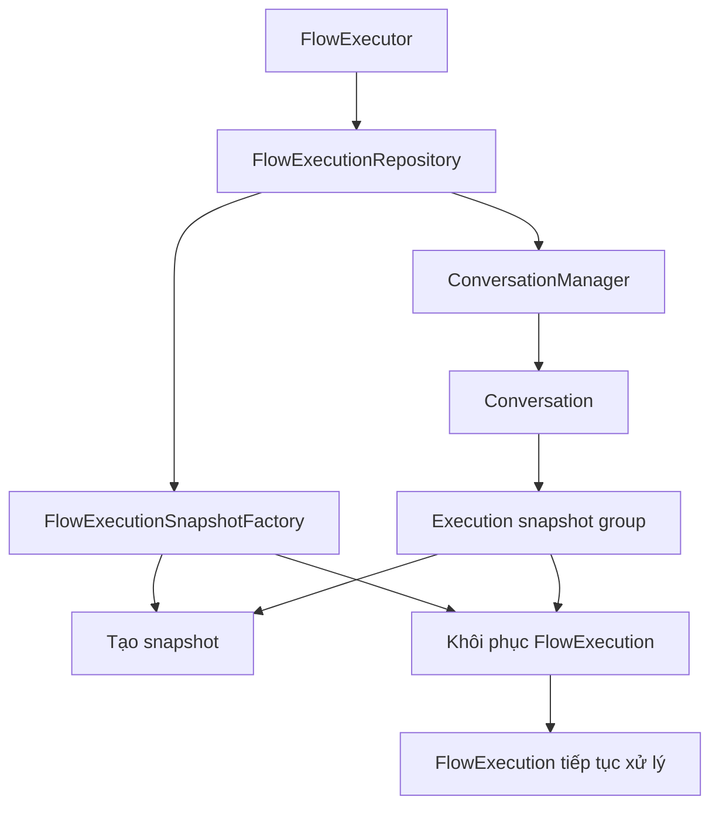
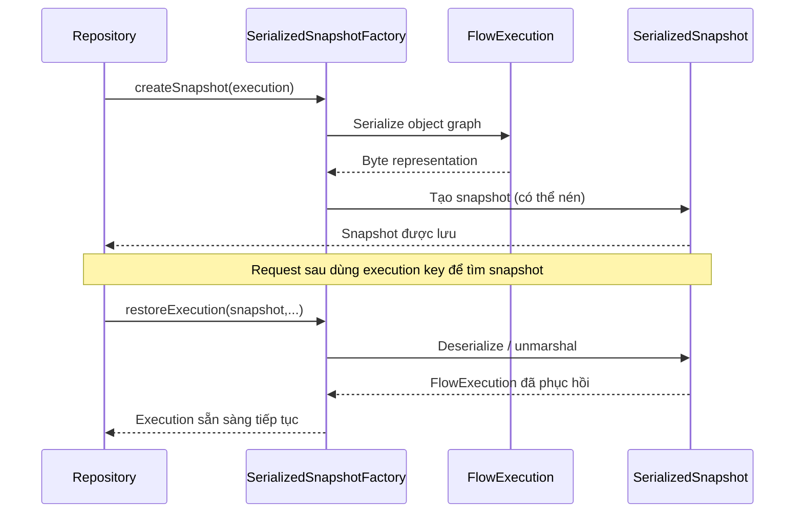
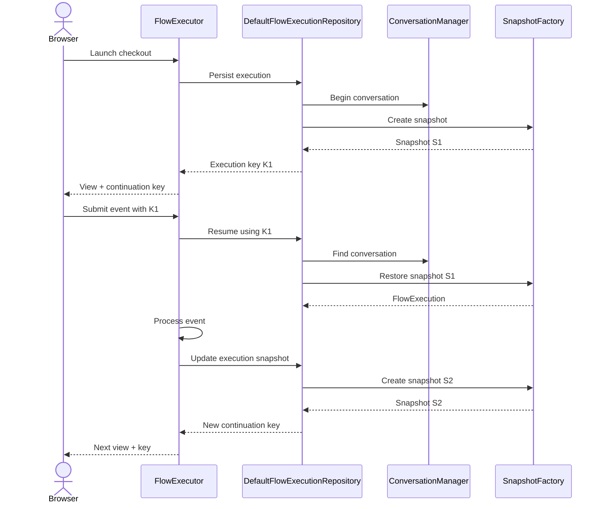

# DefaultFlowExecutionRepository và cơ chế snapshot

## 1. Vì sao Spring Web Flow cần repository?

Trong **Spring Web Flow (SWF)**, một flow execution có thể kéo dài qua nhiều HTTP request. Người dùng mở màn hình giỏ hàng, gửi form giao hàng, xem lại đơn hàng, nhấn Back để sửa rồi tiếp tục. Khi response đầu tiên kết thúc, ứng dụng vẫn phải giữ được trạng thái của execution để request kế tiếp tiếp tục đúng bước.

Phần quản lý trạng thái này được giao cho **`FlowExecutionRepository`**. Repository chịu trách nhiệm lưu, tìm lại, khôi phục và loại bỏ các `FlowExecution` mà `FlowExecutor` tạo ra. Mỗi execution được định danh bằng một `FlowExecutionKey` duy nhất trong repository.

Trong cấu hình Web Flow thông dụng, `DefaultFlowExecutionRepository` thực hiện nhiệm vụ đó bằng cách quản lý một conversation cho execution và tạo các **snapshot** của trạng thái execution. Snapshot cho phép khôi phục một điểm trạng thái trước đó, hỗ trợ browser Back và tiếp tục flow từ một mốc đã lưu.

Ví dụ một hành trình đặt hàng:

```text
checkout
  cart
    └─ next → shipping
                  └─ next → review
                                  ├─ back → shipping
                                  └─ confirm → completed
```

Nếu người dùng đang ở `review`, repository cần tìm đúng execution và trạng thái tương ứng với execution key mà request gửi lên. Khi người dùng quay lại mốc `shipping`, snapshot trước đó có thể được khôi phục để tiếp tục từ bước này.

**Repository không định nghĩa state machine.** Flow definition mô tả các state/transition; repository quản lý trạng thái runtime của từng execution.

## 2. Ba thành phần cần phân biệt

Cơ chế lưu execution của Web Flow gồm ba vai trò chính:

| Thành phần | Trách nhiệm | Câu hỏi nó trả lời |
|---|---|---|
| `FlowExecutionRepository` | API lưu, tra cứu, khôi phục và xóa execution | Lấy execution nào theo key? |
| `ConversationManager` | Quản lý conversation chứa các execution/snapshot | Trạng thái được giữ ở vùng lưu trữ nào? |
| `FlowExecutionSnapshotFactory` | Tạo snapshot và phục hồi execution từ snapshot | Một bản trạng thái được sao chép theo cách nào? |

`DefaultFlowExecutionRepository` kết hợp `ConversationManager` với `FlowExecutionSnapshotFactory`. Nó bắt đầu conversation khi execution được cấp persistent key, quản lý nhóm snapshot, kết thúc conversation khi execution kết thúc và vô hiệu hóa các snapshot liên quan sau khi hoàn tất.

Sơ đồ tổng quát:



Không nên đồng nhất ba thành phần: repository là cổng quản lý execution; conversation manager quyết định nơi conversation được giữ; snapshot factory quyết định cách tạo bản chụp trạng thái.

## 3. DefaultFlowExecutionRepository hoạt động ra sao?

`org.springframework.webflow.execution.repository.impl.DefaultFlowExecutionRepository` là triển khai repository mặc định của Spring Web Flow 2.5.x. Nó kế thừa cơ chế snapshot từ `AbstractSnapshottingFlowExecutionRepository` và ủy thác việc quản lý các conversation đang hoạt động cho một `ConversationManager`.

Các nhiệm vụ chính:

1. **Bắt đầu conversation:** khi một `FlowExecution` được gán persistent key, repository mở một conversation mới. Conversation có ID riêng và ID này là một phần của execution key.
2. **Tạo snapshot:** repository yêu cầu `FlowExecutionSnapshotFactory` chụp trạng thái execution tại các mốc lưu.
3. **Tra cứu và phục hồi:** từ key, repository tìm conversation/snapshot phù hợp và dùng factory phục hồi một `FlowExecution` có thể tiếp tục.
4. **Quản lý lịch sử:** repository giữ số snapshot trong giới hạn cấu hình, phục vụ việc quay lại điểm trước đó.
5. **Kết thúc conversation:** khi flow execution hoàn tất, repository kết thúc conversation và xóa execution cùng các snapshot liên quan.

Điểm cuối có ý nghĩa vận hành: sau khi một logical flow execution hoàn tất, các snapshot của nó bị vô hiệu hóa. Điều này giải phóng tài nguyên và giảm nguy cơ một request cũ gửi lại continuation key để thực hiện hành động lần thứ hai.

### 3.1. Repository không phải mặc định là database

Tên `Repository` dễ khiến người đọc nghĩ dữ liệu luôn được ghi vào database. Thực tế, `DefaultFlowExecutionRepository` phối hợp với `ConversationManager`; nơi lưu vật lý phụ thuộc implementation của manager.

Trong cấu hình web phổ biến, `SessionBindingConversationManager` giữ các conversation trong attribute map của HTTP session. Khi HTTP session hết hạn, conversation container gắn với session cũng hết hạn theo. Nếu ứng dụng sử dụng session store, session replication hoặc cơ chế lưu session phân tán, trạng thái flow sẽ phụ thuộc vào hạ tầng đó.

Vì vậy:

- Repository cung cấp **hợp đồng quản lý execution**.
- Conversation manager quyết định conversation được lưu ở đâu.
- Việc có database/shared store/replication hay không là quyết định cấu hình và hạ tầng.
- Không được suy luận rằng dùng `DefaultFlowExecutionRepository` tự động tạo bản ghi database bền vững.

## 4. Conversation và FlowExecutionKey

Khi execution cần được lưu và tiếp tục qua request, repository cấp cho nó một `FlowExecutionKey`. Key là định danh persistent của một lượt chạy, không phải flow ID và cũng không phải HTTP session ID.

Trong repository mặc định, conversation có một ID riêng; key của execution còn xác định snapshot tương ứng. Có thể hình dung:

```text
Flow ID:          checkout
Conversation ID:  conversation-A
Snapshot ID:      snapshot-3
Execution key:    key đại diện cho conversation-A + snapshot-3
```

Đây là mô hình khái niệm, không phải cam kết về chuỗi ký tự hay định dạng URL. Ứng dụng nên xem execution key là opaque token do Web Flow quản lý; không tự phân tích cấu trúc nội bộ để suy ra user, flow state hoặc quyền truy cập.

Phân biệt:

| Giá trị | Đại diện | Ví dụ |
|---|---|---|
| Flow ID | Definition trong registry | `checkout` |
| Conversation ID | Conversation của logical execution | ID do manager cấp |
| Snapshot ID | Một mốc snapshot trong conversation | ID nội bộ của snapshot group |
| FlowExecutionKey | Khóa dùng để truy xuất một execution/snapshot | Giá trị continuation do engine phát |
| HTTP session ID | Phiên HTTP của trình duyệt | Cookie session |

Một HTTP session có thể chứa nhiều conversation và nhiều flow execution. Một người dùng mở hai checkout độc lập có thể có hai execution key khác nhau dù cùng đăng nhập trong một HTTP session.

**Execution key không phải cơ chế authorization.** Khi xử lý thao tác đặt hàng/thanh toán, service vẫn phải kiểm tra identity, quyền sở hữu tài nguyên và điều kiện nghiệp vụ.

## 5. Snapshot là gì và được dùng khi nào?

`FlowExecutionSnapshot` là bản chụp trạng thái của một `FlowExecution` tại một thời điểm. Snapshot có thể được dùng để khôi phục execution từ đúng mốc đó rồi tiếp tục hành trình.

Một execution có thể tạo chuỗi snapshot:

```text
S1: cart
   │ người dùng gửi next
   ▼
S2: shipping
   │ người dùng gửi next
   ▼
S3: review
   │ người dùng gửi back
   ▼
Khôi phục S2: shipping
```

Snapshot history hỗ trợ browser Back: URL/continuation key trong history có thể trỏ đến snapshot trước đó. Khi người dùng quay lại và tiếp tục từ một mốc cũ, repository phục hồi trạng thái tương ứng theo key đó.

Snapshot **không phải log nghiệp vụ** và không nên được dùng thay cho audit trail. Snapshot lưu trạng thái execution để tiếp tục flow; nó không bảo đảm lưu mọi lần gọi service, mọi transaction hoặc mọi side effect bên ngoài.

### 5.1. Một snapshot có thể khác với object đang chạy

Với snapshot factory tạo bản sao, snapshot lưu một bản thể hiện trạng thái ở thời điểm chụp. Execution tiếp tục xử lý có thể tiến tới state khác mà snapshot cũ vẫn đại diện cho state trước đó.

Ví dụ:

- Snapshot `S2` lưu trạng thái `shipping`.
- Execution tiếp tục đến `review` và tạo snapshot `S3`.
- Browser Back dùng key trỏ `S2`, repository phục hồi trạng thái `shipping`.
- Người dùng sửa lựa chọn và đi tiếp theo nhánh mới.

Khả năng quay lại là một tính năng về **điều khiển flow**, không tự động đảo ngược tác dụng phụ đã xảy ra trong database hoặc hệ thống ngoài. Nếu một transition đã tạo đơn hoặc thu tiền, quay lại snapshot trước đó không hoàn tác transaction đó.

## 6. FlowExecutionSnapshotFactory: cách tạo và khôi phục snapshot

Interface `FlowExecutionSnapshotFactory` định nghĩa hai thao tác:

```java
FlowExecutionSnapshot createSnapshot(FlowExecution flowExecution);

FlowExecution restoreExecution(
        FlowExecutionSnapshot snapshot,
        String flowId,
        FlowExecutionKey key,
        MutableAttributeMap<Object> conversationScope,
        FlowExecutionKeyFactory keyFactory);
```

- `createSnapshot(...)` tạo bản chụp từ execution hiện tại.
- `restoreExecution(...)` phục hồi một execution từ snapshot, root flow ID, key, conversation scope và key factory.
- Nếu không tạo được snapshot, API có thể ném `SnapshotCreationException`.
- Nếu không phục hồi được execution, API có thể ném `FlowExecutionRestorationFailureException`.

Spring Web Flow 2.5.x có hai factory tiêu biểu:

| Factory | Cách hoạt động | Phù hợp khi |
|---|---|---|
| `SerializedFlowExecutionSnapshotFactory` | Tạo snapshot dựa trên Java serialization | Cần bản sao độc lập của execution để hỗ trợ nhiều mốc history |
| `SimpleFlowExecutionSnapshotFactory` | Snapshot chỉ bọc execution hiện có, không sao chép dữ liệu execution | Không cần bản sao history; thường chỉ phù hợp khi `maxSnapshots=1` |

Chọn factory ảnh hưởng đến cả semantics của history lẫn chi phí bộ nhớ/CPU. Không nên thay factory chỉ vì tên lớp có chữ `Simple` hoặc `Serialized`; phải kiểm tra yêu cầu Back/restore và cách dữ liệu trong scope được giữ.

## 7. SerializedFlowExecutionSnapshotFactory và Java serialization

`SerializedFlowExecutionSnapshotFactory` tạo snapshot dựa trên **Java Object Serialization**. Lớp snapshot tương ứng là `SerializedFlowExecutionSnapshot`, triển khai `Externalizable`/`Serializable`.

Cơ chế tổng quát:



### 7.1. Điều kiện của object graph

Khi Java serialization được sử dụng, các đối tượng nằm trong graph cần tuân thủ quy tắc serialization. Một object trong `flowScope`, `viewScope`, `conversationScope` hoặc dữ liệu của execution có thể làm snapshot thất bại nếu chứa tham chiếu không serializable.

Các trường hợp thường gây vấn đề:

- Entity/proxy ORM với quan hệ lazy hoặc proxy phụ thuộc persistence context.
- `InputStream`, `OutputStream`, socket, connection hoặc tài nguyên mở.
- Service/bean có dependency không thể serialize.
- `HttpServletRequest`, `HttpServletResponse` hoặc object request gắn với thread.
- File byte array lớn hoặc collection hàng nghìn phần tử.
- Lambda/inner class capture tham chiếu tới object không serializable.

`FlowExecutionImpl` của Web Flow có khả năng serialization, nhưng điều đó **không làm mọi object mà ứng dụng đặt vào scope tự động serializable**.

### 7.2. Compression

`SerializedFlowExecutionSnapshotFactory` có thuộc tính `compress` để bật/tắt nén snapshot:

```java
snapshotFactory.setCompress(true);
```

Nén có thể giảm số byte lưu trữ hoặc truyền đi, nhưng cần thêm CPU để nén/giải nén. Dữ liệu đã nén tốt hoặc object graph nhỏ có thể không thu được lợi ích đáng kể. Hãy đo kích thước snapshot, thời gian tạo/restore và CPU trước khi bật trong môi trường có tải cao.

### 7.3. Compatibility khi deploy

Snapshot serialized phụ thuộc vào class và cấu trúc object tại thời điểm lưu. Nếu deploy phiên bản mới trong khi execution cũ còn tồn tại, thay đổi class, `serialVersionUID`, class loader hoặc cấu trúc flow có thể làm restore thất bại.

Cần có chính sách cho execution cũ khi rolling deploy:

- Giữ compatibility của object được serialize trong khoảng thời gian execution còn sống, nếu cần tiếp tục qua deploy.
- Giới hạn thời gian sống của flow execution và thông báo cho người dùng khi phải bắt đầu lại.
- Thử restore snapshot được tạo từ build trước bằng build mới trong kiểm thử triển khai.
- Không coi việc flow XML vẫn nạp được là bằng chứng snapshot cũ sẽ khôi phục thành công.

## 8. SimpleFlowExecutionSnapshotFactory: snapshot không sao chép

`SimpleFlowExecutionSnapshotFactory` tạo snapshot bằng cách **bọc execution hiện tại**, không tạo bản sao độc lập của object graph. API ghi chú factory này thường chỉ phù hợp khi repository có `maxSnapshots` bằng 1, vì không có nhiều bản copy trạng thái để giữ history.

Điều đó có nghĩa:

- Nó có thể giảm chi phí tạo bản sao/serialization.
- Nó không cung cấp lịch sử nhiều mốc độc lập như serialized snapshot factory.
- Không nên cấu hình nhiều snapshot rồi kỳ vọng mỗi snapshot giữ một state cũ riêng khi factory chỉ bọc cùng execution.
- Browser Back cần được thử nghiệm theo semantics mà factory và repository thực sự cung cấp.

Không nên chọn `SimpleFlowExecutionSnapshotFactory` như một cách “tắt Java serialization” nhưng vẫn kỳ vọng toàn bộ tính năng Back history hoạt động giống cấu hình serialized factory.

## 9. Giới hạn số execution và số snapshot

Spring Web Flow cho phép giới hạn hai cấp độc lập khi cấu hình `flow-execution-repository`.

### 9.1. max-executions

`max-executions` giới hạn số flow execution được tạo **trên mỗi user session**. Giới hạn này áp dụng chung giữa các flow definition, không phải mỗi flow có một quota riêng. Khi vượt ngưỡng, execution cũ nhất bị loại bỏ.

Ví dụ: `max-executions="5"`. Nếu session đã có năm execution đang quản lý và người dùng khởi chạy flow thứ sáu, execution cũ nhất có thể bị loại bỏ theo chính sách repository. Continuation key của execution bị loại bỏ sẽ không còn tìm thấy trạng thái tương ứng.

### 9.2. max-execution-snapshots

`max-execution-snapshots` giới hạn số history snapshot được giữ cho **mỗi execution**.

| Giá trị | Ý nghĩa |
|---|---|
| `0` | Tắt việc tạo snapshot history; browser Back không hoạt động như khi có snapshot |
| Số dương, ví dụ `30` | Giữ tối đa số snapshot được cấu hình cho mỗi execution |
| `-1` | Không giới hạn số snapshot |

Khi giới hạn snapshot bị vượt, các mốc cũ hơn có thể bị loại bỏ. Nếu người dùng Back tới một key trỏ vào snapshot đã bị loại, repository không thể phục hồi mốc đó và có thể phát sinh `SnapshotNotFoundException`.

**Không đặt `-1` chỉ để tránh lỗi Back.** Số snapshot không giới hạn có thể làm tăng memory/storage theo số execution và số bước. Hãy cân đối giữa nhu cầu quay lại, kích thước object graph và tải đồng thời.

## 10. Cấu hình repository trong XML và Java

### 10.1. XML namespace

Trong cấu hình Spring đã khai báo namespace Web Flow config, có thể đặt giới hạn như sau:

```xml
<webflow:flow-executor id="flowExecutor"
                       flow-registry="flowRegistry">
    <webflow:flow-execution-repository
            max-executions="5"
            max-execution-snapshots="30" />
</webflow:flow-executor>
```

Đoạn trích giả định `flowRegistry` đã được khai báo và MVC adapter của ứng dụng dùng đúng `flowExecutor` này. Hai thuộc tính có ý nghĩa khác nhau:

- `max-executions` kiểm soát số lượt chạy đang được giữ cho mỗi user session.
- `max-execution-snapshots` kiểm soát lịch sử của từng lượt chạy.

### 10.2. Java configuration

Với cấu hình kế thừa `AbstractFlowConfiguration` ở Web Flow 2.x:

```java
@Configuration
public class WebFlowConfig extends AbstractFlowConfiguration {

    @Bean
    public FlowExecutor flowExecutor() {
        return getFlowExecutorBuilder(flowRegistry())
                .setMaxFlowExecutions(5)
                .setMaxFlowExecutionSnapshots(30)
                .build();
    }

    @Bean
    public FlowDefinitionRegistry flowRegistry() {
        return getFlowDefinitionRegistryBuilder()
                .addFlowLocation("/WEB-INF/flows/checkout/checkout.xml")
                .build();
    }
}
```

Ví dụ trên cho thấy cách builder nhận các giới hạn. Trong dự án thực tế, registry có thể được cấu hình với nhiều flow location, và FlowExecutor cần được gắn vào đúng cấu hình Spring MVC.

### 10.3. Khi nào cần tùy chỉnh ConversationManager?

`FlowExecutorBuilder` cho phép đặt một `ConversationManager` khác. Đây là điểm mở rộng khi ứng dụng cần thay đổi cách conversation được lưu/quản lý, ví dụ tích hợp hạ tầng session riêng.

Không nên tùy chỉnh manager chỉ để thay đổi số snapshot: builder có API riêng cho `setMaxFlowExecutionSnapshots`. Khi cung cấp manager tùy chỉnh, semantics về nơi lưu, giới hạn conversation, locking và lifecycle phụ thuộc implementation đó; phải kiểm thử lại cả resume lẫn cleanup.

## 11. Một lượt lưu và khôi phục execution

Mô hình sau diễn tả các bước chính trong một request:

1. Flow được launch và có `FlowExecution` mới.
2. Repository bắt đầu conversation và cấp persistent key.
3. Khi execution được lưu, repository tạo/cập nhật snapshot và giữ thông tin conversation.
4. Response trả continuation key cho request tiếp theo theo cơ chế tích hợp.
5. Request tiếp theo gửi key; executor/repository lấy lock phù hợp, tìm conversation và snapshot.
6. Snapshot factory khôi phục execution.
7. Engine xử lý event, cập nhật trạng thái và lưu snapshot tiếp theo.
8. Khi root execution kết thúc, repository kết thúc conversation và loại bỏ snapshot history.



Đây là sơ đồ logic; chi tiết thời điểm lưu, redirect, tạo key tiếp theo và xử lý view phụ thuộc vào `FlowExecutor`, adapter và cấu hình repository cụ thể. Không nên giả định mọi HTTP request đều serialize toàn bộ execution theo cùng một đường đi trong mọi cấu hình.

## 12. Locking và request đồng thời

`FlowExecutionRepository` có API `getLock(FlowExecutionKey)` để lấy `FlowExecutionLock`. Hợp đồng repository yêu cầu khóa execution trước khi đọc/làm việc với execution tương ứng, sau đó giải phóng khóa trong `finally`.

Mẫu khái niệm:

```java
FlowExecutionLock lock = repository.getLock(key);
lock.lock();
try {
    FlowExecution execution = repository.getFlowExecution(key);
    // Xử lý trong vùng đã khóa theo contract repository.
} finally {
    lock.unlock();
}
```

Đây là minh họa API repository ở tầng thấp, **không phải code để chèn tùy tiện vào controller**. Thông thường `FlowExecutor` và tích hợp Web Flow quản lý quy trình này. Chỉ thao tác trực tiếp repository khi đang xây dựng extension/integration phù hợp và hiểu contract locking.

Lock giúp tránh hai request cùng cập nhật một execution một cách không kiểm soát. Tuy nhiên, lock không tự bảo vệ transaction nghiệp vụ ở database, không thay thế optimistic locking và không bảo đảm action bên ngoài không bị lặp.

Các tình huống phải kiểm thử:

- Người dùng nhấn Submit hai lần nhanh.
- Hai tab gửi hai request cùng execution key.
- Request cũ đến sau request mới.
- Browser Back khôi phục snapshot cũ trong khi tab khác đã đi tiếp.
- Hai execution khác nhau cùng cập nhật một order hoặc một reservation.

Dùng transaction, version field và idempotency key ở service nghiệp vụ để bảo vệ dữ liệu quan trọng.

## 13. Các lỗi snapshot/repository thường gặp

| Exception / hiện tượng | Ý nghĩa | Nguyên nhân có thể |
|---|---|---|
| `BadlyFormattedFlowExecutionKeyException` | Key không phân tích được | URL/key bị cắt, sai định dạng hoặc request gửi giá trị lỗi |
| `NoSuchFlowExecutionException` | Không tìm thấy execution | Execution đã kết thúc, bị loại do giới hạn hoặc session hết hạn |
| `SnapshotNotFoundException` | Snapshot được key tham chiếu không còn | Snapshot history cũ đã bị loại hoặc key stale |
| `SnapshotCreationException` | Không tạo được snapshot | Serialization thất bại hoặc object graph không hỗ trợ |
| `SnapshotUnmarshalException` | Không giải mã được snapshot serialized | Dữ liệu/class/classloader không tương thích hoặc snapshot hỏng |
| `FlowExecutionRestorationFailureException` | Factory không phục hồi được execution | Snapshot không hợp lệ, definition hoặc dependency phục hồi không phù hợp |
| `FlowExecutionAccessException` | Không thể truy cập execution | Conversation/lock/storage gặp lỗi |

Khi điều tra, nên xác định lỗi thuộc giai đoạn nào:

1. **Parse key:** kiểm tra request/URL và continuation key.
2. **Find conversation:** kiểm tra HTTP session, session store, timeout và conversation manager.
3. **Find snapshot:** kiểm tra snapshot limit, key cũ, browser Back và lifecycle.
4. **Restore snapshot:** kiểm tra serialization, class version, class loader và flow definition.
5. **Process event:** kiểm tra action/transition và exception nghiệp vụ sau khi execution đã được phục hồi.

Không chuyển mọi lỗi repository thành “người dùng đã hủy flow”. Có lỗi là stale key, có lỗi là hết session, có lỗi là object không serialize được; cách khôi phục và thông báo cho người dùng cần khác nhau.

## 14. Ảnh hưởng đến browser Back và duplicate submission

### 14.1. Back phụ thuộc history snapshot

Khi snapshot history được bật, browser Back có thể dùng continuation key trỏ đến mốc trước. Nếu đặt `max-execution-snapshots="0"`, history snapshot bị tắt; tài liệu Web Flow nêu rõ browser Back không hoạt động theo cơ chế snapshot và key trỏ tới snapshot chưa được ghi.

Nếu giới hạn chỉ giữ 3 snapshot, người dùng quay lại một mốc cũ hơn đã bị loại cũng không thể phục hồi. Do đó, giới hạn phải được chọn theo số bước người dùng thực tế cần quay lại.

### 14.2. Back không đảo ngược side effect

Giả sử ở state `confirm`, flow gọi service tạo đơn hàng và commit transaction. Nếu người dùng Back về `review`, snapshot chỉ khôi phục **trạng thái điều khiển flow**; nó không tự xóa đơn hàng đã ghi.

Vì vậy, các hành động có side effect cần:

- Idempotency key hoặc cơ chế chống xử lý trùng.
- Kiểm tra trạng thái nghiệp vụ trước khi chạy lại.
- Compensation/reversal riêng nếu nghiệp vụ cho phép hoàn tác.
- Tách rõ action đọc dữ liệu và action ghi dữ liệu.

### 14.3. Completion invalidates history

`DefaultFlowExecutionRepository` hỗ trợ vô hiệu hóa execution khi hoàn tất: conversation và các snapshot liên quan bị xóa. Điều này giúp giải phóng bộ nhớ và ngăn continuation key cũ tiếp tục thực hiện cùng một logical execution sau khi đã hoàn thành.

## 15. Tối ưu kích thước và hiệu năng snapshot

Mỗi snapshot có thể mang theo trạng thái execution và object graph nằm trong các scope. Nếu flow giữ toàn bộ entity JPA, danh sách lớn, tệp upload hoặc dữ liệu nhị phân, snapshot có thể tăng mạnh về kích thước và chi phí tạo/restore.

Các nguyên tắc:

- Giữ ID, code và DTO nhỏ thay vì aggregate/entity graph lớn.
- Không lưu stream, connection, request/response hoặc service trong flow scope.
- Đưa danh sách lớn sang truy vấn phân trang; chỉ giữ lựa chọn cần thiết.
- Chỉ bật số snapshot đủ phục vụ trải nghiệm Back đã yêu cầu.
- Đo thời gian create/restore, số byte serialized, heap, GC và số execution đồng thời.
- Nếu dùng compression, đo cả dung lượng và CPU.
- Theo dõi tỷ lệ lỗi snapshot creation/restoration và số key stale.

Ví dụ ước lượng: nếu mỗi snapshot có kích thước 200 KiB, một execution giữ 20 snapshot thì payload lịch sử xấp xỉ 4.000 KiB (gần 3,9 MiB) trước khi tính metadata, conversation và overhead của storage. Đây chỉ là phép nhân minh họa; kích thước heap và byte stream thực tế cần đo.

Không tối ưu bằng cách đặt `max-execution-snapshots="0"` mà không đánh giá tác động đến Back, refresh và người dùng mở nhiều tab.

## 16. Kiểm thử repository và snapshot

Một bộ kiểm thử tích hợp nên xác minh cả hành vi lưu/khôi phục lẫn giới hạn history.

| Ca kiểm thử | Cách thực hiện | Kết quả cần xác nhận |
|---|---|---|
| Launch execution | Khởi chạy `checkout` | Có execution key và trạng thái ban đầu |
| Resume | Gửi event bằng key hiện tại | Execution phục hồi đúng state và xử lý event |
| Back snapshot | Lưu nhiều bước, dùng key cũ hợp lệ | Phục hồi state trước theo history |
| Vượt giới hạn snapshots | Đặt limit nhỏ, đi qua nhiều state | Snapshot cũ nhất bị loại theo chính sách |
| Tắt snapshot | Đặt limit 0 và thử browser Back | Không kỳ vọng phục hồi history cũ |
| Nhiều execution | Tạo quá `max-executions` trong cùng session | Execution cũ nhất bị loại |
| Root completion | Đi tới end-state | Conversation/snapshot của execution bị invalidated |
| Session timeout | Hết HTTP session rồi resume key | Không tìm được conversation/session cũ |
| Serialization failure | Đặt object không serializable vào scope | Snapshot creation báo lỗi phù hợp |
| Restore sau deploy | Tạo snapshot ở build cũ, restore ở build mới | Xác minh compatibility hoặc chính sách hết hạn |
| Concurrent requests | Gửi đồng thời hai request cùng key | Không làm hỏng trạng thái; xử lý lock/stale key rõ |
| Subflow | Vào và kết thúc subflow | Root execution và flow session stack được phục hồi đúng |

Với test tự động, có thể dùng `spring-webflow-test` cho state/event và kiểm thử tích hợp với cùng FlowExecutor/repository mà ứng dụng sử dụng. Test chỉ khởi tạo `FlowDefinitionRegistry` hoặc kiểm tra XML không đủ để chứng minh snapshot restore hoạt động.

### 16.1. Checklist chẩn đoán khi Back hoặc resume lỗi

1. Key có được gửi nguyên vẹn trong request không?
2. HTTP session còn tồn tại và request có đến đúng ứng dụng/node không?
3. Conversation manager có tìm thấy conversation không?
4. Snapshot ID còn trong nhóm snapshot không?
5. Snapshot factory đang dùng là serialized hay simple?
6. Object graph có chứa field không serializable không?
7. Phiên bản class và flow definition có tương thích với snapshot cũ không?
8. Giới hạn `max-executions`/`max-execution-snapshots` có loại mốc đang được yêu cầu không?
9. Execution đã hoàn tất và bị invalidated chưa?
10. Có hai request đồng thời hoặc tab khác đang dùng cùng execution không?

## 17. Ghi nhớ

`DefaultFlowExecutionRepository` phối hợp `ConversationManager` và `FlowExecutionSnapshotFactory` để lưu, tìm lại, khôi phục và loại bỏ execution. Conversation cung cấp phạm vi quản lý của một logical execution; snapshot lưu một mốc trạng thái có thể phục hồi; execution key giúp repository tìm đúng mốc đó.

Hai giới hạn cần nhớ là `max-executions` (số execution trên mỗi user session, áp dụng qua các flow definition) và `max-execution-snapshots` (số history snapshot cho mỗi execution). Snapshot history hỗ trợ browser Back; tắt snapshot hoặc để history bị loại có thể làm key cũ không còn phục hồi được.

Khi triển khai, hãy chọn snapshot factory phù hợp, giữ object graph gọn và có khả năng serialization nếu dùng serialized factory, kiểm thử restore sau deploy, đồng thời bảo vệ side effect nghiệp vụ bằng transaction/idempotency. **Snapshot khôi phục trạng thái flow; nó không tự hoàn tác nghiệp vụ đã thực hiện.**

### Tài liệu tham khảo

- [Spring Web Flow 2.5.1 — DefaultFlowExecutionRepository API](https://docs.spring.io/spring-webflow/docs/2.5.1.RELEASE/api/org/springframework/webflow/execution/repository/impl/DefaultFlowExecutionRepository.html) — conversation, snapshot group, completion invalidation.
- [Spring Web Flow 2.5.1 — FlowExecutionRepository API](https://docs.spring.io/spring-webflow/docs/2.5.x/api/org/springframework/webflow/execution/repository/FlowExecutionRepository.html) — lưu/khôi phục execution, key và locking.
- [Spring Web Flow 2.5.1 — System Setup: Tuning FlowExecution persistence](https://docs.spring.io/spring-webflow/docs/2.5.1.RELEASE/reference/html/system-setup.html) — `max-executions` và `max-execution-snapshots`.
- [Spring Web Flow 2.5.1 — FlowExecutionSnapshotFactory API](https://docs.spring.io/spring-webflow/docs/2.5.x/api/org/springframework/webflow/execution/repository/snapshot/FlowExecutionSnapshotFactory.html) — contract tạo và phục hồi snapshot.
- [Spring Web Flow 2.5.1 — SerializedFlowExecutionSnapshotFactory API](https://docs.spring.io/spring-webflow/docs/2.5.x/api/org/springframework/webflow/execution/repository/snapshot/SerializedFlowExecutionSnapshotFactory.html) — Java serialization và compression.
- [Spring Web Flow 2.5.1 — SimpleFlowExecutionSnapshotFactory API](https://docs.spring.io/spring-webflow/docs/2.5.x/api/org/springframework/webflow/execution/repository/snapshot/SimpleFlowExecutionSnapshotFactory.html) — snapshot bọc execution và giới hạn khi không tạo bản sao.
- [Spring Web Flow 2.5.1 — SessionBindingConversationManager API](https://docs.spring.io/spring-webflow/docs/2.5.x/api/org/springframework/webflow/conversation/impl/SessionBindingConversationManager.html) — quản lý conversation trong HTTP session.
