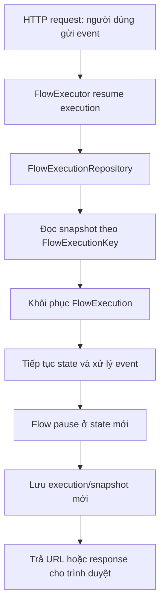
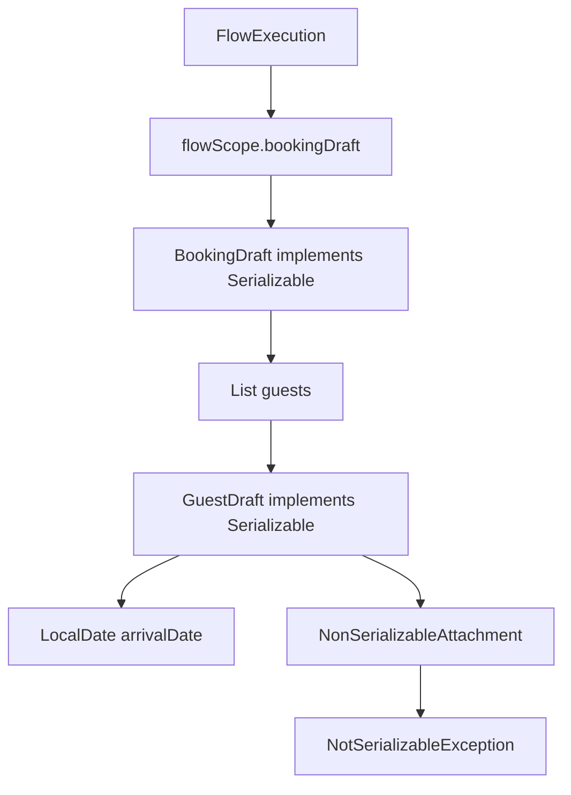

# Serializable và đồ thị đối tượng được lưu theo execution

Trong **Spring Web Flow**, một hành trình như đặt phòng, đăng ký tài khoản hoặc xử lý đơn hàng có thể dừng ở một màn hình rồi tiếp tục sau nhiều HTTP request. Để tiếp tục đúng bước, Web Flow phải lưu trạng thái của lần chạy: flow đang ở state nào, dữ liệu nào đã được nhập, các flow con nào đang hoạt động và những thông tin nào cần để xử lý event tiếp theo.

FlowExecution đại diện cho trạng thái runtime của một lần chạy flow. Khi repository lưu execution hoặc tạo snapshot, dữ liệu runtime cần được giữ lại để lần request sau có thể khôi phục và tiếp tục. Với cơ chế mặc định dựa trên Java serialization, các object được lưu trong những scope tồn tại qua request phải có khả năng serialize. Điều kiện này áp dụng cho **đồ thị đối tượng thực tế**, không chỉ class ở ngoài cùng.

Bài học thuộc chương **Lưu trữ execution**, tập trung vào ý nghĩa của Serializable, các object có thể nằm trong execution graph, cách các scope tham gia vào lưu trữ, nguyên nhân NotSerializableException, cách thiết kế DTO nhỏ và ổn định, ảnh hưởng của thay đổi class khi triển khai, cùng các kiểm thử serialize/restore qua repository thật.

## 1. Vì sao flow execution cần được lưu?

Giả sử người dùng đang thực hiện quy trình đặt phòng:

1. Mở flow booking.
2. Nhập ngày đến, số khách và thông tin liên hệ.
3. Chuyển sang màn hình xem lại.
4. Quay lại sửa số khách.
5. Xác nhận và hoàn tất.

Mỗi lần người dùng gửi request, Web Flow tiếp tục một execution đã tồn tại. Nếu server không giữ được dữ liệu từ các bước trước, flow sẽ không biết người dùng đang ở đâu hoặc đã nhập gì.

Một execution đang tạm dừng có thể chứa:

- Flow definition và active flow session/state.
- Các biến của flow được khai báo bằng phần tử var.
- Giá trị trong flowScope, viewScope và flashScope.
- Dữ liệu trong conversationScope được lưu theo conversation/session.
- Stack các flow session khi flow cha đang gọi subflow.
- Các attributes hoặc dữ liệu runtime khác mà implementation/repository đưa vào snapshot.

Khi execution được khôi phục, Web Flow cần dựng lại trạng thái runtime và kết nối nó với các flow definition đã đăng ký. Vì vậy, **định nghĩa flow trong registry và dữ liệu của một execution là hai phần khác nhau**: XML mô tả quy trình; execution giữ tiến trình cụ thể của một người dùng.



Đây là vòng đời khái quát. Repository cụ thể quyết định execution được lưu ở session, bộ nhớ hay một nơi lưu trữ khác; snapshot factory quyết định cách tạo snapshot.

## 2. FlowExecutionRepository lưu và khôi phục những gì?

FlowExecutionRepository là subsystem chịu trách nhiệm lưu, khôi phục và xóa các flow execution được khởi chạy bởi ứng dụng. Một execution được đánh chỉ mục bằng FlowExecutionKey.

| Thao tác | Ý nghĩa |
| --- | --- |
| putFlowExecution(execution) | Lưu hoặc cập nhật trạng thái execution đang hoạt động nhưng tạm dừng |
| getFlowExecution(key) | Khôi phục execution tương ứng với key để tiếp tục |
| removeFlowExecution(execution) | Xóa execution khi flow kết thúc |
| getLock(key) | Lấy khóa để thao tác an toàn trên execution được chỉ định |

Hợp đồng repository yêu cầu caller lấy lock trước khi đọc/ghi execution theo key và nhả lock sau khi hoàn tất. Khi dùng FlowExecutor tiêu chuẩn, engine điều phối chu trình này; nếu tự viết repository, cần thực hiện đúng hợp đồng khóa để tránh hai request đồng thời sửa cùng một execution.

### FlowExecutionImpl và Java serialization

Implementation mặc định FlowExecutionImpl triển khai Externalizable và Serializable. API mô tả nó có thể được lưu trong HTTP session hoặc một persistent store khác như file hay database. Sau khi deserialize, FlowExecutionImplFactory được dùng để khôi phục execution về trạng thái có thể tiếp tục.

Điều đó **không có nghĩa mọi object do ứng dụng đặt vào flow đều tự động serialize được**. Execution root có thể serializable, nhưng một object trong flowScope chứa InputStream hoặc một field tham chiếu tới servlet request vẫn có thể khiến toàn bộ snapshot thất bại.

### Snapshot và history

Một số repository tạo snapshot để hỗ trợ quay lại trạng thái trước đó. SerializedFlowExecutionSnapshot là implementation snapshot dựa trên Java serialization. Các implementation snapshot khác có thể giữ execution theo cách khác; vì vậy phải phân biệt:

- FlowExecution là trạng thái runtime cần lưu/khôi phục.
- FlowExecutionRepository quản lý storage và key.
- FlowExecutionSnapshotFactory tạo snapshot theo chiến lược được cấu hình.
- SerializedFlowExecutionSnapshot là một dạng snapshot cụ thể sử dụng Java serialization.

Không nên suy luận rằng mọi loại repository hoặc mọi cấu hình đều serialize cùng một cách chỉ vì FlowExecutionImpl hỗ trợ Serializable.

## 3. Serializable áp dụng cho đồ thị đối tượng, không chỉ class gốc

Giả sử flow lưu một object:

```java
public class BookingDraft implements Serializable {
    private Long bookingId;
    private List<GuestDraft> guests;
}
```

Class BookingDraft implements Serializable, nhưng điều đó chưa đủ. Khi serializer đi qua field guests, nó tiếp tục serialize danh sách và từng phần tử. Nếu một GuestDraft hoặc một object nằm sâu hơn trong graph không serialize được, quá trình có thể thất bại.



Để một object graph serialize thành công, các object thực sự được serializer đi tới phải tuân thủ quy tắc serialization của Java. Một field transient được bỏ qua theo cơ chế mặc định; field static không thuộc trạng thái instance được serialize. Với custom serialization như writeObject, readObject, writeExternal và readExternal, ứng dụng có thể điều khiển dữ liệu được ghi và khôi phục, nhưng phải tự bảo đảm tính nhất quán.

| Thành phần trong graph | Điều cần kiểm tra |
| --- | --- |
| Object gốc | Class triển khai Serializable hoặc Externalizable |
| Field instance | Kiểu và object được tham chiếu có serialize được không |
| Collection | Cả collection, key và value/phần tử |
| Object lồng nhau | Toàn bộ nhánh được tham chiếu từ field không transient |
| Superclass | Trạng thái của superclass không serializable không được tự động lưu như class serializable |
| Field transient | Bị bỏ qua; cần khôi phục nếu ứng dụng vẫn cần sau deserialize |
| Field static | Không thuộc object instance được serialize |

**Kiểm tra một class có implements Serializable chỉ là bước đầu.** Cần kiểm tra graph bằng cách serialize một instance thật có dữ liệu đại diện.

## 4. Những scope nào yêu cầu Serializable?

Theo implementation mặc định của Spring Web Flow, các object được lưu trong flowScope, viewScope và flashScope cần serializable vì trạng thái flow được lưu giữa các request. conversationScope được lưu trong HTTP session ở cấu hình thông dụng và nhìn chung cũng nên serializable để hỗ trợ session replication.

| Scope | Vòng đời | Yêu cầu serialization trong cấu hình mặc định |
| --- | --- | --- |
| flowScope | Từ lúc flow bắt đầu đến khi flow kết thúc | Object được lưu cần Serializable |
| viewScope | Từ khi vào đến khi rời một view-state | Object được lưu cần Serializable |
| flashScope | Đến sau lần render view kế tiếp | Object được lưu cần Serializable |
| conversationScope | Từ lúc top-level flow bắt đầu đến khi kết thúc | Thường nên Serializable vì nằm trong HTTP session |
| requestScope | Trong lần flow xử lý request hiện tại | Ngắn hạn; không dùng để giữ trạng thái qua request |

Ví dụ khai báo biến flow:

```xml
<flow xmlns="http://www.springframework.org/schema/webflow">
    <var name="bookingDraft"
         class="com.example.booking.BookingDraft" />

    <view-state id="editBooking"
                view="booking/edit"
                model="bookingDraft">
        <transition on="review" to="reviewBooking" />
    </view-state>
</flow>
```

Biến được tạo từ var tồn tại theo flow session; class của biến phải triển khai Serializable để trạng thái instance có thể được lưu giữa các request. Tương tự, object đặt vào viewScope hoặc flashScope cũng cần đáp ứng yêu cầu serialization của default implementation.

### Conversation scope và session replication

conversationScope được chia sẻ giữa top-level flow và các subflow. Trong cách triển khai thông dụng, dữ liệu conversation nằm trong HTTP session. Nếu ứng dụng chạy nhiều node và container sao chép session, object trong conversation scope cũng phải tương thích với cơ chế serialization của session replication.

Không nên đưa trực tiếp HttpServletRequest, HttpServletResponse, HttpSession hoặc các resource gắn với một request vào conversation scope. Chúng có vòng đời gắn với servlet request/session và không phải DTO dữ liệu có thể phục hồi an toàn qua node khác.

## 5. Thiết kế DTO serializable cho flow

Một DTO lưu trong flow nên biểu diễn **dữ liệu cần để tiếp tục quy trình**, không phải giữ toàn bộ đối tượng runtime của ứng dụng.

Ví dụ:

```java
package com.example.booking;

import java.io.Serializable;
import java.time.LocalDate;
import java.util.ArrayList;
import java.util.List;

public final class BookingDraft implements Serializable {

    private static final long serialVersionUID = 1L;

    private Long bookingId;
    private LocalDate arrivalDate;
    private Integer guestCount;
    private List<GuestDraft> guests = new ArrayList<>();

    public Long getBookingId() {
        return bookingId;
    }

    public void setBookingId(Long bookingId) {
        this.bookingId = bookingId;
    }

    public LocalDate getArrivalDate() {
        return arrivalDate;
    }

    public void setArrivalDate(LocalDate arrivalDate) {
        this.arrivalDate = arrivalDate;
    }

    public Integer getGuestCount() {
        return guestCount;
    }

    public void setGuestCount(Integer guestCount) {
        this.guestCount = guestCount;
    }

    public List<GuestDraft> getGuests() {
        return guests;
    }
}
```

```java
package com.example.booking;

import java.io.Serializable;

public final class GuestDraft implements Serializable {

    private static final long serialVersionUID = 1L;

    private String displayName;
    private Integer age;

    public String getDisplayName() {
        return displayName;
    }

    public void setDisplayName(String displayName) {
        this.displayName = displayName;
    }

    public Integer getAge() {
        return age;
    }

    public void setAge(Integer age) {
        this.age = age;
    }
}
```

LocalDate, Long, Integer, String, ArrayList và GuestDraft trong ví dụ đều phù hợp với Java serialization. Khi thêm field mới vào DTO, hãy xem lại graph và khả năng tương thích với snapshot đang tồn tại.

### Lưu ID và dữ liệu cần thiết, không lưu cả runtime service

Một BookingDraft chỉ cần bookingId, ngày đến, số khách và danh sách khách. Khi flow tiếp tục, action gọi service để nạp dữ liệu mới nhất hoặc kiểm tra quyền:

```java
public Event reloadBooking(RequestContext context) {
    BookingDraft draft =
        (BookingDraft) context.getFlowScope().get("bookingDraft");

    Booking booking = bookingService.findById(draft.getBookingId());
    // Kiểm tra người dùng hiện tại có quyền tiếp tục booking.
    // Đồng bộ những dữ liệu cần thiết vào draft hoặc view model.
    return success();
}
```

Không đưa BookingService, EntityManager, repository, connection pool hay client HTTP vào DTO chỉ để gọi lại khi flow resume. Các service nên được quản lý bởi Spring; execution lưu dữ liệu và định danh cần thiết, sau đó gọi service qua action/bean expression khi cần.

## 6. Những object thường gây NotSerializableException

Các lỗi thường xuất hiện khi object graph chứa resource runtime hoặc object framework không được thiết kế để lưu cùng flow:

| Object thường gặp | Vì sao rủi ro | Cách thiết kế phù hợp |
| --- | --- | --- |
| InputStream, OutputStream, Reader, Writer | Đại diện resource đang mở, không phải dữ liệu có thể khôi phục | Lưu byte/file ID hoặc vị trí resource đã lưu bền vững |
| HttpServletRequest, HttpServletResponse | Gắn với một request cụ thể | Chỉ đọc dữ liệu cần thiết rồi chép vào DTO |
| EntityManager, JDBC Connection | Quản lý resource/persistence context runtime | Lưu ID/entity data phù hợp; tạo context qua listener/service |
| Thread, executor, lock | Gắn với hoạt động đồng thời đang chạy | Lưu trạng thái tác vụ/ID, khởi tạo worker riêng |
| Socket, HTTP client request đang chạy | Có trạng thái kết nối và resource bên ngoài | Lưu endpoint/ID tác vụ, gọi lại service khi resume |
| Lambda/inner class giữ tham chiếu ngoài | Có thể kéo theo object enclosing không serializable | Dùng DTO/class rõ ràng, không lưu callback runtime |
| Proxy lazy hoặc entity graph phức tạp | Phụ thuộc provider, session và proxy implementation | Chuyển thành DTO hoặc lưu khóa định danh |
| ClassLoader, ApplicationContext | Gắn với runtime/container | Để Spring quản lý, không đặt trong scope |

Một số loại như JPA entity hoặc proxy có thể serializable trong một provider/cấu hình cụ thể, nhưng **không nên mặc định điều đó đúng cho mọi provider, mọi association và mọi version**. Test với graph thực tế và cân nhắc dùng DTO thay vì phụ thuộc serialization nội bộ của ORM.

## 7. transient: bỏ field khỏi snapshot nhưng phải khôi phục đúng

Java bỏ qua field transient trong serialization mặc định. Điều này hữu ích cho cache hoặc tham chiếu runtime có thể dựng lại:

```java
public class BookingDraft implements Serializable {

    private static final long serialVersionUID = 1L;

    private Long bookingId;

    private transient String calculatedLabel;

    // getter/setter
}
```

Sau khi deserialize, calculatedLabel nhận giá trị mặc định null. Nếu logic flow cần giá trị này, phải tính lại hoặc nạp lại trước khi sử dụng.

**Không đánh dấu field transient chỉ để làm biến mất NotSerializableException** khi field đó chứa dữ liệu nghiệp vụ cần tiếp tục. Cách đó khiến dữ liệu âm thầm mất sau resume.

Có thể khôi phục field bằng readObject:

```java
private void readObject(ObjectInputStream in)
        throws IOException, ClassNotFoundException {
    in.defaultReadObject();
    this.calculatedLabel = calculateLabel(bookingId);
}
```

Nhưng custom deserialization nên tránh gọi service hoặc phụ thuộc Spring context một cách ngầm định. Thường an toàn hơn khi lưu ID/giá trị cần thiết, rồi dùng action rõ ràng để nạp lại sau khi flow được khôi phục.

### Trường hợp flow variable có transient @Autowired

Tài liệu Spring Web Flow ghi nhận các tham chiếu @Autowired transient mà một flow variable giữ có thể được wiring lại khi flow resume. Đây là hỗ trợ đặc thù của cơ chế khôi phục flow variable; không có nghĩa mọi field transient trong bất kỳ object nào sẽ tự được Spring inject lại. Nếu dùng cách này, phải tuân thủ đúng loại flow variable và kiểm thử sau deserialize. Với đa số ứng dụng, để Spring bean ở ngoài DTO và gọi qua action vẫn dễ hiểu hơn.

## 8. Collection và object graph lồng nhau

Collection thường là nơi lỗi bị ẩn vì class gốc nhìn có vẻ hợp lệ:

```java
public class SearchState implements Serializable {
    private static final long serialVersionUID = 1L;

    private List<SearchResult> results;
}
```

Nếu SearchResult chứa một javax.servlet.http.Cookie hoặc một object tùy biến không serializable, serialize SearchState vẫn có thể thất bại.

Hãy kiểm tra:

- Phần tử của List, Set, mảng.
- Cả key và value của Map.
- Object lồng nhau trong field của phần tử.
- Quan hệ vòng (object A tham chiếu B, B tham chiếu lại A): Java serialization có thể xử lý tham chiếu vòng, nhưng graph vẫn phải tuân thủ quy tắc serializable.
- Custom wrapper, decorator hoặc proxy giữ thêm field ẩn.

Không cần tự duyệt graph bằng reflection trong code production chỉ để kiểm tra. Dùng serialization round-trip test trên fixture đại diện thường giúp phát hiện lỗi thực tế rõ hơn.

## 9. Những gì không được serialize như trạng thái instance

Một số khác biệt của Java serialization rất dễ bị hiểu nhầm:

| Thành phần | Có được lưu mặc định? | Ghi chú |
| --- | --- | --- |
| Field instance không transient | Có, nếu graph của nó serialize được | Giá trị được khôi phục khi deserialize |
| Field transient | Không | Cần tái tạo nếu cần |
| Field static | Không | Thuộc class, không thuộc instance |
| Hằng static final | Không lưu như field instance | Class phải có mặt khi deserialize |
| Field trong superclass serializable | Được lưu theo quy tắc serialization | Phụ thuộc superclass và custom serialization |
| Field của superclass không serializable | Không được serialize như phần trạng thái serializable | Constructor không tham số của superclass không serializable được gọi khi deserialize |

Nếu class dùng Externalizable hoặc custom writeObject/readObject, ứng dụng chịu trách nhiệm ghi và đọc các field tương ứng. Một lỗi trong custom serialization có thể khiến snapshot không khôi phục đúng dữ liệu dù writeObject không ném exception.

## 10. serialVersionUID và thay đổi class khi triển khai

Java serialization sử dụng serialVersionUID để xác định phiên bản tương thích của class. Nếu không khai báo tường minh, Java có thể tính giá trị mặc định dựa trên cấu trúc class. Một thay đổi tưởng nhỏ như đổi method, field hoặc cấu trúc class có thể làm giá trị tính toán thay đổi.

Khai báo:

```java
public final class BookingDraft implements Serializable {
    private static final long serialVersionUID = 1L;

    private Long bookingId;
    private Integer guestCount;
}
```

Giữ serialVersionUID ổn định giúp tránh một số lỗi không tương thích nhị phân khi thay đổi class, nhưng **không bảo đảm dữ liệu cũ có cùng ý nghĩa với schema mới**. Ví dụ:

- Đổi ý nghĩa của guestCount từ số người sang số phòng.
- Đổi tên field và không viết logic migration.
- Thay kiểu field nhưng vẫn giữ UID.
- Thêm field mới mà giá trị mặc định không phù hợp với nghiệp vụ.
- Bỏ field mà flow đang chờ tiếp tục vẫn cần.

Nếu flow execution có thể sống qua lần deploy, cần có chiến lược versioning/migration cho object graph. Với quy trình ngắn, cách vận hành đơn giản là drain hoặc kết thúc các execution cũ trước khi deploy breaking change. Với quy trình dài, thiết kế DTO có schemaVersion, hỗ trợ chuyển đổi phiên bản và kiểm thử snapshot được tạo từ phiên bản ứng dụng trước.

### Ví dụ DTO có schema version

```java
public final class BookingDraft implements Serializable {
    private static final long serialVersionUID = 1L;

    private int schemaVersion = 2;
    private Long bookingId;
    private Integer guestCount;

    public void normalizeAfterRestore() {
        if (schemaVersion == 1) {
            // Ví dụ: chuyển dữ liệu cũ sang cách biểu diễn hiện tại.
            schemaVersion = 2;
        }
    }
}
```

Đây chỉ là minh họa. Trong thực tế, nếu class đã đổi field hoặc kiểu, cần thiết kế readObject, readResolve, custom deserializer hoặc một lớp migration riêng phù hợp. Đừng chỉ đổi số schemaVersion rồi giả định dữ liệu đã được chuyển đổi.

## 11. Deploy nhiều node và classpath phải tương thích

Khi flow execution được lưu trong session có replication hoặc repository dùng chung, một node có thể tạo snapshot và node khác khôi phục nó. Để quá trình này thành công:

1. Class của object graph phải có mặt trên node khôi phục.
2. Package và tên class phải tương thích với dữ liệu đã serialize.
3. serialVersionUID và cấu trúc field phải tương thích hoặc có migration.
4. Các node phải dùng phiên bản flow definition, action bean và dependency tương thích với execution đang chờ.
5. Không lưu tham chiếu đến classloader, Spring context hoặc resource chỉ tồn tại trong node đã tạo snapshot.

Ví dụ node A lưu com.example.booking.BookingDraft, nhưng node B đã deploy class cùng tên với serialVersionUID khác. Khi B khôi phục snapshot, Java có thể ném InvalidClassException. Nếu class không có trên B, có thể gặp ClassNotFoundException.

Ngay cả khi deserialize thành công, flow definition có thể đã đổi state ID hoặc thay đổi logic action. Vì vậy khả năng tương thích không chỉ là Java serialization; còn cần **tương thích giữa execution đang chờ và flow definition hiện tại**.

## 12. Kích thước object graph ảnh hưởng hiệu năng

Flow scope không nên trở thành cache tổng quát. Một object graph lớn làm tăng:

- Thời gian serialize/deserialize.
- Dung lượng session hoặc snapshot.
- Bộ nhớ heap trên mỗi node.
- Lượng dữ liệu phải sao chép qua session replication hoặc durable store.
- Chi phí tạo history snapshot khi người dùng đi qua nhiều transition.

Không lưu cả danh sách hàng chục nghìn kết quả tìm kiếm trong flowScope chỉ để hiển thị một màn hình. Lưu điều kiện tìm kiếm và phân trang, rồi truy vấn lại khi cần. Không lưu cả file upload lớn; lưu file ở storage phù hợp và giữ file ID hoặc metadata trong flow.

### Điều chỉnh giới hạn execution và snapshot

Spring Web Flow cho phép giới hạn số execution trên mỗi user session và số history snapshot trên mỗi execution:

```xml
<webflow:flow-executor id="flowExecutor"
                       flow-registry="flowRegistry">
    <webflow:flow-execution-repository
        max-executions="5"
        max-execution-snapshots="30" />
</webflow:flow-executor>
```

Ý nghĩa:

| Thuộc tính | Tác dụng |
| --- | --- |
| max-executions | Giới hạn số flow execution có thể tạo trên mỗi user session; khi vượt giới hạn, execution cũ nhất bị loại |
| max-execution-snapshots | Giới hạn số history snapshot cho mỗi execution |
| max-execution-snapshots="0" | Tắt snapshot history |
| max-execution-snapshots="-1" | Không giới hạn số history snapshot |

History snapshot hỗ trợ nút Back của trình duyệt. Nếu tắt snapshot, request quay lại bằng execution key trỏ đến snapshot chưa được ghi sẽ không hoạt động như khi bật history. Cần chọn giới hạn dựa trên bộ nhớ, session replication, kích thước graph và nhu cầu điều hướng.

## 13. Bảo mật dữ liệu trong execution store

Object graph được lưu có thể chứa thông tin cá nhân, dữ liệu đơn hàng hoặc thông tin xác thực nếu ứng dụng thiết kế không cẩn thận.

Các nguyên tắc:

- Chỉ lưu dữ liệu thực sự cần để tiếp tục flow.
- Không đưa password, access token, private key hoặc thông tin thanh toán bí mật vào scope.
- Không coi FlowExecutionKey là bằng chứng người dùng có quyền truy cập tài nguyên; service vẫn phải kiểm tra người dùng hiện tại.
- Bảo vệ HTTP session cookie, session store và durable repository theo chính sách của ứng dụng.
- Nếu dùng database hoặc file store, giới hạn quyền đọc/ghi và cân nhắc mã hóa dữ liệu nhạy cảm theo yêu cầu.
- Không deserialize dữ liệu Java tùy ý từ nguồn không tin cậy; Java native deserialization có rủi ro bảo mật nếu đầu vào bị kiểm soát bởi kẻ tấn công.
- Không log toàn bộ flow execution hoặc object graph có dữ liệu cá nhân khi chẩn đoán lỗi.

Serializable chỉ mô tả khả năng chuyển object thành dạng lưu trữ; nó không mã hóa, không kiểm tra quyền và không bảo đảm dữ liệu an toàn khi được khôi phục.

## 14. Kiểm tra nhanh bằng ObjectOutputStream

Một test nhỏ có thể phát hiện object graph không serialize được:

```java
import static org.junit.jupiter.api.Assertions.assertEquals;

import java.io.ByteArrayInputStream;
import java.io.ByteArrayOutputStream;
import java.io.ObjectInputStream;
import java.io.ObjectOutputStream;

import org.junit.jupiter.api.Test;

class BookingDraftSerializationTest {

    @Test
    void bookingDraftCanBeSerializedAndRestored() throws Exception {
        BookingDraft draft = new BookingDraft();
        draft.setBookingId(42L);
        draft.setGuestCount(3);

        byte[] bytes;
        try (ByteArrayOutputStream buffer = new ByteArrayOutputStream();
             ObjectOutputStream output = new ObjectOutputStream(buffer)) {
            output.writeObject(draft);
            output.flush();
            bytes = buffer.toByteArray();
        }

        BookingDraft restored;
        try (ObjectInputStream input = new ObjectInputStream(
                new ByteArrayInputStream(bytes))) {
            restored = (BookingDraft) input.readObject();
        }

        assertEquals(42L, restored.getBookingId());
        assertEquals(3, restored.getGuestCount());
    }
}
```

Đây là **unit test cho DTO graph**. Test chứng minh object có thể serialize và deserialize, đồng thời các giá trị quan trọng được giữ lại. Không nên chỉ assert object khác null.

Test này chưa chứng minh FlowExecutionRepository của ứng dụng lưu/khôi phục đúng. Nó chỉ cô lập vấn đề Java serialization của DTO.

## 15. Kiểm thử repository round-trip và resume execution

Một integration test nên sử dụng repository và snapshot factory thực tế mà FlowExecutor đang cấu hình:

```text
Given:
  flow booking được đăng ký trong FlowDefinitionRegistry
  flow có bookingDraft trong flowScope
  bookingDraft chứa danh sách GuestDraft serializable

When:
  khởi động flow
  gửi event next
  flow pause tại reviewBooking
  repository lưu execution dưới FlowExecutionKey K

Then:
  repository.getFlowExecution(K) khôi phục được execution
  active state vẫn là reviewBooking
  bookingDraft.bookingId vẫn giữ nguyên
  danh sách guests và từng phần tử vẫn giữ nguyên

When:
  tiếp tục execution K với event confirm

Then:
  flow đi tới đúng state tiếp theo
  action nhận dữ liệu đã được khôi phục
```

### Ma trận test cần có

| Kịch bản | Điều cần xác nhận |
| --- | --- |
| DTO đơn giản implements Serializable | Serialize/deserialize thành công |
| DTO chứa list/map | Cả collection và phần tử/key/value đều khôi phục |
| Object lồng nhau không serializable | Test phát hiện NotSerializableException |
| Field transient | Giá trị bị bỏ qua và được tái tạo nếu cần |
| Flow pause rồi resume | Active state và dữ liệu scope được giữ |
| Flow cha đang ở subflow | Stack session và dữ liệu cần thiết khôi phục đúng |
| Conversation scope có dữ liệu | Session/repository có thể lưu object graph theo cấu hình |
| Class đổi serialVersionUID | Test tương thích cũ/mới phát hiện lỗi |
| Snapshot được tạo ở version cũ | Migration hoặc chính sách drain hoạt động |
| Hai request đồng thời cùng execution key | Repository lock ngăn cập nhật không nhất quán |
| Execution kết thúc | Repository xóa execution theo hợp đồng |
| Graph lớn | Đo kích thước snapshot và thời gian serialize/restore |

### Kiểm tra object graph trong flow thật

Một test flow nên đi qua:

1. Khởi động flow từ registry.
2. Đưa object fixture vào flowScope, viewScope hoặc conversationScope đúng vị trí.
3. Gửi event làm flow pause ở view-state.
4. Để repository lưu snapshot.
5. Khôi phục bằng execution key.
6. Assert active state, scope values và các phần tử collection.
7. Gửi event tiếp theo và xác nhận flow vẫn chạy.

Test này phát hiện lỗi mà ObjectOutputStream trên DTO riêng lẻ không thể phát hiện, chẳng hạn một object khác được flow lưu trong view scope hoặc custom execution attribute.

## 16. Chẩn đoán lỗi serialization và restore

| Lỗi/triệu chứng | Nguyên nhân có thể | Cách xử lý |
| --- | --- | --- |
| NotSerializableException | Một object trong graph không serializable | Đọc tên class trong exception; lần theo field/collection chứa object |
| Serialize DTO riêng thành công nhưng snapshot flow thất bại | Một scope/attribute khác trong execution graph chứa object không hợp lệ | Kiểm tra flowScope, viewScope, flashScope, conversationScope và custom attributes |
| Deserialize ném InvalidClassException | serialVersionUID hoặc cấu trúc class không tương thích | Duy trì compatibility, migration hoặc drain execution cũ |
| Deserialize ném ClassNotFoundException | Node khôi phục thiếu class hoặc classloader không tương thích | Đồng bộ artifact/classpath giữa node |
| Giá trị field thành null sau resume | Field transient, custom readObject hoặc migration không khôi phục | Tái tạo field có chủ đích hoặc lưu dữ liệu cần thiết |
| Flow resume nhưng lỗi khi gọi action | Runtime dependency bị lưu sai hoặc không được wiring lại | Để Spring quản lý service; chỉ dùng cơ chế transient autowiring khi phù hợp |
| Lazy loading thất bại | Entity/proxy không còn persistence context phù hợp | Dùng DTO, nạp dữ liệu trong request hiện hành |
| Snapshot quá lớn | Lưu collection/entity graph/file trong scope | Lưu ID và truy vấn lại, giới hạn dữ liệu |
| Flow cũ không chạy sau deploy | State ID, action contract hoặc DTO đã đổi | Quản lý version execution và flow definition |
| Hai request ghi đè state | Không tuân thủ lock của repository tùy biến | Lấy/nhả lock đúng quanh thao tác execution |
| Session replication thất bại | Object trong conversation/session không serializable | Kiểm tra session attributes và DTO graph |

### Trình tự chẩn đoán

```text
1. Xác định thao tác nào tạo lỗi: save snapshot hay restore.
2. Đọc class đầu tiên được nêu trong NotSerializableException.
3. Tìm object đó trong scope/attribute và lần theo object cha.
4. Kiểm tra transient/custom serialization và giá trị sau deserialize.
5. Xác minh classpath, serialVersionUID và phiên bản flow definition.
6. Chạy lại bằng repository thật và cùng cấu hình node/runtime.
7. Đo kích thước graph nếu snapshot lưu được nhưng quá chậm/lớn.
```

## 17. Bài thực hành: làm cho booking execution có thể lưu và khôi phục

Tạo flow booking gồm enterDetails, reviewBooking và completed. Flow lưu BookingDraft trong flowScope; form có danh sách GuestDraft.

Yêu cầu:

1. Tạo BookingDraft và GuestDraft triển khai Serializable, khai báo serialVersionUID.
2. Chỉ lưu ID, ngày đến, số khách và dữ liệu khách cần để tiếp tục; không giữ service, request, response, stream hoặc EntityManager.
3. Đăng ký flow trong FlowDefinitionRegistry và dùng FlowExecutor với repository phù hợp.
4. Khởi động flow, nhập dữ liệu rồi chuyển tới reviewBooking.
5. Xác nhận repository lưu execution và khôi phục được cùng state cùng dữ liệu.
6. Gửi event confirm sau restore và kiểm tra flow tiếp tục đúng.
7. Thêm một field không serializable vào GuestDraft, chạy test và quan sát NotSerializableException; sau đó thay bằng ID/metadata serializable.
8. Thêm field transient, kiểm tra giá trị sau restore và viết logic tái tạo nếu cần.
9. Mô phỏng thay đổi class giữa hai version; xác định chính sách compatibility hoặc drain execution cũ.
10. Đo kích thước snapshot khi danh sách khách tăng; chuyển dữ liệu lớn ra storage riêng nếu cần.
11. Kiểm tra session replication hoặc durable repository nếu ứng dụng cần tiếp tục flow sau khi người dùng đổi node hoặc server restart.

Tiêu chí hoàn thành: execution được lưu và restore qua repository thực tế, mọi dữ liệu cần cho bước tiếp theo còn nguyên, object runtime không bị giữ trong graph và thay đổi class được quản lý có chủ đích.

## 18. Tài liệu tham khảo

- [Spring Web Flow 2.5.x Reference Guide — Defining Flows, Variables and Scopes](https://docs.spring.io/spring-webflow/docs/2.5.x/reference/html/defining-flows.html): yêu cầu Serializable của flow variables, flow/view/flash scopes và lưu ý conversation scope trong HTTP session.
- [FlowExecutionRepository API — Spring Web Flow 2.5.x](https://docs.spring.io/spring-webflow/docs/2.5.x/api/org/springframework/webflow/execution/repository/FlowExecutionRepository.html): hợp đồng lưu, khôi phục, xóa execution và quản lý key/lock.
- [FlowExecutionImpl API — Spring Web Flow 2.5.1](https://docs.spring.io/spring-webflow/docs/2.5.x/api/org/springframework/webflow/engine/impl/FlowExecutionImpl.html): FlowExecutionImpl triển khai Externalizable/Serializable và cần factory để restore về trạng thái có thể dùng.
- [SerializedFlowExecutionSnapshot API — Spring Web Flow 2.5.x](https://docs.spring.io/spring-webflow/docs/2.5.x/api/org/springframework/webflow/execution/repository/snapshot/SerializedFlowExecutionSnapshot.html): snapshot implementation dựa trên Java serialization.
- [Spring Web Flow 2.5.1 Reference Guide — System Setup](https://docs.spring.io/spring-webflow/docs/2.5.1.RELEASE/reference/html/system-setup.html): cấu hình repository, giới hạn số execution và history snapshots.

Một flow execution có thể khôi phục được khi **toàn bộ dữ liệu cần lưu trong object graph tương thích với cơ chế storage đang dùng**. Hãy thiết kế scope bằng DTO nhỏ, serializable; giữ service và resource runtime bên ngoài graph; kiểm tra collection và object lồng nhau; quản lý serialVersionUID cùng thay đổi schema; rồi kiểm thử bằng repository round-trip. Làm đúng những bước đó giúp Spring Web Flow tiếp tục hành trình nhiều request mà không mất dữ liệu hoặc phụ thuộc vào object runtime của request trước.
