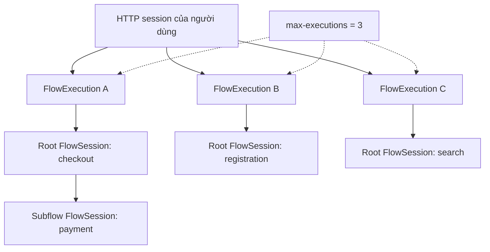
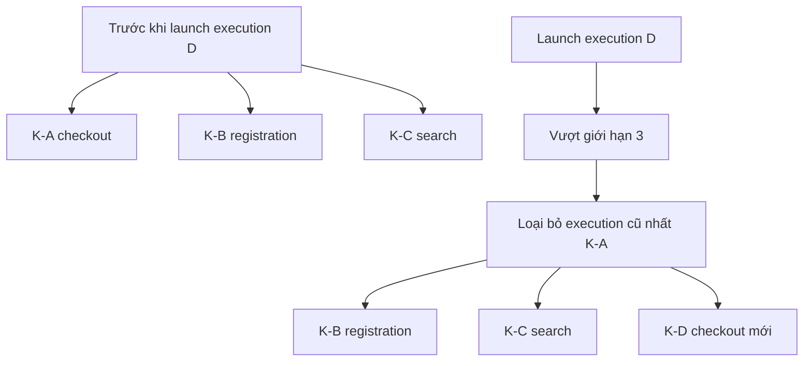

# Giới hạn số execution bằng max-executions

## 1. Vì sao cần giới hạn số flow execution?

Trong Spring Web Flow (SWF), một flow execution giữ trạng thái runtime của một hành trình web nhiều bước. Người dùng có thể mở trang đặt hàng, quay lại form, mở thêm luồng đăng ký, hoặc bắt đầu một hành trình khác trong cùng phiên làm việc. Các execution đang chờ request tiếp theo cần được lưu để engine có thể tiếp tục khi người dùng gửi event.

Nếu một phiên người dùng tạo nhiều execution rồi bỏ quên các tab cũ, repository có thể phải giữ nhiều conversation và snapshot không còn được sử dụng. Điều này làm tăng lượng trạng thái cần lưu trong session, bộ nhớ hoặc kho lưu trữ được cấu hình.

Thuộc tính **`max-executions`** đặt giới hạn số flow execution mà một user session được giữ. Khi số execution vượt giới hạn, Spring Web Flow loại bỏ execution cũ nhất. Nhờ vậy, số hành trình được quản lý trong một phiên có giới hạn rõ ràng.

Ví dụ, đặt giới hạn là 3. Một người dùng đang có ba execution checkout, registration và search. Khi người dùng mở execution thứ tư, execution cũ nhất bị loại khỏi repository để dành chỗ cho execution mới.

## 2. max-executions giới hạn điều gì?

Theo tài liệu Spring Web Flow 2.5.1, `max-executions` giới hạn số flow execution được tạo **trên mỗi user session**. Phạm vi giới hạn này dùng chung giữa các instance của mọi flow definition.

Điều đó có nghĩa:

- Giới hạn áp dụng cho các execution được khởi chạy trong cùng một session.
- Các flow definition khác nhau vẫn dùng chung hạn mức của session đó.
- Một người dùng có thể mở nhiều tab, mỗi tab khởi chạy một execution riêng; các execution đó cùng tiêu thụ hạn mức.
- Hai HTTP session độc lập có hạn mức riêng.
- Khi vượt ngưỡng, execution cũ nhất bị loại bỏ.

Trong ứng dụng Servlet thông thường, user session ở đây tương ứng với HTTP session. `SessionBindingConversationManager` lưu các conversation trong attribute map của session. Vì vậy, giới hạn không phải là số flow cho một tài khoản trên toàn bộ thiết bị hay trình duyệt; nó gắn với session đang lưu conversation.

## 3. Phân biệt FlowExecution, FlowSession và HTTP session

Để hiểu đúng cách đếm, cần phân biệt ba khái niệm:

| Khái niệm | Ý nghĩa | Vai trò đối với max-executions |
|---|---|---|
| `FlowExecution` | Một lượt thực thi hoàn chỉnh của flow gốc | Đơn vị được giới hạn |
| `FlowSession` | Một lần đi vào một flow definition trong execution; có thể là root hoặc subflow | Không phải một execution độc lập khi chỉ là session con |
| HTTP session | Phiên làm việc do ứng dụng web quản lý | Phạm vi áp dụng hạn mức trong cấu hình mặc định |

Một execution có thể chứa nhiều flow session. Ví dụ, flow `checkout` gọi subflow `payment`; subflow tạo thêm một `FlowSession` trong execution đang chạy. Đây vẫn là một flow execution gốc, không phải hai execution độc lập được tính riêng vào `max-executions`.



Khi checkout gọi payment, session con được quản lý trong cùng execution. Khi người dùng mở một checkout mới ở tab khác và launch flow lần nữa, engine tạo execution mới; execution mới đó tiêu thụ thêm một vị trí trong hạn mức.

## 4. Điều gì xảy ra khi vượt giới hạn?

Giả sử `max-executions = 3` và cùng một HTTP session đã tạo ba execution:

| Thứ tự tạo | Flow definition | Execution key | Trạng thái |
|---:|---|---|---|
| 1 | `checkout` | `K-A` | Đang chờ ở review |
| 2 | `registration` | `K-B` | Đang chờ xác nhận email |
| 3 | `search` | `K-C` | Đang chờ kết quả |
| 4 | `checkout` | `K-D` | Vừa được tạo |

Khi execution thứ tư được tạo, execution cũ nhất `K-A` bị loại bỏ. Ba execution còn lại là `K-B`, `K-C` và `K-D`.



Việc loại bỏ diễn ra ở mức execution/conversation được repository quản lý. Nó không có nghĩa flow tự đi tới một `end-state` nghiệp vụ như `cancelled` hoặc `completed`. Execution cũ không còn được repository giữ để tiếp tục bằng key cũ.

## 5. Tác động tới nhiều tab và execution key cũ

Một tab trình duyệt có thể vẫn hiển thị HTML của view đã render trước đó, ngay cả khi execution tương ứng đã bị loại bỏ khỏi repository. Khi người dùng submit form từ tab đó, request gửi execution key cũ. Repository không còn tìm thấy execution tương ứng nên request không thể tiếp tục flow như bình thường.

Tình huống thường gặp:

1. Người dùng mở tab A và bắt đầu checkout.
2. Người dùng mở tab B, bắt đầu registration.
3. Người dùng tiếp tục mở các flow khác cho tới khi vượt hạn mức.
4. Execution checkout cũ nhất bị loại.
5. Người dùng quay lại tab A và nhấn Continue.
6. Request mang key cũ không thể resume execution đã bị loại.

Ứng dụng nên xử lý trường hợp execution không còn tồn tại bằng thông báo rõ ràng, ví dụ: “Hành trình này đã hết hiệu lực. Vui lòng bắt đầu lại.” Có thể cung cấp liên kết khởi chạy flow mới. Không nên báo người dùng đã chủ động hủy đơn nếu họ chỉ bị mất execution do vượt hạn mức.

**Execution key không phải bản sao lưu.** Việc giữ URL hoặc continuation key trong bookmark, email hay tab trình duyệt không bảo đảm execution còn tồn tại trong repository.

## 6. Cấu hình max-executions bằng XML

Giới hạn được cấu hình trong phần `flow-execution-repository` nằm bên trong `flow-executor`:

```xml
<webflow:flow-executor id="flowExecutor"
                       flow-registry="flowRegistry">
    <webflow:flow-execution-repository
            max-executions="5" />
</webflow:flow-executor>
```

Ví dụ này cho phép tối đa năm flow execution trong một user session. Khi execution thứ sáu được tạo trong cùng session, execution cũ nhất bị loại.

Nếu cần cấu hình thêm giới hạn snapshot history, có thể khai báo riêng:

```xml
<webflow:flow-executor id="flowExecutor"
                       flow-registry="flowRegistry">
    <webflow:flow-execution-repository
            max-executions="5"
            max-execution-snapshots="30" />
</webflow:flow-executor>
```

Hai thuộc tính kiểm soát hai chiều khác nhau:

- `max-executions`: số execution trong một user session.
- `max-execution-snapshots`: số snapshot lịch sử của mỗi execution.

Không đặt `max-execution-snapshots` để thay thế giới hạn số execution. Một session có thể có nhiều execution, và mỗi execution lại có lịch sử snapshot riêng.

## 7. Cấu hình bằng Java

Khi dùng Java configuration, `FlowExecutorBuilder` cung cấp `setMaxFlowExecutions(int)`:

```java
import org.springframework.context.annotation.Bean;
import org.springframework.context.annotation.Configuration;
import org.springframework.webflow.config.AbstractFlowConfiguration;
import org.springframework.webflow.executor.FlowExecutor;

@Configuration
public class WebFlowConfig extends AbstractFlowConfiguration {

    @Bean
    public FlowExecutor flowExecutor() {
        return getFlowExecutorBuilder(flowRegistry())
                .setMaxFlowExecutions(5)
                .build();
    }

    // flowRegistry() được khai báo trong cùng cấu hình
    // hoặc được cung cấp từ cấu hình Spring khác.
}
```

`setMaxFlowExecutions(5)` có cùng mục đích với `max-executions="5"` trong XML. Hãy đặt cấu hình trên builder tạo `FlowExecutor` thực sự được Spring MVC hoặc tích hợp web khác sử dụng.

Một lỗi cấu hình thường gặp là khai báo một `FlowExecutor` riêng với giới hạn mới nhưng `FlowController` vẫn được inject executor cũ. Khi đó, thay đổi không có tác dụng trên các request thực tế.

## 8. Giá trị mặc định và SessionBindingConversationManager

Trong cấu hình mặc định của Web Flow 2.5.1, `SessionBindingConversationManager` lưu conversation trong session attribute map và giới hạn số conversation đang hoạt động bằng thuộc tính `maxConversations`. API của implementation này ghi nhận mặc định là 5; giá trị `-1` có nghĩa không giới hạn khi cấu hình trực tiếp manager.

Vì vậy, với cấu hình thông dụng, ứng dụng thường bắt đầu với giới hạn năm conversation/execution trên mỗi session. Nếu đã cung cấp `ConversationManager` tùy chỉnh, hãy kiểm tra chính sách giới hạn mà manager đó thực thi; không suy luận rằng nó tự có cùng giá trị mặc định hoặc cách loại bỏ như manager chuẩn.

Ví dụ cấu hình manager trực tiếp bằng Java:

```java
import org.springframework.webflow.conversation.impl.SessionBindingConversationManager;

@Bean
public SessionBindingConversationManager conversationManager() {
    SessionBindingConversationManager manager =
            new SessionBindingConversationManager();

    manager.setMaxConversations(5);
    return manager;
}
```

Có thể đưa manager tùy chỉnh vào builder:

```java
@Bean
public FlowExecutor flowExecutor() {
    return getFlowExecutorBuilder(flowRegistry())
            .setConversationManager(conversationManager())
            .build();
}
```

Khi dùng manager tùy chỉnh, chính manager quyết định cách lưu và quản lý conversation. Cần đọc contract của implementation, cấu hình hạn mức tương ứng và kiểm thử hành vi vượt ngưỡng. Không nên cấu hình hai cơ chế với kỳ vọng chúng luôn cộng dồn hoặc tự đồng bộ.

## 9. Chọn giới hạn phù hợp với hành vi người dùng

Giới hạn thấp giúp hạn chế trạng thái tồn đọng, nhưng có thể khiến người dùng mất một hành trình đang mở ở tab cũ. Giới hạn cao giữ được nhiều hành trình song song hơn, đổi lại repository phải quản lý nhiều conversation hơn.

Hãy chọn con số dựa trên hành vi thật:

| Loại ứng dụng | Hành vi thường gặp | Cách cân nhắc |
|---|---|---|
| Form đăng ký đơn giản | Thường chỉ một hành trình chính | Có thể dùng hạn mức thấp |
| Cổng quản trị | Người dùng mở nhiều màn hình và tab | Cần hạn mức đủ cho các tác vụ song song |
| Đặt vé/đặt phòng | Có thể so sánh nhiều lựa chọn và mở nhiều phiên đặt chỗ | Kiểm tra số hành trình đồng thời trước khi giảm hạn mức |
| Thương mại điện tử | Có checkout, đăng nhập, tìm kiếm và khuyến mãi trong nhiều tab | Kiểm thử các flow definition cùng tiêu thụ một hạn mức |
| Quy trình nội bộ nhiều bước | Người dùng có thể mở nhiều hồ sơ nghiệp vụ | Đo số execution thực tế theo session |

Ví dụ, nếu người dùng hỗ trợ thường mở bốn hồ sơ và một flow tìm kiếm trong cùng session, đặt hạn mức 3 có thể loại bỏ một hồ sơ đang thao tác. Hãy quan sát số execution đồng thời trong tình huống thực tế rồi mới chọn giới hạn.

Không nên tăng hạn mức vô hạn chỉ để tránh mọi trường hợp tab cũ hết hiệu lực. Cần cân đối tài nguyên và trải nghiệm người dùng.

## 10. max-executions không phải các giới hạn khác

Các giới hạn sau thường bị nhầm lẫn:

| Cơ chế | Phạm vi | Điều khiển |
|---|---|---|
| `max-executions` | Mỗi user session | Số flow execution được giữ |
| `max-execution-snapshots` | Mỗi flow execution | Số snapshot history để phục hồi mốc trước |
| `maxConversations` | Mỗi session của `SessionBindingConversationManager` | Số conversation đồng thời do manager quản lý |
| HTTP session timeout | HTTP session | Thời gian session web còn hiệu lực |
| Conversation lock timeout | Một lần lấy lock conversation | Thời gian chờ khóa execution/conversation |

`max-execution-snapshots` có giá trị `0` để tắt snapshot history và `-1` để không giới hạn snapshot. Đây không phải quy tắc giá trị của `max-executions`. Với `SessionBindingConversationManager`, `maxConversations=-1` được API mô tả là không giới hạn; nếu dùng cấu hình executor chuẩn, hãy ưu tiên thuộc tính `max-executions` và không tự suy diễn ý nghĩa giá trị chưa được tài liệu hóa cho cấu hình khác.

HTTP session timeout cũng khác: khi session hết hạn, conversation container gắn với session hết hạn theo. Điều này có thể làm mọi execution của session không còn khôi phục được, bất kể hạn mức `max-executions` là bao nhiêu.

## 11. Việc loại bỏ execution không tự dọn dữ liệu nghiệp vụ

`max-executions` quản lý trạng thái flow trong repository. Nó không tự động:

- Hủy reservation hoặc giải phóng vé đã giữ trong hệ thống nghiệp vụ.
- Xóa đơn hàng đã ghi trong database.
- Hoàn tiền hoặc rollback transaction đã commit.
- Xóa file upload hoặc tài nguyên ngoài session.
- Gửi thông báo hủy cho khách hàng.
- Gọi transition tới end-state `cancelled` trong flow definition.

Ví dụ, flow đặt phòng tạo một reservation tạm thời rồi người dùng mở nhiều flow khác khiến execution đặt phòng cũ nhất bị loại. Reservation vẫn có thể còn trong database. Ứng dụng phải có cơ chế hết hạn nghiệp vụ riêng, chẳng hạn thời gian giữ chỗ (TTL), scheduled cleanup hoặc service kiểm tra reservation chưa xác nhận.

Nếu cần giải phóng tài nguyên ngay khi người dùng chủ động hủy, hãy gọi service nghiệp vụ trong nhánh cancel của flow. Không dựa vào `max-executions` để thực hiện cleanup vì việc loại bỏ do vượt hạn mức không tương đương một transition nghiệp vụ có kiểm soát.

## 12. Theo dõi và xử lý trải nghiệm khi execution hết hiệu lực

Để biết hạn mức có phù hợp không, nên theo dõi:

- Số lần người dùng khởi chạy flow execution theo session.
- Tần suất người dùng quay lại tab có execution key không còn hợp lệ.
- Tỷ lệ request resume thất bại do execution/conversation không còn tồn tại.
- Các flow definition thường được mở song song.
- Tần suất người dùng phải khởi chạy lại hành trình.
- Lượng trạng thái trong session hoặc conversation store, nếu hạ tầng có cung cấp số liệu.

Có thể dùng `FlowExecutionListener` để quan sát lifecycle như bắt đầu session, kết thúc session và kết thúc execution. Kết hợp log ứng dụng ở điểm launch/resume để phân biệt một execution kết thúc bình thường với một request dùng key cũ. Listener lifecycle không tự cung cấp đầy đủ lý do vì sao một execution bị loại do vượt hạn mức; nếu cần phân tích chính xác, bổ sung telemetry ở conversation manager hoặc lớp repository phù hợp.

Ở giao diện, khi resume thất bại vì execution không còn tồn tại:

1. Giải thích rằng hành trình đã hết hiệu lực.
2. Giữ lại dữ liệu người dùng đã lưu bền vững ở hệ thống nghiệp vụ nếu có.
3. Cung cấp thao tác bắt đầu lại hoặc mở bản ghi nghiệp vụ hiện tại.
4. Không tự động gửi lại thao tác thanh toán, tạo đơn hoặc xác nhận chỉ vì người dùng mở lại trang cũ.

## 13. Kiểm thử giới hạn execution

Cần kiểm tra cả phạm vi theo session, phạm vi qua nhiều flow definition và hành vi của key cũ.

| Ca kiểm thử | Cách thực hiện | Kết quả mong đợi |
|---|---|---|
| Đúng giới hạn | Launch đúng N execution trong cùng session | Cả N execution tiếp tục được |
| Vượt giới hạn | Launch execution thứ N+1 | Execution cũ nhất bị loại |
| Nhiều flow definition | Launch checkout, registration, search trong cùng session | Tất cả cùng tiêu thụ một hạn mức |
| Nhiều tab | Mỗi tab launch một execution trong cùng session | Các execution chia sẻ hạn mức |
| Session độc lập | Launch flow trong hai HTTP session riêng | Mỗi session có hạn mức riêng |
| Subflow | Root flow gọi một hoặc nhiều subflow | Subflow là FlowSession trong execution hiện tại, không cộng thành root execution mới |
| Key cũ | Resume bằng key của execution đã bị loại | Repository không khôi phục được execution đó |
| Execution kết thúc bình thường | Đi tới end-state của root flow | Execution được kết thúc và conversation được loại bỏ |
| Session hết hạn | Hết HTTP session rồi resume key | Conversation container không còn tồn tại |
| Manager tùy chỉnh | Thay SessionBindingConversationManager bằng manager khác | Hạn mức và eviction tuân theo manager mới |

### 13.1. Kịch bản kiểm thử tích hợp

Có thể kiểm thử bằng cùng một `FlowExecutor` và cùng một session context:

1. Cấu hình `max-executions=2`.
2. Launch flow `checkout` và giữ lại execution key A.
3. Launch flow `registration` trong cùng session, giữ key B.
4. Launch flow `search`, giữ key C.
5. Thử resume key A; xác nhận execution cũ nhất không còn trong repository.
6. Resume key B và C; xác nhận chúng vẫn được quản lý nếu chưa bị loại bởi một execution mới hơn.
7. Lặp lại với một HTTP session khác để xác nhận hạn mức độc lập.

Khi viết test, không tạo một `MockExternalContext` mới hoàn toàn cho mỗi lần launch nếu mục tiêu là mô phỏng cùng session. Hãy dùng chung session map hoặc cơ chế test context giữ cùng session attributes. Ngược lại, để kiểm tra hai session độc lập, tạo hai session map riêng.

Không chỉ assert số lần gọi `launchExecution`. Cần kiểm tra kết quả resume bằng execution key và xác nhận key cũ đã mất hiệu lực.

## 14. Những lỗi cấu hình thường gặp

**Lỗi 1 — Nghĩ hạn mức áp dụng riêng cho từng flow definition.** Tài liệu xác nhận hạn mức theo user session và dùng chung qua mọi flow definition. Kiểm thử nhiều flow khác nhau trong cùng session.

**Lỗi 2 — Nghĩ mỗi subflow tiêu thụ thêm một execution.** Subflow tạo FlowSession trong FlowExecution hiện tại. Phân biệt session con với một lần launch execution gốc mới.

**Lỗi 3 — Đặt giới hạn snapshot thay cho execution.** `max-execution-snapshots` kiểm soát history của một execution, không phải số execution đồng thời.

**Lỗi 4 — Cấu hình nhầm FlowExecutor.** Hãy kiểm tra executor được controller/adapter sử dụng có phải bean vừa cấu hình không.

**Lỗi 5 — Giảm giới hạn mà không kiểm tra trải nghiệm nhiều tab.** Người dùng có thể đang nhập dữ liệu trong tab cũ; execution key của tab đó có thể mất hiệu lực khi tab khác launch flow mới.

**Lỗi 6 — Cho rằng eviction gọi end-state cancel.** Repository loại bỏ execution; không có bảo đảm transition nghiệp vụ hoặc cleanup được chạy. Quản lý reservation/tài nguyên ngoài bằng cơ chế riêng.

**Lỗi 7 — Dùng ConversationManager tùy chỉnh nhưng không đặt hạn mức tương ứng.** Manager mới có thể có semantics khác. Đọc API và kiểm thử chính sách lưu/xóa conversation.

**Lỗi 8 — Nhầm HTTP session timeout với max-executions.** Một cái giới hạn số execution, cái còn lại hết hạn toàn bộ session web.

## 15. Bài tập thực hành

Xây một ứng dụng có ba flow definition:

- `checkout`: nhập thông tin đơn hàng và chờ xác nhận.
- `registration`: nhập thông tin tài khoản.
- `search`: nhập tiêu chí tìm kiếm và chờ kết quả.

Cấu hình `max-executions="2"`. Dùng cùng một HTTP session để lần lượt mở checkout, registration và search.

Yêu cầu:

1. Lưu lại execution key của từng lần launch.
2. Sau khi launch search, thử resume key checkout.
3. Xác nhận key checkout không còn khôi phục được.
4. Xác nhận registration và search vẫn tiếp tục được.
5. Tạo một HTTP session thứ hai và launch hai flow; xác nhận hạn mức không bị chia sẻ giữa hai session.
6. Thay checkout bằng flow có subflow payment và kiểm tra subflow không làm tăng số root execution.
7. Thử cấu hình manager tùy chỉnh và kiểm tra chính sách conversation của manager đó.

Câu hỏi tự kiểm tra:

- `max-executions` được tính theo flow definition hay theo user session?
- Khi vượt hạn mức, execution nào bị loại?
- Một subflow có phải một FlowExecution độc lập không?
- Người dùng quay lại tab có execution key đã bị loại thì chuyện gì xảy ra?
- Eviction có tự hủy reservation trong database không?
- `max-execution-snapshots` có thay thế được `max-executions` không?

**Gợi ý:** hạn mức dùng chung theo session; execution cũ nhất bị loại; subflow là session con trong execution hiện tại; key cũ không thể resume; cleanup nghiệp vụ cần service riêng; snapshot cap điều khiển lịch sử của từng execution.

## 16. Ghi nhớ

`max-executions` giới hạn số flow execution được giữ trong một user session. Hạn mức được chia sẻ giữa các flow definition; khi vượt giới hạn, execution cũ nhất bị loại. Với cấu hình mặc định dùng `SessionBindingConversationManager`, conversation được lưu trong HTTP session và manager mặc định cho phép năm conversation đồng thời.

Hãy phân biệt execution gốc với FlowSession của subflow, và phân biệt giới hạn execution với giới hạn snapshot history. Chọn hạn mức dựa trên số tab và hành trình người dùng thực sự mở song song. Khi execution key cũ mất hiệu lực, giao diện cần hướng dẫn bắt đầu lại; dữ liệu nghiệp vụ như reservation hoặc đơn hàng phải được quản lý vòng đời riêng.

### Tài liệu tham khảo

- [Spring Web Flow 2.5.1 — System Setup: Tuning FlowExecution persistence](https://docs.spring.io/spring-webflow/docs/2.5.1.RELEASE/reference/html/system-setup.html) — ý nghĩa và phạm vi của `max-executions`, eviction execution cũ nhất và cấu hình XML/Java.
- [Spring Web Flow 2.5.1 — FlowExecutorBuilder API](https://docs.spring.io/spring-webflow/docs/2.5.1.RELEASE/api/org/springframework/webflow/config/FlowExecutorBuilder.html) — `setMaxFlowExecutions(int)` và `setConversationManager(...)`.
- [Spring Web Flow 2.5.1 — SessionBindingConversationManager API](https://docs.spring.io/spring-webflow/docs/2.5.1.RELEASE/api/org/springframework/webflow/conversation/impl/SessionBindingConversationManager.html) — conversation được lưu trong session, `maxConversations`, mặc định 5 và `-1` không giới hạn.
- [Spring Web Flow 2.5.1 — ConversationContainer API](https://docs.spring.io/spring-webflow/docs/2.5.x/api/org/springframework/webflow/conversation/impl/ConversationContainer.html) — container của conversation được lưu trong session và hết hạn cùng session.
- [Spring Web Flow 2.5.1 — FlowSession API](https://docs.spring.io/spring-webflow/docs/2.5.1.RELEASE/api/org/springframework/webflow/execution/FlowSession.html) — một lần khởi tạo flow definition bên trong một flow execution.
- [Spring Web Flow 2.5.1 — RequestControlContext API](https://docs.spring.io/spring-webflow/docs/2.5.x/api/org/springframework/webflow/engine/RequestControlContext.html) — cách subflow tạo session mới bên trong execution hiện tại.
