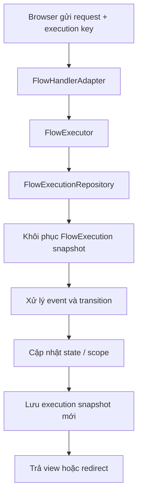

# Phân biệt lưu trạng thái tương tác với lưu bền bản nháp nghiệp vụ

Trong chương **Lưu trữ execution**, bài này phân biệt hai loại dữ liệu thường cùng xuất hiện trong một hành trình Spring Web Flow: trạng thái cần để tiếp tục một lần tương tác và bản nháp nghiệp vụ cần tồn tại độc lập với phiên trình duyệt. Đây là điểm quan trọng khi xây dựng quy trình nhiều bước có thể bị gián đoạn, hết phiên hoặc cần tiếp tục vào ngày khác.

Module **SPRING_WEB_FLOW** dùng state, event, transition và subflow để mô hình hóa hành trình web; form binding và scope giữ dữ liệu giữa các request. Repository của flow execution giúp SWF tiếp tục điều hướng từ state hiện tại. Một bản nháp nghiệp vụ lại cần được lưu bởi service/domain vào nơi lưu trữ bền vững như cơ sở dữ liệu. Hai cơ chế phục vụ hai mục tiêu khác nhau và không nên thay thế cho nhau.

## 1. Hai câu hỏi lưu trữ khác nhau

Khi người dùng đang điền một quy trình tạo hồ sơ, ứng dụng cần trả lời hai câu hỏi:

- **Nếu request tiếp theo đến, làm sao tiếp tục đúng flow?** Cần biết flow definition, state hiện tại, dữ liệu tương tác, conversation và execution key. Đây là trách nhiệm của flow execution và repository lưu execution snapshot.
- **Nếu người dùng đóng trình duyệt, hết phiên hoặc quay lại sau vài ngày, dữ liệu nghiệp vụ đã nhập còn ở đâu?** Cần một bản ghi bản nháp có định danh, chủ sở hữu, trạng thái, phiên bản và thời hạn. Đây là trách nhiệm của domain service và kho lưu trữ bền vững.

Flow execution có thể chứa form object và dữ liệu trung gian, nhưng không vì thế mà trở thành hồ sơ nghiệp vụ bền vững. Ngược lại, một bản nháp trong cơ sở dữ liệu không tự chứa thông tin điều hướng để SWF biết người dùng đang ở state nào hoặc transition nào có thể chạy tiếp.

## 2. So sánh flow execution state và business draft

| Tiêu chí | Trạng thái tương tác (flow execution) | Bản nháp nghiệp vụ (business draft) |
|---|---|---|
| Mục đích | Tiếp tục đúng một lần thực thi flow qua các request. | Lưu tiến độ nghiệp vụ để xem, sửa hoặc tiếp tục về sau. |
| Đơn vị định danh | Flow execution key do SWF quản lý. | Draft ID hoặc business ID do domain tạo. |
| Nội dung | State hiện tại, scope, conversation, dữ liệu điều hướng và model tạm. | Các trường nghiệp vụ đã được chấp nhận lưu, trạng thái, chủ sở hữu, phiên bản và mốc thời gian. |
| Vòng đời | Theo flow execution, conversation, session và cấu hình repository. | Theo chính sách nghiệp vụ: còn hiệu lực, đã gửi, đã hủy hoặc hết hạn. |
| Nơi lưu | Flow execution repository; cách lưu phụ thuộc cấu hình repository và conversation manager. | Cơ sở dữ liệu hoặc kho bền vững do ứng dụng quản lý. |
| Phục hồi | Tiếp tục execution nếu repository, key và dữ liệu liên quan còn hợp lệ. | Tải draft theo ID sau khi xác thực và kiểm tra quyền. |
| Ghi dữ liệu | SWF lưu snapshot/continuation theo vòng đời execution. | Service ghi rõ tại checkpoint hoặc thao tác lưu bản nháp. |
| Quy tắc đồng thời | Cơ chế continuation/snapshot và chính sách repository. | Phiên bản bản ghi, optimistic locking hoặc quy tắc hợp nhất domain. |

`flowExecutionKey` và `draftId` không cùng ý nghĩa. Không dùng execution key làm ID bản nháp, cũng không dùng draft ID để đoán state hiện tại. Một bản nháp có thể được mở trong một flow execution mới; một flow execution có thể tồn tại trong khi chưa có bản nháp nào được lưu bền.

## 3. Flow execution repository lưu điều gì?

Khi SWF xử lý một request, `FlowExecutor` khởi tạo hoặc tiếp tục một `FlowExecution`. Execution theo dõi flow definition đang chạy, state hiện tại, scope và các dữ liệu cần để xử lý event tiếp theo. `FlowExecutionRepository` chịu trách nhiệm lưu và tìm lại execution thông qua execution key; cơ chế snapshot/continuation cho phép SWF khôi phục trạng thái tương tác theo cấu hình.



Repository và conversation manager có thể được cấu hình theo chiến lược lưu trữ khác nhau. Một cấu hình thường gắn execution với HTTP session; các cấu hình khác có thể dùng continuation hoặc cơ chế lưu phía client/server phù hợp. Vì vậy, không nên mặc định rằng execution luôn được lưu vào một bảng database, luôn tồn tại sau khi session hết hạn hoặc luôn sống qua lần khởi động lại ứng dụng. Hãy kiểm tra repository và conversation manager thực tế của ứng dụng.

Execution snapshot là dữ liệu phục vụ điều phối. Nó có thể chứa object trong scope và thông tin điều hướng mà ứng dụng không muốn giữ lâu dài. Tránh đưa password, access token, dữ liệu thanh toán nhạy cảm hoặc object lớn vào flow scope. Nếu chiến lược lưu execution có serialize snapshot, các object phải phù hợp với yêu cầu serialization của cấu hình đó.

## 4. Bản nháp nghiệp vụ cần được lưu chủ động

Bản nháp nên là một đối tượng domain có vòng đời và quy tắc rõ ràng. Ví dụ `ApplicationDraft` có thể chứa:

- `id`: định danh bản nháp do server tạo.
- `ownerId` và `tenantId`: chủ sở hữu và phạm vi dữ liệu lấy từ ngữ cảnh xác thực.
- `status`: `DRAFT`, `SUBMITTED`, `CANCELLED` hoặc trạng thái phù hợp với nghiệp vụ.
- Các trường nghiệp vụ đã lưu tại checkpoint, ví dụ thông tin liên hệ và lựa chọn dịch vụ.
- `version`: số phiên bản để phát hiện cập nhật đồng thời.
- `createdAt`, `updatedAt`, `expiresAt`: thời điểm tạo, cập nhật và hết hạn.

Bản nháp chỉ được ghi khi ứng dụng thực hiện một hành động lưu rõ ràng: người dùng bấm “Lưu và tiếp tục”, rời bước có autosave đã được thiết kế, hoặc service ghi checkpoint sau khi dữ liệu vượt qua validation cần thiết. Việc SWF render lại view hoặc lưu execution snapshot không tự động có nghĩa bản nháp domain đã được cập nhật.

Ví dụ cấu trúc bảng:

```sql
CREATE TABLE application_draft (
    id              UUID PRIMARY KEY,
    owner_id        VARCHAR(100) NOT NULL,
    tenant_id       VARCHAR(100) NOT NULL,
    status          VARCHAR(30) NOT NULL,
    payload         JSON NOT NULL,
    version         BIGINT NOT NULL,
    created_at      TIMESTAMP NOT NULL,
    updated_at      TIMESTAMP NOT NULL,
    expires_at      TIMESTAMP NULL
);

CREATE INDEX ix_application_draft_owner_status
    ON application_draft (owner_id, status);
```

Đây là schema minh họa; chọn kiểu JSON, kiểu ID, index và cách tách bảng theo database và nhu cầu truy vấn thực tế. Với dữ liệu có cấu trúc và cần truy vấn theo từng trường, cân nhắc lưu các trường thành cột hoặc bảng quan hệ thay vì dồn toàn bộ payload vào JSON.

## 5. Chỉ giữ định danh bản nháp trong flow khi có thể

Flow thường chỉ cần giữ `draftId`, version hiện tại và dữ liệu form đang chỉnh sửa. Khi người dùng vào một bước, service tải bản nháp theo ID và actor hiện tại. Khi người dùng lưu, service xác minh quyền, kiểm tra version và ghi thay đổi. Các state tiếp theo có thể tiếp tục dùng cùng draft ID.

Ví dụ flow XML minh họa:

```xml
<flow xmlns="http://www.springframework.org/schema/webflow"
      xmlns:xsi="http://www.w3.org/2001/XMLSchema-instance"
      xsi:schemaLocation="http://www.springframework.org/schema/webflow
                          http://www.springframework.org/schema/webflow/spring-webflow.xsd">

    <input name="draftId" type="java.util.UUID" required="true"/>

    <on-start>
        <evaluate expression="draftService.loadForEdit(flowScope.draftId, currentActor.userId)"
                  result="flowScope.draftForm"/>
        <evaluate expression="draftService.currentVersion(flowScope.draftId, currentActor.userId)"
                  result="flowScope.draftVersion"/>
    </on-start>

    <view-state id="editContact"
                view="application/edit-contact"
                model="draftForm">
        <binder>
            <binding property="contactName" required="true"/>
            <binding property="email" required="true"/>
        </binder>
        <transition on="saveAndContinue" to="editDetails">
            <evaluate expression="draftService.saveContact(flowScope.draftId, currentActor.userId, flowScope.draftVersion, flowScope.draftForm)"
                      result="flowScope.draftVersion"/>
        </transition>
    </view-state>

    <view-state id="editDetails" view="application/edit-details">
        <transition on="back" to="editContact"/>
        <transition on="saveDraft" to="draftSaved">
            <evaluate expression="draftService.saveDetails(flowScope.draftId, currentActor.userId, flowScope.draftVersion, flowScope.draftForm)"
                      result="flowScope.draftVersion"/>
        </transition>
    </view-state>

    <end-state id="draftSaved" view="application/draft-saved"/>
</flow>
```

Các tên bean và method trong ví dụ là minh họa. Trong ứng dụng thật, `loadForEdit`, `saveContact` và `saveDetails` phải kiểm tra actor có quyền truy cập bản nháp, trạng thái còn cho phép sửa và version gửi lên có khớp version hiện tại. `draftId` có thể được nhận qua flow input, nhưng vẫn phải coi nó là dữ liệu định danh chưa đáng tin cậy cho đến khi service kiểm tra quyền.

Nếu flow input `draftId` là tùy chọn vì có cả luồng tạo mới, hãy tách rõ trường hợp tạo draft mới và mở draft hiện có. ID mới phải do server tạo sau khi xác thực actor; không cho client tự chọn `ownerId` hoặc `tenantId`.

## 6. Ghi checkpoint bằng service và transaction

Không cần ghi toàn bộ bản nháp vào database ở mỗi lần render. Hãy xác định checkpoint có ý nghĩa nghiệp vụ, ví dụ hoàn tất thông tin liên hệ hoặc lưu phần chi tiết. Service kiểm tra dữ liệu, xác minh quyền và cập nhật bản nháp trong transaction ngắn.

```java
import java.util.UUID;
import org.springframework.stereotype.Service;
import org.springframework.transaction.annotation.Transactional;

@Service
public class DraftService {

    private final DraftRepository draftRepository;
    private final DraftAccessPolicy accessPolicy;

    public DraftService(
            DraftRepository draftRepository,
            DraftAccessPolicy accessPolicy) {
        this.draftRepository = draftRepository;
        this.accessPolicy = accessPolicy;
    }

    @Transactional
    public long saveContact(
            UUID draftId, String actorId, long expectedVersion, DraftForm form) {

        var draft = draftRepository.findById(draftId)
                .orElseThrow(DraftNotFoundException::new);
        accessPolicy.assertCanEdit(actorId, draft);
        draft.assertEditable();
        draft.assertVersion(expectedVersion);
        draft.updateContact(form.getContactName(), form.getEmail());
        return draftRepository.save(draft).getVersion();
    }
}
```

Đoạn code minh họa domain API; nếu dùng JPA `@Version`, provider có thể tự kiểm tra version khi flush/commit. Khi xảy ra `OptimisticLockException` hoặc lỗi tương đương, ứng dụng nên yêu cầu tải lại dữ liệu và xử lý xung đột có chủ đích. Không ghi đè im lặng các thay đổi mới hơn của một tab hoặc người dùng khác.

Transaction chỉ bao quanh việc đọc, kiểm tra và ghi checkpoint. Không giữ transaction hoặc database lock trong suốt thời gian người dùng di chuyển qua nhiều màn hình. Điều đó làm tăng thời gian giữ connection và có thể gây nghẽn khi người dùng bỏ dở flow.

## 7. Phục hồi khi session hoặc execution không còn

Có thể gặp nhiều tình huống gián đoạn:

| Tình huống | Flow execution | Bản nháp nghiệp vụ | Cách phục hồi phù hợp |
|---|---|---|---|
| Request tiếp theo trong cùng session | Có thể tiếp tục bằng execution key hợp lệ. | Không cần tải lại nếu dữ liệu mới chỉ ở flow. | SWF khôi phục execution và tiếp tục event. |
| Người dùng refresh trang | Tùy URL/key và repository; có thể tiếp tục hoặc báo execution không hợp lệ. | Vẫn còn nếu đã lưu checkpoint. | Dùng URL execution do SWF tạo; nếu execution mất, mở flow mới từ draft ID. |
| Người dùng đóng trình duyệt rồi quay lại | Execution có thể đã hết hạn hoặc không còn trong session. | Bản nháp vẫn còn theo retention policy. | Xác thực lại, tải draft theo owner rồi tạo execution mới. |
| HTTP session hết hạn | Execution gắn session có thể không còn khôi phục được. | Không bị xóa chỉ vì session hết hạn. | Bắt đầu flow mới và nạp dữ liệu từ bản nháp. |
| Ứng dụng khởi động lại | Phụ thuộc repository và khả năng phục hồi của cấu hình triển khai. | Bản nháp trong DB vẫn tồn tại. | Khởi tạo execution mới từ draft nếu execution cũ không khả dụng. |
| Hai tab cùng sửa một draft | Có thể là hai execution riêng. | Có nguy cơ cập nhật đè nhau. | Dùng version/concurrency control và thông báo xung đột. |

Không hứa với người dùng rằng “tiếp tục chính xác từ màn hình cũ” nếu ứng dụng chỉ lưu bản nháp nghiệp vụ. Có thể khôi phục dữ liệu đã lưu và bắt đầu flow mới từ một state khởi tạo phù hợp, nhưng state cũ, lỗi validation tạm thời hoặc dữ liệu chưa checkpoint có thể không còn.

## 8. Phân biệt session, flow scope và kho bản nháp

Các khái niệm này liên quan nhưng không đồng nhất:

- **HTTP session:** vùng dữ liệu gắn với phiên trình duyệt phía server; có thể hết hạn hoặc bị xóa khi logout.
- **`flowScope`:** dữ liệu sống trong một flow execution; thuận tiện để chia sẻ form và context qua các state của execution đó.
- **`conversationScope`:** dữ liệu chia sẻ trong conversation của flow cha và subflow liên quan.
- **Flow execution repository:** cơ chế SWF lưu và khôi phục execution theo execution key và cấu hình repository.
- **Business draft repository:** kho domain lưu bản nháp có ID và vòng đời nghiệp vụ độc lập với flow execution.

Không coi session hoặc flow scope là bản sao lưu. Cũng không đưa nguyên trạng `FlowExecution` vào bảng bản nháp domain. Hai loại dữ liệu có cấu trúc, mục đích và chính sách vòng đời khác nhau.

## 9. Bảo mật và quyền sở hữu bản nháp

Bản nháp thường chứa thông tin cá nhân hoặc dữ liệu nghiệp vụ chưa hoàn tất. Mỗi thao tác đọc, cập nhật, gửi hoặc xóa phải xác minh quyền ở service:

- Lấy `ownerId` và `tenantId` từ principal hoặc ngữ cảnh server đã xác thực khi tạo draft.
- Khi tải draft, truy vấn theo ID kết hợp điều kiện quyền phù hợp; không chỉ tìm theo ID rồi trả dữ liệu.
- Kiểm tra trạng thái `DRAFT` và quyền sửa trước mỗi checkpoint; draft đã submit hoặc expired có thể không còn chỉnh sửa được.
- Không tin owner, role, status hoặc version do form gửi lên.
- Chỉ đưa dữ liệu tối thiểu vào flow scope và execution snapshot; tránh token, bí mật và thông tin thanh toán.
- Áp dụng retention, xóa hoặc ẩn danh dữ liệu nháp theo chính sách của nghiệp vụ.

Flow execution key là thông tin định vị execution, không phải credential và không thay thế xác thực/phân quyền. Biết draft ID cũng không đủ để đọc draft của người khác.

## 10. Chính sách hết hạn và dọn dẹp

Bản nháp cần quy tắc hết hạn rõ ràng. Có thể đặt `expiresAt` khi tạo draft, gia hạn khi có checkpoint hợp lệ hoặc giữ thời hạn cố định theo yêu cầu pháp lý/nghiệp vụ. Một tác vụ nền có thể tìm draft hết hạn để đánh dấu `EXPIRED`, xóa payload hoặc chuyển sang lưu trữ theo chính sách.

Không nên dùng thời hạn HTTP session làm thời hạn bản nháp. Người dùng có thể đăng xuất nhưng vẫn cần bản nháp, hoặc session còn hoạt động nhưng bản nháp đã hết hạn do quy định nghiệp vụ. Khi mở draft, service phải kiểm tra `expiresAt` và trạng thái trong database thay vì tin một cờ trong flow scope.

Execution snapshot cũng cần được dọn theo chính sách repository/conversation manager. Việc xóa execution cũ không nên xóa bản nháp domain còn hiệu lực. Ngược lại, xóa bản nháp cần xác định cách xử lý các flow execution đang tham chiếu draft đó; service phải từ chối tiếp tục thao tác nếu draft đã bị xóa hoặc hết hạn.

## 11. Kiểm thử hai cơ chế lưu trữ độc lập

Kiểm thử cần chứng minh flow có thể tiếp tục khi execution còn tồn tại và draft có thể phục hồi ngay cả khi execution mất:

| Kịch bản | Điều cần xác minh |
|---|---|
| Gửi request tiếp theo với execution key hợp lệ | SWF khôi phục đúng state và scope. |
| Render lại view hoặc gửi event hợp lệ | Flow tiếp tục đúng execution; không tạo draft ngoài ý muốn. |
| Lưu checkpoint rồi kết thúc session | Draft vẫn đọc được sau khi đăng nhập lại. |
| Xóa/để hết hạn execution nhưng giữ draft | Có thể khởi tạo flow mới và tải dữ liệu đã lưu. |
| Đóng trình duyệt trước checkpoint | Các thay đổi chưa lưu được nhận diện là chưa bền; không tuyên bố đã lưu. |
| Hai execution cùng cập nhật một draft | Version conflict được phát hiện và xử lý, không ghi đè âm thầm. |
| Actor khác đoán draft ID | Service từ chối đọc và cập nhật. |
| Draft hết hạn hoặc đã submit | Flow không cho tiếp tục sửa trái chính sách. |
| Ứng dụng restart hoặc chạy nhiều instance | Hành vi khôi phục phù hợp với repository/session thực tế. |

Có thể chia test thành ba lớp:

1. **Flow test:** kiểm tra state, event, scope và execution key bằng test support của Spring Web Flow.
2. **Service/repository integration test:** kiểm tra checkpoint, transaction, quyền sở hữu, version và expiry trên database.
3. **End-to-end test:** mô phỏng session hết hạn, mở lại bằng draft ID, nhiều tab và điều hướng qua browser.

Không chỉ kiểm tra rằng flow scope còn dữ liệu sau một request. Cần có test chứng minh dữ liệu đã checkpoint trong kho domain vẫn còn sau khi execution hoặc session không còn.

## 12. Các lỗi thiết kế thường gặp

| Cách làm | Rủi ro | Cách sửa |
|---|---|---|
| Cho rằng execution snapshot là bản nháp đã lưu | Người dùng mất dữ liệu khi session/repository hết hạn. | Lưu checkpoint domain riêng. |
| Dùng draft ID làm flow execution key | Không thể định vị execution và trộn hai vòng đời. | Giữ riêng draft ID và execution key. |
| Lưu toàn bộ entity vào flow scope | Snapshot lớn, dữ liệu cũ và khó serialize. | Giữ form/context tối thiểu; tải entity trong service. |
| Ghi database ở mỗi lần render | Tăng tải và tạo side effect không cần thiết. | Chỉ ghi tại checkpoint hoặc autosave có thiết kế rõ. |
| Tin ownerId từ hidden field | Có thể đọc hoặc sửa draft của người khác. | Lấy actor từ principal và kiểm tra quyền ở service. |
| Không có version cho bản nháp | Tab hoặc người dùng khác có thể ghi đè dữ liệu mới. | Dùng optimistic locking hoặc quy tắc hợp nhất. |
| Dùng session timeout làm expiry của draft | Mất bản nháp hợp lệ hoặc giữ draft quá hạn. | Quản lý `expiresAt` theo domain policy. |
| Xóa execution đồng thời xóa draft | Người dùng mất dữ liệu nghiệp vụ đã lưu. | Tách lifecycle và cleanup của hai kho. |

## 13. Checklist thiết kế lưu trữ

- [ ] Xác định dữ liệu nào chỉ phục vụ điều hướng và dữ liệu nào là tiến độ nghiệp vụ cần lưu bền.
- [ ] Dùng execution key cho FlowExecution và draft ID cho bản nháp domain.
- [ ] Biết rõ FlowExecutionRepository/conversation manager đang dùng lưu execution ở đâu và trong bao lâu.
- [ ] Không giả định session hoặc execution snapshot tồn tại sau logout, timeout hay restart.
- [ ] Có service lưu checkpoint rõ ràng và transaction phù hợp.
- [ ] Draft có owner/tenant, status, version và thời hạn khi cần.
- [ ] Mọi thao tác tải/lưu draft đều kiểm tra quyền và trạng thái hiện tại.
- [ ] Có cơ chế phát hiện cập nhật đồng thời.
- [ ] Có quy trình mở flow mới từ draft khi execution cũ không còn.
- [ ] Cleanup execution và cleanup draft được quản lý độc lập.
- [ ] Có test cho session expiry, restart, nhiều tab, quyền truy cập và phục hồi từ draft.

## 14. Kết luận

Flow execution repository lưu trạng thái cần thiết để SWF tiếp tục một lần tương tác; bản nháp nghiệp vụ cần được service ghi riêng vào kho bền vững theo checkpoint và quy tắc domain. Hãy giữ riêng execution key và draft ID, lưu tối thiểu dữ liệu tương tác trong flow scope, kiểm tra quyền và version khi đọc/ghi draft, đồng thời xác định cách khởi tạo flow mới khi execution cũ không còn. Tách hai vòng đời này giúp ứng dụng phục hồi dữ liệu nghiệp vụ ngay cả khi session hoặc flow execution đã hết hạn.
