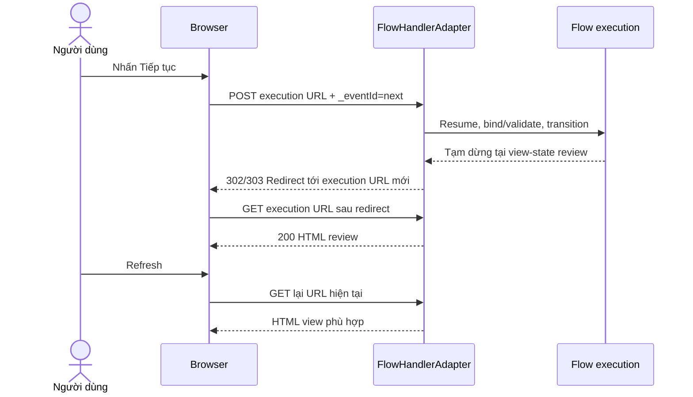
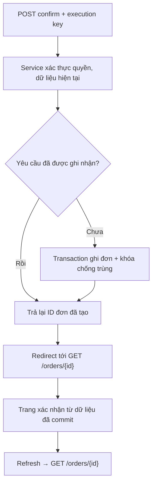

# Refresh tại view-state và tác động của chính sách redirect trong Spring Web Flow

Trong quy trình đặt hàng nhiều bước, người dùng nhập thông tin liên hệ, chuyển sang trang xem lại rồi nhấn **Refresh (F5)**. Trang có bị khởi tạo lại không? Trình duyệt có gửi lại biểu mẫu hay không? Nếu vừa bấm **Xác nhận**, Refresh có tạo thêm đơn hàng không? Để trả lời chính xác, cần nhìn đồng thời **view-state**, **flow execution key**, phương thức HTTP, lịch sử trình duyệt và **chính sách redirect** của Spring Web Flow.

Bài học thuộc chương **Lịch sử trình duyệt** của module `SPRING_WEB_FLOW`. Web Flow quản lý các hành trình nhiều bước qua state, event, transition và subflow trong tích hợp Spring MVC. Trình duyệt lại quản lý URL, lịch sử và các lần tải lại trang. Hai vòng đời này giao nhau tại request/response HTTP; cách Web Flow redirect quyết định request nào được browser lặp lại khi người dùng Refresh.

Sau bài học, bạn có thể:

- Phân biệt **Refresh**, **launch execution**, **resume execution** và **transition**.
- Giải thích mẫu **Post/Redirect/Get (PRG)** và tại sao nó hạn chế việc gửi lại POST.
- Phân tích tác động của redirect tới URL, thông báo validation, lịch sử Back/Forward và view-state.
- Đặt logic đúng chỗ trong `on-start`, `on-entry`, `on-render` và transition action.
- Xử lý Refresh sau xác nhận, key hết hạn, hai tab và request lặp bằng kiểm tra nghiệp vụ phù hợp.
- Kiểm thử bằng Network của trình duyệt và các test ở tầng Web Flow, MVC, service.

## 1. Refresh là request HTTP, không phải event của flow

Khi flow đã vào `view-state`, Web Flow thường **tạm dừng execution** để chờ thao tác người dùng. Một event như `next`, `back`, `cancel` hoặc `confirm` có thể khiến execution resume và thực hiện transition. **Refresh không tự động phát bất kỳ event nghiệp vụ nào**; nó yêu cầu browser tải lại tài nguyên đang hiển thị.

| Khái niệm | Bản chất | Ví dụ |
| --- | --- | --- |
| Refresh/Reload | Trình duyệt tải lại một mục lịch sử, bằng request phù hợp với trang hiện tại | F5 ở trang `review` |
| Launch | Bắt đầu một lần chạy mới của flow definition | Mở `/checkout?cartId=42` |
| Resume | Khôi phục execution theo key và tiếp tục xử lý request | POST kèm `execution` và `_eventId_next` |
| Transition | Quy tắc chuyển state khi nhận event/điều kiện | `contact → review` |
| Redirect | Server trả response yêu cầu browser thực hiện request tới URL khác | POST → redirect → GET |

Để xác định tác động của Refresh, hãy hỏi: URL trên thanh địa chỉ có phải URL **launch** hay **execution**? Trang hiện tại được trả từ GET hay từ một POST render trực tiếp? Response cuối cùng có redirect không? Key/snapshot ở URL còn hợp lệ không?

Một execution URL điển hình có dạng:

```http
GET /checkout?execution=e1s1
```

`e1s1` là **giá trị minh họa**, không phải định dạng bất biến. Tên tham số, cách tạo execution key và khả năng khôi phục snapshot phụ thuộc URL handler và execution repository. Không tự tạo, chỉnh sửa hoặc tái sử dụng key dựa trên giả định về định dạng.

## 2. POST trực tiếp trả HTML khác POST/Redirect/GET thế nào?

Giả sử người dùng ở state `contact`, nhập người nhận rồi bấm nút **Tiếp tục**:

```http
POST /checkout?execution=e1s1
Content-Type: application/x-www-form-urlencoded

_eventId=next&recipient=Lan
```

Nếu server xử lý transition rồi trả **HTML của trang review ngay trong response POST**, Refresh có thể khiến browser hỏi có gửi lại thông tin biểu mẫu hay không. Khi người dùng đồng ý, browser phát lại request POST cũ. Tình trạng state, key hoặc dữ liệu đã thay đổi nên kết quả có thể là một transition không hợp lệ, một snapshot cũ, một lỗi, hoặc hành động nghiệp vụ bị gọi lại.

Với **Post/Redirect/Get (PRG)**, sau khi POST được xử lý và flow tạm dừng ở view-state, server trả redirect tới URL hiển thị execution. Trình duyệt GET URL đó và coi GET là request của trang đang mở; F5 sau đó chủ yếu tải lại GET:



Ở đây `302/303` minh họa các mã redirect thường gặp; không cam kết một mã cụ thể cho mọi phiên bản/cấu hình. Khi kiểm thử cần quan sát trình duyệt **thực sự gửi GET sau redirect hay không**.

### Đối chiếu hai chuỗi request

```text
Không redirect:
  POST /checkout?execution=...  _eventId=next
  200 HTML review
  F5 → browser có thể hỏi gửi lại POST

Có PRG:
  POST /checkout?execution=...  _eventId=next
  302/303 Location: /checkout?execution=...
  GET /checkout?execution=...
  200 HTML review
  F5 → GET /checkout?execution=...
```

**PRG chỉ giảm việc browser phát lại POST do Refresh sau điều hướng thành công.** Nó không chặn tuyệt đối hai lần bấm nút, hai POST đồng thời hoặc một client chủ động gửi lại request. Những hành động như đặt hàng, thu tiền cần idempotency và transaction ở service.

## 3. Các trường hợp Refresh thường gặp

| Trạng thái trước Refresh | Request hoặc hành vi có thể xuất hiện | Điều cần kiểm tra |
| --- | --- | --- |
| Browser đang ở URL launch `/checkout?cartId=42` | GET mới có thể launch một execution khác | `on-start` có chạy lại không, dữ liệu mới tạo có trùng không |
| Browser đang ở URL GET chứa execution key còn hợp lệ | GET tới execution URL | Web Flow có thể khôi phục/hiển thị view; không cần event `next` |
| Trang view là response HTML trực tiếp của POST | Browser có thể yêu cầu resubmit POST | Binding/event có bị lặp hoặc báo lỗi không |
| Browser đã đi qua redirect rồi GET | Refresh thường tải lại GET | Không tự gửi lại event POST trước |
| POST validation thất bại, vẫn cùng view-state | Tùy chính sách: render trực tiếp hoặc redirect | Message lỗi và giá trị form có còn không |
| Execution key hoặc snapshot trong lịch sử đã hết hạn | Không khôi phục được trạng thái cũ | Có đường bắt đầu lại/khôi phục draft hợp lý |
| Trang được cập nhật qua AJAX/fragment | JavaScript và adapter có thể dùng đường xử lý khác | Không mặc định có PRG/full-page redirect |

Hai kết luận quan trọng:

1. **Refresh không đồng nghĩa quay lại state cũ.** State machine không hiểu F5 là event `back`.
2. **Refresh cũng không bảo đảm view hoàn toàn giữ nguyên.** Hook render, truy vấn mới, cache, snapshot hoặc session hết hạn có thể khiến nội dung khác.

Nếu người dùng mở URL launch ban đầu thêm lần nữa thay vì Refresh GET của URL execution, đó có thể là **execution mới**. Nên đặt logic đọc/khởi tạo an toàn trong `on-start`, tránh tạo đơn chính thức chỉ vì URL được mở.

## 4. Flow minh họa: chỉnh thông tin và xem lại đơn hàng

Flow `checkout` nhận `cartId`, cho người dùng nhập liên hệ tại `contact`, xem lại tại `review`, rồi phát event `confirm` để gọi service tạo đơn.

```xml
<?xml version="1.0" encoding="UTF-8"?>
<flow xmlns="http://www.springframework.org/schema/webflow"
      xmlns:xsi="http://www.w3.org/2001/XMLSchema-instance"
      xsi:schemaLocation="http://www.springframework.org/schema/webflow
                          http://www.springframework.org/schema/webflow/spring-webflow-2.0.xsd">

    <input name="cartId" type="java.lang.Long" required="true" />
    <var name="checkoutForm" class="com.example.checkout.CheckoutForm" />

    <on-start>
        <evaluate expression="checkoutService.requireAccessibleCart(cartId)"
                  result="flowScope.cart" />
    </on-start>

    <view-state id="contact" view="checkout/contact" model="checkoutForm">
        <transition on="next" to="review" />
        <transition on="cancel" to="cancelled" bind="false" />
    </view-state>

    <view-state id="review" view="checkout/review">
        <on-entry>
            <evaluate expression="checkoutService.preview(cart.id, checkoutForm)"
                      result="viewScope.preview" />
        </on-entry>
        <transition on="back" to="contact" />
        <transition on="confirm" to="placingOrder" />
    </view-state>

    <action-state id="placingOrder">
        <evaluate expression="checkoutService.placeOrder(cart.id, checkoutForm)" />
        <transition on="success" to="completed" />
        <transition on="rejected" to="review" />
    </action-state>

    <end-state id="completed" view="checkout/completed" />
    <end-state id="cancelled" view="checkout/cancelled" />
</flow>
```

`CheckoutForm` và các phương thức `requireAccessibleCart`, `preview`, `placeOrder` **do ứng dụng tự xây dựng**. Ví dụ này cần bổ sung bean, view, validation và exception handling cho môi trường thực tế. `placeOrder` được thiết kế để trả outcome `success`/`rejected` tương ứng với transition; service phải kiểm tra quyền, giá và tình trạng giỏ hàng tại thời điểm chốt.

Form JSP gửi event về URL execution của chính lượt chạy:

```jsp
<form method="post" action="${flowExecutionUrl}">
    <label for="recipient">Người nhận</label>
    <input id="recipient" name="recipient"
           value="${checkoutForm.recipient}" />
    <button type="submit" name="_eventId_next" value="1">
        Tiếp tục
    </button>
    <button type="submit" name="_eventId_cancel" value="1">
        Hủy
    </button>
</form>
```

Nếu dùng Spring Security, POST còn phải gửi CSRF token thích hợp. Phải escape dữ liệu hiển thị ở view; ví dụ trên minh họa event, không thay thế template rendering an toàn.

### Trình tự khi nhấn Tiếp tục rồi Refresh

1. Trình duyệt POST `_eventId_next=1` và `recipient` tới `flowExecutionUrl`.
2. Web Flow khôi phục execution, bind/validate `checkoutForm` theo cấu hình `view-state`.
3. Nếu hợp lệ, transition `next` dẫn đến state `review`; `on-entry` ở `review` tính bản xem trước.
4. Nếu chính sách áp dụng redirect sau khi flow tạm dừng, server trả redirect và browser GET trang `review`.
5. Refresh tại `review` gửi GET mới; **không mặc nhiên phát `confirm`** và không tự gọi `placeOrder`.

URL sau redirect có thể mang khóa execution/snapshot đã cập nhật. Không giả định key trước và sau redirect giống nhau; luôn dùng URL do Web Flow trả về.

## 5. Chính sách redirect ở tầng tích hợp Spring MVC

Trong Web Flow tích hợp Spring MVC, `FlowHandlerAdapter` kết nối request với `FlowExecutor` và tham gia xử lý việc redirect tới view. Ở các phiên bản Spring Web Flow 2.x có hỗ trợ `redirectOnPause`, có thể cấu hình redirect khi execution tạm dừng, ví dụ:

```xml
<bean id="flowHandlerAdapter"
      class="org.springframework.webflow.mvc.servlet.FlowHandlerAdapter">
    <property name="flowExecutor" ref="flowExecutor" />
    <property name="redirectOnPause" value="true" />
</bean>
```

Đây là ví dụ cho cấu hình bean phù hợp với API phiên bản tương ứng. Cần kiểm tra tài liệu của **đúng phiên bản Web Flow** và cấu hình adapter thực tế trước khi áp dụng; tên thuộc tính, giá trị mặc định hoặc cách xử lý một số trường hợp có thể khác nhau.

Việc bật redirect khi flow tạm dừng **không có nghĩa mọi request sẽ luôn redirect**. Cần phân biệt:

| Request | Điều thường cần xem xét |
| --- | --- |
| Launch flow và vào start view-state | Cấu hình có redirect tới URL execution để browser Refresh đúng lượt chạy không |
| POST hợp lệ chuyển sang view-state khác | Có thực hiện PRG để browser không Refresh bằng POST cũ không |
| POST thất bại do binding/validation, giữ nguyên view-state | Có render trực tiếp để giữ thông báo lỗi hay redirect trong cùng state không |
| Request chỉ render lại view hiện tại | Có cần redirect hoặc đã là GET phù hợp |
| Request AJAX/partial render | Có đi theo cùng chính sách như full-page flow không |

Một số cấu hình hỗ trợ điều chỉnh **redirect khi vẫn ở cùng view-state** riêng với việc redirect sau transition sang state mới. Trong trường hợp validation lỗi, render trực tiếp response POST có thể giữ message context dễ hơn; nếu redirect sang GET, cần bảo đảm thông báo lỗi và giá trị người dùng nhập vẫn được bảo toàn đúng cách.

**Hậu quả thực tế:** một luồng có PRG cho chuyển bước thành công vẫn có thể hiển thị cảnh báo resubmit khi Refresh **sau submit sai dữ liệu**. Đây là tình huống phải kiểm thử riêng; không nên coi nó là lỗi của transition `next` nếu flow đang cố ý ở cùng view-state.

## 6. `on-start`, `on-entry`, `on-render` có chạy lại khi Refresh?

Refresh không phải một lifecycle hook riêng của Spring Web Flow. Hook nào chạy phụ thuộc việc request tạo flow mới, vào state mới hay chỉ render lại view.

| Hook hoặc action | Khi nào chạy | Cần lưu ý với Refresh |
| --- | --- | --- |
| `<on-start>` | Khi một flow session mới bắt đầu | Không tự chạy khi resume execution; có thể chạy nếu người dùng Refresh URL launch tạo flow mới |
| `<on-entry>` | Khi flow thực sự đi vào state | Không mặc nhiên chạy chỉ vì render lại cùng view; chạy nếu có re-entry |
| `<on-render>` | Khi view-state được render theo lifecycle | Có thể chạy lại trong nhiều lần render, kể cả khi còn ở cùng state |
| Action của `<transition>` | Khi event chọn transition tương ứng | Không tự chạy khi refresh GET; có thể bị gọi lại nếu POST event được gửi lại |
| Action trong `action-state` | Khi state machine đi vào action-state | Cẩn thận với các thao tác ghi khi event bị phát lặp |

Ví dụ, nếu bản xem trước đơn hàng phải cập nhật mỗi khi view `review` được render, có thể đặt một action **chỉ đọc** trong `on-render`:

```xml
<view-state id="review" view="checkout/review">
    <on-render>
        <evaluate expression="checkoutService.preview(cart.id, checkoutForm)"
                  result="viewScope.preview" />
    </on-render>
    <transition on="back" to="contact" />
    <transition on="confirm" to="placingOrder" />
</view-state>
```

Đây là **phương án thay thế** cho `on-entry` trong ví dụ trước nếu muốn tính bản xem trước mỗi lần render; không cần gọi cùng một service ở cả hai hook. `preview` phải có khả năng gọi lặp an toàn. Nếu nó phụ thuộc giá/tồn kho, kiểm tra lại lần cuối ở service xác nhận.

**Không đặt** thu tiền, gửi email hoàn tất hoặc tạo đơn chính thức trong `on-render`. Refresh và validation error có thể khiến view render nhiều lần. Cũng tránh reset form trong `on-entry` nếu cho phép người dùng quay lại sửa dữ liệu: một lần vào lại state có thể làm mất những gì họ đã nhập.

### Khi submit sai dữ liệu

1. User POST `_eventId_next` nhưng trường bắt buộc bị thiếu.
2. Binding hoặc validation ngăn việc đi tiếp; execution giữ view-state `contact`.
3. Hệ thống render lỗi trực tiếp hoặc redirect về view theo chính sách.
4. Nếu trang hiện tại gắn với POST trực tiếp, Refresh có thể hỏi gửi lại POST; nếu qua PRG, browser thường gửi GET.

Thiết kế cần bảo đảm lỗi validation hiển thị đúng, dữ liệu đã nhập còn phù hợp, và **database chưa có thay đổi nghiệp vụ**. Nếu thay đổi chính sách redirect trong cùng state, phải kiểm tra lại cơ chế lưu/hiển thị messages và form field, không chỉ kiểm tra status HTTP.

## 7. Redirect và lịch sử Back/Forward

Browser history chứa các mục URL/trang mà browser biết. Execution repository của Web Flow lại lưu hoặc khôi phục các trạng thái/snapshot mà server cho phép. **Hai lịch sử này không giống nhau**.

| Thao tác | Đơn vị quyết định | Có đảm bảo thực hiện event `back`? |
| --- | --- | --- |
| Nút **Quay lại** trong ứng dụng gửi `_eventId=back` | Web Flow xử lý state/transition | Có, nếu transition hợp lệ và execution còn hoạt động |
| Nút **Back** của browser | Lịch sử URL/cache của browser | Không |
| Nút **Forward** của browser | Lịch sử URL/cache của browser | Không |
| Refresh ở URL GET | Browser GET lại hoặc áp dụng cache | Không |

Ví dụ người dùng xem `contact → review`, sau đó bấm Back của browser. Tùy redirect, cache và chính sách snapshot, browser có thể hiển thị trang `contact` cũ, khôi phục một snapshot, hoặc gửi request tới URL đã hết hiệu lực. Việc thấy lại form cũ **không bảo đảm** server đang ở state cũ theo đúng nhánh nghiệp vụ.

Những điều cần tính đến:

- Snapshot cũ có thể bị loại bỏ do giới hạn bộ nhớ, thời gian tồn tại hoặc chính sách lịch sử.
- URL cũ ở browser không chứng minh execution key hiện tại còn hợp lệ.
- Browser có thể dùng cache để hiển thị trang cũ mà chưa gửi request tới server.
- Một POST từ trang cũ có thể dùng dữ liệu/phiên bản đã lỗi thời.
- Redirect có thể thêm/thay đổi các mục trong lịch sử; cần đo bằng browser thực tế.

Với quy trình thanh toán hoặc cập nhật dữ liệu, service phải kiểm tra quyền, trạng thái nghiệp vụ và version mới nhất khi commit. Hạn chế lịch sử execution giúp điều khiển khả năng quay lại nhưng **không thay thế** kiểm tra dữ liệu và chống thao tác trùng.

## 8. Refresh sau bước xác nhận và nguy cơ ghi trùng

Giả sử user từ `review` bấm `confirm`, flow vào `placingOrder` và service ghi đơn hàng. Việc kết thúc execution không đồng nghĩa trang hoàn tất luôn có một URL GET bền vững. Kết quả Refresh phụ thuộc cách ứng dụng điều hướng sau `end-state`:

- Nếu redirect tới trang đọc dữ liệu đã commit, ví dụ `GET /orders/123`, Refresh tải lại trạng thái đơn và không cần execution đã kết thúc.
- Nếu trang cuối vẫn dựa vào URL của execution đã kết thúc, key đó có thể không khôi phục được khi tải lại.
- Nếu hai POST `confirm` đến gần đồng thời trước khi redirect, riêng PRG không bảo đảm service chỉ ghi một lần.

Một thiết kế nghiệp vụ an toàn:



Đây là kiến trúc minh họa: redirect tới `/orders/{id}` cần được ứng dụng cấu hình phù hợp và **không phải hành vi tự động của mọi end-state**. Service phải có cơ chế idempotency thực sự, ví dụ định danh yêu cầu duy nhất và ràng buộc unique trong database, bảo vệ cả các request đồng thời.

Không chỉ vô hiệu hóa nút Xác nhận trên trình duyệt rồi coi là đủ an toàn: client có thể gửi lại request, mạng có thể retry hoặc người dùng có thể mở nhiều tab.

## 9. Execution hết hạn, nhiều tab và bảo mật

Người dùng có thể mở hai tab và launch hai execution độc lập: `flowScope` của từng flow nên giữ dữ liệu riêng. Nhưng nếu họ sao chép **cùng URL có execution key** sang tab khác, hai tab có thể cùng thao tác trên một execution hoặc các snapshot liên quan.

| Tình huống | Hậu quả có thể xảy ra | Cách xử lý |
| --- | --- | --- |
| Refresh tab A sau khi tab B đổi state với cùng key | URL hoặc snapshot của A đã cũ | Xử lý trạng thái không hợp lệ/khôi phục theo chính sách repository |
| Refresh URL launch nhiều lần | Nhiều execution mới | Tránh side effect không thể đảo ngược trong `on-start` |
| Refresh URL execution sau timeout | Key không còn khả dụng | Hướng user bắt đầu lại hoặc khôi phục draft có lưu riêng |
| Browser Back tới form cũ rồi submit | Event/dữ liệu không còn khớp trạng thái | Kiểm tra transition, quyền, version và điều kiện nghiệp vụ |
| Gửi `confirm` hai lần | Hai request gần đồng thời | Idempotency tại service và database |
| Refresh trang dữ liệu riêng tư | Browser cache hoặc URL có thể lưu nội dung | HTTPS, cache-control và phân quyền phù hợp |

Execution key phục vụ định tuyến/khôi phục lượt chạy, **không phải chứng chỉ phân quyền**. Service vẫn phải xác định người dùng có quyền xem/cập nhật đơn hàng. Với POST, bảo vệ CSRF theo cấu hình Spring Security; redirect không tự thay thế CSRF. Không đặt credential, token nhạy cảm hoặc toàn bộ dữ liệu form vào query string.

## 10. Kiểm thử chính sách redirect và Refresh

Kiểm thử UI chỉ xác nhận trang đã xuất hiện là chưa đủ. Cần kiểm tra **chuỗi HTTP request/response, status, Location, method, URL execution, state và thay đổi database**.

| Ca kiểm thử | Cách thực hiện | Kỳ vọng |
| --- | --- | --- |
| Launch và Refresh | Mở URL khởi chạy, quan sát redirect/URL, F5 | Hiểu rõ có tạo execution mới hay đang reload execution hiện tại |
| POST hợp lệ chuyển state | POST `next` từ `contact` | Với PRG: redirect rồi GET `review`; model giữ dữ liệu đã bind |
| Refresh sau PRG | F5 tại `review` | Browser gửi GET, không tự phát `next` hay `confirm` |
| POST form sai cùng state | Gửi `recipient` thiếu/sai | Hiển thị lỗi; không chuyển state và không ghi dữ liệu |
| Refresh sau lỗi validation | F5 ở form lỗi | Hành vi GET/POST đúng chính sách; thông báo và dữ liệu form được bảo toàn |
| Nút Back của ứng dụng | Phát `_eventId=back` | Transition được xử lý theo state machine |
| Back/Forward của browser | Dùng lịch sử browser | Không giả định tương đương transition; xử lý key/snapshot cũ |
| Refresh sau xác nhận | Hoàn tất đơn rồi tải lại | Không tạo thêm đơn, trang kết quả dựa trên dữ liệu đã commit |
| Double submit | Hai POST `confirm` gần nhau | Service xử lý một lần hoặc trả kết quả idempotent |
| Hai tab khác execution | Launch hai flow | Form và state độc lập |
| Hai tab cùng key | Sao chép URL execution | Hành vi cạnh tranh và snapshot được xử lý rõ ràng |
| Execution hết hạn | F5 ở URL cũ | Thông báo/đường bắt đầu lại; không ghi sai nghiệp vụ |
| AJAX/fragment | Gửi event bất đồng bộ | Không suy diễn PRG đầy đủ nếu stack xử lý khác |

### Kiểm tra trực tiếp trong Developer Tools

1. Mở **Network**, bật **Preserve log** để thấy chuỗi redirect.
2. Từ URL launch, ghi nhận request, status code, `Location` và URL cuối cùng.
3. Submit `next`, xác nhận đó là POST; quan sát response có redirect và GET theo sau hay trả HTML trực tiếp.
4. Nhấn F5, xem request mới là GET hay POST và URL có execution key hợp lệ không.
5. Thử form sai, Back của ứng dụng, Back của browser, hai tab và session hết hạn.
6. Đếm số lần service tạo đơn được gọi và kiểm tra database để chứng minh không có ghi trùng.

Để tự động hóa, kết hợp flow test cho state/scope, Spring MVC integration test cho status/`Location`/method và service/database test cho transaction/idempotency. Test Web Flow không mô phỏng redirect của browser thì **chưa đủ** để kết luận F5 sẽ gửi GET trong mọi tình huống.

Ví dụ chuỗi mong muốn khi PRG được bật:

```text
POST /checkout?execution=...  _eventId=next
302 Location: /checkout?execution=...
GET /checkout?execution=...
200 OK (review)
GET /checkout?execution=...  [Refresh]
200 OK (review)
```

Chuỗi này chỉ minh họa, không bảo đảm mã status hay execution key không đổi. Nếu thực tế khác, hãy kiểm tra cấu hình adapter, validation, flow URL handler, repository và các lớp bảo mật/redirect của ứng dụng.

## 11. Bài tập thực hành: đặt lịch nhiều bước

Tạo flow `appointment` gồm `chooseSlot → enterContact → review → placeBooking → completed`:

1. Khai báo model giữ khung giờ và thông tin liên hệ qua nhiều view-state.
2. Cho form POST event `next` qua `flowExecutionUrl` và bật chính sách redirect phù hợp với phiên bản Web Flow.
3. Quan sát POST → redirect → GET bằng Network; sau đó Refresh ở `review` và xác minh không gọi service đặt lịch.
4. Tạo một lỗi validation để vẫn ở `enterContact`, ghi nhận trường hợp render trực tiếp so với redirect và việc hiển thị thông báo lỗi.
5. So sánh event `back` của ứng dụng với nút Back của browser; ghi nhận URL, state và dữ liệu form.
6. Thử Refresh URL launch và URL có execution key hết hạn; trình bày cách hướng user bắt đầu lại.
7. Bấm `confirm` hai lần, mở hai tab cùng execution và hai execution độc lập; bảo đảm service chống đặt lịch trùng.
8. Sau khi hoàn tất, điều hướng đến URL đọc kết quả đã lưu để Refresh GET không yêu cầu khôi phục execution cũ.

**Câu hỏi tự kiểm tra:**

- Vì sao F5 ở view-state không tự phát event `next`?
- POST trả thẳng HTML khác POST/Redirect/GET thế nào khi browser Refresh?
- Khi validation lỗi nhưng giữ nguyên view-state, vì sao vẫn có thể xuất hiện cảnh báo gửi lại form?
- `on-render` có thể chạy lặp ở trường hợp nào? Vì sao không đặt logic thanh toán ở đây?
- Tại sao nút Back của browser không tương đương transition `on="back"`?
- PRG có ngăn hai POST xác nhận đồng thời không? Nếu không, trách nhiệm thuộc tầng nào?

## Ghi nhớ

**Refresh** là hành vi tải lại của trình duyệt, còn **transition** là thay đổi state của Web Flow khi xử lý event. Redirect theo mẫu **Post/Redirect/Get** thường khiến Refresh sau một POST thành công tải lại GET thay vì gửi lại POST. Nhưng URL launch, validation lỗi ở cùng view-state, Back/Forward, key hết hạn và AJAX có thể có hành vi khác. Chính sách redirect cần được kiểm thử trên đúng cấu hình Web Flow; dữ liệu và giao dịch quan trọng vẫn phải được bảo vệ bằng validation, phân quyền, transaction và idempotency. Lịch sử của browser và snapshot của flow execution có liên quan qua URL nhưng không phải một cơ chế duy nhất.
