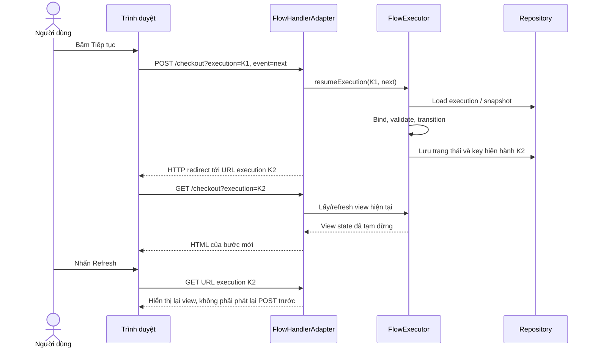
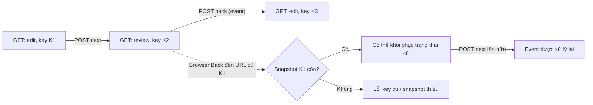
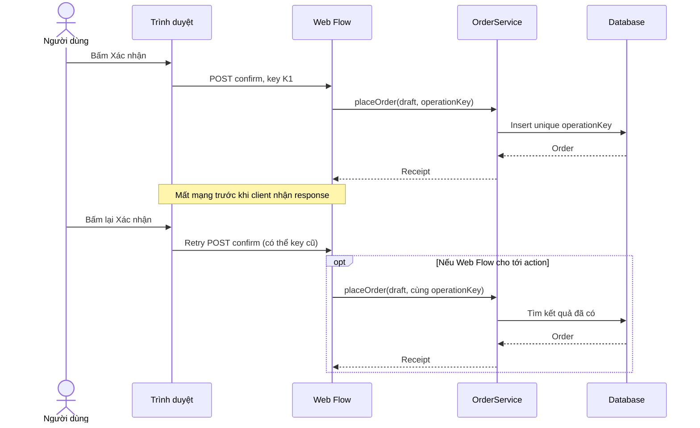

# Gửi lại form và yêu cầu phát lại cùng sự kiện

## 1. Tại sao gửi lại một form có thể gây lỗi?

Trong **Spring Web Flow**, người dùng thực hiện hành trình nhiều bước bằng các **state**, **event**, **transition** và đôi khi **subflow**. Một `view-state` hiển thị form, tạm dừng execution; request tiếp theo cung cấp dữ liệu và một event như `next`, `back`, `confirm` hoặc `cancel` để Web Flow tiếp tục. Điều này giúp ứng dụng không phải rải logic điều hướng trong nhiều Spring MVC controller.

Tuy nhiên, trình duyệt và mạng không bảo đảm rằng **mỗi thao tác của người dùng chỉ tạo đúng một HTTP request**. Có thể xảy ra:

- Người dùng bấm nút `Xác nhận` hai lần rất nhanh.
- Người dùng nhấn **Refresh** sau khi submit một form.
- Người dùng nhấn **Back**, quay lại form cũ rồi bấm lại nút với cùng event.
- Trình duyệt hỏi “Confirm form resubmission” rồi người dùng đồng ý.
- Client, proxy hoặc người dùng gửi lại trực tiếp một POST có cùng body.
- Hai tab cùng gửi event `confirm` từ một snapshot trước đó.

Với thao tác chỉ tính toán dữ liệu, phát lại có thể chỉ lãng phí tài nguyên. Với thao tác tạo đơn hàng, đăng ký, gửi email hoặc thanh toán, **phát lại cùng sự kiện có thể dẫn đến tác dụng phụ lặp** nếu ứng dụng không thiết kế đúng.

> **Điểm cốt lõi:** “Cùng event ID” không đồng nghĩa “cùng lần thực hiện nghiệp vụ”, và Web Flow **không bảo đảm exactly-once** cho các side effect của service. Cần phân biệt chuyện trình duyệt gửi lại request, repository khôi phục execution cũ, và service quyết định một lệnh nghiệp vụ đã được xử lý hay chưa.

Bài thuộc chương **Lịch sử trình duyệt** của module `SPRING_WEB_FLOW`. Nội dung giải thích quan hệ giữa form resubmission, event replay, **POST–Redirect–GET**, execution key, snapshot, các chính sách lịch sử, form binding/validation, Spring MVC và chiến lược phục hồi luồng khi gặp lỗi.

Sau bài này, bạn có thể mô tả chính xác các đường đi khi Refresh/Back/submit lại, cấu hình repository và history policy phù hợp, viết flow có event rõ ràng, bảo vệ thao tác có side effect bằng idempotency và kiểm thử những trường hợp phát lại.

## 2. Hai lớp lịch sử: trình duyệt và FlowExecutionRepository

Web Flow tồn tại giữa hai hệ thống có khái niệm “quay lại” khác nhau:

| Lớp | Lưu điều gì? | Có bảo đảm hành động được thực hiện một lần không? |
| --- | --- | --- |
| **Browser history** | URL, history entry và đôi khi trang/form được cache | Không |
| **FlowExecutionRepository** | Các execution đang hoạt động và, tùy cấu hình, các **snapshot** của execution | Không |
| **Flow definition** | Các state, event, transition hợp lệ | Không |
| **Business database** | Dữ liệu và ràng buộc nghiệp vụ đã cam kết | Có thể bảo đảm bất biến/duy nhất nếu thiết kế đúng |

Trình duyệt có thể quay lại **một trang cũ** mà không gọi server ngay; khi người dùng tương tác với trang ấy, form có thể mang **execution key cũ**. Repository quyết định còn snapshot tương ứng không. Nếu có, execution có thể được phục hồi ở trạng thái cũ rồi nhận event; nếu không, request có thể thất bại vì key hết hạn hoặc không còn hợp lệ.

Một snapshot **không phải** bản ghi nghiệp vụ bất biến. Nó là ảnh trạng thái để tiếp tục một conversation tại một thời điểm. Khi khôi phục snapshot cũ, các action được kích hoạt lại sau đó có thể gọi service một lần nữa.

### 2.1. Flow ID, execution key và event ID

Giả sử flow có ID `checkout`:

```text
Flow ID:           checkout
Execution key:     e1s2          (chỉ là ví dụ)
Event ID:          confirm
Form body:         ... dữ liệu cần bind ...
```

- **Flow ID** tìm definition trong `FlowDefinitionRegistry`.
- **Execution key** tìm một lần chạy/snapshot trong `FlowExecutionRepository`; chuỗi như `e1s2` chỉ minh họa, không phải định dạng được bảo đảm cho mọi repository.
- **Event ID** cho biết hành động đang được yêu cầu tại state hiện tại.
- **Form fields** mang dữ liệu binding cho model nếu view-state hỗ trợ.

Hai request cùng `eventId=confirm` có thể nhắm tới **hai execution khác nhau**, hoặc cùng execution nhưng **hai snapshot khác nhau**. Cùng tên event cũng có thể có ý nghĩa khác ở những state khác. Do đó, so sánh duy nhất `eventId` không đủ để phát hiện lệnh nghiệp vụ bị lặp.

### 2.2. “Phát lại cùng sự kiện” có nghĩa gì?

Một cách phân loại hữu ích:

| Tình huống | Có gửi event mới tới server? | Vấn đề cần xét |
| --- | --- | --- |
| Reload trang GET hiện tại | Thường không có event điều hướng mới | Có làm lại action render hay không? |
| Reload trang sau POST **không** redirect | Có thể yêu cầu gửi lại cùng POST/event | Có phát lại transition/action? |
| Nhấn Back để xem trang đã cache | Chưa chắc có request mới | Dữ liệu và key có thể cũ |
| Submit lại form từ trang cũ | Có event được gửi lại | Snapshot cũ còn không; service có chạy lặp không? |
| Double-click nút Submit | Hai request gần như đồng thời | Khóa execution và idempotency nghiệp vụ |
| Retry do HTTP client/proxy | Có thể gửi lại body tương tự | Không thể dựa hoàn toàn vào UI |

Không phải request nào lặp lại cũng được Web Flow chấp nhận. Kết quả còn tùy trạng thái execution, key, chính sách snapshot, khóa và việc event có hợp lệ tại state đã khôi phục không.

## 3. Chuỗi xử lý thông thường: POST–Redirect–GET

Tài liệu Spring Web Flow mô tả cơ chế mặc định khi vào một `view-state` là **POST–Redirect–GET (PRG)**: xử lý form POST, gửi redirect về execution URL, sau đó trình duyệt GET để render view.



`K1` và `K2` là ký hiệu minh họa, không nhất thiết mọi triển khai đều cấp hai chuỗi khác nhau ở từng bước. PRG quan trọng vì trang mà người dùng nhìn thấy sau submit có thể được tải bằng **GET**, nên nhấn Refresh bình thường sẽ không hỏi gửi lại POST vừa xử lý.

### 3.1. PRG giúp điều gì?

- Giảm việc trình duyệt tự đề nghị gửi lại form POST khi Refresh.
- Tạo điểm hiển thị hợp lý cho bước tiếp theo và lịch sử URL.
- Giúp người dùng Back/Forward ít gặp cảnh báo “resubmit form”.
- Tách **xử lý event** khỏi **render view** trong nhiều tình huống.

### 3.2. PRG không giải quyết điều gì?

PRG **không** ngăn một người gửi **hai POST liên tiếp trước khi nhận redirect**, gửi thủ công cùng request, mở trang cũ rồi submit, hoặc retry từ một client khác. Nó cũng không chống hai execution khác nhau cùng tạo một đơn hàng.

Vì thế, với `confirm`, `pay`, `register` hoặc các action có side effect, cần **idempotency ở tầng nghiệp vụ**, không chỉ thay cấu hình redirect.

### 3.3. Refresh trong cùng một view-state

Nếu validation thất bại, flow có thể vẫn ở `enterDetails`. Theo tài liệu Web Flow, request **không phải Ajax** mặc định vẫn được redirect ngay cả khi còn ở cùng view-state. Điều này có lợi vì Refresh không phải phát lại POST gây validation lỗi.

```text
POST event=next, email không hợp lệ
  -> Bind/validate báo lỗi
  -> Vẫn ở view-state enterDetails
  -> Redirect sang URL execution tương ứng
  -> GET render lại form và thông báo lỗi
```

Không nên suy luận rằng “còn cùng state” đồng nghĩa browser đang giữ nguyên POST response.

Có thể cấu hình tắt redirect khi ở cùng view:

```xml
<webflow:flow-executor id="flowExecutor" flow-registry="flowRegistry">
    <webflow:flow-execution-attributes>
        <webflow:redirect-in-same-state value="false" />
    </webflow:flow-execution-attributes>
</webflow:flow-executor>
```

Tài liệu nêu tùy chọn này chủ yếu cho một số vấn đề tích hợp JSF/Mojarra. **Không nên tắt chỉ để “nhanh hơn”**: người dùng có thể gặp cảnh báo resubmit khi Refresh một response đến trực tiếp từ POST.

## 4. HTTP form trong Spring MVC gửi event như thế nào?

Khi Web Flow dùng Spring MVC view, event thường được xác định theo request parameter:

- `_eventId=next`: một hidden field hoặc tham số có giá trị `next`.
- `_eventId_next`: tên nút submit bắt đầu bằng `_eventId_`, phần còn lại là event ID.

Ví dụ cấu trúc form:

```html
<!-- CURRENT_FLOW_EXECUTION_URL là placeholder.
     View engine phải thay bằng flowExecutionUrl hiện hành. -->
<form method="post" action="CURRENT_FLOW_EXECUTION_URL">
    <label>
        Email:
        <input type="email" name="email" required />
    </label>

    <button type="submit" name="_eventId_next">
        Tiếp tục
    </button>

    <button type="submit" name="_eventId_cancel">
        Hủy
    </button>
</form>
```

`CURRENT_FLOW_EXECUTION_URL` không phải URL cố định. Trong view thật, dùng URL execution mà Spring Web Flow đã đưa vào model/view context để giữ đúng **execution key**. Tránh hardcode `?execution=e1s1` hoặc tự nối chuỗi nếu framework đã cung cấp URL.

Giả sử người dùng bấm `next`:

```http
POST /checkout?execution=KEY_CURRENT HTTP/1.1
Content-Type: application/x-www-form-urlencoded

email=student%40example.org&_eventId=next
```

Ở phía server, `FlowHandlerAdapter` quyết định launch hay resume theo thông tin request. Khi resume, engine nhìn **state hiện tại** và xử lý event `next`. Nếu một bản copy request này được gửi lần nữa, cùng `_eventId` không bảo đảm outcome giống nhau: key có thể không còn hợp lệ, snapshot có thể khác, validation hay dữ liệu nghiệp vụ đã thay đổi.

### 4.1. Back của browser không giống event back của flow

Có hai thao tác khác nhau:

- Người dùng bấm nút **Back của trình duyệt**: browser chuyển history entry. Server có thể nhận GET tới execution URL cũ, hoặc chỉ thấy trang được lấy từ cache.
- Người dùng bấm nút **Quay lại** trong form gửi `_eventId_back`: Web Flow xử lý transition `on="back"` tại state hiện hành.

Không nên coi chúng tương đương. `history` và repository snapshot có thể cho browser backtracking, nhưng event `back` trong flow là **điều hướng nghiệp vụ có chủ đích**, thường dễ kiểm thử và kiểm soát validation hơn.

### 4.2. Khi nào không có event?

Request chỉ có URL execution mà không có `_eventId`/`_eventId_*` có thể được adapter xử lý theo hướng refresh/render hiện tại thay vì yêu cầu một transition mới. Chi tiết phụ thuộc version, handler và view technology. Đặc biệt, JSF component action/Ajax có cách giải mã event khác form Spring MVC thuần.

## 5. FlowExecutionRepository, snapshot và key cũ

Để người dùng đi qua nhiều HTTP request, Web Flow dùng `FlowExecutionRepository` để lưu và khôi phục execution. Với implementation hỗ trợ snapshot, một thời điểm đã hiển thị có thể tương ứng một continuation key/snapshot có thể được truy xuất lại nếu chưa bị loại bỏ.



**Quan trọng:** Có snapshot giúp hỗ trợ backtracking nhưng đồng thời có thể khiến một event được thực thi lại từ trạng thái cũ. Việc xử lý này phải dựa trên semantics và policy của ứng dụng, không phải giả định rằng có snapshot nghĩa là Web Flow đã loại bỏ duplicate.

### 5.1. Điều chỉnh giới hạn snapshot

Ví dụ cấu hình Spring XML:

```xml
<webflow:flow-executor id="flowExecutor"
                       flow-registry="flowRegistry">
    <webflow:flow-execution-repository
        max-executions="5"
        max-execution-snapshots="30" />
</webflow:flow-executor>
```

Theo tài liệu Spring Web Flow:

- `max-executions` giới hạn số flow executions trên **mỗi user session**, tính trên các flow definitions.
- `max-execution-snapshots` giới hạn số snapshot lịch sử được lưu **cho mỗi execution**.
- Giá trị `0` cho `max-execution-snapshots` **tắt lưu snapshot**: dùng key trỏ tới bản snapshot không được lưu sẽ làm backtracking thất bại.
- Giá trị `-1` cho phép không giới hạn số snapshot trong cấu hình được hỗ trợ; điều đó có thể gây tốn bộ nhớ nên không mặc định nên dùng.

Giới hạn snapshot nhỏ giúp kiểm soát tài nguyên nhưng cũng khiến người dùng Back sâu gặp key cũ. Giới hạn lớn hỗ trợ history tốt hơn nhưng tăng khả năng các state cũ còn có thể được khôi phục.

### 5.2. Có nên tắt snapshot để chống double-submit?

Không nên coi `max-execution-snapshots="0"` là phương án bảo vệ nghiệp vụ. Nó có thể làm request dùng key cũ bị từ chối, nhưng:

1. Nó làm hỏng kỳ vọng Back/Forward của một flow nhiều bước.
2. Hai request đến gần như đồng thời vẫn cần xử lý khóa và transaction.
3. Người dùng có thể tạo **execution mới** rồi thực hiện cùng nghiệp vụ.
4. Một retry có thể xảy ra trước khi key hiện hành bị thay thế.
5. Các thao tác service ngoài flow không được snapshot policy bảo vệ.

Muốn bảo đảm một lệnh `confirm` không tạo dữ liệu trùng, phải bảo vệ **ở service/database**.

### 5.3. Cần hiểu gì về khóa và nhiều tab?

Repository có thể dùng cơ chế khóa execution hoặc kiểm soát snapshot nhằm duy trì nhất quán. Tuy vậy, không nên hứa rằng nó sẽ tự từ chối mọi duplicate hoặc làm service exactly-once.

Ví dụ, hai tab chứa cùng trang `review` có thể gửi `confirm` gần như đồng thời. Một request có thể hoàn tất và xóa execution; request còn lại có thể nhận lỗi key cũ, hoặc xử lý theo policy khác nếu snapshot còn. Dù kết quả nào, ràng buộc nghiệp vụ vẫn phải được kiểm soát độc lập.

## 6. Cấu hình history trên từng transition

Spring Web Flow cho phép định nghĩa chính sách lịch sử thông qua thuộc tính `history` của `transition`.

### 6.1. history="discard"

```xml
<view-state id="review" view="checkout/review">
    <transition on="cancel"
                to="cancelled"
                history="discard" />
</view-state>
```

Theo tài liệu, `discard` ngăn backtracking về **view vừa rời**. Nó thích hợp cho các tình huống người dùng hủy và không nên quay lại form cụ thể như một bước vẫn có thể tiếp tục.

### 6.2. history="invalidate"

```xml
<view-state id="review" view="checkout/review">
    <transition on="confirm"
                to="placeOrder"
                history="invalidate" />
</view-state>
```

Theo tài liệu, `invalidate` ngăn backtracking về view vừa rời **và các view trước đó**. Nó thường hữu ích khi chuyển qua ranh giới không nên quay lại (ví dụ đã xác nhận một bước cuối).

```text
editCart  -> review -> confirm -> placeOrder -> completed
             ^          |
             |          +-- history="invalidate" trên confirm
             +-- không được kỳ vọng tiếp tục bằng view cũ
```

Không nên nhầm với việc xóa toàn bộ lịch sử browser trên máy người dùng: `history` là chính sách của **Web Flow đối với history/snapshot**, không phải API chỉnh sửa các history entry của trình duyệt.

### 6.3. Tác dụng và giới hạn

| Chính sách | Cần sử dụng khi | Không thể thay thế |
| --- | --- | --- |
| Mặc định (hỗ trợ backtracking theo repository) | Wizard cho phép xem lại và sửa bước cũ | Idempotency nghiệp vụ |
| `discard` | Không muốn quay lại view vừa rời | Giới hạn số lần gọi service |
| `invalidate` | Hoàn tất bước bất hồi phục, không nên tiếp tục bằng các view trước | Transaction/unique constraint |
| Tắt snapshot tại repository | Có chủ đích không hỗ trợ browser backtracking | Bảo vệ duplicate từ client khác |

Dù đã đặt `history="invalidate"`, vẫn cần bảo vệ trường hợp gửi lại POST trước khi transition hoàn tất, gửi lệnh từ execution khác hoặc client gọi service ngoài Web Flow.

## 7. Ví dụ flow có xác nhận đơn hàng

Một flow `checkout` đi qua `editCart`, `review`, `placeOrder`, `completed`. Điểm quan trọng là **ngữ nghĩa của event confirm** và cơ chế nhận diện một *ý định đặt hàng* ổn định.

```xml
<?xml version="1.0" encoding="UTF-8"?>
<flow xmlns="http://www.springframework.org/schema/webflow"
      xmlns:xsi="http://www.w3.org/2001/XMLSchema-instance"
      xsi:schemaLocation="
        http://www.springframework.org/schema/webflow
        https://www.springframework.org/schema/webflow/spring-webflow.xsd">

    <var name="draft" class="com.example.checkout.CheckoutDraft" />

    <on-start>
        <!-- Mã riêng do server cấp cho ý định đặt hàng này. -->
        <evaluate expression="checkoutService.newOperationKey()"
                  result="flowScope.operationKey" />
    </on-start>

    <view-state id="editCart"
                model="draft"
                view="checkout/cart">
        <transition on="next" to="review" />
        <transition on="cancel"
                    to="cancelled"
                    bind="false"
                    history="discard" />
    </view-state>

    <view-state id="review" view="checkout/review">
        <transition on="back" to="editCart" validate="false" />
        <transition on="confirm"
                    to="placeOrder"
                    history="invalidate" />
    </view-state>

    <action-state id="placeOrder">
        <evaluate
            expression="orderService.placeOrder(draft, operationKey)"
            result="flowScope.receipt" />
        <transition on="success" to="completed" />
    </action-state>

    <end-state id="completed" />
    <end-state id="cancelled" />
</flow>
```

Ở đây `CheckoutDraft` là JavaBean do ứng dụng định nghĩa, có dữ liệu phù hợp với form binding/validation và yêu cầu repository. `checkoutService` và `orderService` là các Spring bean thực tế mà ứng dụng cung cấp.

Hành vi mong muốn:

1. **Launch** tạo một `operationKey` trên server và lưu trong `flowScope`.
2. Người dùng nhập giỏ hàng; `next` chuyển đến `review` khi binding/validation hợp lệ.
3. `confirm` chuyển qua `placeOrder`, gọi `orderService.placeOrder(...)`.
4. Service dùng `operationKey` để tìm hoặc tạo đơn đúng một lần **ở tầng lưu trữ nghiệp vụ**.
5. Khi thành công, Web Flow kết thúc execution ở `completed`.
6. Khi request `confirm` bị phát lại, service phải trả cùng kết quả hoặc từ chối có kiểm soát, **không tạo một đơn mới cùng ý định**.

Trong ví dụ, `result="flowScope.receipt"` nhận dữ liệu trả về từ service; `<transition on="success">` chọn nhánh dựa trên event outcome của action. Nếu `placeOrder` ném exception, điều đó **không tự biến** thành event `error`. Cần khai báo exception handling/flow action outcome phù hợp nếu muốn hiện thông báo rồi phục hồi.

### 7.1. Giữ operation key như thế nào?

Một `operationKey` có thể là UUID hoặc token khó đoán do server tạo, gắn với một **ý định nghiệp vụ**. Nó khác với **execution key**:

| Trường | Dùng để | Nên sống bao lâu? |
| --- | --- | --- |
| `FlowExecutionKey` | Khôi phục một instance/snapshot của flow | Theo repository/session policy |
| `operationKey` / idempotency key | Nhận diện một lần đặt hàng/command tại service | Ít nhất tới khi retry hợp lệ không thể tạo trùng |
| `orderId` | Nhận diện đơn hàng thực đã lưu | Theo vòng đời nghiệp vụ |

Không dùng execution key làm idempotency key mặc định: execution key có thể đổi theo snapshot, mất khi session hết hạn hoặc khác nhau khi người dùng khởi chạy flow mới. Dùng một **key nghiệp vụ** ổn định hơn, lưu ở database cùng kết quả thao tác, và kiểm soát phạm vi key theo user/tenant.

Một flow mới có thể sinh một operation key mới. Vì vậy nếu yêu cầu là **một đơn mua hàng duy nhất** xuyên cả việc mở lại trang hay đổi thiết bị, cần thêm bất biến nghiệp vụ: ví dụ một `checkoutIntentId` được lưu bền vững và không được thanh toán hai lần.

### 7.2. Rủi ro khi confirm đã tạo đơn nhưng response bị mất



Web Flow có thể từ chối request thứ hai vì execution đã kết thúc, tùy repository và adapter. Tuy nhiên, **service vẫn phải có khả năng nhận cùng operation key và không thực hiện side effect lặp**, vì request retry từ một kênh khác hoặc một execution khác vẫn có thể đến.

## 8. Idempotency ở tầng service/database

Một action là **idempotent** nếu gọi lặp lại với cùng ý định không làm thay đổi kết quả nghiệp vụ ngoài điều đã thực hiện lần đầu. Đối với tạo đơn, việc gọi lại cần trả về cùng đơn (hoặc trạng thái “đã xử lý”), không tạo thêm đơn thứ hai.

### 8.1. Đặt unique constraint trong database

Ví dụ thiết kế với PostgreSQL:

```sql
CREATE TABLE orders (
    id BIGSERIAL PRIMARY KEY,
    user_id BIGINT NOT NULL,
    command_key VARCHAR(120) NOT NULL,
    request_hash VARCHAR(128) NOT NULL,
    total_amount NUMERIC(18, 2) NOT NULL,
    created_at TIMESTAMPTZ NOT NULL DEFAULT now(),
    CONSTRAINT uq_orders_user_command UNIQUE (user_id, command_key)
);
```

Ở đây:

- `user_id` xác định principal/thực thể sở hữu lệnh.
- `command_key` nhận diện ý định đặt hàng, tương ứng operation key.
- `request_hash` giúp phát hiện client dùng lại **cùng key với nội dung khác**.
- Unique constraint bảo vệ chống hai transaction cùng chèn hai đơn cho cùng lệnh.

Pseudo-flow ở service:

```text
@Transactional
placeOrder(userId, commandKey, draft):
    1. Kiểm tra quyền và validation của draft.
    2. Tính requestHash chuẩn hóa dữ liệu có ý nghĩa nghiệp vụ.
    3. Thử INSERT order (userId, commandKey, requestHash, ...)
       với unique constraint ở database.
    4. Nếu INSERT thành công: trả receipt vừa tạo.
    5. Nếu đã tồn tại (userId, commandKey):
         - Nếu requestHash trùng: đọc và trả receipt cũ.
         - Nếu requestHash khác: từ chối reuse key với payload khác.
    6. Thực hiện mọi side effect liên quan bằng outbox/transaction
       hoặc cơ chế chống lặp thích hợp.
```

Các bước trên là **thuật toán thiết kế**, không phải một phương thức Java có thể copy chạy ngay. Một transaction sau khi gặp unique violation có thể bị đánh dấu rollback tùy driver/JPA. Trong thực tế nên dùng cú pháp insert-on-conflict, transaction boundary rõ ràng hoặc phương thức retry phù hợp, thay vì bắt lỗi constraint rồi tiếp tục dùng session JPA đã thất bại.

Ví dụ truy vấn PostgreSQL để không tạo thêm row khi key đã có:

```sql
INSERT INTO orders (user_id, command_key, request_hash, total_amount)
VALUES (:userId, :commandKey, :requestHash, :total)
ON CONFLICT (user_id, command_key) DO NOTHING;
```

Sau đó đọc row theo cặp key và kiểm tra hash trước khi trả kết quả. Nếu giao dịch chưa commit hoặc có concurrency cao, cần xác minh isolation/locking trong thiết kế thật.

### 8.2. Còn gửi email và gọi cổng thanh toán?

Một unique constraint trong bảng `orders` không tự ngăn hệ thống gửi email hai lần hoặc gọi API thanh toán hai lần. Các side effect bên ngoài transaction DB cần cơ chế tương ứng:

- **Payment gateway:** gửi idempotency key qua API nếu provider hỗ trợ; lưu lại kết quả/ID giao dịch và đối soát.
- **Gửi email:** dùng transactional outbox với event ID duy nhất; consumer xử lý trùng an toàn.
- **Phân bổ tồn kho:** dùng lệnh giữ hàng có định danh duy nhất hoặc invariant ở database.
- **Hệ thống phân tán:** timeout không đồng nghĩa request trước đã thất bại; cần truy vấn trạng thái trước khi retry.

Đặt điều khiển duplicate **chỉ ở nút bấm** hoặc **chỉ ở Web Flow repository** là chưa đủ để bảo vệ các side effect này.

## 9. Flow đã kết thúc và trường hợp gửi lại key cũ

Khi một flow đạt `end-state`, repository thông thường loại bỏ execution và snapshot liên quan. Vì vậy, POST mang key của execution đã kết thúc có thể gặp `NoSuchFlowExecutionException` thay vì tiếp tục như lần đầu. Đây là hành vi bảo vệ trạng thái, nhưng cần hiểu cách **Spring MVC adapter** xử lý.

Theo tài liệu Spring Web Flow 3.0, `FlowHandlerAdapter` mặc định có thể **xử lý `NoSuchFlowExecutionException` bằng cách khởi chạy một execution mới**. Khi flow kết thúc mà không commit response cuối, handler mặc định cũng có thể chuyển hướng mở một flow mới.

Điều này có thể hợp lý cho một wizard đơn giản, nhưng với checkout/thanh toán:

- Người dùng có thể nghĩ xác nhận trước **chưa thành công** rồi thực hiện lại trong flow mới.
- Flow mới có thể có `operationKey` mới, nên idempotency chỉ dựa trên token của execution cũ **không còn đủ**.
- UI cần hiển thị được **kết quả nghiệp vụ đã lưu** thay vì đơn thuần đưa người dùng về trang đầu.

Cần kiểm tra `FlowHandler`, `FlowHandlerAdapter`, cách xử lý outcome/exception của ứng dụng và mục tiêu nghiệp vụ. Có thể tùy chỉnh flow handler/exception handling để chuyển người dùng tới trang “phiên hết hạn” hoặc “đơn hàng đã được ghi nhận” sau khi truy vấn kết quả bằng định danh nghiệp vụ hợp lệ.

**Không tự động phát lại event `confirm` khi khởi tạo execution mới** chỉ để “khôi phục” một request lỗi. Nếu không biết kết quả lần đầu, hãy kiểm tra trạng thái lệnh trong database trước.

### 9.1. So sánh một số lỗi key

| Kết quả khi resume | Cách hiểu | Hướng xử lý |
| --- | --- | --- |
| Key hợp lệ, current state tương ứng | Có thể tiếp tục event | Bind/validate, xử lý transition |
| Key trỏ snapshot không còn lưu | Lịch sử đã bị giới hạn hoặc invalidated | Thông báo không thể tiếp tục từ trang cũ |
| Execution hết hạn/session mất | Không khôi phục conversation | Đăng nhập lại/bắt đầu mới; dùng draft bền vững nếu có |
| Flow đã completed | Không có execution active để resume | Hiển thị outcome nghiệp vụ qua URL riêng |
| Key hợp lệ nhưng event sai state | Request không khớp hành trình hiện tại | Từ chối hoặc xử lý có kiểm soát; không ép chuyển |
| Request đồng thời tranh chấp | Key/snapshot có thể stale, repository khóa | Retry theo contract có idempotency, không mù quáng |

Không hiển thị stack trace hoặc cấu trúc execution key chi tiết cho người dùng cuối. Ghi log an toàn để điều tra và tạo một đường phục hồi cụ thể.

## 10. Ajax và embedded flow có gì khác?

Với Ajax, Web Flow có thể **không redirect khi ở cùng view-state**, để chỉ render các fragment cần thiết. Với flow chạy ở chế độ **embedded**, mô hình redirect có thể khác nhằm tránh tải lại toàn trang.

Điều này ảnh hưởng cách browser Refresh và history hoạt động:

- Một Ajax POST có thể cập nhật một phần trang mà không tạo history entry tương ứng với state hiển thị.
- Bấm Refresh toàn trang có thể khởi tạo lại flow hoặc tải lại URL bên ngoài vùng embedded, tùy cách tích hợp.
- Một callback Ajax bị client retry vẫn có thể gửi lại event.
- Nếu Ajax event thay đổi dữ liệu nghiệp vụ, nó cũng cần bảo vệ idempotency/authorization như POST thông thường.

Ví dụ thao tác cùng state:

```xml
<view-state id="searchProducts">
    <transition on="nextPage">
        <evaluate expression="searchCriteria.nextPage()" />
        <render fragments="searchResults" />
    </transition>
</view-state>
```

Event `nextPage` làm thay đổi tiêu chí tìm kiếm rồi re-render fragment trong cùng state. Đây là loại action tương đối an toàn nếu chỉ điều hướng trang kết quả. Nếu thay bằng `chargeCard`, không thể cho phép phát lại chỉ vì request gửi qua Ajax.

## 11. Form binding và validation khi người dùng gửi lại

Khi người dùng submit một `view-state` có `model`, Web Flow thực hiện binding/validation theo cấu hình trước khi chuyển state. Một số event phải được phép đi qua ngay cả khi form đang sai định dạng, ví dụ `back` hoặc `cancel`.

```xml
<view-state id="editCart" model="draft">
    <transition on="next" to="review" />
    <transition on="back" to="previousStep" validate="false" />
    <transition on="cancel" to="cancelled" bind="false" />
</view-state>
```

Sự khác nhau:

- `validate="false"` bỏ validation model trên transition đó, nhưng binding vẫn có thể diễn ra.
- `bind="false"` bỏ binding và validation gắn với lần submit theo transition, thích hợp với `cancel`.
- Một event `next` có thể bị chặn khi binding/validation thất bại, làm Web Flow hiển thị lại cùng view.

Nếu người dùng Refresh sau validation failure, PRG mặc định giúp không phát lại POST. Nếu họ bấm lại `next`, đây là **một POST mới có chủ ý**, cần được xử lý đúng và không nên coi mặc định là lỗi duplicate.

### 11.1. Tránh ghi dữ liệu nghiệp vụ trong quá trình render

`<on-render>` có thể chạy khi view được hiển thị lại, kể cả GET sau redirect hoặc refresh. Không đặt hành động **thu tiền, tạo đơn, gửi email** trong `<on-render>`.

Ví dụ hợp lý:

```xml
<view-state id="review">
    <on-render>
        <evaluate expression="catalogService.listShippingOptions(draft)"
                  result="viewScope.shippingOptions" />
    </on-render>
</view-state>
```

Ví dụ không phù hợp:

```xml
<!-- Không làm: render có thể chạy lại khi Refresh. -->
<view-state id="review">
    <on-render>
        <evaluate expression="paymentService.charge(draft)" />
    </on-render>
</view-state>
```

Đặt side effect trong action-state/transition rõ ràng và bảo vệ nó bằng idempotency. Ngay cả vậy, event có thể được phát lại, nên service vẫn phải kiểm tra lệnh đã xử lý.

## 12. Bảng kịch bản thực tế và hướng xử lý

| Kịch bản | Mong muốn của người dùng | Chiến lược phù hợp |
| --- | --- | --- |
| Refresh ở trang `review` sau khi đi từ `editCart` | Chỉ xem lại thông tin | PRG; GET hiện hành không phát event `confirm` |
| Nhấn Back rồi sửa thông tin | Quay lại để chỉnh | Transition `back` chính thức, snapshot/history nếu hỗ trợ |
| Back browser rồi gửi lại `next` | Đi tiếp từ bước cũ | Kiểm tra key/snapshot và validation; hướng dẫn quay về flow hiện hành nếu stale |
| Validation lỗi và Refresh | Không gửi lại POST lỗi | Giữ redirect cùng state mặc định cho non-Ajax |
| Double-click `confirm` | Chỉ tạo một đơn | Disable UI để giảm lặp, nhưng cần idempotent service |
| Client retry `confirm` sau mất mạng | Biết đơn trước đã thành công chưa | Truy vấn bằng operation key và trả cùng receipt |
| Reload URL cũ của flow đã kết thúc | Xem kết quả nghiệp vụ | Trang receipt riêng, không tái thực hiện action |
| Session hết hạn khi đang điền form | Tiếp tục hoặc bắt đầu lại an toàn | Draft persistence/khôi phục hợp lệ, không phát lại event tùy tiện |
| Hai tab gửi cùng event | Không tạo side effect trùng | Unique constraint, transaction, idempotency |
| Ajax callback được gửi lại | UI và dữ liệu nhất quán | Phân biệt action đọc/ghi; deduplicate command |
| Thay `history="invalidate"` sau confirm | Không backtrack vào view trước | Cần test và vẫn bảo vệ service |
| Tắt snapshot để tiết kiệm RAM | Hành vi history được giải thích rõ | Chấp nhận hạn chế Back; không coi là chống duplicate |

### 12.1. Một quy trình chẩn đoán request phát lại

1. **Xác định loại request:** GET refresh, POST submit mới, POST retry hay Ajax.
2. **Đọc flow ID / execution key / event ID** từ request (chỉ log dạng an toàn).
3. **Kiểm tra state tại thời điểm request** và snapshot/key có còn không.
4. **Kiểm tra redirect:** POST trước có dẫn tới GET không; current view có redirect khi validation failed không.
5. **Kiểm tra action:** event có đi tới transition hoặc action-state mang side effect không.
6. **Kiểm tra business operation key:** request trùng đã có kết quả bền vững chưa.
7. **Kiểm tra transaction/constraint và external side effect:** service có thực hiện lặp hay chỉ trả kết quả cũ.
8. **Kiểm tra UX phục hồi:** thông báo đã xử lý/hết hạn và đường dẫn kết quả có rõ không.

Tránh kết luận chỉ từ số lần thấy log `confirm`. Nếu có hai request được nhận nhưng service trả cùng receipt và chỉ có một đơn, cơ chế bảo vệ nghiệp vụ đã hoạt động.

## 13. Kiểm thử form resubmission và event replay

Cần kiểm tra ở ba cấp độ.

### 13.1. Test flow state machine

Dùng hỗ trợ kiểm thử Spring Web Flow phù hợp phiên bản để:

- Bắt đầu `checkout`, xác nhận ở `editCart`.
- Gửi `next` và đến `review`.
- Gửi `back` và kiểm tra dữ liệu draft vẫn đúng.
- Gửi `confirm` ở `review`, kiểm tra `orderService.placeOrder` được gọi và flow kết thúc.
- Thử event `confirm` ở state không hợp lệ, kiểm tra không có đơn nào được tạo.
- Thử validation failure, bảo đảm `confirm` hoặc `next` chưa gọi business service trước khi hợp lệ.

Test này chỉ kiểm tra state/event; chưa chứng minh response HTTP/redirect và repository snapshot hoạt động đúng.

### 13.2. Test tích hợp HTTP với session thực tế

Với `DispatcherServlet`, `FlowHandlerMapping`, `FlowHandlerAdapter` và repository cấu hình thật, kiểm tra:

| Bài test | Điều cần assert |
| --- | --- |
| `GET /checkout` | Launch flow, render trang đầu có execution URL/key |
| POST `next` hợp lệ | Redirect tới URL execution mới; GET hiển thị `review` |
| POST `next` invalid | Không rời view; lỗi validation hiển thị sau redirect phù hợp |
| Nhấn Refresh sau PRG | Chỉ GET view, không gửi lại POST event trước |
| Browser Back rồi POST `next` bằng key cũ | Hành vi phù hợp snapshot/history policy |
| POST cùng `confirm` hai lần | Tối đa một đơn nghiệp vụ; response thứ hai có kiểm soát |
| Hai tab gửi `confirm` đồng thời | Unique constraint bảo đảm chỉ một order |
| Snapshot limit nhỏ/`0` | Old key gây stale behavior dự kiến |
| `history="invalidate"` | Không tiếp tục các view bị invalidated |
| Session timeout | Thông báo phục hồi; không tự gọi service lại |
| Flow completed và refresh URL cũ | Điều hướng đến kết quả hoặc entry point hợp lý, không tạo đơn mới |

### 13.3. Test idempotency độc lập với Web Flow

Đây là test quan trọng nhất cho action có side effect. Thử gọi `OrderService.placeOrder` hai lần với **cùng `operationKey`** và cùng payload:

```java
// Pseudo-test: OrderService và test database đã được khởi tạo.
Receipt first = orderService.placeOrder(draft, operationKey);
Receipt second = orderService.placeOrder(draft, operationKey);

assertEquals(first.orderId(), second.orderId());
assertEquals(1L, orderRepository.countByOperationKey(operationKey));
```

Tiếp theo tạo hai thread/transaction gọi đồng thời cùng key, và thử gọi lại key cũ với payload khác. Khi payload khác, service phải báo lỗi không tương thích thay vì âm thầm tạo đơn mới hoặc trả một receipt không khớp nội dung yêu cầu.

`operationKey` trong pseudo-test là biến đã được tạo bởi test fixture; các class `Receipt`, `CheckoutDraft` và `OrderService` là domain code của ứng dụng, không phải API Spring Web Flow có sẵn. Với payment/email, cần test tương ứng ở boundary provider/outbox.

## 14. Bảo mật và những giới hạn cần ghi nhớ

**Không tin event do client gửi.** `_eventId=confirm` chỉ là input HTTP. Phải kiểm tra current state, form validation, authentication và quyền hành động tại service. Không dùng một hidden input do client chỉnh sửa để đánh dấu thanh toán đã hoàn tất.

**Execution key không phải authorization token.** Dù key khó đoán, một request vẫn phải liên kết với session/principal đúng và dữ liệu thuộc quyền người dùng. Không log key nguyên văn vào nơi công khai hoặc đưa vào URL gửi cho bên thứ ba.

**CSRF vẫn cần thiết.** Web Flow form POST phải được bảo vệ bằng CSRF token theo cấu hình Spring Security đang dùng. Idempotency key không thay thế CSRF protection.

**PRG là tối ưu UX, không phải giao dịch exactly-once.** Nó giảm khả năng browser Refresh tự resubmit, nhưng network retry, backtracking và nhiều tab vẫn có thể phát lại cùng event.

**Snapshot history là convenience, không phải lịch sử nghiệp vụ.** Muốn kiểm toán ai đã đặt hàng lúc nào, lưu audit/business events bền vững trong database; không dùng execution snapshot để đối soát.

**Không phát lại một action không rõ kết quả.** Khi response bị mất, hãy truy vấn trạng thái command bằng key nghiệp vụ thay vì lập tức gọi `confirm` lần nữa với một token mới.

## 15. Checklist áp dụng

1. Xác định state nào thu thập form, event nào chỉ điều hướng và event nào tạo side effect.
2. Giữ PRG mặc định khi phù hợp; chỉ chỉnh `redirect-in-same-state` khi có nhu cầu tích hợp đã kiểm thử.
3. Gửi form tới `flowExecutionUrl` hiện hành và dùng event ID đúng quy ước.
4. Chọn giới hạn execution/snapshot theo nhu cầu Back và tài nguyên server.
5. Dùng `history="discard"` hoặc `history="invalidate"` để kiểm soát backtracking ở các điểm phù hợp.
6. Giữ một **operation key** riêng cho mỗi ý định nghiệp vụ, không phụ thuộc duy nhất execution key.
7. Áp dụng unique constraint và transaction cho thao tác ghi; đối chiếu payload trùng key.
8. Dùng outbox/idempotency của provider cho email, thanh toán hoặc side effect ngoài DB.
9. Thiết kế trang kết quả nghiệp vụ để Refresh không tạo thêm action.
10. Kiểm thử HTTP retry, Back, nhiều tab, session timeout, form lỗi và đồng thời thực tế.

### Câu hỏi tự luyện

1. Điều gì khác nhau giữa việc browser Refresh một GET sau PRG và xác nhận gửi lại POST?
2. Khi hai request có cùng `_eventId=confirm`, vì sao chưa thể kết luận là cùng một lệnh nghiệp vụ?
3. Một execution key cũ có còn tiếp tục được không? Những điều kiện nào quyết định?
4. Vì sao `max-execution-snapshots="0"` không phải giải pháp đầy đủ cho double-submit?
5. `history="discard"` và `history="invalidate"` có tác dụng khác nhau thế nào?
6. Nếu validation thất bại nhưng flow vẫn ở cùng view-state, PRG mặc định có thể giúp gì?
7. Vì sao một flow đã completed cần trang kết quả nghiệp vụ riêng?
8. Default `FlowHandlerAdapter` có thể làm gì khi nhận `NoSuchFlowExecutionException`, và điều này ảnh hưởng UX ra sao?
9. Tại sao idempotency key nên khác với Web Flow execution key?
10. Một thao tác tạo đơn đã commit nhưng response mất trên mạng; service nên xử lý retry như thế nào?
11. Hai tab cùng gửi `confirm` cần bảo vệ ở Web Flow hay database? Vì sao?
12. Vì sao không nên gọi `paymentService.charge(...)` ở `on-render`?

## Tài liệu tham khảo

- [Spring Web Flow 3.0.0 Reference Guide — View Backtracking](https://docs.spring.io/spring-webflow/docs/3.0.0/reference/index.html#_view_backtracking)
- [Spring Web Flow 3.0.0 Reference Guide — Tuning Flow Execution Persistence](https://docs.spring.io/spring-webflow/docs/3.0.0/reference/index.html#_tuning_flow_execution_persistence)
- [Spring Web Flow 3.0.0 Reference Guide — Signaling an Event from a View](https://docs.spring.io/spring-webflow/docs/3.0.0/reference/index.html#_signaling_an_event_from_a_view)
- [Spring Web Flow 3.0.0 Reference Guide — Embedding a Flow on a Page](https://docs.spring.io/spring-webflow/docs/3.0.0/reference/index.html#_embedding_a_flow_on_a_page)
- [Spring Web Flow 3.0.0 Reference Guide — Redirect in the Same State](https://docs.spring.io/spring-webflow/docs/3.0.0/reference/index.html#_redirect_in_the_same_state)
- [Spring Web Flow 3.0.0 Reference Guide — Flow Handling Workflow](https://docs.spring.io/spring-webflow/docs/3.0.0/reference/index.html#_flow_handling_workflow)
- [Spring Web Flow 3.0.1 Javadoc — NoSuchFlowExecutionException](https://docs.spring.io/spring-webflow/docs/3.0.1/api/org/springframework/webflow/execution/repository/NoSuchFlowExecutionException.html)

Các ví dụ nhằm phân biệt hành vi của Web Flow, browser và nghiệp vụ. Khi áp dụng trong dự án, cần đối chiếu Spring Web Flow/Spring MVC version, repository implementation, redirect policy, validation, CSRF và ràng buộc transaction thực tế.
