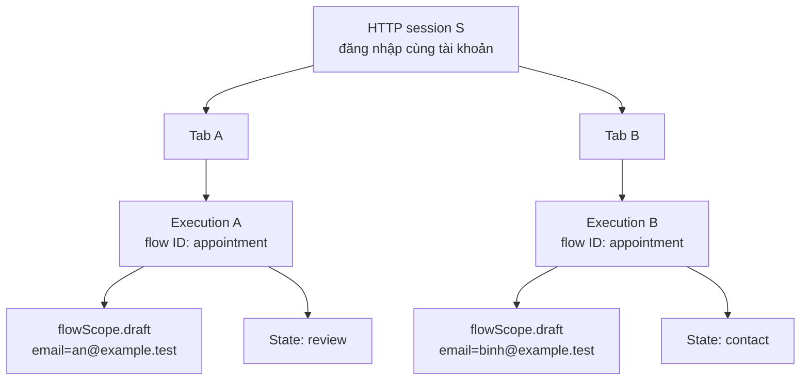
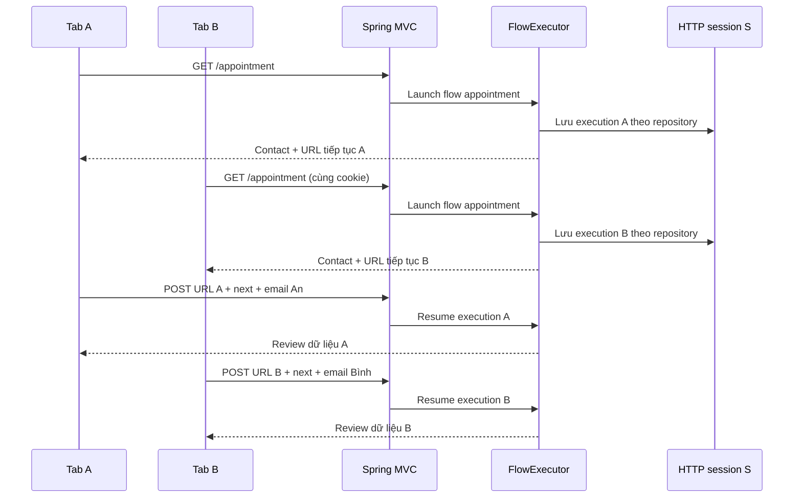
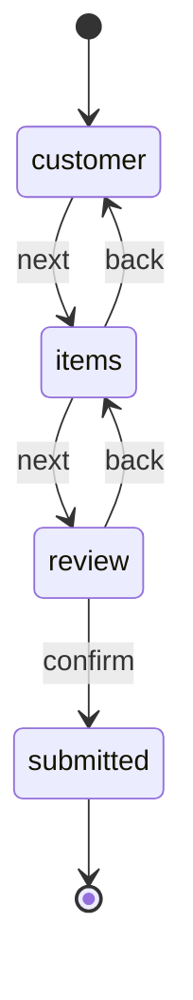

# Mở nhiều flow độc lập trong cùng HTTP session

Một người dùng có thể mở hai tab trình duyệt, cùng truy cập biểu mẫu đăng ký nhiều bước và nhập **hai bộ dữ liệu khác nhau**. Cả hai tab thường dùng chung cookie đăng nhập và cùng một **HTTP session**. Tuy nhiên, chúng không nhất thiết phải dùng chung **lần thực thi flow**. Nếu ứng dụng trộn lẫn hai khái niệm này, dữ liệu ở tab thứ nhất có thể xuất hiện trong tab thứ hai, hoặc thao tác xác nhận một biểu mẫu có thể gửi nhầm bản nháp.

Bài học thuộc chương **Lịch sử trình duyệt** của module **SPRING_WEB_FLOW**. Spring Web Flow mô hình hóa hành trình nhiều bước bằng **state, event, transition và subflow**, quản lý dữ liệu qua các scope, tích hợp Spring MVC để **form binding, validation** và hỗ trợ xử lý khi session hoặc execution không còn hợp lệ. Ở đây ta sẽ tập trung vào thiết kế và kiểm thử **nhiều flow execution độc lập trong cùng HTTP session**, cùng những hệ quả khi người dùng mở tab mới, nhân bản tab, dùng Back/Refresh hoặc gửi yêu cầu gần như đồng thời.

## 1. Tình huống: hai tab đặt lịch trong một phiên đăng nhập

Giả sử một nhân viên đang tạo hai yêu cầu đặt lịch:

- **Tab A:** đặt lịch cho khách hàng An, email `an@example.test`.
- **Tab B:** đặt lịch cho khách hàng Bình, email `binh@example.test`.

Cả hai tab đều truy cập flow `appointment`, cùng đăng nhập bằng một tài khoản, và có thể đang ở những bước khác nhau. Ta muốn:

1. Tab A và B có **flow execution riêng**.
2. Sửa `draft.email` ở tab A **không làm thay đổi** `draft.email` ở tab B.
3. Mỗi tab tiếp tục chính execution tương ứng khi nhấn `next`, `back` hoặc `confirm`.
4. Hệ thống không lưu trùng khi người dùng xác nhận nhiều lần.
5. Nếu một execution hết hạn, ứng dụng có cách giải thích lỗi và phục hồi có kiểm soát.



**Điểm cần nhớ:** cùng HTTP session **không đồng nghĩa** cùng flow execution. Việc hai tab có dữ liệu tách biệt hay không phụ thuộc vào cách bắt đầu flow, URL tiếp tục execution, cấu hình repository và nơi ứng dụng lưu bản nháp.

## 2. Phân biệt các lớp định danh và trạng thái

| Khái niệm | Ví dụ | Tác dụng | Có thể giống nhau giữa hai tab? |
|---|---|---|---|
| HTTP session | Cookie phiên `JSESSIONID` | Gắn các HTTP request vào phiên web của người dùng | **Có**, với hai tab cùng trình duyệt/profile |
| Flow definition ID | `appointment` | Chọn bản thiết kế flow đã đăng ký | **Có** |
| Flow execution | Lần chạy A, lần chạy B | Duy trì trạng thái và dữ liệu của hành trình | **Không**, nếu thật sự mở hai execution mới |
| Execution key | Key riêng do SWF cấp | Định vị một execution/snapshot để resume | Phải dùng đúng key của từng request |
| State ID | `contact`, `review` | Màn hình/trạng thái hiện tại trong flow | **Có thể** giống hoặc khác |
| Event ID | `next`, `back` | Yêu cầu transition | **Có thể** giống |
| Conversation | Ngữ cảnh của một hành trình cấp cao nhất | Phạm vi chia sẻ với subflow thuộc cùng hành trình | Tách biệt giữa các hành trình độc lập theo mô hình SWF thông thường |

Ví dụ hai URL tiếp tục được phát hành cho cùng flow:

```text
/appointment?execution=<key-A>
/appointment?execution=<key-B>
```

Đây chỉ là cách **minh họa**; key thực tế là dữ liệu opaque, định dạng và cách đặt tham số phụ thuộc `FlowUrlHandler`/execution repository. Không hardcode các giá trị như `e1s1` và không lấy key ở tab A để POST cho tab B.

Một hệ thống có thể cấp **khóa snapshot mới** sau transition hoặc quản lý lịch sử execution khác nhau tùy repository. Bởi vậy, test cũng như JavaScript không nên suy luận key bằng cách tăng số hoặc sửa ký tự. **Mỗi tab phải lấy URL tiếp tục từ phản hồi mới nhất phù hợp của chính tab đó.**

### Flow execution khác với một bước trong flow

Tab A chuyển từ `contact` sang `review` vẫn có thể đang ở **cùng execution A**. Không có lý do để tạo execution mới cho từng state. Ngược lại, người dùng bấm “Tạo lịch mới” và mở một **flow entry URL không mang execution key cũ** thì ứng dụng có thể tạo execution B mới, theo quy tắc launch của cấu hình.

## 3. Scope quyết định dữ liệu nào được chia sẻ

Cần phân biệt **phạm vi lưu dữ liệu** với tên biến và loại Java object. Spring Web Flow cung cấp những scope quen thuộc sau:

| Scope | Vòng đời điển hình | Có dùng chung giữa execution A và B độc lập? | Dùng cho |
|---|---|---|---|
| `requestScope` | Một request xử lý flow | Không | Giá trị tạm thời cho request hiện tại |
| `flashScope` | Phản hồi qua một khoảng điều hướng ngắn theo cơ chế SWF | Không mặc định | Thông báo/kết quả ngắn hạn |
| `viewScope` | Một view-state trong một execution | Không | Dữ liệu phục vụ một màn hình |
| `flowScope` | Một lần chạy của flow tương ứng | **Không**, nếu hai execution riêng | Draft, lựa chọn qua nhiều bước |
| `conversationScope` | Conversation cấp cao nhất và các subflow liên quan | **Không**, giữa hai top-level conversation độc lập | Thông tin dùng chung trong cây flow/subflow |
| `sessionScope` | HTTP session | **Có** | Thông tin chung của phiên, không phải draft riêng từng tab |

Sơ đồ:

```text
HTTP session S
├── sessionScope: userPreferences, localeHint, ...
├── Top-level conversation A
│   ├── flowScope của appointment A
│   │   └── draft A
│   └── subflow (nếu có)
│       └── flowScope riêng của subflow
└── Top-level conversation B
    ├── flowScope của appointment B
    │   └── draft B
    └── subflow (nếu có)
        └── flowScope riêng của subflow
```

Trong cấu hình SWF thông thường, `conversationScope` của một hành trình cấp cao nhất có thể được nhìn thấy bởi **subflow thuộc chính conversation ấy**. Nó không phải một kho dữ liệu toàn cục cho mọi flow của cùng HTTP session. Ngược lại, `sessionScope` có thể được nhìn thấy từ nhiều execution trong cùng HTTP session; ghi đè một khóa chung tại đây dễ gây lỗi đa tab.

### Phép thử nhanh để chọn scope

Hãy hỏi: **“Giá trị này có phải riêng cho một bản nháp đặt lịch không?”**

- Nếu **có**, chọn `flowScope` hoặc vùng dữ liệu cấp conversation phù hợp với cây flow/subflow đang chạy.
- Nếu là giá trị dùng chung như tùy chọn giao diện của người dùng trong phiên, `sessionScope` có thể hợp lý.
- Nếu giá trị phải tồn tại sau timeout hoặc dùng trên nhiều thiết bị, cần cơ chế lưu trữ bền vững có phân quyền; không coi `sessionScope` là database.
- Nếu là trạng thái riêng cho một view, cân nhắc `viewScope`, không đưa cả bản nháp nghiệp vụ vào đó rồi mong nó sống qua mọi bước.

**Không nên dùng `sessionScope.draft` cho mỗi tab** chỉ vì người dùng đã đăng nhập trong cùng session.

## 4. Một flow XML tạo draft riêng khi launch

Giả sử ứng dụng đăng ký một flow với ID `appointment`. Định nghĩa đơn giản:

```xml
<?xml version="1.0" encoding="UTF-8"?>
<flow xmlns="http://www.springframework.org/schema/webflow"
      xmlns:xsi="http://www.w3.org/2001/XMLSchema-instance"
      xsi:schemaLocation="
          http://www.springframework.org/schema/webflow
          http://www.springframework.org/schema/webflow/spring-webflow.xsd">

    <var name="draft"
         class="com.example.appointment.AppointmentDraft"/>

    <view-state id="contact"
                view="appointment/contact"
                model="draft">
        <binder>
            <binding property="customerName" required="true"/>
            <binding property="email" required="true"/>
        </binder>
        <transition on="next" to="review"/>
        <transition on="cancel" to="cancelled"
                    bind="false" validate="false"/>
    </view-state>

    <view-state id="review"
                view="appointment/review"
                model="draft">
        <transition on="back" to="contact"
                    bind="false" validate="false"/>
        <transition on="confirm" to="persist"
                    bind="false" validate="false"/>
    </view-state>

    <action-state id="persist">
        <evaluate expression="appointmentService.save(draft)"
                  result="flowScope.appointmentId"/>
        <transition on="success" to="completed"/>
    </action-state>

    <end-state id="completed"
               view="appointment/completed"/>
    <end-state id="cancelled"
               view="appointment/cancelled"/>
</flow>
```

`<var name="draft" .../>` khai báo một biến của flow; khi **một execution mới** bắt đầu, model được khởi tạo trong phạm vi flow tương ứng. Bắt đầu execution B không có nghĩa “tiếp tục” biến draft của A. Chuyển từ `contact` sang `review` trong A cũng không có nghĩa phải tạo draft mới mỗi lần render.

Model JavaBean:

```java
package com.example.appointment;

import java.io.Serializable;

public class AppointmentDraft implements Serializable {
    private static final long serialVersionUID = 1L;

    private String customerName;
    private String email;

    public String getCustomerName() { return customerName; }
    public void setCustomerName(String customerName) {
        this.customerName = customerName;
    }

    public String getEmail() { return email; }
    public void setEmail(String email) {
        this.email = email;
    }
}
```

`Serializable` giúp tương thích các cấu hình lưu snapshot/session dựa trên serialization, nhưng bản thân nó không thay thế thiết kế vòng đời dữ liệu. Nếu draft chứa resource không serializable, object lớn hoặc entity có quan hệ sâu, execution repository có thể khó lưu/khôi phục; nên giữ draft như DTO nhỏ, dữ liệu nghiệp vụ nhạy cảm được lấy lại và kiểm tra ở service khi cần.

### Điều kiện để ví dụ hoạt động đúng

XML chỉ minh họa cách tạo draft và điều hướng. Dự án thực còn cần:

- Flow registry, executor, handler mapping/adapter của Spring MVC.
- View template cho `contact`, `review` và các trang kết thúc.
- Bean `appointmentService` với phương thức `save` phù hợp.
- Validation theo view-state để ngăn dữ liệu không hợp lệ đi tiếp.
- Xử lý exception/kết quả nghiệp vụ khi lưu thất bại; một exception **không mặc nhiên** trở thành event `failure`.

Chính hành vi **launch mới** tại entry URL, không phải chỉ sự tồn tại của `<var>`, quyết định hai tab có hai execution riêng hay không.

## 5. Cách mở một execution mới và cách tiếp tục execution cũ

Hai hành động phải dùng hai URL có ý nghĩa khác nhau.

### 5.1. Mở luồng mới từ entry URL

Trong ví dụ ứng dụng công bố điểm vào:

```http
GET /appointment
```

Nếu URL handler của ứng dụng diễn giải `/appointment` là flow ID `appointment` và request **không mang execution key để resume**, nó thường khởi động một execution mới. Mở cùng entry URL ở tab B, giữ nguyên HTTP session, sẽ giúp tạo một hành trình mới, với điều kiện cấu hình repository cho phép và không có custom controller tự chuyển vào execution cũ.

Một liên kết JSP khởi tạo hành trình mới có thể là:

```jsp
<a href="${pageContext.request.contextPath}/appointment"
   target="_blank"
   rel="noopener">
    Mở một lịch hẹn mới
</a>
```

Ví dụ này giả định `DispatcherServlet` được map để `/appointment` là entry URL thực tế; khi ứng dụng dùng servlet prefix hoặc custom `FlowUrlHandler`, cần tạo URL theo cấu hình đó. `target="_blank"` chỉ là lựa chọn giao diện; **nó không tạo ra execution riêng nếu href đã chứa key của execution cũ**.

### 5.2. Tiếp tục execution hiện tại bằng URL do SWF cấp

Form của tab A phải gửi lại đúng URL tiếp tục A:

```jsp
<%@ taglib prefix="form" uri="http://www.springframework.org/tags/form" %>

<form:form method="post"
           action="${flowExecutionUrl}"
           modelAttribute="draft">

    <label for="customerName">Tên khách hàng</label>
    <form:input id="customerName" path="customerName"/>
    <form:errors path="customerName" cssClass="field-error"/>

    <label for="email">Email</label>
    <form:input id="email" path="email"/>
    <form:errors path="email" cssClass="field-error"/>

    <button type="submit" name="_eventId_next">
        Tiếp tục
    </button>
</form:form>
```

Tương tự, tab B dùng `flowExecutionUrl` được render **cho B**. Cơ chế URL và event parameter tùy cấu hình SWF/Spring MVC; ví dụ sử dụng quy ước `_eventId_next`. Nếu Spring Security bật CSRF, form cần token theo cách framework thực tế cung cấp.



**Không dùng URL tiếp tục của tab A làm href “Mở flow mới”.** Khi nhân bản tab hoặc copy địa chỉ đang chứa execution key, cả hai tab có thể cùng tham chiếu **một execution hoặc các snapshot của cùng hành trình**, dù nhìn như hai tab riêng.

## 6. Mở tab mới khác với nhân bản tab

Đây là khác biệt quan trọng đối với browser history.

| Hành động | Thông tin URL được dùng | Hành vi có thể xảy ra |
|---|---|---|
| Mở entry URL `/appointment` lần thứ hai | Không có key đang resume | Khởi động execution mới nếu cấu hình cho phép |
| Nhân bản tab chứa `?execution=...` | Mang theo key đang có | Hai tab có thể trỏ tới cùng execution/snapshot |
| Mở link “Tiếp tục bản nháp” | Có thể chứa key hoặc ID bản nháp | Phải xác định rõ semantics resume |
| Bấm Back trong một tab | Có thể quay tới URL/snapshot trước | Phụ thuộc repository và chiến lược lịch sử |
| Refresh trang review | Có thể lặp render hoặc redirect | Không được mặc định gọi lại nghiệp vụ an toàn |

**Tab không phải ranh giới lưu trữ phía server.** SWF không có lý do mặc định để biết một request đến từ “tab A” hay “tab B”; nó nhận diện execution dựa vào URL/key, repository, session và các dữ liệu ngữ cảnh tương ứng.

Một triển khai muốn bảo đảm mỗi tab là một hành trình độc lập cần **tạo execution mới từ entry URL** và giữ đúng key của từng lần chạy. Nếu sản phẩm có nút “Nhân bản phiếu” thì đó là **nghiệp vụ tạo bản nháp mới**: nên sao chép các trường được phép vào một draft/execution mới theo cơ chế rõ ràng, không nhân bản bừa execution key.

## 7. Mẫu sai phổ biến: một bản nháp chung trong sessionScope

Giả sử flow A và B đều đặt bản nháp vào cùng khóa của HTTP session:

```xml
<!-- Ví dụ PHẢN MẪU: hai execution cùng ghi một khóa -->
<on-start>
    <set name="sessionScope.appointmentDraft"
         value="flowScope.draft"/>
</on-start>
```

Nếu cùng session, khi B bắt đầu nó có thể **ghi đè tham chiếu** `appointmentDraft` đang trỏ tới A bằng draft của B. Hệ quả càng khó phát hiện nếu action sau đó lại đọc:

```text
sessionScope.appointmentDraft.email
```

thay vì đối tượng `draft` nằm trong execution hiện tại.

Cách đúng thường là:

```xml
<var name="draft" class="com.example.appointment.AppointmentDraft"/>
```

Và service/action chỉ nhận model thuộc execution đang chạy:

```xml
<evaluate expression="appointmentService.save(draft)"
          result="flowScope.appointmentId"/>
```

Nếu thực sự cần lưu bản nháp **bền vững**, service có thể lưu draft bằng **draft ID duy nhất** kèm thông tin chủ sở hữu và quyền truy cập. Mỗi execution giữ draft ID của chính mình; session chỉ dùng cho ngữ cảnh đăng nhập hoặc những tùy chọn chung.

### Singleton service cũng không phải nơi giữ draft

Một lỗi tương tự xảy ra khi bean singleton chứa field mutable:

```java
// Phản mẫu: không đặt draft của người dùng trong singleton service.
@Service
public class AppointmentService {
    private AppointmentDraft currentDraft;
}
```

Bean singleton có thể được gọi từ nhiều request, nhiều tab và nhiều người dùng khác nhau. Dữ liệu như `currentDraft` dễ bị ghi đè, tạo rủi ro sai nghiệp vụ và lộ thông tin. Service nên nhận draft/ID qua tham số và chỉ lưu trữ dữ liệu theo một cơ chế có key, owner, transaction và kiểm tra quyền rõ ràng.

## 8. Những loại dữ liệu nên và không nên chia sẻ giữa hai execution

Không phải mọi dữ liệu trong session đều cần tách. Ví dụ:

**Có thể chia sẻ**, tùy thiết kế bảo mật:

- Danh tính/phiên đăng nhập do Spring Security quản lý.
- Một số tùy chọn giao diện dùng chung cho người dùng.
- Locale hiện tại nếu chính sách ứng dụng đặt nó ở cấp session.
- Những cờ hỗ trợ vận hành không chứa bản nháp riêng từng tab.

**Không nên đặt dưới một khóa session chung:**

- `currentAppointmentDraft` nếu người dùng có thể mở nhiều phiếu.
- `selectedCustomerId` nếu mỗi flow chọn một khách hàng khác nhau.
- `currentReviewStep` hoặc `lastValidationErrors` của một flow cụ thể.
- `currentSubflowResult` nếu nhiều flow cha cùng gọi subflow.
- Giá trị idempotency của một lần lưu nếu nhiều execution sẽ xác nhận độc lập.

Nếu dùng cache hoặc một bảng lưu nháp bên ngoài SWF, có thể khóa theo một định danh riêng cho mỗi bản nháp/execution và người sở hữu. Tuy nhiên, **không lấy execution key làm thông tin xác thực** hay bí mật duy nhất bảo vệ dữ liệu. Service vẫn cần xác minh quyền của người dùng hiện tại.

## 9. Back, Forward và Refresh khi có nhiều flow đang hoạt động

Lịch sử trình duyệt là lịch sử **URL và document của từng tab**, còn SWF là một bộ máy **trạng thái phía server**. Hai lịch sử này cần được kết hợp có chủ đích.

### 9.1. Back trong tab A không phải event back của tab B

Flow A có thể có transition:

```xml
<transition on="back" to="contact"
            bind="false" validate="false"/>
```

Event `back` của form A chạy trong execution A. Flow B không bị ảnh hưởng nếu B đang dùng execution riêng.

Còn nút **Back của trình duyệt** có thể quay về URL trước đó hoặc một snapshot execution trước đó; kết quả tùy repository và chiến lược redirect/history. Không thể cho rằng nút Back của trình duyệt luôn tương đương event `back` trong XML. Cần kiểm thử cả hai.

### 9.2. Snapshot history không phải dữ liệu bất biến

Ở một số cấu hình SWF, việc tiếp tục execution với key của snapshot cũ có thể khôi phục trạng thái trước đó; ở cấu hình khác, key cũ có thể không còn hợp lệ. Repository, giới hạn snapshot, session và chế độ redirect ảnh hưởng đến kết quả.

Không được khẳng định:

- “Nhấn Back luôn hoạt động.”
- “Dùng execution key cũ luôn bị từ chối.”
- “Flow B không thể bị ảnh hưởng bởi Back của A” **nếu hai tab thật ra đang chia sẻ cùng execution key**.

Trước hết cần chứng minh A và B được launch độc lập; sau đó test đúng chính sách lịch sử của ứng dụng.

### 9.3. Refresh sau Confirm và post/redirect/get

Nếu trang xác nhận nhận một POST có tác dụng lưu dữ liệu, người dùng Refresh có thể gây gửi lại request tùy cách điều hướng. SWF có các cơ chế redirect/render để giảm rủi ro, nhưng **không nên dùng redirect như biện pháp chống lưu trùng duy nhất**.

Cần xử lý:

1. Định danh một yêu cầu ghi nghiệp vụ bằng idempotency key hoặc ràng buộc duy nhất thích hợp.
2. Service kiểm tra trạng thái và giao dịch trước khi tạo bản ghi.
3. Trang kết quả không yêu cầu POST lại để xem thông tin.
4. Khi request bị lặp hoặc snapshot đã cũ, hệ thống trả kết quả có kiểm soát.

**Hai execution độc lập** vẫn có thể cùng nhắm tới một tài nguyên nghiệp vụ, ví dụ đặt cùng khung giờ. Tách draft bằng flowScope không thay thế khóa giao dịch và kiểm tra xung đột tại database.

## 10. Subflow và conversationScope trong trường hợp đa tab

Một top-level flow có thể gọi subflow xác thực địa chỉ:

```xml
<subflow-state id="verifyAddress"
               subflow="address-verification">
    <input name="address"
           value="draft.address"/>
    <transition on="verified" to="review">
        <set name="draft.address"
             value="currentEvent.attributes.verifiedAddress"/>
    </transition>
</subflow-state>
```

Ở đây flow cha **truyền input** qua thẻ `<input>` và **nhận kết quả** từ event `verified` qua `currentEvent.attributes.verifiedAddress`. Flow con phải khai báo input tương ứng và phát kết quả từ end-state, chẳng hạn `<end-state id="verified"><output name="verifiedAddress" value="flowScope.verifiedAddress"/></end-state>`. Mẫu này giả định flow con thật sự cung cấp thuộc tính `verifiedAddress`; tên biến, cấu trúc model và schema phải tương thích với phiên bản SWF cùng hợp đồng input/output của dự án.

Để hiểu isolation, hãy xét:

```text
HTTP session S
├── Conversation A / appointment A
│   ├── flowScope của appointment A
│   ├── conversationScope A
│   └── subflow address-verification A
└── Conversation B / appointment B
    ├── flowScope của appointment B
    ├── conversationScope B
    └── subflow address-verification B
```

Subflow thuộc A có thể chia sẻ `conversationScope` của A theo thiết kế SWF, nhưng không vì vậy được chia sẻ `conversationScope` của B. Ngược lại, một bean singleton hoặc khóa `sessionScope.address` chung vẫn có thể tạo xung đột ngoài ý muốn.

**Điều quan trọng:** đừng dùng `sessionScope` làm đường vòng để chuyển dữ liệu giữa flow cha và flow con. Hãy định nghĩa contract input/output rõ ràng và kiểm thử trong cả hai execution độc lập.

## 11. Nhiều execution có thể tiêu tốn tài nguyên phiên

Tách execution không có nghĩa ứng dụng có thể lưu vô hạn bản nháp trong một HTTP session.

Tùy loại execution repository, flow conversation manager và cấu hình:

- Mỗi execution/snapshot có thể chiếm bộ nhớ phía server.
- Có thể có giới hạn số execution hoặc conversation còn tồn tại.
- Có thể có giới hạn số snapshot lịch sử được giữ.
- Session timeout hoặc eviction có thể làm execution key cũ không còn dùng được.
- Khi một flow kết thúc, tài nguyên tương ứng có thể được giải phóng theo lifecycle/repository.

**Không khẳng định con số tối đa mặc định** nếu chưa xem phiên bản SWF và cấu hình thực tế. Những thuộc tính điều khiển giới hạn và chiến lược lưu trữ có thể khác theo version hoặc implementation. Thay đổi giới hạn lên quá cao có thể tạo nguy cơ tăng dung lượng session; giảm quá thấp có thể khiến người dùng mở vài tab đã gặp lỗi hết hạn.

### Trường hợp nhiều node ứng dụng

Nếu backend triển khai trên nhiều instance, hai request của cùng HTTP session có thể đến các node khác nhau. Cần kiểm tra chiến lược sticky session hoặc chia sẻ/replicate session phù hợp với repository được dùng. Không phải cứ giữ cùng cookie là node B chắc chắn đọc được execution do node A lưu.

Nếu dùng distributed session, phải chú ý khả năng serialize draft, cách phân phối session, cập nhật đồng thời và khả năng tương thích sau deploy. Chỉ test một node local sẽ không chứng minh flow có thể resume ổn định khi cân bằng tải.

## 12. Request gần đồng thời từ cùng execution và từ hai execution

Có hai tình huống khác nhau:

1. **Hai execution độc lập:** A và B có bản nháp riêng; tuy nhiên có thể cạnh tranh cùng slot đặt lịch hoặc cùng bản ghi nghiệp vụ.
2. **Hai request vào một execution:** người dùng nhấn Next hai lần, mở bản sao của tab hoặc một script gửi trùng request; cả hai request có thể cùng tham chiếu một execution/snapshot.

Trong trường hợp thứ hai, repository/engine có thể áp dụng khóa/đồng bộ khi tiếp tục execution tùy implementation, nhưng ứng dụng vẫn phải xử lý request lặp, exception, stale execution key và side effect. Đừng tự xây cơ chế đồng bộ chỉ dựa trên việc “SWF chắc chắn khóa hộ tất cả”.

Đối với lưu nghiệp vụ:

```java
@Service
public class AppointmentService {

    public Long save(AppointmentDraft draft, String requestId) {
        // Kiểm tra danh tính/điều kiện nghiệp vụ, rồi xử lý
        // requestId theo cơ chế idempotency của hệ thống.
        // Cần transaction và ràng buộc phù hợp ở persistence.
        throw new UnsupportedOperationException(
            "Ví dụ hợp đồng service; cần hiện thực tại dự án."
        );
    }
}
```

Đoạn trên chỉ mô tả **hợp đồng**: mỗi yêu cầu ghi có thể có `requestId` do server quản lý để chống trùng. Không nên dùng mã giả này làm service chạy production. Flow XML ở phần 4 minh họa `save(draft)`; khi áp dụng idempotency, cần thay đổi chữ ký service và flow action **một cách nhất quán**.

Nếu hai execution A/B đặt cùng lịch giờ, database phải có ràng buộc/chốt tranh chấp phù hợp. Scope separation giải quyết “dữ liệu bản nháp không lẫn nhau”; nó không tự giải quyết “cùng tài nguyên có được đặt hai lần hay không”.

## 13. Kiểm thử hai flow độc lập cùng HTTP session

Một **flow execution test** có thể xác minh mỗi execution tạo draft riêng. Nhưng lỗi nghiêm trọng nhất thường xuất hiện ở tầng HTTP khi các tab vô tình dùng chung URL hoặc session attribute. Do đó cần thêm **HTTP integration test** với Spring MVC/SWF thực sự được cấu hình.

### 13.1. Kịch bản cần chứng minh

| Bước | Thao tác | Kỳ vọng |
|---|---|---|
| 1 | Tạo HTTP session S; GET entry URL flow | Sinh execution A |
| 2 | GET cùng entry URL, dùng **chính S** | Sinh execution B mới, độc lập |
| 3 | Gửi `next` của A với email An | Review A hiển thị An |
| 4 | Gửi `next` của B với email Bình | Review B hiển thị Bình |
| 5 | Quay lại A, sửa tên | Chỉ draft A thay đổi |
| 6 | Kiểm tra B | Draft B vẫn giữ Bình |
| 7 | Confirm A rồi tiếp tục B | B không bị tự động kết thúc do A |
| 8 | Refresh/Back từng tab | Hành vi phù hợp chính sách snapshot/history |

Đặc biệt, ở bước 2 phải dùng **cùng session S**. Hai request dùng hai `MockHttpSession` khác nhau không chứng minh được khả năng chạy song song trong cùng session.

### 13.2. Pseudocode kiểm thử HTTP

Có thể dùng `MockMvc` với `@SpringBootTest` và `@AutoConfigureMockMvc` khi dự án nạp đủ bean SWF, MVC, view và security. Với ứng dụng Spring MVC truyền thống, có thể dùng web application context tương đương. Phần dưới là **pseudocode thể hiện hợp đồng kiểm thử**, không phải lớp Java có thể chạy ngay mà không tạo các helper:

```java
@Test
void twoFreshLaunchesInSameSessionKeepDraftsSeparate() {
    MockHttpSession sharedSession = new MockHttpSession();

    // launchFreshFlow thực hiện GET entry URL KHÔNG có execution key.
    // Nó xử lý redirect nếu có và đọc URL tiếp tục từ view thật.
    FlowPage a0 = launchFreshFlow(
        "/appointment", sharedSession
    );
    FlowPage b0 = launchFreshFlow(
        "/appointment", sharedSession
    );

    // Đây là hai execution riêng, không chỉ hai cửa sổ.
    assertThat(a0.executionKey())
        .isNotEqualTo(b0.executionKey());

    FlowPage a1 = submit(
        a0.actionUrl(),
        sharedSession,
        "_eventId_next",
        Map.of(
            "customerName", "An",
            "email", "an@example.test"
        )
    );

    FlowPage b1 = submit(
        b0.actionUrl(),
        sharedSession,
        "_eventId_next",
        Map.of(
            "customerName", "Binh",
            "email", "binh@example.test"
        )
    );

    assertThat(a1.body()).contains("an@example.test");
    assertThat(a1.body()).doesNotContain("binh@example.test");

    assertThat(b1.body()).contains("binh@example.test");
    assertThat(b1.body()).doesNotContain("an@example.test");
}
```

`FlowPage`, `launchFreshFlow` và `submit` là **test helpers do dự án xây dựng**, cần xử lý GET/POST, redirect, parse form action, session, CSRF token và cách xác định execution key theo renderer thật. Một số cấu hình dùng execution key trong query string, một số cấu hình URL khác; assert nên dựa vào contract của `FlowUrlHandler` đang dùng.

Nếu dùng JSP, cần nhớ `MockMvc` có thể chỉ mô phỏng forward đến JSP mà **không render JSP thành HTML**. Khi muốn trích form action và kiểm tra HTML cuối, cần môi trường servlet tích hợp phù hợp hoặc một renderer có thể render trực tiếp trong test.

### 13.3. Các test bổ sung nên có

- **Cùng flow, hai session khác nhau:** dữ liệu được cô lập và không lộ cho tài khoản khác.
- **Cùng session, hai flow ID khác nhau:** ví dụ `appointment` và `registration`, không ghi đè draft.
- **Cùng session, hai execution của cùng ID:** kịch bản chính của bài.
- **Nhân bản tab dùng cùng key:** xác minh hệ thống xử lý theo chính sách snapshot/stale execution, không giả vờ đây là hai flow mới.
- **A kết thúc, B còn mở:** trạng thái B tiếp tục nếu repository/session vẫn hỗ trợ.
- **A bị timeout hoặc bị eviction:** phản hồi có kiểm soát, không âm thầm chuyển request sang B.
- **Một tab logout:** session dùng chung có thể mất authentication hoặc bị invalidate; mọi tab phải xử lý đúng.
- **Hai POST gần đồng thời:** không tạo trùng dữ liệu, xử lý xung đột nghiệp vụ.
- **Proxy/multi-node:** nếu deployment thực tế cần, kiểm tra khôi phục execution qua node khác.

## 14. Những lỗi dễ gặp khi thử nghiệm thực tế

### 14.1. Tab B luôn hiện dữ liệu của A

**Khả năng:** B được mở bằng cách copy URL có `execution=<key-A>`, hoặc action/view đọc `sessionScope.draft` chung, hoặc một singleton giữ draft.

**Kiểm tra:** so sánh execution key, cách mở entry URL, scope chứa draft và lời gọi service. Nếu B có cùng key với A, đó chưa phải hai execution độc lập.

### 14.2. Nhấn Next ở B lại thay đổi A

**Khả năng:** form B đang dùng action URL của A; code front-end dùng một biến global chứa URL tiếp tục; một template/cache đã tái sử dụng URL sai.

**Kiểm tra:** trong Network tab, xem **request URL thực tế của B** và form action render trong B. Không dùng chung một biến execution URL trên toàn bộ session.

### 14.3. Hai tab có key khác nhưng vẫn lẫn dữ liệu

**Khả năng:** vấn đề không còn nằm ở URL mà là dữ liệu chung: `sessionScope`, singleton mutable field, cache không khóa theo draft ID hoặc bản ghi database được truy xuất bằng một khóa chung.

**Kiểm tra:** tìm tất cả nơi đọc/ghi draft ngoài `flowScope`, rồi xem chúng định danh dữ liệu theo gì. Đừng kết luận “SWF bị lỗi isolation” chỉ vì key khác nhau.

### 14.4. Tab mới mở được nhưng tab cũ bị hết hạn

**Khả năng:** repository giới hạn số execution/snapshot, session timeout hoặc chính sách dọn dẹp; cũng có thể request cũ mang stale execution key.

**Kiểm tra:** cấu hình giới hạn thực tế, lifecycle các execution, session và log có kiểm soát. Đừng tăng vô hạn số execution chỉ để che vấn đề.

### 14.5. Chỉ lỗi trên production, không lỗi local

**Khả năng:** load balancing, phân phối session, sticky session, serialization, proxy rewrite hoặc nhiều phiên bản ứng dụng đang chạy đồng thời.

**Kiểm tra:** session routing, health của backend, cơ chế lưu execution, URL và query string. Không đăng đầy đủ cookie hay key của người dùng vào log công khai.

### 14.6. A đã Confirm nhưng B cũng lưu lại dữ liệu của A

**Khả năng:** tầng service dùng một `currentDraft` chung, API xác nhận thiếu draft ID hoặc request bị dùng lại cùng khóa ghi.

**Kiểm tra:** input thực tới service, idempotency key, owner và transaction. Phải sửa định danh nghiệp vụ và kiểm tra quyền, không chỉ thay nút giao diện.

## 15. Thực hành: xây dựng hai biểu mẫu đặt hàng trong cùng session

Hãy xây dựng flow `order-wizard` gồm ba bước:



Mỗi execution chứa:

```java
public class OrderDraft implements java.io.Serializable {
    private String customerEmail;
    private Integer quantity;
    private String productCode;
    // Getter/setter và serialVersionUID...
}
```

**Yêu cầu thực hành:**

1. Tạo `<var name="draft" .../>` ở cấp flow, không đặt toàn bộ draft vào một khóa `sessionScope` dùng chung.
2. Tạo link “Đơn hàng mới” dẫn tới **entry URL không mang execution key cũ**.
3. Mở **hai flow execution** từ cùng một session; ở A nhập `customerEmail=a@example.test`, ở B nhập `customerEmail=b@example.test`.
4. Nhấn Next/Back xen kẽ ở hai tab; bảo đảm draft không bị ghi đè.
5. Cố ý mở bản sao tab A bằng cùng URL có key, so sánh với cách mở flow mới.
6. Thử thay URL action của B bằng key của A trong môi trường test; ghi nhận vì sao đây là rủi ro và xác minh cơ chế security/validation của ứng dụng.
7. Thêm một subflow xác nhận địa chỉ; kiểm tra dữ liệu chỉ thuộc conversation tương ứng.
8. Confirm từng flow và kiểm tra service ghi đúng bản nháp, không lưu trùng.
9. Dùng session timeout/giới hạn repository của môi trường test để quan sát cách xử lý execution không còn hợp lệ.
10. Viết HTTP integration test theo kịch bản A/B; không chỉ dựa vào test riêng hai phiên độc lập.

**Câu hỏi tự kiểm tra:**

**1. Hai tab cùng cookie session có bắt buộc cùng flow execution không?** Không. Cùng HTTP session có thể chứa nhiều flow execution độc lập.

**2. Hai tab dùng cùng `flow ID` có được xem là một execution không?** Không. Flow ID là định nghĩa; execution được nhận diện bằng key/ngữ cảnh lưu thực tế.

**3. Nếu tab B được tạo bằng cách copy URL `?execution=<key-A>`, nó có tự tạo execution mới không?** Không thể giả định như vậy. URL này thường yêu cầu resume execution/snapshot được tham chiếu.

**4. Nên đặt bản nháp riêng từng tab ở `sessionScope` hay `flowScope`?** Thường là `flowScope` của execution tương ứng.

**5. `conversationScope` có được chia sẻ giữa mọi flow cùng HTTP session không?** Không. Nó thuộc phạm vi conversation của một hành trình cấp cao nhất và các subflow liên quan, không phải session toàn cục.

**6. Vì sao một test dùng hai `MockHttpSession` khác nhau không đủ cho bài này?** Vì nó không kiểm tra **hai execution cùng chia sẻ một HTTP session**, nơi lỗi dùng chung session attribute dễ xảy ra.

**7. Vì sao phân tách flowScope không đủ để chống đặt trùng một slot?** Vì đây là cạnh tranh trên tài nguyên nghiệp vụ; service và database cần kiểm tra giao dịch/xung đột.

## 16. Checklist trước khi triển khai hỗ trợ đa tab

- [ ] Link “Mở mới” dùng URL launch flow, không dùng execution URL cũ.
- [ ] Mỗi tab mới thật sự có execution riêng nếu sản phẩm yêu cầu tính độc lập.
- [ ] Mỗi form dùng URL tiếp tục được render cho execution của chính nó.
- [ ] `flowScope` hoặc conversation của đúng execution chứa draft riêng.
- [ ] Không có `sessionScope.currentDraft` bị chia sẻ ngoài chủ đích.
- [ ] Không có singleton mutable field lưu trạng thái riêng một form/người dùng.
- [ ] Subflow trao đổi dữ liệu bằng input/output contract rõ ràng.
- [ ] Back/Forward/Refresh được kiểm tra với chính sách snapshot/history.
- [ ] Session timeout, giới hạn execution và xử lý key cũ có thông báo rõ ràng.
- [ ] Bộ nhớ session và cơ chế phân phối nhiều node được xem xét nếu có.
- [ ] Service kiểm tra quyền, tính toàn vẹn nghiệp vụ, transaction và idempotency.
- [ ] Có HTTP test dùng **cùng session, hai execution, dữ liệu khác nhau**.
- [ ] Có test cho nhân bản tab dùng cùng execution key và các request gần đồng thời.
- [ ] Không lộ execution key, cookie hoặc dữ liệu nhạy cảm trong log công khai.

**Ghi nhớ:** HTTP session là bối cảnh dùng chung của trình duyệt, còn **mỗi lần khởi động flow là một hành trình có trạng thái riêng**. Muốn hai tab độc lập, cần **launch hai execution thực sự**, giữ draft trong scope thích hợp và dùng **execution URL đúng của từng tab**. Browser Back, snapshot history, session timeout và request lặp vẫn cần kiểm thử riêng; tách flow execution chỉ giải quyết bài toán cô lập hành trình, không thay thế bảo mật hay nhất quán giao dịch.

